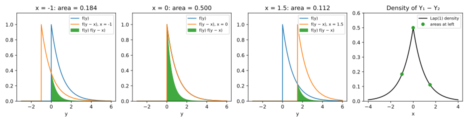
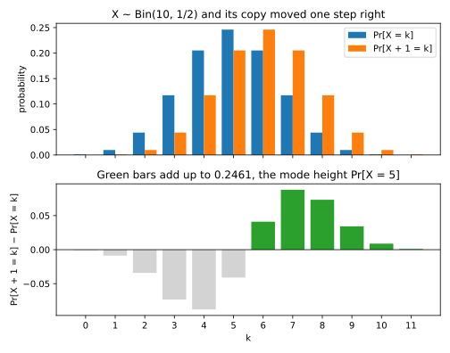
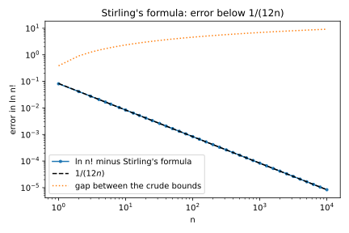
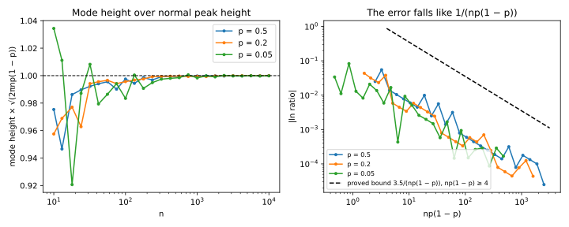
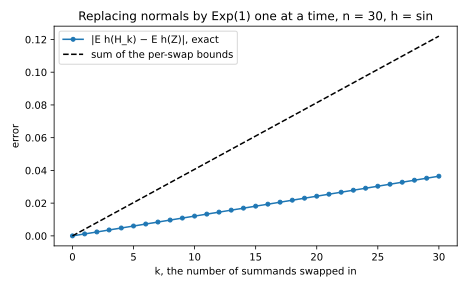
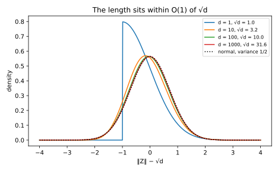

# Sums, limits and counting

This appendix proves five facts about sums of random variables and about counting that the chapters use without a full proof. The first finds the distribution of a sum of two independent variables by adding up the ways the sum can arise. That replaces a theorem the book takes as given, namely that the moment generating function of a distribution pins it down. The second counts: it finds the most likely value of a binomial count, how tall that peak is, and how large $n!$ is. The third proves the central limit theorem (CLT) by swapping one term at a time for a normal one. The fourth shows that the length of a normal vector in $d$ dimensions rarely exceeds $\sqrt d$ by much. The fifth finds the tail of the difference of two Laplace variables. They sit together because each is a statement about a sum or a count. They also share their tools. The proofs add up the ways a sum can happen, compare neighbouring terms through their ratio, and apply Markov's inequality to an exponential.

@tbl-apx-prob-map lists where each result is stated or used.

| Derivation | Where the chapters state or use it |
| --- | --- |
| @sec-apx-prob-convolution: sums by convolution, rotation invariance of the normal | @sec-dist-mgf and the sections on the Poisson, Laplace and normal in [Probability distributions](../part01-prerequisites/01-distributions.md); @sec-div-gauss; @sec-lg-analytic; @sec-lower-packing |
| @sec-apx-prob-stirling: Stirling's formula, the binomial mode and its height | @sec-threat-games; @sec-threat-average; @sec-prop-scaling; @sec-memo-exposure |
| @sec-apx-prob-clt: the central limit theorem | The normal section of [Probability distributions](../part01-prerequisites/01-distributions.md); @sec-gdp-clt and every normal approximation in the book |
| @sec-apx-prob-gauss-norm: the length of a normal vector | @sec-mean-multi |
| @sec-apx-prob-laplace-diff: the difference of two Laplace variables | @sec-pate-stable; @sec-lower-packing |

: The derivations of this appendix and the chapter sections that state or use them. {#tbl-apx-prob-map}

## A sum's distribution, found by convolution {#sec-apx-prob-convolution}

### What the chapter uses

[Probability distributions](../part01-prerequisites/01-distributions.md) identifies the distribution of a sum in four places. The sum of two independent Poisson counts is Poisson, and the difference of two independent exponential variables is Laplace. Any weighted sum of independent normal variables is normal, and the sum of $n$ independent $\mathrm{Exp}(1)$ variables has the $\mathrm{Gamma}(n, 1)$ density. Each time the chapter multiplies moment generating functions (MGFs), recognizes the product, and then relies on a theorem stated in @sec-dist-mgf: two distributions with the same MGF near 0 are the same. The chapter says that the proof of that theorem "needs more analysis than this book uses, so take it as given".

The same chapter states two facts about a normal vector $X \sim \mathcal N(0, \sigma^2 I_d)$, whose $d$ coordinates are independent $\mathcal N(0, \sigma^2)$ variables. Its projection onto any unit vector is $\mathcal N(0, \sigma^2)$. And the projections onto two perpendicular unit vectors are independent, because "for jointly normal variables zero covariance means independence", which the chapter does not prove. @sec-div-gauss and @sec-lg-analytic use a stronger form: rotating the space does not change the distribution of $X$. They use it to compare the noise $X$ with a shifted copy $X + v$: a rotation turns the shift $v$ to point along the first axis, which reduces the comparison to one dimension. Finally, @sec-lower-packing states that the difference of two independent $\mathrm{Lap}(1/\varepsilon)$ variables has density $\frac\varepsilon4(1 + \varepsilon|z|)e^{-\varepsilon|z|}$.

This section proves all of these without the uniqueness theorem. The tool is the **convolution**, which adds up the ways a sum can arise. Take independent variables $X$ and $Y$, and write $f$ and $g$ for their densities. The density of the sum $X + Y$ at a point $s$ is then
$$f_{X+Y}(s) = \int f(x)\,g(s - x)\,dx,$$ {#eq-apx-prob-conv}
and for counts the integral becomes a sum over $x$. In every line below the variables are independent. In the last one, each $X_i$ is normal with mean $\mu_i$ and variance $\sigma_i^2$, and the weights $a_i$ are constants. As in the chapter, $\mathrm{Exp}(b)$ and $\mathrm{Lap}(b)$ have scale $b$, and an equals sign between distributions means that the left side has the distribution on the right.
$$\begin{aligned}
&\mathrm{Poisson}(\mu_1) + \mathrm{Poisson}(\mu_2) = \mathrm{Poisson}(\mu_1 + \mu_2), \qquad \mathrm{Exp}(b) - \mathrm{Exp}(b) = \mathrm{Lap}(b),\\
&\mathrm{Exp}(1) + \dots + \mathrm{Exp}(1) \;(n \text{ terms}) = \mathrm{Gamma}(n, 1), \qquad \textstyle\sum_i a_iX_i \sim \mathcal N\big(\sum_i a_i\mu_i, \sum_i a_i^2\sigma_i^2\big).
\end{aligned}$$
For the normal vector, the claim is that rotating $X$ leaves its distribution unchanged, so the coordinates of $X$ along any two perpendicular unit vectors are independent $\mathcal N(0, \sigma^2)$ variables.

### The idea

To find the chance that a sum takes a value, list every way it can take that value and add up their chances. Roll two fair dice and ask for a total of 4. The first die shows 1, 2 or 3, and the second must then show 3, 2 or 1. Each pair has chance $\frac16 \cdot \frac16$, because the dice are independent, so the total is $3/36$. @tbl-apx-prob-dice writes this out.

| First die $x$ | 1 | 2 | 3 | 4, 5, 6 |
| --- | --- | --- | --- | --- |
| Second die must show $4 - x$ | 3 | 2 | 1 | impossible |
| Chance of this way | $1/36$ | $1/36$ | $1/36$ | 0 |

: The ways two dice can total 4. Adding the last row gives $\Pr[\text{total} = 4] = 3/36$. {#tbl-apx-prob-dice}

For a density the list of ways becomes an integral. The first variable takes a value $x$, the second must make up the rest, $s - x$, and independence multiplies the two densities. That is @eq-apx-prob-conv. Each identification in the chapter is one such integral, and each is short.

Rotation invariance has a different reason. The joint density of $X$ depends on the point $x$ only through its distance from the origin, so in two dimensions its contours are circles, and in $d$ dimensions they are spheres. A rotation moves every point along its sphere and keeps every volume, so it leaves the density where it was. So a rotation that carries two perpendicular directions onto the first two coordinate axes does not change the distribution. Along the axes the coordinates are independent by definition, so they are independent along the two directions too.

### Derivation

1. **Why @eq-apx-prob-conv holds.** Fix a small width $\kappa > 0$ and the interval of that width around $s$. The sum lands in it when $X$ is near some value $x$ and $Y$ lands within $\kappa$ of $s - x$. Given $X = x$, that has chance about $g(s - x)\kappa$, because $Y$ is independent of $X$ and so its density does not change. Averaging over $x$ with the density $f$ gives $\kappa\int f(x)g(s - x)\,dx$, and dividing by $\kappa$ gives the density. For counts the same step reads $\Pr[X + Y = k] = \sum_j\Pr[X = j]\Pr[Y = k - j]$, as in the dice.

2. **Poisson.** Take independent $N_1 \sim \mathrm{Poisson}(\mu_1)$ and $N_2 \sim \mathrm{Poisson}(\mu_2)$. The sum of step 1, with $\Pr[N = j] = e^{-\mu}\mu^j/j!$, is
$$\Pr[N_1 + N_2 = k] = \sum_{j=0}^k e^{-\mu_1}\frac{\mu_1^j}{j!}\,e^{-\mu_2}\frac{\mu_2^{k-j}}{(k-j)!} = \frac{e^{-(\mu_1+\mu_2)}}{k!}\sum_{j=0}^k\binom kj\mu_1^j\mu_2^{k-j}.$$
The second form multiplies and divides by $k!$, and $\binom kj = k!/(j!(k-j)!)$. The binomial theorem says that the last sum is $(\mu_1 + \mu_2)^k$. So $\Pr[N_1 + N_2 = k] = e^{-(\mu_1+\mu_2)}(\mu_1 + \mu_2)^k/k!$, which is the $\mathrm{Poisson}(\mu_1 + \mu_2)$ probability.

3. **Exponential minus exponential.** Let $Y_1, Y_2 \sim \mathrm{Exp}(b)$ be independent, each with density $f(y) = \frac1be^{-y/b}$ for $y \ge 0$ and 0 for $y < 0$. The difference $Y_1 - Y_2$ equals $x$ when $Y_1 = y$ and $Y_2 = y - x$, so the density of the difference at $x$ is $\int f(y)f(y - x)\,dy$. Here $y$ is the integration variable and $x$ is the value of the difference. This is @eq-apx-prob-conv for the sum $Y_1 + (-Y_2)$, whose second term has density $f(-z)$, so the copy of $f$ appears shifted but not flipped. The integrand is non-zero only where both $y \ge 0$ and $y - x \ge 0$, that is for $y \ge \max(0, x)$, and on that range
$$f(y)f(y - x) = \frac{1}{b^2}e^{-y/b}e^{-(y - x)/b} = \frac{1}{b^2}e^{x/b}e^{-2y/b}.$$
Integrating $e^{-2y/b}$ from a point $c$ to infinity gives $\frac b2e^{-2c/b}$, so with $c = \max(0, x)$ the density of the difference is $\frac{1}{2b}e^{x/b}e^{-2\max(0, x)/b}$. When $x \ge 0$ this is $\frac1{2b}e^{-x/b}$, and when $x < 0$ it is $\frac1{2b}e^{x/b}$. Together they make $\frac1{2b}e^{-|x|/b}$, which is the $\mathrm{Lap}(b)$ density.

4. **Sums of exponentials.** Write $f_n(x) = x^{n-1}e^{-x}/(n-1)!$ for $x \ge 0$, the $\mathrm{Gamma}(n, 1)$ density. For $n = 1$ it is $e^{-x}$, the $\mathrm{Exp}(1)$ density. Suppose the sum of $n$ independent $\mathrm{Exp}(1)$ variables has density $f_n$, and add one more. Use @eq-apx-prob-conv with the sum at $x$ and the integration variable $y$ for the first term. Both terms are non-negative, so $y$ can only lie between 0 and $x$:
$$\int_0^x\frac{y^{n-1}e^{-y}}{(n-1)!}\,e^{-(x - y)}\,dy = \frac{e^{-x}}{(n-1)!}\int_0^xy^{n-1}\,dy = \frac{e^{-x}}{(n-1)!}\cdot\frac{x^n}{n} = \frac{x^ne^{-x}}{n!}.$$
The exponentials combine to $e^{-x}$, which does not depend on $y$, so it leaves the integral. The result is $f_{n+1}$. By induction, the claim holds for every $n$.

5. **Sums of normals.** Start with two independent normals with mean 0, $X_1 \sim \mathcal N(0, \sigma_1^2)$ and $X_2 \sim \mathcal N(0, \sigma_2^2)$, and write $v = \sigma_1^2 + \sigma_2^2$. In @eq-apx-prob-conv the two exponents add to $-\frac{y^2}{2\sigma_1^2} - \frac{(s - y)^2}{2\sigma_2^2}$. Completing the square in $y$ rewrites this sum as
$$-\frac{v}{2\sigma_1^2\sigma_2^2}\Big(y - \frac{\sigma_1^2}{v}s\Big)^2 - \frac{s^2}{2v},$$
which you can check by expanding both forms. The first term is the exponent of a normal density in $y$ with variance $\sigma_1^2\sigma_2^2/v$, and integrating it over $y$ gives $\sqrt{2\pi\sigma_1^2\sigma_2^2/v}$. The two normalizing factors $1/(\sigma_1\sqrt{2\pi})$ and $1/(\sigma_2\sqrt{2\pi})$ remain. Multiplying the three numbers leaves $1/\sqrt{2\pi v}$, so the sum has density $e^{-s^2/(2v)}/\sqrt{2\pi v}$, the $\mathcal N(0, v)$ density. Two simpler facts extend this to weighted sums with any means. First, multiplying $X \sim \mathcal N(\mu, \sigma^2)$ by a constant $a > 0$ gives $\mathcal N(a\mu, a^2\sigma^2)$. The reason is that $aX \le t$ is the event $X \le t/a$. Differentiating its probability in $t$ gives the density of $X$ at $t/a$ times $1/a$, and that is the $\mathcal N(a\mu, a^2\sigma^2)$ density. A negative $a$ also flips the sign, which the symmetry of the normal about its mean absorbs. Second, adding a constant only moves the mean. With these two facts, applying the two-term rule one term at a time gives the rule for $\sum_ia_iX_i$.

6. **Rotation invariance.** The coordinates of $X \sim \mathcal N(0, \sigma^2I_d)$ are independent, so its joint density is the product of $d$ normal densities. The exponents add up to the squared length $\|x\|^2 = x_1^2 + \dots + x_d^2$:
$$p(x) = \prod_{i=1}^d\frac{e^{-x_i^2/(2\sigma^2)}}{\sigma\sqrt{2\pi}} = (2\pi\sigma^2)^{-d/2}e^{-\|x\|^2/(2\sigma^2)}.$$ {#eq-apx-prob-joint}
In this appendix a **rotation** means any square matrix $O$ whose rows are perpendicular unit vectors, which is also called an orthogonal matrix (it includes reflections). It keeps every length, $\|Ox\| = \|x\|$, because the coordinates of $Ox$ are the components of $x$ along the rows of $O$. It also keeps every volume, because the factor by which a matrix scales volumes is $|\det O|$, and $\det O = \pm1$ since $O^\top O = I$. In two dimensions, for example, $O$ turns the plane by an angle $\phi$, and $\cos^2\phi + \sin^2\phi = 1$ is the reason lengths are kept. Now let $Y = OX$. For any region $A$, $Y$ lands in $A$ exactly when $X$ lands in the region $O^{-1}A$ that $O$ maps onto $A$. Substituting $x = O^{-1}y$, which keeps volume, gives $\Pr[Y \in A] = \int_A p(O^{-1}y)\,dy$. By @eq-apx-prob-joint, $p(O^{-1}y)$ depends only on $\|O^{-1}y\| = \|y\|$, so it equals $p(y)$. So $Y$ has the same density as $X$.

7. **Perpendicular projections are independent.** Let $u$ and $v$ be perpendicular unit vectors. Choose a rotation $O$ whose first row is $u$ and whose second row is $v$; the other rows are any unit vectors that complete a perpendicular set. The first two coordinates of $Y = OX$ are then $\langle u, X\rangle$ and $\langle v, X\rangle$. By step 6, $Y \sim \mathcal N(0, \sigma^2I_d)$, so these two coordinates are independent $\mathcal N(0, \sigma^2)$ variables. This also proves the chapter's general remark, if "jointly normal" means "linear functions of one vector of independent standard normals". Two such variables $A = \langle a, G\rangle$ and $B = \langle b, G\rangle$, with $G \sim \mathcal N(0, I_d)$, have covariance $\mathbb E[AB] = \sum_{i,j}a_ib_j\,\mathbb E[G_iG_j] = \sum_ia_ib_i = \langle a, b\rangle$, because $\mathbb E[G_iG_j]$ is 1 when $i = j$ and 0 otherwise. When that is 0, $a/\|a\|$ and $b/\|b\|$ are perpendicular unit vectors, so $A$ and $B$ are multiples of two independent normals, and adding constant means keeps them independent.

8. **Two Laplace variables with the same scale.** The density $\frac\varepsilon4(1 + \varepsilon|z|)e^{-\varepsilon|z|}$ is the equal-scale case of the convolution in @sec-apx-prob-laplace-diff (step 5 there).

One more claim of the chapter needs no new proof. It says that the sum of two independent $\mathrm{Lap}(b)$ variables is not Laplace, because its MGF $1/(1 - b^2\lambda^2)^2$ is not a Laplace MGF. That argument needs only the easy direction, which is that two variables with the same distribution have the same MGF. So it does not depend on the uniqueness theorem.

### Checking it

The script of this appendix (see the Code section at the end) evaluates each convolution numerically and compares it with the closed form. For the sum of two Poisson counts with means 2 and 3, the largest gap to $\mathrm{Poisson}(5)$ is $3.3 \times 10^{-16}$, which is rounding error. The difference of two exponential densities, integrated on a grid, is within $7.2 \times 10^{-5}$ of the Laplace density. Similarly, five exponential densities convolved on a grid are within $1.1 \times 10^{-3}$ of the Gamma density. Both of these gaps are the error of the grid, so they shrink as the grid gets finer. Finally, the sum of normals with variances 1 and 4 matches the normal density with variance 5 to $1.2 \times 10^{-12}$.

@fig-apx-prob-convolution draws the integral of step 3. In each of the first three panels, the blue curve is $f(y)$ and the orange curve is its copy shifted by $x$. The green area under their product is the density of the difference at $x$. At $x = 0$ the two curves coincide and the overlap is largest, 0.5. Moving the copy either way shrinks the overlap at the same exponential rate, which is why the result is the two-sided Laplace shape in the last panel.

{#fig-apx-prob-convolution}

For rotation invariance, the script draws a million points from $\mathcal N(0, I_2)$ and projects them onto $u = (\cos\phi, \sin\phi)$ and the perpendicular $v$, with $\phi = \pi/6$. The two projections have variances 0.9983 and 1.0010 and correlation $-0.0005$. Independence is a stronger claim than zero correlation, so the script also checks a joint probability. The chance that both projections exceed 1 is 0.0251, and the product of the two separate chances is $(1 - \Phi(1))^2 = 0.0252$, where $\Phi$ is the standard normal cumulative distribution function (CDF). @fig-apx-prob-rotation shows the circular contours and the two matching histograms.

{#fig-apx-prob-rotation}

### What it does not cover

The derivations identify each sum that the book needs, one at a time. They do not prove the general theorem that an MGF finite near 0 determines the distribution. That theorem needs a way to recover a distribution from its transform, through complex numbers or a limit argument, and it stays cited to Blitzstein & Hwang (2019) and Billingsley (1995). Nothing in the book depends on it beyond the cases proved here.

## Stirling's formula and the peak of a binomial {#sec-apx-prob-stirling}

### What the chapter uses

Four sections in the attacks part count with binomial probabilities. Write $X \sim \mathrm{Bin}(n, p)$ for the number of successes in $n$ independent trials with success probability $p$. Write $\bar p = 1 - p$ and $p_k = \Pr[X = k] = \binom nkp^k\bar p^{n-k}$.

- @sec-threat-average (@eq-threat-avg-worst) says that the binomial weights "rise up to the middle value and fall after it". From that it shows that shifting $\mathrm{Bin}(m, \frac12)$ by one has total variation (TV) distance equal to the largest weight, $\binom{m}{\lfloor m/2\rfloor}2^{-m}$. It then says that this is about $\sqrt{2/(\pi m)}$, without proof.
- @sec-threat-games releases the exact sum $K$ of $m$ fair secret bits. Given $K$, the best guess sets every bit to the majority value, which gets $\max(K, m - K)$ bits right, so the expected fraction recovered is $\frac12 + \mathbb E|K - \frac m2|/m$. It approximates the fraction by $\frac12 + 1/\sqrt{2\pi m}$ through the central limit theorem and the mean absolute value $\sigma\sqrt{2/\pi}$ of a normal variable. That step assumes that the average distance $\mathbb E|K - \frac m2|$ follows the normal one, which the CLT alone does not give, because the CLT is a statement about probabilities, not averages.
- @sec-prop-scaling (@eq-prop-membership) states that a binomial is unimodal. It then argues that the probability of the most likely count is close to the height $1/\sqrt{2\pi np\bar p}$ of the normal curve, because "the density is nearly flat over a unit interval at the top".
- @sec-memo-exposure (@eq-memo-null-mean) uses $\ln N! = N\ln N - N + O(\ln N)$, "Stirling's approximation of the factorial", without proof.

This section proves all of these. First, the binomial probabilities rise and then fall, with the most likely count at $\lfloor(n+1)p\rfloor$. Second, Stirling's formula holds with an explicit error $r_n$:
$$n! = \sqrt{2\pi n}\,\Big(\frac ne\Big)^ne^{r_n}, \qquad 0 < r_n \le \frac{1}{12n}.$$ {#eq-apx-prob-stirling}
Third, the fraction of bits recovered from the sum of $m$ fair bits is exactly
$$\frac12 + \frac12\binom{2j}{j}4^{-j}, \qquad j = \lfloor m/2\rfloor,$$ {#eq-apx-prob-recon}
and $\binom{2j}{j}4^{-j}\sqrt{\pi j} \to 1$, so the fraction is $\frac12 + 1/\sqrt{2\pi m}$ up to a relative error that vanishes.

Fourth, the height of the mode is close to the peak $1/\sqrt{2\pi np\bar p}$ of the normal curve with the same mean and variance. The proof needs the count to have some spread, so it assumes $np\bar p \ge 4$, and then
$$\Big|\ln\big(\max_kp_k\cdot\sqrt{2\pi np\bar p}\big)\Big| \le \frac{3.5}{np\bar p}.$$ {#eq-apx-prob-peak}

### The idea

The shape of the binomial comes from comparing each probability with the next one. Going from $k$ to $k + 1$ successes multiplies the probability by a ratio that gets smaller as $k$ grows. While the ratio is above 1 the probabilities climb, and once it drops below 1 they fall, so there is one peak. With $n = 4$ and $p = \frac12$ the ratios are $4, \frac32, \frac23, \frac14$, and the probabilities $\frac1{16}, \frac4{16}, \frac6{16}, \frac4{16}, \frac1{16}$ climb twice and fall twice.

For the factorial, compare a sum with an integral. The logarithm $\ln n! = \ln 1 + \ln 2 + \dots + \ln n$ is a sum of values of the slowly growing function $\ln x$, so it is close to $\int\ln x\,dx = x\ln x - x$. That gives $n\ln n - n$ with an error of order $\ln n$. Part of the error is exactly $\frac12\ln n$, which becomes the $\sqrt n$ in Stirling's formula. What remains changes from $n$ to $n + 1$ by an amount that is always positive and adds up to a finite total, so it settles to a constant. A classical integral of $\sin^n$, due to Wallis, then shows that the constant is $\ln\sqrt{2\pi}$.

### Derivation

1. **The ratio of neighbours.** Dividing the binomial formula at $k + 1$ by the one at $k$, most factors cancel:
$$\frac{p_{k+1}}{p_k} = \frac{n - k}{k + 1}\cdot\frac p{\bar p}.$$
As $k$ grows the numerator $n - k$ falls and the denominator $k + 1$ rises, so the ratio decreases. It is above 1 exactly when $(n - k)p > (k + 1)\bar p$, which rearranges to $k < (n + 1)p - 1$. So the probabilities rise while $k + 1 < (n + 1)p$ and do not rise after. The last count reached by a rise is the largest whole number not above $(n + 1)p$, so the largest probability is at $k^* = \lfloor(n + 1)p\rfloor$. When $(n + 1)p$ is a whole number the ratio there is exactly 1, and $k^* - 1$ ties with $k^*$.

2. **Shifting by one costs the height of the peak.** This is the argument of @sec-threat-average, which step 1 completes. The shifted list is the distribution of $X + 1$, with $\Pr[X + 1 = k] = p_{k-1}$, and the TV distance is the total of $p_{k-1} - p_k$ over the $k$ where it is positive. By step 1 those are exactly the $k$ after the peak, $k = k^* + 1, \dots, n + 1$, with $p_{n+1} = 0$. In the sum $(p_{k^*} - p_{k^*+1}) + (p_{k^*+1} - p_{k^*+2}) + \dots + (p_n - p_{n+1})$, each negative part cancels the positive part of the next difference, and only $p_{k^*}$ survives. So the TV distance equals $\max_kp_k$.

3. **A rough Stirling formula.** The function $\ln x$ increases, so on the interval $[k - 1, k]$ it lies below $\ln k$, and on $[k, k + 1]$ it lies above. Summing over $k = 2, \dots, n$ therefore gives
$$\int_1^n\ln x\,dx \le \ln n! \le \int_1^{n+1}\ln x\,dx,$$
since $\ln 1 = 0$. The integral of $\ln x$ is $x\ln x - x$, so the two sides are $n\ln n - n + 1$ and $(n + 1)\ln(n + 1) - n$. The upper side exceeds $n\ln n - n$ by $\ln(n + 1) + n\ln(1 + 1/n)$, and the second part is at most 1 because $\ln(1 + u) \le u$. So $\ln n!$ is $n\ln n - n$ up to an error between 0 and $\ln(n + 1) + 1$, which gives the form @sec-memo-exposure uses:
$$\ln n! = n\ln n - n + O(\ln n).$$

4. **The error settles to a constant.** Define $d_n = \ln n! - (n + \frac12)\ln n + n$, the error left after taking out $n\ln n - n$ and also $\frac12\ln n$. The extra $\frac12\ln n$ is chosen because, as the next lines show, it makes the remaining error change by a summable amount. Subtracting $d_{n+1}$ from $d_n$, the factorials leave $-\ln(n + 1)$ and most terms cancel:
$$d_n - d_{n+1} = \Big(n + \frac12\Big)\ln\frac{n + 1}{n} - 1.$$
Write $u = 1/(2n + 1)$. Then $\frac{n + 1}{n} = \frac{1 + u}{1 - u}$ and $n + \frac12 = \frac1{2u}$. The power series $\ln\frac{1 + u}{1 - u} = 2(u + \frac{u^3}3 + \frac{u^5}5 + \cdots)$ comes from subtracting the series of $\ln(1 - u)$ from that of $\ln(1 + u)$, where the even powers cancel. Multiplying by $\frac1{2u}$ and subtracting 1 gives
$$d_n - d_{n+1} = \frac{u^2}{3} + \frac{u^4}{5} + \frac{u^6}{7} + \cdots.$$
Every term is positive, so $d_n$ decreases. The denominators 5, 7, … are larger than 3, so the sum is at most $\frac{u^2}3(1 + u^2 + u^4 + \cdots) = \frac{u^2}{3(1 - u^2)}$. Since $1 - u^2 = \frac{4n(n+1)}{(2n+1)^2}$, this equals $\frac{1}{12n(n + 1)}$, which is $\frac1{12}\big(\frac1n - \frac1{n+1}\big)$. Adding these steps from $n$ onwards, the right sides telescope, so $d_n - d_{n+k} < \frac1{12n}$ for every $k$. A decreasing sequence that never drops more than a fixed amount has a limit, so $d_n$ tends to a constant $d_\infty$, with $0 < d_n - d_\infty \le \frac1{12n}$. This is @eq-apx-prob-stirling with $r_n = d_n - d_\infty$, once $d_\infty = \ln\sqrt{2\pi}$.

5. **Wallis's integrals.** Let $I_n = \int_0^{\pi/2}\sin^nx\,dx$, so $I_0 = \pi/2$ and $I_1 = 1$. Integrating by parts, with $\sin^nx = \sin^{n-1}x\cdot\sin x$, gives $I_n = (n - 1)\int_0^{\pi/2}\sin^{n-2}x\cos^2x\,dx$. Writing $\cos^2x = 1 - \sin^2x$ turns this into $(n - 1)(I_{n-2} - I_n)$, so $I_n = \frac{n-1}{n}I_{n-2}$. Running this down to $I_0$ or $I_1$ gives products of fractions such as $\frac{1\cdot3\cdots(2j-1)}{2\cdot4\cdots2j}$, which equals $\binom{2j}j4^{-j}$. So
$$I_{2j} = \frac\pi2\binom{2j}{j}4^{-j}, \qquad I_{2j+1} = \frac{1}{(2j + 1)\binom{2j}{j}4^{-j}}.$$
Since $0 \le \sin x \le 1$, the integrals decrease in $n$. So $1 \le I_{2j}/I_{2j+1} \le I_{2j-1}/I_{2j+1} = \frac{2j+1}{2j}$, and the ratio tends to 1. The ratio is $\frac\pi2(2j + 1)\big(\binom{2j}j4^{-j}\big)^2$, so
$$\binom{2j}{j}4^{-j} = \frac{1 + o(1)}{\sqrt{\pi j}},$$ {#eq-apx-prob-central}
where $o(1)$ is a quantity that tends to 0 as $j$ grows.

6. **The constant.** Write $\ln\binom{2j}{j} = \ln(2j)! - 2\ln j!$ and replace each $\ln n!$ by $d_n + (n + \frac12)\ln n - n$, which is the definition of step 4 solved for $\ln n!$. Writing $\ln(2j) = \ln 2 + \ln j$, the terms in $j\ln j$ and $j$ cancel, and what is left is
$$\ln\Big(\binom{2j}{j}4^{-j}\Big) = d_{2j} - 2d_j + \tfrac12\ln 2 - \tfrac12\ln j.$$
As $j$ grows, $d_{2j} - 2d_j \to -d_\infty$. By @eq-apx-prob-central the left side is $-\frac12\ln(\pi j) + o(1)$. Matching the two gives $-d_\infty + \frac12\ln 2 = -\frac12\ln\pi$, so $d_\infty = \frac12\ln(2\pi) = \ln\sqrt{2\pi}$.

7. **The fraction recovered, exactly.** For $K \sim \mathrm{Bin}(m, \frac12)$ one identity does all the work:
$$\Big(k - \frac m2\Big)\binom mk = \frac m2\Big[\binom{m-1}{k-1} - \binom{m-1}{k}\Big].$$
It holds because $\binom{m-1}{k-1} = \frac km\binom mk$ and $\binom{m-1}{k} = \frac{m-k}m\binom mk$. By symmetry about $\frac m2$, $\mathbb E|K - \frac m2|$ is twice the sum of $(k - \frac m2)\binom mk2^{-m}$ over $k > \frac m2$. Let $k_0$ be the first whole number above $\frac m2$. Replacing each term by the identity, the sum from $k_0$ to $m$ telescopes as in step 2, because the second binomial of each term cancels the first binomial of the next, and only $\frac m2\binom{m-1}{k_0-1}2^{-m}$ is left. So $\mathbb E|K - \frac m2|/m = \binom{m-1}{k_0-1}2^{-m}$. Now write $j = \lfloor m/2\rfloor$. When $m = 2j$ is even, $k_0 = j + 1$ and $\binom{2j-1}{j} = \frac12\binom{2j}{j}$. When $m = 2j + 1$ is odd, $k_0 = j + 1$ again and $\binom{2j}{j}2^{-2j-1}$ appears directly. Either way $\mathbb E|K - \frac m2|/m = \frac12\binom{2j}{j}4^{-j}$, which is @eq-apx-prob-recon. For $m = 10$ the fraction recovered is $\frac12 + \frac12 \cdot 252/1024 = 0.62305$. By @eq-apx-prob-central and $j \approx m/2$, the excess over $\frac12$ is $\frac{1 + o(1)}{2\sqrt{\pi m/2}} = \frac{1 + o(1)}{\sqrt{2\pi m}}$, which is the chapter's approximation, now proved.

8. **The height of the peak for any $p$.** Write $k = k^*$ for the mode and $a = k/n$ for the fraction of successes there. Replace each of $n!$, $k!$ and $(n - k)!$ in $p_k$ by @eq-apx-prob-stirling. The square roots give $\sqrt{n/(2\pi k(n - k))}$, and the powers $n^n$, $k^k$, $(n-k)^{n-k}$, $p^k$ and $\bar p^{n-k}$ combine into $\exp\big(-k\ln\frac{k}{np} - (n - k)\ln\frac{n-k}{n\bar p}\big)$. Multiplying by $\sqrt{2\pi np\bar p}$ and grouping gives three factors:
$$p_k\sqrt{2\pi np\bar p} = \underbrace{\sqrt{\frac{p\bar p}{a(1 - a)}}}_{A}\cdot\underbrace{e^{-n\,\mathrm{kl}(a\|p)}}_{B}\cdot\underbrace{e^{r_n - r_k - r_{n-k}}}_{R},$$
where $\mathrm{kl}(a\|p) = a\ln\frac ap + (1 - a)\ln\frac{1-a}{\bar p}$ is the Kullback–Leibler (KL) divergence between coins with success probabilities $a$ and $p$, which is never negative. The mode is within one count of the mean. By step 1, $k^*$ lies between $(n + 1)p - 1$ and $(n + 1)p$, so the offset $\xi = k^* - np$ satisfies $|\xi| < 1$. Each factor is then close to 1.

    - *Factor $B$.* The logarithm is concave, so by Jensen's inequality $\mathrm{kl}(a\|p) \le \ln\big(\frac{a^2}p + \frac{(1-a)^2}{\bar p}\big) = \ln\big(1 + \frac{(a-p)^2}{p\bar p}\big) \le \frac{(a-p)^2}{p\bar p}$. With $a - p = \xi/n$, this gives $0 \le -\ln B = n\,\mathrm{kl}(a\|p) \le \xi^2/(np\bar p) < 1/(np\bar p)$.
    - *Factor $R$.* By @eq-apx-prob-stirling, $|\ln R| \le \frac1{12}\big(\frac1n + \frac1k + \frac1{n-k}\big)$. When $np\bar p \ge 4$, $k > np - 1 \ge np/2$ and $n - k > n\bar p - 1 \ge n\bar p/2$, so $|\ln R| \le \frac{1}{12}\cdot\frac{5}{np\bar p}$, using $\frac1n, \frac1{np}, \frac1{n\bar p} \le \frac1{np\bar p}$.
    - *Factor $A$.* With $a = p + \xi/n$ and $1 - a = \bar p - \xi/n$, multiplying out gives $a(1 - a) = p\bar p(1 + x)$ with $x = \frac{\xi(\bar p - p)}{np\bar p} - \frac{\xi^2}{n^2p\bar p}$, so $|x| \le \frac{2}{np\bar p} \le \frac12$. For $|x| \le \frac12$, $|\ln(1 + x)| \le 2|x|$, so $|\ln A| = \frac12|\ln(1 + x)| \le \frac{2}{np\bar p}$.

    Adding the three logarithms gives $(2 + 1 + \frac5{12})/(np\bar p) < 3.5/(np\bar p)$, which is @eq-apx-prob-peak. With $n - 1$ trials and the chapter's subgroup share $t$ as the success probability, it gives @eq-prop-membership, and for $p = \frac12$ the height $\sqrt{2/(\pi m)}$ of @sec-threat-average.

### Checking it

@fig-apx-prob-shift-tv shows step 2 for $\mathrm{Bin}(10, \frac12)$. The green bars, where the shifted list is larger, start right after the peak and add up to 0.2461, the height of the mode. For $\mathrm{Bin}(100, \frac12)$ the same total is 0.0796, the value in @sec-threat-average. The script also checks step 1 by brute force. For every $n \le 60$ and eight values of $p$, $\lfloor(n+1)p\rfloor$ is a most likely count in all 480 cases.

{#fig-apx-prob-shift-tv}

Stirling's error is close to its bound everywhere (@fig-apx-prob-stirling). At $n = 10$ the error $r_n$ is $8.331 \times 10^{-3}$ against $1/(12n) = 8.333 \times 10^{-3}$, and at $n = 1$ it is 0.0811 against 0.0833. So $1/(12n)$ is nearly the exact error, not just a bound. The rough bounds of step 3 are far weaker, since at $n = 10$ they only place $\ln 10! = 15.1044$ between 14.0259 and 16.3768.

{#fig-apx-prob-stirling}

For the fraction of bits recovered, @eq-apx-prob-recon gives 0.62305, 0.53979 and 0.51261 for $m = 10$, 100 and 1000, matching the sums over the binomial table to the digits shown. The approximation $\frac12 + 1/\sqrt{2\pi m}$ gives 0.62616, 0.53989 and 0.51262. The script also confirms that $m = 11$ recovers the same fraction as $m = 10$, as @eq-apx-prob-recon says. The ratio $\binom{2j}{j}4^{-j}\sqrt{\pi j}$ is 0.97535 at $j = 5$ and 0.99750 at $j = 50$, so it approaches 1 with an error close to $1/(8j)$.

@fig-apx-prob-peak shows @eq-apx-prob-peak. The ratio of the mode height to $1/\sqrt{2\pi np\bar p}$ approaches 1 for $p = 0.5$, 0.2 and 0.05. At $n = 100$ it is 0.9975, 0.9956 and 0.9834. The right panel shows that the error falls like $1/(np\bar p)$. The constant 3.5 of the proof is loose: over every $n \le 20{,}000$ and six values of $p$ with $np\bar p \ge 4$, the script finds $np\bar p\,|\ln(\text{ratio})|$ at most 0.187.

{#fig-apx-prob-peak}

## The central limit theorem, by swapping one term at a time {#sec-apx-prob-clt}

### What the chapter uses

The normal section of [Probability distributions](../part01-prerequisites/01-distributions.md) states the CLT, illustrates it with sums of exponential variables, and cites the Berry–Esseen theorem (Shevtsova, 2011) for its rate. It gives no proof. Almost every normal approximation in the book rests on it, including the CLT for composition in @sec-gdp-clt, where the summands are not identically distributed.

Take independent $X_1, \dots, X_n$ with means $\mu_i$, variances $\sigma_i^2$, and finite third moments. Write $Y_i = X_i - \mu_i$ for the centred terms and $s^2 = \sigma_1^2 + \dots + \sigma_n^2$ for the variance of their sum. The quantity that controls the error is the **Lyapunov ratio**
$$L = \frac{\mathbb E|Y_1|^3 + \dots + \mathbb E|Y_n|^3}{s^3}.$$
For $n$ copies of one distribution with variance $\sigma^2$, it is $L = \mathbb E|X - \mu|^3/(\sigma^3\sqrt n)$, which falls like $1/\sqrt n$. The theorem proved here says that the standardized sum $S = (Y_1 + \dots + Y_n)/s$ has a CDF within $2L^{1/4}$ of the standard normal CDF $\Phi$:
$$\big|\Pr[S \le z] - \Phi(z)\big| \le 2L^{1/4} \quad\text{for every } z.$$ {#eq-apx-prob-clt}
So the CDF gap tends to 0 whenever $L$ does, at least as fast as $n^{-1/8}$ for identical terms. That proves the CLT when the third moments are finite.

### The idea

Compare the sum with a sum of normals, one term at a time. Next to each $Y_i$, put a normal variable $G_i$ with the same mean 0 and the same variance $\sigma_i^2$. The sum of all the $G_i$, divided by $s$, is exactly $\mathcal N(0, 1)$, by the normal-sum rule of @sec-apx-prob-convolution. Now swap the terms one at a time. Start with all normals, replace $G_1$ by $Y_1$, then $G_2$ by $Y_2$, and so on, until only the $Y_i$ remain. The total change is the sum of the $n$ changes from single swaps, so it is enough to show that each swap changes little.

A probability $\Pr[S \le z]$ is the average of an indicator, which jumps, and jumps are hard to expand. So the proof first compares averages $\mathbb E h(S)$ of a smooth **test function** $h$, and handles the indicator at the end. A single swap changes such an average little, because $Y_i$ and $G_i$ agree in their first two moments. Expand $h(W + Y_i/s)$ around the rest of the sum $W$ as a Taylor series. The first-order and second-order terms depend on $Y_i$ only through its mean and variance, so they are the same for $Y_i$ and $G_i$ and cancel. What is left is a third-order term of size $(\mathbb E|Y_i|^3 + \mathbb E|G_i|^3)/s^3$. There are $n$ swaps of size about $n^{-3/2}$ each, so the total is about $n^{-1/2}$. The last step squeezes the indicator between two smooth ramps and pays for the width of the ramp.

### Derivation

1. **The hybrids.** Let $G_1, \dots, G_n$ be independent normal variables, independent of the $X_i$, with $G_i \sim \mathcal N(0, \sigma_i^2)$. For $k = 0, \dots, n$, let
$$H_k = \frac{Y_1 + \dots + Y_k + G_{k+1} + \dots + G_n}{s}.$$
Then $H_n = S$, and $H_0 = (G_1 + \dots + G_n)/s$ is exactly $\mathcal N(0, 1)$ by step 5 of @sec-apx-prob-convolution, since its variance is $s^2/s^2 = 1$. Write $Z = H_0$.

2. **Telescoping.** For any test function $h$, the change from $Z$ to $S$ is a sum of single swaps, because the middle terms cancel in pairs:
$$\mathbb E h(S) - \mathbb E h(Z) = \sum_{k=1}^n\big(\mathbb E h(H_k) - \mathbb E h(H_{k-1})\big).$$

3. **One swap.** The hybrids $H_k$ and $H_{k-1}$ differ only in term $k$. So if $W$ stands for the other terms divided by $s$, then $H_k = W + Y_k/s$ while $H_{k-1} = W + G_k/s$. The rest $W$ is independent of both $Y_k$ and $G_k$. Now suppose that $h$ has two derivatives, and that its second derivative $h''$ changes by at most $\gamma|a - b|$ between any two points $a$ and $b$, for a constant $\gamma$. Taylor's theorem with this condition says that, for every $w$ and $y$,
$$\Big|h(w + y) - h(w) - h'(w)y - \tfrac12h''(w)y^2\Big| \le \frac\gamma6|y|^3.$$
Apply it with $y = Y_k/s$, take expectations, and do the same with $G_k$. The term $h(W)$ is common to both. The first-order term averages to 0 for both, because $W$ is independent of $Y_k$ and $Y_k$ has mean 0, so $\mathbb E[h'(W)Y_k] = \mathbb E[h'(W)]\,\mathbb E[Y_k] = 0$, and likewise for $G_k$. The second-order term averages to $\frac12\mathbb E[h''(W)]\,\sigma_k^2$ for both, because $Y_k$ and $G_k$ have the same variance. So these terms cancel and
$$\big|\mathbb E h(H_k) - \mathbb E h(H_{k-1})\big| \le \frac{\gamma}{6s^3}\big(\mathbb E|Y_k|^3 + \mathbb E|G_k|^3\big).$$

4. **Sum the swaps.** For a normal variable, $\mathbb E|G_k|^3 = 2\sqrt{2/\pi}\,\sigma_k^3 \approx 1.596\,\sigma_k^3$, which you get by integrating $|x|^3$ against the normal density. And $\sigma_k^3 = (\mathbb E Y_k^2)^{3/2} \le \mathbb E|Y_k|^3$ by Jensen's inequality, because $x \mapsto x^{3/2}$ is convex. So each swap costs at most $\frac{\gamma}{6s^3}(1 + 2\sqrt{2/\pi})\mathbb E|Y_k|^3$. By step 2, with $c = (1 + 2\sqrt{2/\pi})/6 \approx 0.433$,
$$\big|\mathbb E h(S) - \mathbb E h(Z)\big| \le c\,\gamma\,L.$$ {#eq-apx-prob-smooth}

5. **A smooth ramp.** The function $\rho(u) = 6u^5 - 15u^4 + 10u^3$ rises from $\rho(0) = 0$ to $\rho(1) = 1$. Its first two derivatives are 0 at both ends, and its third derivative is at most 60 in size on $[0, 1]$. Set $\rho = 0$ below 0 and $\rho = 1$ above 1. For a width $\kappa > 0$ and a point $z$, the upper ramp $h^+(x) = 1 - \rho((x - z)/\kappa)$ is 1 up to $z$ and 0 beyond $z + \kappa$. Its second derivative changes by at most $\gamma = 60/\kappa^3$ per unit, so @eq-apx-prob-smooth applies with that $\gamma$. The lower ramp $h^-(x) = h^+(x + \kappa)$ is the same ramp moved left by $\kappa$.

6. **Sandwich the indicator.** At every point, $h^-(x) \le \mathbf 1[x \le z] \le h^+(x)$. Averaging keeps the order, so
$$\Pr[S \le z] \le \mathbb E h^+(S) \le \mathbb E h^+(Z) + c\gamma L \le \Phi(z + \kappa) + c\gamma L.$$
The last step uses $h^+ \le \mathbf 1[x \le z + \kappa]$. The normal density is at most $1/\sqrt{2\pi}$, so $\Phi(z + \kappa) \le \Phi(z) + \kappa/\sqrt{2\pi}$. The lower ramp gives the matching bound from below, so
$$\big|\Pr[S \le z] - \Phi(z)\big| \le \frac{\kappa}{\sqrt{2\pi}} + \frac{60\,c\,L}{\kappa^3}.$$

7. **Choose the width.** A narrow ramp fits the indicator closely but has a large third derivative. The best balance sets the derivative in $\kappa$ to zero, which gives $\kappa^4 = 180\,c\,L\sqrt{2\pi}$. At that width the second term is a third of the first, and the bound is $\frac43\kappa/\sqrt{2\pi} = 1.99\,L^{1/4}$. That proves @eq-apx-prob-clt.

**Many dimensions.** @sec-apx-opt-mest and other sections use the CLT for random vectors. It follows from the one-dimensional theorem by the Cramér–Wold device: a sequence of random vectors converges in distribution to a normal vector if and only if every fixed linear combination of the coordinates converges to the matching normal variable. Each linear combination is a sum of independent scalar terms, so the theorem above applies to it. The Cramér–Wold device itself rests on a uniqueness theorem for the Fourier transform of a distribution, a relative of the MGF, so it stays cited (Billingsley, 1995).

### Checking it

@fig-apx-prob-lindeberg follows the swaps for $n = 30$ $\mathrm{Exp}(1)$ summands, with $h = \sin$, whose third derivative is at most 1 in size. Every hybrid's average $\mathbb E\sin(H_k)$ is computed exactly from a closed form, with no simulation. The error grows in steps of at most 0.00122 to a total of 0.0365. Step 3 bounds each step by 0.00407 and the total by 0.1220, about three times the truth. For $\mathrm{Exp}(1)$ the bound uses $\mathbb E|X - 1|^3 = 12/e - 2 = 2.4146$, against $\mathbb E|G|^3 = 1.5958$ for the normal.

{#fig-apx-prob-lindeberg}

@fig-apx-prob-smoothing draws the sandwich of step 6 at $z = 0$. The ramps lie on either side of the indicator, and the shaded area under the normal density is the price $\Phi(\kappa) - \Phi(0)$ of a ramp of width $\kappa = 0.5$.

![The indicator $\mathbf 1[x \le 0]$ between the upper and lower smooth ramps of widths $\kappa = 0.5$ and $0.2$, over the $\mathcal N(0, 1)$ density. The shaded area is $\Phi(0.5) - \Phi(0)$.](figures/apx_prob_smoothing.svg){#fig-apx-prob-smoothing}

The CDF bound is valid but slow. For 30 $\mathrm{Exp}(1)$ terms the Lyapunov ratio is $L = 0.4408$, and @eq-apx-prob-clt gives 1.6201, which says nothing, while the true largest gap is 0.0243. Even at $n = 10^8$ the bound is still 0.2478. The Berry–Esseen bound $0.48L$ gives 0.2116 at $n = 30$. The proof gets the right answer in the limit, but not the right rate.

### What it does not cover

The proof assumes finite third moments, but the CLT holds with finite variance alone. Lindeberg's original argument handles that case by cutting each term into a bounded part and a small remainder. The rate the proof gives is also weak. The Berry–Esseen theorem improves $L^{1/4}$ to a constant times $L$, with a constant below 0.48 for identical terms (Shevtsova, 2011) and a constant of the same size for terms that are not identical. Its proof uses Fourier analysis, so it stays cited. The sandwich loses the rate because a smooth ramp of width $\kappa$ must pay $\kappa^{-3}$ in its third derivative.

## The length of a normal vector stays near $\sqrt d$ {#sec-apx-prob-gauss-norm}

### What the chapter uses

@sec-mean-multi needs the chance that a standard normal vector in $d$ dimensions is much longer than $\sqrt d$. Let $Z \sim \mathcal N(0, I_d)$, a vector of $d$ independent standard normal coordinates, and let $t \ge 0$. The chapter uses
$$\Pr\big[\|Z\| \ge \sqrt d + t\big] \le e^{-t^2/2}.$$ {#eq-apx-prob-norm}
It uses the bound to choose two lengths in its algorithm: a radius $\tau_d$ that every record stays within, and a margin for the noise in each round of @eq-mean-shrink. The chapter cites Boucheron, Lugosi & Massart (2013, ch. 5), whose proof uses a general theorem for functions that change slowly when their input changes. This section proves @eq-apx-prob-norm using only the Chernoff method.

### The idea

The squared length $S = \|Z\|^2 = Z_1^2 + \dots + Z_d^2$ is a sum of $d$ independent terms, each with mean 1, so its mean is $d$. A sum of independent terms is the setting of the Chernoff bound: apply Markov's inequality to $e^{\lambda(S - d)}$, which splits into a product of $d$ identical factors. Each factor has a closed form, and a short series bound turns it into a simple expression. A well-chosen $\lambda$ then makes the exponent of the bound exactly $-x$ at the level $2\sqrt{dx} + 2x$, for any $x > 0$. That gives a bound on the squared length, due to Laurent & Massart (2000). Taking square roots turns it into @eq-apx-prob-norm.

### Derivation

1. **One factor.** For $\lambda < \frac12$, combining the two exponents in the normal integral gives
$$\mathbb E\,e^{\lambda Z_1^2} = \int\frac{e^{-(1 - 2\lambda)x^2/2}}{\sqrt{2\pi}}\,dx = (1 - 2\lambda)^{-1/2}.$$
The integrand is a normal density with variance $1/(1 - 2\lambda)$, without its factor $\sqrt{1 - 2\lambda}$. So the logarithm of the MGF of $Z_1^2 - 1$ is $-\lambda - \frac12\ln(1 - 2\lambda)$.

2. **A simple upper bound.** The series $-\frac12\ln(1 - 2\lambda) = \sum_{k\ge1}\frac{(2\lambda)^k}{2k}$ starts with the term $\lambda$, which the $-\lambda$ cancels. For $0 \le \lambda < \frac12$ each later term is at most $\frac14(2\lambda)^k$, because $2k \ge 4$. Summing the geometric series gives
$$-\lambda - \tfrac12\ln(1 - 2\lambda) = \sum_{k\ge2}\frac{(2\lambda)^k}{2k} \le \frac{\lambda^2}{1 - 2\lambda}.$$

3. **The Chernoff bound.** The $d$ terms are independent, so the MGF of $S - d$ is the product of $d$ factors. Markov's inequality applied to $e^{\lambda(S - d)}$ gives, for any level $\ell > 0$ and any $0 < \lambda < \frac12$,
$$\Pr[S - d \ge \ell] \le \exp\Big(-\lambda\ell + \frac{d\lambda^2}{1 - 2\lambda}\Big).$$

4. **Choose the level and $\lambda$.** The level is written through a free parameter $x > 0$ because that makes the final exponent simple. Take $\ell = 2\sqrt{dx} + 2x$. Write $r = \sqrt{x/d}$, so that $\sqrt{dx} = dr$ and $x = dr^2$. Choose $\lambda = r/(1 + 2r)$, which is below $\frac12$, so that $1 - 2\lambda = 1/(1 + 2r)$. Then $\frac{d\lambda^2}{1 - 2\lambda} = \frac{dr^2}{1 + 2r}$ and $\lambda\ell = \frac{2dr^2(1 + r)}{1 + 2r}$. The exponent of step 3 is
$$\frac{-2dr^2(1 + r) + dr^2}{1 + 2r} = -dr^2\,\frac{1 + 2r}{1 + 2r} = -x.$$
So $\Pr[S - d \ge 2\sqrt{dx} + 2x] \le e^{-x}$.

5. **Back to the length.** Take $x = t^2/2$. If $\|Z\| \ge \sqrt d + t$, then squaring gives $S \ge d + 2\sqrt d\,t + t^2$. Since $2\sqrt{dx} = \sqrt2\sqrt d\,t$, which is at most $2\sqrt d\,t$, and $2x = t^2$, it follows that $S - d \ge 2\sqrt{dx} + 2x$. So the event $\|Z\| \ge \sqrt d + t$ lies inside the event of step 4, and its probability is at most $e^{-x} = e^{-t^2/2}$.

### Checking it

The squared length $\|Z\|^2$ has the chi-squared distribution, whose tail the script computes exactly with the incomplete gamma function. @tbl-apx-prob-norm compares it with the bound.

| $t$ | $d = 1$ | $d = 10$ | $d = 100$ | $d = 1000$ | bound $e^{-t^2/2}$ |
| --- | --- | --- | --- | --- | --- |
| 1 | $4.55 \times 10^{-2}$ | $6.75 \times 10^{-2}$ | $7.51 \times 10^{-2}$ | $7.76 \times 10^{-2}$ | $6.07 \times 10^{-1}$ |
| 2 | $2.70 \times 10^{-3}$ | $2.96 \times 10^{-3}$ | $2.63 \times 10^{-3}$ | $2.44 \times 10^{-3}$ | $1.35 \times 10^{-1}$ |
| 3 | $6.33 \times 10^{-5}$ | $3.84 \times 10^{-5}$ | $1.98 \times 10^{-5}$ | $1.37 \times 10^{-5}$ | $1.11 \times 10^{-2}$ |

: Exact $\Pr[\|Z\| \ge \sqrt d + t]$ for $Z \sim \mathcal N(0, I_d)$, against the bound of @eq-apx-prob-norm. {#tbl-apx-prob-norm}

The bound holds in every dimension, and over $d$ up to 10,000 and $t$ up to 6 the exact tail is never more than 0.498 of it. It is loose. At $t = 3$ it is 175 times the exact value for $d = 1$ and about 810 times for $d = 1000$. @fig-apx-prob-norm-tails shows that for large $d$ the exact tail falls like $e^{-t^2}$, twice as fast in the exponent. @fig-apx-prob-norm-density explains this. As $d$ grows, $\|Z\| - \sqrt d$ settles to a normal distribution with variance $\frac12$, so the spread of the length stays of order 1 while $\sqrt d$ grows. What matters for @sec-mean-multi is that the bound does not depend on $d$ at all.

![Exact $\Pr[\|Z\| \ge \sqrt d + t]$ for $d = 1$, 10, 100 and 1000 on a log scale, against the bound $e^{-t^2/2}$.](figures/apx_prob_norm_tails.svg){#fig-apx-prob-norm-tails}

{#fig-apx-prob-norm-density}

## The difference of two Laplace variables {#sec-apx-prob-laplace-diff}

### What the chapter uses

@sec-pate-stable compares a Laplace noise $\nu \sim \mathrm{Lap}(b_1)$ with another, independent noise $\rho \sim \mathrm{Lap}(b_2)$, where $b_1 = 4/\varepsilon_0$ and $b_2 = 2/\varepsilon_0$ for a budget $\varepsilon_0$. It runs a test on each of $P$ queries and wants the chance that any test wrongly passes to be at most a small number $\delta_{\text{bad}}$. So it sets a threshold $\tau$ with $P\cdot\Pr[\nu - \rho > \tau] \le \delta_{\text{bad}}$, using the tail of the difference given by @eq-pate-stable-threshold:
$$\Pr[\nu - \rho > \tau] = \frac{b_1^2e^{-\tau/b_1} - b_2^2e^{-\tau/b_2}}{2(b_1^2 - b_2^2)}, \qquad \tau \ge 0,\ b_1 \ne b_2.$$ {#eq-apx-prob-lapdiff}
The chapter says that the formula "comes from integrating the density of a sum of two Laplace variables, and the script checks it by simulation". @sec-lower-packing uses the case of equal scales, $b_1 = b_2 = 1/\varepsilon$, where the difference has density $\frac\varepsilon4(1 + \varepsilon|z|)e^{-\varepsilon|z|}$. This section does the integral.

### The idea

A Laplace variable is symmetric, so $-\rho$ is again $\mathrm{Lap}(b_2)$, and the difference $\nu - \rho$ is a sum $\nu + \rho'$ of two independent Laplace variables, with $\rho' = -\rho \sim \mathrm{Lap}(b_2)$. Its density at $s$ is the convolution @eq-apx-prob-conv. Each Laplace density has a corner at 0, so the integral splits into three ranges of the first variable $y$: below 0, between 0 and $s$, and above $s$. On each range both absolute values have a fixed sign, the integrand is a single exponential, and its integral is one line. Integrating the density from $\tau$ outwards then gives the tail.

### Derivation

1. **Three pieces.** Fix $s \ge 0$, and write the density of $\nu + \rho'$ at $s$ as $\frac{1}{4b_1b_2}\int e^{-|y|/b_1 - |s - y|/b_2}\,dy$.
    - For $y < 0$, the exponent is $y/b_1 - (s - y)/b_2$. Its integral over $y < 0$ is $e^{-s/b_2}\cdot\frac{b_1b_2}{b_1 + b_2}$, because $\int_{-\infty}^0e^{y(1/b_1 + 1/b_2)}\,dy = \frac{1}{1/b_1 + 1/b_2}$.
    - For $y > s$, the exponent is $-y/b_1 - (y - s)/b_2$, and the same computation gives $e^{-s/b_1}\cdot\frac{b_1b_2}{b_1 + b_2}$.
    - For $0 \le y \le s$, the exponent is $-y/b_1 - (s - y)/b_2 = -s/b_2 + y(1/b_2 - 1/b_1)$. With $b_1 \ne b_2$ its integral is $\frac{b_1b_2}{b_1 - b_2}\big(e^{-s/b_1} - e^{-s/b_2}\big)$.

2. **The density.** Dividing the three pieces by $4b_1b_2$ and collecting the two exponentials, the coefficient of $e^{-s/b_1}$ is $\frac14\big(\frac1{b_1 + b_2} + \frac1{b_1 - b_2}\big) = \frac{b_1}{2(b_1^2 - b_2^2)}$, and that of $e^{-s/b_2}$ is $-\frac{b_2}{2(b_1^2 - b_2^2)}$. By symmetry, for every $s$,
$$f(s) = \frac{b_1e^{-|s|/b_1} - b_2e^{-|s|/b_2}}{2(b_1^2 - b_2^2)}.$$
As a check, at $s = 0$ this is $\frac{1}{2(b_1 + b_2)}$, which is positive.

3. **The tail.** For $\tau \ge 0$, integrate $f$ from $\tau$ to infinity, using $\int_\tau^\infty b\,e^{-s/b}\,ds = b^2e^{-\tau/b}$. This gives @eq-apx-prob-lapdiff. At $\tau = 0$ it gives $\frac12$, as symmetry requires.

4. **Far out, the wider noise wins.** For large $\tau$ the term with the larger scale $b_1$ dominates, and the tail is about $\frac{b_1^2}{2(b_1^2 - b_2^2)}e^{-\tau/b_1}$. With $b_1 = 2b_2$ that is $\frac23e^{-\tau/b_1}$, which is $\frac43$ times the tail $\frac12e^{-\tau/b_1}$ of $\nu$ alone. So the narrower noise $\rho$ adds only a constant factor. To make $P\cdot\Pr[\nu - \rho > \tau] \le \delta_{\text{bad}}$ for $P$ queries, the threshold must be about $b_1\ln\big(2P/(3\delta_{\text{bad}})\big)$, which is the $4\ln(P/\delta_{\text{bad}})/\varepsilon_0$ growth the chapter describes.

5. **Equal scales.** When $b_1 = b_2 = b$, the middle piece of step 1 has the constant integrand $e^{-s/b}$ over an interval of length $s$, so it is $s\,e^{-s/b}$. The other two pieces are $\frac b2e^{-s/b}$ each. Dividing by $4b^2$,
$$f(s) = \frac{1}{4b}\Big(1 + \frac{|s|}{b}\Big)e^{-|s|/b}.$$
With $b = 1/\varepsilon$ this is the density $\frac\varepsilon4(1 + \varepsilon|z|)e^{-\varepsilon|z|}$ that @sec-lower-packing uses. Integrating from $\tau$ gives the tail $\frac14(2 + \tau/b)e^{-\tau/b}$. It is also the limit of @eq-apx-prob-lapdiff as $b_1 \to b_2$. At $\tau = 3$ and $b = 1$, for example, it is 0.0622, and @eq-apx-prob-lapdiff with $b_1 = 1.001$ gives 0.0623. The factor $1 + |s|/b$ is why this density is not a Laplace density, as @sec-apx-prob-convolution noted.

### Checking it

At the chapter's budget $\varepsilon_0 = 1$, so $b_1 = 4$ and $b_2 = 2$, and at $\tau = 8$, @eq-apx-prob-lapdiff gives 0.0872. Numerical integration of the density of step 2 also gives 0.0872, and a million simulated pairs give 0.0867. Solving $P\cdot\Pr[\nu - \rho > \tau] = 5 \times 10^{-6}$ by bisection gives the chapter's thresholds, $\tau = 74.8$ for a pool of $P = 1{,}000$ queries and $\tau = 84.0$ for $P = 10{,}000$. The equal-scale density of step 5 matches a numerical convolution to $7.5 \times 10^{-9}$.

@fig-apx-prob-laplace-diff shows the tail on a log scale. It runs parallel to the tail of $\nu$ alone and slightly above it, as step 4 says, while the tail of $\rho$ alone falls away. The threshold sits where the tail reaches $\delta_{\text{bad}}/P = 5 \times 10^{-10}$, far beyond the reach of a simulation. That is why the closed form matters: it is the only way to set the threshold accurately.

![The tail $\Pr[\nu - \rho > \tau]$ for $\nu \sim \mathrm{Lap}(4)$ and $\rho \sim \mathrm{Lap}(2)$ on a log scale: the formula (line), one million simulated pairs (dots), and the tails of $\nu$ and $\rho$ alone (dashed). The dotted lines mark the threshold for a pool of 10,000 queries and the level $5 \times 10^{-10}$.](figures/apx_prob_laplace_diff.svg){#fig-apx-prob-laplace-diff}

## Code

The script `code/appendix-derivations/apx_probability.py` checks every result of this appendix against an exact value, a numerical integral or a simulation, and draws the figures. Run it with

```bash
uv run python code/appendix-derivations/apx_probability.py
```

@tbl-apx-prob-code lists the main numbers it prints, with the default seed 0.

| Check | Result |
| --- | --- |
| Poisson, exponential, Gamma and normal sums against their closed forms | largest gaps $3.3 \times 10^{-16}$, $7.2 \times 10^{-5}$, $1.1 \times 10^{-3}$, $1.2 \times 10^{-12}$ |
| Projections of $\mathcal N(0, I_2)$ at $\phi = \pi/6$ | variances 0.9983 and 1.0010, correlation $-0.0005$ |
| Mode at $\lfloor(n + 1)p\rfloor$ | 480 of 480 cases |
| Stirling error at $n = 10$ against $1/(12n)$ | $8.331 \times 10^{-3}$ against $8.333 \times 10^{-3}$ |
| Fraction recovered, $m = 10$, 100, 1000 | 0.62305, 0.53979, 0.51261 |
| Shift TV of $\mathrm{Bin}(100, \frac12)$ and its mode height | both 0.0796 |
| Largest $np\bar p\,|\ln(\text{ratio})|$ for $np\bar p \ge 4$ | 0.187 (proved: at most 3.5) |
| Swapping 30 $\mathrm{Exp}(1)$ terms, $h = \sin$ | error 0.0365, bound 0.1220 |
| CDF gap for 30 $\mathrm{Exp}(1)$ terms | exact 0.0243; bound 1.6201; Berry–Esseen 0.2116 |
| Normal length tail, largest ratio to $e^{-t^2/2}$ | 0.498 |
| Laplace difference tail at $\tau = 8$ | formula 0.0872, integral 0.0872, simulation 0.0867 |
| Thresholds for $P = 1{,}000$ and $10{,}000$ | 74.8 and 84.0 |

: The numbers printed by the appendix's script. {#tbl-apx-prob-code}

Two lessons stand out. The closed forms match their numerical checks to the accuracy of the grid or the simulation, so the derivations prove the formulas the chapters quote. And the bounds differ a lot in how tight they are. Stirling's $1/(12n)$ is nearly exact, and the peak-height bound is about 19 times too large in its constant. The norm bound loses a factor of 2 in the exponent for large $d$, and the CLT bound is far too weak to use for numbers. In the chapters, the CLT is used for its limit, while concrete error sizes come from the exact computations or from Berry–Esseen.

## References

- Blitzstein, J. K. & Hwang, J. (2019). *Introduction to Probability*, 2nd ed. Convolutions, the MGF and the uniqueness theorem at the level of this book.
- Billingsley, P. (1995). *Probability and Measure*, 3rd ed. Proofs of uniqueness for MGFs and characteristic functions, and the Cramér–Wold device.
- Feller, W. (1968). *An Introduction to Probability Theory and Its Applications*, Vol. 1, 3rd ed. The binomial ratio argument, Stirling's formula and Wallis's product.
- Robbins, H. (1955). "A remark on Stirling's formula". *American Mathematical Monthly* 62(1). The bounds $\frac1{12n+1} < r_n < \frac1{12n}$ on the error of Stirling's formula.
- Lindeberg, J. W. (1922). "Eine neue Herleitung des Exponentialgesetzes in der Wahrscheinlichkeitsrechnung". *Mathematische Zeitschrift* 15. The replacement argument, under the Lindeberg condition.
- Durrett, R. (2019). *Probability: Theory and Examples*, 5th ed. The CLT under the Lindeberg condition and its standard proof.
- Shevtsova, I. (2011). "On the absolute constants in the Berry–Esseen type inequalities for identically distributed summands". arXiv:1111.6554. The constant 0.48 quoted above.
- Laurent, B. & Massart, P. (2000). "Adaptive estimation of a quadratic functional by model selection". *Annals of Statistics* 28(5). The chi-squared tail bound of @sec-apx-prob-gauss-norm, in Lemma 1.
- Boucheron, S., Lugosi, G. & Massart, P. (2013). *Concentration Inequalities: A Nonasymptotic Theory of Independence*. Chapter 5 proves the same normal-length bound through Gaussian concentration of functions that change slowly.
