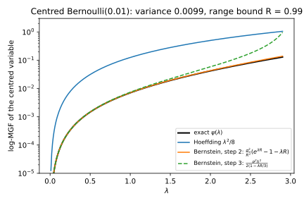
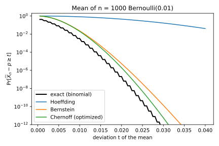
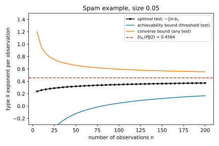
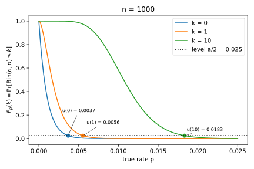
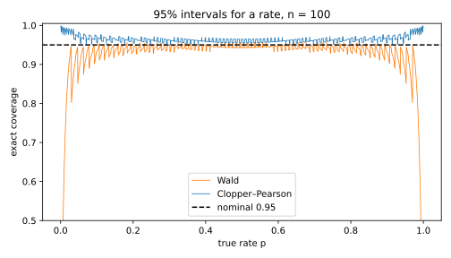

# Tail bounds, tests and divergences

Several chapters state a fact about tails, tests or divergences and then use it without a full proof. Some cite a book for the proof, some give a sketch that needs an extra condition, and one gives a reason that does not hold in general. This appendix derives six of these facts step by step. They belong together because they are built from the same three tools. The first is the moment generating function (MGF) of a random variable and its logarithm. The second is a change of measure, which rewrites a probability under one distribution as an average under another. The third is Jensen's inequality for convex functions.

@tbl-apx-tail-map lists the six results, where a chapter states each one, and where the book relies on it.

| Result | Stated in | Relied on in |
| --- | --- | --- |
| Bernstein's inequality | [Concentration inequalities](../part01-prerequisites/02-concentration.md), Hoeffding section | The same chapter's example of a small error rate |
| Cramér's lower bound and the Chernoff–Stein lemma | [Concentration inequalities](../part01-prerequisites/02-concentration.md), Chernoff section; @sec-ht-np | The claim that the Chernoff exponent cannot be improved |
| The Clopper–Pearson limits exist and are unique | @sec-ht-estimation | @sec-audit-bound |
| Rényi divergence tends to the Kullback–Leibler divergence | @sec-div-renyi | @sec-min-entropy |
| Perspective functions are jointly convex | @sec-conv-tests | @sec-gdp-rdp, @sec-cdp-tcdp, @sec-sub-rdp-gaussian |
| A noisy count has an increasing likelihood ratio | @sec-threat-average | @tbl-threat-avg-worst |

: The derivations of this appendix, the chapter section that states each result, and the sections that rely on it. {#tbl-apx-tail-map}

## Bernstein's inequality: the variance sets the width {#sec-apx-tail-bernstein}

### What the chapter uses

[Concentration inequalities](../part01-prerequisites/02-concentration.md) states Bernstein's inequality at the end of its section on sub-Gaussian variables and Hoeffding's inequality. It says that the inequality "is proved by the same Chernoff recipe" and cites Boucheron, Lugosi & Rassart (chapter 2) for the derivation.

The setting is an average of independent measurements. Take a number $n$ of independent variables $X_1, \dots, X_n$, all with the same mean $\mu$ and the same variance $\sigma^2$. Assume that each one stays within a distance $R$ of its mean, so that $|X_i - \mu| \le R$, and write $\bar X_n$ for their average. Then for every deviation $t > 0$,
$$\Pr\big[\bar X_n - \mu \ge t\big] \le \exp\left(-\frac{nt^2}{2\sigma^2 + \frac23 Rt}\right).$$ {#eq-apx-tail-bernstein}
The chapter also turns this into a **width**. For a failure probability $\beta$, the width is a deviation that the average exceeds with probability at most $\beta$. The chapter says that the width is about
$$\sqrt{\frac{2\sigma^2\ln(1/\beta)}{n}} + \frac{2R\ln(1/\beta)}{3n}.$$
The derivation below shows that this expression is more than an approximation: it is a valid width.

### The idea

Hoeffding's lemma bounds the MGF of a bounded variable as if it were the worst variable the range allows, a fair coin on the two ends, which has the largest variance of any variable in the interval. Bernstein's inequality keeps the true variance instead. To see how, expand the MGF of a centred variable as a series. After the constant 1 and the mean, which is 0, its terms are the moments times powers of $\lambda$: first the variance, then the third moment, the fourth, and so on. A variable that never strays more than $R$ from its mean has small higher moments, each at most the variance times a power of $R$. So the variance and the range together control the whole MGF. After that, the Chernoff recipe runs as usual: bound the MGF of each term of the sum, multiply these MGFs, choose the free parameter $\lambda$ and simplify.

A rare event shows why this matters. Let $X$ be a Bernoulli(0.01) variable, which is 1 with probability 0.01 and 0 otherwise. Its centred version $Y = X - 0.01$ is $0.99$ with probability 0.01 and $-0.01$ otherwise. Its variance is $0.01 \times 0.99 = 0.0099$, while Hoeffding's lemma, which knows only that $X$ lies in an interval of width 1, treats it as if its variance were $\frac14$, about 25 times more. Its higher moments are just as small, as @tbl-apx-tail-moments shows, and each stays below the bound $\sigma^2R^{k-2}$ used in step 2 below.

| Roment $k$ | 2 | 3 | 4 |
| --- | --- | --- | --- |
| $\mathbb E[Y^k]$ | 0.0099000 | 0.0097020 | 0.0096060 |
| Bound $\sigma^2R^{k-2}$, with $R = 0.99$ | 0.0099000 | 0.0098010 | 0.0097030 |

: Roments of the centred Bernoulli(0.01) variable $Y$ and the bound of step 2. {#tbl-apx-tail-moments}

### Derivation

1. **Centre the variables.** Subtract the mean from each variable, $Y_i = X_i - \mu$, so that each $Y_i$ has mean 0, variance $\sigma^2$ and $|Y_i| \le R$. Then the event $\bar X_n - \mu \ge t$ is the event that the sum $S = Y_1 + \dots + Y_n$ is at least $nt$.
2. **Bound each moment.** For $k \ge 2$, split $|Y|^k$ as $Y^2 |Y|^{k-2}$. The second factor is at most $R^{k-2}$, because $|Y| \le R$. Averaging gives
$$\mathbb E[Y^k] \le \mathbb E\big[|Y|^k\big] \le \mathbb E[Y^2]\,R^{k-2} = \sigma^2R^{k-2}.$$
3. **Bound the MGF of one term.** Take $\lambda \ge 0$ and expand $e^{\lambda Y} = 1 + \lambda Y + \sum_{k \ge 2}\lambda^kY^k/k!$. Because the variable is bounded, you may average the series term by term. The linear term then averages to 0, because $Y$ has mean 0. Each later term is at most $\lambda^k\sigma^2R^{k-2}/k!$ by step 2, and the direction of the inequality is kept because $\lambda^k \ge 0$. Writing $\lambda^k\sigma^2R^{k-2}$ as $(\sigma^2/R^2)(\lambda R)^k$, the terms from $k = 2$ on add up to at most $\sigma^2/R^2$ times the sum $\sum_{k\ge2}(\lambda R)^k/k!$, which is the exponential series without its first two terms, $e^{\lambda R} - 1 - \lambda R$. So
$$\mathbb E\big[e^{\lambda Y}\big] \le 1 + \frac{\sigma^2}{R^2}\big(e^{\lambda R} - 1 - \lambda R\big) \le \exp\left(\frac{\sigma^2}{R^2}\big(e^{\lambda R} - 1 - \lambda R\big)\right).$$
The second inequality is $1 + x \le e^x$. It holds because the line $1 + x$ is the tangent of the convex curve $e^x$ at 0, and a convex curve lies above its tangents.
4. **Simplify the series.** Write $u = \lambda R$ and take $0 \le u < 3$. Every factor of $k!$ from 3 up to $k$ is at least 3, so $k! \ge 2\cdot 3^{k-2}$. Each term of the series is therefore at most $\frac{u^2}{2}(u/3)^{k-2}$, and these terms form a geometric series with ratio $u/3 < 1$. Summing it gives
$$e^u - 1 - u \le \frac{u^2}{2(1 - u/3)}.$$
Put back $u = \lambda R$, multiply by $\sigma^2/R^2$ and take the logarithm of step 3's bound. The log-MGF of one term then satisfies
$$\ln\mathbb E\big[e^{\lambda Y}\big] \le \frac{\sigma^2\lambda^2}{2(1 - \lambda R/3)}, \qquad 0 \le \lambda < 3/R.$$
This is the Gaussian log-MGF $\sigma^2\lambda^2/2$ with the variance inflated by the factor $1/(1 - \lambda R/3)$, which is close to 1 for small $\lambda$.
5. **Chernoff for the sum.** The MGF of a sum of independent terms is the product of their MGFs, so the log-MGFs add and $S$ has log-MGF at most $n$ times the bound of step 4. Rarkov's inequality applied to $e^{\lambda S}$ (the master bound of the Chernoff method) then gives
$$\Pr[S \ge nt] \le \exp\left(-\lambda nt + \frac{n\sigma^2\lambda^2}{2(1 - \lambda R/3)}\right).$$
6. **Choose $\lambda$.** Take $\lambda = t/(\sigma^2 + Rt/3)$. It is positive, and $\lambda R/3 = (Rt/3)/(\sigma^2 + Rt/3)$ is below 1, so step 4 applies. With this choice $1 - \lambda R/3 = \sigma^2/(\sigma^2 + Rt/3)$. The second term of the exponent becomes $nt^2/\big(2(\sigma^2 + Rt/3)\big)$, and the first is $-nt^2/(\sigma^2 + Rt/3)$. Their sum is
$$-\frac{nt^2}{2(\sigma^2 + Rt/3)} = -\frac{nt^2}{2\sigma^2 + \frac23Rt},$$
which is @eq-apx-tail-bernstein. This $\lambda$ is not the exact minimizer of step 5, but it is the one that gives a clean formula.
7. **The width.** Write $\ell$ for $\ln(1/\beta)$. The bound equals $\beta$ when $nt^2 = \ell(2\sigma^2 + \frac23Rt)$, which is a quadratic equation in $t$ with the positive root
$$t^* = \frac{R\ell}{3n} + \sqrt{\Big(\frac{R\ell}{3n}\Big)^2 + \frac{2\sigma^2\ell}{n}}.$$
The exponent $nt^2/(2\sigma^2 + \frac23Rt) = nt/(2\sigma^2/t + \frac23R)$ grows with $t$, so every $t \ge t^*$ has a bound of at most $\beta$. To simplify the root, use the fact that the square root of a sum of two non-negative numbers is at most the sum of their square roots, which you can see by squaring both sides. Applied to the square root in $t^*$, it gives
$$t^* \le \sqrt{\frac{2\sigma^2\ell}{n}} + \frac{2R\ell}{3n},$$
the chapter's width. So with probability at least $1 - \beta$, the average exceeds $\mu$ by less than this amount.

The proof also works when the variables have different variances $\sigma_i^2$. Step 5 then adds the individual bounds, and $\sigma^2$ becomes their average.

### Checking it

The appendix's script, `apx_tails.py` (see the Code section), checks steps 3 and 4 for the centred Bernoulli(0.01) on a grid of $\lambda$ from 0.01 to 2.99, which is just below $3/R = 3.03$. The exact log-MGF never exceeds the series bound $\frac{\sigma^2}{R^2}(e^{\lambda R} - 1 - \lambda R)$ of step 3, and the series bound never exceeds the simpler bound of step 4. @fig-apx-tail-bernstein-mgf shows the three curves together with Hoeffding's $\lambda^2/8$. For small $\lambda$ both Bernstein curves lie on the exact one, far below Hoeffding's, because they use the variance 0.0099 rather than $\frac14$. Only near $\lambda = 3/R$ does the simplification of step 4 blow up.

{#fig-apx-tail-bernstein-mgf}

@fig-apx-tail-bernstein-tail shows what this buys for the mean of $n = 1{,}000$ such variables, whose expected count is 10. Take $t = 0.01$, which asks for a count of 20 or more, twice the expected count. The exact binomial tail is $3.29\times10^{-3}$. Bernstein's bound is $2.26\times10^{-2}$, within a factor of 7 of it and close to the optimized Chernoff bound, $2.00\times10^{-2}$. (That bound uses the exact binomial MGF. @sec-apx-tail-cramer-stein shows that its exponent is the binary Kullback–Leibler divergence.) Hoeffding's bound is $0.819$, which says almost nothing. The same holds for widths. At $\beta = 0.05$ the exact root $t^*$ of step 7 is 0.00875, the chapter's simpler formula gives 0.00968, and Hoeffding's one-sided width $\sqrt{\ln(1/\beta)/(2n)} = \sqrt{\ln(20)/2000}$ is 0.0387, four times larger.

{#fig-apx-tail-bernstein-tail}

## Chernoff's exponent is exact, for tails and for tests {#sec-apx-tail-cramer-stein}

### What the chapter uses

Let $X_1, \dots, X_n$ be independent copies of a variable $X$ with mean $\mu$, and let $S_n = X_1 + \dots + X_n$. Write $\psi(\lambda) = \ln\mathbb E[e^{\lambda X}]$ for the log-MGF of one copy. The Chernoff method of [Concentration inequalities](../part01-prerequisites/02-concentration.md) bounds the chance that the sum reaches $nt$, for a level $t$ above the mean, by
$$\Pr[S_n \ge nt] \le e^{-n\psi^*(t)}, \qquad \psi^*(t) = \sup_{\lambda > 0}\big(\lambda t - \psi(\lambda)\big).$$
The chapter then says that "Cramér's theorem says that ... the probability of a large deviation decays exponentially in $n$ with exactly the rate the optimized Chernoff bound gives, so no method can improve its exponent for large sums". It does not prove this. In symbols, for every $t$ between the mean $\mu$ and the largest value $x_{\max}$ that $X$ can take,
$$\lim_{n\to\infty}-\frac1n\ln\Pr[S_n \ge nt] = \psi^*(t).$$ {#eq-apx-tail-cramer}

@sec-ht-np makes the same kind of claim about tests, and cites Cover & Thomas (chapter 11) for it. You observe $n$ independent draws and test $H_0$, that they come from $P$, against $H_1$, that they come from $Q$. Hold the type I error at a level $a$ in $(0, 1)$, and write $b_n^*(a)$ for the smallest type II error of any test, randomized or not, whose type I error is at most $a$. The **Chernoff–Stein lemma** says that
$$\lim_{n\to\infty}-\frac1n\ln b_n^*(a) = D_{\mathrm{KL}}(P\|Q), \qquad D_{\mathrm{KL}}(P\|Q) = \mathbb E_P\Big[\ln\frac{p(X)}{q(X)}\Big],$$ {#eq-apx-tail-stein}
where $D_{\mathrm{KL}}$ is the Kullback–Leibler (KL) divergence. As in @sec-ht-np, $a$ and $b$ are the type I and type II errors.

### The idea

Chernoff's bound shows that the probability is *at most* about $e^{-n\psi^*(t)}$. To show that it is also *at least* about that, change the distribution so that the rare event becomes typical, and then pay for the change. The change is the **tilted** distribution of [Divergences](../part01-prerequisites/03-divergences.md), which multiplies the probability of each outcome $x$ by $e^{\lambda x}$ and renormalizes. With $\lambda > 0$ it moves mass toward large values. Pick $\lambda$ so that the tilted mean sits just above $t$, so that most of the tilted sums land in a narrow window just above $nt$. Under the tilt, $S_n$ then lands near $nt$ most of the time, by Chebyshev's inequality. The price of switching back is the ratio of the two distributions on those samples, which is about $e^{-n(\lambda t - \psi(\lambda))}$, and that is the Chernoff exponent.

Here is a concrete case. A coin lands heads with probability 0.1, and you ask how likely 100 tosses are to give at least 20 heads, twice the expected number. Tilting by $e^{\lambda x}$, with $x = 1$ for heads and 0 for tails, turns it into a coin with heads probability $0.1e^\lambda/(0.9 + 0.1e^\lambda)$. With $\lambda = \ln 2.25 = 0.8109$ that probability is exactly 0.2, so for the tilted coin 20 heads in 100 is the typical outcome, not a rare one.

The Chernoff–Stein lemma uses the same trick, with the two distributions already given. Under $P$, the evidence $\sum_i\ln(p(x_i)/q(x_i))$ of a sample is close to $n\,D_{\mathrm{KL}}(P\|Q)$, by the law of large numbers. So on most samples that $P$ produces, $Q$ gives a probability about $e^{-nD_{\mathrm{KL}}(P\|Q)}$ times smaller. A test with a small type I error must accept $H_0$ on most of $P$'s typical samples. So under $Q$ it accepts with probability about $e^{-nD_{\mathrm{KL}}(P\|Q)}$. No test can do better, because every test of small type I error must accept those samples. And the test that accepts exactly the samples with large evidence does that well.

### Derivation

Two facts from the chapters do the work. The first is the **change of measure** (Fact 1 of [Divergences](../part01-prerequisites/03-divergences.md), Fact 2 of [Hypothesis testing](../part01-prerequisites/04-hypothesis-testing.md)). If $P$ and $Q'$ give positive probability to the same outcomes, then for any event $A$,
$$\Pr_P[X \in A] = \sum_{x \in A}p(x) = \sum_{x\in A}q'(x)\frac{p(x)}{q'(x)} = \mathbb E_{Q'}\Big[\frac{p(X)}{q'(X)}\mathbf 1[X \in A]\Big],$$
because multiplying and dividing by $q'(x)$ changes nothing. The second is the **tilted distribution** with parameter $\lambda$, whose probabilities are
$$q_\lambda(x) = p(x)\,e^{\lambda x - \psi(\lambda)}.$$
They add up to 1 because $e^{\psi(\lambda)} = \sum_xp(x)e^{\lambda x}$. Its mean is $\psi'(\lambda)$ and its variance is $\psi''(\lambda)$, as the Rényi section of [Divergences](../part01-prerequisites/03-divergences.md) shows for the log-likelihood ratio. Here you only need these facts for a bounded $X$, where the sums are finite and the derivatives can be taken term by term.

**Cramér's lower bound.** Assume that $X$ is bounded and not constant, and that $\mu < t < x_{\max}$.

1. **Tilt to just above $t$.** Fix a small $\kappa > 0$ with $t + \kappa < x_{\max}$. The tilted mean $\psi'(\lambda)$ equals $\mu$ at $\lambda = 0$. It increases with $\lambda$, because its derivative is a variance, which is positive for a variable that is not constant. It tends to $x_{\max}$ as $\lambda \to \infty$, because the weight $e^{\lambda x}$ favours the largest values more and more. So there is one $\lambda > 0$ with $\psi'(\lambda) = t + \kappa/2$.
2. **Change the measure of the whole sample.** Tilt each of the $n$ copies. The ratio of the two probabilities of a sample is the product of the ratios of its draws, $\prod_ip(x_i)/q_\lambda(x_i) = e^{-\lambda S_n + n\psi(\lambda)}$. The change of measure therefore gives, for any event $A$ about the sample,
$$\Pr[A] = \mathbb E_{Q_\lambda}\big[e^{-\lambda S_n + n\psi(\lambda)}\,\mathbf 1[A]\big].$$
3. **Restrict to a window.** Let $A$ be the event $nt \le S_n \le n(t + \kappa)$. It is part of the event $S_n \ge nt$. On $A$, the sum is at most $n(t + \kappa)$, and $\lambda > 0$, so $e^{-\lambda S_n} \ge e^{-\lambda n(t + \kappa)}$. Hence
$$\Pr[S_n \ge nt] \ge \Pr[A] \ge e^{-n(\lambda(t + \kappa) - \psi(\lambda))}\,\Pr_{Q_\lambda}[A].$$
4. **The window is likely under the tilt.** Under $Q_\lambda$, the average $S_n/n$ has mean $t + \kappa/2$ and variance $\psi''(\lambda)/n$. The window contains every average within $\kappa/2$ of that mean. Chebyshev's inequality bounds the chance of falling outside, so
$$\Pr_{Q_\lambda}[A] \ge 1 - \frac{4\psi''(\lambda)}{n\kappa^2},$$
which tends to 1 as $n$ grows.
5. **Let $n$ grow.** Take logarithms in step 3 and divide by $-n$. The term $-\frac1n\ln \Pr_{Q_\lambda}[A]$ tends to 0, so
$$\limsup_{n\to\infty}-\frac1n\ln\Pr[S_n \ge nt] \le \lambda(t + \kappa) - \psi(\lambda).$$
6. **Let $\kappa$ shrink.** As $\kappa \to 0$, the chosen $\lambda$ tends to the $\lambda_0$ with $\psi'(\lambda_0) = t$, because $\psi'$ is continuous and increasing. The right side of step 5 then tends to $\lambda_0t - \psi(\lambda_0)$. The function $\lambda t - \psi(\lambda)$ is concave, since $\psi$ is convex, and its slope $t - \psi'(\lambda)$ is zero at $\lambda_0$. So $\lambda_0$ is where it is largest, and $\lambda_0t - \psi(\lambda_0) = \psi^*(t)$.
7. **Combine with Chernoff.** Chernoff's bound gives $-\frac1n\ln\Pr[S_n \ge nt] \ge \psi^*(t)$ for every $n$. Step 6 gives the matching upper limit, which proves @eq-apx-tail-cramer.

For the coin, $\psi(\lambda) = \ln(1 - p + pe^\lambda)$ with $p = 0.1$, and solving $\psi'(\lambda_0) = t$ gives $e^{\lambda_0} = t(1 - p)/\big(p(1 - t)\big)$. Substituting, the exponent is the **binary KL divergence**
$$\psi^*(t) = \mathrm{kl}(t\|p) = t\ln\frac tp + (1 - t)\ln\frac{1 - t}{1 - p}.$$
With $t = 0.2$ this is $\lambda_0 = \ln 2.25 = 0.8109$, $\psi(\lambda_0) = \ln1.125 = 0.11778$, and $\psi^*(0.2) = 0.2 \times 0.8109 - 0.11778 = 0.04440$.

**Chernoff–Stein, achievability.** Assume that $P$ and $Q$ give positive probability to the same outcomes. Write $L(x)$ for the evidence $\ln(p(x)/q(x))$ of one draw $x$. Under $P$ its mean is the divergence $D_{\mathrm{KL}}(P\|Q)$, written $D_{\mathrm{KL}}$ below, and assume that its variance $V$ is finite. For a whole sample $x = (x_1, \dots, x_n)$, write $p^n(x)$ and $q^n(x)$ for its probabilities under the two hypotheses. Each is a product over the draws, so the change of measure becomes
$$q^n(x) = p^n(x)\,e^{-\sum_iL(x_i)}.$$

1. **The test.** Fix $\kappa > 0$, and accept $H_0$ exactly when the average evidence is at least $D_{\mathrm{KL}} - \kappa$. Call that set of samples $A_n$.
2. **Its type I error.** It rejects when the average evidence falls more than $\kappa$ below its mean $D_{\mathrm{KL}}$. The average has variance $V/n$, so Chebyshev gives a type I error of at most $V/(n\kappa^2)$, which is below $a$ once $n$ is large.
3. **Its type II error.** On $A_n$ the total evidence is at least $n(D_{\mathrm{KL}} - \kappa)$, so $q^n(x) \le p^n(x)\,e^{-n(D_{\mathrm{KL}} - \kappa)}$. Summing over $A_n$ gives
$$b_n = \Pr_{Q^n}[A_n] \le e^{-n(D_{\mathrm{KL}} - \kappa)}\Pr_{P^n}[A_n] \le e^{-n(D_{\mathrm{KL}} - \kappa)}.$$
4. **The best test does at least as well.** So $b_n^*(a) \le e^{-n(D_{\mathrm{KL}} - \kappa)}$ for large $n$, and $\liminf_n -\frac1n\ln b_n^*(a) \ge D_{\mathrm{KL}} - \kappa$ for every $\kappa > 0$.

**Chernoff–Stein, converse.** Now take any test, described by its probability $\phi(x)$ of rejecting $H_0$, with type I error $\mathbb E_{P^n}[\phi] \le a$.

5. **Restrict to typical samples.** Let $B_n$ be the set of samples whose average evidence is at most $D_{\mathrm{KL}} + \kappa$. On $B_n$, $q^n(x) \ge p^n(x)\,e^{-n(D_{\mathrm{KL}} + \kappa)}$. The type II error is the probability of accepting under $Q$, and keeping only the samples in $B_n$ can only lower it, so
$$b_n = \sum_x\big(1 - \phi(x)\big)q^n(x) \ge e^{-n(D_{\mathrm{KL}} + \kappa)}\sum_{x\in B_n}\big(1 - \phi(x)\big)p^n(x).$$
6. **The test must accept most typical samples.** The last sum is the acceptance probability under $P$, minus the part outside $B_n$. That part is at most $\Pr_{P^n}[B_n^c]$, which Chebyshev bounds by $V/(n\kappa^2)$. So the sum is at least $1 - a - V/(n\kappa^2)$.
7. **Let $n$ grow.** Taking logarithms, $-\frac1n\ln b_n \le D_{\mathrm{KL}} + \kappa - \frac1n\ln\big(1 - a - V/(n\kappa^2)\big)$, and the last term tends to 0. (For large $n$ the factor $1 - a - V/(n\kappa^2)$ is positive, so its logarithm is defined.) This holds for every test of level $a$, so $\limsup_n-\frac1n\ln b_n^*(a) \le D_{\mathrm{KL}} + \kappa$. Since $\kappa$ is arbitrary, steps 4 and 7 together prove @eq-apx-tail-stein.

### Checking it

For the coin with $p = 0.1$ and $t = 0.2$, the script computes the exact exponent $-\frac1n\ln\Pr[S_n \ge 0.2n]$ from the binomial distribution. It is 0.06225 at $n = 100$, 0.04728 at $n = 1{,}000$ and 0.04481 at $n = 10{,}000$, and it approaches $\mathrm{kl}(0.2\|0.1) = 0.04440$ from above, as Chernoff's bound requires. The right panel of @fig-apx-tail-cramer also draws the bound of steps 3 and 4 for each $n$, with the window width $\kappa = 4\sqrt{t(1 - t)/n}$. The factor 4 makes Chebyshev's bound in step 4 leave about three quarters of the tilted mass in the window. It closes in from the other side, but slowly: 0.23163, 0.09152 and 0.05800 at the same three sizes. It is slow because the window must shrink like $1/\sqrt n$, the size of the typical fluctuation. The left panel shows the tilt at $n = 100$. The original count sits around 10, while the tilted count sits inside the window from 20 up.

![Left: the distribution of the number of heads in 100 tosses of a coin with heads probability 0.1, and of the tilted coin, with the window of step 3 shaded. Right: the exact exponent $-\frac1n\ln\Pr[S_n \ge 0.2n]$ (black), the bound from the tilting argument (blue) and the Chernoff exponent $\mathrm{kl}(0.2\|0.1)$ (dashed), against $n$.](figures/tail_cramer.svg){#fig-apx-tail-cramer}

For the Chernoff–Stein lemma the script uses the spam example of @tbl-ht-spam. An email's count of suspicious words, capped at 3, takes the values 0, 1, 2, 3 with probabilities 0.4, 0.3, 0.2, 0.1 under ham ($P$) and 0.1, 0.2, 0.3, 0.4 under spam ($Q$). There $D_{\mathrm{KL}}(P\|Q) = 0.4564$ and the variance of the evidence is $V = 0.8348$. The evidence of one count is $\pm\ln4$ or $\pm\ln1.5$, so the evidence of a sample is $i\ln4 + j\ln1.5$ for two whole numbers $i$ and $j$. The script tracks the exact distribution of $(i, j)$ under both hypotheses and builds the most powerful test of size exactly 0.05, as the Neyman–Pearson lemma prescribes. @tbl-apx-tail-stein gives its type II error. Its last column gives the two bounds of the derivation. They use $\kappa = \sqrt{V/(0.05\,n)}$ for achievability, so that step 2 gives size 0.05, and $\kappa = \sqrt{2V/(0.95\,n)}$ for the converse, so that the factor in step 6 is $0.95/2$. A negative lower bound says nothing, because an exponent is never negative.

| $n$ | $b_n^*(0.05)$ | $-\frac1n\ln b_n^*$ | Bounds from the proof |
| --- | --- | --- | --- |
| 10 | $7.702\times10^{-2}$ | 0.2564 | $[-0.8357, 0.9501]$ |
| 50 | $1.160\times10^{-7}$ | 0.3194 | $[-0.1214, 0.6588]$ |
| 200 | $3.959\times10^{-33}$ | 0.3730 | $[0.1675, 0.5539]$ |

: Type II error of the most powerful size-0.05 test on $n$ spam-example observations, its exponent, and the two bounds of the derivation with $\kappa$ chosen for each $n$. The limit is $D_{\mathrm{KL}}(P\|Q) = 0.4564$. {#tbl-apx-tail-stein}

The exponent creeps up toward 0.4564, as @fig-apx-tail-stein shows. Both bounds tend to KL, at the slow rate $1/\sqrt n$. The exact exponent is also far from its limit at moderate $n$. With 200 observations it is still 18% below KL, because the test must leave room for fluctuations of the evidence of order $\sqrt n$.

{#fig-apx-tail-stein}

### What it does not cover

Cramér's theorem holds without boundedness. The upper bound is always Chernoff's, and the lower bound needs only a tilt with the right mean, which exists in more general settings; Dembo & Zeitouni prove it in full. The Chernoff–Stein argument above uses a finite variance $V$ only for Chebyshev's inequality. The weak law of large numbers gives the same two limits with only a finite KL divergence, which is the version Cover & Thomas prove. Neither proof says how fast the limit is reached. The examples above show that the approach is slow, with an error of order $1/\sqrt n$ in the exponent.

## The Clopper–Pearson limits exist and are unique {#sec-apx-tail-clopper}

### What the chapter uses

@sec-ht-estimation builds the Clopper–Pearson interval for a rate from $k$ successes in $n$ independent trials. Write $F_p(k) = \Pr[\mathrm{Bin}(n, p) \le k]$ for the probability of at most $k$ successes when each trial succeeds with probability $p$. Step 1 of the chapter's derivation says that $F_p(k)$ is continuous and strictly decreasing in $p$ for $k < n$, and concludes that "for each $k$ there is a single rate $u(k)$ with $F_{u(k)}(k) = a/2$". Here $1 - a$ is the confidence level. The chapter gives a reason in one phrase, that a larger success probability makes small counts less likely, and points here for the proof. Fact 2 of [Auditing](../part05-dp-ml/10-auditing.md) relies on the same step for one-sided bounds, used in @sec-audit-bound.

The precise statement is this. For $0 \le k \le n - 1$, the function $p \mapsto F_p(k)$ is continuous and strictly decreasing on $[0, 1]$, from $F_0(k) = 1$ to $F_1(k) = 0$. So for every level $c$ in $(0, 1)$ exactly one rate $u(k)$ in $(0, 1)$ solves $F_{u(k)}(k) = c$. Moreover,
$$F_p(k) = \int_p^1 n\binom{n-1}{k}s^k(1 - s)^{n-1-k}\,ds.$$ {#eq-apx-tail-beta}
For $k = n$, $F_p(n) = 1$ for every $p$, and the chapter sets $u(n) = 1$.

### The idea

Picture all the trials driven by one set of random numbers. Draw $n$ numbers $U_1, \dots, U_n$ uniformly from $[0, 1]$, and say that trial $i$ succeeds at rate $p$ when $U_i \le p$. Each trial then succeeds with probability $p$, independently, so the count $K_p$ of successes is $\mathrm{Bin}(n, p)$. Now raise $p$ while keeping the same numbers. A trial that succeeded still succeeds, and some new ones may join, so the count never goes down. For example, with $n = 3$ and $U = (0.15, 0.62, 0.40)$, @tbl-apx-tail-coupling shows the count as $p$ grows.

| Rate $p$ | 0.1 | 0.3 | 0.5 | 0.7 |
| --- | --- | --- | --- | --- |
| Trials with $U_i \le p$ | none | 1 | 1, 3 | 1, 2, 3 |
| Count $K_p$ | 0 | 1 | 2 | 3 |

: One draw of three uniform numbers, and the count of successes they give at four rates. The count can only go up as $p$ grows. {#tbl-apx-tail-coupling}

On every draw the event "at most $k$ successes" can only stop happening as $p$ grows. So its probability $F_p(k)$ never increases. The count leaves that event when one more trial crosses over while exactly $k$ of the other $n - 1$ have already succeeded, and that has positive probability for every $p$ strictly between 0 and 1. So the decrease is strict. The derivation makes this exact by differentiating.

### Derivation

1. **The endpoints.** At $p = 0$ no trial succeeds, so $F_0(k) = 1$. At $p = 1$ all $n$ succeed, so $F_1(k) = 0$ for $k \le n - 1$.
2. **Continuity.** $F_p(k) = \sum_{j=0}^k\binom njp^j(1 - p)^{n-j}$ is a polynomial in $p$, so it is continuous and can be differentiated.
3. **The derivative telescopes.** Write $g_j(p)$ for the probability of exactly $j$ successes in $n - 1$ trials, $\binom{n-1}{j}p^j(1 - p)^{n-1-j}$, and set $g_{-1} = 0$. Differentiate one term of the sum by the product rule, and then use the identities $j\binom nj = n\binom{n-1}{j-1}$ and $(n - j)\binom nj = n\binom{n-1}{j}$. The result is
$$\frac{d}{dp}\binom njp^j(1 - p)^{n-j} = n\big(g_{j-1}(p) - g_j(p)\big).$$
Summing over $j = 0, \dots, k$, each $g_j$ appears once with a plus sign and once with a minus sign, except $g_{-1} = 0$ and the last one. So
$$\frac{d}{dp}F_p(k) = -n\binom{n-1}{k}p^k(1 - p)^{n-1-k}.$$
For example, with two trials and $k = 0$, $F_p(0) = (1 - p)^2$ has derivative $-2(1 - p)$, which is what the formula gives. The formula also has a reading in words. When $p$ rises a little, one of the $n$ trials may cross over, and the count leaves "at most $k$" exactly when the other $n - 1$ trials hold exactly $k$ successes.
4. **Strictly decreasing.** The derivative is negative for $0 < p < 1$. By the mean value theorem, for $p < p'$ the difference $F_{p'}(k) - F_p(k)$ equals $(p' - p)$ times the derivative at some point in between, which is negative.
5. **Existence and uniqueness.** A continuous function that goes from 1 to 0 takes every value $c$ in between, by the intermediate value theorem. A strictly decreasing function takes each value at most once. So exactly one $u(k)$ has $F_{u(k)}(k) = c$. Strictness is also what the chapter needs when it turns the limit into a statement about the true rate: the true rate $p$ is at least $u(K)$ exactly when $F_p(K) \le F_{u(K)}(K)$.
6. **The lower end.** For $k \ge 1$, the probability of at least $k$ successes is $1 - F_p(k - 1)$. By steps 1 to 4 it is continuous and strictly increasing in $p$, from 0 to 1. So the chapter's lower limit $l(k)$, the rate at which at least $k$ successes have probability $c$, also exists and is unique.
7. **The Beta form.** Integrate the derivative of step 3 from $p$ to 1, and use $F_1(k) = 0$. This gives @eq-apx-tail-beta. The integrand is the density of the $\mathrm{Beta}(k + 1, n - k)$ distribution, because its normalizing constant $1/B(k + 1, n - k) = n!/\big(k!\,(n - 1 - k)!\big)$ equals $n\binom{n-1}{k}$. So $F_p(k)$ is the probability that a $\mathrm{Beta}(k + 1, n - k)$ variable exceeds $p$. The upper limit $u(k)$ is therefore the point that such a variable exceeds with probability $c$. This is how statistical software computes Clopper–Pearson limits.

### Checking it

@fig-apx-tail-clopper-cdf draws $F_p(k)$ against $p$ for $n = 1{,}000$ and $k = 0$, 1 and 10. Each curve falls from 1 to 0 and crosses the level $0.025$ exactly once, at the upper limit: $u(0) = 0.003682$, $u(1) = 0.005559$ and $u(10) = 0.018313$. The first has a closed form, because $F_p(0) = (1 - p)^n$ gives $u(0) = 1 - 0.025^{1/1000}$. The script checks the derivative of step 3 against finite differences, and the integral of step 7 by numerical integration. It also recomputes the limits that the chapters quote, by bisection. For 10 successes in 10,000 trials the interval is $[0.00048, 0.00184]$. For 1 success in 1,000 the one-sided 95% bound is 0.0047, and for none in 3,000 it is $9.9808\times10^{-4}$.

{#fig-apx-tail-clopper-cdf}

@fig-apx-tail-clopper-coverage shows what the interval delivers. For $n = 100$ it gives the exact coverage of the 95% Clopper–Pearson interval at each true rate $p$, the probability that the interval built from a $\mathrm{Bin}(100, p)$ count contains $p$. The curve is a sawtooth, because it jumps each time $p$ crosses an endpoint of one of the 101 intervals. It never drops below 0.95: its smallest value on the grid is 0.9504 and its average is 0.9645. The Wald interval $\hat p \pm 1.96\sqrt{\hat p(1 - \hat p)/n}$ of @sec-ht-estimation falls far below 0.95 near the edges. At $p = 0.01$ it covers only 63.34% of the time, against 98.16% for Clopper–Pearson.

{#fig-apx-tail-clopper-coverage}

## Rényi divergence tends to KL at order 1 {#sec-apx-tail-renyi-kl}

### What the chapter uses

@sec-div-renyi writes the Rényi divergence of order $\alpha$ through the likelihood ratio $r = p/q$ and the log-MGF of the evidence $\ln r$ under $P$,
$$\psi(\lambda) = \ln\mathbb E_P\big[r^\lambda\big], \qquad D_\alpha(P\|Q) = \frac{\psi(\alpha - 1)}{\alpha - 1}.$$
That is @eq-renyi-psi. Here $\psi$ is the log-MGF of the evidence $\ln r$, not of a sum as in the previous section. Property 1 there says that $D_\alpha \to D_{\mathrm{KL}}(P\|Q)$ as $\alpha \to 1$, where $D_{\mathrm{KL}}(P\|Q) = \mathbb E_P[\ln r]$ is the KL divergence. The chapter proves it as the slope of $\psi$ at 0, by passing a derivative inside an average. It adds: "This needs $\psi$ to be finite near 0. van Erven & Harremoës prove the limit in general." Write $\lambda = \alpha - 1$. This section proves two statements without derivatives:
$$\lim_{\alpha \uparrow 1}D_\alpha(P\|Q) = D_{\mathrm{KL}}(P\|Q) \text{ always}, \qquad \lim_{\alpha\downarrow1}D_\alpha(P\|Q) = D_{\mathrm{KL}}(P\|Q) \text{ if } D_{\alpha_0}(P\|Q) < \infty \text{ for some } \alpha_0 > 1.$$
The first holds even when the KL divergence is infinite.

@sec-min-entropy states the matching facts for the **Rényi entropy** $H_\alpha(X) = \frac{1}{1 - \alpha}\log_2\sum_xp(x)^\alpha$, measured in bits, of a variable with finitely many values. It says that $H_\alpha$ tends to the Shannon entropy $H$ as $\alpha \to 1$, and to the min-entropy $H_\infty$ as $\alpha \to \infty$. Both follow from the divergence limits.

### The idea

The divergence $D_{1+\lambda}$ is $\psi(\lambda)/\lambda$, and two simple inequalities trap it between the KL divergence and a quantity whose limit is easy. The first is Jensen's inequality for the concave logarithm: the log of an average is at least the average of the log. The second is the tangent-line bound $\ln m \le m - 1$. Applied to the average $\mathbb E_P[r^\lambda]$, they give
$$\lambda D_{\mathrm{KL}} = \mathbb E_P[\ln r^\lambda] \le \psi(\lambda) \le \mathbb E_P[r^\lambda] - 1.$$
Dividing by $\lambda$, with care for its sign, puts $D_{1+\lambda}$ between $D_{\mathrm{KL}}$ and the average of the **power slope**
$$h_\lambda(r) = \frac{r^\lambda - 1}{\lambda}.$$
For each fixed value of the ratio $r$, the power slope moves steadily toward $\ln r$ as $\lambda$ tends to 0. So its average moves toward the average of $\ln r$, which is the KL divergence, and no derivative of $\psi$ is needed.

On the die of @tbl-div-die, $r$ is 3 on a six and 0.6 otherwise. @tbl-apx-tail-power-slopes shows $h_\lambda$ at both values. Each row increases from left to right, and the middle column, $\lambda = 0$, is $\ln r$.

| $\lambda$ | $-0.5$ | $-0.1$ | $0$ | $0.1$ | $0.5$ |
| --- | --- | --- | --- | --- | --- |
| $h_\lambda(3)$ | 0.8453 | 1.0404 | 1.0986 | 1.1612 | 1.4641 |
| $h_\lambda(0.6)$ | $-0.5820$ | $-0.5241$ | $-0.5108$ | $-0.4980$ | $-0.4508$ |

: The power slope $h_\lambda(r) = (r^\lambda - 1)/\lambda$ at the die's two likelihood ratios. At $\lambda = 0$ it is $\ln r$. {#tbl-apx-tail-power-slopes}

### Derivation

The derivation uses one theorem about averages, the **monotone convergence theorem**. Suppose random variables $Z_1 \le Z_2 \le \dots$ increase to a limit $Z$ at every outcome, and $\mathbb E[Z_1] > -\infty$. Then $\mathbb E[Z_k] \to \mathbb E[Z]$, and the limit may be $+\infty$. The same holds for a decreasing sequence if $\mathbb E[Z_1] < \infty$. For finitely many outcomes this is just the limit of a finite sum. For densities, it is a standard theorem of integration.

1. **The power slopes.** For a number $x > 0$, write $z = \ln x$, so that $x^\lambda = e^{\lambda z}$. Then the power slope is an integral,
$$h_\lambda(x) = \frac{e^{\lambda z} - 1}{\lambda} = \int_0^z e^{\lambda s}\,ds,$$
which runs backward when $z < 0$. At $\lambda = 0$ the integral is $z = \ln x$, and it changes continuously with $\lambda$. It is also non-decreasing in $\lambda$. If $z > 0$, every $s$ in the integral is positive, so $e^{\lambda s}$ grows with $\lambda$. If $z < 0$, the integral is $-\int_z^0e^{\lambda s}\,ds$ with negative $s$, so $e^{\lambda s}$ shrinks with $\lambda$ and its negative grows. So as $\lambda \uparrow 0$, $h_\lambda(x)$ increases to $\ln x$, and as $\lambda \downarrow 0$ it decreases to $\ln x$.
2. **Below order 1, an upper bound.** Take $\lambda \in (-1, 0)$. Then $r^\lambda = (q/p)^{|\lambda|}$, and Jensen's inequality for the concave power $|\lambda| < 1$ gives $\mathbb E_P[r^\lambda] \le \big(\mathbb E_P[q/p]\big)^{|\lambda|} \le 1$, so $\psi(\lambda)$ is not $+\infty$. (If $P$ and $Q$ share no outcome, $\psi(\lambda) = -\infty$ and every divergence is infinite, so there is nothing to prove.) Next, the logarithm is concave, so Jensen's inequality gives
$$\psi(\lambda) = \ln\mathbb E_P[r^\lambda] \ge \mathbb E_P[\ln r^\lambda] = \lambda D_{\mathrm{KL}}.$$
Dividing by the negative $\lambda$ flips the inequality, so $D_{1+\lambda}$ is at most $D_{\mathrm{KL}}$. When the KL divergence is infinite this says nothing, and nothing is needed.
3. **Below order 1, a lower bound.** Since $\ln m \le m - 1$, $\psi(\lambda) \le \mathbb E_P[r^\lambda] - 1 = \lambda\,\mathbb E_P[h_\lambda(r)]$. Dividing by the negative $\lambda$ flips it again:
$$\mathbb E_P[h_\lambda(r)] \le D_{1+\lambda} \le D_{\mathrm{KL}}, \qquad -1 < \lambda < 0.$$
4. **The limit from below.** As $\lambda \uparrow 0$, $h_\lambda(r)$ increases to $\ln r$ by step 1. The sequence starts above an integrable variable: at $\lambda = -1$, $h_{-1}(r) = 1 - 1/r$, and $\mathbb E_P[1/r] = \sum_{x:\,p(x)>0}q(x) \le 1$, so $\mathbb E_P[h_{-1}(r)] \ge 0$. So monotone convergence applies, and the average of the power slope tends to the average of $\ln r$, which is the KL divergence. Both sides of step 3 tend to $D_{\mathrm{KL}}$, so $D_\alpha \to D_{\mathrm{KL}}$ as $\alpha \uparrow 1$. This includes an infinite KL divergence, where the lower bound alone grows without limit.
5. **Above order 1.** For $\lambda > 0$ the same two inequalities hold, and dividing by the positive $\lambda$ keeps their direction:
$$D_{\mathrm{KL}} \le D_{1+\lambda} \le \mathbb E_P[h_\lambda(r)], \qquad \lambda > 0.$$
6. **The limit from above.** As $\lambda \downarrow 0$, $h_\lambda(r)$ decreases to $\ln r$. Monotone convergence now needs a finite starting point. That is the assumption: if $D_{\alpha_0} < \infty$ with $\lambda_0 = \alpha_0 - 1 > 0$, then $\mathbb E_P[r^{\lambda_0}] = e^{\lambda_0D_{\alpha_0}}$ is finite, and so is $\mathbb E_P[h_{\lambda_0}(r)]$. Then $\mathbb E_P[h_\lambda(r)] \to D_{\mathrm{KL}}$ and $D_\alpha \to D_{\mathrm{KL}}$ as $\alpha \downarrow 1$.
7. **Rényi entropy.** Let $U$ be the uniform distribution on the $N$ values of $X$, which gives each value probability $1/N$. Measuring the divergence in bits too, with $\log_2$ in place of $\ln$, the definition gives
$$D_\alpha(P\|U) = \frac{1}{\alpha - 1}\log_2\sum_xp(x)^\alpha N^{\alpha - 1} = \log_2 N - H_\alpha(X).$$
The identity holds in any base used for both sides. In the same way, the KL divergence from the uniform distribution is $\log_2 N$ minus the Shannon entropy $H(X)$. On a finite set the likelihood ratio $Np(x)$ is at most $N$, so every $D_\alpha(P\|U)$ is finite. Both limits of steps 4 and 6 then apply, and $H_\alpha \to H$ as $\alpha \to 1$. As $\alpha \to \infty$, property 2 of @sec-div-renyi says that $D_\alpha(P\|U)$ tends to the logarithm of the largest ratio, $\log_2(N\max_xp(x))$. Subtracting it from $\log_2 N$ leaves the min-entropy,
$$\lim_{\alpha\to\infty}H_\alpha(X) = -\log_2\max_xp(x) = H_\infty(X).$$

### Checking it

@fig-apx-tail-renyi-sandwich draws the sandwich for the die and for the pair $\mathcal N(0, 1)$ against $\mathcal N(1, 1)$, whose KL divergence is $\frac12$. The black curve is $D_{1+\lambda}$ and the blue curve is $\mathbb E_P[h_\lambda(r)]$. The blue curve lies below the black on the left of 0 and above it on the right, and both meet the KL line at $\lambda = 0$. On the die, where $D_{\mathrm{KL}} = 0.2939$, the divergence at $\lambda = -0.01$ is 0.2907 with the lower bound 0.2902, and at $\lambda = +0.01$ it is 0.2971 with the upper bound 0.2976.

![The Rényi divergence $D_{1+\lambda} = \psi(\lambda)/\lambda$ (black) and the bound $\mathbb E_P[(r^\lambda - 1)/\lambda]$ (blue) as functions of $\lambda = \alpha - 1$, with the KL divergence (dashed). Left: the loaded die against the fair die. Right: $\mathcal N(0, 1)$ against $\mathcal N(1, 1)$.](figures/tail_renyi_sandwich.svg){#fig-apx-tail-renyi-sandwich}

For the PIN example of @sec-min-entropy, with 10% on one PIN and the rest uniform over the other 9,999, the Shannon entropy is $H = 12.4278$ bits. The script finds $H_{0.999} = 12.4310$ and $H_{1.001} = 12.4246$ on either side of it. As the order grows, $H_2 = 6.6322$ and $H_{100} = 3.3555$ approach the min-entropy $H_\infty = 3.3219$. The identity of step 7 holds to rounding error.

### What it does not cover

Without the assumption of step 6, the limit from above can fail. Take outcomes $k = 1, 2, \dots$ with $p(k)$ proportional to $e^{-\sqrt k}$, and let $q(k) = p(k)e^{-k}$, with the rest of $Q$'s mass on an extra outcome that $P$ never produces. Then $\ln r(k) = k$, so $D_{\mathrm{KL}} = \mathbb E_P[k]$ is finite. But $\mathbb E_P[r^\lambda]$ sums $e^{\lambda k - \sqrt k}$ times a constant, which diverges for every $\lambda > 0$. So $D_\alpha = \infty$ for every $\alpha > 1$, while the limit from below is the finite KL divergence. van Erven & Harremoës (2014) treat the general case, including orders near 0 and $\infty$.

## Perspective functions are jointly convex {#sec-apx-tail-perspective}

### What the chapter uses

Let $g$ be a convex function on $(0, \infty)$. Its **perspective** is a function $G$ of two positive numbers $x$ and $y$. It applies $g$ to their ratio and multiplies the result by the denominator:
$$G(x, y) = y\,g(x/y).$$

The perspective has three properties. The first is that it is **jointly convex**. Take several points $(x_t, y_t)$, indexed by $t$, and weights $w_t \ge 0$ that add up to 1. The value of $G$ at the weighted average of the points is at most the weighted average of its values:
$$G\Big(\sum_tw_tx_t,\ \sum_tw_ty_t\Big) \le \sum_tw_t\,G(x_t, y_t).$$ {#eq-apx-tail-joint}
The second is that it is **positively homogeneous**, which means that scaling both arguments by a factor $c > 0$ scales the value by $c$. The third follows from the first two. The perspective is **subadditive**, so its value at a sum of two points is at most the sum of its values:
$$G(x_1 + x_2,\ y_1 + y_2) \le G(x_1, y_1) + G(x_2, y_2).$$

The Rényi divergence uses $g(t) = t^\alpha$ with $\alpha > 1$, whose perspective is $G(x, y) = x^\alpha y^{1-\alpha}$. Write the sum in the Rényi divergence as
$$F(P, Q) = \sum_yP(y)^\alpha Q(y)^{1-\alpha} = e^{(\alpha - 1)D_\alpha(P\|Q)}.$$
Several chapters assert one of the properties above for this function, without a proof:

- Fact 3 of [Conversions](../part04-privacy-accounting/02-rdp-conversions.md), the chapter on converting Rényi differential privacy (RDP) guarantees, says that a test cannot increase the Rényi divergence. Its short reason is the subadditivity of $x^\alpha y^{1-\alpha}$, and it sends randomized tests to the general proof.
- "Computing it" in @sec-conv-tests says that each constraint of @eq-conv-region is convex in the test's errors $(a, b)$, so that the region they allow is convex and its lower boundary $f_{\mathrm{RDP}}$ is a convex function. It also uses that each constraint is smallest, equal to 1, at $b = 1 - a$. Step 3 of @sec-gdp-rdp repeats the convexity claim.
- Step 1 of @sec-cdp-tcdp uses the joint convexity of $F$ in the pair, for the pair $(Q, P)$ written as a mixture.
- Step 2 of @sec-sub-rdp-gaussian uses it to show that a mixture of pairs with shared weights has a Rényi divergence no larger than the largest of its parts. It cites van Erven & Harremoës (2014, Theorem 13) for this **quasi-convexity**.

This section proves the three properties and these four uses.

### The idea

The perspective is $g$ of a ratio, weighted by the denominator. When you mix two points, the ratio of the mixture is an average of the two ratios, weighted by the denominators. A convex function of an average is at most the average of the function (Jensen), and multiplying back by the total denominator gives the joint convexity.

Take $\alpha = 2$, so $G(x, y) = x^2/y$, and the two points $(0.9, 0.3)$ and $(0.1, 0.9)$. Their values are $0.81/0.3 = 2.70$ and $0.01/0.9 = 0.0111$, and their ratios $x/y$ are 3 and $\frac19$. The midpoint is $(0.5, 0.6)$, whose ratio is $0.5/0.6 = 0.833$. That is the average of 3 and $\frac19$ with weights $0.3/1.2 = \frac14$ and $0.9/1.2 = \frac34$, the shares of the two denominators. At the midpoint $G = 0.25/0.6 = 0.4167$, well below the average of the two values, $(2.70 + 0.0111)/2 = 1.3556$.

In the language of divergences, $x$ is $P$'s probability of an output and $y$ is $Q$'s. Merging two outputs replaces their likelihood ratios by an average weighted by $Q$, as in the data-processing section of [Divergences](../part01-prerequisites/03-divergences.md), and a convex summary of the ratios can only go down.

### Derivation

1. **Joint convexity.** Fix the points $(x_t, y_t)$ and the weights $w_t$, and let $x = \sum_tw_tx_t$ and $y = \sum_tw_ty_t$. The numbers $v_t = w_ty_t/y$ are non-negative and add up to 1. They make the ratio of the mixture an average of the ratios,
$$\frac xy = \sum_t\frac{w_ty_t}{y}\cdot\frac{x_t}{y_t} = \sum_tv_t\frac{x_t}{y_t}.$$
Jensen's inequality for the convex $g$ gives $g(x/y) \le \sum_tv_t\,g(x_t/y_t)$. Multiplying by $y$ turns each $y\,v_t$ back into $w_ty_t$, which is @eq-apx-tail-joint.
2. **Homogeneity.** $G(cx, cy) = cy\,g(cx/cy) = c\,y\,g(x/y)$, because the ratio does not change.
3. **Subadditivity.** By homogeneity with $c = 2$, $G(x_1 + x_2, y_1 + y_2) = 2\,G\big(\frac{x_1 + x_2}2, \frac{y_1 + y_2}2\big)$. By joint convexity with weights $\frac12$, this is at most $G(x_1, y_1) + G(x_2, y_2)$.
4. **Zero probabilities.** For $G(x, y) = x^\alpha y^{1-\alpha}$, outputs where a probability is 0 follow the conventions $G(0, y) = 0$ and $G(x, 0) = \infty$ for $x > 0$. Steps 1 to 3 still hold, case by case. If some point has $y_t = 0 < x_t$, the right side is infinite, so there is nothing to check, while a point $(0, 0)$ adds nothing to either side. With $x_t = 0 < y_t$, the formula $y\,g(x/y)$ still applies, since $g(0) = 0$ and $g$ is convex on $[0, \infty)$.
5. **Mixtures of pairs: quasi-convexity.** Let $(P_t, Q_t)$ be pairs of distributions on the same outputs, and mix them with shared weights $w_t$. Apply step 1 at each output $y$, to the points $(P_t(y), Q_t(y))$, and add over $y$. Then
$$F\Big(\sum_tw_tP_t,\ \sum_tw_tQ_t\Big) \le \sum_tw_t\,F(P_t, Q_t) \le \max_tF(P_t, Q_t).$$
For $\alpha > 1$, $D_\alpha = \frac{1}{\alpha - 1}\ln F$ increases with $F$. So the Rényi divergence of the mixed pair is at most the largest $D_\alpha(P_t\|Q_t)$. This is step 2 of @sec-sub-rdp-gaussian. For densities, replace the sum over $y$ by an integral, and the inequality survives because it holds at every $y$.
6. **The pair $(Q, P)$ for a subsampled Gaussian.** In @sec-cdp-tcdp, $Q = \mathcal N(0, \sigma^2)$ and $P = (1 - q)Q + q\,\mathcal N(1, \sigma^2)$. The pair $(Q, P)$ is the mixture $(1 - q)(Q, Q) + q\,(Q, \mathcal N(1, \sigma^2))$, with the shared weights $1 - q$ and $q$. The first inequality of step 5 gives
$$F(Q, P) \le (1 - q)F(Q, Q) + q\,F\big(Q, \mathcal N(1, \sigma^2)\big) = (1 - q) + q\,e^{(\alpha - 1)\alpha\rho_0},$$
because $F(Q, Q) = 1$, and $D_\alpha$ between two normals with unit shift is $\alpha\rho_0$, where $\rho_0 = 1/(2\sigma^2)$. That is the bound the chapter states.
7. **Tests cannot increase the divergence.** A test rejects on output $y$ with probability $\phi(y)$, which may lie strictly between 0 and 1. Split each output $y$ into two pieces, "$y$ and reject" and "$y$ and accept". Their probabilities are $\phi(y)P(y)$ and $(1 - \phi(y))P(y)$ under $P$, and likewise under $Q$. Both pieces keep the ratio $P(y)/Q(y)$, so by homogeneity their two terms add up to $G(P(y), Q(y))$, and $F$ does not change. Now merge all the "reject" pieces into one output and all the "accept" pieces into another. By subadditivity, applied one merge at a time, $F$ can only go down. The two merged outputs are the test's coin. It rejects with probability $a = \sum_y\phi(y)P(y)$ under $P$ and $1 - b = \sum_y\phi(y)Q(y)$ under $Q$, where $a$ and $b$ are its type I and type II errors. So
$$G(a, 1 - b) + G(1 - a, b) \le F(P, Q),$$
which is Fact 3 of [Conversions](../part04-privacy-accounting/02-rdp-conversions.md), randomized tests included. The same split-and-merge argument works for any processing that sends each output $y$ to a random output $z$, so it also proves the data-processing inequality for $D_\alpha$.
8. **The region of allowed tests is convex.** The chapter's RDP curve $\varepsilon(\alpha)$ bounds the Rényi divergence of order $\alpha$ in both directions, and the coin of step 7 inherits both bounds. Written with $G$, the two constraints of @eq-conv-region are
$$c_1(a, b) = G(a, 1 - b) + G(1 - a, b) \le e^{(\alpha - 1)\varepsilon(\alpha)}, \qquad c_2(a, b) = G(1 - b, a) + G(b, 1 - a) \le e^{(\alpha - 1)\varepsilon(\alpha)}.$$ Each term is $G$ applied to numbers that depend linearly on $(a, b)$. Mixing two error pairs mixes those numbers with the same weights, so step 1 makes each term, and their sum, convex in $(a, b)$. The same holds for $c_2$, which swaps the roles of the two distributions. If two error pairs satisfy a convex constraint, so does every mixture of them, because its value is at most the mixture of two values that are both within the limit. So each constraint allows a convex set of pairs, and so does their intersection.
9. **The boundary is convex, and each constraint is smallest at $b = 1 - a$.** Let $f_{\mathrm{RDP}}(a)$ be the smallest allowed $b$ at type I error $a$. For allowed pairs $(a_1, b_1)$ and $(a_2, b_2)$, the mixture is allowed, so $f_{\mathrm{RDP}}$ at the mixed $a$ is at most the mixed $b$. Taking each $b_i$ as small as allowed shows that $f_{\mathrm{RDP}}$ is convex. At $b = 1 - a$, homogeneity gives $c_1 = G(a, a) + G(1 - a, 1 - a) = a + (1 - a) = 1$. Subadditivity merges the two terms, whose arguments add up to $(a + 1 - a,\ 1 - b + b) = (1, 1)$, so $c_1 \ge G(1, 1) = 1$ for every $(a, b)$, so 1 is the smallest value. A convex function of $b$ that is smallest at $1 - a$ decreases on $[0, 1 - a]$, which is what the chapter needs to find $f_{\mathrm{RDP}}(a)$ by bisection on $b$.

### Checking it

At $\alpha = 2$, the script draws 100,000 random pairs of points and weights. It finds no violation of joint convexity or of subadditivity. It also draws 20,000 random mixtures of three pairs of distributions on five outputs, and finds no mixture whose Rényi divergence exceeds the largest of its parts.

On the die, the loaded die gives a six probability 0.5 and each other face 0.1. Take the randomized test that rejects on a six, and with probability $\frac12$ on a five. Its type I error is $a = 0.5 + 0.05 = 0.55$, and it rejects under the fair die with probability $1 - b = \frac16 + \frac1{12} = 0.25$. Its coin has $D_2 = 0.3920$, below $D_2(P\|Q) = 0.5878$ for the full roll, as step 7 requires.

For the subsampled Gaussian of step 6, with $q = 0.1$, $\sigma = 1$ and $\alpha = 2$, numerical integration gives $F(Q, P) = 1.0115$, below the bound $0.9 + 0.1e = 1.1718$. The bound is loose here because it charges the full Gaussian divergence to the fraction $q$ of the mixture.

The right panel of @fig-apx-tail-perspective draws the region that order 2 alone allows for the Gaussian mechanism whose sensitivity equals its noise standard deviation ($\mu = 1$ in the chapters), whose RDP curve gives $\varepsilon(2) = 1$. At $a = 0.1$ the boundary is $f_{\mathrm{RDP}}(0.1) = 0.5068$, so the largest power is 0.4932, the order-2 value that @sec-conv-tests reports. The script checks convexity on a grid of 199 values of $a$: the smallest second difference of $f_{\mathrm{RDP}}$ is positive. In the figure, the chord between two boundary points stays inside the region. The boundary has a kink where the binding constraint switches from $c_2$ to $c_1$, and convexity survives it.

{#fig-apx-tail-perspective}

## A noisy count has an increasing likelihood ratio {#sec-apx-tail-noisy-count}

### What the chapter uses

The example of @sec-threat-average releases a noisy count of $m = 100$ other records plus the target's bit $b$. The adversary sees $K + b + Z$, where the unknown count $K$ of the others is $\mathrm{Bin}(m, \frac12)$ and the noise $Z$ is normal with mean 0 and standard deviation $\sigma = 1$. Write $w_k = \binom mk2^{-m}$ for the binomial weights and $\varphi_\sigma$ for the normal density with standard deviation $\sigma$. In world 0 ($b = 0$) the observation has density
$$p(y) = f(y), \qquad f(y) = \sum_{k=0}^mw_k\,\varphi_\sigma(y - k),$$
and in world 1 ($b = 1$) it has the shifted density $q(y) = f(y - 1)$.

The chapter says that the likelihood ratio increases with $y$, so the best attack is a threshold, at $m/2 + \frac12 = 50.5$ by symmetry. A tempting reason is that $f$ is log-concave, because a binomial and a normal are both log-concave and so is their sum. That reason is not valid in general, because the rule it quotes concerns two variables that both have log-concave densities on the real line. A binomial count lives on the integers and has no density there, and for such sums the rule fails. For example, a Bernoulli($\frac12$) variable plus normal noise with $\sigma = 0.2$ has two separate peaks, as the left panel of @fig-apx-tail-noisy-count shows, so it is not log-concave. With $m = 100$ and $\sigma = 1$ the density does happen to be log-concave, but with $\sigma = 0.5$ it is not.

The attack needs less than log-concavity, and what it needs holds for every $\sigma > 0$:
$$\frac{q(y)}{p(y)} = \frac{f(y - 1)}{f(y)} \text{ is strictly increasing in } y.$$ {#eq-apx-tail-mlr}
The proof below uses two properties. The weights $w_k$ must form a **log-concave sequence**, $w_k^2 \ge w_{k-1}w_{k+1}$, with no zero between two non-zero weights. The noise must be normal.

### The idea

Both densities are mixtures over the unknown count of the others. Comparing the ratio at two observations $y < y'$ therefore means comparing two double sums, over the count $j$ in one world and the count $k$ in the other. Pair each term $(j, k)$ with its mirror image $(k, j)$. Each pair turns into a product of two factors. One compares the binomial weights, and it is non-negative because the binomial is log-concave. The other compares normal densities, and it is non-negative because a larger observation favours a larger centre. A product of two non-negative factors is non-negative, and so is the sum.

For a single Bernoulli($\frac12$) record ($m = 1$), the weights are $w_0 = w_1 = \frac12$, and $w_k = 0$ for every other $k$. The pairs with $j > k$ whose weight factor $w_{j-1}w_k - w_{k-1}w_j$ is not zero are listed in @tbl-apx-tail-pairs. All three weight factors are positive, even though the density has two peaks.

| Pair $(j, k)$ | $w_{j-1}w_k$ | $w_{k-1}w_j$ | Weight factor |
| --- | --- | --- | --- |
| $(1, 0)$ | $w_0w_0 = \frac14$ | $w_{-1}w_1 = 0$ | $\frac14$ |
| $(2, 0)$ | $w_1w_0 = \frac14$ | $w_{-1}w_2 = 0$ | $\frac14$ |
| $(2, 1)$ | $w_1w_1 = \frac14$ | $w_0w_2 = 0$ | $\frac14$ |

: The weight factors of step 4 for one Bernoulli($\frac12$) record, for the pairs $j > k$ where they are not zero. {#tbl-apx-tail-pairs}

### Derivation

Set $w_i = 0$ for $i$ outside $0, \dots, m$, and write $\varphi$ for $\varphi_\sigma$. Substituting $j = k + 1$ in $q(y) = f(y - 1)$ writes both densities as sums over a centre:
$$p(y) = \sum_kw_k\,\varphi(y - k), \qquad q(y) = \sum_jw_{j-1}\varphi(y - j).$$

1. **What to show.** The ratio increases exactly when $q(y')/p(y') \ge q(y)/p(y)$ for every $y < y'$. Multiplying by the positive $p(y)p(y')$, this is $\Delta = q(y')p(y) - q(y)p(y') \ge 0$.
2. **Expand.** Multiplying out the sums,
$$\Delta = \sum_{j,k}a_{jk}b_{jk}, \qquad a_{jk} = w_{j-1}w_k, \qquad b_{jk} = \varphi(y' - j)\varphi(y - k) - \varphi(y - j)\varphi(y' - k).$$
3. **Pair each term with its mirror.** Swapping $j$ and $k$ swaps the two products in $b_{jk}$, so $b_{kj} = -b_{jk}$ and $b_{jj} = 0$. Split the sum into the terms with $j > k$ and those with $j < k$, and rename the indices in the second part. Then
$$\Delta = \sum_{j > k}\big(a_{jk} - a_{kj}\big)b_{jk} = \sum_{j>k}\big(w_{j-1}w_k - w_{k-1}w_j\big)\,b_{jk}.$$
4. **The weight factor is non-negative.** Take $j > k$. If $w_{k-1} = 0$ or $w_j = 0$, the subtracted product is 0 and the factor is at least 0. Otherwise $k - 1$ and $j$ both carry weight, and so does every index between them, because there are no internal zeros. Log-concavity, $w_i^2 \ge w_{i-1}w_{i+1}$, says that the ratio $w_{i-1}/w_i$ never decreases as $i$ grows. So $w_{j-1}/w_j \ge w_{k-1}/w_k$, which is $w_{j-1}w_k \ge w_{k-1}w_j$. For the binomial, $w_{i-1}/w_i = i/(m - i + 1)$, which increases with $i$.
5. **The kernel factor is positive.** Take $j > k$ and $y < y'$. Compare the logarithms of the two products in $b_{jk}$. Expanding the squares in the normal densities, the terms in $y^2$, $y'^2$, $j^2$ and $k^2$ cancel, and
$$\ln\frac{\varphi(y' - j)\varphi(y - k)}{\varphi(y - j)\varphi(y' - k)} = \frac{(y - j)^2 + (y' - k)^2 - (y' - j)^2 - (y - k)^2}{2\sigma^2} = \frac{(y' - y)(j - k)}{\sigma^2} > 0.$$
So $b_{jk} > 0$. In words, a larger observation is relatively more likely under the larger centre.
6. **Conclude.** Every term of step 3 is a non-negative weight factor times a positive kernel factor, so $\Delta \ge 0$. The pair $(1, 0)$ has weight factor $w_0^2 > 0$, so $\Delta > 0$ and the ratio is strictly increasing. This proves @eq-apx-tail-mlr.
7. **The best attack is a threshold.** By the Neyman–Pearson lemma (@sec-ht-np), the most powerful test rejects where the likelihood ratio $q/p$ is above a cut-off. When the ratio increases with $y$, that region is $\{y > \tau\}$ for some threshold $\tau$.
8. **The threshold.** The binomial weights are symmetric, $w_k = w_{m-k}$, and so is the noise, so $f(m/2 + s) = f(m/2 - s)$ for every $s$. The ratio equals 1 where $f(y - 1) = f(y)$. That happens when $y - 1$ and $y$ sit symmetrically around $m/2$, at $y = m/2 + \frac12$. Because the ratio is strictly increasing, it crosses 1 only there. The test with the best advantage rejects exactly where $q > p$, that is, where the ratio is above 1 (@sec-ht-tv), which is $\{y > 50.5\}$ for $m = 100$.

### Checking it

For the Bernoulli($\frac12$) record with $\sigma = 0.2$, the script finds two peaks in the density. On a grid of 4,001 points the log-ratio still increases at every step. It also evaluates the double sum of step 3 directly and matches $\Delta$ to rounding error, both for this case and for $m = 100$. For $m = 100$ and $\sigma = 1$, the ratio crosses 1 at 50.5000, and the advantage of that threshold is 0.0779, the exact value in @tbl-threat-avg-worst. The largest second difference of $\ln f$ on a grid is negative ($-3.8\times10^{-6}$) at $\sigma = 1$ and positive ($+5.5\times10^{-5}$) at $\sigma = 0.5$. So the density is log-concave in the chapter's case but not for smaller noise. The ratio increases in both cases, as the right panel of @fig-apx-tail-noisy-count shows.

{#fig-apx-tail-noisy-count}

### What it does not cover

The proof needs the kernel inequality of step 5 for the noise. Step 5 proves it for normal noise, and it holds for every log-concave noise density, such as the Laplace density (Karlin calls such shift kernels totally positive of order 2). For other noise the argument does not apply. It also needs log-concave weights without internal zeros. A count whose other records have unequal probabilities is a sum of independent Bernoulli variables, and such a count still has log-concave weights, so the result covers it too.

## Code

The script `code/appendix-derivations/apx_tails.py` computes every number on this page and draws its figures. For each derivation it checks the inequalities numerically, compares each bound with the exact value, and recomputes the numbers the chapters quote. Run it with

```bash
uv run python code/appendix-derivations/apx_tails.py
```

@tbl-apx-tail-code lists the main numbers it prints.

| Section | Quantity | Value |
| --- | --- | --- |
| Bernstein | Exact tail, mean of 1,000 Bernoulli(0.01) at $t = 0.01$ | $3.29\times10^{-3}$ |
| Bernstein | Bernstein, optimized Chernoff, Hoeffding bounds there | $2.26\times10^{-2}$, $2.00\times10^{-2}$, 0.819 |
| Bernstein | Width at $\beta = 0.05$: exact root, chapter formula, Hoeffding | 0.00875, 0.00968, 0.0387 |
| Cramér | Exact exponent at $n = 100, 1{,}000, 10{,}000$; limit $\mathrm{kl}(0.2\|0.1)$ | 0.06225, 0.04728, 0.04481; 0.04440 |
| Chernoff–Stein | Spam example: exponent at $n = 200$; limit KL | 0.3730; 0.4564 |
| Clopper–Pearson | $u(0)$, $u(1)$, $u(10)$ at $n = 1{,}000$, level 0.025 | 0.003682, 0.005559, 0.018313 |
| Clopper–Pearson | Smallest coverage at $n = 100$: Clopper–Pearson, Wald | 0.9504, 0.0488 |
| Rényi to KL | Die: $D_{0.99}$, KL, $D_{1.01}$ | 0.2907, 0.2939, 0.2971 |
| Rényi entropy | PIN: $H_{0.999}$, $H$, $H_{1.001}$ (bits) | 12.4310, 12.4278, 12.4246 |
| Perspective | Violations of joint convexity, subadditivity, quasi-convexity | 0, 0, 0 |
| Perspective | $F(Q, P)$ and its bound, subsampled Gaussian | 1.0115, 1.1718 |
| Noisy count | Crossing point and advantage, $m = 100$, $\sigma = 1$ | 50.5000, 0.0779 |

: Numbers printed by the script for this appendix. {#tbl-apx-tail-code}

Each bound sits on the right side of its exact value, and the limits are approached at the slow rates the proofs predict. The Wald coverage of 0.0488 occurs at the extreme rates of the grid, 0.0005 and 0.9995. At $p = 0.0005$, for example, the count is 0 in 95% of runs, and then the Wald interval is the single point $[0, 0]$, which misses $p$. The counts of violations are the numerical form of the convexity proofs.

## References

- Boucheron, Lugosi & Massart, *Concentration Inequalities: A Nonasymptotic Theory of Independence* (2013). Chapter 2 derives Bernstein's inequality and its relatives by the Chernoff method.
- Dembo & Zeitouni, *Large Deviations Techniques and Applications* (2nd ed., 1998). Cramér's theorem in full generality, with the tilting argument used here.
- Cover & Thomas, *Elements of Information Theory* (2nd ed., 2006). Chapter 11 proves the Chernoff–Stein lemma with typical sets, and states the binary KL bounds.
- Clopper & Pearson, "The use of confidence or fiducial limits illustrated in the case of the binomial", *Biometrika* (1934). The original interval.
- Brown, Cai & DasGupta, "Interval estimation for a binomial proportion", *Statistical Science* (2001). The coverage of the Wald interval and its alternatives, with sawtooth plots like @fig-apx-tail-clopper-coverage.
- van Erven & Harremoës, "Rényi divergence and Kullback–Leibler divergence", *IEEE Transactions on Information Theory* (2014). The limits of Rényi divergence in every order, and its convexity properties, in full generality.
- Boyd & Vandenberghe, *Convex Optimization* (2004). Section 3.2.6 introduces the perspective of a function and proves that it keeps convexity.
- Karlin, *Total Positivity* (1968). The theory behind step 5 of the noisy-count proof: kernels with the inequality of step 5 and the sums they preserve.
