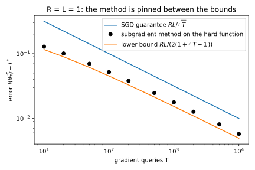
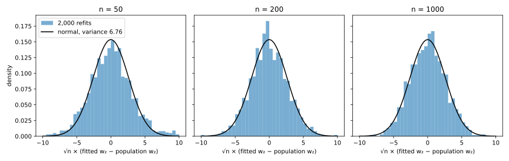
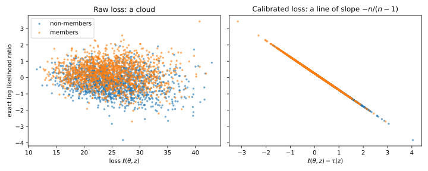

# Optimization and estimation

This appendix proves six results that the chapters on optimization, generalization and attacks use without deriving them in full. The first four are about gradient methods on convex functions. Convexity can be recognized in three ways, and on a strongly convex function gradient descent (GD) closes the gap to the minimum by a constant factor per step. On a convex smooth function, a small enough gradient step never pushes two points apart. And on functions whose slope is bounded (Lipschitz functions), no gradient method can beat the rate of stochastic gradient descent (SGD), one over the square root of the number of steps. The other results treat a trained model as a random object, random because its training set is. Here the appendix finds the limit of the error of the 1-nearest-neighbour rule, and shows that the parameters fitted by logistic regression are approximately Gaussian, with a formula for how much one record moves them. It ends by showing when the best attack on the membership of a target record looks at the parameters only through that record's loss. @tbl-apx-opt-map lists where each result is stated or used.

| Derivation | Where the book states or uses it |
| --- | --- |
| Three tests for convexity; linear convergence of GD | @sec-opt-definitions and the GD section of [Optimization](../part01-prerequisites/06-optimization.md) |
| Co-coercivity of the gradient | Fact 4 of [Algorithmic stability and generalization](../part01-prerequisites/07-stability-generalization.md); @sec-shuf-iteration |
| Lower bound $RL/\sqrt T$ for convex Lipschitz optimization | The section on SGD for convex Lipschitz objectives in [Optimization](../part01-prerequisites/06-optimization.md) |
| Limit of the 1-nearest-neighbour error | The 1-nearest-neighbour section of [Algorithmic stability and generalization](../part01-prerequisites/07-stability-generalization.md) |
| Fitted parameters are approximately Gaussian; influence of one record | @sec-prop-meta, @sec-mia-lira, @sec-mia-outliers, @sec-attr-inversion |
| The best membership attack depends on the loss | @sec-threat-models |

: The derivations of this appendix and the chapter sections that state or use them. {#tbl-apx-opt-map}

## Convexity three ways, and the linear rate of gradient descent {#sec-apx-opt-convexity}

### What the chapter uses

[Optimization](../part01-prerequisites/06-optimization.md) defines a convex function by its chords, saying that the straight segment between two points of the graph never dips below it. It then works with its tangents, @eq-first-order, which say that the graph lies above each of its tangent planes. It proves that chords give tangents and says "the other direction, from tangents to chords, is in the references". In @sec-opt-definitions it also states, citing Nesterov's *Lectures on Convex Optimization*, §2.1, that convexity and strong convexity can be read off the Hessian $\nabla^2 f$, the matrix of second derivatives, and that a strongly monotone gradient makes a function strongly convex. Strong monotonicity, @eq-strong-monotone, says that $\langle\nabla f(\theta) - \nabla f(\theta'), \theta - \theta'\rangle \ge \lambda\|\theta - \theta'\|^2$: moving from $\theta'$ to $\theta$ raises the slope along the direction of travel by at least $\lambda$ per unit of distance. Its logistic-regression example uses the Hessian test to conclude that the loss is convex. Finally, it proves the linear rate @eq-gd-linear, a geometric shrinking of the distance to the minimizer, only for a quadratic, while its interpretation says that GD converges linearly on every strongly convex smooth function.

Write $f$ for a differentiable function of the parameters $\theta \in \mathbb R^d$, and $\lambda \ge 0$ for a level of curvature. The four claims proved here are these. First, tangents give chords. Suppose $f$ lies above all its tangents, $f(\theta') \ge f(\theta) + \langle\nabla f(\theta), \theta' - \theta\rangle$ for all points $\theta$ and $\theta'$. Then, for every mixing weight $\omega \in [0, 1]$,
$$f(\omega \theta' + (1-\omega)\theta) \le \omega f(\theta') + (1-\omega)f(\theta).$$
Second, a Hessian with every eigenvalue at least $\lambda$ makes $f$ lie above each tangent by a bowl of curvature $\lambda$. In symbols, with $I$ the identity matrix, if $\nabla^2 f(\theta) \succeq \lambda I$ everywhere, then
$$f(\theta') \ge f(\theta) + \langle\nabla f(\theta), \theta' - \theta\rangle + \frac\lambda2\|\theta' - \theta\|^2.$$ {#eq-apx-opt-strong}
This inequality is what **$\lambda$-strongly convex** means, and with $\lambda = 0$ it is convexity. The Hessian test also works backwards for $\lambda = 0$: a convex twice-differentiable $f$ has $\nabla^2 f \succeq 0$. Third, a strongly monotone gradient gives @eq-apx-opt-strong without any second derivatives.

The fourth claim is about GD on the training objective. Take an empirical risk $\mathcal L(\theta; D)$, written $\mathcal L(\theta)$ here because the dataset $D$ stays fixed. Let it be $\lambda$-strongly convex, with minimum value $\mathcal L^*$, and let it also be $\beta$-smooth, so that no curvature exceeds the number $\beta$, and write $\kappa = \beta/\lambda$ for its condition number. Then GD with the learning rate $\eta = 1/\beta$ shrinks the gap to the minimum by the factor $1 - 1/\kappa$ at every step, where $\theta_t$ is the point reached after $t$ steps:
$$\mathcal L(\theta_t) - \mathcal L^* \le \left(1 - \frac1\kappa\right)^t\big(\mathcal L(\theta_0) - \mathcal L^*\big).$$ {#eq-apx-opt-gd-values}
And when $\mathcal L$ is twice differentiable with $\lambda I \preceq \nabla^2 \mathcal L \preceq \beta I$, the chapter's distance bound @eq-gd-linear holds exactly as stated for the quadratic.

### The idea

To get a chord from tangents, look at the mixed point $z = \omega \theta' + (1-\omega)\theta$ and draw the tangent there. The graph lies above this tangent at both ends, $\theta$ and $\theta'$, so it still lies above it after you average the two endpoint values with the weights $1 - \omega$ and $\omega$. The tangent is a straight line, so its weighted average over the two ends is its value at the weighted average of the ends, which is $z$ itself. So the average of the function values is at least the tangent's value at $z$, which is $f(z)$. Take $f(\theta) = \theta^2$, $\theta = 0$, $\theta' = 2$ and $\omega = \frac12$, so $z = 1$. The tangent at 1 is $1 + 2(\theta - 1)$. At the two ends it gives $-1$ and $3$, below the function values 0 and 4. The two tangent values average to $1 = f(z)$, and the function values average to 2, which is at least 1.

The Hessian test works one line at a time. Restricted to the line from $\theta$ to $\theta'$, the function is a function of one variable whose second derivative is at least $\lambda$ times the squared length of the step. Its slope therefore grows at least linearly along the line, and integrating twice gives the bowl.

The linear rate combines two inequalities. The chapter shows that a GD step with the learning rate $\eta = 1/\beta$ (the learning rate is also called the step size) lowers $\mathcal L$ by at least $\|\nabla \mathcal L\|^2/(2\beta)$. Strong convexity adds that the gradient cannot be small while the gap is large: the gap is at most $\|\nabla \mathcal L\|^2/(2\lambda)$. So each step removes at least the fraction $\lambda/\beta = 1/\kappa$ of the gap that remains.

### Derivation

1. **Tangents give chords.** Let $z = \omega \theta' + (1-\omega)\theta$. The tangent inequality at $z$, applied towards $\theta$ and towards $\theta'$, gives $f(\theta) \ge f(z) + \langle\nabla f(z), \theta - z\rangle$ and $f(\theta') \ge f(z) + \langle\nabla f(z), \theta' - z\rangle$. Multiply the first by $1 - \omega$ and the second by $\omega$, and add. The inner products combine into $\langle\nabla f(z), (1-\omega)\theta + \omega \theta' - z\rangle$, which is zero because the vector on the right is $z - z$. What is left is $(1-\omega)f(\theta) + \omega f(\theta') \ge f(z)$, the chord inequality. @fig-apx-opt-convexity (left) draws the two gaps and their average.
2. **A curvature bound gives the bowl.** Fix $\theta$ and $\theta'$, and let $u = \theta' - \theta$ be the step between them. Walking a fraction $s \in [0, 1]$ of that step gives the one-variable function $g(s) = f(\theta + su)$, the values of $f$ along the segment. By the chain rule, $g'(s) = \langle\nabla f(\theta + su), u\rangle$ and $g''(s) = u^\top\nabla^2 f(\theta + su)\,u$. A symmetric matrix $A$ satisfies $A \succeq \lambda I$ exactly when $u^\top Au \ge \lambda\|u\|^2$ for every $u$, so the curvature bound says $g''(s) \ge \lambda\|u\|^2$. Now integrate twice. By the fundamental theorem of calculus, the slope at $s$ is the slope at 0 plus the integral of $g''$ from 0 to $s$, so $g'(s) \ge g'(0) + \lambda s\|u\|^2$. Integrating again over $s \in [0, 1]$ gives $g(1) \ge g(0) + g'(0) + \frac\lambda2\|u\|^2$, which is @eq-apx-opt-strong written in terms of $f$.
3. **And back: convexity gives a Hessian with no negative eigenvalue.** Step 5 of @sec-opt-definitions, with $\lambda = 0$, shows that a convex $f$ has a monotone gradient, $\langle\nabla f(\theta + su) - \nabla f(\theta), su\rangle \ge 0$. In terms of $g$ this says $s\,(g'(s) - g'(0)) \ge 0$. Divide by $s^2$ and let $s \to 0$: the ratio $(g'(s) - g'(0))/s$ tends to $g''(0) = u^\top\nabla^2 f(\theta)u$, so that is at least 0 for every direction $u$.
4. **Strong monotonicity gives the bowl.** Keep the same $g$. Strong monotonicity @eq-strong-monotone, applied to the points $\theta + su$ and $\theta$, says $\langle\nabla f(\theta + su) - \nabla f(\theta), su\rangle \ge \lambda s^2\|u\|^2$. Dividing by $s > 0$ gives $g'(s) - g'(0) \ge \lambda s\|u\|^2$, which is the inequality of step 2 obtained without second derivatives. Integrating it over $s \in [0, 1]$ again gives @eq-apx-opt-strong.
5. **A small gradient means a small gap.** Apply @eq-apx-opt-strong at a point $\theta$ towards every other point $\theta'$. The right side is a parabola in $\theta'$, and completing the square shows that its lowest value is $\mathcal L(\theta) - \|\nabla \mathcal L(\theta)\|^2/(2\lambda)$, reached at $\theta' = \theta - \nabla \mathcal L(\theta)/\lambda$. Every value of $\mathcal L$ is above the right side, and so above that lowest value. In particular $\mathcal L^* \ge \mathcal L(\theta) - \|\nabla \mathcal L(\theta)\|^2/(2\lambda)$, which rearranges to the **Polyak–Łojasiewicz inequality**:
$$\mathcal L(\theta) - \mathcal L^* \le \frac{\|\nabla \mathcal L(\theta)\|^2}{2\lambda}.$$ {#eq-apx-opt-pl}
6. **Each step removes a fixed fraction of the gap.** The chapter derives from the descent lemma @eq-descent-lemma that one GD step with the learning rate $\eta = 1/\beta$ gives $\mathcal L(\theta_{t+1}) \le \mathcal L(\theta_t) - \|\nabla \mathcal L(\theta_t)\|^2/(2\beta)$. Subtract $\mathcal L^*$ from both sides. By @eq-apx-opt-pl, $\|\nabla \mathcal L(\theta_t)\|^2 \ge 2\lambda(\mathcal L(\theta_t) - \mathcal L^*)$, so the subtracted term is at least $\frac\lambda\beta(\mathcal L(\theta_t) - \mathcal L^*)$. Hence $\mathcal L(\theta_{t+1}) - \mathcal L^* \le (1 - 1/\kappa)(\mathcal L(\theta_t) - \mathcal L^*)$, and repeating this $t$ times gives @eq-apx-opt-gd-values.
7. **The distance bound, when second derivatives exist.** Write $\theta^*$ for the minimizer. It has zero gradient, so the GD step can be written as $\theta_{t+1} - \theta^* = (\theta_t - \theta^*) - \frac1\beta(\nabla \mathcal L(\theta_t) - \nabla \mathcal L(\theta^*))$. Step 4 of @sec-opt-definitions writes the gradient difference as $\bar H_t(\theta_t - \theta^*)$, where $\bar H_t = \int_0^1\nabla^2 \mathcal L(\theta^* + s(\theta_t - \theta^*))\,ds$ is the average Hessian along the segment. For a unit vector $u$, $u^\top\bar H_tu$ is an average of numbers $u^\top\nabla^2 \mathcal L\,u$ that all lie in $[\lambda, \beta]$, so it lies there too. The smallest and largest values of $u^\top Au$ over unit vectors are the extreme eigenvalues of a symmetric $A$, so every eigenvalue of $\bar H_t$ is in $[\lambda, \beta]$. Substituting $\bar H_t(\theta_t - \theta^*)$ for the gradient difference in the GD step gives $\theta_{t+1} - \theta^* = (I - \bar H_t/\beta)(\theta_t - \theta^*)$, a matrix with eigenvalues between 0 and $1 - 1/\kappa$ applied to the error. This is the quadratic's step 1 with the fixed $H$ replaced by $\bar H_t$, and its steps 2 and 3 then go through unchanged and give @eq-gd-linear.

Step 7 also gives a faster rate for the gap. The gradient vanishes at $\theta^*$, so the descent lemma at $\theta^*$ gives $\mathcal L(\theta_t) - \mathcal L^* \le \frac\beta2\|\theta_t - \theta^*\|^2$, and with @eq-gd-linear the gap falls like $(1 - 1/\kappa)^{2t}$. That exponent is twice the one in @eq-apx-opt-gd-values. The slower rate is the price of an argument that uses only first derivatives.

{#fig-apx-opt-convexity}

### Checking it

The script uses the logistic data of the optimization chapter: $n = 1{,}000$ records with $x$ uniform on the unit sphere in $\mathbb R^5$ and labels from a logistic model. It adds a ridge penalty $\frac\lambda2\|\theta\|^2$ with $\lambda = 0.01$. Each $x$ has length 1, so the logistic curvature is at most $\frac14$, and the ridge adds $\lambda$. So $\beta = 0.26$ and $\kappa = 26$. Over 2,000 random pairs of points in the ball of radius 5, the smallest ratio of the tangent gap $\mathcal L(\theta') - \mathcal L(\theta) - \langle\nabla \mathcal L(\theta), \theta' - \theta\rangle$ to $\frac12\|\theta' - \theta\|^2$ is 0.0372, above $\lambda = 0.01$ as @eq-apx-opt-strong requires.

GD from $\theta_0 = 0$ satisfies both bounds with room to spare. Over the first 40 steps, the gap shrinks by a factor of at most 0.7131 per step and the distance by at most 0.8445, both below $1 - 1/\kappa = 0.9615$. After 25 steps the gap is $1.22\times10^{-5}$, against $5.30\times10^{-2}$ from @eq-apx-opt-gd-values. After 50 steps it is $2.59\times10^{-9}$, against $1.99\times10^{-2}$.

The bounds are loose here because they know only the curvature $\lambda = 0.01$ of the penalty, while the data add curvature of their own. At the minimizer, the smallest eigenvalue of $\nabla^2 \mathcal L$ is 0.0404. The rate of step 7 with that curvature in place of $\lambda$ is $(1 - 0.0404/0.26)^2 = 0.713$ per step, and the measured rate between steps 20 and 40 is 0.712. So the form of the rate is exact, and only the curvature it is given is pessimistic. @fig-apx-opt-gd-linear shows the run.

{#fig-apx-opt-gd-linear}

### What it does not cover

The distance bound @eq-gd-linear was proved here only for twice-differentiable $\mathcal L$. It holds without second derivatives as well. That proof applies the co-coercivity of the next section to $\mathcal L - \frac\lambda2\|\theta\|^2$, which is convex and $(\beta - \lambda)$-smooth (Nesterov 2018, Theorem 2.1.12), and it is longer than the short argument of step 7. The gap bound @eq-apx-opt-gd-values needs only the descent lemma and @eq-apx-opt-pl, so it holds for any function that satisfies the Polyak–Łojasiewicz inequality, even one that is not convex (Karimi, Nutini & Schmidt 2016).

## The gradient of a convex smooth function is co-coercive {#sec-apx-opt-cocoercive}

### What the chapter uses

Fact 4 of [Algorithmic stability and generalization](../part01-prerequisites/07-stability-generalization.md) states that the gradient of a convex $\beta$-smooth function $f$ is **co-coercive**. In words, two gradients that differ by a lot must come from points that are far apart along the direction of that difference. For all $u$ and $v$,
$$\langle\nabla f(u) - \nabla f(v),\, u - v\rangle \ge \frac1\beta\|\nabla f(u) - \nabla f(v)\|^2.$$ {#eq-apx-opt-cocoercive}
The chapter cites Nesterov's Theorem 2.1.5 and says "the proof needs more than a few lines". It then derives from @eq-apx-opt-cocoercive that a gradient step $\psi(\theta) = \theta - \eta\nabla f(\theta)$ with $0 \le \eta \le 2/\beta$ is non-expansive, $\|\psi(u) - \psi(v)\| \le \|u - v\|$. That fact drives the stability bound @eq-stability-hrs for SGD, and @sec-shuf-iteration uses the same contraction in amplification by iteration.

### The idea

Subtract from $f$ its tangent at $v$. The result, $\varphi$, is still convex and $\beta$-smooth, and its gradient is zero at $v$, so $v$ is its lowest point. Now stand at $u$ and take a gradient step on $\varphi$. By the descent lemma, the step lowers $\varphi$ by at least $\|\nabla\varphi(u)\|^2/(2\beta)$, and no step can go below the lowest value $\varphi(v)$. So $\varphi(u)$ must sit at least $\|\nabla\varphi(u)\|^2/(2\beta)$ above $\varphi(v)$. In words, a convex smooth function cannot have a steep slope close to its minimum. This gives a tangent inequality with an extra term. Writing it once from $u$ and once from $v$, and adding the two, gives @eq-apx-opt-cocoercive.

A one-dimensional case makes the inequality concrete. Take the logistic loss
$$f(\theta) = \ln(1 + e^{-\theta}),$$
whose slope is $f'(\theta) = -\sigma(-\theta)$, where $\sigma(s) = 1/(1 + e^{-s})$ is the logistic function, and whose curvature is at most $\beta = \frac14$. At the two points $u = 0$ and $v = 2$ the slopes are $-0.5000$ and $-0.1192$. The left side of @eq-apx-opt-cocoercive is $(-0.5000 + 0.1192)(0 - 2) = 0.7616$, and the right side is $0.3808^2/0.25 = 0.5800$, smaller as it should be. For the quadratic $f(\theta) = \frac\beta2 \theta^2$ the slope difference is $\beta(u - v)$, so both sides equal $\beta(u - v)^2$, and the inequality is tight.

### Derivation

1. **Shift the minimum to $v$.** Define $\varphi(\theta) = f(\theta) - \langle\nabla f(v), \theta\rangle$. Subtracting a linear function changes neither the curvature nor the differences between gradients, so $\varphi$ is convex and $\beta$-smooth. Its gradient is $\nabla\varphi(\theta) = \nabla f(\theta) - \nabla f(v)$, which is zero at $\theta = v$. The tangent inequality @eq-first-order for $\varphi$ at $v$ then reads $\varphi(\theta) \ge \varphi(v)$ for every $\theta$, so $v$ minimizes $\varphi$.
2. **A gradient step from $u$ cannot go below the minimum.** Apply the descent lemma @eq-descent-lemma to $\varphi$ at $u$, with the step $\theta' = u - \nabla\varphi(u)/\beta$. The computation is the chapter's GD step with $\beta = \beta$, and it gives $\varphi(\theta') \le \varphi(u) - \|\nabla\varphi(u)\|^2/(2\beta)$. Since $\varphi(v) \le \varphi(\theta')$ by step 1, we get $\varphi(v) \le \varphi(u) - \|\nabla\varphi(u)\|^2/(2\beta)$.
3. **Return to $f$.** Write $\Delta = \nabla f(u) - \nabla f(v)$, which is $\nabla\varphi(u)$. The difference $\varphi(u) - \varphi(v)$ is $f(u) - f(v) - \langle\nabla f(v), u - v\rangle$, so step 2 becomes a tangent inequality with an extra term:
$$f(u) \ge f(v) + \langle\nabla f(v), u - v\rangle + \frac{1}{2\beta}\|\Delta\|^2.$$
4. **Swap and add.** The same inequality with $u$ and $v$ exchanged is $f(v) \ge f(u) + \langle\nabla f(u), v - u\rangle + \frac{1}{2\beta}\|\Delta\|^2$, because exchanging the points only flips the sign of $\Delta$. Adding the two, the function values cancel and the inner products combine into $-\langle\Delta, u - v\rangle$, which leaves $0 \ge -\langle\Delta, u - v\rangle + \frac1\beta\|\Delta\|^2$. That is @eq-apx-opt-cocoercive.
5. **The step is non-expansive.** This is the chapter's own argument, repeated so that the page stands alone. Expand $\psi(u) - \psi(v) = (u - v) - \eta\Delta$ as a square and replace $\langle\Delta, u - v\rangle$ by the smaller $\|\Delta\|^2/\beta$:
$$\|\psi(u) - \psi(v)\|^2 = \|u - v\|^2 - 2\eta\langle\Delta, u - v\rangle + \eta^2\|\Delta\|^2 \le \|u - v\|^2 - \eta\Big(\frac2\beta - \eta\Big)\|\Delta\|^2.$$
For $0 \le \eta \le 2/\beta$ the subtracted term is not negative, so the distance does not grow.

### Checking it

The script draws 500 pairs $(u, v)$ from a normal distribution with standard deviation 4 and evaluates both sides of @eq-apx-opt-cocoercive for the logistic loss. The smallest ratio of left to right side is 1.0006, so the inequality holds and is nearly tight. The tight pairs lie near 0, where the curvature of the logistic loss is close to $\frac14$ and the loss looks like the quadratic of the example. For the five-dimensional logistic risk of the previous section, the smallest ratio over 2,000 pairs is 5.3704. That risk curves much less than $\frac14$ in most directions, so the bound has slack there.

The non-expansive step behaves as step 5 says. Over the 500 pairs, the largest ratio $|\psi(u) - \psi(v)|/|u - v|$ is 0.9993 at $\eta = 4$ and 0.9988 at $\eta = 8 = 2/\beta$. At $\eta = 10$ it is 1.4985, so the step pushes some pairs apart. @fig-apx-opt-cocoercive shows both checks.

{#fig-apx-opt-cocoercive}

### What it does not cover

Both convexity and smoothness are needed. Without convexity, step 1 fails, because a zero gradient no longer marks a minimum. A gradient step can then expand distances by up to the factor $1 + \eta\beta$, as on the concave function $-\frac\beta2\theta^2$, whose step multiplies every distance by exactly $1 + \eta\beta$. Without smoothness there is no descent lemma, and the gradient of a function with a kink, such as $|\theta|$, jumps by 2 between points arbitrarily close together, so no constant $\beta$ can work.

## No gradient method beats $RL/\sqrt T$ on every convex Lipschitz function {#sec-apx-opt-lower}

### What the chapter uses

The section on SGD for convex Lipschitz objectives in [Optimization](../part01-prerequisites/06-optimization.md) proves @eq-sgd-convex, an error of at most $RL/\sqrt T$ after $T$ steps. Here $R$ is the distance from the start to the minimizer, and $L$ is the Lipschitz constant, the largest size of a gradient. Its interpretation then says that the rate cannot be improved: "there are convex $L$-Lipschitz functions on which every method that only queries gradients has error at least of order $RL/\sqrt T$ after $T$ queries (Bubeck 2015, §3.5)."

This section proves that claim for the methods the book uses. A method is **span-restricted** if it starts at $\theta_1 = 0$ and every point it queries or outputs is a combination of the gradients it has received so far. Gradient descent and SGD, with a constant or a changing learning rate, with projection onto a ball centred at 0 (which only rescales a vector), and with averaged iterates, are all span-restricted. The claim is that in dimension $d \ge T + 1$ there is a convex function that is $L$-Lipschitz on the ball $\{\|\theta\| \le R\}$, with its minimizer at distance $R$ from the start, on which every span-restricted method, after $T$ gradient queries, outputs a point $\theta$ with
$$f(\theta) - f^* \ge \frac{RL}{2(1 + \sqrt{T + 1})}.$$ {#eq-apx-opt-lower}
The right side is close to half of $RL/\sqrt T$ for large $T$, so the SGD guarantee is optimal up to a factor of about 2.

### The idea

The hard function hides its minimum in many coordinates and reveals them one gradient at a time. It uses one more coordinate than the method has queries, $k = T + 1$. Its first term is a positive constant $\gamma$ times the largest of the first $k$ coordinates, and its second is a small bowl with a positive weight $\alpha$. Both constants are chosen below:
$$f(\theta) = \gamma\max_{i \le k} \theta_i + \frac\alpha2\|\theta\|^2.$$
Its lowest point spreads equal negative values over all $k$ coordinates, which brings the largest coordinate down. But the gradient at a point whose later coordinates are all zero involves only one new coordinate, the first place where the largest value is reached. So after $T$ gradients the method has touched at most $T$ coordinates. The last coordinate is still zero, so the largest coordinate is at least zero, and $f$ is at least zero. The minimum is negative, and its distance below zero is the bound.

Take $T = 2$, so $k = 3$, with $R = L = 1$. The constants are then $\gamma = 0.6340$ and $\alpha = 0.3660$, and the minimum is $f^* = -0.1830$. The first query is at $\theta_1 = 0$, where all three coordinates tie at 0, so the gradient points along the first coordinate. The method's next point has the form $(a, 0, 0)$. Whatever $a$ is, the largest coordinate is first reached at the first or the second position, so the second gradient involves only the first two coordinates. Any output is then of the form $(a', b', 0)$, its third coordinate makes the largest coordinate at least 0, and $f \ge 0$. The error is at least $0.1830$, which is $1/(2(1 + \sqrt3))$, the right side of @eq-apx-opt-lower.

### Derivation

1. **The minimum.** The largest of $k$ numbers is at least their average, so $f(\theta) \ge \sum_{i \le k}\big(\frac\gamma k\theta_i + \frac\alpha2\theta_i^2\big) + \frac\alpha2\sum_{i > k}\theta_i^2$. Each term of the first sum is a parabola in $\theta_i$ whose lowest value is $-\gamma^2/(2\alpha k^2)$, at $\theta_i = -\gamma/(\alpha k)$. The terms of the second sum are at least 0. Adding up, $f(\theta) \ge -\gamma^2/(2\alpha k)$. The point with $\theta_i = -\gamma/(\alpha k)$ for $i \le k$ and 0 elsewhere reaches this value, because its first $k$ coordinates are equal and so their largest equals their average. So
$$f^* = -\frac{\gamma^2}{2\alpha k}, \qquad \|\theta^*\| = \frac{\gamma}{\alpha\sqrt k}.$$
2. **The constants.** The max term changes by at most $\gamma$ times the distance moved, since no coordinate changes by more than the distance. On the ball of radius $R$ the quadratic term changes by at most $\alpha R$ times the distance, since $\frac\alpha2(\|\theta\|^2 - \|\theta'\|^2) = \frac\alpha2\langle \theta + \theta', \theta - \theta'\rangle$ and $\|\theta + \theta'\| \le 2R$. So $f$ is $(\gamma + \alpha R)$-Lipschitz on the ball. Asking for $\gamma + \alpha R = L$ and $\|\theta^*\| = R$, and solving the two equations, gives
$$\gamma = \frac{L\sqrt k}{1 + \sqrt k}, \qquad \alpha = \frac{L}{R(1 + \sqrt k)}, \qquad -f^* = \frac{RL}{2(1 + \sqrt k)}.$$
3. **The gradients the method sees.** At a point $\theta$, let $i$ be the first index at which $\theta_1, \dots, \theta_k$ reach their largest value, and return $g = \gamma e_i + \alpha \theta$, where $e_i$ is the $i$-th unit vector. This is a legitimate gradient for a function with a kink, a subgradient as in the chapter: its tangent stays below the graph. The reason is that $\max_j \theta'_j \ge \theta'_i = \max_j \theta_j + \langle e_i, \theta' - \theta\rangle$, while the quadratic term lies above its own tangent. Adding the two gives $f(\theta') \ge f(\theta) + \langle g, \theta' - \theta\rangle$.
4. **One new coordinate per query.** Write $V_s$ for the vectors whose coordinates after the $s$-th are zero. The claim is that the $s$-th query point lies in $V_{s-1}$ and its gradient in $V_s$. The first query is at $0 \in V_0$. Suppose the $s$-th query point $\theta_s$ is in $V_{s-1}$, with $s \le k$. Its coordinates $s, \dots, k$ are zero, so its largest coordinate among the first $k$ is at least 0. If that largest value is 0, coordinate $s$ reaches it, so the first index that does is at most $s$. If it is positive, it is reached among the first $s - 1$ coordinates. Either way $e_i \in V_s$, and $\alpha \theta_s \in V_{s-1}$, so $g_s \in V_s$. A span-restricted method then chooses $\theta_{s+1}$ in $V_s$.
5. **The error after $T$ queries.** Any output lies in the span of $g_1, \dots, g_T$, which is inside $V_T$. Its coordinate $k = T + 1$ is zero, so its largest coordinate is at least 0 and $f(\theta) \ge \frac\alpha2\|\theta\|^2 \ge 0$. The error is therefore at least $-f^*$, which by step 2 with $k = T + 1$ is @eq-apx-opt-lower.

### Checking it

The script runs the projected subgradient method of the chapter, with the learning rate $\eta = R/(L\sqrt T)$ and the averaged iterate, against these gradients, with $R = L = 1$. @tbl-apx-opt-lower shows that its error always lies between the two bounds.

| $T$ | Lower bound @eq-apx-opt-lower | Subgradient method | SGD guarantee $RL/\sqrt T$ |
| --- | --- | --- | --- |
| 10 | 0.1158 | 0.1285 | 0.3162 |
| 100 | 0.0452 | 0.0519 | 0.1000 |
| 1,000 | 0.0153 | 0.0178 | 0.0316 |
| 10,000 | 0.0050 | 0.0058 | 0.0100 |

: Error of the averaged iterate on the hard function, $R = L = 1$, against the lower and upper bounds. {#tbl-apx-opt-lower}

No iterate ever has a negative value of $f$, as step 5 predicts. The method sits just above the lower bound, about 17% above it at $T = 10{,}000$ (a ratio of 1.17), so the lower bound is close to exact for this method. The upper bound is about twice the lower one, as the ratio $2(1 + \sqrt{T + 1})/\sqrt T$ approaches 2. @fig-apx-opt-lower shows the three on a log scale.

{#fig-apx-opt-lower}

### What it does not cover

The proof needs the method to stay in the span of its gradients. Nemirovski & Yudin (1983) remove that condition, and prove the same order of bound for every method that uses only gradients, by hiding the coordinates in a random rotation that the method cannot know in advance; their argument is longer and stays cited. The dimension must also be at least $T + 1$, because in low dimension, methods that cut away part of the space at each query, such as the ellipsoid method, have an error that shrinks like $e^{-cT/d}$ for a constant $c$ (Bubeck 2015, ch. 2). Finally, the bound is for functions that are not smooth. On a smooth function GD with exact gradients does better than $1/\sqrt T$, and the $1/\sqrt T$ of SGD then comes from its gradient noise.

## The 1-nearest-neighbour error tends to $\mathbb E[2p(1-p)]$ {#sec-apx-opt-nn}

### What the chapter uses

The nearest neighbour (NN) rule with one neighbour, 1-NN, predicts the label of the closest training point. [Algorithmic stability and generalization](../part01-prerequisites/07-stability-generalization.md) states, citing Cover & Hart (1967), that its test error tends to $\mathbb E[2p(x)(1 - p(x))]$ as the number $n$ of training points grows. Here $p(x) = \Pr[y = 1 \mid x]$ is the probability that the label at $x$ is $+1$. Its argument is a sketch, whose step 3 says that for large $n$ "the nearest neighbour of a test point $x$ lies at (essentially) $x$". In its running example the limit is 0.338 and the Bayes error, the error of the best possible classifier, is 0.250.

The precise statement proved here is this. Let the training pairs $(x_i, y_i)$ and the test pair $(x, y)$ be independent draws from the same distribution. Assume that $x$ lies in a closed and bounded set $K$, and that $p$ is continuous on $K$. Ties between equally near neighbours may be broken by any rule that looks only at the points, not at their labels. Then the test error $R_n$ of 1-NN, averaged over the training set and the test pair, satisfies
$$\lim_{n\to\infty}R_n = \mathbb E\big[2p(x)(1 - p(x))\big].$$ {#eq-apx-opt-nn}

### The idea

The argument has two parts. First, the nearest neighbour gets close. For a fixed test point, the chance that none of the $n$ training points lands within a distance $r$ of it is $(1 - P)^n$, where $P$ is the chance that one point lands there. As long as $P > 0$, this goes to zero. Second, the labels behave like two coins. Given where all the points are, the neighbour's label is $+1$ with probability $p(x')$, where $x'$ is the neighbour, and the test label is $+1$ with probability $p(x)$, independently. They disagree with probability
$$e(x, x') = p(x)(1 - p(x')) + (1 - p(x))p(x').$$
As $x'$ approaches $x$, $e(x, x')$ approaches $2p(x)(1 - p(x))$.

@tbl-apx-opt-nn-coins shows the two coins at a test point with $p(x) = 0.8$. A neighbour where $p = 0.7$ disagrees with probability 0.38. A neighbour at the same $p$ disagrees with probability 0.32, which is $2 \times 0.8 \times 0.2$. Even a perfect neighbour disagrees often, because both labels are noisy.

| Neighbour's $p(x')$ | Test $+1$, neighbour $-1$ | Test $-1$, neighbour $+1$ | Disagree |
| --- | --- | --- | --- |
| 0.7 | $0.8 \times 0.3 = 0.24$ | $0.2 \times 0.7 = 0.14$ | 0.38 |
| 0.8 | $0.8 \times 0.2 = 0.16$ | $0.2 \times 0.8 = 0.16$ | 0.32 |

: The chance that the 1-NN prediction is wrong at a test point with $p(x) = 0.8$, for two neighbours. {#tbl-apx-opt-nn-coins}

### Derivation

1. **The error given the points.** Fix all the feature vectors, of the training set and the test point. The nearest neighbour $x'_n$ is then fixed, since it depends only on the points. Given the points, the labels are independent, each $+1$ with probability $p$ at its own point. The neighbour was chosen without looking at labels, so its label is still $+1$ with probability $p(x'_n)$. The prediction is wrong when the two labels differ, which has probability $e(x, x'_n)$. Averaging over the points gives $R_n = \mathbb E[e(x, x'_n)]$.
2. **The nearest neighbour gets close.** Fix the test point $x$ and a radius $r > 0$, and write $P_r(x)$ for the probability that one training point lands within distance $r$ of $x$. The training points are independent, so the probability that none of them does is
$$\Pr\big[\|x'_n - x\| > r \,\big|\, x\big] = (1 - P_r(x))^n,$$
which tends to 0 whenever $P_r(x) > 0$.
3. **Almost every test point has $P_r(x) > 0$.** Suppose some ball around $x$ has probability zero. Then a smaller ball inside it, with a centre whose coordinates are fractions and a radius that is a fraction, also has probability zero and still contains $x$. Such a ball exists because fractions come arbitrarily close to any number: take a centre within $r/3$ of $x$ and a radius between $r/3$ and $2r/3$, where $r$ is the radius of the original ball. There are only countably many such balls, and each of them that has probability zero contributes nothing, so by the union bound their union has probability zero. So the test points with a zero-probability ball around them have probability zero together. For all other test points, step 2 applies for every $r$. The averaged probability $\Pr[\|x'_n - x\| > r] = \mathbb E[(1 - P_r(x))^n]$ then tends to 0. This uses the **bounded convergence theorem**: if quantities between 0 and 1 tend to 0 at almost every point, so does their average.
4. **The error converges.** Expanding $e$ gives $e(x, x') - e(x, x) = (p(x') - p(x))(1 - 2p(x))$, so $|e(x, x') - e(x, x)| \le |p(x') - p(x)|$. A continuous function on a closed and bounded set is uniformly continuous. So for every tolerance $\xi > 0$ there is an $r > 0$ with $|p(x') - p(x)| \le \xi$ whenever $\|x' - x\| \le r$. Split the average according to whether the neighbour is within $r$. Inside, the difference is at most $\xi$, and outside it is at most 1, so
$$\big|R_n - \mathbb E[2p(1 - p)]\big| \le \mathbb E\big|e(x, x'_n) - e(x, x)\big| \le \xi + \Pr\big[\|x'_n - x\| > r\big].$$
By step 3 the last term tends to 0. The limit of the left side is therefore at most $\xi$, for every $\xi > 0$, which proves @eq-apx-opt-nn.

### Checking it

In the chapter's running example, $x$ is uniform on the unit sphere in $\mathbb R^{10}$ and $p(x) = \sigma(5x_1)$. The script computes the Bayes error $\mathbb E[\min(p, 1 - p)] = 0.250$ and the limit $\mathbb E[2p(1 - p)] = 0.338$, by numerical integration over the first coordinate. The sphere looks the same from every point, so every test point sees the same $P_r$, so the median distance to the nearest neighbour can be computed exactly, by solving $(1 - P_r)^n = \frac12$ for $r$. @tbl-apx-opt-nn-dist shows that it shrinks very slowly.

| Training points $n$ | 100 | 4,000 | $10^6$ | $10^9$ |
| --- | --- | --- | --- | --- |
| Median distance to the nearest neighbour | 0.758 | 0.489 | 0.261 | 0.121 |

: Exact median distance from a test point to its nearest neighbour, for points uniform on the unit sphere in $\mathbb R^{10}$. {#tbl-apx-opt-nn-dist}

The sphere in $\mathbb R^{10}$ is a nine-dimensional surface, so $P_r$ grows like $r^9$ and the distance shrinks only like $n^{-1/9}$. That is why the error approaches its limit slowly. In the script's table, with 4,000 test points, the measured 1-NN error is 0.398 at $n = 100$ and 0.356 at $n = 4{,}000$. The average of $e(x, x'_n)$ over the same test points, which step 1 says has the same mean, is 0.392 and 0.358. Both are still above 0.338, because at $n = 4{,}000$ the typical neighbour is still about 0.49 away, where $p$ differs noticeably. @fig-apx-opt-nn shows both parts of the argument.

![Left: the median distance from a test point to its nearest neighbour against $n$, exact (line) and simulated (dots), for points uniform on the unit sphere in $\mathbb R^{10}$. Right: the measured 1-NN test error and the average of $p(1 - p') + (1 - p)p'$ over the same 20,000 test points, with the limit $\mathbb E[2p(1 - p)] = 0.338$.](figures/apx_opt_nn.svg){#fig-apx-opt-nn}

### What it does not cover

The limit holds without continuity of $p$, by a longer argument that approximates $p$ by continuous functions, which is left to Devroye, Györfi & Lugosi (1996, ch. 5). The proof says nothing about the speed of convergence, and the example shows why none can be given without more assumptions: the speed depends on the dimension of the data. Finally, $k$-NN with $k$ growing and $k/n$ shrinking converges to the Bayes error itself, because averaging many neighbours' labels estimates $p(x)$ rather than drawing one more coin (Stone 1977).

## Fitted parameters are approximately Gaussian, and one record moves them by its gradient {#sec-apx-opt-mest}

### What the chapter uses

@sec-prop-meta states that parameters fitted by minimizing an average loss, which statisticians call **M-estimators**, are approximately Gaussian, centred on the population fit with covariance $\Sigma_1/n$. Here $\Sigma_1 = H^{-1}GH^{-1}$ is the **sandwich covariance**, $H$ is the average curvature of the loss at the population fit, and $G$ is the covariance of one record's gradient there. The chapter gives a four-step sketch and cites "the standard asymptotic normality of M-estimators (van der Vaart 1998, ch. 5)". The statement feeds the attack accuracy @eq-prop-delta and the constant @eq-prop-kappa. @sec-mia-lira uses the same fact to explain why the margin $\phi_z$ is close to Gaussian over retrainings. @sec-mia-outliers explains in words which records have a large self-influence $\mu_{\mathrm{in}, z} - \mu_{\mathrm{out}, z}$, the numerator of the separation in @eq-mia-per-example. And @sec-attr-inversion asserts that as $n$ grows the model approaches the population's probabilities.

This section proves the result for logistic regression, the model all four chapters use. A record is $z = (x, y)$, with a feature vector $x$, which may include a constant 1 for an intercept, and a label $y = \pm1$. (The property-inference chapter writes the whole record as $x$; here the features get their own name.) The loss is $\ell(\theta; z) = \ln(1 + e^{-y\langle\theta, x\rangle})$. The fit $\hat\theta$ minimizes the training objective on the dataset $D = (z_1, \dots, z_n)$, here the average loss plus a ridge term, and the population fit $\theta^*$ minimizes its average over the data distribution $\mathcal D$:
$$\mathcal L(\theta; D) = \frac1n\sum_{i=1}^n\ell(\theta; z_i) + \frac\lambda2\|\theta\|^2, \qquad \mathcal L_{\mathcal D}(\theta) = \mathbb E_{z \sim \mathcal D}\,\ell(\theta; z) + \frac\lambda2\|\theta\|^2.$$
The ridge weight $\lambda \ge 0$ may be zero. (The property-inference chapter writes $\theta$ for the fit and $\theta(t)$ for the population fit. Here $\theta$ is any parameter vector, $\hat\theta$ the fit and $\theta^*$ the population fit.) The curvature and the gradient covariance are
$$H = \nabla^2 \mathcal L_{\mathcal D}(\theta^*), \qquad G = \mathbb E\big[g\,g^\top\big], \quad g = \nabla\ell(\theta^*; z) + \lambda\theta^*.$$
The assumptions are that the records are independent draws from one distribution, that $\mathbb E\|x\|^6$ is finite (true for bounded or Gaussian features, and needed so that the averages in step 2 have finite variance), and that $H$ has no zero eigenvalue. Write $h > 0$ for its smallest eigenvalue. The claim has two parts. First, $\hat\theta$ is within a distance of order $1/\sqrt n$ of $\theta^*$. Second, $\sqrt n(\hat\theta - \theta^*)$ is approximately Gaussian. It **converges in distribution** to a Gaussian, which means that for large $n$ the probability that it lands in any box or half-space approaches the probability for the Gaussian:
$$\sqrt n\,(\hat\theta - \theta^*) \to \mathcal N\big(0,\ H^{-1}GH^{-1}\big).$$ {#eq-apx-opt-mest}

The influence of one record is a statement about one fixed dataset, so it uses the membership-inference chapter's setting, with a ridge weight $\lambda > 0$ and the margin $\phi_z = y\langle\theta, x\rangle$ of a record $z = (x, y)$. Compare the fit $\hat\theta_D$ on a dataset $D$ that contains $z$ with the fit $\hat\theta_{-z}$ of the same objective with $z$'s term removed. Training on $z$ raises its margin by
$$\phi_z(\hat\theta_D) - \phi_z(\hat\theta_{-z}) = \frac1n\,\sigma(-\phi_z)\,x^\top H^{-1}x + O(1/n^2),$$ {#eq-apx-opt-influence}
where $\phi_z$ on the right is the margin under $\hat\theta_{-z}$, and $\sigma(s) = 1/(1 + e^{-s})$ is the logistic function. Here $H$ is the Hessian of the full training objective, with $z$'s term included, at $\hat\theta_{-z}$, and "removed" means that the other terms keep their weight $1/n$.

### The idea

The argument takes four moves. The first is that the fit is close to the population fit. With high probability the training objective curves upward by at least $h/2$ near $\theta^*$. Its gradient at $\theta^*$ is an average of $n$ independent terms with mean zero, so it has size about $1/\sqrt n$. A function that curves up by at least $h/2$ cannot have its minimum farther than about $2/h$ times the gradient away. The second move is that, near $\theta^*$, the gradient is almost linear. The condition "gradient zero at $\hat\theta$" then becomes, exactly, $0 = \nabla\mathcal L(\theta^*; D) + \bar H(\hat\theta - \theta^*)$, where $\bar H$ is the average Hessian between the two points. Solving it gives $\hat\theta - \theta^* = -\bar H^{-1}\nabla\mathcal L(\theta^*; D)$. The third move is that the average gradient is approximately Gaussian, by the central limit theorem, with covariance $G/n$. The fourth is that $\bar H$ approaches $H$, and multiplying a Gaussian vector by the matrix $-H^{-1}$ multiplies its covariance by $H^{-1}$ on both sides.

The simplest case shows why the covariance is a sandwich. For the loss $\frac12(\theta - a)^2$ of a number $a$, the fit is the sample mean. The curvature is $H = 1$ and the gradient $\theta^* - a$ has variance $G = \operatorname{Var}(a)$, so the sandwich gives the familiar $\operatorname{Var}(a)/n$. Doubling the loss to $(\theta - a)^2$ doubles the curvature and quadruples the gradient variance. The two copies of $H^{-1}$ undo the quadrupling, so the fit's variance does not change, as it should not, since the fit is still the mean.

### Derivation

1. **The curvature of the logistic loss changes slowly.** The Hessian of one record's loss is $s(\langle\theta, x\rangle)\,xx^\top$, with $s(m) = \sigma(m)(1 - \sigma(m))$. Its derivative is $s'(m) = \sigma(1 - \sigma)(1 - 2\sigma)$, whose largest size is $c = 1/(6\sqrt3) \approx 0.0962$. To see this, write $\sigma = \frac12 + v$, so that $|s'| = 2|v|(\frac14 - v^2)$, which is largest at $v = 1/(2\sqrt3)$. The matrix $xx^\top$ stretches no vector by more than $\|x\|^2$, and $|\langle\theta - \theta', x\rangle| \le \|\theta - \theta'\|\,\|x\|$, so the Hessian moves by at most $c\|x\|^3\|\theta - \theta'\|$. Averaging over the records, with $\hat M_3 = \frac1n\sum_i\|x_i\|^3$,
$$\big\|\nabla^2\mathcal L(\theta; D) - \nabla^2\mathcal L(\theta'; D)\big\| \le c\,\hat M_3\,\|\theta - \theta'\|.$$
2. **Three averages settle down.** Each of $\nabla^2\mathcal L(\theta^*; D)$, $\hat M_3$ and $\nabla\mathcal L(\theta^*; D)$ is an average of $n$ independent terms. Their means are $H$, the third moment $M_3 = \mathbb E\|x\|^3$, and 0. The last mean is 0 because $\theta^*$ minimizes $\mathcal L_{\mathcal D}$, so $\mathbb E g = \nabla \mathcal L_{\mathcal D}(\theta^*) = 0$. Their variances are finite, because the sixth moment is. By Chebyshev's inequality, an average of $n$ terms with variance $v$ strays from its mean by more than $a$ with probability at most $v/(na^2)$. (For a matrix, apply it to the sum of the squared entries, which is at least the square of the largest factor by which the matrix stretches a vector.) So each average is near its mean with probability tending to 1. Choose the radius $r = h/(8cM_3)$, whose role step 3 shows, and call $E_n$ the event that all three are near their means in the following sense:
$$\big\|\nabla^2\mathcal L(\theta^*; D) - H\big\| \le \frac h4, \qquad \hat M_3 \le 2M_3, \qquad \big\|\nabla\mathcal L(\theta^*; D)\big\| < \frac{hr}4.$$
Then $E_n$ holds with probability tending to 1. For the gradient there is even an exact formula for the mean square. The cross terms of independent mean-zero vectors average to zero, so
$$\mathbb E\big\|\nabla\mathcal L(\theta^*; D)\big\|^2 = \frac{\operatorname{tr}G}{n}.$$
3. **The objective curves up near $\theta^*$.** On $E_n$, take any $\theta$ within distance $r$ of $\theta^*$. By step 1 its Hessian differs from $\nabla^2\mathcal L(\theta^*; D)$ by at most $c \cdot 2M_3 \cdot r = h/4$, and that one differs from $H$ by at most $h/4$. Since $H \succeq hI$, every eigenvalue of $\nabla^2\mathcal L(\theta; D)$ is at least $h - h/4 - h/4 = h/2$. So, by step 2 of @sec-apx-opt-convexity applied to segments inside the ball, $\mathcal L(\cdot; D)$ is $(h/2)$-strongly convex on the ball of radius $r$ around $\theta^*$.
4. **The fit is inside the ball, and close.** On the sphere $\|\theta - \theta^*\| = r$, strong convexity and Cauchy–Schwarz give $\mathcal L(\theta; D) \ge \mathcal L(\theta^*; D) - \|\nabla\mathcal L(\theta^*; D)\|r + \frac h4r^2$. This is larger than $\mathcal L(\theta^*; D)$, by the third condition of $E_n$. A convex function that is higher on a whole sphere than at its centre cannot be lower anywhere outside. If some outside point $\theta$ had $\mathcal L(\theta; D) \le \mathcal L(\theta^*; D)$, the segment from $\theta^*$ to $\theta$ would cross the sphere, and by the chord inequality the value at the crossing would be at most $\mathcal L(\theta^*; D)$. So the minimizer $\hat\theta$ is inside the ball. There, consequence (a) of @sec-opt-definitions, with strong convexity $h/2$ and $\nabla\mathcal L(\hat\theta; D) = 0$, gives
$$\|\hat\theta - \theta^*\| \le \frac{2}{h}\,\|\nabla\mathcal L(\theta^*; D)\|,$$ {#eq-apx-opt-consistency}
whose square has mean at most $4\operatorname{tr}G/(h^2n)$ by step 2. So the fit is within a distance of order $1/\sqrt n$ of the population fit, and in particular it converges to it.
5. **An exact linear equation for the error.** The fit has zero gradient. By the fundamental theorem of calculus along the segment from $\theta^*$ to $\hat\theta$, as in step 4 of @sec-opt-definitions, $0 = \nabla\mathcal L(\hat\theta; D) = \nabla\mathcal L(\theta^*; D) + \bar H_n(\hat\theta - \theta^*)$. Here $\bar H_n$ is the average of $\nabla^2\mathcal L(\cdot; D)$ along the segment, whose eigenvalues are at least $h/2$ by step 3, so it can be inverted:
$$\hat\theta - \theta^* = -\bar H_n^{-1}\,\nabla\mathcal L(\theta^*; D).$$ {#eq-apx-opt-linear}
This is the chapter's step 2 with "$\approx$" replaced by "$=$" and $H$ replaced by $\bar H_n$.
6. **The average curvature approaches $H$.** By step 1, $\bar H_n$ differs from $\nabla^2\mathcal L(\theta^*; D)$ by at most $c\hat M_3\|\hat\theta - \theta^*\|/2$, which tends to 0 by step 4. By step 2, $\nabla^2\mathcal L(\theta^*; D)$ tends to $H$. The inverses follow, because $\bar H_n^{-1} - H^{-1} = \bar H_n^{-1}(H - \bar H_n)H^{-1}$ has size at most $\frac2h \cdot \frac1h\|H - \bar H_n\|$.
7. **The average gradient is approximately Gaussian.** The scaled gradient $\sqrt n\,\nabla\mathcal L(\theta^*; D) = \frac1{\sqrt n}\sum_ig_i$ is a scaled sum of independent vectors with mean 0 and covariance $G$. Take any fixed direction $a$. The numbers $\langle a, g_i\rangle$ are independent with mean 0 and variance $a^\top Ga$, so the central limit theorem in one dimension (@sec-apx-prob-clt) makes their scaled sum approximately $\mathcal N(0, a^\top Ga)$. That is the distribution of $\langle a, Y\rangle$ for $Y \sim \mathcal N(0, G)$. The **Cramér–Wold device** says that the distributions of all the one-dimensional views $\langle a, \cdot\rangle$ determine the distribution of a vector, also in the limit (van der Vaart 1998, §2.2). So $\sqrt n\,\nabla\mathcal L(\theta^*; D)$ approaches $\mathcal N(0, G)$.
8. **Combine.** Multiply @eq-apx-opt-linear by $\sqrt n$ and split it in two:
$$\sqrt n(\hat\theta - \theta^*) = -H^{-1}\sqrt n\,\nabla\mathcal L(\theta^*; D) + (H^{-1} - \bar H_n^{-1})\sqrt n\,\nabla\mathcal L(\theta^*; D).$$
By step 7 the first term approaches $-H^{-1}Y$. A linear map $A$ turns a Gaussian with covariance $G$ into one with covariance $AGA^\top$, which here is $H^{-1}GH^{-1}$ because $H$ is symmetric. In the second term, the matrix tends to 0 by step 6, while the vector has mean square $\operatorname{tr}G$ for every $n$. So their product tends to 0 in probability, by Chebyshev's inequality. Adding a term that tends to 0 in probability does not change the limiting distribution (Slutsky's lemma, van der Vaart 1998, Lemma 2.8). This proves @eq-apx-opt-mest. The event $E_n$ fails with probability tending to 0, so it changes no limit.
9. **When the model is right, $G = H$.** Suppose $\lambda = 0$ and the labels really follow the model, $\Pr[y = 1 \mid x] = \sigma(\langle\theta^*, x\rangle) = p$. One record's gradient is $-\sigma(-y\langle\theta^*, x\rangle)\,y\,x$, so $gg^\top$ is $(1 - p)^2xx^\top$ when $y = 1$, which has probability $p$, and $p^2xx^\top$ when $y = -1$. On average, given $x$, that is $p(1 - p)^2 + (1 - p)p^2 = p(1 - p)$ times $xx^\top$. That is exactly the Hessian's weight $s$. So $G = H$ and the covariance is $H^{-1}$, the inverse of the Fisher information. The same case answers @sec-attr-inversion. The expected log-loss at each $x$ is smallest when the predicted probability equals the true one, so the population fit of a correct model is the true parameter. By step 4 the fitted model then converges to the population's probabilities.
10. **The influence of one record.** Now fix the dataset $D$ and the record $z = (x, y)$ in it, with $\lambda > 0$. The objective without $z$'s term is $\mathcal L_{-z}$, and with it $\mathcal L(\cdot; D) = \mathcal L_{-z} + \frac1n\ell(\cdot; z)$. At $\hat\theta_{-z}$ the gradient of $\mathcal L_{-z}$ is zero, so the gradient of $\mathcal L(\cdot; D)$ there is just $\frac1n\nabla\ell(\hat\theta_{-z}; z)$. Step 5, applied to $\mathcal L(\cdot; D)$ around $\hat\theta_{-z}$ instead of around $\theta^*$, gives exactly $\hat\theta_D - \hat\theta_{-z} = -\frac1n\bar H^{-1}\nabla\ell(\hat\theta_{-z}; z)$, with $\bar H$ the average Hessian of $\mathcal L(\cdot; D)$ along the segment. This move is small: $\mathcal L(\cdot; D)$ is $\lambda$-strongly convex and the logistic gradient has length at most $\|x\|$, so consequence (a) gives $\|\hat\theta_D - \hat\theta_{-z}\| \le \|x\|/(\lambda n)$. Replacing $\bar H$ by the Hessian $H$ of $\mathcal L(\cdot; D)$ at $\hat\theta_{-z}$ therefore changes the matrix by $O(1/n)$, by step 1, and the move by $O(1/n^2)$. The logistic gradient is $\nabla\ell = -\sigma(-\phi_z)\,y\,x$, so the move is $\frac1n\sigma(-\phi_z)\,y\,H^{-1}x$. The margin $\phi_z = y\langle \theta, x\rangle$ changes by $y$ times the inner product of the move with $x$, which is $\frac1n\sigma(-\phi_z)\,y^2\,x^\top H^{-1}x$. Since $y^2 = 1$, that is @eq-apx-opt-influence.

Step 10 turns the heuristic of @sec-mia-outliers into a formula. The factor $\sigma(-\phi_z)$ is close to 1 when the model trained without $z$ gets its label wrong, and close to 0 when it already predicts it confidently. The factor $x^\top H^{-1}x$ counts the length of $x$ twice, once for how hard $z$ pulls the weights and once for how much a move of the weights changes $z$'s own margin, and divides by the curvature in that direction. In the chapter, the models without $z$ train on the same number of records, with another record in $z$'s place. That record pulls the fit by its own gradient. Averaged over which record it is, the pull is the average gradient of the loss, which is close to zero near the population fit, where only the small ridge term $\lambda \theta$ balances it. So, to first order, the self-influence $\mu_{\mathrm{in}, z} - \mu_{\mathrm{out}, z}$ is the average of @eq-apx-opt-influence over training sets.

### Checking it

The script checks the Gaussian picture on the logistic-regression toy of @sec-prop-meta. The features are $x \sim \mathcal N(0, I_2)$ with an intercept. Records from the majority get the label $+1$ with probability $\sigma(2x_1 + x_2)$, records from a hidden subgroup with probability $\sigma(2x_1 - x_2)$, and the subgroup makes up a share $t = \frac12$ of the population. Numerically, the largest of $|s'|$ is 0.09623, which is $1/(6\sqrt3)$. Computed by quadrature, the population fit is $(1.704, 0, 0)$ for $(\theta_1, \theta_2, \text{intercept})$, and the sandwich has diagonal $(12.59, 6.94, 6.04)$, the chapter's values. The chapter trains its models with a ridge weight $10^{-3}$. Including it in $\mathcal L_{\mathcal D}$, as the theorem allows, gives the population fit $(1.683, 0, 0)$ and the diagonal $(11.83, 6.76, 5.89)$. This is the right comparison for models trained that way.

@tbl-apx-opt-mest compares $n$ times the variance over 2,000 refits, with that ridge weight, against this sandwich. It also shows the share of refits whose $\theta_2$ lands within 1.96 predicted standard deviations of its centre, which is 0.950 for an exact Gaussian.

| $n$ | $n\operatorname{Var}(\theta_1)$ | $n\operatorname{Var}(\theta_2)$ | $n\operatorname{Var}(\text{intercept})$ | $\theta_2$ within $\pm1.96$ sd |
| --- | --- | --- | --- | --- |
| 50 | 22.06 | 9.62 | 7.94 | 0.902 |
| 200 | 13.61 | 7.48 | 6.16 | 0.935 |
| 1,000 | 11.72 | 6.95 | 5.92 | 0.950 |
| sandwich | 11.83 | 6.76 | 5.89 | 0.950 |

: Scaled variances of logistic regressions refitted on 2,000 training sets at subgroup share $t = \frac12$, against the sandwich covariance, which includes the ridge weight $10^{-3}$. {#tbl-apx-opt-mest}

At $n = 1{,}000$ every variance is within 3% of the sandwich, about the sampling error of a variance estimated from 2,000 refits. At $n = 50$ the variances are larger and the tails heavier, because the linearization of step 5 is not yet accurate. This also explains a remark in @sec-prop-meta. There the chapter compares its refits with the sandwich without the ridge weight, and finds a gap of about 5% in $\theta_1$. The ridge weight alone accounts for most of it, since it lowers the predicted value from 12.59 to 11.83. @fig-apx-opt-mest-hist shows the histograms becoming Gaussian, and @fig-apx-opt-mest-variance (left) shows the scaled variances settling on the sandwich.

{#fig-apx-opt-mest-hist}

Step 9 checks out as well, with $\lambda = 0$ as it requires. With the majority's rule alone, $t = 0$, the model is correct. Its population fit is $(2.000, 1.000, 0.000)$, the true weights, and $G$ and $H$ agree to rounding error, within $10^{-12}$. At $t = \frac12$ the model is wrong, because no single logistic rule describes the mixture. Then the diagonals differ: $G$ has $(0.076, 0.191, 0.166)$ and $H$ has $(0.078, 0.166, 0.166)$.

The influence formula is checked on the running example of the membership-inference chapter. That example has $d = 100$ features, 950 typical points and 50 outliers with five times longer $x$ and a random label, and $\lambda = 10^{-3}$. One model is trained on $n = 500$ points. For 200 of them the script removes the point's term, refits, and compares the measured change in its margin with @eq-apx-opt-influence. For the 188 typical points, the mean change is 0.2287 against a predicted 0.2291, and the median ratio of measured to predicted is 1.003. For the 12 outliers, the mean change is 3.92 against a predicted 8.21, with a median ratio of 0.671. An outlier moves its own margin by several units, far outside the range where the linear expansion is accurate. The $O(1/n^2)$ term of step 10 has a constant that grows with $\|x\|$ and with $1/\lambda$, and both are large for outliers. So the formula ranks the records correctly but overstates the largest influences. @fig-apx-opt-mest-variance (right) shows both groups.

{#fig-apx-opt-mest-variance}

### What it does not cover

The result is a limit, so it says nothing about how large $n$ must be; a finite-sample version (a Berry–Esseen bound) needs further moment assumptions. The proof also needs $H$ to be invertible and a minimizer to exist. Both can fail with $\lambda = 0$: when a line separates the classes perfectly, the loss keeps falling as the weights grow, so no minimizer exists at all. When the number of features grows with $n$, so that $d/n$ does not go to zero, the sandwich is wrong: the fitted weights are too large in size, pushed away from zero, and their variance is larger than predicted (Sur & Candès 2019). This matters for the membership example, where $d/n = 0.2$. The general theory of M-estimators, for other losses and without convexity, is in van der Vaart (1998, ch. 5). For deep networks, which have many minima, the Gaussian shape of $\phi_z$ that @sec-mia-lira relies on is an empirical finding of Carlini et al., not a consequence of this theorem.

## The best membership attack looks at the parameters through the loss {#sec-apx-opt-gibbs}

### What the chapter uses

@sec-threat-models studies a **centroid detector**: the model is the mean $\theta$ of $n$ records, and an attacker who holds a record $z$ plays a game against it. In the member world $z$ is one of the $n$ records, and in the non-member world all $n$ records are fresh draws. The chapter gives the log likelihood ratio between the two worlds, saying only that "expanding the squares in the two Gaussian densities gives" it. It then cites Sablayrolles et al. (2019): if training draws the parameters with a probability that decreases exponentially in the training loss, the Bayes-optimal membership attack depends on the parameters, to a good approximation, only through the target's loss, calibrated for each target, and white-box access then adds little. The chapter's chain @eq-threat-access-chain compares access levels, and this result explains why, in its example, access to the weights (white-box) gives no better attack than access to the loss of each query, compared with what that loss would typically be (calibrated black-box).

The setting of Sablayrolles et al. is this. There are $n$ candidate records $z_1, \dots, z_n$. Each is a member of the training set independently with probability $\pi_1$, and $m_i \in \{0, 1\}$ marks whether $z_i$ is one. Training draws the parameters $\theta$ from a **Gibbs posterior** at a temperature $\nu > 0$, a density that falls exponentially in the total training loss:
$$p(\theta \mid m) = \frac{1}{Z(m)}\exp\Big(-\frac1\nu\sum_{i=1}^n m_i\,\ell(\theta; z_i)\Big),$$
where $Z(m)$ makes the density integrate to 1. Write $m_{-1}$ for the memberships of the other candidates, and $\sigma$ for the logistic function. The attacker knows the candidates and sees $\theta$. The posterior probability that the target $z_1$ is a member is then exactly
$$\Pr[m_1 = 1 \mid \theta] = \mathbb E\Big[\sigma\Big(-\frac{\ell(\theta; z_1) - \tau(z_1, m_{-1})}{\nu} + \ln\frac{\pi_1}{1 - \pi_1}\Big)\,\Big|\,\theta\Big],$$ {#eq-apx-opt-gibbs}
with the calibration
$$\tau(z_1, m_{-1}) = -\nu\ln\mathbb E_{\theta' \sim p(\cdot \mid m_1 = 0,\ m_{-1})}\big[e^{-\ell(\theta'; z_1)/\nu}\big].$$
Inside the logistic function, $\theta$ appears only through the loss $\ell(\theta; z_1)$. It also appears in the outer average over the unknown $m_{-1}$, and that is where the result becomes an approximation. If $\tau$ hardly depends on the other memberships, it can be replaced by one number $\tau(z_1)$ per target, and the best attack thresholds $\ell(\theta; z_1) - \tau(z_1)$. That last step is Sablayrolles et al.'s approximation, not a theorem.

For the centroid detector no approximation is needed. Write $q(\theta \mid z)$ for the density of $\theta$ in the member world and $p(\theta \mid z)$ in the non-member world. The model is $\theta = \frac1n\sum_ix_i$ for $n$ records $x_i \sim \mathcal N(0, I_d)$, and its loss is $\ell(\theta; z) = \frac12\|\theta - z\|^2$. The log likelihood ratio between the member and non-member worlds is exactly
$$\ln\frac{q(\theta \mid z)}{p(\theta \mid z)} = -\frac{n}{n - 1}\big(\ell(\theta; z) - \tau(z)\big) + \frac d2\ln\frac{n}{n - 1}, \qquad \tau(z) = \frac{(n - 1)\|z\|^2}{2n}.$$ {#eq-apx-opt-centroid}

### The idea

Fix the memberships of all the other candidates for a moment. Then the only question is whether the term of $z_1$ is in the exponent or not. Adding it multiplies the density of $\theta$ by $e^{-\ell(\theta; z_1)/\nu}$ and changes the normalizing constant. The change of normalizing constant is a number that does not depend on $\theta$, and $\tau$ is $-\nu$ times its logarithm. So, with the others fixed, the log of the posterior odds is a straight-line function of the loss. The attacker does not know the others, so it averages over them.

Two targets with the same loss show why the calibration matters. Take $\nu = 1$ and $\pi_1 = \frac12$, so that the prior term $\ln(\pi_1/(1 - \pi_1))$ is zero. A hard target has $\tau = 2$, because models trained without it give it a typical loss near 2. If the released model gives it loss 0.5, the posterior is $\sigma(2 - 0.5) = \sigma(1.5) = 0.8176$, likely a member. An easy target has $\tau = 0.3$, because every model fits it well. The same loss 0.5 gives $\sigma(0.3 - 0.5) = \sigma(-0.2) = 0.4502$, slightly less likely than not. A low loss is evidence of membership only relative to what the target's loss would be without it.

### Derivation

1. **Bayes' rule with the others fixed.** Write $A = \pi_1\,p(\theta \mid m_1 = 1, m_{-1})$ and $B = (1 - \pi_1)\,p(\theta \mid m_1 = 0, m_{-1})$ for the two joint weights. Bayes' rule says $\Pr[m_1 = 1 \mid \theta, m_{-1}] = A/(A + B)$. A ratio of this form equals $\sigma(\ln(A/B))$, because $1/(1 + B/A) = 1/(1 + e^{-\ln(A/B)})$. So
$$\Pr[m_1 = 1 \mid \theta, m_{-1}] = \sigma\Big(\ln\frac{p(\theta \mid m_1 = 1, m_{-1})}{p(\theta \mid m_1 = 0, m_{-1})} + \ln\frac{\pi_1}{1 - \pi_1}\Big).$$
2. **The density ratio.** The two exponents differ by the target's term only, so the density ratio is $e^{-\ell(\theta; z_1)/\nu}\,Z_0/Z_1$, where $Z_1$ and $Z_0$ are the normalizing constants with and without the target. Write $Z_1$ as the integral of $e^{-\ell(\theta'; z_1)/\nu}$ times the unnormalized density without the target. Dividing by $Z_0$ turns that integral into an average over $\theta'$ drawn from the posterior without the target:
$$\frac{Z_1}{Z_0} = \mathbb E_{\theta' \sim p(\cdot \mid m_1 = 0,\ m_{-1})}\big[e^{-\ell(\theta'; z_1)/\nu}\big] = e^{-\tau(z_1, m_{-1})/\nu}.$$
So the log density ratio is $-(\ell(\theta; z_1) - \tau(z_1, m_{-1}))/\nu$, a function of $\theta$ only through the loss.
3. **Average over the unknown others.** By the law of total probability, $\Pr[m_1 = 1 \mid \theta]$ is the average of $\Pr[m_1 = 1 \mid \theta, m_{-1}]$ over $m_{-1}$, weighted by $\Pr[m_{-1} \mid \theta]$. Together with steps 1 and 2 that is @eq-apx-opt-gibbs. The weights depend on $\theta$, which is why replacing $\tau(z_1, m_{-1})$ by a single $\tau(z_1)$ is an approximation.
4. **The centroid: two Gaussians.** If $z$ is a member, $\theta = (z + S)/n$, where $S$, the sum of the other $n - 1$ records, is $\mathcal N(0, (n - 1)I_d)$. So $\theta$ is Gaussian with mean $z/n$ and variance $(n - 1)/n^2$ per coordinate. If it is not, all $n$ records are fresh draws, so $\theta$ is Gaussian with mean 0 and variance $1/n$ per coordinate. The log of each density is minus the squared distance to the mean over twice the variance, plus $-\frac d2\ln$ of the variance. Their difference is
$$-\frac{n^2}{2(n - 1)}\Big\|\theta - \frac zn\Big\|^2 + \frac n2\|\theta\|^2 + \frac d2\ln\frac{n}{n - 1}.$$
5. **Expand the squares.** The first square is $\|\theta\|^2 - \frac2n\langle z, \theta\rangle + \frac1{n^2}\|z\|^2$. Collecting terms, $\|\theta\|^2$ has coefficient $\frac n2 - \frac{n^2}{2(n - 1)} = -\frac{n}{2(n - 1)}$, and $\langle z, \theta\rangle$ has coefficient $\frac{n}{n - 1}$. So the log ratio is $\frac{n}{2(n - 1)}(2\langle z, \theta\rangle - \|\theta\|^2) - \frac{\|z\|^2}{2(n - 1)} + \frac d2\ln\frac{n}{n - 1}$, the chapter's formula with its constant made explicit.
6. **Write it with the loss.** Since $\ell(\theta; z) = \frac12\|z\|^2 - \frac12(2\langle z, \theta\rangle - \|\theta\|^2)$, the bracket of step 5 equals $\|z\|^2 - 2\ell(\theta; z)$. Substituting, the $\|z\|^2$ terms are $\frac{n}{2(n - 1)}\|z\|^2 - \frac{1}{2(n - 1)}\|z\|^2 = \frac12\|z\|^2$, which is $\frac{n}{n - 1}\tau(z)$. The result is @eq-apx-opt-centroid. It has the Gibbs form exactly, with temperature $(n - 1)/n$, and no approximation was needed. The reason is that the other records enter only through their sum $S$, whose distribution does not depend on which records they are.

The chapter's remark that the white-box and calibrated black-box attacks "agree to four decimals" follows from step 5. The calibrated score $\|z\|^2 - \|z - \theta\|^2$ is the bracket $2\langle z, \theta\rangle - \|\theta\|^2$, so the log ratio is a fixed multiple of it minus the term $\|z\|^2/(2(n - 1))$. That term changes from target to target, so the two scores do not rank the games (pairs of model and target) in exactly the same order. But it changes very little: its standard deviation is 0.0504, against 0.757 for the log ratio itself, at $n = 100$ and $d = 50$.

### Checking it

The script checks @eq-apx-opt-gibbs exactly on a small Gibbs posterior. It uses 10 candidates $z_i \sim \mathcal N(0, 1)$, the loss $\frac12(\theta - z)^2$, $\nu = 1$, $\pi_1 = \frac12$, and $\theta$ on a grid of 801 points in $[-4, 4]$. Enumerating all $2^9$ memberships of the other candidates, the exact posterior and the right side of @eq-apx-opt-gibbs differ by less than $10^{-12}$, which is rounding error. Replacing $\tau(z_1, m_{-1})$ by the single value $\bar\tau(z_1) = -\nu\ln\mathbb E_{m_{-1}}[e^{-\tau(z_1, m_{-1})/\nu}]$, an average over memberships drawn from their prior, changes the posterior by up to 0.054 over the grid points that carry 99.9% of the probability of $\theta$, so in this small example the approximation is reasonable but visible.

For the centroid, @eq-apx-opt-centroid matches the log ratio computed from the two densities to within $10^{-10}$, rounding error. Over 100,000 games per world, the best advantage is 0.2804 for the exact likelihood ratio, 0.2800 for the calibrated score and 0.0422 for the raw loss. (The chapter's own run gives 0.2789 for the first two.) @fig-apx-opt-gibbs shows why calibration matters. Against the raw loss, the exact log ratio is a cloud, because a target's loss mixes its membership with how typical it is. Against $\ell - \tau(z)$ it is a line of slope $-n/(n - 1)$.

{#fig-apx-opt-gibbs}

### What it does not cover

Real training is not a Gibbs posterior. SGD with a constant learning rate behaves like one only roughly, and an exactly trained model, like the centroid, is deterministic given its data. The centroid escapes the problem because, from the attacker's view, the unknown other records make $\theta$ random, and the result has the Gibbs form anyway. In general the per-target calibration $\tau(z)$ must be estimated, which is what shadow models do in the per-example attacks of [Membership inference](../part02-attacks/02-membership-inference.md).

## Code

The script [apx_optimization.py](../../code/appendix-derivations/apx_optimization.py) computes every number on this page and draws every figure. It checks the inequalities on random pairs and on gradient-descent runs. It runs the subgradient method against the resisting gradients and computes the exact nearest-neighbour distances on the sphere. It also refits logistic regressions thousands of times, compares leave-one-out refits with the influence formula, and enumerates a small Gibbs posterior. From the repository root:

```bash
uv run python code/appendix-derivations/apx_optimization.py
```

@tbl-apx-opt-code collects the main numbers it prints.

| Check | Result |
| --- | --- |
| Strong convexity of the ridge logistic risk, $\lambda = 0.01$ | smallest ratio 0.0372 over 2,000 pairs |
| GD, largest gap ratio per step against $1 - 1/\kappa = 0.9615$ | 0.7131 |
| GD gap after 50 steps, against @eq-apx-opt-gd-values | $2.59\times10^{-9}$ against $1.99\times10^{-2}$ |
| Co-coercivity, smallest ratio of the two sides | 1.0006 (logistic loss), 5.3704 (logistic risk) |
| Worst distance ratio after one step, $\eta = 8$ and $\eta = 10$ | 0.9988 and 1.4985 |
| Hard function, $T = 10{,}000$: lower bound, method, SGD bound | 0.0050, 0.0058, 0.0100 |
| 1-NN limit and Bayes error | 0.338 and 0.250 |
| 1-NN error and plug-in average at $n = 4{,}000$ | 0.356 and 0.358 |
| Sandwich diagonal at $t = \frac12$, ridge $10^{-3}$ | $(11.83, 6.76, 5.89)$ |
| $n\operatorname{Var}$ over 2,000 refits at $n = 1{,}000$ | $(11.72, 6.95, 5.92)$ |
| Influence, median measured/predicted: typical points, outliers | 1.003, 0.671 |
| Gibbs identity, largest error | below $10^{-12}$ |
| Centroid advantage: likelihood ratio, calibrated score, raw loss | 0.2804, 0.2800, 0.0422 |

: The main numbers printed by the appendix's script. {#tbl-apx-opt-code}

Every bound holds where it should, and the checks also show how loose each one is. The linear rate of GD is exact in form but pessimistic in its curvature, while co-coercivity is tight where the loss is most curved, and the lower bound is within 17% of what the subgradient method achieves. The Gaussian picture of a fitted model is accurate to sampling error at $n = 1{,}000$, while its first-order influence formula fails exactly for the records that matter most to membership attacks, the outliers.

## References

- Yurii Nesterov, *Lectures on Convex Optimization*, 2nd ed. (2018), §2.1. The characterizations of convex and strongly convex functions, co-coercivity (Theorem 2.1.5), and the inequality that gives the distance rate of GD without second derivatives (Theorem 2.1.12).
- Boris Polyak, "Gradient methods for minimizing functionals" (1963), and Hamed Karimi, Julie Nutini & Mark Schmidt, "Linear convergence of gradient and proximal-gradient methods under the Polyak–Łojasiewicz condition" (2016). The inequality of step 5 in @sec-apx-opt-convexity and how far it reaches beyond convexity.
- Sébastien Bubeck, "Convex Optimization: Algorithms and Complexity" (2015), Theorem 3.13. The hard function of @sec-apx-opt-lower, and the cutting-plane methods of ch. 2.
- Arkadi Nemirovski & David Yudin, *Problem Complexity and Method Efficiency in Optimization* (1983). The lower bound for every gradient method, not only span-restricted ones.
- Thomas Cover & Peter Hart, "Nearest neighbor pattern classification" (1967). The original 1-NN limit.
- Luc Devroye, László Györfi & Gábor Lugosi, *A Probabilistic Theory of Pattern Recognition* (1996), ch. 5. The 1-NN limit without continuity, and nearest-neighbour rules in general.
- Charles Stone, "Consistent nonparametric regression" (1977). $k$-NN rules that reach the Bayes error.
- Aad van der Vaart, *Asymptotic Statistics* (1998), ch. 2 and ch. 5. The Cramér–Wold device, Slutsky's lemma, and the asymptotic normality of M-estimators in general.
- Peter Huber, "The behavior of maximum likelihood estimates under nonstandard conditions" (1967). The sandwich covariance for a misspecified model.
- Pang Wei Koh & Percy Liang, "Understanding black-box predictions via influence functions" (2017). The influence formula of step 10 as a tool for explaining predictions.
- Pragya Sur & Emmanuel Candès, "A modern maximum-likelihood theory for high-dimensional logistic regression" (2019). What replaces the sandwich when $d/n$ does not go to zero.
- Alexandre Sablayrolles, Matthijs Douze, Yann Ollivier, Cordelia Schmid & Hervé Jégou, "White-box vs black-box: Bayes optimal strategies for membership inference" (2019). The Gibbs-posterior result of @sec-apx-opt-gibbs and its approximation.
