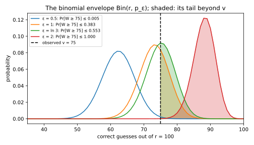
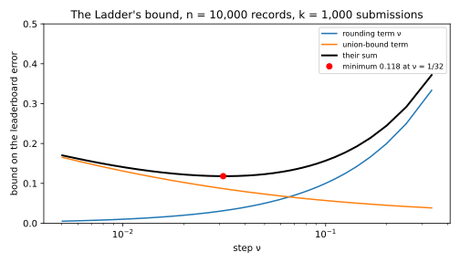

# Auditing, reconstruction and adaptive analysis

This appendix proves four results that the last chapters of Part 5 state and use but do not prove in full. Each one starts from a limit on how much an output can reveal and turns it into a limit on what someone can learn from it. Three of them start from a differential privacy (DP) guarantee, and the fourth, the Ladder, from the small number of different outputs it can produce.

A one-run audit plants test records, called canaries, in one training run and guesses which were used, and the first result limits how many of those guesses can be right. The transfer theorem is about an analyst who asks a dataset many questions, each chosen after seeing earlier answers, and it limits how far private answers can drift from the truth about the population. The Ladder is a rule for releasing a competition leaderboard, and its bound limits how far repeated submissions can push the leaderboard away from the truth. Finally, the reconstruction bound limits how close any unbiased estimate of a training record can get. The proofs share one habit, which is to bound something the attacker or the analyst chooses by a quantity that holds for every choice at once. For example, a sum of guesses is compared with a binomial count, and a classifier the analyst chose is compared with every classifier it could have submitted.

The four results sit together because they use the same few tools. Each proof conditions on what was observed, changes from one distribution to another through a likelihood ratio, or counts the possible outputs and applies a union bound. @tbl-apx-audit-map lists each derivation and the chapter section that uses it.

| Derivation | What it proves | Where the chapter states or uses it |
| --- | --- | --- |
| @sec-apx-audit-onerun | Correct guesses in a one-run audit are dominated by a binomial | @sec-audit-onerun, step 4 of the proof of @thm-audit-onerun |
| @sec-apx-audit-transfer | Private answers that are accurate on the sample are accurate on the population with high probability | @sec-ada-gauss, the first of the three cited results |
| @sec-apx-audit-ladder | The Ladder leaderboard's error is of order $(\ln k/n)^{1/3}$ against any analyst | @sec-ada-practice, rule 5 |
| @sec-apx-audit-recon | An unbiased reconstruction has mean squared error at least $w^2/(4(e^\varepsilon - 1))$ | @sec-epsc-recon, the paragraph on Guo et al. |

: The derivations of this appendix and the chapter sections that use them. {#tbl-apx-audit-map}

## One-run auditing: correct guesses are dominated by a binomial {#sec-apx-audit-onerun}

### What the chapter uses

A one-run audit plants $m$ canaries in the training set, each included by its own fair coin, and trains a model once. Write $S_i = +1$ if canary $i$ is in the training set and $S_i = -1$ if it is not. The auditor then scores every canary, and it guesses "in", written $\hat S_i = +1$, for some canaries and "out", written $\hat S_i = -1$, for others. On the rest it abstains, written $\hat S_i = 0$. Each score is a number computed from the trained model, such as the canary's loss, and a high score suggests the canary was in. In the chapter the number of guesses $r$ is fixed in advance: the auditor guesses "in" on the $r/2$ highest scores and "out" on the $r/2$ lowest. Let $W$ be the number of correct guesses.

The privacy level $\varepsilon$ of the training run is the number being tested. The chapter states that an $\varepsilon$-DP training run limits the count of correct guesses. That count reaches any level $v$ no more often than a binomial count does:
$$\Pr[W \ge v] \le \Pr\big[\mathrm{Bin}(r, p_\varepsilon) \ge v\big], \qquad p_\varepsilon = \frac{e^\varepsilon}{1 + e^\varepsilon},$$
where $\mathrm{Bin}(r, p)$ is a binomial count of $r$ independent trials that each succeed with probability $p$. This is @eq-audit-onerun in @sec-audit-onerun. The chapter derives it for pure DP, in which the slack $\delta$ of $(\varepsilon, \delta)$-DP is zero, in four steps. Its step 4 writes whether each guess is right as an indicator that is 1 when a uniform random number falls below a threshold. The threshold depends on the earlier guesses, and the step compares the sum of the indicators with a binomial. It does not prove that this comparison is allowed. That missing piece is the **domination lemma** below. The version with $\delta$, @eq-audit-onerun-delta, is cited to Steinke, Nasr & Jagielski (2023), and it stays cited here.

### The idea

Each guess, on its own, is a guess about one fair coin, made from an output that is $\varepsilon$-DP in that coin. So no guess can be right more often than $p_\varepsilon$. The reason is that DP lets the output make one value of the coin at most $e^\varepsilon$ times as likely as the other, and Bayes' rule turns odds of $e^\varepsilon$ to 1 into the probability $e^\varepsilon/(1 + e^\varepsilon)$. The difficulty is that the guesses are not independent. The auditor ranks all the canaries together, so whether one guess is right can change the odds of the next. What saves the argument is that, once the guesses are put in some fixed order, the bound $p_\varepsilon$ holds *given whether every earlier guess was right*, so the past can make a guess less likely to be right, but never more likely than $p_\varepsilon$. A count of successes in which every success has conditional probability at most $p$ is never more likely to be large than a binomial count with success probability $p$.

A small case shows the last claim. Take $r = 2$ guesses and $p = 3/4$. The first guess is right with probability $3/4$. The second is right with probability $3/4$ after a correct first guess and only $1/2$ after a wrong one, so the past changes its odds, but never above $3/4$. @tbl-apx-audit-two compares the count with a $\mathrm{Bin}(2, 3/4)$ count.

| Correct guesses | 0 | 1 | 2 |
| --- | --- | --- | --- |
| Adaptive guesser | $\frac14\cdot\frac12 = \frac{2}{16}$ | $\frac34\cdot\frac14 + \frac14\cdot\frac12 = \frac{5}{16}$ | $\frac34\cdot\frac34 = \frac{9}{16}$ |
| $\mathrm{Bin}(2, \frac34)$ | $\frac{1}{16}$ | $\frac{6}{16}$ | $\frac{9}{16}$ |
| Adaptive $\Pr[W \ge v]$, for $v = 1, 2$ | | $\frac{14}{16}$ | $\frac{9}{16}$ |
| Binomial $\Pr[\mathrm{Bin} \ge v]$, for $v = 1, 2$ | | $\frac{15}{16}$ | $\frac{9}{16}$ |

: Two guesses whose second success probability depends on the first, against a binomial with the same largest success probability. Every tail of the adaptive count is at most the binomial's. {#tbl-apx-audit-two}

Every tail of the adaptive count is at most the binomial's tail. The derivation shows why by building both counts from the same uniform random numbers, so that the adaptive count is never larger, outcome by outcome.

### Derivation

The setting is the chapter's. The inclusion bits $S_1, \dots, S_m$ are independent fair coins. Training produces an output from the dataset with the included canaries. The guesses $\hat S$ are computed from that output alone, possibly with extra randomness that is independent of the bits, and exactly $r$ of them are non-zero. The first three steps are the chapter's, restated so that each says what it conditions on.

1. **Each inclusion bit is protected.** Fix every bit except $S_i$. Changing $S_i$ adds or removes one record, so the training output is $\varepsilon$-DP as a function of $S_i$. The guesses are computed from the output without looking at the data, so they are $\varepsilon$-DP too, because post-processing cannot weaken privacy. So for every vector of guesses $s$,
$$\Pr[\hat S = s \mid S_i = +1, S_{-i}] \le e^\varepsilon\,\Pr[\hat S = s \mid S_i = -1, S_{-i}],$$
where $S_{-i}$ stands for all the bits except $S_i$.

2. **Average over the later bits.** Write $S_{<i}$ for the bits $S_1, \dots, S_{i-1}$, and $S_{>i}$ for the bits after $i$. Keep $S_{<i}$ fixed and average both sides of step 1 over $S_{>i}$. The later bits are independent of $S_i$, so the same weights appear on both sides, and the inequality survives:
$$\Pr[\hat S = s \mid S_i = +1, S_{<i}] \le e^\varepsilon\,\Pr[\hat S = s \mid S_i = -1, S_{<i}].$$

3. **No guess is right more than $p_\varepsilon$ of the time, given the guesses and the earlier bits.** Write $x$ and $y$ for the two sides of step 2 without the factor $e^\varepsilon$, so that $x \le e^\varepsilon y$. The bit $S_i$ has prior probability $\frac12$ of each value, and it is independent of $S_{<i}$. So Bayes' rule gives
$$\Pr[S_i = +1 \mid \hat S = s, S_{<i}] = \frac{\frac12 x}{\frac12 x + \frac12 y} = \frac{x}{x + y} \le \frac{e^\varepsilon y}{e^\varepsilon y + y} = p_\varepsilon.$$
The inequality holds because $x/(x + y)$ grows with $x$. Swapping the roles of $+1$ and $-1$ gives the same bound for $\Pr[S_i = -1 \mid \hat S = s, S_{<i}]$. So whichever way canary $i$ is guessed, the guess is right with probability at most $p_\varepsilon$, given the guesses and the earlier bits.

4. **Fix the guesses and put the guessed canaries in order.** Condition on the event $\hat S = s$ for one guess vector $s$. That fixes which $r$ canaries are guessed. List them in index order, $i_1 < i_2 < \dots < i_r$, and write $X_j = \mathbf 1[S_{i_j} = s_{i_j}]$ for the indicator that the $j$-th guess is right. So $W = X_1 + \dots + X_r$. The earlier indicators $X_1, \dots, X_{j-1}$ are functions of the earlier bits $S_{<i_j}$ alone, because $s$ is fixed. Step 3, applied to canary $i = i_j$, says that $X_j = 1$ has chance at most $p_\varepsilon$ given $\hat S = s$ and the earlier bits $S_{<i_j}$. Knowing only the earlier indicators is knowing less than the earlier bits. So the chance of $X_j = 1$ given $\hat S = s$ and the earlier indicators is an average of those step-3 chances, taken over the values of $S_{<i_j}$ that produce the observed indicators. An average of numbers that are each at most $p_\varepsilon$ is at most $p_\varepsilon$, so
$$\Pr[X_j = 1 \mid \hat S = s,\ X_1, \dots, X_{j-1}] \le p_\varepsilon \qquad \text{for every } j \text{ and every past}.$$
Index order is the simplest choice. Any other order of the canaries works too, as long as it is chosen before the bits are drawn, because steps 1 to 3 can be redone with "earlier" meaning earlier in that order.

5. **The domination lemma.** Steps 1 to 4 leave a sequence of 0/1 variables in which each has conditional probability at most $p$ of being 1, whatever happened before. The lemma says that their sum is never more likely to reach $v$ than a binomial count.

   > **Domination lemma.** Let $X_1, \dots, X_r$ take values in $\{0, 1\}$, and suppose $\Pr[X_j = 1 \mid X_1, \dots, X_{j-1}] \le p$ for every $j$ and every value of the past. Then for every $v$,
   > $$\Pr[X_1 + \dots + X_r \ge v] \le \Pr\big[\mathrm{Bin}(r, p) \ge v\big].$$ {#eq-apx-audit-domination}

   The proof builds both counts from the same random numbers. Write $g_j(x_1, \dots, x_{j-1})$ for the conditional probability that $X_j = 1$ after the past $x_1, \dots, x_{j-1}$, which is at most $p$ by assumption. Draw independent numbers $U_1, \dots, U_r$, each uniform on $[0, 1]$, and build two sequences from them.

   - **A copy of the $X$'s.** Set $Y_1 = \mathbf 1[U_1 \le g_1]$ and, one step at a time, $Y_j = \mathbf 1[U_j \le g_j(Y_1, \dots, Y_{j-1})]$.
   - **A binomial.** Set $B_j = \mathbf 1[U_j \le p]$. The $B_j$ are independent, each 1 with probability $p$, so their sum is $\mathrm{Bin}(r, p)$.

   The sequence $Y$ has the same distribution as $X$. The reason is that $U_j$ is independent of the earlier $U$'s, and so of $Y_1, \dots, Y_{j-1}$. So given the past, $Y_j$ is 1 with probability exactly $g_j$ of that past, which is the conditional law of $X_j$. Multiplying these conditional probabilities along any 0/1 string gives the same probability for $Y$ as for $X$, by the chain rule of probability. Next, compare the two sequences outcome by outcome. Since $g_j \le p$, whenever $U_j \le g_j$ also $U_j \le p$, so $Y_j \le B_j$ for every $j$ and every outcome. Summing, $Y_1 + \dots + Y_r \le B_1 + \dots + B_r$ on every outcome. So whenever the $Y$ count reaches $v$, so does the binomial count, and
   $$\Pr\Big[\sum_jX_j \ge v\Big] = \Pr\Big[\sum_jY_j \ge v\Big] \le \Pr\Big[\sum_jB_j \ge v\Big] = \Pr\big[\mathrm{Bin}(r, p) \ge v\big].$$
   This is the chapter's step 4 made precise. The uniform numbers $U_j$ exist only inside the proof, and the copy $Y$ is what lets the threshold $g_j$ depend on the past.

6. **Average over the guesses.** Given $\hat S = s$, step 4 puts the correctness indicators in the lemma's setting with $p = p_\varepsilon$, so
$$\Pr[W \ge v \mid \hat S = s] \le \Pr\big[\mathrm{Bin}(r, p_\varepsilon) \ge v\big].$$
The right side does not depend on $s$, because every guess vector has exactly $r$ non-zero entries. So averaging over $s$, with weights $\Pr[\hat S = s]$, gives @eq-audit-onerun.

If the number of guesses could vary with the output, step 6 would give a binomial with the number of guesses that $s$ makes. The largest possible number of guesses then gives a bound that holds for every $s$, because a binomial count with more trials is more likely to reach $v$.

### Checking it

@fig-apx-audit-onerun-tails shows the binomial envelope for $r = 100$ guesses at four values of $\varepsilon$. The chapter's worked example observes $v = 75$ correct guesses. The shaded area beyond 75 is the most probability that an $\varepsilon$-DP training run can give to an audit at least this successful. The audit treats each $\varepsilon$ as a claim to test. If an $\varepsilon$-DP run would reach 75 correct guesses with probability below $\beta = 0.05$, the audit rejects the claim that the run is $\varepsilon$-DP. @tbl-apx-audit-tails lists the tail at each of the four values of $\varepsilon$.

| $\varepsilon$ | $p_\varepsilon$ | Mean of $\mathrm{Bin}(100, p_\varepsilon)$ | $\Pr[\mathrm{Bin}(100, p_\varepsilon) \ge 75]$ | Rejected at $\beta = 0.05$? |
| --- | --- | --- | --- | --- |
| 0.5 | 0.6225 | 62.25 | 0.0048 | Yes |
| 1 | 0.7311 | 73.11 | 0.3827 | No |
| $\ln 3$ | 0.7500 | 75.00 | 0.5535 | No |
| 2 | 0.8808 | 88.08 | 0.9999 | No |

: The binomial envelope for 100 guesses and its probability of 75 or more correct guesses, at four privacy levels. {#tbl-apx-audit-tails}

The tail grows with $\varepsilon$, and it crosses 0.05 at $\varepsilon = 0.702$. That is the chapter's lower bound, recomputed by this page's script (see @sec-apx-audit-code). The script also reproduces the chapter's ceilings, the largest $\varepsilon$ an audit can certify when every guess is right: 3.49 for 100 guesses, 5.81 for 1,000 and 8.11 for 10,000.

{#fig-apx-audit-onerun-tails}

The script checks the domination lemma on an adaptive sequence it computes exactly. There are 100 indicators. The first is 1 with probability 0.75, and each later one is 1 with probability 0.75 after a success and 0.6 after a failure, in the spirit of the two-guess example of @tbl-apx-audit-two. Their sum has mean 70.64, and its chance of reaching 75 is 0.2363, against 0.5535 for the binomial. Over every $v$ from 0 to 100 its tail never exceeds the binomial's, except by floating-point rounding of $2.1 \times 10^{-14}$.

The bound is exact for randomized response, the mechanism that reports each inclusion bit and flips it with probability $1 - p_\varepsilon$. Here the reports play the role of the trained model. Guessing each canary's bit from its report is right with probability exactly $p_\varepsilon$, independently, so $W$ is exactly $\mathrm{Bin}(r, p_\varepsilon)$. The left panel of @fig-apx-audit-onerun-sim simulates 20,000 such audits at $\varepsilon = \ln 3$, each with 100 guesses among 1,000 canaries, picked at random among the reports of each sign. The average count is 75.01, and the chance of 75 or more is 0.5544, against 0.5535 for the binomial.

The right panel scores each canary by $S_i$ plus Laplace noise of scale $2/\varepsilon$. Changing $S_i$ moves its score by 2, so this is $\varepsilon$-DP in each bit. Unlike randomized response, these scores differ in how informative they are, so the number of guesses matters. A Laplace density falls by the factor $e^{-x/b}$ over a distance $x$, where $b$ is its scale. A score of 1 or more is a distance 2 closer to the centre $+1$ than to the centre $-1$. So it is exactly $e^{2/b} = e^\varepsilon$ times as likely when the canary is in as when it is out. A guess on such a confident score is therefore right with probability exactly $p_\varepsilon$, and the binomial is reached.

The simulation confirms this. With 1,000 canaries at $\varepsilon = 1$, where $p_\varepsilon = 0.731$, the average accuracy is 0.730 for 20 guesses and 0.732 for both 100 and 500 guesses. Guessing all 1,000 canaries includes scores near 0, which carry little information. Then the accuracy drops to 0.697. That is the chance that the noise, of scale $b = 2$ at $\varepsilon = 1$, does not move the score across 0, a distance 1 away, which is $1 - \frac12e^{-1/2}$. So the auditor should guess only where the scores are confident, as the chapter does.

{#fig-apx-audit-onerun-sim}

### What it does not cover

The proof needs two things from the audit design. Each canary must be included by its own fair coin, because step 3 uses the prior $\frac12$ and step 2 uses the independence of the bits. And the guesses must be computed from the training output alone, so that step 1 can use post-processing. The proof covers pure DP only. Under $(\varepsilon, \delta)$-DP, step 1 picks up an additive $\delta$, and the slack can pile up across the guesses. Steinke, Nasr & Jagielski (2023) control it with a longer induction over the guesses, which gives the correction term of @eq-audit-onerun-delta. That argument is several pages long, so it stays cited.

## Private answers stay accurate with high probability {#sec-apx-audit-transfer}

### What the chapter uses

The adaptive data analysis chapter proves the transfer theorem in expectation (@eq-ada-transfer). A mechanism $M$ answers $k$ statistical queries that an analyst chooses one at a time, each from the earlier answers. A **statistical query** $q$ maps one record to a number in $[0, 1]$. Its empirical value $q(D)$ is its average over the dataset $D$, a sample of $n$ records drawn independently from a distribution $\mathcal D$. Its population value $q(\mathcal D)$ is its average over $\mathcal D$. The answer to query $q_j$ is $a_j$. If the whole interaction is $(\varepsilon, \delta)$-DP in the sample, under the replace relation, and the answers are accurate on the sample on average, then they are accurate on the population on average.

@sec-ada-gauss then states a high-probability version with citations and no proof. It credits the result to Bassily, Nissim, Smith, Steinke, Stemmer & Ullman (2016), and says that Jung, Ligett, Neel, Roth, Sharifi-Malvajerdi & Shenfeld (2020) give a shorter proof with explicit constants. This section gives that shorter proof. Call the answers **$(\alpha, \beta)$-accurate on the sample** when, with probability at least $1 - \beta$, every answer is within $\alpha$ of its empirical value, so that $\max_j|a_j - q_j(D)| \le \alpha$. The theorem proved here is the following.

> **High-probability transfer theorem.** Suppose the interaction is $(\varepsilon, \delta)$-DP in the sample under the replace relation, every answer lies in $[0, 1]$, and the answers are $(\alpha, \beta)$-accurate on the sample. Then for every $c > 0$ and $d > 0$,
> $$\Pr\Big[\max_{j\le k}\big|a_j - q_j(\mathcal D)\big| > \alpha + c + e^\varepsilon - 1 + d\Big] \le \frac{\beta}{c} + \frac{\delta}{d}.$$ {#eq-apx-audit-hp}

The two free numbers $c$ and $d$ trade error for failure probability. The chapter's own statement keeps the failure probability of the order of $\beta$. This form instead divides $\beta$ by $c$, which costs only a logarithm for Gaussian answers, as the end of the derivation shows.

### The idea

The proof introduces one object, the **posterior** $Q_\pi$. Picture an observer who knows the distribution $\mathcal D$, the mechanism and the analyst's strategy, and who sees the whole transcript $\pi$ of queries and answers, but not the sample. Ask that observer to describe a record picked at random from the sample. Their answer is a distribution over records, and that distribution is $Q_\pi$. Then a query's value under the posterior, $q(Q_\pi)$, is the observer's best guess of the query's empirical value. The proof compares each answer with the population in two hops, through the posterior. First, answers that are close to the sample are close to the observer's guess of the sample, because the observer's guess is an average over the samples that could have produced the transcript. Second, the observer's guess cannot be far from the population, because DP limits how much the transcript reveals about any one record. So the observer cannot believe that the sample's records are very different from fresh ones.

A small case makes the second hop concrete. Take $n = 20$ coin records, each 1 with probability $p = 0.3$, and one query, the average. The mechanism answers it with Laplace noise of scale $1/(n\varepsilon)$, which is $\varepsilon$-DP because one record moves the average by at most $1/n$. @fig-apx-audit-posterior plots the posterior mean of a sample record, $q(Q_\pi)$, against the observed answer $a$. With $\varepsilon = 4$ the answer is nearly exact, and the posterior follows it: after seeing $a = 0.6$, the observer believes the sample's records are 1 with probability 0.5973. With $\varepsilon = 1$ the observer believes 0.4989, and with $\varepsilon = 0.25$ only 0.3539, close to the population's 0.3. However strange the answer, the posterior cannot leave a band around the population value, and the band narrows as $\varepsilon$ shrinks.

{#fig-apx-audit-posterior}

### Derivation

The randomness is the sample, the mechanism's coins and the analyst's coins. The analyst's strategy and the distribution $\mathcal D$ are fixed and known to the proof, and they are not part of the private input. The transcript $\pi$ lists every query and every answer, so each $q_j$ and each $a_j$ is a function of $\pi$. For simplicity the records take countably many values, so that the posterior is a list of probabilities. With densities, every sum below becomes an integral.

1. **The posterior and the resampling identity.** Pick an index $I$ uniformly from $1, \dots, n$, independently of everything else, and define the posterior as the conditional distribution of the record $x_I$ given the transcript:
$$Q_\pi(x) = \Pr[x_I = x \mid \pi] = \frac1n\sum_{i=1}^n\Pr[x_i = x \mid \pi].$$
For any query $q$ that is a function of $\pi$, the empirical value $q(D)$ is the average of $q(x_i)$ over the records, so its conditional expectation is the average of $q$ under the posterior:
$$\mathbb E\big[q(D) \mid \pi\big] = \frac1n\sum_{i=1}^n\mathbb E\big[q(x_i) \mid \pi\big] = \sum_xq(x)\,Q_\pi(x) = q(Q_\pi).$$ {#eq-apx-audit-resample}
In words, the observer's best guess of a query's empirical value is the query's value under the posterior.

2. **Accuracy on the sample gives accuracy against the posterior.** Write $F$ for the failure event $\max_j|a_j - q_j(D)| > \alpha$, which has probability at most $\beta$. The answer $a_j$ is fixed by $\pi$, so by @eq-apx-audit-resample, $a_j - q_j(Q_\pi) = \mathbb E[a_j - q_j(D) \mid \pi]$. Outside $F$ the gap $|a_j - q_j(D)|$ is at most $\alpha$. Inside $F$ it is at most 1, because both $a_j$ and $q_j(D)$ lie in $[0, 1]$. So
$$\big|a_j - q_j(Q_\pi)\big| \le \mathbb E\big[|a_j - q_j(D)| \mid \pi\big] \le \alpha + \Pr[F \mid \pi].$$

3. **The conditional failure probability is rarely large.** The conditional failure probability $\Pr[F \mid \pi]$ is a non-negative quantity whose average over transcripts is $\Pr[F] \le \beta$. Markov's inequality, which says that a non-negative quantity exceeds $c$ with probability at most its average divided by $c$, gives
$$\Pr_\pi\big[\Pr[F \mid \pi] > c\big] \le \frac{\beta}{c}.$$
So, except with probability at most $\beta/c$, every answer is within $\alpha + c$ of its posterior value.

4. **Under pure DP, the posterior is never far from the population.** This warm-up is the case $\delta = 0$, and it explains the bands of @fig-apx-audit-posterior. Fix a record $i$, a value $x$ and a transcript $\pi$. Bayes' rule writes the observer's belief about record $i$ through the chance of the transcript:
$$\Pr[x_i = x \mid \pi] = \frac{\Pr[\pi \mid x_i = x]\,\mathcal D(x)}{\Pr[\pi]}.$$
Replacing $x_i$ by another value $x'$ multiplies the chance of the transcript by at most $e^\varepsilon$, whatever the other records are. So it does so after averaging over the other records too, and $\Pr[\pi \mid x_i = x] \le e^\varepsilon\Pr[\pi \mid x_i = x']$. Averaging the right side over $x'$ drawn from $\mathcal D$ gives $e^\varepsilon\Pr[\pi]$, because that is how $x_i$ is drawn. Substituting into Bayes' rule, and then averaging over the record $i$, gives
$$\Pr[x_i = x \mid \pi] \le e^\varepsilon\,\mathcal D(x), \qquad Q_\pi(x) \le e^\varepsilon\,\mathcal D(x).$$
The same argument with $x$ and $x'$ swapped gives $Q_\pi(x) \ge e^{-\varepsilon}\mathcal D(x)$. Now average a query $q$ with values in $[0, 1]$ against these two bounds, and do the same for $1 - q$:
$$e^{-\varepsilon}q(\mathcal D) \le q(Q_\pi) \le e^\varepsilon q(\mathcal D), \qquad e^{-\varepsilon}\big(1 - q(\mathcal D)\big) \le 1 - q(Q_\pi) \le e^\varepsilon\big(1 - q(\mathcal D)\big).$$
These confine $q(Q_\pi)$ to a band around $q(\mathcal D)$. The upper bound of the first pair puts the band's top at most $(e^\varepsilon - 1)q(\mathcal D)$ above the population value. The upper bound of the second pair puts its bottom at most $(e^\varepsilon - 1)(1 - q(\mathcal D))$ below it. Both distances are at most $e^\varepsilon - 1$.

5. **Under $(\varepsilon, \delta)$-DP, the posterior is far from the population only rarely.** With $\delta > 0$ the pointwise bound of step 4 fails, so the proof bounds a probability instead. The tool is the one-sided transfer lemma that the chapter proves in @sec-ada-transfer. It says that if an $(\varepsilon, \delta)$-DP mechanism $M'$ reads the dataset and outputs a query $q_{M'}$, then the query's expected empirical value is not much larger than its expected population value:
$$\mathbb E\big[q_{M'}(D)\big] \le e^\varepsilon\,\mathbb E\big[q_{M'}(\mathcal D)\big] + \delta.$$
The reason, in short, is a swap. The population value of a query is its value on a fresh record $x_i'$ that the algorithm never saw. Swapping $x_i'$ with the sample's record $x_i$ leaves the joint distribution unchanged, so it equals the value on $x_i$ of a query chosen from a sample without $x_i$. And DP says that choosing from the sample with $x_i$ instead of without it raises the average of any $[0, 1]$-valued function of the choice by at most the factor $e^\varepsilon$ plus $\delta$ (@eq-ada-avg).

   Apply the lemma to a query built from the transcript. Among the $2k$ queries $q_j$ and $1 - q_j$, let $q^*_\pi$ be the one with the largest gap $q(Q_\pi) - q(\mathcal D)$. Adding the complements makes this largest signed gap equal to the largest absolute gap $\max_j|q_j(Q_\pi) - q_j(\mathcal D)|$, because the complement $1 - q$ has the same gap with the opposite sign. Fix a threshold $\tau$, and let $E$ be the event that this gap exceeds $\tau$. Define the query
$$h_\pi(x) = q^*_\pi(x)\,\mathbf 1[\pi \in E],$$
which is $q^*_\pi$ on transcripts in $E$ and the zero query elsewhere. The algorithm that outputs $h_\pi$ computes it from the transcript and from the fixed $\mathcal D$, so it is post-processing of the interaction and is $(\varepsilon, \delta)$-DP. The lemma applied to it, with $h_\pi(D) = q^*_\pi(D)\mathbf 1[E]$ and $h_\pi(\mathcal D) = q^*_\pi(\mathcal D)\mathbf 1[E]$, gives
$$\mathbb E\big[q^*_\pi(D)\,\mathbf 1[E]\big] \le e^\varepsilon\,\mathbb E\big[q^*_\pi(\mathcal D)\,\mathbf 1[E]\big] + \delta.$$
Both $q^*_\pi$ and $\mathbf 1[E]$ are fixed by $\pi$, so the resampling identity @eq-apx-audit-resample turns the left side into $\mathbb E[q^*_\pi(Q_\pi)\mathbf 1[E]]$. Subtract $\mathbb E[q^*_\pi(\mathcal D)\mathbf 1[E]]$ from both sides. On $E$ the gap exceeds $\tau$, which gives the left inequality below. On the right, $(e^\varepsilon - 1)\mathbb E[q^*_\pi(\mathcal D)\mathbf 1[E]] \le (e^\varepsilon - 1)\Pr[E]$ because $q^*_\pi(\mathcal D) \le 1$. So
$$\tau\Pr[E] \le \mathbb E\Big[\big(q^*_\pi(Q_\pi) - q^*_\pi(\mathcal D)\big)\mathbf 1[E]\Big] \le (e^\varepsilon - 1)\Pr[E] + \delta.$$
Choose $\tau = e^\varepsilon - 1 + d$ and solve for $\Pr[E]$:
$$\Pr\Big[\max_j\big|q_j(Q_\pi) - q_j(\mathcal D)\big| > e^\varepsilon - 1 + d\Big] \le \frac{\delta}{d}.$$ {#eq-apx-audit-posterior}
With $\delta = 0$ the right side is 0 for every $d$, which agrees with step 4.

6. **Combine.** Outside the two bad events of steps 3 and 5, which together have probability at most $\beta/c + \delta/d$ by the union bound, every answer satisfies
$$\big|a_j - q_j(\mathcal D)\big| \le \big|a_j - q_j(Q_\pi)\big| + \big|q_j(Q_\pi) - q_j(\mathcal D)\big| \le (\alpha + c) + (e^\varepsilon - 1 + d).$$
This is @eq-apx-audit-hp.

**Gaussian answers.** Now apply the theorem to the mechanism of @sec-ada-gauss. It answers query $j$ with $q_j(D) + \xi_j$, where the noise $\xi_j$ is normal with mean 0 and standard deviation $\sigma$, independently for each query. Here the answer is also clipped, that is, moved into $[0, 1]$ if it falls outside. Clipping is post-processing, and it never moves an answer away from $q_j(D)$, which lies in $[0, 1]$.

The privacy comes from step 1 of the chapter's derivation in @sec-ada-gauss. Zero-concentrated differential privacy (zCDP) measures privacy by one number $\rho$, a bound on the Rényi divergence of every order divided by the order. Gaussian noise of standard deviation $\sigma$ on a value whose sensitivity is $\Delta$ gives $\rho = \Delta^2/(2\sigma^2)$. One record moves an average of $n$ values in $[0, 1]$ by at most $1/n$, so each answer is zCDP with $\rho_1 = 1/(2n^2\sigma^2)$. Composition adds these to $\rho = k/(2n^2\sigma^2)$, and @eq-ada-zcdp converts the total to $(\varepsilon, \delta)$-DP with
$$\varepsilon = \rho + 2\sqrt{\rho\ln(1/\delta)}.$$
The sample accuracy comes from the normal tail. Each noise exceeds $t$ in absolute value with probability at most $2e^{-t^2/(2\sigma^2)}$. So a union bound over the $k$ answers gives, for any failure probability $\beta'$,
$$\Pr\Big[\max_j|\xi_j| > \sigma\sqrt{2\ln(2k/\beta')}\Big] \le \beta'.$$
In other words, the answers are $(\sigma\sqrt{2\ln(2k/\beta')}, \beta')$-accurate on the sample.

Now fix a target total error $\alpha$ and failure probability $\beta$; here $\alpha$ is the total, not the sample-accuracy term of the theorem. The four error terms of @eq-apx-audit-hp are the noise level $\sigma\sqrt{2\ln(2k/\beta')}$, then $c$, then $e^\varepsilon - 1$, then $d$. Give each a quarter of $\alpha$, so $c = d = \alpha/4$. Split the failure probability equally too, with $\beta' = \delta = \alpha\beta/8$, so that $\beta'/c$ and $\delta/d$ are both $\beta/2$. The noise term is then at most $\alpha/4$ when
$$\sigma = \frac{\alpha}{4\sqrt{2\ln\big(16k/(\alpha\beta)\big)}}.$$
For the transfer term, $e^\varepsilon - 1 \approx \varepsilon$ when $\varepsilon$ is small, and step 4 of the chapter's derivation notes that for small $\rho$ the privacy level is about $\varepsilon \approx \sqrt{2k\ln(1/\delta)}/(n\sigma)$. Setting this to $\alpha/4$ gives $n \approx 4\sqrt{2k\ln(1/\delta)}/(\alpha\sigma)$. Substituting the $\sigma$ above and $\ln(1/\delta) = \ln(8/(\alpha\beta))$ gives
$$n \approx \frac{32\sqrt{k\,\ln\big(8/(\alpha\beta)\big)\,\ln\big(16k/(\alpha\beta)\big)}}{\alpha^2} = \tilde O\Big(\frac{\sqrt k}{\alpha^2}\Big),$$
where $\tilde O$ hides factors that are logarithmic in the number of queries and in $1/\alpha$ and $1/\beta$. This is the chapter's high-probability rate. It needs $\varepsilon$ of order $\alpha$ and $\delta$ of order $\alpha\beta$, the same conditions the chapter quotes. The failure probability enters only through logarithms, so dividing it by $c$ costs little.

### Checking it

The pure-DP band of step 4 holds in the coin example. The script computes the posterior exactly on a grid of answers from $-0.2$ to $1.2$, and @tbl-apx-audit-band compares the range of the posterior mean with the band.

| $\varepsilon$ | Posterior mean at $a = 0.6$ | Range of the posterior mean | Band allowed by pure DP |
| --- | --- | --- | --- |
| 0.25 | 0.3539 | $[0.2502, 0.3550]$ | $[0.2336, 0.3852]$ |
| 1 | 0.4989 | $[0.1362, 0.5381]$ | $[0.1104, 0.7425]$ |
| 4 | 0.5973 | $[0.0078, 0.9590]$ | $[0.0055, 0.9872]$ |

: The posterior mean of a sample record in the coin example, with 20 records of mean 0.3 and one Laplace-noised answer, against the band of step 4. {#tbl-apx-audit-band}

The posterior stays inside the band at every $\varepsilon$, but it does not fill it, because a single noisy average reveals too little about the records to push the posterior to the band's edge.

@tbl-apx-audit-records solves both bounds for the smallest number of records that brings the largest error down to $\alpha = 0.05$. The expectation column is the chapter's @tbl-ada-rates, recomputed. The high-probability column chooses the noise level $\sigma$ and the numbers $c$ and $d$. It also chooses how to split $\beta = 0.05$ between the two failure terms. It makes these choices with a numerical search, so it is accurate to about three digits and is rounded to three.

| Queries $k$ | Records, expected error @eq-ada-gauss | Records, error with probability 0.95, @eq-apx-audit-hp | Ratio |
| --- | --- | --- | --- |
| 1 | 7,300 | 38,400 | 5.3 |
| 100 | 201,800 | 455,000 | 2.3 |
| 1,000 | 764,337 | 1,530,000 | 2.0 |
| 1,000,000 | 33,393,779 | 56,500,000 | 1.7 |

: Records that Gaussian answering needs for a largest error of 0.05, on average and with probability 0.95. {#tbl-apx-audit-records}

The high-probability guarantee costs a factor of about 2 for a thousand queries, and the factor shrinks as $k$ grows. At the optimum for $k = 1{,}000$ the noise term is 0.0243 and the transfer term $e^\varepsilon - 1$ is 0.0240. The slack terms are tiny, with $c = 0.0006$ and $d = 0.0012$, so the optimizer asks for $\delta = 3.89 \times 10^{-5}$ and a sample failure probability of $1.11 \times 10^{-5}$. This shows the logarithmic price at work: it is cheaper to make both failure probabilities very small than to give up error.

@fig-apx-audit-transfer-sim runs the chapter's boosting analyst against Gaussian answers. Each record is a point with a label, and the labels are fair coins. A submission is a labelling of the points, and its query asks "does the submission agree with this record's label?", so its value is an accuracy. A fresh label is independent of every submission, so every query has population value exactly $\frac12$. The analyst submits 99 random labellings and then the majority vote of those whose answer was above $\frac12$. With $n = 10{,}000$ records, $k = 100$ queries and the noise level that minimizes the expectation bound, $\sigma = 0.0319$, the largest population error averages 0.0888 over 400 runs, and 95% of runs stay below 0.1125. The expectation bound is 0.2141, and the high-probability bound at the same $\sigma$ is 0.3218. So the bounds are valid here, and loose by a factor of about 2.4 on average and about 2.9 at the 95% level. Part of the slack is the analyst, which is far from the worst case. The rest is the transfer step, which charges $e^\varepsilon - 1$ to every query.

{#fig-apx-audit-transfer-sim}

### What it does not cover

The theorem needs the answers to lie in $[0, 1]$, which clipping provides. It also needs the guarantee to hold under the replace relation, because the transfer lemma swaps a record for a fresh one. A mechanism that is $(\varepsilon, \delta)$-DP for adding or removing a record is $(2\varepsilon, (1 + e^\varepsilon)\delta)$-DP for replacing one. The form proved here divides the sample failure probability by $c$. Bassily et al. (2016) prove a form in which a failure probability $\beta$ on the sample gives a failure probability of order $\beta$ on the population, with a different argument, a "monitor" that picks the worst of many independent runs of the interaction. That form stays cited. For mechanisms whose accuracy depends on $\beta$ only through $\ln(1/\beta)$, such as Gaussian noise, the two forms give the same rate.

## The Ladder: a leaderboard that rarely changes cannot be overfitted {#sec-apx-audit-ladder}

### What the chapter uses

Rule 5 of @sec-ada-practice says that the **Ladder** of Blum & Hardt (2015) keeps a competition leaderboard accurate against any analyst. The Ladder reports a new score only when a submission beats the best so far by a margin, rounded to that margin. The chapter states that its error against the population is of order $n^{-1/3}$, times a factor that grows like the cube root of $\ln(kn)$, where $n$ is the size of the holdout set and $k$ the number of submissions. It cites the paper and gives only the idea that a leaderboard that changes rarely reveals few bits.

To state the result, write the score as a loss in $[0, 1]$, where lower is better. For a classifier $f$, the empirical loss $\mathcal L(f; D)$ is its average loss on the $n$ records of the holdout set $D$, and the population loss $\mathcal L_{\mathcal D}(f)$ is its average over the distribution. With the margin $\nu = 1/J$ for a whole number $J$, the Ladder releases values $R_0, R_1, \dots, R_k$ as follows.

- Start with $R_0 = 1$.
- When submission $f_t$ arrives, compute $\mathcal L(f_t; D)$. If $\mathcal L(f_t; D) < R_{t-1} - \nu$, release $R_t$ as $\mathcal L(f_t; D)$ rounded to the nearest multiple of $\nu$. Otherwise, release $R_t = R_{t-1}$ again.

The leaderboard should show the best population loss among the submissions so far, so the **leaderboard error** is the largest gap $\max_t|R_t - \min_{i\le t}\mathcal L_{\mathcal D}(f_i)|$. The result proved here is the following.

> **Ladder bound.** Against any analyst, who may choose each submission from the values released so far, with probability at least $1 - \beta$ the leaderboard error is at most
> $$\nu + \sqrt{\frac{\ln(2k/\beta) + \ln\binom{k + J}{J}}{2n}} \;\le\; 3\Big(\frac{\ln(k + 1)}{8n}\Big)^{1/3} + \sqrt{\frac{\ln(2k/\beta)}{2n}},$$ {#eq-apx-audit-ladder}
> where the right side holds at the best step $\nu = (\ln(k + 1)/(8n))^{1/3}$, ignoring that $1/\nu$ must be a whole number.

The leading term is of order $(\ln k/n)^{1/3}$, and $\ln k \le \ln(kn)$, so this gives the chapter's rate.

### The idea

An analyst overfits a holdout set by learning which submissions happen to do well on it and then combining them. To learn that, it must read the scores. The Ladder releases very little. Its released value moves at most $1/\nu$ times, because each move lowers it by at least $\nu$ and it starts at 1. Each move happens at one of $k$ submissions and lands on one of $1/\nu$ rounded values. So the whole sequence of released values is one of a modest number of possible sequences, even though the analyst may react to it in any way it likes.

Once the analyst's own coins are fixed, it is a deterministic machine. Each submission is a function of the values released before it. So the set of every classifier it *could* submit, over all possible released sequences, is fixed before the holdout set is drawn, and it is not too large. A fixed set of classifiers is exactly what Hoeffding's inequality and a union bound handle, as in the fixed-query bound of @sec-ada-overfit. The adaptivity has been paid for by counting. The rounding to $\nu$ is the price of keeping that count small, so the best $\nu$ balances rounding error against the logarithm of the count.

### Derivation

1. **The released value falls by at least $\nu$ at each move.** All released values are multiples of $\nu$, because $R_0 = 1 = J\nu$ and every new value is rounded to a multiple of $\nu$. A move happens only if $\mathcal L(f_t; D) < R_{t-1} - \nu$. Rounding adds at most $\nu/2$, so $R_t < R_{t-1} - \nu/2$. Two multiples of $\nu$ that differ by more than $\nu/2$ differ by at least $\nu$, so $R_t \le R_{t-1} - \nu$. The values stay at or above 0, since the loss does. So there are at most $J = 1/\nu$ moves.

2. **The number of possible released sequences.** A released sequence is fixed by the times of its moves and the values it moves to. With $u$ moves, the times are $u$ of the $k$ submissions, and the values are $u$ distinct multiples of $\nu$ among $0, \nu, \dots, (J - 1)\nu$, which must appear in decreasing order. So the number of sequences is
$$N = \sum_{u=0}^{J}\binom{k}{u}\binom{J}{u} = \binom{k + J}{J} \le (k + 1)^J.$$
The middle step is Vandermonde's identity: choosing $J$ items from $k + J$ is the same as choosing $u$ from the first $k$ and $J - u$ from the last $J$, summed over $u$, and $\binom{J}{J - u} = \binom{J}{u}$. The last step holds because $\binom{k + J}{J}$ is the product of the ratios $(k + i)/i$ for $i = 1, \dots, J$, and each ratio is at most $k + 1$.

3. **The classifiers the analyst could submit.** Fix the analyst's coins, which are independent of the holdout set. Submission $t$ is then a function of the values $R_1, \dots, R_{t-1}$. Those are the first $t - 1$ entries of a released sequence, so they take at most $N$ values. Let $\mathcal F$ be the set of all classifiers the analyst would submit at some time $t$ after some possible history. It has at most $kN$ members, and it is fixed before the holdout set is drawn, because it depends only on the analyst's strategy and coins.

4. **Every classifier in the set is accurate.** For one fixed classifier, the empirical loss is an average of $n$ independent losses in $[0, 1]$. Hoeffding's inequality bounds the chance that it is more than $\gamma$ from its mean by $2e^{-2n\gamma^2}$. The union bound over the at most $kN$ members of $\mathcal F$ bounds the chance that any of them is off by more than $\gamma$ by $2kNe^{-2n\gamma^2}$. Setting this to $\beta$ and solving for $\gamma$ shows that, with probability at least $1 - \beta$,
$$\big|\mathcal L(f; D) - \mathcal L_{\mathcal D}(f)\big| \le \gamma = \sqrt{\frac{\ln(2kN/\beta)}{2n}} \qquad \text{for every } f \in \mathcal F.$$
The analyst's actual submissions all belong to $\mathcal F$, whatever the holdout set turns out to be.

5. **The released value tracks the best empirical loss.** Write $m_t = \min_{i\le t}\mathcal L(f_i; D)$ for the best empirical loss so far. If the leaderboard has not moved by time $t$, then $R_t = 1$ and every submission had $\mathcal L(f_i; D) \ge 1 - \nu$, so $R_t - \nu \le m_t \le R_t$. Otherwise, let $t_0 \le t$ be the time of the last move. Then $R_t = R_{t_0}$ is within $\nu/2$ of $\mathcal L(f_{t_0}; D)$, so $m_t \le R_t + \nu/2$. For the other side, take any $i \le t$. If submission $i$ moved the leaderboard, $\mathcal L(f_i; D) \ge R_i - \nu/2 \ge R_t - \nu/2$, because the released values never go up. If it did not, $\mathcal L(f_i; D) \ge R_{i-1} - \nu \ge R_t - \nu$. So
$$R_t - \nu \le m_t \le R_t + \frac{\nu}{2}.$$

6. **Combine.** On the event of step 4, each empirical loss is within $\gamma$ of the population loss, so the smallest empirical loss so far is within $\gamma$ of the smallest population loss so far. Together with step 5, $|R_t - \min_{i\le t}\mathcal L_{\mathcal D}(f_i)| \le \nu + \gamma$ for every $t$. Substituting $N = \binom{k + J}{J}$ gives the first form of @eq-apx-audit-ladder. If the analyst's coins are random, the bound holds for each value of the coins, and so it holds on average over them too.

7. **The best step.** For a closed form, bound the number of histories by $\ln N \le J\ln(k + 1) = \ln(k + 1)/\nu$, and split the square root with $\sqrt{x + y} \le \sqrt x + \sqrt y$. Write $\kappa = \ln(k + 1)/(2n)$ for short. Then the bound becomes
$$\nu + \sqrt{\frac{\kappa}{\nu}} + \sqrt{\frac{\ln(2k/\beta)}{2n}}.$$
The first two terms trade off. Their derivative in $\nu$ is $1 - \frac12\sqrt\kappa\,\nu^{-3/2}$, which is zero at $\nu^3 = \kappa/4$. There $\sqrt{\kappa/\nu} = 2\nu$, so the two terms add up to $3\nu = 3(\kappa/4)^{1/3} = 3(\ln(k + 1)/(8n))^{1/3}$, which is the second form of @eq-apx-audit-ladder.

### Checking it

@fig-apx-audit-ladder plots the first form of the bound against $\nu$ for $n = 10{,}000$ records and $k = 1{,}000$ submissions, at $\beta = 0.05$. A large step makes the rounding term large, while a small one allows more moves, and so more possible histories and a larger union-bound term. The sum is smallest at $\nu = 1/32$, where it is 0.118. The closed form is looser, because it replaces $\binom{k + J}{J}$ by $(k + 1)^J$. It puts the best step at 0.0442 and the bound at 0.1556. The closed form's step must be rounded to the form $1/J$. At $\nu = 1/23$, the nearest such step to 0.0442, the first form gives $0.0435 + 0.0769 = 0.1203$.

{#fig-apx-audit-ladder}

The script also runs the chapter's boosting attack against both kinds of leaderboard, with $n = 1{,}000$ coin labels and $k = 1{,}000$ submissions, over 20 runs. Every submission has population loss exactly $\frac12$. Against a leaderboard that shows each submission's exact loss, the attacker keeps the submissions that scored below $\frac12$, and its final majority vote makes the best shown loss wrong by 0.2207 on average. Against the Ladder with $\nu = 1/11$, the attacker sees only when the released value moves. The first submission moves the leaderboard from 1 to its loss near $\frac12$, rounded to $5/11$ or $6/11$, both $1/22 = 0.0455$ away from $\frac12$. Later random submissions almost never beat that by $\nu$, so the attacker learns almost nothing, and the error stays at 0.0455, the rounding of that first move. The bound for these sizes is 0.2768 at $\nu = 1/11$, so it is loose by a factor of about 6 here.

### What it does not cover

The proof needs the losses to lie in $[0, 1]$ and the holdout records to be independent draws, for Hoeffding's inequality. It controls the best score so far, which is what a leaderboard shows, not the score of every submission. Blum & Hardt (2015) also give a parameter-free variant that sets the margin from the data, which stays cited.

## Unbiased reconstruction has a floor set by Rényi DP of order 2 {#sec-apx-audit-recon}

### What the chapter uses

@sec-epsc-recon mentions a bound of Guo, Karrer, Chaudhuri & van der Maaten (2022) in one sentence. It says that under Rényi differential privacy (RDP) of order 2 at level $\varepsilon$, the expected mean squared error of any reconstruction is at least of order $1/(e^\varepsilon - 1)$. It adds that Fisher information gives a tighter, data-dependent bound for unbiased reconstructions. The chapter gives no proof. This section proves the first bound, and it has to correct the chapter's wording, because the bound holds for *unbiased* reconstructions, as in Guo et al., and not for every reconstruction.

The setting is a target record whose value is a number $x$ in an interval of width $w$. The rest of the training data is fixed. The training run releases an output $Y$ whose distribution $P_x$ depends on $x$. The **Rényi divergence of order 2** between two distributions $P$ and $Q$ is
$$D_2(P \Vert Q) = \ln\mathbb E_Q\Big[\Big(\frac{dP}{dQ}\Big)^2\Big],$$
where $dP/dQ$ is the likelihood ratio, the density of $P$ divided by the density of $Q$. Training is $(2, \varepsilon)$-RDP when $D_2(P_{x'} \Vert P_x) \le \varepsilon$ for every pair of target values $x$ and $x'$, since changing the target is replacing one record. A reconstruction is a function $\hat x(Y)$ of the output. It is **unbiased** when its average equals the true value whatever that value is, $\mathbb E_x[\hat x] = x$ for every $x$. The result is
$$\mathbb E_x\big[(\hat x - x)^2\big] \ge \frac{w^2}{4(e^\varepsilon - 1)} \qquad \text{for every } x.$$ {#eq-apx-audit-recon}
A target with several coordinates, coordinate $\ell$ in its own interval of width $w_\ell$, gives the sum of these bounds, $\sum_\ell w_\ell^2/(4(e^\varepsilon - 1))$.

### The idea

An unbiased reconstruction must move its average by exactly $x' - x$ when the target moves from $x$ to $x'$. The only thing that changes between the two cases is the distribution of the output, and under RDP that distribution changes little. So the reconstruction must amplify small differences in the output into a large difference in its average, and amplifying noise makes the reconstruction vary a lot. An inequality of Hammersley, Chapman and Robbins makes this precise. Moving the target reweights each output by the likelihood ratio, so the change in the reconstruction's average is a covariance between the reconstruction and that ratio. A covariance is at most the product of two spreads, by the Cauchy–Schwarz inequality. One spread is the reconstruction's error. The other is the spread of the likelihood ratio, which is called the $\chi^2$ divergence and is set by RDP of order 2.

A concrete case is the Gaussian mechanism, which releases $Y = x + Z$ with $Z$ normal of standard deviation $\sigma$ and $x \in [0, 1]$. The natural reconstruction is $Y$ itself. It is unbiased, and its mean squared error is $\sigma^2$. Between two normals with the same $\sigma$ and means a distance $h$ apart, the order-2 divergence is $h^2/\sigma^2$, by completing the square in $\mathbb E[(dP/dQ)^2]$. Between targets 0 and 1 it is $1/\sigma^2$, so the mechanism is $(2, \varepsilon)$-RDP with $\varepsilon = 1/\sigma^2$, and its error is $1/\varepsilon$. At $\varepsilon = 1$ the error is 1, and the bound @eq-apx-audit-recon is $1/(4(e - 1)) = 0.1455$.

### Derivation

Fix two target values $x$ and $x'$ in the interval, and write $\Lambda = dP_{x'}/dP_x$ for the likelihood ratio of the output. The divergence $D_2(P_{x'} \Vert P_x)$ is finite, so $P_{x'}$ gives no probability to outputs that $P_x$ never produces, and the ratio is well defined.

1. **Change of measure.** An average under $P_{x'}$ is an average under $P_x$ weighted by the likelihood ratio, $\mathbb E_{x'}[\hat x] = \mathbb E_x[\hat x \Lambda]$. The weights average to 1, $\mathbb E_x[\Lambda] = 1$, because the density of $P_{x'}$ integrates to 1.

2. **Write the change of the average as a covariance.** By unbiasedness, $\mathbb E_{x'}[\hat x] - \mathbb E_x[\hat x] = x' - x$. By step 1 the left side is $\mathbb E_x[\hat x(\Lambda - 1)]$. Since $\mathbb E_x[\Lambda - 1] = 0$, subtracting the constant $x$ from $\hat x$ changes nothing, so
$$x' - x = \mathbb E_x\big[(\hat x - x)(\Lambda - 1)\big].$$

3. **Cauchy–Schwarz.** The average of a product is at most the square root of the product of the averages of the squares, so
$$(x' - x)^2 \le \mathbb E_x\big[(\hat x - x)^2\big]\cdot\mathbb E_x\big[(\Lambda - 1)^2\big].$$
The first factor is the mean squared error at $x$. The second is the **$\chi^2$ divergence** $\chi^2(P_{x'} \Vert P_x)$. This is the Hammersley–Chapman–Robbins inequality.

4. **The $\chi^2$ divergence is set by order-2 RDP.** Expanding the square, $\mathbb E_x[(\Lambda - 1)^2] = \mathbb E_x[\Lambda^2] - 2\mathbb E_x[\Lambda] + 1 = \mathbb E_x[\Lambda^2] - 1$. By the definition of $D_2$, $\mathbb E_x[\Lambda^2] = e^{D_2(P_{x'} \Vert P_x)}$, so
$$\chi^2(P_{x'} \Vert P_x) = e^{D_2(P_{x'} \Vert P_x)} - 1 \le e^\varepsilon - 1.$$
Dividing step 3 by this gives, for every $x'$ in the interval,
$$\mathbb E_x\big[(\hat x - x)^2\big] \ge \frac{(x' - x)^2}{e^\varepsilon - 1}.$$ {#eq-apx-audit-hcr}

5. **Choose the farthest $x'$.** The bound holds for every $x'$, so take the one farthest from $x$, which is an end of the interval. Wherever $x$ lies, one of the two ends is at least $w/2$ away, so $(x' - x)^2 \ge w^2/4$, and @eq-apx-audit-recon follows. At an end of the interval the other end is $w$ away, and the bound is four times larger, $w^2/(e^\varepsilon - 1)$.

6. **Several coordinates.** If the target has several coordinates, each in its own interval, apply steps 1 to 5 to each coordinate of $\hat x$, with $x'$ differing from $x$ in that coordinate only. Changing one coordinate is still a change of one record, so the RDP bound applies. The squared error is the sum of the coordinates' squared errors, so the bounds add.

### Checking it

@tbl-apx-audit-recon compares the bound with two unbiased mechanisms for a target in $[0, 1]$, so $w = 1$. The Gaussian mechanism has error $1/\varepsilon$, as above. The Laplace mechanism releases $x + Z$ with Laplace noise of scale $b$, whose error is $2b^2$. Its order-2 divergence between targets 0 and 1 is $\ln\big(\frac23e^{1/b} + \frac13e^{-2/b}\big)$ (Mironov 2017), which the script also checks by numerical integration at $b = 1$, getting 0.619124 both ways. The script solves for the $b$ that makes this equal to $\varepsilon$.

| RDP level $\varepsilon$ | Bound $1/(4(e^\varepsilon - 1))$ | Gaussian error $1/\varepsilon$ | Laplace error $2b^2$ | Gaussian over bound |
| --- | --- | --- | --- | --- |
| 0.1 | 2.377 | 10 | 17.36 | 4.21 |
| 0.5 | 0.3854 | 2 | 2.647 | 5.19 |
| 1 | 0.1455 | 1 | 1.023 | 6.87 |
| 2 | 0.03913 | 0.5 | 0.3458 | 12.8 |
| 4 | 0.004664 | 0.25 | 0.103 | 53.6 |
| 8 | $8.389 \times 10^{-5}$ | 0.125 | 0.02831 | 1,490 |

: The mean squared error of unbiased reconstructions of a target in $[0, 1]$ from the Gaussian and Laplace mechanisms, against the bound @eq-apx-audit-recon, at the same RDP of order 2. {#tbl-apx-audit-recon}

Both mechanisms stay above the bound, as they must. For small $\varepsilon$ the Gaussian's error is about 4 times the bound. For large $\varepsilon$ the gap grows without limit, because the bound falls like $e^{-\varepsilon}$ and the Gaussian's error only like $1/\varepsilon$. The left panel of @fig-apx-audit-recon shows this on a log scale.

The right panel shows where the slack comes from, at $\varepsilon = 1$, so $\sigma = 1$. For the Gaussian, the true $\chi^2$ divergence between targets a distance $h$ apart is $e^{h^2/\sigma^2} - 1$, from the order-2 divergence above, so @eq-apx-audit-hcr with the mechanism's own pair gives $h^2/(e^{h^2/\sigma^2} - 1)$. That rises to the exact error $\sigma^2$ as $h$ shrinks to 0. This limit is the Cramér–Rao bound, which uses the Fisher information, the rate at which the output distribution changes with the target. The RDP bound instead uses the worst-case $\chi^2$, that of targets a full width apart, for every pair. At $h = \frac12$, the page's choice for a target in the middle, the true divergence of that pair is $e^{1/4} - 1$, but the bound uses $e - 1$. So the slack comes from summarizing the mechanism by its worst pair.

![Left: the bound $1/(4(e^\varepsilon - 1))$ on the mean squared error of an unbiased reconstruction of a target in $[0, 1]$, against the exact error of the Gaussian and Laplace mechanisms at the same RDP of order 2, and the worst-case error $\frac14$ of the biased guess $\frac12$. Right: at $\varepsilon = 1$, the Hammersley–Chapman–Robbins bound $h^2/\chi^2$ against the distance $h$ between the two targets, with the Gaussian's own $\chi^2$ and with the worst-case $e^\varepsilon - 1$.](figures/apx_audit_recon.svg){#fig-apx-audit-recon}

### What it does not cover

**The bound needs unbiasedness.** Step 2 uses it at both $x$ and $x'$. Without it, the bound fails. For example, the reconstruction that ignores the output and always answers $\frac12$ has squared error at most $\frac14$ for every target in $[0, 1]$. But @eq-apx-audit-recon exceeds $\frac14$ whenever $e^\varepsilon - 1 < 1$, that is, for $\varepsilon < \ln 2 = 0.693$. At $\varepsilon = 0.1$ the "bound" is 2.377, and the constant guess beats it by a factor of almost 10. So for small $\varepsilon$ no such bound can hold for every reconstruction, and the chapter states it for unbiased ones.

A biased reconstruction still obeys a weaker statement. Steps 1 to 4 go through if, in step 2, the targets $x$ and $x'$ on the left are replaced by the averages $\mathbb E_x[\hat x]$ and $\mathbb E_{x'}[\hat x]$. The $x$ inside the expectation is replaced by $\mathbb E_x[\hat x]$ too, which turns the squared error into the variance. They give
$$\big(\mathbb E_{x'}[\hat x] - \mathbb E_x[\hat x]\big)^2 \le \operatorname{Var}_x(\hat x)\,(e^\varepsilon - 1),$$
where $\operatorname{Var}_x$ is the variance at $x$. In words, a reconstruction whose average follows the target closely must vary a lot, and one that varies little cannot follow the target. Guo et al. (2022) state their bound for unbiased reconstructions, and they also give the Fisher-information refinement for them, which is the limit of @eq-apx-audit-hcr as $x'$ approaches $x$. That refinement needs the output distribution to change smoothly with the target, and it uses how fast the trained model's output distribution moves with the target rather than the RDP level, so it stays cited.

## Code {#sec-apx-audit-code}

The script [code/appendix-derivations/apx_auditing.py](../../code/appendix-derivations/apx_auditing.py) computes every number on this page and draws its figures. It computes binomial tails exactly, solves for the one-run audit's $\varepsilon$ bound, and computes the law of an adaptive sum exactly to check the domination lemma. It simulates one-run audits of randomized response and of Laplace scores. It computes the posterior of the coin example exactly, solves the expectation and high-probability bounds for the records that Gaussian answering needs, and simulates Gaussian answers to the boosting analyst. It evaluates the Ladder's bound, runs the boosting attack against an exact leaderboard and against the Ladder, and compares the reconstruction bound with the exact error of the Gaussian and Laplace mechanisms. From the repository root:

```bash
uv run python code/appendix-derivations/apx_auditing.py
```

**Output** (seed 0), summarized in @tbl-apx-audit-code:

| Check | Result |
| --- | --- |
| One-run audit, $r = 100$, $v = 75$ | $\varepsilon \ge 0.702$ at 95% confidence; tails 0.0048, 0.3827, 0.5535 and 0.9999 at $\varepsilon = 0.5$, 1, $\ln 3$ and 2 |
| Domination lemma, adaptive sum of 100 | $\Pr[X \ge 75] = 0.2363$ against 0.5535; never above the binomial |
| Randomized response, $\varepsilon = \ln 3$, 20,000 runs | Mean 75.01 correct; $\Pr[W \ge 75] = 0.5544$ against 0.5535 |
| Laplace scores, $\varepsilon = 1$ | Accuracy 0.730 to 0.732 for 20 to 500 guesses, against $p_\varepsilon = 0.731$; 0.697 for all 1,000 |
| Coin posterior, $n = 20$ | Inside the pure-DP band at $\varepsilon = 0.25$, 1 and 4 |
| Records for error 0.05, $k = 1{,}000$ | 764,337 on average; about 1,530,000 with probability 0.95 |
| Gaussian answers, $n = 10{,}000$, $k = 100$ | Mean largest error 0.0888, 95% quantile 0.1125; bounds 0.2141 and 0.3218 |
| Ladder, $n = 10{,}000$, $k = 1{,}000$ | Best bound 0.118 at $\nu = 1/32$; closed form 0.1556 |
| Boosting attack, $n = k = 1{,}000$ | Error 0.2207 against an exact leaderboard, 0.0455 against the Ladder |
| Reconstruction, $\varepsilon = 1$ | Bound 0.1455; Gaussian 1, Laplace 1.023 |

: Summary of the script's output. {#tbl-apx-audit-code}

[tests/test_appendix_auditing.py](../../tests/test_appendix_auditing.py) checks that the output still matches the numbers on this page.

**What to take from it.** The binomial envelope is exact for randomized response and for confident Laplace scores, and an adaptive guesser can only fall below it. The high-probability transfer theorem costs about a factor of 2 in records over the expectation version, because the failure probabilities enter only through logarithms. The Ladder stops the boosting attack almost completely, while its worst-case bound is loose by a factor of about 6. The reconstruction bound is valid for unbiased reconstructions only, and it is loose by at least a factor of 4 for the Gaussian mechanism, because it charges every pair of targets the worst pair's divergence.

## References

- Steinke, Nasr & Jagielski, "Privacy Auditing with One (1) Training Run" (NeurIPS 2023). The one-run audit, the binomial bound for pure DP and the $\delta$ correction, whose proof is cited above.
- Bassily, Nissim, Smith, Steinke, Stemmer & Ullman, "Algorithmic Stability for Adaptive Data Analysis" (STOC 2016). The first high-probability transfer theorem, by the monitor argument.
- Jung, Ligett, Neel, Roth, Sharifi-Malvajerdi & Shenfeld, "A New Analysis of Differential Privacy's Generalization Guarantees" (ITCS 2020). The posterior and resampling argument that this page follows. The constants here are derived on this page.
- Dwork, Feldman, Hardt, Pitassi, Reingold & Roth, "Preserving Statistical Validity in Adaptive Data Analysis" (STOC 2015). The transfer results in expectation that the chapter proves.
- Blum & Hardt, "The Ladder: A Reliable Leaderboard for Machine Learning Competitions" (ICML 2015). The Ladder, its guarantee, the boosting attack and a parameter-free variant.
- Guo, Karrer, Chaudhuri & van der Maaten, "Bounding Training Data Reconstruction in Private (Deep) Learning" (ICML 2022). The reconstruction bound from RDP of order 2 and its Fisher-information refinement, both for unbiased reconstructions.
- Hammersley, "On Estimating Restricted Parameters" (*Journal of the Royal Statistical Society B*, 1950), and Chapman & Robbins, "Minimum Variance Estimation without Regularity Assumptions" (*Annals of Mathematical Statistics*, 1951). The variance bound through a second distribution, used in the reconstruction proof.
- Mironov, "Rényi Differential Privacy" (CSF 2017). The Rényi divergences of the Laplace and Gaussian mechanisms used in the reconstruction check.
