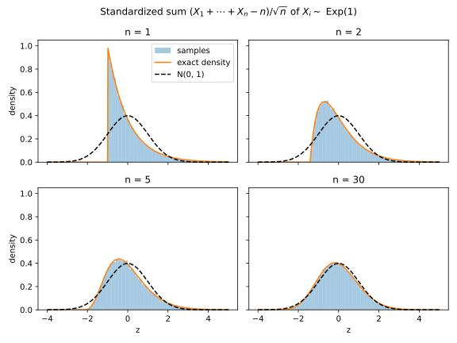

# Probability distributions

A handful of distributions do almost all the work in this book. Counts of events are binomial, and Poisson when the events are rare. Waiting times are exponential, and additive noise is usually normal or Laplace. Every later chapter is stated in terms of these few families, so this chapter asks what each one is, and what its mean, variance, moment generating function (MGF) and tail are.

The idea that organizes the answer is that the families are built from one another. A binomial is a sum of coin flips, and a Poisson is a binomial with many unlikely trials. An exponential is the wait for the first event in that same setting, and a Laplace is two exponentials back to back. A normal is what any sum of many small independent pieces looks like. So each family's moments can be computed from its pieces.

The running example is a classifier tested on $n = 2{,}000$ records, which errs on each one independently with probability $p = 0.05$. It makes about 100 errors, give or take 9.7, and the count is binomial. When errors are rare it is close to a Poisson count, the wait for a first error in deployment is exponential, and the normal approximation says how the measured error rate spreads. The last section compares a normal and a Laplace density with copies of themselves moved sideways, which is where the next chapters begin.

## Moments {#sec-dist-moments}

Every family below is described by the same few summaries, and the first two say where the distribution sits and how widely it spreads. This section defines them and proves the rules that compute them for sums, which every later section uses.

::: {#def-dist-moments name="Mean, variance and covariance"}
For a random variable $X$, the **mean** $\mathbb E[X]$ is the average of its values weighted by their probabilities. The **variance** is the average squared distance from the mean,
$$\operatorname{Var}(X) = \mathbb E\big[(X - \mathbb E[X])^2\big] = \mathbb E[X^2] - \mathbb E[X]^2,$$
and its square root is the **standard deviation**. The $k$-th **moment** of $X$ is $\mathbb E[X^k]$. For two variables $X$ and $Y$, the **covariance** is $\operatorname{Cov}(X, Y) = \mathbb E[XY] - \mathbb E[X]\,\mathbb E[Y]$.
:::

The two forms of the variance agree, because expanding the square gives $X^2 - 2X\,\mathbb E[X] + \mathbb E[X]^2$, and averaging each term gives $\mathbb E[X^2] - 2\mathbb E[X]^2 + \mathbb E[X]^2$. Three rules cover almost every calculation in this chapter.

::: {#lem-dist-moment-rules name="Means and variances of sums"}
Let $X$ and $Y$ be random variables and $c$ a constant. The mean of a sum is the sum of the means, whether or not $X$ and $Y$ are independent. Scaling by $c$ multiplies the variance by $c^2$. If $X$ and $Y$ are independent, their variances add:
$$\mathbb E[X + Y] = \mathbb E[X] + \mathbb E[Y], \qquad \operatorname{Var}(cX) = c^2\operatorname{Var}(X), \qquad \operatorname{Var}(X + Y) = \operatorname{Var}(X) + \operatorname{Var}(Y).$$
:::

::: {.proof}
1. *Means add.* An expectation is a weighted sum over outcomes, and the weighted sum of $X + Y$ splits into the weighted sum of $X$ plus that of $Y$. No step uses independence, and the same splitting gives $\mathbb E[cX] = c\,\mathbb E[X]$.
2. *Scaling.* Multiplying $X$ by $c$ multiplies its mean by $c$, so every deviation from the mean is multiplied by $c$. Squaring the deviation turns that factor into $c^2$.
3. *Expand the square.* The deviation of $X + Y$ is the sum of the two deviations. Its square is the two squares plus twice their product, and the mean of that product expands to $\mathbb E[XY] - \mathbb E[X]\,\mathbb E[Y]$, the covariance, so
$$\operatorname{Var}(X + Y) = \operatorname{Var}(X) + \operatorname{Var}(Y) + 2\operatorname{Cov}(X, Y).$$
4. *Independence removes the cross term.* For independent variables the mean of a product is the product of the means, so the covariance is 0.
:::

The third rule needs independence. If $X_1, \dots, X_n$ are all the same variable, their sum is $nX_1$, whose variance is $n^2\operatorname{Var}(X_1)$, not $n\operatorname{Var}(X_1)$. With independent copies, the rules give the law that governs every average.

::: {#cor-dist-sqrt-n name="The square-root law for averages"}
The average of $n$ independent copies of $X$ has mean $\mathbb E[X]$ and variance $\operatorname{Var}(X)/n$, so its standard deviation is that of one draw divided by $\sqrt n$.
:::

::: {.proof}
1. The average is the sum of the copies times $1/n$. By the first rule of @lem-dist-moment-rules its mean is $n\,\mathbb E[X]/n = \mathbb E[X]$.
2. By the third rule the sum has variance $n\operatorname{Var}(X)$, and by the second, multiplying by $1/n$ divides that by $n^2$.
:::

::: {#exm-dist-die}
A fair die has mean $(1 + \dots + 6)/6 = 3.5$ and mean of the square $(1 + 4 + \dots + 36)/6 = 91/6$. So its variance is $91/6 - 3.5^2 = 35/12 \approx 2.92$, and its standard deviation is about 1.71.
:::

## The moment generating function {#sec-dist-mgf}

The mean and variance summarize a distribution by two numbers. Later sections need more: the distribution of a sum of independent variables, and how fast large values become rare. One function does both jobs, and the idea behind it is to average not $X$ itself but an exponential of it.

::: {#def-dist-mgf name="Moment generating function"}
The **moment generating function** of a random variable $X$ is the function
$$M_X(\lambda) = \mathbb E\big[e^{\lambda X}\big]$$
of a real number $\lambda$, wherever this average is finite. Its logarithm is written $K_X(\lambda) = \ln M_X(\lambda)$.
:::

The number $\lambda$ is not a parameter of the distribution but a dial that you set. With $\lambda > 0$ large values of $X$ dominate the average, and at $\lambda = 0$ every weight is 1, so $M_X(0) = 1$.

::: {#exm-dist-coin-mgf}
One test record of the running example is a coin $X \sim \mathrm{Bern}(p)$, which is 1 when the classifier errs, with probability $p$, and 0 otherwise. To compute $\mathbb E[e^{\lambda X}]$, list each outcome, the value $e^{\lambda X}$ takes there, and its probability (@tbl-dist-mgf-coin).

| Outcome $x$ | $\Pr[X = x]$ | $e^{\lambda x}$ |
| --- | --- | --- |
| 0 | $1 - p$ | 1 |
| 1 | $p$ | $e^\lambda$ |

: The MGF of a coin, outcome by outcome. {#tbl-dist-mgf-coin}

An expectation adds up the value at each outcome times its probability, so
$$M_X(\lambda) = (1 - p)\cdot1 + p\cdot e^\lambda = 1 + p(e^\lambda - 1).$$
So the $e^\lambda$ in the MGFs of all the counting distributions below is the weight of the outcome 1. With $p = 0.3$ and $\lambda = 1$, for instance, $M_X(1) = 0.7 + 0.3e \approx 1.52$.
:::

The MGF gets its name from the first thing it does. Its derivatives at 0 are the moments, and the derivatives of its logarithm are the mean and the variance directly.

::: {#prp-dist-mgf-moments name="The MGF generates the moments"}
If $M_X$ is finite on an interval around 0, then its $k$-th derivative at 0 is the $k$-th moment, $M_X^{(k)}(0) = \mathbb E[X^k]$. The first two derivatives of $K_X$ at 0 are the mean and the variance,
$$K_X'(0) = \mathbb E[X], \qquad K_X''(0) = \operatorname{Var}(X).$$
:::

::: {.proof}
The plan is to expand the exponential as a power series and read the moments off its coefficients, then to differentiate the logarithm.

1. *Expand.* Put $u = \lambda X$ in the power series $e^u = 1 + u + u^2/2! + \cdots$ and average term by term, using the first rule of @lem-dist-moment-rules:
$$M_X(\lambda) = 1 + \lambda\,\mathbb E[X] + \frac{\lambda^2}{2!}\mathbb E[X^2] + \frac{\lambda^3}{3!}\mathbb E[X^3] + \cdots.$$
2. *Differentiate $k$ times at 0.* Differentiating removes the lower powers of $\lambda$, and setting $\lambda = 0$ removes the higher ones. Only the term $\lambda^k\,\mathbb E[X^k]/k!$ is left, and it contributes $\mathbb E[X^k]$.
3. *First derivative of the logarithm.* The chain rule gives $K_X' = M_X'/M_X$, and at 0, where $M_X = 1$, this is $\mathbb E[X]$.
4. *Second derivative.* The quotient rule gives $K_X'' = M_X''/M_X - (M_X'/M_X)^2$. At 0 this is $\mathbb E[X^2] - \mathbb E[X]^2$, the variance.
:::

The main reason to use MGFs, though, is that adding independent variables multiplies them, which is the first step of every exponential tail bound in [Concentration inequalities](02-concentration.md).

::: {#lem-dist-mgf-sum name="MGFs of independent sums multiply"}
If $X$ and $Y$ are independent, then at every $\lambda$ where both MGFs are finite,
$$M_{X+Y}(\lambda) = M_X(\lambda)\,M_Y(\lambda), \qquad K_{X+Y}(\lambda) = K_X(\lambda) + K_Y(\lambda).$$
:::

::: {.proof}
1. The exponential turns the sum into a product, $e^{\lambda(X+Y)} = e^{\lambda X}e^{\lambda Y}$.
2. The two factors are independent because $X$ and $Y$ are, and the mean of a product of independent variables is the product of the means. Taking logarithms turns the product into a sum.
:::

To conclude which family a sum belongs to, the chapter needs one more fact: the MGF determines the distribution.

::: {#thm-dist-mgf-unique name="The MGF determines the distribution"}
If $X$ and $Y$ have MGFs that are finite and equal on an interval around 0, then $X$ and $Y$ have the same distribution.
:::
<!-- proof: cited -->

This is a standard theorem of probability, proved in Blitzstein & Hwang (listed in the references). Its proof needs more analysis than this book uses, so take it as given. @sec-apx-prob-convolution in the appendices checks each sum this chapter identifies without it, by summing or integrating directly. The chapter uses the theorem to identify a sum whose MGF, computed as a product, is that of a known family. For heavy-tailed distributions the MGF is infinite for every $\lambda > 0$, and then the theorem says nothing.

The last summary is the **tail** of $X$, the probability $\Pr[X \ge t]$ as a function of a point $t$ well above the mean. It describes the rare, large outcomes that a worst-case guarantee has to control. At $t = 5$, a polynomial decay $1/t^2$ gives 0.04 and an exponential decay $e^{-t}$ about $6.7\times10^{-3}$. A Gaussian (normal) decay $e^{-t^2/2}$ gives about $3.7\times10^{-6}$, because its exponent grows like $t^2$. The MGF controls the tail in two lines.

::: {#prp-dist-mgf-tail name="The MGF bounds the tail"}
For every $t$ and every $\lambda > 0$ at which $M_X(\lambda)$ is finite,
$$\Pr[X \ge t] \le M_X(\lambda)\,e^{-\lambda t}.$$
:::

::: {.proof}
1. Write $\mathbf 1[X \ge t]$ for the indicator that is 1 when $X \ge t$ and 0 otherwise. Whenever $X \ge t$, the weight $e^{\lambda X}$ is at least $e^{\lambda t}$, because $\lambda > 0$, and elsewhere it is still positive. So $e^{\lambda X} \ge e^{\lambda t}\,\mathbf 1[X \ge t]$ at every outcome.
2. Averaging both sides turns the indicator into a probability, which gives $M_X(\lambda) \ge e^{\lambda t}\Pr[X \ge t]$.
:::

So a finite MGF at some $\lambda > 0$ makes the tail decay at least exponentially in $t$, and [Concentration inequalities](02-concentration.md) turns this into explicit bounds by choosing $\lambda$ well.

## Bernoulli and binomial {#sec-dist-binomial}

The simplest random quantity is a yes/no outcome, such as whether a test record is misclassified. Count the yeses over $n$ independent trials and you get a binomial. Every estimated rate in machine learning, such as an accuracy or a false positive rate, is a binomial count divided by $n$, so this is the first family the running example needs.

::: {#def-dist-binomial name="Bernoulli and binomial distributions"}
A **Bernoulli** variable $X \sim \mathrm{Bern}(p)$ takes the value 1 with probability $p$ and 0 with probability $1 - p$. A **binomial** variable $S \sim \mathrm{Bin}(n, p)$ is the number of ones among $n$ independent $\mathrm{Bern}(p)$ trials.
:::

The binomial's probability mass function (PMF), the table of probabilities of each count, follows by counting sequences of trials. Its moments follow from the rules of @sec-dist-moments, without any sum over that table.

::: {#prp-dist-binomial name="Binomial PMF and moments"}
For $S \sim \mathrm{Bin}(n, p)$ and each count $k = 0, 1, \dots, n$,
$$\Pr[S = k] = \binom nk p^k(1-p)^{n-k},$$
$$\mathbb E[S] = np, \qquad \operatorname{Var}(S) = np(1-p), \qquad M_S(\lambda) = \big(1 + p(e^\lambda - 1)\big)^n.$$
:::

::: {.proof}
The plan is to count sequences for the PMF, then to compute the moments of one trial and combine them over the $n$ trials.

1. *One sequence.* A particular sequence with exactly $k$ ones has probability $p^k(1-p)^{n-k}$, because the trials are independent and each one contributes $p$ or $1 - p$.
2. *All sequences.* There are $\binom nk$ such sequences, one for each choice of the $k$ positions that hold the ones. They are disjoint events, so their probabilities add.
3. *One trial.* A Bernoulli has mean $p$. Since $X^2 = X$, its mean square is also $p$, so its variance is $p - p^2 = p(1-p)$. Its MGF is $1 + p(e^\lambda - 1)$ by @exm-dist-coin-mgf.
4. *Combine the trials.* Write $S = X_1 + \dots + X_n$ with independent Bernoullis. By @lem-dist-moment-rules the means add to $np$ and the variances to $np(1-p)$. By @lem-dist-mgf-sum the MGF is the product of $n$ identical Bernoulli MGFs.
:::

The variance $p(1-p)$ is largest at $p = \frac12$ and small near 0 or 1, so in absolute terms a rate near 0 is estimated more precisely than one near $\frac12$. The estimated rate $\hat p = S/n$ is an average of $n$ independent trials, so by @cor-dist-sqrt-n it has standard deviation $\sqrt{p(1-p)/n}$.

::: {#exm-dist-error-rate}
The classifier errs on each test record independently with probability $p = 0.05$. On $n = 2{,}000$ records its error count is $\mathrm{Bin}(2000, 0.05)$, with mean $2000 \times 0.05 = 100$. Its standard deviation is $\sqrt{2000 \times 0.05 \times 0.95} \approx 9.7$, so the measured rate has standard deviation about $9.7/2000 \approx 0.005$. So the measured error rate is typically within about half a percentage point of the true 5%.

A better classifier, with $p = 0.001$, makes 2 errors on average, with standard deviation $\sqrt{2000 \times 0.001 \times 0.999} \approx 1.4$. Now the *relative* error, $1.4/2$, is about 70%, and a single test set can easily show no errors at all. The probability of that is $0.999^{2000} \approx e^{-2}$, about one test set in seven. In general $(1 - p)^n \approx e^{-np}$, because $1 - p \approx e^{-p}$ for small $p$, so you need $n$ on the order of $1/p$ before you expect to see any error.
:::

## Poisson {#sec-dist-poisson}

In the running example at $p = 0.001$, the classifier makes about 2 errors in 2,000 records: many trials, each unlikely. In that regime the binomial depends on $n$ and $p$ only through the mean $np$, and its limit is the Poisson distribution, the law of rare events. The same law describes the size of a minibatch when each of many records is included independently with a small probability.

::: {#def-dist-poisson name="Poisson distribution"}
A **Poisson** variable $N \sim \mathrm{Poisson}(\mu)$ with mean $\mu > 0$ takes the values $k = 0, 1, 2, \dots$ with probabilities
$$\Pr[N = k] = e^{-\mu}\frac{\mu^k}{k!}.$$
:::

The factor $e^{-\mu}$ makes the probabilities add up to 1, since $\sum_k \mu^k/k! = e^\mu$. The limit that produces this distribution holds the expected count $\mu$ fixed while the number of trials grows.

::: {#thm-dist-poisson-limit name="Poisson limit of the binomial"}
Fix a mean $\mu > 0$ and a count $k \ge 0$. As $n \to \infty$,
$$\Pr\big[\mathrm{Bin}(n, \mu/n) = k\big] \to e^{-\mu}\frac{\mu^k}{k!}.$$
:::

::: {.proof}
The plan is to write the binomial PMF at $p = \mu/n$ as a product of four factors, each of which has a simple limit.

1. *Split into four factors.* Write $\binom nk = n(n-1)\cdots(n-k+1)/k!$ and group the terms:
$$\binom nk\Big(\frac\mu n\Big)^k\Big(1 - \frac\mu n\Big)^{n-k} = \frac{n(n-1)\cdots(n-k+1)}{n^k}\cdot\frac{\mu^k}{k!}\cdot\Big(1 - \frac\mu n\Big)^n\cdot\Big(1 - \frac\mu n\Big)^{-k}.$$
2. *The first factor tends to 1.* It is a product of $k$ fractions $n/n, (n-1)/n, \dots$, each tending to 1. The second factor does not depend on $n$.
3. *The third factor tends to $e^{-\mu}$.* Its logarithm is $n\ln(1 - \mu/n)$. Since $\ln(1 - u) = -u + O(u^2)$ for small $u$, that is $-\mu + O(1/n)$.
4. *The fourth factor tends to 1.* It has a fixed exponent and a base that tends to 1.
:::

@fig-dist-poisson-limit shows the convergence. At $n = 10$ the binomial is visibly narrower than the Poisson, while at $n = 100$ the two almost coincide, and the gap shrinks like $1/n$.

{#fig-dist-poisson-limit}

::: {#prp-dist-poisson name="Poisson MGF, moments and sums"}
For $N \sim \mathrm{Poisson}(\mu)$,
$$M_N(\lambda) = \exp\big(\mu(e^\lambda - 1)\big), \qquad \mathbb E[N] = \operatorname{Var}(N) = \mu.$$
If $N_1 \sim \mathrm{Poisson}(\mu_1)$ and $N_2 \sim \mathrm{Poisson}(\mu_2)$ are independent, then $N_1 + N_2 \sim \mathrm{Poisson}(\mu_1 + \mu_2)$.
:::

::: {.proof}
1. *The MGF.* Weight each count $k$ by $e^{\lambda k}$. Gathering the powers into $(\mu e^\lambda)^k$ leaves the power series of the exponential at $\mu e^\lambda$:
$$M_N(\lambda) = e^{-\mu}\sum_{k\ge0}\frac{(\mu e^\lambda)^k}{k!} = e^{-\mu}e^{\mu e^\lambda}.$$
2. *Mean and variance.* So $K_N(\lambda) = \mu(e^\lambda - 1)$, all of whose derivatives equal $\mu$ at 0. By @prp-dist-mgf-moments the mean and the variance are both $\mu$.
3. *Sums.* By @lem-dist-mgf-sum the MGF of $N_1 + N_2$ is the product of the two MGFs, $\exp\big((\mu_1 + \mu_2)(e^\lambda - 1)\big)$. That is the $\mathrm{Poisson}(\mu_1 + \mu_2)$ MGF, so @thm-dist-mgf-unique identifies the sum.
:::

The binomial variance $np(1-p)$ tends to $\mu$ as well, because $1 - p$ tends to 1. The spread relative to the mean, $1/\sqrt\mu$, shrinks only once you expect many events, so with $\mu = 4$ a count of 0 or 8, two standard deviations of 2 from the mean, is unremarkable. Far above the mean the probabilities fall like $(e\mu/k)^k$, faster than any exponential but slower than a normal tail, as @sec-apx-prob-poisson-tail derives.

The Chernoff bound in [Concentration inequalities](02-concentration.md) bounds the tail of a count of independent yes/no events through its MGF, as in @prp-dist-mgf-tail. Its first step is that, as far as the MGF can tell, such a count is dominated by a Poisson count with the same mean.

::: {#prp-dist-bern-poisson name="A Bernoulli sum is dominated by a Poisson count"}
Let $X_1, \dots, X_n$ be independent, with $X_i \sim \mathrm{Bern}(p_i)$, where the probabilities $p_i$ may differ, and let $\mu = p_1 + \dots + p_n$. For every $\lambda$,
$$M_{X_1 + \dots + X_n}(\lambda) \le \exp\big(\mu(e^\lambda - 1)\big).$$
:::

::: {.proof}
1. *The tangent line.* The inequality $1 + x \le e^x$ holds for every $x$, because the exponential is convex and $1 + x$ is its tangent line at 0, which a convex curve lies above.
2. *One trial.* With $x = p_i(e^\lambda - 1)$ it bounds the Bernoulli MGF $1 + p_i(e^\lambda - 1)$ by $\exp\big(p_i(e^\lambda - 1)\big)$.
3. *The sum.* By @lem-dist-mgf-sum the MGF of the sum is the product of the $n$ positive Bernoulli MGFs. Multiplying their bounds adds the exponents, to $\mu(e^\lambda - 1)$.
:::

::: {#exm-dist-minibatch}
Some training procedures form a minibatch by including each of $n = 60{,}000$ records independently with probability $q = 0.01$. The batch size is $\mathrm{Bin}(60000, 0.01)$, so by @thm-dist-poisson-limit it is very close to $\mathrm{Poisson}(600)$, with mean $60000 \times 0.01 = 600$ and standard deviation $\sqrt{600}$, about 24.5. So batch sizes between 550 and 650, about two standard deviations either side, are typical. The classifier's errors at $p = 0.001$ are the same kind of count, close to $\mathrm{Poisson}(2)$.
:::

## Exponential {#sec-dist-exponential}

The Poisson counts how many rare events land in a fixed window. Turn the question around: how long until the first one, such as a deployed classifier's first error? The answer is the exponential distribution, which comes out of the same construction as the Poisson and is the building block of the Laplace.

The construction chops time into short slots. Fix a scale $b > 0$, which will turn out to be the average wait, and split each unit of time into $n$ slots. As the slots get finer, each must get less likely to hold an event. So let each slot hold an event independently with probability $p = 1/(bn)$, which keeps the expected number of events per unit of time at $1/b$.

::: {#thm-dist-exponential-limit name="The waiting time in the Poisson limit"}
Let each slot of width $1/n$ hold an event independently with probability $1/(bn)$, and let $T_n$ be the time of the first event. For every time $t \ge 0$, as $n \to \infty$,
$$\Pr[T_n > t] \to e^{-t/b}.$$ {#eq-dist-exponential-survival}
:::

::: {.proof}
The plan is to find the wait in slots, convert it to time, and rewrite the result in the form whose limit @thm-dist-poisson-limit already found.

1. *The wait in slots is geometric.* Let $G$ be the index of the first slot that holds an event. The event $G > j$ means that the first $j$ slots are all empty, and independent slots multiply:
$$\Pr[G > j] = (1 - p)^j, \qquad j = 0, 1, 2, \dots$$
This is the **geometric distribution** $\mathrm{Geom}(p)$, the number of coin flips up to and including the first head (@tbl-dist-geometric-wait).

| $j$ | Slots until the first event | $\Pr[G = j]$ | $\Pr[G > j]$ |
| --- | --- | --- | --- |
| 1 | event | $p$ | $1 - p$ |
| 2 | empty, event | $(1 - p)p$ | $(1 - p)^2$ |
| 3 | empty, empty, event | $(1 - p)^2p$ | $(1 - p)^3$ |

: The waiting time $G$, in slots, until the first event. {#tbl-dist-geometric-wait}

2. *Convert slots to time.* Each slot lasts $1/n$, so $T_n = G/n$. Time $t$ covers $\lfloor nt\rfloor$ whole slots, where the floor rounds down to a whole number, so
$$\Pr[T_n > t] = \Big(1 - \frac{1}{bn}\Big)^{\lfloor nt\rfloor}.$$
3. *Rewrite.* The goal is the form $(1 - \mu/m)^m$, whose limit $e^{-\mu}$ appeared in step 3 of the proof of @thm-dist-poisson-limit. Write the exponent as $nt - r$, where $0 \le r < 1$ is the fractional part of $nt$, and write $\frac{1}{bn}$ as $\frac{t/b}{nt}$:
$$\Big(1 - \frac{1}{bn}\Big)^{\lfloor nt\rfloor} = \Big(1 - \frac{t/b}{nt}\Big)^{nt}\cdot\Big(1 - \frac{1}{bn}\Big)^{-r}.$$
4. *Take the limit.* The first factor is $(1 - \mu/m)^m$ with $\mu = t/b$ and $m = nt$, so it tends to $e^{-t/b}$. The second has a bounded exponent and a base that tends to 1.
:::

Counting gives the same answer. The window $[0, t]$ holds about $nt$ slots with $1/(bn)$ chance each, so by @thm-dist-poisson-limit its count of events tends to $\mathrm{Poisson}(t/b)$, which is 0 with probability $e^{-t/b}$. The limit has $\Pr[T \le t] = 1 - e^{-t/b}$, and its derivative is the density that defines the family.

::: {#def-dist-exponential name="Exponential distribution"}
A variable $Y \sim \mathrm{Exp}(b)$ with **scale** $b > 0$ has density
$$f(y) = \frac1b e^{-y/b}, \qquad y \ge 0.$$
:::

The rate of events is $1/b$. @fig-dist-exponential-limit shows the limit for $b = 2$. With one slot per unit of time the curve is a staircase that halves at every integer, and with five it already hugs $e^{-t/2}$. @tbl-dist-slotted-wait gives the values at $t = 4$ from the chapter's script (@sec-dist-code). The first two follow from step 2 of the proof: $(\frac12)^4 = 0.0625$, and with five slots the probability per slot is 0.1, so $0.9^{20} = 0.1216$.

![$\Pr[T_n > t]$ for the slotted waiting time with $b = 2$ and $n = 1$ or $5$ slots per unit of time, against the exponential tail $e^{-t/2}$.](figures/exponential_limit.svg){#fig-dist-exponential-limit}

| Slots per unit of time | $\Pr[T_n > 4]$ | Mean of $T_n$ | Variance of $T_n$ |
| --- | --- | --- | --- |
| 1 | 0.0625 | 1.998 | 2.001 |
| 5 | 0.1216 | 2.000 | 3.596 |
| 100 | 0.1347 | 2.001 | 3.984 |
| Limit | 0.1353 | 2 | 4 |

: The slotted waiting time with $b = 2$. The probability is exact; the mean and variance are over 1,000,000 draws (seed 0). {#tbl-dist-slotted-wait}

The simulated mean is close to $b$ for every $n$, and the variance approaches $b^2$ as the slots shrink. The exponential's other summaries follow from its density by short integrals.

::: {#prp-dist-exponential name="Exponential tail, moments and MGF"}
For $Y \sim \mathrm{Exp}(b)$, every $t \ge 0$, every $k = 1, 2, \dots$ and every $\lambda < 1/b$,
$$\Pr[Y \ge t] = e^{-t/b}, \qquad \mathbb E[Y^k] = k!\,b^k, \qquad M_Y(\lambda) = \frac{1}{1 - b\lambda}.$$
So $\mathbb E[Y] = b$ and $\operatorname{Var}(Y) = b^2$, and $M_Y(\lambda)$ is infinite for $\lambda \ge 1/b$.
:::

::: {.proof}
1. *Tail.* Integrating the density from $t$ to infinity gives $e^{-t/b}$, which is @eq-dist-exponential-survival again.
2. *Moments.* The substitution $u = y/b$, then $k$ integrations by parts, give the Gamma integral
$$\int_0^\infty y^ke^{-y/b}\,\mathrm dy = b^{k+1}\int_0^\infty u^ke^{-u}\,\mathrm du = k!\,b^{k+1}.$$
With the factor $\frac1b$ of the density, $\mathbb E[Y^k] = k!\,b^k$, so the mean is $b$ and the variance $2b^2 - b^2 = b^2$.
3. *MGF.* Multiplying the density by $e^{\lambda y}$ combines the exponents into $-(1/b - \lambda)y$, which is negative for $\lambda < 1/b$:
$$M_Y(\lambda) = \frac1b\int_0^\infty e^{-(1/b - \lambda)y}\,\mathrm dy = \frac{1}{1 - b\lambda}.$$
For $\lambda \ge 1/b$ the integrand does not shrink, and the integral diverges.
:::

The MGF exists only on part of the line, which is the hallmark of an exponential tail rather than a Gaussian one. The exponential also forgets how long you have waited.

::: {#prp-dist-memoryless name="Memorylessness"}
For $Y \sim \mathrm{Exp}(b)$ and all times $s, t \ge 0$,
$$\Pr[Y \ge s + t \mid Y \ge s] = \Pr[Y \ge t].$$
:::

::: {.proof}
1. The event $Y \ge s + t$ lies inside the event $Y \ge s$, so the conditional probability is the ratio of the two tails.
2. By @prp-dist-exponential that ratio is $e^{-(s+t)/b}/e^{-s/b} = e^{-t/b}$.
:::

In the slotted picture, the slots after time $s$ are independent of the empty ones before it, so the wait starts afresh.

::: {#exm-dist-first-error}
A deployed classifier serves 50 requests per second and misclassifies each one independently with probability $10^{-4}$. Each request is a slot, so errors arrive at rate $50 \times 10^{-4} = 0.005$ per second, and the wait is approximately $\mathrm{Exp}(200)$ in seconds. So a 10-minute window is clean with probability $e^{-600/200} = e^{-3} \approx 0.050$. The exact answer, $(1 - 10^{-4})^{30000}$ with one factor per request, agrees to three decimals. By @prp-dist-memoryless, after 10 quiet minutes the expected wait is still 200 seconds.
:::

## Laplace {#sec-dist-laplace}

The Laplace distribution is symmetric noise with exponential tails. In machine learning it is the noise model behind absolute-error loss, and in later parts it is one of the two standard noise distributions. This section builds it from the exponential, which gives its moments almost for free.

::: {#def-dist-laplace name="Laplace distribution"}
A variable $X \sim \mathrm{Lap}(\mu, b)$ with **location** $\mu$ and **scale** $b > 0$ has density
$$f(x) = \frac{1}{2b}e^{-|x - \mu|/b}.$$
We write $\mathrm{Lap}(b)$ for $\mathrm{Lap}(0, b)$.
:::

The density is an exponential density on each side of the centre, mirrored, with each side carrying half the probability. So its cumulative distribution function (CDF) is $\frac12e^{(x-\mu)/b}$ left of the centre and $1 - \frac12e^{-(x-\mu)/b}$ right of it.

::: {#prp-dist-laplace name="Laplace tail, moments and MGF"}
Let $X \sim \mathrm{Lap}(b)$. Its size $|X|$ has the $\mathrm{Exp}(b)$ distribution, so
$$\Pr[|X| \ge t] = e^{-t/b}, \qquad \mathbb E[|X|] = b, \qquad \operatorname{Var}(X) = 2b^2.$$
For $|\lambda| < 1/b$ its MGF is
$$M_X(\lambda) = \frac{1}{1 - b^2\lambda^2}.$$
:::

::: {.proof}
1. *The size is exponential.* The density takes the same value at $x$ and $-x$, so on $x \ge 0$ the density of $|X|$ is $2\cdot\frac{1}{2b}e^{-x/b} = \frac1be^{-x/b}$, the $\mathrm{Exp}(b)$ density. Its tail and mean are then those of @prp-dist-exponential.
2. *Variance.* Since $X^2 = |X|^2$, the mean square is the exponential second moment $2b^2$, and the mean is 0 by symmetry.
3. *MGF.* Split the integral at 0. The right half is $\frac{1}{2b}\cdot\frac{1}{1/b - \lambda}$, which needs $\lambda < 1/b$, and the left half is the same with $-\lambda$ in place of $\lambda$. Over the common denominator $1/b^2 - \lambda^2$,
$$M_X(\lambda) = \frac{1}{2b}\Big(\frac{1}{1/b - \lambda} + \frac{1}{1/b + \lambda}\Big) = \frac{1}{1 - b^2\lambda^2}.$$
:::

So a Laplace variable with variance $\sigma^2$ has scale $b = \sigma/\sqrt2$, and by symmetry one side alone has half of the tail. Since the Laplace is two exponentials back to back, it can also be built by subtracting one exponential from another.

::: {#prp-dist-laplace-difference name="A Laplace variable is a difference of exponentials"}
If $Y_1, Y_2 \sim \mathrm{Exp}(b)$ are independent, then $Y_1 - Y_2 \sim \mathrm{Lap}(b)$.
:::

::: {.proof}
1. *Negation flips the dial.* The MGF of $-Y_2$ at $\lambda$ is $M_{Y_2}(-\lambda)$.
2. *Multiply.* For $|\lambda| < 1/b$, @lem-dist-mgf-sum and @prp-dist-exponential give the MGF of $Y_1 - Y_2$:
$$M_{Y_1}(\lambda)\,M_{Y_2}(-\lambda) = \frac{1}{1 - b\lambda}\cdot\frac{1}{1 + b\lambda} = \frac{1}{1 - b^2\lambda^2}.$$
3. *Identify.* That is the Laplace MGF of @prp-dist-laplace, so @thm-dist-mgf-unique gives $Y_1 - Y_2 \sim \mathrm{Lap}(b)$.
:::

Over a million samples, the empirical CDF of $\mathrm{Exp}(1) - \mathrm{Exp}(1)$ is within 0.0006 of the $\mathrm{Lap}(1)$ CDF everywhere on $[-5, 5]$ (@fig-dist-difference-of-exponentials).

{#fig-dist-difference-of-exponentials}

Put a Laplace with $b = 1$ and a normal (@sec-dist-normal) with standard deviation $\sqrt2$ side by side, both with variance 2 (@fig-dist-laplace-vs-normal). The Laplace has a sharp peak at 0 and fatter tails. On a log scale the difference is structural, because the normal's log density is a parabola, $-x^2/(2\sigma^2)$, while the Laplace's is two straight lines, $-|x|/b$. Far out, a parabola always falls below a line. At $3b$, for instance, the Laplace has $\Pr[|X| \ge 3b] = e^{-3} \approx 0.050$, while for the normal with the same variance, $3b$ is $3/\sqrt2$ standard deviations and the probability is about 0.034.

{#fig-dist-laplace-vs-normal}

::: {#exm-dist-absolute-error}
The classifier's error counts are not Laplace, so this example shows what the Laplace model of noise implies when you fit a model. Suppose $y_i = \theta^\top x_i + \xi_i$, with parameters $\theta$ and independent noise $\xi_i \sim \mathrm{Lap}(b)$. The log-likelihood of the data is the sum of the log densities of the residuals,
$$-n\ln(2b) - \frac1b\sum_i|y_i - \theta^\top x_i|.$$
Only the second term depends on $\theta$, so the maximum-likelihood $\theta$, the one that makes the observed data most probable, minimizes the sum of absolute errors. When the model is a single constant $m$ in place of $\theta^\top x_i$, the best $m$ is the *median*, where half the points lie on each side. The median is far less sensitive to outliers than the mean, because moving one extreme point further out does not change which point is in the middle.
:::

## The normal distribution {#sec-dist-normal}

The normal distribution appears whenever many small independent effects add up, and it is the default model for measurement noise. This section derives its MGF and shows that it is closed under sums. It then states the central limit theorem (CLT), the reason the normal appears everywhere, including in the running example's error count.

::: {#def-dist-normal name="Normal distribution"}
A variable $X \sim \mathcal N(\mu, \sigma^2)$ with mean $\mu$ and standard deviation $\sigma > 0$ has density
$$f(x) = \frac{1}{\sigma\sqrt{2\pi}}e^{-(x-\mu)^2/(2\sigma^2)}.$$
The **standard normal** $\mathcal N(0, 1)$ has density $\varphi$ and CDF $\Phi$.
:::

Subtracting the mean and dividing by $\sigma$ gives a standard normal, so $\Pr[X \le x] = \Phi((x - \mu)/\sigma)$. There is no closed form for $\Phi$. In code, compute it as $\Phi(x) = \frac12\operatorname{erfc}(-x/\sqrt2)$ with the complementary error function, which stays accurate far into the tail, where $1 - \Phi$ would lose all its digits.

The MGF integrates $e^{\lambda x}$ against the density, so the two exponents add. The trick is to recognize their sum as the exponent of another normal density.

::: {#prp-dist-normal-mgf name="Normal MGF"}
For $X \sim \mathcal N(\mu, \sigma^2)$ and every real $\lambda$,
$$M_X(\lambda) = e^{\mu\lambda + \sigma^2\lambda^2/2}.$$
So $K_X(\lambda) = \mu\lambda + \sigma^2\lambda^2/2$, whose third and higher derivatives are 0.
:::

::: {.proof}
1. *Centre first.* Take $\mu = 0$, and complete the square in the combined exponent:
$$\lambda x - \frac{x^2}{2\sigma^2} = -\frac{(x - \lambda\sigma^2)^2}{2\sigma^2} + \frac{\lambda^2\sigma^2}{2}.$$
2. *Integrate.* The first term is the exponent of a normal density centred at $\lambda\sigma^2$, which integrates to 1 against the normalizer, so only the factor $e^{\lambda^2\sigma^2/2}$ survives.
3. *Add the mean.* A mean $\mu$ adds the constant $\mu$ to $X$, which multiplies $e^{\lambda X}$ by $e^{\lambda\mu}$.
4. *Higher derivatives.* So $K_X$ is a quadratic, whose third and higher derivatives are 0.
:::

::: {#prp-dist-normal-sums name="Linear combinations of independent normals"}
For independent $X_i \sim \mathcal N(\mu_i, \sigma_i^2)$ and constants $a_i$,
$$\sum_i a_iX_i \sim \mathcal N\Big(\sum_i a_i\mu_i,\ \sum_i a_i^2\sigma_i^2\Big).$$
:::

::: {.proof}
1. *Scaling.* Scaling $X_i$ by $a_i$ evaluates its MGF at $a_i\lambda$.
2. *Adding.* By @lem-dist-mgf-sum the MGF of the sum is the product, which adds the exponents of @prp-dist-normal-mgf:
$$M_{\sum_i a_iX_i}(\lambda) = \exp\Big(\lambda\sum_i a_i\mu_i + \frac{\lambda^2}{2}\sum_i a_i^2\sigma_i^2\Big).$$
3. *Identify.* That is a normal MGF, so @thm-dist-mgf-unique identifies the sum.
:::

The Laplace has no such property. By @lem-dist-mgf-sum the sum of two independent $\mathrm{Lap}(b)$ variables has MGF $1/(1 - b^2\lambda^2)^2$, which is not of the form $1/(1 - b'^2\lambda^2)$ for any scale $b'$, so the sum is not Laplace.

The running example's error count is a sum of 2,000 independent pieces. By @lem-dist-moment-rules, a sum of $n$ independent draws with mean $\mu$ and variance $\sigma^2$ has mean $n\mu$ and standard deviation $\sigma\sqrt n$, so standardizing it always leaves mean 0 and variance 1. The CLT says more: whatever the distribution of each draw, the *shape* of the standardized sum approaches the standard normal.

::: {#thm-dist-clt name="Central limit theorem"}
Let $X_1, X_2, \dots$ be independent and identically distributed (i.i.d.) with mean $\mu$ and finite variance $\sigma^2 > 0$. Then for every $z$, as $n \to \infty$,
$$\Pr\Big[\frac{X_1 + \dots + X_n - n\mu}{\sigma\sqrt n} \le z\Big] \to \Phi(z).$$
:::
<!-- proof: cited -->

The proof needs more than this chapter's tools. @sec-apx-prob-clt in the appendices proves the theorem by swapping one term at a time for a normal one, with a slower rate than the one below. The best way to see that the shape of each draw does not matter is to start from one that looks nothing like a normal.

Take $X_i \sim \mathrm{Exp}(1)$, with mean and variance 1, which is badly skewed. The sum $S_n = X_1 + \dots + X_n$ has the $\mathrm{Gamma}(n, 1)$ density $x^{n-1}e^{-x}/(n-1)!$, whose MGF $(1 - \lambda)^{-n}$ is the product of $n$ exponential MGFs. So you can watch the standardized sum change shape as $n$ grows (@fig-dist-clt-exponential). At $n = 1$ it has a hard wall at $-1$, from the constraint $X_1 \ge 0$. At $n = 30$ the curve is close to $\mathcal N(0, 1)$, though a small lean remains.

{#fig-dist-clt-exponential}

The lean is measured by the **skewness** $\mathbb E[(X - \mu)^3]/\sigma^3$, the third central moment (the mean cubed deviation) over the cubed standard deviation, which is 0 for every normal. The third central moment adds over independent terms, because each cross term in the cube of a sum of deviations contains some deviation $X_i - \mu$ to the first power, which has mean 0 and is independent of the rest. For $\mathrm{Exp}(1)$, expanding $(Y - 1)^3$ and using $\mathbb E[Y^k] = k!$ from @prp-dist-exponential gives $6 - 6 + 3 - 1 = 2$. So $S_n$ has third central moment $2n$ and standard deviation $\sqrt n$, and skewness $2n/n^{3/2} = 2/\sqrt n$. The largest gap between the CDF of the standardized sum and $\Phi$, computed exactly from the Gamma CDF, falls at the same rate (@tbl-dist-clt-exponential).

| $n$ | Skewness $2/\sqrt n$ | Largest CDF gap to $\mathcal N(0, 1)$ |
| --- | --- | --- |
| 1 | 2.000 | 0.1587 |
| 2 | 1.414 | 0.0945 |
| 5 | 0.894 | 0.0596 |
| 30 | 0.365 | 0.0243 |

: How far the standardized sum of $n$ $\mathrm{Exp}(1)$ variables is from $\mathcal N(0, 1)$. The CDF gap is the maximum of $|F_n(z) - \Phi(z)|$ over $z \in [-5, 5]$ in steps of 0.01. {#tbl-dist-clt-exponential}

Multiply each gap by $\sqrt n$ and you get 0.159, 0.134, 0.133 and 0.133, so the error decays like $1/\sqrt n$. In general the Berry–Esseen theorem bounds the gap by $c\,\mathbb E[|X - \mu|^3]/(\sigma^3\sqrt n)$ for a constant $c \le 0.4748$ (Shevtsova, 2011). The CLT is a statement about the *bulk*, the region within a few standard deviations of the mean. In the far tails it can be badly wrong, because a gap of order $1/\sqrt n$ is far larger than the tiny tail probabilities themselves, and bounding those is the job of the next chapter.

::: {#exm-dist-error-rate-normal}
A common rule of thumb is that the normal approximation to a binomial is reasonable once $np(1-p) \gtrsim 10$. The running example's error count has $np(1-p) = 95$, so in the bulk it is close to $\mathcal N(100, 95)$, with the standard deviation 9.7 of @exm-dist-error-rate. A normal variable is within 1.96 standard deviations of its mean with probability $\Phi(1.96) - \Phi(-1.96) = 0.95$, so about 95% of test sets show 81 to 119 errors. At $p = 0.001$, by contrast, $np(1-p)$ is about 2, and the count is better described by $\mathrm{Poisson}(2)$.
:::

## Normal vectors in many dimensions {#sec-dist-high-dim}

A random weight initialization, or noise added to every weight of a model, is a normal vector with many coordinates. Later parts use two facts about it: it looks the same in every direction, and its length is almost fixed. Write $X \sim \mathcal N(0, \sigma^2I_d)$ for a vector whose $d$ coordinates are independent $\mathcal N(0, \sigma^2)$, where $I_d$ is the $d \times d$ identity matrix. The first fact turns a question about one direction into a one-dimensional question.

::: {#prp-dist-rotation name="Rotation invariance"}
Let $X \sim \mathcal N(0, \sigma^2I_d)$ and let $u$ be a unit vector, one with $\sum_i u_i^2 = 1$. Whatever the direction $u$, the projection $\langle u, X\rangle = \sum_i u_iX_i$ has the $\mathcal N(0, \sigma^2)$ distribution.
:::

::: {.proof}
1. The projection is a linear combination of independent normals, so by @prp-dist-normal-sums it is normal with mean 0 and variance $\sigma^2\sum_i u_i^2 = \sigma^2$.
:::

The second fact is about the length. The squared length $\|X\|^2 = \sum_i X_i^2$ is a sum of $d$ independent terms, so its mean and variance are $d$ times those of one term.

::: {#prp-dist-norm name="The norm concentrates"}
For $X \sim \mathcal N(0, \sigma^2I_d)$,
$$\mathbb E\big[\|X\|^2\big] = d\sigma^2, \qquad \operatorname{Var}\big(\|X\|^2\big) = 2d\sigma^4.$$
So the ratio $\|X\|^2/(d\sigma^2)$ has mean 1 and standard deviation $\sqrt{2/d}$.
:::

::: {.proof}
The plan is to find the mean and variance of one squared coordinate, which needs the fourth moment of a standard normal, and then to add over coordinates.

1. *One coordinate.* Write $X_i = \sigma Z$ with $Z$ standard normal. Then $\mathbb E[X_i^2] = \sigma^2$ and $\operatorname{Var}(X_i^2) = \sigma^4\big(\mathbb E[Z^4] - 1\big)$.
2. *The fourth moment.* The MGF of $Z$ expands as $e^{\lambda^2/2} = 1 + \lambda^2/2 + \lambda^4/8 + \cdots$. By @prp-dist-mgf-moments, $\mathbb E[Z^4]$ is $4!$ times the coefficient of $\lambda^4$, which is $24/8 = 3$, so $\operatorname{Var}(X_i^2) = 2\sigma^4$.
3. *Add the coordinates.* By @lem-dist-moment-rules the $d$ independent squares add to mean $d\sigma^2$ and variance $2d\sigma^4$.
4. *Divide by the mean.* By the scaling rule, the ratio has standard deviation $\sqrt{2d\sigma^4}/(d\sigma^2) = \sqrt{2/d}$.
:::

In high dimension a normal vector is almost never near the origin, because it lives on a thin shell of radius $\sigma\sqrt d$. The length itself has a relative spread of about $1/\sqrt{2d}$, half that of the squared length, because a square root halves small relative deviations, $\sqrt{1 + e} \approx 1 + e/2$. The script measures $\|X\|/\sqrt d$ for $\sigma = 1$ (@tbl-dist-gaussian-norms and @fig-dist-gaussian-norms).

| $d$ | 1 | 10 | 100 | 1,000 | 10,000 |
| --- | --- | --- | --- | --- | --- |
| mean of $\Vert X\Vert/\sqrt d$ | 0.802 | 0.977 | 0.998 | 1.000 | 1.000 |
| std of $\Vert X\Vert/\sqrt d$ | 0.611 | 0.220 | 0.069 | 0.022 | 0.007 |

: Mean and standard deviation of $\Vert X\Vert/\sqrt d$ over 2,000 draws of $X \sim \mathcal N(0, I_d)$. {#tbl-dist-gaussian-norms}

At $d = 10{,}000$, for instance, $1/\sqrt{20000} \approx 0.007$, and at $d = 1$ the exact mean is $\mathbb E[|Z|] = \sqrt{2/\pi} \approx 0.798$. The mean approaches 1 from below because the square root is concave. Jensen's inequality says that $\mathbb E[g(W)] \le g(\mathbb E[W])$ for a concave $g$, and with $W = \|X\|^2$ it gives $\mathbb E[\|X\|] \le \sqrt d$.

{#fig-dist-gaussian-norms}

::: {#exm-dist-high-dim}
The error counts are not vectors, so take the classifier's weights instead. Add $\mathcal N(0, \sigma^2I_d)$ noise to a model with $d = 10^6$ parameters and $\sigma = 0.01$. By @prp-dist-norm the noise vector has length about $\sigma\sqrt d = 10$, with a relative spread $1/\sqrt{2 \times 10^6}$ under 0.1%. Yet by @prp-dist-rotation its projection onto any fixed unit vector is only $\mathcal N(0, 0.01^2)$. The same two facts show that two independent random directions are almost orthogonal.
:::

## A density against its shifted copy {#sec-dist-shift}

You take a noisy measurement $x = \mu + X$ of an unknown value $\mu$, such as a sensor reading. The noise $X$ has density $f$ centred at 0, and $\mu$ can only be 0 or a known **shift** $s$. This section asks how strongly one observation can favour one candidate, and the normal and the Laplace give opposite answers. [Divergences](03-divergences.md) and [hypothesis testing](04-hypothesis-testing.md) build on that answer.

If $\mu = 0$, then $x$ has density $f(x)$. If $\mu = s$, the CDF of $s + X$ at $x$ is $\Pr[X \le x - s] = F(x - s)$, where $F$ is the CDF of $X$. Differentiating gives the density $f(x - s)$, the same curve moved right by $s$. The ratio $f(x)/f(x - s)$ says how many times more likely $x$ is under $\mu = 0$ than under $\mu = s$, and its logarithm turns the ratio into a difference.

::: {#def-dist-log-ratio name="Log ratio of a density and its shifted copy"}
For a density $f$ and a shift $s$, the **log ratio** at an observation $x$ is
$$L(x) = \ln\frac{f(x)}{f(x - s)} = \ln f(x) - \ln f(x - s).$$
:::

If the log ratio is bounded, no single observation can make one candidate much more likely than the other. The answer follows from the shapes of the log densities. A normal log density is a parabola, and a parabola minus its shifted copy is a straight line, which grows without bound. A Laplace log density is a pair of straight lines with slopes $\pm 1/b$, and shifting it changes its value at any point by at most $|s|/b$.

::: {#thm-dist-shift name="Normal and Laplace against their shifted copies"}
Let $s$ be any real shift. If $f$ is the $\mathcal N(0, \sigma^2)$ density, then
$$L(x) = \frac{s^2 - 2sx}{2\sigma^2},$$
which is linear in $x$ and unbounded when $s \ne 0$. If $f$ is the $\mathrm{Lap}(b)$ density, then
$$L(x) = \frac{|x - s| - |x|}{b}, \qquad |L(x)| \le \frac{|s|}{b} \quad\text{for every } x,$$
and for $s > 0$ the bound is reached: $L(x) = s/b$ for every $x \le 0$, and $L(x) = -s/b$ for every $x \ge s$.
:::

::: {.proof}
The plan is to cancel the constants in each ratio and simplify the difference of the exponents, then, for the Laplace, to bound that difference above and below with the triangle inequality.

1. *Normal: the ratio.* Replacing $x$ by $x - s$ changes only the exponent, so the constants cancel, and the logarithm of a ratio of exponentials is the difference of the exponents:
$$L(x) = \frac{(x - s)^2 - x^2}{2\sigma^2}.$$
2. *Normal: expand the square.* Since $(x - s)^2 = x^2 - 2sx + s^2$, the $x^2$ cancels, which leaves $(s^2 - 2sx)/(2\sigma^2)$. A line with nonzero slope $-s/\sigma^2$ has no bound.
3. *Laplace: the ratio.* As for the normal, the constants cancel and $L(x) = (|x - s| - |x|)/b$.
4. *Laplace: bound from above.* The triangle inequality $|a + c| \le |a| + |c|$ with $a = x$ and $c = -s$ gives $|x - s| \le |x| + |s|$, so $|x - s| - |x| \le |s|$.
5. *Laplace: bound from below.* The same inequality with $a = x - s$ and $c = s$ gives $|x| \le |x - s| + |s|$, so $|x - s| - |x| \ge -|s|$.
6. *Laplace: equality.* Take $s > 0$. For $x \le 0$ both $x$ and $x - s$ are at most 0, so $|x - s| - |x| = (s - x) - (-x) = s$. For $x \ge s$ both are at least 0, and the difference is $(x - s) - x = -s$.
:::

So two Laplace copies are within the factor $e^{|s|/b}$ of each other everywhere, while two normal copies have an unbounded ratio in the tails. There is very little probability in those tails, though. Since the normal log ratio is linear in $x$, it is itself normal when $x$ is drawn from $f$.

::: {#cor-dist-shift-normal-law name="The normal log ratio is normal"}
If $f$ is the $\mathcal N(0, \sigma^2)$ density and the observation $x$ is drawn from $f$, then
$$L(x) \sim \mathcal N\Big(\frac{s^2}{2\sigma^2},\ \frac{s^2}{\sigma^2}\Big).$$
:::

::: {.proof}
1. By @thm-dist-shift, $L(x)$ is the constant $s^2/(2\sigma^2)$ minus the multiple $s/\sigma^2$ of $x$.
2. By @prp-dist-normal-sums with a single term, that multiple is normal with mean 0 and variance $(s/\sigma^2)^2\sigma^2 = s^2/\sigma^2$, and adding the constant moves the mean.
:::

::: {#exm-dist-shift}
@tbl-dist-shifted-log-ratio puts numbers on @thm-dist-shift for $s = 1$, $\sigma = 1$ and $b = 1$.

| $x$ | $-2$ | $0$ | $0.5$ | $1$ | $3$ | $10$ |
| --- | --- | --- | --- | --- | --- | --- |
| Normal, $L(x) = (1 - 2x)/2$ | 2.5 | 0.5 | 0 | $-0.5$ | $-2.5$ | $-9.5$ |
| Laplace, $L(x) = \lvert x - 1\rvert - \lvert x\rvert$ | 1 | 1 | 0 | $-1$ | $-1$ | $-1$ |

: The log ratio $L(x)$ of a density and its copy shifted by $s = 1$, for $\mathcal N(0, 1)$ and $\mathrm{Lap}(1)$. {#tbl-dist-shifted-log-ratio}

Both vanish at the midpoint $x = 0.5$, where the two densities cross. At $x = 10$ the normal log ratio is $-9.5$, so the observation is $e^{9.5} \approx 13{,}360$ times more likely under $\mu = 1$ than under $\mu = 0$. The Laplace never says more than $e^1 \approx 2.72$ times (@fig-dist-shifted-log-ratio). Such far-out observations are rare, because by @cor-dist-shift-normal-law the normal log ratio under $\mu = 0$ is $\mathcal N(0.5, 1)$. The next three chapters make "rare" precise.
:::

{#fig-dist-shifted-log-ratio}

## Code {#sec-dist-code}

The script [code/distributions.py](../../code/part01-prerequisites/distributions.py) draws every figure in this chapter and checks the formulas against simulation. From the repository root:

```bash
uv run python code/part01-prerequisites/distributions.py
```

| Distribution | Mean (formula / sample) | Variance (formula / sample) |
| --- | --- | --- |
| $\mathrm{Bern}(0.3)$ | 0.300 / 0.301 | 0.210 / 0.210 |
| $\mathrm{Bin}(20, 0.3)$ | 6.000 / 6.001 | 4.200 / 4.198 |
| $\mathrm{Poisson}(4)$ | 4.000 / 3.998 | 4.000 / 4.001 |
| $\mathrm{Exp}(2)$ | 2.000 / 2.001 | 4.000 / 4.019 |
| $\mathrm{Lap}(0, 2)$ | 0.000 / −0.000 | 8.000 / 7.993 |
| $\mathcal N(1, 3^2)$ | 1.000 / 1.002 | 9.000 / 8.977 |

: Mean and variance from the formulas against 1,000,000 samples (seed 0). The script's other checks are reported in their sections. {#tbl-dist-code}

[tests/test_distributions.py](../../tests/test_distributions.py) checks that the output still matches.

## Summary {#sec-dist-summary}

| Result | Statement | Use |
| --- | --- | --- |
| @lem-dist-moment-rules | Means add; $\operatorname{Var}(cX) = c^2\operatorname{Var}(X)$; independent variances add | Moments of every sum |
| @cor-dist-sqrt-n | Averages of $n$ copies: standard deviation over $\sqrt n$ | Four times the data halves the error |
| @prp-dist-mgf-moments | $K_X'(0) = \mathbb E[X]$, $K_X''(0) = \operatorname{Var}(X)$ | Moments in one line |
| @lem-dist-mgf-sum | $M_{X+Y} = M_XM_Y$ for independent $X, Y$ | Sums; every Chernoff bound |
| @thm-dist-mgf-unique | Equal MGFs near 0, equal distributions | Identify a sum from its MGF |
| @prp-dist-mgf-tail | $\Pr[X \ge t] \le M_X(\lambda)e^{-\lambda t}$ | A finite MGF means an exponential tail |
| @prp-dist-binomial | Mean $np$, variance $np(1-p)$ | Error counts; rates near 0 are precise |
| @thm-dist-poisson-limit | $\mathrm{Bin}(n, \mu/n) \to \mathrm{Poisson}(\mu)$ | Rare events, with error of order $1/n$ |
| @prp-dist-poisson | Mean and variance $\mu$; Poissons add | Sampled batch sizes, spread $\sqrt\mu$ |
| @prp-dist-bern-poisson | Bernoulli-sum MGF $\le e^{\mu(e^\lambda - 1)}$ | First step of the Chernoff bound |
| @thm-dist-exponential-limit | Waiting time $\to \mathrm{Exp}(b)$ | Time to a first event |
| @prp-dist-exponential | $\mathbb E[Y^k] = k!\,b^k$ | Building block of the Laplace |
| @prp-dist-memoryless | The wait starts afresh | Waiting after a quiet period |
| @prp-dist-laplace | $\vert X\vert \sim \mathrm{Exp}(b)$, variance $2b^2$ | Scale $b = \sigma/\sqrt2$ for variance $\sigma^2$ |
| @prp-dist-laplace-difference | $\mathrm{Exp}(b) - \mathrm{Exp}(b) \sim \mathrm{Lap}(b)$ | Sampling Laplace noise |
| @prp-dist-normal-mgf | $M_X(\lambda) = e^{\mu\lambda + \sigma^2\lambda^2/2}$ | Gaussian tails |
| @prp-dist-normal-sums | Independent normals combine into a normal | The Laplace does not |
| @thm-dist-clt | Standardized i.i.d. sums tend to $\mathcal N(0, 1)$ | The bulk, once $np(1-p) \gtrsim 10$; never the far tails |
| @prp-dist-rotation | Each projection is $\mathcal N(0, \sigma^2)$ | Noise is small in every direction |
| @prp-dist-norm | $\Vert X\Vert \approx \sigma\sqrt d$, relative spread $1/\sqrt{2d}$ | Noise is large in length |
| @thm-dist-shift | Normal $L(x)$ unbounded; Laplace $\vert L(x)\vert \le \vert s\vert/b$ | Shifted Laplace copies differ by a bounded factor |
| @cor-dist-shift-normal-law | $L \sim \mathcal N(s^2/(2\sigma^2), s^2/\sigma^2)$ | Large normal log ratios are rare |

: The results of this chapter, and where each is used. {#tbl-dist-summary}

## References {#sec-dist-references}

- Blitzstein & Hwang, *Introduction to Probability* (2nd ed., 2019), ch. 3–5 and 7: every distribution here, with worked examples, and the proofs of @thm-dist-mgf-unique and the central limit theorem.
- Wasserman, *All of Statistics* (2004), ch. 2–3: a compact reference.
- Vershynin, *High-Dimensional Probability* (2018), §3.1: concentration of the norm of a normal vector.
- Shevtsova, "On the absolute constants in the Berry–Esseen type inequalities for identically distributed summands" (2011): the constant $c \le 0.4748$ in the Berry–Esseen bound.
