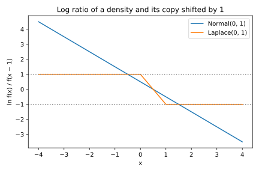

# Probability distributions

## Why this matters

A handful of distributions do almost all the work in this book. Counts of events (errors, successes, examples drawn into a batch) are binomial, and Poisson when the events are rare. Additive noise is usually normal or Laplace. Every later chapter — concentration, divergences, hypothesis testing — is stated in terms of these few families. So you need to know each one well: its density, mean, variance, moment generating function (MGF), tails, and how it relates to the others.

The idea that ties the chapter together is that these families are not a zoo of unrelated formulas. They are built from one another. A binomial is a sum of coin flips. A Poisson is a binomial with many trials and a small success probability. An exponential is the waiting time for the first event in that same Poisson setting. A Laplace is two exponentials placed back to back. A normal is what any sum of many small independent pieces looks like. Because each family is built from simpler ones, its mean, variance and MGF can be computed from the pieces, and that is how this chapter derives them.

This chapter covers five families (@tbl-families):

| Family | Models | Key fact for later |
| --- | --- | --- |
| Bernoulli and binomial | One yes/no outcome; the count of successes in $n$ trials | Mean and variance add over independent trials |
| Poisson | Counts of rare events | Its MGF $e^{\mu(e^\lambda - 1)}$ drives the Chernoff bound |
| Exponential | Waiting times; a building block | A difference of two exponentials is Laplace |
| Laplace | Symmetric noise with exponential tails | Its log density is piecewise linear, so shifted copies differ by a bounded factor |
| Normal | Sums of many small effects; symmetric noise with light tails | Closed under sums; a $d$-dimensional normal vector has norm $\approx\sigma\sqrt d$ |

: The five families in this chapter, what each models, and the fact about it that later chapters use. {#tbl-families}

A last section puts the normal and the Laplace side by side and asks how different a density is from a copy of itself moved sideways. That comparison is where the next chapters begin.

Each section follows the same arc: context, definition, derivations of the moments, interpretation, an example from machine learning, and a self-check.

## Toolkit: what to know for each distribution

For every family below you will meet the same three summaries: its moments, its moment generating function and its tail. This section says what each one is, why it is worth computing, and the few rules for working with it.

### Moments: where the distribution sits and how wide it is {#sec-dist-moments}

The **mean** $\mathbb E[X]$ is the centre of mass of the distribution: the long-run average of many independent draws. The **variance** measures how far draws typically land from the mean. It squares each draw's distance from the mean, so that distances on either side count the same, and averages. Expanding the square $(X - \mathbb E X)^2 = X^2 - 2X\,\mathbb E X + (\mathbb E X)^2$ and averaging each term gives a second form that is often easier to compute, "mean of the square minus square of the mean":
$$\operatorname{Var}(X) = \mathbb E\big[(X - \mathbb E X)^2\big] = \mathbb E[X^2] - (\mathbb E X)^2.$$
Its square root, the **standard deviation**, is in the same units as $X$, so it is the number to compare with the mean. For a fair die, $\mathbb E X = (1 + \dots + 6)/6 = 3.5$ and $\mathbb E X^2 = (1 + 4 + \dots + 36)/6 = 91/6$, so $\operatorname{Var}X = 91/6 - 3.5^2 = 35/12 \approx 2.92$ and the standard deviation is about 1.71.

Three rules cover almost every calculation in this chapter. The first is that the mean of a sum is the sum of the means, $\mathbb E[X + Y] = \mathbb E X + \mathbb E Y$, always, even when $X$ and $Y$ are dependent. The reason is that an expectation is a weighted sum over outcomes, and a weighted sum of $X + Y$ splits into the weighted sum of $X$ plus the weighted sum of $Y$.

The second rule says what scaling does to the spread: $\operatorname{Var}(cX) = c^2\operatorname{Var}(X)$. Multiplying $X$ by $c$ multiplies every deviation $X - \mathbb E X$ by $c$, and squaring the deviation turns that into $c^2$.

The third rule is that variances add when the variables are independent: $\operatorname{Var}(X + Y) = \operatorname{Var}X + \operatorname{Var}Y$. To see where independence enters, expand the square in the definition. In general $\operatorname{Var}(X + Y) = \operatorname{Var}X + \operatorname{Var}Y + 2\operatorname{Cov}(X, Y)$, where the cross term is the **covariance** $\operatorname{Cov}(X, Y) = \mathbb E[XY] - \mathbb E X\,\mathbb E Y$. Independence makes $\mathbb E[XY] = \mathbb E X\,\mathbb E Y$, so the covariance vanishes and only the two variances remain.

The second and third rules together give the $1/\sqrt n$ law. The average of $n$ independent copies of $X$ is their sum times $1/n$. The sum has variance $n\operatorname{Var}(X)$ by the third rule, and multiplying by $1/n$ divides that by $n^2$ by the second, so the average has variance $n\operatorname{Var}(X)/n^2 = \operatorname{Var}(X)/n$. Its standard deviation is therefore the standard deviation of one draw divided by $\sqrt n$.

### The moment generating function {#sec-dist-mgf}

The mean and variance summarize a distribution by two numbers. The moment generating function summarizes it by a whole function, and that function turns out to be the right tool for sums of independent variables and for tails. The idea is to average not $X$ itself but an exponential of it, $e^{\lambda X}$, for a number $\lambda$ of your choice. The **moment generating function** (MGF) of $X$ is
$$M_X(\lambda) = \mathbb E\big[e^{\lambda X}\big].$$
Here $\lambda$ is a real number that *you* choose. It is not a parameter of the distribution; it is a dial. For each setting of the dial you get one number, $\mathbb E[e^{\lambda X}]$, and the MGF is the whole function $\lambda \mapsto M_X(\lambda)$. With $\lambda > 0$, the weight $e^{\lambda X}$ grows exponentially in $X$, so large values of $X$ dominate the average; the larger $\lambda$, the further into the right tail it looks. With $\lambda < 0$ it looks at the left tail instead. At $\lambda = 0$ every weight is $e^0 = 1$, so $M_X(0) = 1$ for every distribution.

**A concrete case: where $e^\lambda$ comes from.** Take a coin $X \sim \mathrm{Bernoulli}(p)$, which is 1 with probability $p$ and 0 otherwise. To compute $\mathbb E[e^{\lambda X}]$, list each outcome, the value $e^{\lambda X}$ takes there, and its probability (@tbl-mgf-coin).

| Outcome $x$ | $\Pr[X = x]$ | $e^{\lambda x}$ |
| --- | --- | --- |
| 0 | $1 - p$ | $e^{\lambda\cdot0} = 1$ |
| 1 | $p$ | $e^{\lambda\cdot1} = e^\lambda$ |

: The MGF of a coin, outcome by outcome. The factor $e^\lambda$ is just $e^{\lambda x}$ evaluated at $x = 1$. {#tbl-mgf-coin}

An expectation is the value at each outcome times its probability, added up, so
$$M_X(\lambda) = (1 - p)\cdot1 + p\cdot e^\lambda = 1 + p(e^\lambda - 1).$$
So the $e^\lambda$ in the Bernoulli, binomial and Poisson MGFs is nothing mysterious: it is the weight $e^{\lambda x}$ of the outcome $x = 1$. For a count $k$ the weight is $e^{\lambda k} = (e^\lambda)^k$, which is why $e^\lambda$ keeps reappearing for the counting distributions. With $p = 0.3$ and $\lambda = 1$, for instance, $M_X(1) = 0.7 + 0.3e \approx 1.52$.

**Why it "generates" moments.** The $k$-th **moment** of $X$ is $\mathbb E X^k$; the mean is the first. The MGF contains all of them, and the way to see this is to expand the exponential in its power series, $e^u = 1 + u + u^2/2! + u^3/3! + \cdots$, with $u = \lambda X$, and take the expectation of each term separately (the first rule of @sec-dist-moments, extended to many terms):
$$M_X(\lambda) = \mathbb E\Big[1 + \lambda X + \frac{\lambda^2X^2}{2!} + \frac{\lambda^3X^3}{3!} + \cdots\Big] = 1 + \lambda\,\mathbb E X + \frac{\lambda^2}{2!}\mathbb E X^2 + \cdots.$$
The $k$-th moment $\mathbb E X^k$ is $k!$ times the coefficient of $\lambda^k$, and differentiating $k$ times at $\lambda = 0$ picks it out, because differentiation kills the lower powers of $\lambda$ and setting $\lambda = 0$ kills the higher ones: $M_X'(0) = \mathbb E X$, $M_X''(0) = \mathbb E X^2$. For the coin, expanding $e^\lambda$ the same way gives $1 + p(e^\lambda - 1) = 1 + p\lambda + p\lambda^2/2! + \cdots$, so every moment equals $p$, as it must, since $X^k = X$ when $X \in \{0, 1\}$.

**The log-MGF gives mean and variance directly.** The derivatives of $M_X$ give the raw moments $\mathbb E X$ and $\mathbb E X^2$, and the variance then needs a subtraction. Taking the logarithm first does the subtraction for you, and it will also turn products of MGFs into sums. Let $\psi_X(\lambda) = \ln M_X(\lambda)$. The chain rule gives $\psi' = M'/M$, and the quotient rule applied to $M'/M$ gives $\psi'' = M''/M - (M'/M)^2$. At 0, where $M = 1$, $M' = \mathbb E X$ and $M'' = \mathbb E X^2$,
$$\psi_X'(0) = \mathbb E X, \qquad \psi_X''(0) = \mathbb E X^2 - (\mathbb E X)^2 = \operatorname{Var}X.$$
The derivatives of $\psi_X$ at 0 are called the **cumulants** of $X$: the first is the mean, the second the variance, and the higher ones measure finer features of the shape. For the Poisson below, $\psi$ turns out so simple that both derivatives can be read off in one line.

**Sums become products.** The main reason to use MGFs is that adding independent variables multiplies their MGFs. The exponential turns the sum into a product, and independence lets the expectation of that product split. If $X$ and $Y$ are independent, then
$$M_{X+Y}(\lambda) = \mathbb E\big[e^{\lambda X}e^{\lambda Y}\big] = \mathbb E\big[e^{\lambda X}\big]\,\mathbb E\big[e^{\lambda Y}\big] = M_X(\lambda)M_Y(\lambda).$$
The first step is $e^{a + b} = e^ae^b$; the second uses independence, which lets the expectation of a product split into a product of expectations. In log form, $\psi_{X+Y} = \psi_X + \psi_Y$. This is how you get the binomial MGF from the Bernoulli one without touching the probability table, and it is the starting point of every exponential tail bound in [Concentration inequalities](02-concentration.md).

**The MGF pins down the distribution.** If two distributions have the same MGF on an interval around 0, they are the same distribution. This is a standard theorem of probability (it is proved in Blitzstein & Hwang, listed in the references); its proof needs more analysis than this book uses, so take it as given. You can check each sum this chapter identifies without it: @sec-apx-prob-convolution in the appendices derives every one directly, by integrating or summing over the ways the two values can add up. We use it to identify sums: compute the MGF of $X + Y$ as a product, recognise it as the MGF of a known family, and conclude that $X + Y$ belongs to that family ("the sum of independent Poissons is Poisson"). The MGF can be infinite for some $\lambda$, and for heavy-tailed distributions it is infinite for every $\lambda > 0$; the identification needs it finite near 0.

### Tails: how fast large values become rare {#sec-dist-tails}

The **tail** of $X$ is $\Pr[X \ge t]$ as a function of $t$, for $t$ well above the mean. The mean and variance describe the bulk of the distribution; the tail describes the rare, large outcomes, which are what a worst-case guarantee has to control. What matters is the *shape* of the decay, and three shapes recur. Evaluate each at $t = 5$. A polynomial decay such as $1/t^2$ gives $1/25 = 0.04$. An exponential decay such as $e^{-t}$ gives $e^{-5}$, about $6.7 \times 10^{-3}$. A Gaussian decay such as $e^{-t^2/2}$ gives $e^{-12.5}$, about $3.7 \times 10^{-6}$.

The gap widens quickly as $t$ grows, because the exponent of the Gaussian decay grows like $t^2$ while that of the exponential grows like $t$. Exponential tails are those of the exponential and Laplace families below; Gaussian tails are those of the normal.

The tail and the MGF are tied together, and the link is a one-line argument. Fix $\lambda > 0$. Whenever $X \ge t$, the weight $e^{\lambda X}$ is at least $e^{\lambda t}$, and it is never negative, so averaging gives $M_X(\lambda) = \mathbb E[e^{\lambda X}] \ge e^{\lambda t}\Pr[X \ge t]$. Rearranged, $\Pr[X \ge t] \le M_X(\lambda)e^{-\lambda t}$. So if $M_X(\lambda)$ is finite for some $\lambda > 0$, the tail decays at least exponentially in $t$. [Concentration inequalities](02-concentration.md) turns this into explicit bounds by choosing $\lambda$ well. Which decay a distribution has decides which concentration inequalities apply to it.

## Bernoulli and binomial

### Context

The simplest random quantity is a yes/no outcome: a test example is misclassified or not, a coin lands heads or not, a record is included in a sample or not. Count the yeses over $n$ independent trials and you get a binomial. Every estimated rate in machine learning — accuracy, error rate, false-positive rate — is a binomial count divided by $n$.

### Definitions

$X \sim \mathrm{Bernoulli}(p)$ takes value 1 with probability $p$ and 0 with probability $1 - p$.

$S \sim \mathrm{Binomial}(n, p)$ is the number of ones in $n$ independent $\mathrm{Bernoulli}(p)$ trials. The probability of exactly $k$ ones is the number of ways to place $k$ ones among $n$ trials, times the probability of any one such placement. That gives the probability mass function (PMF), the table of probabilities of each count,
$$\Pr[S = k] = \binom nk p^k(1-p)^{n-k}, \qquad k = 0, 1, \dots, n.$$

**Derivation of the PMF.** Any particular sequence with exactly $k$ ones has probability $p^k(1-p)^{n-k}$, because the trials are independent and the probability of a sequence is the product of the probabilities of its entries: $p$ for each one and $1 - p$ for each zero. There are $\binom nk$ such sequences — choose which $k$ positions hold the ones — and they are disjoint events, so their probabilities add.

### Moments

**Bernoulli.** $\mathbb E X = 1\cdot p + 0\cdot(1-p) = p$. Since $X^2 = X$, $\mathbb E X^2 = p$, so $\operatorname{Var}X = p - p^2 = p(1-p)$. The MGF, computed outcome by outcome in @tbl-mgf-coin, is $M_X(\lambda) = (1 - p) + pe^\lambda = 1 + p(e^\lambda - 1)$.

**Binomial.** Rather than work with the PMF, write the count as a sum of the trials, $S = X_1 + \dots + X_n$ with independent Bernoullis, and apply the rules of the Toolkit to the sum. The mean of a sum is the sum of the $n$ means, each $p$. The trials are independent, so the variances add, $n$ times $p(1-p)$. And the MGF of an independent sum is the product of $n$ identical Bernoulli MGFs. Together,
$$\mathbb E S = np, \qquad \operatorname{Var}S = np(1-p), \qquad M_S(\lambda) = \big(1 + p(e^\lambda - 1)\big)^n.$$
No sums over the PMF are needed: decomposing into simple pieces is almost always easier than computing with the PMF directly.

### Interpretation

The variance $p(1-p)$ is a downward parabola in $p$ that is zero at $p = 0$ and $p = 1$, so it is largest halfway between, at $p = \frac12$, where it is $\frac12 \cdot \frac12 = \frac14$, and small near 0 or 1. A rate near 0 is therefore estimated much more precisely than one near $\frac12$. Bounds that use only the fact that each trial lies between 0 and 1, such as Hoeffding's inequality in [Concentration inequalities](02-concentration.md), cannot see this difference, and it matters later.

The estimated rate $\hat p = S/n$ is the count scaled by $1/n$. By the scaling rules of @sec-dist-moments it has mean $np/n = p$ and variance $np(1-p)/n^2 = p(1-p)/n$, so its standard deviation is $\sqrt{p(1-p)/n}$. Precision improves like $1/\sqrt n$: four times the data halves the error, since $\sqrt 4 = 2$.

### Example: estimating a classifier's error rate

A classifier makes an error on each test example independently with probability $p = 0.05$. On $n = 2{,}000$ test examples the error count is $\mathrm{Binomial}(2000, 0.05)$, with mean $2000 \times 0.05 = 100$ and standard deviation $\sqrt{2000 \times 0.05 \times 0.95} \approx 9.7$. Divided by $n$, that standard deviation is about $9.7/2000 \approx 0.005$ of the rate, so the measured error rate is typically within about $\pm 0.5$ percentage points of the true 5%. At $p = 0.001$ the count has mean 2 and standard deviation $\sqrt{2000 \times 0.001 \times 0.999} \approx 1.4$: the *relative* error, $1.4/2$, is now about 70%, and a single test set can easily show 0 errors (that happens with probability $0.999^{2000} \approx e^{-2}$, about one test set in seven).

### Check yourself

- Why is $\operatorname{Var}(X_1 + \dots + X_n) = n\operatorname{Var}(X_1)$ wrong if the $X_i$ are copies of the same variable? *(Then the sum is $nX_1$, whose variance is $n^2\operatorname{Var}X_1$. Independence is what makes variances add.)*
- What is $\Pr[S = 0]$ for $\mathrm{Binomial}(n, p)$, and roughly how large must $n$ be before you expect to see at least one success? *($(1-p)^n \approx e^{-np}$, using $1 - p \approx e^{-p}$ for small $p$; this is small only once $np$ is around 1 or more, so you need $n$ on the order of $1/p$.)*

## Poisson

### Context

When $n$ is large and $p$ is small, the binomial depends on $n$ and $p$ only through the mean $\mu = np$, as the limit below shows. The limit is the Poisson distribution: the law of rare events. It describes the number of errors in a large test set with a tiny error rate, the number of rare tokens in a document, or the size of a minibatch when each of many examples is included independently with small probability.

### Definition

$N \sim \mathrm{Poisson}(\mu)$ for $\mu > 0$ counts events whose expected number is $\mu$. It takes values $k = 0, 1, 2, \dots$ with
$$\Pr[N = k] = e^{-\mu}\frac{\mu^k}{k!}.$$
The factor $e^{-\mu}$ makes the probabilities add up to 1, since $\sum_k \mu^k/k! = e^\mu$ is the power series of the exponential.

### The Poisson limit of the binomial

Hold the expected count $\mu$ fixed and let the number of trials grow, so each trial has success probability $p = \mu/n$. Put that into the binomial PMF for a fixed count $k$, write $\binom nk = n(n-1)\cdots(n-k+1)/k!$, and group the result into four factors, each of which has a simple limit as $n \to \infty$:
$$\binom nk\left(\frac\mu n\right)^k\left(1 - \frac\mu n\right)^{n-k} = \underbrace{\frac{n(n-1)\cdots(n-k+1)}{n^k}}_{\to\, 1}\cdot\frac{\mu^k}{k!}\cdot\underbrace{\left(1 - \frac\mu n\right)^n}_{\to\, e^{-\mu}}\cdot\underbrace{\left(1 - \frac\mu n\right)^{-k}}_{\to\, 1}.$$
The first factor is a product of $k$ fractions $n/n, (n-1)/n, \dots$, each tending to 1, and there are only $k$ of them. The middle factor does not depend on $n$. The third is the classic limit that defines $e$: its logarithm is $n\ln(1 - \mu/n)$, and since $\ln(1 - u) \approx -u$ for small $u$, that is close to $n \cdot (-\mu/n) = -\mu$. The last factor has a fixed exponent $-k$ and a base tending to 1. The limit is $e^{-\mu}\mu^k/k!$. @fig-poisson-limit shows the convergence: at $n = 10$ the binomial is visibly narrower than the Poisson, while at $n = 100$ they almost coincide.

{#fig-poisson-limit}

### Moments via the MGF

The MGF is the sum, over all counts $k$, of the weight $e^{\lambda k}$ times the probability of $k$. Gathering the powers of $k$ into $(\mu e^\lambda)^k$ leaves the power series of the exponential, evaluated at $\mu e^\lambda$:
$$M_N(\lambda) = \sum_{k\ge0}e^{\lambda k}e^{-\mu}\frac{\mu^k}{k!} = e^{-\mu}\sum_{k\ge0}\frac{(\mu e^\lambda)^k}{k!} = e^{-\mu}e^{\mu e^\lambda} = \exp\big(\mu(e^\lambda - 1)\big).$$
So the log-MGF is $\psi_N(\lambda) = \mu(e^\lambda - 1)$. Its derivatives are all $\mu e^\lambda$, which equals $\mu$ at $\lambda = 0$. Since $\psi'(0)$ is the mean and $\psi''(0)$ the variance (@sec-dist-mgf),
$$\mathbb E N = \operatorname{Var}N = \mu.$$

**Sums.** Take independent $N_1 \sim \mathrm{Poisson}(\mu_1)$ and $N_2 \sim \mathrm{Poisson}(\mu_2)$. The MGF of the sum is the product of the two MGFs, and multiplying two exponentials adds their exponents, which gives $\exp((\mu_1 + \mu_2)(e^\lambda - 1))$. That is the Poisson MGF with mean $\mu_1 + \mu_2$, and since the MGF pins down the distribution, $N_1 + N_2 \sim \mathrm{Poisson}(\mu_1 + \mu_2)$.

### Interpretation

**Mean equals variance.** The standard deviation is $\sqrt\mu$, so the spread relative to the mean, $\sqrt\mu/\mu = 1/\sqrt\mu$, shrinks only once you expect many events. With $\mu = 4$ the standard deviation is 2, so a count of 0 or 8, two standard deviations from the mean, is unremarkable.

**The Poisson MGF bounds the Bernoulli MGF.** The inequality $1 + x \le e^x$ holds for every $x$: the exponential is convex, and $1 + x$ is its tangent line at 0, which a convex curve always lies above. Apply it with $x = p(e^\lambda - 1)$:
$$M_{\mathrm{Bern}(p)}(\lambda) = 1 + p(e^\lambda - 1) \le \exp(p(e^\lambda - 1)) = M_{\mathrm{Poisson}(p)}(\lambda).$$
Now take independent Bernoullis with probabilities $p_1, \dots, p_n$ and mean $\mu = p_1 + \dots + p_n$. The MGF of their sum is the product of their MGFs, each at most $\exp(p_i(e^\lambda - 1))$, and the product of those is $\exp(\mu(e^\lambda - 1))$. So the MGF of any sum of independent Bernoullis with mean $\mu$ is at most the Poisson($\mu$) MGF. This one-line inequality is the first step of the Chernoff bound in [Concentration inequalities](02-concentration.md), which bounds the tail of a count through its MGF, as in @sec-dist-tails.

**Right tail.** Count data are right-skewed: the count cannot go below 0 but can run far above the mean. For large $k$, $\Pr[N = k]$ decays like $(e\mu/k)^k$. To see this, use the bound $k! \ge (k/e)^k$ (it follows from $e^k = \sum_j k^j/j! \ge k^k/k!$), which gives $\Pr[N = k] \le e^{-\mu}\mu^k(e/k)^k \le (e\mu/k)^k$. Written as $e^{-k\ln(k/(e\mu))}$, the exponent grows like $k\ln k$, so the decay is faster than any exponential $e^{-ck}$, but slower than the $e^{-k^2/(2\mu)}$ of a normal with the same variance.

### Example: minibatch sizes under independent sampling

Some training procedures form a minibatch by including each of $n = 60{,}000$ examples independently with probability $q = 0.01$. The batch size is $\mathrm{Binomial}(60000, 0.01)$: many trials, each unlikely, so it is very close to $\mathrm{Poisson}(600)$, with mean $60000 \times 0.01 = 600$ and standard deviation $\sqrt{600}$, about 24.5. Batch sizes between 550 and 650, about two standard deviations either side, are typical; [Concentration inequalities](02-concentration.md) shows how unlikely anything outside $600 \pm 20\%$ is.

### Check yourself

- Using only the MGF, show that $\mathbb E[N(N-1)] = \mu^2$. *(Differentiate $M_N$ twice at 0 to get $\mathbb E N^2 = \mu^2 + \mu$, then subtract $\mathbb E N$.)*
- The binomial variance $np(1-p)$ tends to $\mu$ under the Poisson limit. Which factor disappears, and why? *($(1-p) \to 1$ because $p = \mu/n \to 0$.)*

## Exponential

### Context

The Poisson counts how many rare events land in a fixed window. Turn the question around: starting now, *how long* until the first one? A model in production makes a rare error, a cache entry is evicted, a request arrives. The answer is the exponential distribution, and it comes out of the same construction as the Poisson: chop time into many short slots, give each slot a small, independent chance of holding an event, and let the slots shrink. For us it is mainly a building block: the Laplace distribution is two exponentials glued back to back, and the simplest exponential-type tail bounds are calculations with it.

### Derivation: the waiting time in the Poisson limit

Fix a scale $b > 0$, which will turn out to be the average waiting time. Split each unit of time into $n$ slots of width $1/n$. As the slots get finer, each one must get less likely to hold an event, or the number of events per unit of time would blow up. So choose the per-slot probability to keep the expected number of events per unit of time at $1/b$, whatever $n$ is. With $n$ slots per unit of time, that means each slot holds an event independently with probability
$$p = \frac{1}{bn},$$
since then $np = 1/b$. This is the Poisson setup: in the Poisson limit we held the mean $\mu = np$ fixed and let $n \to \infty$, and here we hold the mean *rate* $1/b$ fixed in the same way.

1. **The wait in slots is geometric.** Let $G$ be the index of the first slot that holds an event. $G > j$ means the first $j$ slots are all empty, each with probability $1 - p$. The slots are independent, so these probabilities multiply:
$$\Pr[G > j] = (1 - p)^j, \qquad j = 0, 1, 2, \dots$$
@tbl-geometric-wait lists the first few outcomes. This is the **geometric distribution**: the number of coin flips up to and including the first head.

| $j$ | Slots $1, \dots, j$ when $G = j$ | $\Pr[G = j]$ | $\Pr[G > j]$ |
| --- | --- | --- | --- |
| 1 | event | $p$ | $1 - p$ |
| 2 | empty, event | $(1 - p)p$ | $(1 - p)^2$ |
| 3 | empty, empty, event | $(1 - p)^2p$ | $(1 - p)^3$ |
| $j$ | $j - 1$ empty, then event | $(1 - p)^{j-1}p$ | $(1 - p)^j$ |

: The waiting time $G$, in slots, until the first event. Each row is one outcome. $G > j$ exactly when the first $j$ slots are empty. {#tbl-geometric-wait}

2. **Convert slots to time.** Each slot lasts $1/n$, so the first event happens at time $T_n = G/n$. Time $t$ covers $\lfloor nt\rfloor$ whole slots (the floor $\lfloor\cdot\rfloor$ rounds down to a whole number), so $T_n > t$ means those slots are all empty:
$$\Pr[T_n > t] = \Pr[G > \lfloor nt\rfloor] = \left(1 - \frac{1}{bn}\right)^{\lfloor nt\rfloor}.$$

3. **Let the slots shrink.** The goal is to bring this into the form $(1 - \mu/m)^m$, whose limit $e^{-\mu}$ we already know from the Poisson limit. Two rewrites do it. Write the exponent as $nt - r$, where $0 \le r < 1$ is the fractional part of $nt$, and write $\frac{1}{bn}$ as $\frac{t/b}{nt}$, which is the same number. Then
$$\left(1 - \frac{1}{bn}\right)^{\lfloor nt\rfloor} = \underbrace{\left(1 - \frac{t/b}{nt}\right)^{nt}}_{\to\, e^{-t/b}}\cdot\underbrace{\left(1 - \frac{1}{bn}\right)^{-r}}_{\to\, 1}.$$
The first factor is the limit $(1 - \mu/m)^m \to e^{-\mu}$ with $\mu = t/b$ and $m = nt$ slots. The second has a bounded exponent and a base tending to 1. So the limiting waiting time $T$ satisfies
$$\Pr[T > t] = e^{-t/b}, \qquad t \ge 0.$$ {#eq-exponential-survival}

4. **Differentiate to get the density.** The probability that the wait is at most $t$ is $\Pr[T \le t] = 1 - e^{-t/b}$, and a density is the derivative of this function, here $\frac1be^{-t/b}$.

**The same answer from the Poisson count.** The first event comes after $t$ exactly when no event falls in $[0, t]$. The number of events in $[0, t]$ is a count over $\lfloor nt\rfloor$ independent slots, $\mathrm{Binomial}(\lfloor nt\rfloor, \frac{1}{bn})$, with mean about $t/b$; by the Poisson limit it tends to $\mathrm{Poisson}(t/b)$, and $\Pr[\mathrm{Poisson}(t/b) = 0] = e^{-t/b}$. Counting events in a window gives a Poisson count, and waiting for the first event gives an exponential time. Both come from the same slots.

### Definition

$Y \sim \mathrm{Exp}(b)$ with *scale* $b > 0$ has the density just derived,
$$f(y) = \frac1b e^{-y/b}, \qquad y \ge 0.$$
(Some texts use the rate $1/b$ instead. NumPy's `rng.exponential(b)` uses the scale.)

@fig-exponential-limit shows the limit for $b = 2$. With one slot per unit of time, each slot holds an event with probability $p = 1/(2 \cdot 1) = \frac12$, so $\Pr[T_n > t] = (\frac12)^{\lfloor t\rfloor}$ is a staircase that halves at every integer. With five slots it already hugs $e^{-t/2}$. At $t = 4$ the script gives $\Pr[T_n > 4] = 0.0625$, $0.1216$ and $0.1347$ for $n = 1, 5, 100$, against $e^{-2} = 0.1353$. The first two follow from the formula of step 2: $(\frac12)^4 = 0.0625$, and with $n = 5$, $p = 0.1$ and $(0.9)^{20} = 0.1216$.

![$\Pr[T_n > t]$ for the slotted waiting time with $b = 2$ and $n = 1$ or $5$ slots per unit of time, against the exponential tail $e^{-t/2}$.](figures/exponential_limit.svg){#fig-exponential-limit}

### Moments and tail

Everything about the exponential follows from its density by short integrals.

The **tail** is the area under the density to the right of $t$: $\Pr[Y \ge t] = \int_t^\infty \frac1be^{-y/b}\,dy = e^{-t/b}$, which is @eq-exponential-survival again.

The **mean** is easiest from the tail. A non-negative variable can be written as $Y = \int_0^\infty \mathbf 1[Y \ge t]\,dt$, where $\mathbf 1[\cdot]$ is 1 when the condition holds and 0 otherwise: the integrand is 1 for $t$ from 0 up to $Y$, so the integral is the length $Y$. Taking expectations turns each indicator into a probability, $\mathbb E Y = \int_0^\infty\Pr[Y \ge t]\,dt = \int_0^\infty e^{-t/b}\,dt = b$. So $b$ is indeed the average wait.

The **second moment** uses the Gamma integral $\int_0^\infty y^k e^{-y/b}\,dy = k!\,b^{k+1}$. Substituting $u = y/b$ turns it into $b^{k+1}\int_0^\infty u^ke^{-u}\,du$, and integrating by parts $k$ times reduces the last integral to $k!$. With $k = 2$ and the factor $\frac1b$ from the density, $\mathbb E Y^2 = 2b^2$, so $\operatorname{Var}Y = 2b^2 - b^2 = b^2$.

The **MGF** multiplies the density by $e^{\lambda y}$, which combines the two exponents into $-(1/b - \lambda)y$. As long as $\lambda < 1/b$ that exponent is negative and the integral converges:
$$M_Y(\lambda) = \frac1b\int_0^\infty e^{-(1/b - \lambda)y}\,dy = \frac{1}{1 - b\lambda}.$$
For $\lambda \ge 1/b$ the exponent is zero or positive, the integrand does not shrink, and the integral diverges. The MGF exists only on part of the line: the hallmark of an exponential, rather than Gaussian, tail.

### Interpretation: memorylessness

The exponential forgets how long you have waited. Given that you have already waited $s$ without an event, the chance of waiting at least $t$ more is the same as the chance of waiting $t$ from scratch. In symbols, the conditional probability is the ratio of the two tails,
$$\Pr[Y \ge s + t \mid Y \ge s] = e^{-(s+t)/b}/e^{-s/b} = e^{-t/b} = \Pr[Y \ge t].$$
Having already waited $s$ tells you nothing about the remaining wait. The derivation explains why: the slots after time $s$ are independent of the empty slots before it, so the wait starts afresh. The geometric distribution is memoryless for the same reason. The exponential is also the only continuous distribution with this property: memorylessness says the tail $g(t) = \Pr[Y \ge t]$ satisfies $g(s + t) = g(s)g(t)$, and the only decreasing functions with that property are exponentials $e^{-t/b}$.

### Example: time to a model's first error

A deployed classifier serves 50 requests per second and misclassifies each one independently with probability $10^{-4}$. Each request is a slot, so errors arrive at rate $50 \times 10^{-4} = 0.005$ per second, and the time to the first error is approximately $\mathrm{Exp}(b)$ with $b = 1/0.005 = 200$ seconds. A 10-minute window is 600 seconds, so the probability of a clean window is $e^{-600/200} = e^{-3} \approx 0.050$. The exact slotted answer is $(1 - 10^{-4})^{30000}$, one factor for each of the $50 \times 600 = 30{,}000$ requests, which agrees to three decimals because $p$ is tiny. Memorylessness says that after 10 error-free minutes, the expected wait for the first error is still 200 seconds.

### Check yourself

- Show that $\mathbb E Y^k = k!\,b^k$ by differentiating the MGF $k$ times. *($M^{(k)}(\lambda) = k!\,b^k(1 - b\lambda)^{-k-1}$, which is $k!\,b^k$ at $\lambda = 0$.)*
- The slotted wait has $\mathbb E T_n = \mathbb E G/n = b$ for every $n$, and $\operatorname{Var}T_n = (1 - p)b^2$. Which factor disappears in the limit, and why? *($(1 - p) \to 1$ because $p = 1/(bn) \to 0$, just as for the binomial variance under the Poisson limit. The script's samples give variances 2.001, 3.596 and 3.984 for $n = 1, 5, 100$, against $b^2 = 4$.)*

## Laplace

### Context

The Laplace distribution is symmetric noise with exponential tails. Compared with a normal of the same variance it puts more mass near zero *and* more mass far out. In machine learning it appears as the noise model behind absolute-error loss: assuming Laplace noise and maximizing the likelihood gives least-absolute-deviation regression, just as normal noise gives least squares. In later parts it is one of the two standard noise distributions.

### Definition

The Laplace density is an exponential density on each side of a centre $\mu$, mirrored, with each side carrying half the probability. $X \sim \mathrm{Lap}(\mu, b)$ with location $\mu$ and scale $b > 0$ has density
$$f(x) = \frac{1}{2b}e^{-|x - \mu|/b}.$$
We write $\mathrm{Lap}(b)$ for $\mathrm{Lap}(0, b)$. The cumulative distribution function (CDF), the probability $\Pr[X \le x]$, comes from integrating the density up to $x$. Left of the centre only the left half contributes, and right of it you subtract the remaining right tail from 1: the CDF is $\frac12e^{(x-\mu)/b}$ for $x < \mu$ and $1 - \frac12e^{-(x-\mu)/b}$ for $x \ge \mu$.

### Moments and tail

Take $\mu = 0$. The density takes the same value at $x$ and $-x$, so the size $|X|$ collects the density from both sides: its density is $2\cdot\frac{1}{2b}e^{-x/b} = \frac1be^{-x/b}$ on $x \ge 0$, which is the $\mathrm{Exp}(b)$ density. So $|X| \sim \mathrm{Exp}(b)$, and everything follows from the exponential.

The tail of $|X|$ is the exponential tail, $\Pr[|X| \ge t] = e^{-t/b}$. The event $|X| \ge t$ is made of two equally likely pieces, $X \ge t$ and $X \le -t$, because the density is mirror-symmetric about 0, so one side alone has half of it: $\Pr[X \ge t] = \frac12e^{-t/b}$. The mean absolute deviation is the exponential mean, $\mathbb E|X| = b$.

For the variance, note that $X^2 = |X|^2$, so $\mathbb E X^2$ is the exponential second moment $2b^2$. The mean is 0 by symmetry, so $\operatorname{Var}X = 2b^2$. Turned around, a Laplace variable with variance $\sigma^2$ has scale $b = \sigma/\sqrt2$.

For the MGF, split the integral at 0 into the two exponential halves. On the right, $\frac{1}{2b}\int_0^\infty e^{\lambda x - x/b}\,dx = \frac{1}{2b}\cdot\frac{1}{1/b - \lambda}$, which needs $\lambda < 1/b$; the left half is the same with $-\lambda$ in place of $\lambda$, which needs $\lambda > -1/b$. So for $|\lambda| < 1/b$, putting the two fractions over the common denominator $1/b^2 - \lambda^2$,
$$M_X(\lambda) = \frac{1}{2b}\left(\frac{1}{1/b - \lambda} + \frac{1}{1/b + \lambda}\right) = \frac{1}{1 - b^2\lambda^2}.$$

### A Laplace variable is a difference of exponentials

The Laplace is two exponentials back to back, which suggests building it by subtracting one exponential from another: the positive one supplies the right half, the negated one the left half. The MGF confirms it. Let $Y_1, Y_2 \sim \mathrm{Exp}(b)$ be independent. Negating a variable flips the dial, $\mathbb E[e^{\lambda(-Y_2)}] = M_{Y_2}(-\lambda)$, and the MGF of an independent sum is the product, so the MGF of $Y_1 - Y_2$ is
$$M_{Y_1}(\lambda)\,M_{Y_2}(-\lambda) = \frac{1}{1 - b\lambda}\cdot\frac{1}{1 + b\lambda} = \frac{1}{1 - b^2\lambda^2},$$
which is the Laplace MGF. Since the MGF pins down the distribution, $Y_1 - Y_2 \sim \mathrm{Lap}(b)$. The script checks this numerically: over a million samples, the empirical CDF of $\mathrm{Exp}(1) - \mathrm{Exp}(1)$ is within 0.0006 of the $\mathrm{Lap}(1)$ CDF everywhere on $[-5, 5]$ (@fig-difference-of-exponentials).

{#fig-difference-of-exponentials}

### Interpretation: Laplace against normal

Put a Laplace and a normal side by side with the same variance, here 2, which means a normal with $\sigma = \sqrt2$ and a Laplace with $b = 1$ (@fig-laplace-vs-normal, left). The Laplace has a sharp peak at 0 and fatter tails. On a log scale (right) the difference is structural. Taking the logarithm of each density removes the exponential and leaves its exponent, plus a constant: the normal log density is a parabola, $-x^2/(2\sigma^2)$, while the Laplace log density is two straight lines, $-|x|/b$. Far out, a parabola always falls below a line, so the normal's tails are much lighter.

{#fig-laplace-vs-normal}

The same fact explains why the Laplace MGF exists only for $|\lambda| < 1/b$. Inside the MGF integral the weight $e^{\lambda x}$ multiplies the density, so the exponents add: $\lambda x - |x|/b$. For large positive $x$ that is $(\lambda - 1/b)x$, which goes to $-\infty$, and keeps the integral finite, only when $\lambda < 1/b$; the left side needs $\lambda > -1/b$. A quadratic decay $-x^2/(2\sigma^2)$ beats the linear term $\lambda x$ for every $\lambda$, which is why the normal MGF is finite everywhere.

### Example: absolute-error regression

Suppose $y_i = w^\top x_i + \varepsilon_i$ with $\varepsilon_i \sim \mathrm{Lap}(b)$ independent. The likelihood of the data is the product of the $n$ Laplace densities of the residuals $y_i - w^\top x_i$, and its logarithm is the sum of their log densities, $-n\ln(2b) - \frac1b\sum_i|y_i - w^\top x_i|$. Only the second term depends on $w$, and it enters with a minus sign, so the maximum-likelihood $w$ minimizes the sum of absolute errors. With no features this estimates the location by the *median*: moving a candidate location $m$ to the right lowers the absolute error of every point above $m$ and raises it for every point below, so the sum stops decreasing exactly when half the points are on each side. The median is far less sensitive to outliers than the mean, because moving one extreme point further out does not change which point is in the middle. That insensitivity is the same heavy-tail property seen in the figure: under a Laplace model, large residuals are not surprising enough to dominate the fit.

### Check yourself

- If $X \sim \mathrm{Lap}(b)$, what is $\Pr[|X| \ge 3b]$, and what is the corresponding probability for a normal with the same variance? *($e^{-3b/b} = e^{-3} \approx 0.050$; for the normal, $\sigma = \sqrt2 b$, so $3b$ is $3/\sqrt2$ standard deviations and $\Pr[|Z| \ge 3/\sqrt2] \approx 0.034$. The Laplace wins this far out, and the gap grows quickly.)*
- Derive $\mathbb E|X| = b$ from the exponential. *($|X| \sim \mathrm{Exp}(b)$.)*

## Normal

### Context

The normal distribution appears whenever many small independent effects add up — that is the central limit theorem (CLT) — and it is the default model for measurement noise, weight initialization and random projections. It is the light-tailed counterpart of the Laplace: closed under sums and scalings, with an MGF that is finite everywhere and a tail that decays like $e^{-t^2/2}$.

### Definition

The normal density is the bell curve: its logarithm is a downward parabola centred at the mean $\mu$, with width set by the standard deviation $\sigma$. $X \sim \mathcal N(\mu, \sigma^2)$ has density
$$f(x) = \frac{1}{\sigma\sqrt{2\pi}}e^{-(x-\mu)^2/(2\sigma^2)}.$$
**Standardization:** subtracting the mean and dividing by the standard deviation gives $Z = (X - \mu)/\sigma \sim \mathcal N(0, 1)$, the standard normal, with density $\varphi$ and CDF $\Phi$. So $\Phi(t)$ is the probability that a standard normal is below $t$, and every normal probability reduces to it: $\Pr[X \le x] = \Phi((x - \mu)/\sigma)$. There is no closed form for $\Phi$. In code, use the complementary error function $\operatorname{erfc}$ that every maths library provides, through $\Phi(x) = \frac12\operatorname{erfc}(-x/\sqrt2)$. It stays accurate far into the tail, where computing a small tail as $1 - \Phi$ by subtraction would lose all its digits.

### MGF and moments

The MGF integrates $e^{\lambda x}$ against the density, so the two exponents add, and the trick is to recognize the sum as another normal density. Take $\mu = 0$ first. Completing the square in the combined exponent gives
$\lambda x - \frac{x^2}{2\sigma^2} = -\frac{(x - \lambda\sigma^2)^2}{2\sigma^2} + \frac{\lambda^2\sigma^2}{2}$. The first term is the exponent of a normal density centred at $\lambda\sigma^2$, which integrates to 1 against the normalizer $\frac{1}{\sigma\sqrt{2\pi}}$, so only the factor $e^{\lambda^2\sigma^2/2}$ survives. A mean $\mu$ adds the constant $\mu$ to $X$, which multiplies $e^{\lambda X}$ by $e^{\lambda\mu}$. So
$$M_X(\lambda) = e^{\mu\lambda + \sigma^2\lambda^2/2}.$$
Then $\psi(\lambda) = \mu\lambda + \sigma^2\lambda^2/2$ gives $\psi'(0) = \mu$ and $\psi''(0) = \sigma^2$. Because $\psi$ is a quadratic, its third and higher derivatives are zero, so all higher cumulants (the higher derivatives of the log-MGF at 0, @sec-dist-mgf) are zero.

### Sums and linear maps

Scaling and adding independent normals gives another normal. The MGF shows it: scaling $X_i$ by $a_i$ evaluates its MGF at $a_i\lambda$, and adding independent variables multiplies MGFs, which adds the exponents. For independent $X_i \sim \mathcal N(\mu_i, \sigma_i^2)$, the MGF of $\sum_i a_iX_i$ is therefore $\exp\big(\lambda\sum_i a_i\mu_i + \frac{\lambda^2}2\sum_i a_i^2\sigma_i^2\big)$. That is the normal MGF with mean $\sum_i a_i\mu_i$ and variance $\sum_i a_i^2\sigma_i^2$, and since the MGF pins down the distribution,
$$\sum_i a_iX_i \sim \mathcal N\Big(\sum_i a_i\mu_i,\ \sum_i a_i^2\sigma_i^2\Big).$$
Among distributions with finite variance, the normal is the only one for which every linear combination of independent copies stays in the same family, up to location and scale (a classical result of Lévy on what are called stable distributions). The Laplace, for instance, fails: the sum of two independent $\mathrm{Lap}(b)$ variables has MGF $1/(1 - b^2\lambda^2)^2$, which is not a Laplace MGF.

### The normal in many dimensions

$X \sim \mathcal N(0, \sigma^2I_d)$ means the $d$ coordinates are independent $\mathcal N(0, \sigma^2)$; $I_d$ is the $d \times d$ identity matrix. Two facts are used constantly.

**Rotation invariance.** The noise looks the same in every direction, so a question about one direction is a one-dimensional question. To see it, project $X$ onto a unit vector $u$, one with $\sum_i u_i^2 = 1$. The projection $\langle u, X\rangle = \sum_i u_iX_i$ is a linear combination of independent normals, so by the rule above $\langle u, X\rangle \sim \mathcal N(0, \sigma^2\sum_i u_i^2) = \mathcal N(0, \sigma^2)$, whatever the direction $u$.

**The norm concentrates at $\sigma\sqrt d$.** The squared length $\|X\|^2 = \sum_i X_i^2$ is a sum of $d$ independent terms, so its mean and variance are $d$ times those of one term. Write $X_i = \sigma Z$ with $Z$ standard normal. Then $\mathbb E X_i^2 = \sigma^2$, and $\operatorname{Var}X_i^2 = \sigma^4(\mathbb E Z^4 - (\mathbb E Z^2)^2) = \sigma^4(3 - 1) = 2\sigma^4$. The value $\mathbb E Z^4 = 3$ comes from the MGF: $e^{\lambda^2/2} = 1 + \lambda^2/2 + \lambda^4/8 + \cdots$, and the coefficient of $\lambda^4$ times $4!$ is $24/8 = 3$. So
$$\mathbb E\|X\|^2 = d\sigma^2, \qquad \operatorname{Var}\|X\|^2 = 2d\sigma^4, \qquad \frac{\|X\|^2}{d\sigma^2} = 1 \pm O\!\left(\frac{1}{\sqrt d}\right).$$
The last statement divides by the mean: the ratio has mean 1 and standard deviation $\sqrt{2d\sigma^4}/(d\sigma^2) = \sqrt{2/d}$, and $O(1/\sqrt d)$ means "at most a constant times $1/\sqrt d$". In high dimension a normal vector is almost never near the origin: it lives on a thin shell of radius $\sigma\sqrt d$. The script measures $\|X\|/\sqrt d$ for $\sigma = 1$ (@tbl-gaussian-norms and @fig-gaussian-norms):

| $d$ | 1 | 10 | 100 | 1,000 | 10,000 |
| --- | --- | --- | --- | --- | --- |
| mean of $\|X\|/\sqrt d$ | 0.802 | 0.977 | 0.998 | 1.000 | 1.000 |
| std of $\|X\|/\sqrt d$ | 0.611 | 0.220 | 0.069 | 0.022 | 0.007 |

: Mean and standard deviation of $\|X\|/\sqrt d$ over 2,000 draws of $X \sim \mathcal N(0, I_d)$. {#tbl-gaussian-norms}

The standard deviation falls like $1/\sqrt{2d}$. That is half the $\sqrt{2/d}$ found for the squared norm, because taking a square root halves small relative deviations: $\sqrt{1 + e} \approx 1 + e/2$. At $d = 10{,}000$, for instance, $1/\sqrt{20000} \approx 0.007$. At $d = 1$ the mean is $\mathbb E|Z| = 2\int_0^\infty z\varphi(z)\,dz = 2/\sqrt{2\pi} = \sqrt{2/\pi} \approx 0.798$.

{#fig-gaussian-norms}

### The central limit theorem

Take a sum of $n$ independent draws from the same distribution, with mean $\mu$ and finite variance $\sigma^2$. By the rules of @sec-dist-moments the sum has mean $n\mu$ and standard deviation $\sigma\sqrt n$. Subtract the first and divide by the second, and the result always has mean 0 and variance 1. The central limit theorem says more: whatever the distribution of each draw, the *shape* of this standardized sum approaches the standard normal. In symbols, if $X_1, X_2, \dots$ are independent and identically distributed with mean $\mu$ and finite variance $\sigma^2$, then
$$\frac{X_1 + \dots + X_n - n\mu}{\sigma\sqrt n} \to \mathcal N(0, 1) \quad\text{in distribution,}$$
which means that its CDF approaches $\Phi$ at every point. The theorem holds whatever the shape of the $X_i$, and the best way to see this is to start from a distribution that looks nothing like a normal. Take $X_i \sim \mathrm{Exp}(1)$, so $\mu = \sigma^2 = 1$. One draw is badly skewed: it can't go below 0, its density is highest at 0, and it has a long right tail. The sum $S_n = X_1 + \dots + X_n$ has a known density, the $\mathrm{Gamma}(n, 1)$ density $x^{n-1}e^{-x}/(n-1)!$ (its MGF is $(1 - \lambda)^{-n}$, the product of $n$ exponential MGFs), so you can watch the standardized sum $(S_n - n)/\sqrt n$ change shape as $n$ grows (@fig-clt-exponential).

At $n = 1$ it is the exponential itself, shifted to mean 0. The hard wall at $z = (0 - 1)/1 = -1$ is the constraint $X \ge 0$. At $n = 2$ the wall moves to $(0 - 2)/\sqrt 2 = -\sqrt 2$, and the peak rounds off, because two draws are rarely both near 0. At $n = 5$ the bump is in the right place but leans left, with a longer right tail. At $n = 30$ the curve is close to $\mathcal N(0, 1)$, though a small lean to the left remains.

{#fig-clt-exponential}

The leftover lean is measured by the **skewness** $\mathbb E[(X - \mu)^3]/\sigma^3$, the average cubed deviation in units of the standard deviation. Cubing keeps the sign, so a long right tail makes it positive; it is 0 for every normal, which is symmetric. The third central moment, like the variance, adds over independent terms: expand $\mathbb E[(\sum_i (X_i - \mu))^3]$, and every cross term contains some $\mathbb E[X_i - \mu] = 0$ as a factor. For $\mathrm{Exp}(1)$ the third central moment is 2: with $\mathbb E Y^k = k!$, it is $\mathbb E Y^3 - 3\mathbb E Y^2 + 3\mathbb E Y - 1 = 6 - 6 + 3 - 1 = 2$. So $S_n$ has third central moment $2n$ and standard deviation $\sqrt n$, and its skewness is $2n/n^{3/2} = 2/\sqrt n$. The skewness falls, but only like $1/\sqrt n$. The largest gap between the CDF of the standardized sum and the normal CDF, which the script computes exactly from the Gamma CDF, falls at the same rate (@tbl-clt-exponential).

| $n$ | Skewness $2/\sqrt n$ | Largest CDF gap to $\mathcal N(0, 1)$ |
| --- | --- | --- |
| 1 | 2.000 | 0.1587 |
| 2 | 1.414 | 0.0945 |
| 5 | 0.894 | 0.0596 |
| 30 | 0.365 | 0.0243 |

: How far the standardized sum of $n$ $\mathrm{Exp}(1)$ variables is from $\mathcal N(0, 1)$. The CDF gap is the maximum of $|F_n(z) - \Phi(z)|$ over $z \in [-5, 5]$ in steps of 0.01. {#tbl-clt-exponential}

Multiply each gap by $\sqrt n$ and you get 0.159, 0.134, 0.133 and 0.133: the product settles to a constant, so the error decays like $1/\sqrt n$. This rate holds in general. The Berry–Esseen theorem bounds the gap by $C\,\mathbb E|X - \mu|^3/(\sigma^3\sqrt n)$ for a universal constant $C < 0.48$ (Shevtsova, 2011). @sec-apx-prob-clt in the appendices proves the central limit theorem itself, with a slower rate, by swapping one term at a time for a normal one. The numerator is a third moment, like the skewness, so the more skewed the summands, the more terms you need.

This is also why the normal curve in @fig-poisson-limit fits so well: $\mathrm{Poisson}(5)$ is a sum of five independent $\mathrm{Poisson}(1)$ variables, since Poisson means add, so the CLT already applies to it. A common rule of thumb is that the normal approximation to a binomial is reasonable once $np(1-p) \gtrsim 10$. The CLT is a statement about the *bulk*. In the far tails, where worst-case guarantees operate, it can be badly wrong, because the gap it controls is an absolute error of order $1/\sqrt n$, far larger than the tiny tail probabilities themselves; that is the job of the concentration inequalities in the next chapter.

### Example: noise in high dimension

Add $\mathcal N(0, \sigma^2I_d)$ noise to a model with $d = 10^6$ parameters and $\sigma = 0.01$. The noise vector has norm about $\sigma\sqrt d = 0.01 \times 1000 = 10$, almost surely within a fraction of a percent of that: the relative standard deviation is $1/\sqrt{2d} = 1/\sqrt{2 \times 10^6}$, under 0.1%. Yet by rotation invariance its projection onto any fixed unit vector is only $\mathcal N(0, 0.01^2)$. Large in norm, small in every direction: both facts come from rotation invariance and norm concentration.

### Check yourself

- If $X \sim \mathcal N(0, \sigma^2I_d)$ and $u, v$ are orthogonal unit vectors, are $\langle u, X\rangle$ and $\langle v, X\rangle$ independent? *(Yes. They are jointly normal with covariance $\sigma^2\langle u, v\rangle = 0$, and for jointly normal variables zero covariance means independence, which @sec-apx-prob-convolution proves by rotation.)*
- Why does the mean of $\|X\|/\sqrt d$ approach 1 from below? *(Jensen's inequality says that for a concave function $g$, such as the square root, $\mathbb E g(Y) \le g(\mathbb E Y)$. With $Y = \|X\|^2$ this gives $\mathbb E\|X\| \le \sqrt{\mathbb E\|X\|^2} = \sqrt d$.)*

## Comparing a density with its shifted copy

### Context

You take a noisy measurement $x = \mu + X$ of an unknown value $\mu$: a sensor reading, a timing measurement, or a statistic computed from a random sample. The noise $X$ has density $f$ centred at 0. Suppose $\mu$ can only be one of two values, $0$ or $s$. The number $s \in \mathbb R$ is the **shift**, the distance between the two candidate values. It is fixed and known, and it may be positive or negative.

Each candidate gives $x$ its own density. If $\mu = 0$, then $x = X$, with density $f(x)$. If $\mu = s$, then $x = s + X$, with density $f(x - s)$: the same curve, moved sideways by $s$.

The second claim is the step to check. The CDF of $s + X$ at a point $t$ is $\Pr[s + X \le t] = \Pr[X \le t - s] = F(t - s)$, where $F$ is the CDF of $X$, and differentiating in $t$ gives the density $f(t - s)$. So $f(x - s)$ is the graph of $f$ moved right by $s$: its value at $x$ is the value $f$ had at $x - s$. With $s = 1$, for instance, $f(x - 1)$ at $x = 1$ equals $f(0)$, so the shifted copy has its peak at 1.

To decide between the two candidates from one observation $x$, compare the two densities at $x$. Their ratio $f(x)/f(x - s)$ says how many times more likely $x$ is under $\mu = 0$ than under $\mu = s$. Taking its logarithm turns the ratio into a difference, and since both densities below are exponentials of something, it leaves just the difference of the exponents. That logarithm is the **log ratio**
$$L(x) = \ln\frac{f(x)}{f(x - s)} = \ln f(x) - \ln f(x - s).$$
It is positive when $x$ favours $\mu = 0$, negative when $x$ favours $\mu = s$, and zero when $x$ says nothing.

The question this section answers is: **how large can $|L(x)|$ get?** If it is bounded, no single observation can make one candidate much more likely than the other. If it is unbounded, some observations settle the question almost for certain. The normal and the Laplace give opposite answers. Later parts compare distributions in exactly this way, and the next chapters build on it: [divergences](03-divergences.md) average the log ratio over $x$, and [hypothesis testing](04-hypothesis-testing.md) uses it to decide.

### Statement

The answer follows from the shapes of the two log densities. A normal log density is a parabola, and the difference of a parabola and the same parabola shifted is a straight line, which grows without bound. A Laplace log density is a pair of straight lines with slopes $\pm 1/b$, and the difference of two such shapes can never exceed what the shift moves it, $|s|/b$. For any shift $s \in \mathbb R$, if $f$ is the $\mathcal N(0, \sigma^2)$ density, then
$$L(x) = \frac{s^2 - 2sx}{2\sigma^2},$$
which is linear in $x$ and unbounded. If $f$ is the $\mathrm{Lap}(b)$ density, then
$$L(x) = \frac{|x - s| - |x|}{b}, \qquad |L(x)| \le \frac{|s|}{b} \quad\text{for every } x.$$

### Derivation

**Normal.** Start from the normal density with $\mu = 0$, $f(x) = \frac{1}{\sigma\sqrt{2\pi}}e^{-x^2/(2\sigma^2)}$.

1. *Write the shifted density.* Replace $x$ by $x - s$: $f(x - s) = \frac{1}{\sigma\sqrt{2\pi}}e^{-(x - s)^2/(2\sigma^2)}$. The constant in front is the same; only the exponent changes.
2. *Take the ratio.* The constants cancel, and $e^a/e^c = e^{a - c}$:
$$\frac{f(x)}{f(x - s)} = \frac{e^{-x^2/(2\sigma^2)}}{e^{-(x - s)^2/(2\sigma^2)}} = \exp\!\left(\frac{(x - s)^2 - x^2}{2\sigma^2}\right).$$
3. *Take the logarithm.* Since $\ln e^c = c$, the log ratio is the exponent: $L(x) = \dfrac{(x - s)^2 - x^2}{2\sigma^2}$.
4. *Expand the square.* $(x - s)^2 = x^2 - 2sx + s^2$, and the $x^2$ cancels against $-x^2$, leaving $L(x) = \dfrac{s^2 - 2sx}{2\sigma^2}$.

The $x^2$ terms cancel because both densities have the same curvature; what is left is linear in $x$, with slope $-s/\sigma^2$. A line with nonzero slope has no bound, so $|L(x)| \to \infty$ as $|x| \to \infty$.

**Laplace.** Start from $f(x) = \frac{1}{2b}e^{-|x|/b}$.

1. *Write the shifted density.* $f(x - s) = \frac{1}{2b}e^{-|x - s|/b}$.
2. *Take the ratio and the logarithm,* as for the normal: the constants cancel and the log leaves the difference of exponents, $L(x) = -\dfrac{|x|}{b} + \dfrac{|x - s|}{b} = \dfrac{|x - s| - |x|}{b}$.
3. *Bound it from above.* The triangle inequality $|a + c| \le |a| + |c|$ says that the size of a sum is at most the sum of the sizes. With $a = x$, $c = -s$ it gives $|x - s| \le |x| + |s|$, so $|x - s| - |x| \le |s|$.
4. *Bound it from below.* The same inequality with $a = x - s$, $c = s$ gives $|x| \le |x - s| + |s|$, so $|x - s| - |x| \ge -|s|$.
5. *Combine.* $\big||x - s| - |x|\big| \le |s|$, so $|L(x)| \le |s|/b$ for every $x$, and the ratio of the two densities never exceeds $e^{|s|/b}$.

The bound is reached, not just approached. For $s > 0$ and any $x \le 0$, $|x - s| - |x| = (s - x) - (-x) = s$; for any $x \ge s$, it is $(x - s) - x = -s$. Between 0 and $s$ the log ratio falls linearly from $s/b$ to $-s/b$.

@tbl-shifted-log-ratio puts numbers on both formulas for $s = 1$, $\sigma = 1$ and $b = 1$, where they read $L(x) = (1 - 2x)/2$ and $L(x) = |x - 1| - |x|$.

| $x$ | $-2$ | $0$ | $0.5$ | $1$ | $3$ | $10$ |
| --- | --- | --- | --- | --- | --- | --- |
| Normal, $L(x) = (1 - 2x)/2$ | 2.5 | 0.5 | 0 | $-0.5$ | $-2.5$ | $-9.5$ |
| Laplace, $L(x) = \lvert x - 1\rvert - \lvert x\rvert$ | 1 | 1 | 0 | $-1$ | $-1$ | $-1$ |

: The log ratio $L(x)$ of a density and its copy shifted by $s = 1$, for $\mathcal N(0, 1)$ and $\mathrm{Lap}(1)$, at a few observations $x$. {#tbl-shifted-log-ratio}

Both vanish at the midpoint $x = 0.5$, where the two candidates are equally plausible. Far out they part ways. At $x = 10$ the normal log ratio is $-9.5$, so the observation is $e^{9.5} \approx 13{,}360$ times more likely under $\mu = 1$ than under $\mu = 0$. The Laplace never says more than $e^1 \approx 2.72$ times, however far out $x$ is (@fig-shifted-log-ratio).

{#fig-shifted-log-ratio}

### Interpretation

For the Laplace, the two copies are within a fixed factor of each other everywhere. For the normal, they are close in the bulk, but the ratio is unbounded in the tails — where, however, there is very little probability. How to make "very little probability" precise is the subject of the next three chapters: concentration bounds it, divergences summarize it, and hypothesis testing says what an observer can do with it.

### Check yourself

- For the normal, at which $x$ is $L(x) = 0$, and why is that point natural? *($x = s/2$, the midpoint, where the two densities cross.)*
- Under $x \sim \mathcal N(0, \sigma^2)$, what is the distribution of $L(x)$? *(It is linear in a normal, so normal: mean $s^2/(2\sigma^2)$, variance $(s/\sigma^2)^2\sigma^2 = s^2/\sigma^2$.)*

## Code: check the facts by simulation

The script [code/distributions.py](../../code/part01-prerequisites/distributions.py) draws every figure in this chapter and checks the formulas against simulation. Each probability function and each simulated quantity is a small typed function; the script calls them once for the tables and loops them over parameters for the figures. From the repository root:

```bash
uv run python code/part01-prerequisites/distributions.py
```

@tbl-moments compares each formula with 1,000,000 samples:

| Distribution | Mean (formula / sample) | Variance (formula / sample) |
| --- | --- | --- |
| $\mathrm{Bernoulli}(0.3)$ | 0.300 / 0.301 | 0.210 / 0.210 |
| $\mathrm{Binomial}(20, 0.3)$ | 6.000 / 6.001 | 4.200 / 4.198 |
| $\mathrm{Poisson}(4)$ | 4.000 / 3.998 | 4.000 / 4.001 |
| $\mathrm{Exp}(2)$ | 2.000 / 2.001 | 4.000 / 4.019 |
| $\mathrm{Lap}(0, 2)$ | 0.000 / −0.000 | 8.000 / 7.993 |
| $\mathcal N(1, 3^2)$ | 1.000 / 1.002 | 9.000 / 8.977 |

: Mean and variance from the formulas against 1,000,000 samples (seed 0). {#tbl-moments}

The formulas in each row are the ones derived above: $p(1-p)$, $np(1-p)$, $\mu$, $b^2$, $2b^2$ and $\sigma^2$. Every sample value is within a few thousandths of its formula, which is the sampling error you expect from a million draws. The other four checks are reported in their sections above: the slotted waiting time, the difference of exponentials, the norm of a normal vector, and the convergence of standardized exponential sums to the normal. [tests/test_distributions.py](../../tests/test_distributions.py) checks that the output still matches.

## References

- Blitzstein & Hwang, *Introduction to Probability* (2nd ed., 2019), ch. 3–5 and 7: every distribution here, with worked examples
- Wasserman, *All of Statistics* (2004), ch. 2–3: a compact reference
- Vershynin, *High-Dimensional Probability* (2018), §3.1: concentration of the norm of a normal vector
- Shevtsova, "On the absolute constants in the Berry–Esseen type inequalities for identically distributed summands" (2011): the constant $C \le 0.4748$ in the Berry–Esseen bound

## Cheat sheet

@tbl-distributions-cheat-sheet collects the facts above.

| Distribution | Density or PMF | Mean | Variance | MGF | Tail |
| --- | --- | --- | --- | --- | --- |
| $\mathrm{Bernoulli}(p)$ | $p^x(1-p)^{1-x}$, $x \in \{0, 1\}$ | $p$ | $p(1-p)$ | $1 + p(e^\lambda - 1)$ | — |
| $\mathrm{Binomial}(n, p)$ | $\binom nk p^k(1-p)^{n-k}$ | $np$ | $np(1-p)$ | $(1 + p(e^\lambda - 1))^n$ | Chernoff, see [chapter 2](02-concentration.md) |
| $\mathrm{Poisson}(\mu)$ | $e^{-\mu}\mu^k/k!$ | $\mu$ | $\mu$ | $e^{\mu(e^\lambda - 1)}$ | $\approx(e\mu/k)^k$ |
| $\mathrm{Exp}(b)$ | $\frac1be^{-y/b}$, $y \ge 0$ | $b$ | $b^2$ | $\frac{1}{1 - b\lambda}$, $\lambda < \frac1b$ | $e^{-t/b}$ |
| $\mathrm{Lap}(\mu, b)$ | $\frac{1}{2b}e^{-\lvert x-\mu\rvert/b}$ | $\mu$ | $2b^2$ | $\frac{e^{\mu\lambda}}{1 - b^2\lambda^2}$, $\lvert\lambda\rvert < \frac1b$ | $\Pr[\lvert X - \mu\rvert \ge t] = e^{-t/b}$ |
| $\mathcal N(\mu, \sigma^2)$ | $\frac{1}{\sigma\sqrt{2\pi}}e^{-(x-\mu)^2/(2\sigma^2)}$ | $\mu$ | $\sigma^2$ | $e^{\mu\lambda + \sigma^2\lambda^2/2}$ | $\Pr[X - \mu \ge t] \le \frac12e^{-t^2/(2\sigma^2)}$ |

: Summary of the five families: density, moments, MGF and tail. {#tbl-distributions-cheat-sheet}

**Relationships**

- $\mathrm{Binomial}(n, \mu/n) \to \mathrm{Poisson}(\mu)$ as $n \to \infty$.
- $\mathrm{Geometric}(\frac{1}{bn})/n \to \mathrm{Exp}(b)$ as $n \to \infty$: the waiting time for the first event in the same slots as the Poisson limit.
- $\mathrm{Binomial}(n, p) \approx \mathcal N(np, np(1-p))$ in the bulk when $np(1-p) \gtrsim 10$.
- $\mathrm{Exp}(b) - \mathrm{Exp}(b) \sim \mathrm{Lap}(b)$, and $|\mathrm{Lap}(b)| \sim \mathrm{Exp}(b)$.
- Independent Poissons add to a Poisson, and independent normals add to a normal.
- CLT: $(S_n - n\mu)/(\sigma\sqrt n) \to \mathcal N(0, 1)$ for any i.i.d. summands with finite variance. The CDF error is $O(1/\sqrt n)$ and grows with the skewness (Berry–Esseen).
- $\mathcal N(0, \sigma^2I_d)$ has norm $\approx\sigma\sqrt d$ and is $\mathcal N(0, \sigma^2)$ along every unit direction.

**Practice.** Exercises for this chapter, each with a worked solution, are in [the exercise book](../../book-exercises/part01-prerequisites/01-distributions.md).
