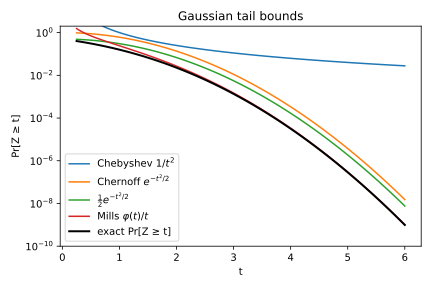
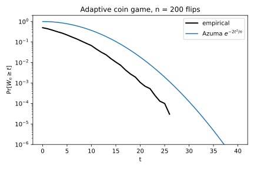

# Concentration inequalities

## Why this matters

Randomness enters machine learning everywhere: the sample you trained on, the minibatches you drew, the test set you evaluated on, and later in this book, noise that is added on purpose. In every case the question is the same: **how far can a random quantity be from what you expect, and with what probability?** Concentration inequalities answer it. Treat them as tools for that one job, not as a list to memorize.

The whole subject is one idea, applied with more and more information about the random variable. To bound the chance that a variable lands far out, you compare it with something whose average you know, and the more you know, the sharper the comparison. If you know only the mean, you get Markov's inequality, and the tail can only be shown to decay like $1/t$, where $t$ is how far out you look. If you also know the variance, the average squared distance from the mean, you get Chebyshev's inequality and a decay like $1/t^2$. If you know the **moment generating function (MGF)** $\mathbb E[e^{\lambda X}]$, which averages an exponential of the variable and so feels every moment at once, you get the Chernoff bound, which decays exponentially in $t$. When that MGF is no larger than a normal distribution's, the variable is called **sub-Gaussian** and its tail decays like a normal's, as $e^{-t^2}$; Hoeffding's inequality is the special case of bounded variables, which are always sub-Gaussian. Finally, when the quantity is not a sum of independent terms but a function of many inputs, or a running total whose steps depend on the past (a martingale), McDiarmid's and Azuma's inequalities give the same exponential bounds as long as each input or step can move the result only a bounded amount.

@tbl-inequality-uses lists where each one shows up:

| Inequality | Typical use |
| --- | --- |
| Markov | The base step inside every other proof |
| Chebyshev | Quick variance-based error bars |
| Chernoff | Counts of events: error counts, sampled batch sizes, rare outcomes |
| Hoeffding | Confidence intervals for averages of bounded quantities; generalization bounds |
| Gaussian tail | How large normal noise can be |
| Laplace tail | How large Laplace noise can be; maxima over many draws |
| McDiarmid | Functions of many independent inputs, such as an empirical risk; stability |
| Azuma | Sums whose terms are chosen adaptively, based on the past |

: The inequalities in this chapter and where each is typically used. {#tbl-inequality-uses}

The distributions used here (binomial, Poisson, Laplace, normal) and their MGFs are derived in [Probability distributions](01-distributions.md). This chapter restates each fact where it uses it, so you do not need that chapter open.

## Toolkit: five facts every derivation uses

Each section below follows the same arc: the question the bound answers, the statement, a derivation, an interpretation, an example, and a self-check. The derivations reuse five facts. We prove them once here.

### Fact 1 — Probability is the expectation of an indicator

The probability of an event is the average of a variable that is 1 when the event happens and 0 when it does not. Write $\mathbf 1_A$ for that 0/1 variable, the **indicator** of the event $A$, and $\mathbb E$ for the expectation (the probability-weighted average). Then
$$\Pr[A] = \mathbb E[\mathbf 1_A].$$
This matters because it turns probabilities into averages, and averages respect inequalities: any pointwise inequality between a random variable and an indicator becomes a probability bound after taking expectations. Markov's inequality and the union bound are both this move. Because everything later depends on it, here it is slowly, with a die.

**Step 1: an indicator is a 0/1 random variable.** For an event $A$, $\mathbf 1_A$ equals 1 on outcomes where $A$ happens and 0 elsewhere. Roll a fair die and let $A$ = "the roll is at least 5" (@tbl-die-indicator):

| Roll | 1 | 2 | 3 | 4 | 5 | 6 |
| --- | --- | --- | --- | --- | --- | --- |
| $\mathbf 1_A$ | 0 | 0 | 0 | 0 | 1 | 1 |

: The indicator of the event "roll at least 5" on each outcome of a fair die. {#tbl-die-indicator}

The average of that row is $2/6$, which is exactly $\Pr[A]$. Averaging a 0/1 variable counts the fraction of outcomes where the event happens.

**Step 2: if one variable is never larger, its average is never larger.** If $Y \le Z$ on *every* outcome, then $\mathbb E[Y] \le \mathbb E[Z]$: you are averaging two rows of numbers where each entry of the first is at most the matching entry of the second.

**Step 3: put them together.** Take $X$ = the roll and compare $5\cdot\mathbf 1[X \ge 5]$ with $X$ itself, outcome by outcome (@tbl-die-markov):

| Roll | 1 | 2 | 3 | 4 | 5 | 6 | Average |
| --- | --- | --- | --- | --- | --- | --- | --- |
| $5\cdot\mathbf 1[X \ge 5]$ | 0 | 0 | 0 | 0 | 5 | 5 | $5\Pr[X \ge 5]$ |
| $X$ | 1 | 2 | 3 | 4 | 5 | 6 | $3.5$ |

: Outcome-by-outcome comparison of $5\cdot\mathbf 1[X \ge 5]$ with the die roll $X$. {#tbl-die-markov}

Every entry in the top row is at most the one below it. Where the event fails, the top is 0 and $X \ge 0$. Where it holds, the top is 5 and $X \ge 5$ by definition of the event. So the averages are ordered: $5\Pr[X \ge 5] \le 3.5$, and dividing by 5 gives $\Pr[X \ge 5] \le 0.7$. The true value is $2/6 = 1/3$; the bound is weak, but it is correct and used nothing except the mean. @fig-markov-die shows the comparison.

![The scaled indicator $5\cdot\mathbf 1[X \ge 5]$ never exceeds the die roll $X$, so its average never exceeds 3.5.](figures/markov_die.svg){#fig-markov-die}

The pattern for bounding $\Pr[\text{event}]$: write it as the average of an indicator, find a variable that is at least as large as that indicator on every outcome and whose average you know, and average both sides.

### Fact 2 — Union bound

The chance that at least one of several events happens is at most the sum of their separate chances. Adding the chances can only overcount, never undercount, because an outcome that lies in several events gets counted several times. In symbols, for events $A_1, \dots, A_k$,
$$\Pr[A_1 \cup \dots \cup A_k] \le \sum_i \Pr[A_i].$$

To prove it, use Fact 1 and compare indicators outcome by outcome: $\mathbf 1[\cup_i A_i] \le \sum_i \mathbf 1[A_i]$. On an outcome where none of the events happens, both sides are 0. On an outcome where at least one happens, the left side is 1 and the right side counts how many of the events happen, which is at least 1. The right side can be larger than 1 on outcomes that lie in several events at once: that double counting is the only slack. Taking expectations of both sides turns each indicator into a probability and gives the bound.

You will use it whenever you need $k$ estimates, $k$ steps or $k$ hypotheses to all behave at once. If each one fails with probability at most $\beta/k$, all of them succeed together except with probability at most $k \cdot \beta/k = \beta$. In the exponential bounds of this chapter, asking for failure probability $\beta/k$ instead of $\beta$ replaces $\ln(1/\beta)$ by $\ln(k/\beta) = \ln k + \ln(1/\beta)$, so the cost of controlling $k$ things is an extra $\ln k$ inside every exponential bound.

### Fact 3 — $1 + x \le e^x$ for every real $x$

The straight line $1 + x$ touches the curve $e^x$ at $x = 0$ (both equal 1 there and both have slope 1) and stays below it everywhere else. The reason is that $e^x$ is **convex**: its second derivative $e^x$ is positive, so the curve bends upward, away from any tangent line, on both sides of the point of contact. A convex function therefore lies above all its tangents, and $1 + x$ is its tangent at 0.

You will use it to turn a sum into an exponential. In the Chernoff bound it turns $1 + p(e^\lambda - 1)$ into $\exp(p(e^\lambda - 1))$, by taking $x = p(e^\lambda - 1)$. A product of such factors then becomes a single exponential whose exponent is a sum, which is far easier to optimize.

### Fact 4 — MGFs multiply under independence

The moment generating function of a random variable $X$ is the average of $e^{\lambda X}$, viewed as a function of a number $\lambda$ that you choose:
$$M_X(\lambda) = \mathbb E[e^{\lambda X}].$$
With $\lambda > 0$ the weight $e^{\lambda X}$ grows exponentially in $X$, so large values of $X$ dominate the average, and the larger $\lambda$, the further into the right tail it looks. That is why the MGF is the right object for tail bounds.

The MGF of a sum of independent variables is the product of their MGFs. The reason is that $e^{\lambda(X+Y)} = e^{\lambda X}e^{\lambda Y}$, and when $X$ and $Y$ are independent so are $e^{\lambda X}$ and $e^{\lambda Y}$; the average of a product of independent variables is the product of their averages, so
$$\mathbb E[e^{\lambda(X+Y)}] = \mathbb E[e^{\lambda X}]\,\mathbb E[e^{\lambda Y}].$$
Scaling is just as simple. Multiplying $X$ by a constant $c$ is the same as multiplying the dial $\lambda$ by $c$, because $\mathbb E[e^{\lambda (cX)}] = \mathbb E[e^{(c\lambda)X}]$, so $M_{cX}(\lambda) = M_X(c\lambda)$.

You will use it to reduce a sum of $n$ variables to $n$ one-variable calculations, one MGF per term.

### Fact 5 — Inverting a tail bound

A tail bound answers "how likely is a deviation of size $t$?". In practice you usually want the reverse: "how large a deviation must I allow so that it is exceeded with probability at most $\beta$?". That number is the **width** at failure probability $\beta$, and you get it by setting the bound equal to $\beta$ and solving for $t$.

Concretely, suppose the deviation $D$ satisfies $\Pr[D \ge t] \le e^{-g(t)}$ for an increasing function $g$. The bound is at most $\beta$ exactly when $g(t) \ge \ln(1/\beta)$, that is, when $t \ge g^{-1}(\ln(1/\beta))$. So with probability at least $1 - \beta$,
$$D < g^{-1}(\ln(1/\beta)).$$
For example, the Gaussian-shaped bound with $g(t) = t^2/(2\sigma^2)$ gives $t^2/(2\sigma^2) = \ln(1/\beta)$, so $D < \sigma\sqrt{2\ln(1/\beta)}$. Every "width at failure probability $\beta$" in this chapter is this step.

## Markov and Chebyshev

### Context

You have a random estimate and want the crudest answer to "how far can it be from the truth?", using as little as possible about its distribution. Markov uses only the mean, and Chebyshev uses only the variance. Both are weak. But every stronger bound in this chapter is Markov applied to a better function, so the derivation pattern matters more than the bounds themselves.

### Markov's inequality

A non-negative variable cannot often be much larger than its mean, because those large values alone would already pull the average up. If $X \ge 0$ were at least $a$ with probability $p$, those outcomes would contribute at least $a p$ to the mean, so $ap \le \mathbb E[X]$. For $X \ge 0$ and $a > 0$:
$$\Pr[X \ge a] \le \frac{\mathbb E[X]}{a}.$$

**Derivation.** This is the die argument of Fact 1, with a general $a$ in place of 5.

1. Compare $X$ with a scaled indicator: $a\,\mathbf 1[X \ge a] \le X$ pointwise. If $X \ge a$, the left side is $a$, which is at most $X$. If $X < a$, the left side is $0$, which is at most $X$ because $X \ge 0$. This is the only place non-negativity is used.
2. Take expectations, which preserve $\le$ (Fact 1, Step 2). The average of the indicator is a probability (Fact 1), so $a \Pr[X \ge a] \le \mathbb E[X]$.
3. Divide both sides by $a > 0$.

**Tightness.** You cannot do better with only the mean. Write $\mu$ for the mean and take the variable that puts all its mass on two points: $X = a$ with probability $\mu/a$ and $0$ otherwise. Its mean is $a \cdot \mu/a = \mu$, and $\Pr[X \ge a] = \mu/a$ exactly, so Markov's bound holds with equality.

### Generalized Markov

Markov's inequality applies to any non-negative variable, so you can apply it to a transformed version of $X$ instead of $X$ itself. If $g$ is non-negative and strictly increasing, then $X \ge t$ and $g(X) \ge g(t)$ are the same event, because an increasing function keeps the order. Applying Markov to the non-negative variable $g(X)$ at the level $a = g(t)$ gives
$$\Pr[X \ge t] = \Pr[g(X) \ge g(t)] \le \frac{\mathbb E[g(X)]}{g(t)}.$$
The rest of this chapter is a search for good $g$. A fast-growing $g$ makes the threshold $g(t)$ in the denominator huge compared with typical values of $g(X)$, so the bound gets small; the price is that $\mathbb E[g(X)]$ also grows, and you must be able to compute or bound it. $g(x) = x^2$ gives Chebyshev, and $g(x) = e^{\lambda x}$ gives Chernoff.

### Chebyshev's inequality

The variance $\sigma^2$ is the average squared distance from the mean $\mu$. A large deviation $|X - \mu| \ge t$ makes the squared distance at least $t^2$, and if that happened often, the average squared distance would exceed $\sigma^2$. So the probability of a deviation of $t$ or more is at most $\sigma^2/t^2$. For $X$ with mean $\mu$ and variance $\sigma^2$:
$$\Pr[|X - \mu| \ge t] \le \frac{\sigma^2}{t^2}.$$

**Derivation.**

1. Turn the two-sided event into an event about a non-negative variable: $|X - \mu| \ge t$ holds exactly when $(X - \mu)^2 \ge t^2$, since squaring preserves the order of non-negative numbers.
2. Apply Markov to $Y = (X-\mu)^2$, which is non-negative and has mean $\sigma^2$ by the definition of the variance, at the level $a = t^2$: $\Pr[Y \ge t^2] \le \mathbb E[Y]/t^2 = \sigma^2/t^2$.

**Means of samples.** Averaging $n$ independent samples shrinks the variance by a factor of $n$. Two rules give this. Variances add for independent terms, because the cross terms (covariances) in the expansion of the square vanish, so a sum of $n$ terms has variance $n\sigma^2$. And $\operatorname{Var}(cX) = c^2\operatorname{Var}X$, because every deviation is multiplied by $c$ and then squared, so dividing the sum by $n$ divides its variance by $n^2$. Together, the mean $\bar X$ has $\operatorname{Var}(\bar X) = n\sigma^2/n^2 = \sigma^2/n$. Chebyshev then gives $\Pr[|\bar X - \mu| \ge t] \le \sigma^2/(nt^2)$. To turn this into a width, set the bound equal to $\beta$ and solve for $t$, as in Fact 5: $\sigma^2/(nt^2) = \beta$ gives $t = \sigma/\sqrt{n\beta}$. So with probability at least $1-\beta$, $|\bar X - \mu| < \sigma/\sqrt{n\beta}$.

### Interpretation: the price of knowing only the variance

How wide must an error bar be to fail with probability at most $\beta$? With only the variance known, solving $\sigma^2/t^2 = \beta$ gives $t = \sigma/\sqrt\beta$. With a Gaussian-type tail $e^{-t^2/(2\sigma^2)}$, Fact 5 gives $t = \sigma\sqrt{2\ln(1/\beta)}$. @tbl-width-price compares the two, in units of $\sigma$. For instance, at $\beta = 0.05$, $1/\sqrt{0.05} = 4.5$, while $\ln(1/0.05) = \ln 20 \approx 3.0$ gives $\sqrt{2 \times 3.0} = 2.4$.

| $\beta$ | Chebyshev, $1/\sqrt\beta$ | Gaussian-type, $\sqrt{2\ln(1/\beta)}$ |
| --- | --- | --- |
| $0.05$ | 4.5 | 2.4 |
| $10^{-3}$ | 31.6 | 3.7 |
| $10^{-6}$ | 1,000 | 5.3 |

: Width needed to reach failure probability $\beta$, in units of $\sigma$, with only the variance known (Chebyshev) and with a Gaussian-type tail. {#tbl-width-price}

The Chebyshev width grows like a power of $1/\beta$, the Gaussian-type width only like the square root of a logarithm. Polynomial bounds are fine for a quick 95% error bar. They are useless when the failure probability must be tiny, as it usually must be in security and in the later parts of this book, often $10^{-5}$ or smaller.

### Example: the error of Laplace noise

A measurement is corrupted by additive noise from the **Laplace distribution** $\mathrm{Lap}(b)$, which has density $\frac{1}{2b}e^{-|x|/b}$: symmetric around 0, with scale $b$. Its variance is $2b^2$; you can check this by integrating, since $\mathbb E[X^2] = 2\int_0^\infty x^2 \frac{1}{2b}e^{-x/b}\,dx = 2b^2$ ([Probability distributions](01-distributions.md)). Chebyshev with $\sigma^2 = 2b^2$ gives $\Pr[|\text{error}| \ge t] \le 2b^2/t^2$, and setting this to $\beta$ gives the $1-\beta$ width $b\sqrt{2/\beta}$. With $b = 1$ and $\beta = 0.05$ that is $\sqrt{2/0.05} = \sqrt{40} \approx 6.3$.

Now use the shape of the noise. Integrating the density gives the exact tail $\Pr[|X| \ge t] = e^{-t/b}$, and setting $e^{-t/b} = \beta$ gives the width $b\ln(1/\beta) = \ln 20 \approx 3.0$. At $\beta = 10^{-6}$ the two widths are 1,414 (that is, $\sqrt{2 \times 10^6}$) and 13.8 (that is, $\ln(10^6)$): ignoring the shape of the noise costs a factor of 100.

### Check yourself

- Why can't you apply Markov directly to $X - \mu$? *(It can be negative, so step 1 of the Markov derivation fails.)*
- Which step of the sample-mean argument used independence, and is it more than you need? *(Only the vanishing of covariances. Pairwise uncorrelated samples suffice.)*

## The Chernoff method

### Context

Small failure probabilities like $10^{-5}$ are out of reach for polynomial bounds at sensible widths. The fix is to apply generalized Markov with $g(x) = e^{\lambda x}$. Its average is the MGF, which contains every moment of $X$ at once, so the bound uses everything about the distribution, not just the mean or the variance. The resulting Chernoff bound is exponentially tight: Cramér's theorem says that for a sum of $n$ independent copies of a variable, the probability of a large deviation decays exponentially in $n$ with exactly the rate the optimized Chernoff bound gives, so no method can improve its exponent for large sums. (@sec-apx-tail-cramer-stein in the appendices derives this matching lower bound.)

### The recipe

**The master bound.** For any $\lambda > 0$, $e^{\lambda x}$ is positive and increasing, so generalized Markov applies with $g(x) = e^{\lambda x}$. Dividing $\mathbb E[e^{\lambda X}]$ by $e^{\lambda t}$ gives the first form below. Writing the MGF as $e^{\psi(\lambda)}$, where $\psi$ is the logarithm of the MGF (the **log-MGF**), puts the whole bound into one exponent:
$$\Pr[X \ge t] \le e^{-\lambda t}\,\mathbb E[e^{\lambda X}] = \exp\big(-(\lambda t - \psi(\lambda))\big), \qquad \psi(\lambda) = \ln\mathbb E[e^{\lambda X}].$$
This holds for every $\lambda > 0$, so you are free to pick the $\lambda$ that makes the bound smallest, which is the one that makes $\lambda t - \psi(\lambda)$ largest. The best exponent, $\sup_\lambda(\lambda t - \psi(\lambda))$, viewed as a function of $t$, has a name: the **Legendre transform** $\psi^*(t)$ of the log-MGF. It is the exponent Cramér's theorem says is exact (@sec-apx-tail-cramer-stein).

In practice every Chernoff bound in this chapter is computed by the same five steps:

1. Write down the MGF of $X$.
2. If $X$ is a sum of independent terms, factorize the MGF (Fact 4).
3. Bound each factor by something simple, usually with Fact 3.
4. Minimize the exponent over $\lambda$ by setting its derivative to zero.
5. Simplify the result into a usable form.

Think of $e^{\lambda X}$ as a lens on the tail. A large $\lambda$ magnifies the far tail but inflates $\mathbb E[e^{\lambda X}]$. A small $\lambda$ keeps the expectation tame but magnifies little. @fig-chernoff-lambda shows the trade-off for a binomial: the bound as a function of $\lambda$ has a clear minimum, and the relaxation of step 3 costs a little but moves the optimum to a closed form.

![The Chernoff bound $e^{-\lambda t}\mathbb E[e^{\lambda S}]$ for $S \sim \mathrm{Binomial}(100, 0.1)$ and $t = 20$, as a function of $\lambda$, before and after the relaxation $1 + x \le e^x$. Both stay above the exact tail.](figures/chernoff_lambda.svg){#fig-chernoff-lambda}

### Warm-up: the Gaussian

Start with the case where every step is exact, a normal variable $X \sim \mathcal N(0, \sigma^2)$ with mean 0 and variance $\sigma^2$. Its MGF is $\mathbb E[e^{\lambda X}] = e^{\lambda^2\sigma^2/2}$ ([Probability distributions](01-distributions.md)). To see why, multiply the density, which is proportional to $e^{-x^2/(2\sigma^2)}$, by $e^{\lambda x}$ and complete the square in the exponent: $\lambda x - x^2/(2\sigma^2) = -(x - \lambda\sigma^2)^2/(2\sigma^2) + \lambda^2\sigma^2/2$. The first term is a normal density shifted to mean $\lambda\sigma^2$, which still integrates to 1, and the constant $e^{\lambda^2\sigma^2/2}$ is left over. So the log-MGF is the quadratic $\psi(\lambda) = \lambda^2\sigma^2/2$.

1. **Master bound.** Substitute the MGF: $\Pr[X \ge t] \le \exp(-\lambda t + \lambda^2\sigma^2/2)$.
2. **Minimize.** The exponent is a parabola in $\lambda$. Its derivative $-t + \lambda\sigma^2$ vanishes at $\lambda = t/\sigma^2$. Substituting this $\lambda$ gives the exponent $-t^2/\sigma^2 + t^2/(2\sigma^2) = -t^2/(2\sigma^2)$, so
$$\Pr[X \ge t] \le e^{-t^2/(2\sigma^2)}.$$

Remember the shape of this calculation: a quadratic log-MGF gives a quadratic exponent. The sub-Gaussian section reuses it verbatim.

### Main case: sums of Bernoullis

Now the case the method is most used for: counting how many of many independent yes/no events happen. Let $X_i \sim \mathrm{Bernoulli}(p_i)$ be independent, each equal to 1 with probability $p_i$ and 0 otherwise, let $S = \sum_i X_i$ be the count, and let $\mu = \mathbb E[S] = \sum_i p_i$ be its mean. The question is how likely $S$ is to land a fraction $\delta$ above or below $\mu$.

**Upper tail**, $\Pr[S \ge (1+\delta)\mu]$ for $\delta > 0$. Follow the recipe.

1. **One factor.** $X_i$ is 1 with probability $p_i$ and 0 otherwise, so $\mathbb E[e^{\lambda X_i}] = p_ie^\lambda + (1 - p_i) = 1 + p_i(e^\lambda - 1)$. Fact 3 with $x = p_i(e^\lambda - 1)$ bounds this by $\exp(p_i(e^\lambda - 1))$. The right side is the MGF of a Poisson variable with mean $p_i$, since a $\mathrm{Poisson}(\mu)$ variable has MGF $\exp(\mu(e^\lambda - 1))$ ([Probability distributions](01-distributions.md)). In words: as far as the MGF can tell, a Bernoulli sum is dominated by a Poisson count with the same mean.
2. **Product.** By Fact 4 the MGF of the sum is the product of the factors, and the exponents add: $\mathbb E[e^{\lambda S}] \le \exp\big(\sum_i p_i(e^\lambda - 1)\big) = \exp(\mu(e^\lambda - 1))$.
3. **Master bound** with $t = (1+\delta)\mu$: $\Pr[S \ge (1+\delta)\mu] \le \exp(\mu(e^\lambda - 1) - \lambda(1+\delta)\mu)$.
4. **Minimize.** The derivative of the exponent, $\mu e^\lambda - (1+\delta)\mu$, vanishes at $e^\lambda = 1 + \delta$, so $\lambda = \ln(1+\delta)$, which is positive as required. Substituting, the exponent becomes $\mu\delta - (1+\delta)\mu\ln(1+\delta)$, so
$$\Pr[S \ge (1+\delta)\mu] \le \left(\frac{e^\delta}{(1+\delta)^{1+\delta}}\right)^\mu = \exp\big(-\mu[(1+\delta)\ln(1+\delta) - \delta]\big).$$
5. **Simplify.** The bracket is awkward to invert, so replace the logarithm by a simpler lower bound, $\ln(1+\delta) \ge \frac{2\delta}{2+\delta}$ for $\delta \ge 0$. To see that this holds, let $f(\delta) = \ln(1+\delta) - \frac{2\delta}{2+\delta}$. It starts at $f(0) = 0$ and never decreases, because its derivative is $f'(\delta) = \frac{1}{1+\delta} - \frac{4}{(2+\delta)^2} = \frac{\delta^2}{(1+\delta)(2+\delta)^2} \ge 0$; so $f(\delta) \ge 0$. Putting the lower bound into the bracket gives $(1+\delta)\frac{2\delta}{2+\delta} - \delta = \frac{\delta^2}{2+\delta}$, so
$$\Pr[S \ge (1+\delta)\mu] \le \exp\left(-\frac{\delta^2\mu}{2+\delta}\right).$$

**Lower tail**, $\Pr[S \le (1-\delta)\mu]$ for $0 < \delta < 1$. The same recipe works if you look at $-S$ instead of $S$, because a small $S$ is a large $-S$.

1. **Master bound for the lower tail.** For $\lambda > 0$, $S \le s$ holds exactly when $e^{-\lambda S} \ge e^{-\lambda s}$, since $e^{-\lambda x}$ is decreasing. Markov applied to $e^{-\lambda S}$, and the same per-factor bound as before with $-\lambda$ in place of $\lambda$, give $\Pr[S \le s] \le e^{\lambda s}\,\mathbb E[e^{-\lambda S}] \le \exp(\lambda s + \mu(e^{-\lambda} - 1))$.
2. **Minimize.** With $s = (1-\delta)\mu$, the derivative $s - \mu e^{-\lambda}$ vanishes at $e^{-\lambda} = 1 - \delta$, that is, $\lambda = -\ln(1-\delta) > 0$. Substituting gives $\exp\big(-\mu[\delta + (1-\delta)\ln(1-\delta)]\big)$.
3. **Simplify.** Expand the logarithm in its Taylor series, $\ln(1-\delta) = -\sum_{k \ge 1}\delta^k/k$, multiply by $1-\delta$ and collect powers of $\delta$: $(1-\delta)\ln(1-\delta) = -\delta + \sum_{k\ge2}\frac{\delta^k}{k(k-1)}$. Every term of the sum is non-negative, so keeping only the first one ($k = 2$, which is $\delta^2/2$) gives the lower bound $-\delta + \frac{\delta^2}{2}$. The bracket is then at least $\delta^2/2$, so
$$\Pr[S \le (1-\delta)\mu] \le \exp\left(-\frac{\delta^2\mu}{2}\right).$$

### Interpretation

The bounds depend on the expected count $\mu$, not on the number of trials $n$. A million trials with $p = 10^{-6}$ expect a single event, and the count is far from concentrated. Rare events concentrate in relative terms only once you expect enough of them, because the exponent $\delta^2\mu$ grows with $\mu$.

Chernoff also beats Hoeffding (the range-only bound of the next section) when $p$ is small, and the reason is in step 1. That step keeps each $p_i$ in the bound instead of replacing it by the worst case, so the bound implicitly knows the variance of the count, $\mu(1-p) \approx \mu$, which is small when $p$ is small. A bound that only knows the range has to assume the largest variance the range allows. @fig-bernoulli-tails shows the gap.

Finally, the two tails differ. For large $\delta$, the upper-tail exponent $\delta^2\mu/(2+\delta)$ behaves like $\delta\mu$, so the tail decays like $\exp(-\delta\mu)$, not like $\exp(-\delta^2)$. Counts have Poisson-like right tails, not Gaussian ones: they can overshoot their mean by a lot more easily than they can undershoot it.

### Example: sampled minibatch sizes

A training loop forms each minibatch by including each of $n = 60{,}000$ examples independently with probability $q = 0.01$. The batch size $B$ is a sum of $\mathrm{Bernoulli}(q)$ variables, so the bounds above apply with $\mu = 60{,}000 \times 0.01 = 600$. How likely is the batch to be more than 20% off, that is, $\delta = 0.2$, so that $\delta^2 = 0.04$?

The upper-tail bound is $\exp(-0.04 \times 600/2.2) = e^{-10.9} \approx 1.8\times10^{-5}$, and the lower-tail bound is $\exp(-0.04 \times 600/2) = e^{-12} \approx 6.1\times10^{-6}$. The two events cannot happen together, so adding them gives the chance of either: $B$ stays within $600 \pm 20\%$ except with probability about $2.4\times10^{-5}$ per step. Over 1,000 steps, the union bound (Fact 2) adds the 1,000 per-step failure probabilities, $1{,}000 \times 2.4\times10^{-5}$, so every batch stays in that range except with probability about $0.024$.

### Check yourself

- Why must $\lambda$ be positive for the upper tail? *(For $\lambda < 0$, $e^{\lambda x}$ is decreasing, so $X \ge t$ no longer implies $e^{\lambda X} \ge e^{\lambda t}$.)*
- Where exactly did independence enter? *(Only in factorizing the MGF in step 2.)*

## Sub-Gaussian variables and Hoeffding

### Context

Redoing the Chernoff calculation for every new distribution is tedious. The Gaussian warm-up showed that a quadratic log-MGF alone produces a Gaussian-shaped tail: nothing else about the normal distribution was used. So define a class by that one property, prove tail and sum bounds for the class once, and from then on only check membership. Hoeffding's inequality is the result for the most common member: bounded variables.

### Definition

The idea is to call a variable sub-Gaussian when its MGF, centred at its mean $\mu$, is never larger than the MGF of a normal variable, because then the Chernoff argument for the normal goes through with "$\le$" in place of "$=$". Formally, $X$ is **$\sigma$-sub-Gaussian** if its centred MGF is dominated by that of $\mathcal N(0, \sigma^2)$:
$$\mathbb E\big[e^{\lambda(X - \mu)}\big] \le e^{\lambda^2\sigma^2/2} \quad\text{for all } \lambda \in \mathbb R.$$
The parameter $\sigma$, called the **variance proxy** when squared, is the effective standard deviation for tail purposes. It is at least the true standard deviation. To see why, expand both sides around $\lambda = 0$: the left side is $1 + \lambda^2\operatorname{Var}(X)/2 + \dots$ (the linear term vanishes because $X - \mu$ has mean 0) and the right side is $1 + \lambda^2\sigma^2/2 + \dots$, so for small $\lambda$ the inequality forces $\operatorname{Var}(X) \le \sigma^2$. It can be much larger than the true standard deviation, and that slack is where these bounds lose accuracy.

### Three properties, each one line

**Tail.** A sub-Gaussian variable has a tail no heavier than the normal's. The Gaussian warm-up used the MGF only through the inequality in the master bound, so repeating it with the sub-Gaussian inequality in place of the equality gives the same result:
$$\Pr[X - \mu \ge t] \le e^{-t^2/(2\sigma^2)}.$$
The same holds for the lower tail, because $-X$ is also $\sigma$-sub-Gaussian (replace $\lambda$ by $-\lambda$ in the definition). Adding the two one-sided bounds, the two-sided bound $\Pr[|X - \mu| \ge t]$ carries a factor of 2.

**Sums.** Variance proxies add under independence, like variances. The reason is Fact 4: the centred MGF of a sum of independent terms is the product of their centred MGFs, and each factor is bounded by a Gaussian MGF, whose exponents add. For independent $X_i$, each $\sigma_i$-sub-Gaussian with mean $\mu_i$,
$$\mathbb E\big[e^{\lambda\sum_i(X_i - \mu_i)}\big] = \prod_i \mathbb E\big[e^{\lambda(X_i - \mu_i)}\big] \le \prod_i e^{\lambda^2\sigma_i^2/2} = e^{\lambda^2(\sum_i\sigma_i^2)/2},$$
so the sum is $\sqrt{\sum_i\sigma_i^2}$-sub-Gaussian.

**Scaling and means.** By Fact 4, $M_{cX}(\lambda) = M_X(c\lambda)$, so substituting $c\lambda$ for $\lambda$ in the definition gives $e^{c^2\lambda^2\sigma^2/2}$: $cX$ is $|c|\sigma$-sub-Gaussian. Now take the mean of $n$ independent $\sigma$-sub-Gaussian variables. Their sum is $\sqrt{n\sigma^2} = \sigma\sqrt n$-sub-Gaussian by the sum rule, and dividing by $n$ makes the mean $(\sigma\sqrt n/n) = (\sigma/\sqrt n)$-sub-Gaussian. That is where the $1/\sqrt n$ rate comes from.

### Hoeffding's lemma: bounded variables are sub-Gaussian

**Statement.** A variable trapped in an interval $[a, b]$ cannot have a heavy tail, since it cannot go beyond $b$ at all. The lemma makes this quantitative: its MGF is bounded as if it were normal with standard deviation half the width of the interval. If $X \in [a, b]$, then $X$ is $\frac{b-a}{2}$-sub-Gaussian:
$$\mathbb E[e^{\lambda(X-\mu)}] \le \exp\big(\lambda^2(b-a)^2/8\big).$$

**Derivation.** Centre $X$ so that $\mathbb E[X] = 0$ (shifting $X$ and the interval by $\mu$ changes nothing on either side). A mean-zero variable must take values on both sides of 0, so $a \le 0 \le b$. The plan is to bound $e^{\lambda X}$ by something linear in $X$, whose average depends only on the mean, and then show that the resulting expression has a quadratic logarithm.

1. **Use convexity.** On $[a, b]$, the convex curve $e^{\lambda x}$ lies below the straight line (the chord) joining its values at the two endpoints. That line is the weighted average of the endpoint values, with weights that say how close $x$ is to each end:
$$e^{\lambda x} \le \frac{b - x}{b - a}e^{\lambda a} + \frac{x - a}{b - a}e^{\lambda b}.$$
2. **Take expectations.** The right side is linear in $x$, so its average only needs $\mathbb E[X] = 0$: $\mathbb E[e^{\lambda X}] \le \frac{b}{b-a}e^{\lambda a} - \frac{a}{b-a}e^{\lambda b}$. This is exactly the MGF of the two-point variable that sits at $a$ or $b$ with mean 0.
3. **Reparametrize** to make the bound a function of one variable. Let $p = -a/(b-a) \in [0,1]$, so that $\frac{b}{b-a} = 1 - p$ and $\lambda a = -hp$, where $h = \lambda(b - a)$; then $e^{\lambda b} = e^{\lambda a}e^{h}$. The right side becomes $e^{-hp}(1 - p + pe^h) = e^{\varphi(h)}$, where
$$\varphi(h) = -hp + \ln\big(1 - p + pe^h\big).$$
It remains to show $\varphi(h) \le h^2/8$, by a Taylor expansion around $h = 0$.
4. **Value and slope at 0.** $\varphi(0) = 0 + \ln 1 = 0$. The derivative is $\varphi'(h) = -p + \frac{pe^h}{1 - p + pe^h}$, so $\varphi'(0) = -p + p = 0$.
5. **Bound the curvature.** Write $u = \frac{pe^h}{1 - p + pe^h}$, a number in $[0,1]$, so that $\varphi'(h) = -p + u$. Differentiating again gives $\varphi''(h) = u(1-u)$. A product of two non-negative numbers that add up to 1 is largest when both are $\frac12$, so $\varphi''(h) \le 1/4$.
6. **Taylor with remainder.** Taylor's theorem says $\varphi(h) = \varphi(0) + h\varphi'(0) + \frac{h^2}{2}\varphi''(\xi)$ for some $\xi$ between 0 and $h$. With the value and slope 0 and the curvature at most $\frac14$, $\varphi(h) \le h^2/8 = \lambda^2(b-a)^2/8$.

The worst case is a fair coin on the two endpoints, whose variance is exactly $((b-a)/2)^2$: it puts all its mass as far from the mean as the interval allows.

### Hoeffding's inequality

The average of $n$ bounded independent variables is sub-Gaussian with a variance proxy that shrinks like $1/n$, so its tail is Gaussian-shaped with that proxy. Concretely, combine the lemma with the rule for means: the mean of $n$ independent variables in $[a, b]$ is $\frac{b-a}{2\sqrt n}$-sub-Gaussian, so $\sigma^2 = (b-a)^2/(4n)$. Putting this into the tail bound $e^{-t^2/(2\sigma^2)}$ gives
$$\Pr\big[\bar X_n - \mu \ge t\big] \le \exp\left(-\frac{2nt^2}{(b-a)^2}\right).$$
As a two-sided confidence interval, add the matching lower tail to get $2\exp(-2nt^2/(b-a)^2)$, set it equal to $\beta$ and solve for $t$ (Fact 5): with probability at least $1-\beta$, $|\bar X_n - \mu| < (b-a)\sqrt{\ln(2/\beta)/(2n)}$.

### Interpretation

Hoeffding needs only the range, not the variance. That is its strength, since there is nothing to estimate, and its weakness, since it assumes the worst-case variance $(b-a)^2/4$, the variance of the fair coin on the endpoints.

When the true variance $\sigma^2$ is much smaller than that, use **Bernstein's inequality**, which keeps the variance in the bound. It is proved by the same Chernoff recipe, with a sharper bound on each factor's MGF that uses the variance and the size of the largest deviation (Boucheron, Lugosi & Massart, ch. 2, give the derivation, and @sec-apx-tail-bernstein in the appendices derives it step by step). For $|X_i - \mu| \le M$:
$$\Pr\big[\bar X_n - \mu \ge t\big] \le \exp\left(-\frac{nt^2}{2\sigma^2 + \frac23 Mt}\right).$$
The denominator shows the two regimes. For small $t$ the $2\sigma^2$ term dominates and the bound looks Gaussian with the true variance; for large $t$ the $\frac23 Mt$ term dominates and the bound decays only exponentially in $t$. Setting the bound equal to $\beta$ and solving the quadratic in $t$ shows that its width is at most $\sqrt{2\sigma^2\ln(1/\beta)/n} + 2M\ln(1/\beta)/(3n)$: driven by the variance for moderate deviations, and by the range only at the far end.

@fig-bernoulli-tails puts all the bounds so far side by side for the mean of 200 Bernoulli(0.1) variables. Hoeffding even loses to Chebyshev at small deviations here, because the true variance $0.1 \times 0.9 = 0.09$ is far below Hoeffding's worst case of $1/4 = 0.25$ for variables in $[0, 1]$.

{#fig-bernoulli-tails}

### Example: generalization for a finite class

How far can a model's error on the training sample be from its error on the whole population? For one fixed model $h$ with loss in $[0,1]$, the **empirical risk** $\hat R(h)$, its average loss on $n$ independent examples, is a mean of $n$ bounded terms whose expectation is the **true risk** $R(h)$, the average loss on the population. Two-sided Hoeffding with $b - a = 1$ gives $\Pr[|\hat R(h) - R(h)| \ge t] \le 2e^{-2nt^2}$.

But a learner picks the model after seeing the data, so you need the bound for every model in the class at once. For a finite class $H$, apply the union bound (Fact 2) over its $|H|$ models: the chance that any one of them is off by $t$ or more is at most $2|H|e^{-2nt^2}$. Setting this to $\beta$ and solving for $t$ gives $t = \sqrt{\ln(2|H|/\beta)/(2n)}$, so with probability at least $1-\beta$,
$$|\hat R(h) - R(h)| \le \sqrt{\frac{\ln(2|H|/\beta)}{2n}} \quad\text{for all } h \in H.$$
The size of the class enters only through $\ln|H|$, which is the $\ln k$ cost of Fact 2.

### Example: estimating a small error rate

A classifier is tested on 1,000 negative examples and makes 1 false positive. You want a 95% upper bound on its true false-positive rate, so the failure probability is $\beta = 0.05$ and $\ln(1/\beta) = \ln 20 \approx 3.0$. Three methods give very different answers.

Hoeffding, one-sided, adds the half-width $\sqrt{\ln(1/\beta)/(2n)} = \sqrt{\ln 20/2000} \approx 0.039$ to the measured rate of $1/1{,}000$. That is about 40 times the rate you measured: the range $[0, 1]$ forces it to assume a variance of $0.25$, when the true variance of a rate near $0.001$ is about $0.001$.

Bernstein uses that small variance. Plugging $\sigma^2 \approx 0.001$, $M = 1$ and $n = 1{,}000$ into its width gives $\sqrt{2\times0.001\times3.0/1000} + 2\times3.0/3000 \approx 0.0045$, almost ten times tighter. This is a heuristic: $\sigma^2$ was estimated from the same data, and a rigorous version (empirical Bernstein) is wider.

The exact answer comes from the binomial distribution itself. The **Clopper–Pearson** upper bound is the largest true rate $p$ under which seeing 1 or fewer false positives in 1,000 trials still has probability at least $0.05$; it is $0.0047$.

Measuring rare rates is expensive: range-based bounds are useless near zero, and even exact intervals need many trials. This returns in later parts, wherever a small rate has to be certified empirically.

### Check yourself

- Is a Laplace variable sub-Gaussian? *(No. Its MGF is infinite for $|\lambda| \ge 1/b$, so no quadratic bound holds for all $\lambda$. See the next section.)*
- Why is the fair coin on $\{a, b\}$ the worst case in Hoeffding's lemma? *(It maximizes the variance among variables on $[a, b]$, and step 5 is tight at $u = 1/2$.)*

## Gaussian and Laplace tails

### Context

The normal and Laplace distributions are the two standard models of additive noise, and their tails behave very differently: the normal tail decays like $e^{-t^2/2}$, the Laplace tail only like $e^{-t}$. This section gives sharp tail bounds for each, rules for the maximum of many draws, and the two-regime behaviour of sums of Laplace variables.

### Gaussian tails

For the normal distribution you know the density exactly, so you can bound the tail integral directly instead of going through the MGF, and do better than Chernoff. Write $Z \sim \mathcal N(0,1)$ for a standard normal variable, with density $\varphi(z) = e^{-z^2/2}/\sqrt{2\pi}$. Two bounds hold for $t \ge 0$: the first is the Chernoff bound with an extra factor $\frac12$, and the second, the **Mills ratio** bound, replaces the exponential by the density at $t$ divided by $t$:
$$\Pr[Z \ge t] \le \tfrac12 e^{-t^2/2}, \qquad \Pr[Z \ge t] \le \frac{\varphi(t)}{t}.$$

**Derivation of the first bound.** The idea is to slide the tail back to start at 0 and compare it with the right half of the whole distribution, which has probability exactly $\frac12$. Substitute $u = z - t$, so that the tail integral runs over $u \ge 0$. Expanding $(t+u)^2 = t^2 + 2tu + u^2$ splits the density into the factor $e^{-t^2/2}$, a factor $e^{-tu}$, and the standard normal density in $u$:
$$\Pr[Z \ge t] = \int_0^\infty \varphi(t+u)\,du = e^{-t^2/2}\int_0^\infty \frac{e^{-tu - u^2/2}}{\sqrt{2\pi}}\,du \le e^{-t^2/2}\int_0^\infty \varphi(u)\,du = \tfrac12 e^{-t^2/2}.$$
The inequality drops the factor $e^{-tu}$, which is at most 1 for $t, u \ge 0$, and the last integral is $\frac12$ because the normal density is symmetric around 0. This beats the Chernoff bound $e^{-t^2/2}$ of the warm-up by a factor of $\frac12$.

**Derivation of the second (Mills ratio).** The idea is to multiply the density by a factor that is at least 1 on the tail and makes the integral easy. On $z \ge t$ the factor $z/t$ is at least 1, and $z\varphi(z)$ has the simple antiderivative $-\varphi(z)$, because differentiating the density gives $\varphi'(z) = -z\varphi(z)$. So
$$\Pr[Z \ge t] = \int_t^\infty \varphi(z)\,dz \le \int_t^\infty \frac zt\varphi(z)\,dz = \frac1t\big[-\varphi(z)\big]_t^\infty = \frac{\varphi(t)}{t}.$$
This bound is asymptotically exact as $t$ grows, because the tail mass sits ever closer to $t$, where the factor $z/t$ is close to 1. @fig-gaussian-tails compares the bounds with the exact tail. At $t = 3$ the exact tail is $1.35\times10^{-3}$. Chebyshev gives $1/3^2 = 0.111$, Chernoff $e^{-9/2} = 0.0111$, the halved bound $0.0056$, and Mills $\varphi(3)/3 = 0.00148$.

{#fig-gaussian-tails}

**Working rules.** These are the two widths you will use most for a normal variable $X \sim \mathcal N(0,\sigma^2)$; a normal with standard deviation $\sigma$ is $\sigma Z$, so every threshold scales by $\sigma$. For one draw, the first bound doubled covers both tails, $\Pr[|X| \ge t] \le e^{-t^2/(2\sigma^2)}$, and setting this to $\beta$ gives $\Pr[|X| \ge \sigma\sqrt{2\ln(1/\beta)}] \le \beta$. For the maximum of $k$ draws, ask each draw to fail with probability $\beta/k$ and apply the union bound (Fact 2): every $|X_i| < \sigma\sqrt{2\ln(k/\beta)}$ with probability at least $1-\beta$. Since $\ln(k/\beta) = \ln k + \ln(1/\beta)$, controlling $k$ draws costs only a factor of about $\sqrt{\ln k}$ in the width.

### Laplace tails

For the Laplace distribution the tail is exactly computable, so no bound is needed. $\mathrm{Lap}(b)$ has density $\frac{1}{2b}e^{-|x|/b}$, and integrating it from $t \ge 0$ to infinity gives
$$\Pr[X \ge t] = \tfrac12 e^{-t/b}, \qquad \Pr[|X| \ge t] = e^{-t/b},$$
where the second form doubles the first because the density is symmetric.

**Working rules.** Setting $e^{-t/b} = \beta$ and solving gives the width for one draw: with probability at least $1-\beta$, $|X| \le b\ln(1/\beta)$. For the maximum of $k$ independent draws, ask each to fail with probability $\beta/k$ and use the union bound: with probability at least $1-\beta$, every $|X_i| \le b\ln(k/\beta)$.

The union bound is nearly exact here. All $k$ independent draws stay below $t$ with probability $(1 - e^{-t/b})^k$, so $\Pr[\max_i|X_i| > t] = 1 - (1 - e^{-t/b})^k$, and when the per-draw tail $x = e^{-t/b}$ is small, $(1 - x)^k \approx 1 - kx$, so this is $\approx ke^{-t/b}$, exactly the union bound's sum. @fig-laplace-max confirms it: the empirical failure rate sits at $\beta$ for every $k$ from 1 to 1,000.

{#fig-laplace-max}

### Laplace is sub-exponential, not sub-Gaussian

**MGF.** The Laplace MGF is finite only for small $\lambda$, which rules out the sub-Gaussian definition (it must hold for every $\lambda$). Integrating $e^{\lambda x}$ against the density, the right half gives $\int_0^\infty \frac{1}{2b}e^{\lambda x - x/b}\,dx = \frac{1}{2(1 - \lambda b)}$, which is finite only for $\lambda < 1/b$, and the left half gives $\frac{1}{2(1 + \lambda b)}$. Adding them, for $|\lambda| < 1/b$,
$$\mathbb E[e^{\lambda X}] = \frac{1}{1 - \lambda^2b^2}$$
([Probability distributions](01-distributions.md)). It blows up as $|\lambda| \to 1/b$, so no bound of the form $e^{\lambda^2\sigma^2/2}$ can hold for all $\lambda$.

**A quadratic bound near zero.** For small $\lambda$, though, the log-MGF is still at most quadratic, which is all the Chernoff recipe needs as long as you only use those $\lambda$. The log-MGF is $-\ln(1 - x)$ with $x = \lambda^2b^2$, and $-\ln(1 - x) = x + x^2/2 + x^3/3 + \dots \le x + x^2 + \dots = \frac{x}{1-x}$. For $0 \le x \le \frac12$, $\frac{1}{1-x} \le 2$, so $-\ln(1-x) \le \frac{x}{1-x} \le 2x$. For $|\lambda| \le 1/(2b)$ you have $x \le \frac14$, well inside that range, so
$$\mathbb E[e^{\lambda X}] \le e^{2\lambda^2b^2}.$$

**Sum of $k$ independent $\mathrm{Lap}(b)$.** Let $S$ be the sum of $k$ independent $\mathrm{Lap}(b)$ variables. By Fact 4 the MGF of $S$ is the product of $k$ factors, each at most $e^{2\lambda^2b^2}$, so $\mathbb E[e^{\lambda S}] \le e^{2k\lambda^2b^2}$ for $|\lambda| \le 1/(2b)$. Run Chernoff with $\lambda$ restricted to $(0, 1/(2b)]$. The result depends on whether the best $\lambda$ is inside the allowed range.

1. **Find the unconstrained optimum.** The exponent to minimize is $-\lambda t + 2k\lambda^2b^2$, a parabola whose derivative $-t + 4k\lambda b^2$ vanishes at $\lambda^* = t/(4kb^2)$.
2. **Small deviations.** $\lambda^* \le 1/(2b)$ exactly when $t \le 2kb$. Then $\lambda^*$ is allowed, and substituting it gives the exponent $-t^2/(4kb^2) + t^2/(8kb^2) = -t^2/(8kb^2)$, so the bound is $\exp(-t^2/(8kb^2))$: Gaussian-like.
3. **Large deviations.** If $t > 2kb$, the best allowed $\lambda$ is the boundary $\lambda = 1/(2b)$, which gives $\exp(-t/(2b) + k/2)$. In this regime $k/2 < t/(4b)$, so the exponent is at most $-t/(2b) + t/(4b) = -t/(4b)$, and the bound is at most $\exp(-t/(4b))$.

The two cases combine into one formula, because in each regime the smaller of the two expressions inside the minimum is the one that applies:
$$\Pr[S \ge t] \le \exp\left(-\min\left(\frac{t^2}{8kb^2},\ \frac{t}{4b}\right)\right).$$
Small deviations look Gaussian, with variance on the order of $kb^2$. Large deviations decay only exponentially. That two-regime shape is what *sub-exponential* means.

@fig-laplace-sum shows why the distinction matters. Take $k = 10$ and $b = 1$. The central limit theorem (CLT) says a sum of many independent terms is approximately normal with the same mean and variance, here mean 0 and variance $10 \times 2b^2 = 20$. That normal approximation matches the bulk: $\Pr[S \ge 10]$ is $1.42\times10^{-2}$ empirically and $1.27\times10^{-2}$ from the normal. But it badly underestimates the tail: $\Pr[S \ge 20]$ is $3.4\times10^{-5}$ empirically and only $3.9\times10^{-6}$ from the normal. Both deviations are in the Gaussian regime of the bound, since $t \le 2kb = 20$, so the bound gives $e^{-100/80} = 0.287$ at $t = 10$ and $e^{-400/80} = e^{-5} = 6.7\times10^{-3}$ at $t = 20$. The sub-exponential bound is loose, but it is valid everywhere.

{#fig-laplace-sum}

### Check yourself

- Why does the maximum of $k$ normals grow like $\sqrt{\ln k}$ but the maximum of $k$ Laplace draws like $\ln k$? *(Invert the tails: $e^{-t^2/2} = \beta/k$ gives $t = \sqrt{2\ln(k/\beta)}$, while $e^{-t/b} = \beta/k$ gives $t = b\ln(k/\beta)$.)*
- What does dropping the $\frac12$ in the Gaussian tail bound cost in the width? *($\ln(1/(2\beta))$ becomes $\ln(1/\beta)$: $\ln 2 \approx 0.7$ more inside the square root.)*

## McDiarmid and Azuma

### Context

So far, everything was a sum of independent terms. Two common situations break that. First, quantities such as a trained model's empirical risk are complicated functions of the data, not sums, so there is no MGF to factorize. Second, in sequential procedures each step can be chosen after seeing earlier outcomes, so the terms are dependent and Fact 4 no longer applies.

Azuma's inequality handles the second situation: dependent sums whose terms are "fresh" given the past, in the sense that each new term averages to zero whatever happened before. Such a running total is called a martingale. McDiarmid's inequality handles the first: it follows from Azuma by revealing the inputs of the function one at a time, and it applies to any function that no single input can move by much.

### Azuma–Hoeffding

**Setup.** A **martingale** is a running total whose next step is zero on average given everything that has happened so far, like your fortune in a sequence of fair bets where you may choose each bet based on the previous ones. Formally, $M_0, M_1, \dots, M_n$ is a martingale if each increment $D_k = M_k - M_{k-1}$ has conditional mean zero given the past, $\mathbb E[D_k \mid \text{past}] = 0$. Assume each $D_k$ lies in an interval $[A_k, A_k + d_k]$, where the position $A_k$ may depend on the past but the length $d_k$ is fixed in advance.

**Statement.** The total drift $M_n - M_0$ obeys the same tail bound as a sum of independent bounded terms, with the step lengths $d_k$ playing the role of the ranges:
$$\Pr[M_n - M_0 \ge t] \le \exp\left(-\frac{2t^2}{\sum_k d_k^2}\right).$$

**Derivation.** The Chernoff recipe needs the MGF of the total. Without independence it does not factorize, but you can still bound it one step at a time, starting from the last step and working back.

1. **Bound one step given the past.** Given the past, $D_k$ is a mean-zero variable on an interval of length $d_k$, so Hoeffding's lemma (previous section) applies to it, with every expectation taken given the past: $\mathbb E[e^{\lambda D_k} \mid \text{past}] \le e^{\lambda^2d_k^2/8}$. The proof is the one in the previous section, run conditionally.
2. **Peel off the last increment.** The **tower property** says you can average in two stages: first average over the last step with the past held fixed, then average over the past; the result is the ordinary average. Split $M_n - M_0 = (M_{n-1} - M_0) + D_n$. With the past held fixed, $e^{\lambda(M_{n-1} - M_0)}$ is a constant and comes out of the inner average, which is then bounded by step 1:
$$\mathbb E\big[e^{\lambda(M_n - M_0)}\big] = \mathbb E\Big[e^{\lambda(M_{n-1} - M_0)}\,\mathbb E\big[e^{\lambda D_n} \mid \text{past}\big]\Big] \le e^{\lambda^2d_n^2/8}\,\mathbb E\big[e^{\lambda(M_{n-1} - M_0)}\big].$$
3. **Repeat.** Apply the same step to $M_{n-1} - M_0$, then $M_{n-2} - M_0$, and so on, $n$ times: $\mathbb E[e^{\lambda(M_n - M_0)}] \le \exp(\lambda^2\sum_k d_k^2/8)$. Peeling replaces Fact 4, which needed independence.
4. **Chernoff.** The exponent to minimize is $-\lambda t + \lambda^2\sum_k d_k^2/8$. Its derivative vanishes at $\lambda = 4t/\sum_k d_k^2$, and substituting gives $\exp(-2t^2/\sum_k d_k^2)$.

Hoeffding is the special case of independent increments: there the past tells you nothing, and the conditional bound of step 1 is the ordinary lemma.

### Example: an adaptive coin game

You have two coins, with heads probabilities 0.3 and 0.7. You flip 200 times; before each flip you pick the 0.7 coin if the previous flip was heads, and the 0.3 coin otherwise. The flips are dependent, and the number of heads is not binomial, so Hoeffding does not apply.

What you can control is how far the heads count drifts from what your own choices predicted. Let $X_k$ be 1 if flip $k$ is heads, let $p_k$ be the bias of the coin chosen at step $k$, and let $M_n = \sum_{k\le n}(X_k - p_k)$: heads minus the heads you "expected" given your choices. Given the past, the coin is fixed, so $X_k - p_k$ has mean $p_k - p_k = 0$ and lies in $[-p_k, 1 - p_k]$, an interval of length 1. So $M_n$ is a martingale with $d_k = 1$, $\sum_k d_k^2 = 200$, and Azuma gives $\Pr[M_{200} \ge t] \le e^{-2t^2/200}$. At $t = 20$ the exponent is $2 \times 400/200 = 4$ and the bound is $e^{-4} = 1.83\times10^{-2}$, while simulation gives $1.12\times10^{-3}$ (@fig-azuma-adaptive). The bound pays for assuming the worst-case variance, exactly as Hoeffding does: each step's true variance is $p_k(1-p_k) = 0.21$, not the $0.25$ the interval allows.

{#fig-azuma-adaptive}

### McDiarmid (bounded differences)

**Statement.** If a function of many independent inputs cannot be moved much by any single input, it concentrates around its mean as tightly as a sum of bounded terms would. Let $X_1, \dots, X_n$ be independent, and suppose that changing only the $i$-th input, with all others held fixed, changes $f$ by at most $c_i$. Then
$$\Pr\big[f(X) - \mathbb E f(X) \ge t\big] \le \exp\left(-\frac{2t^2}{\sum_i c_i^2}\right).$$

**Derivation via the Doob martingale.** The idea is to turn $f$ into a martingale by revealing the inputs one at a time and tracking your best guess of $f$ as you go. Each revealed input moves the guess by a bounded amount, and Azuma does the rest.

1. **Build the martingale.** After seeing $X_1, \dots, X_k$, your best guess of $f(X)$ is its conditional average, $M_k = \mathbb E[f(X) \mid X_1, \dots, X_k]$. Before seeing anything, the guess is $M_0 = \mathbb E f$; after seeing everything, it is $M_n = f(X)$. So $M_n - M_0$ is exactly the deviation you want to bound. $(M_k)$ is a martingale by the tower property: averaging the next guess $M_k$ over the not-yet-seen $X_k$ gives back the current guess $M_{k-1}$, so each increment has mean zero given the past.
2. **Bound the range of each increment.** By independence, the unseen inputs do not depend on the seen ones, so $M_k$ is the average of $f$ over fresh copies of $X_{k+1}, \dots, X_n$, with $X_1, \dots, X_k$ fixed at their observed values. Hold $X_1, \dots, X_{k-1}$ fixed. Then $M_k$ depends only on $X_k$, and changing $X_k$ changes every term of that average by at most $c_k$, so it changes the average by at most $c_k$. As $X_k$ varies, $M_k$ therefore stays in an interval of length at most $c_k$, and so does $D_k = M_k - M_{k-1}$, whose position depends on the past through $M_{k-1}$.
3. **Apply Azuma** with $d_k = c_k$.

**Interpretation.** The bounded-difference constant $c_i$ measures how much one input can move the output: a per-record influence. Small per-record influence forces the output to concentrate. The same quantity returns in later parts under the name *sensitivity*.

**Example: stability.** The empirical risk of a fixed model with loss in $[0,1]$ is an average of $n$ losses, so changing one example changes it by at most $1/n$: $c_i = 1/n$, $\sum_i c_i^2 = n/n^2 = 1/n$, and McDiarmid gives concentration $\exp(-2nt^2)$. That is Hoeffding again, now as a special case. The real power is for functions that are not sums. Bousquet & Elisseeff apply McDiarmid to the risk of a model *trained* on the data: if retraining after changing one example moves the loss by at most $\beta$ (here a stability constant, not a failure probability), each input has bounded influence on the trained model's risk, and the generalization gap concentrates ([Algorithmic stability and generalization](07-stability-generalization.md)).

### Check yourself

- Why can't you use Hoeffding in the adaptive coin game? *(The coin chosen at each step depends on earlier flips, so the flips are not independent. Only their conditional structure is controlled.)*
- In the McDiarmid derivation, where is the independence of the $X_i$ used? *(In step 2: the average over the unrevealed inputs must not change when $X_k$ changes.)*

## Code: check every bound by simulation

The script [code/concentration.py](../../code/part01-prerequisites/concentration.py) draws every figure in this chapter and computes the numbers quoted in it. Each bound and each simulated quantity is a small typed function; the script calls them once for the table and loops them over parameters for the figures. From the repository root:

```bash
uv run python code/part01-prerequisites/concentration.py
```

@tbl-concentration-results shows the output with seed 0.

| Experiment | Result |
| --- | --- |
| Bernoulli mean, $n = 200$, $p = 0.1$, $t = 0.05$ | Empirical $9.6\times10^{-3}$; Markov 0.67; Chebyshev 0.18; Hoeffding 0.37; Chernoff 0.135 |
| Maximum of $k = 100$ draws of $\mathrm{Lap}(1)$, $\beta = 0.05$ | Bound 7.60; empirical failure rate 0.0486 |
| Standard normal tail at $t = 3$ | Exact $1.35\times10^{-3}$; Chebyshev 0.111; Chernoff 0.0111; halved 0.0056; Mills 0.00148 |
| Sum of $k = 10$ draws of $\mathrm{Lap}(1)$ | $t = 10$: empirical $1.42\times10^{-2}$, bound 0.287, normal $1.27\times10^{-2}$. $t = 20$: empirical $3.4\times10^{-5}$, bound $6.7\times10^{-3}$, normal $3.9\times10^{-6}$ |
| Adaptive coin game, $n = 200$, $t = 20$ | Empirical $1.12\times10^{-3}$; Azuma $1.83\times10^{-2}$ |

: Results of the chapter's script with seed 0. {#tbl-concentration-results}

[tests/test_concentration.py](../../tests/test_concentration.py) checks that the output still matches this table.

**What to take from it**

The first row shows that variance matters. The mean of 200 Bernoulli(0.1) variables has mean $0.1$ and variance $0.09/200$, and the question is how likely it is to reach $0.15$. Markov gives $0.1/0.15 = 0.67$, Chebyshev $0.09/(200 \times 0.05^2) = 0.18$, Hoeffding $e^{-2 \times 200 \times 0.05^2} = e^{-1} = 0.37$, and Chernoff, with $\mu = 20$ and $\delta = 0.5$, $e^{-0.25 \times 20/2.5} = e^{-2} = 0.135$. Hoeffding loses to Chebyshev because $p(1-p) = 0.09$ is far below the worst case $0.25$: range-based bounds pay for ignoring the variance.

The second row shows that a union bound can be nearly exact. The bound $\ln(100/0.05) = 7.60$ fails at the empirical rate 0.0486, close to the target 0.05, because for independent draws with small individual tails the chance that any one fails is almost the sum of the individual chances.

The third row shows that the Mills ratio is the bound to use far out. At $t = 3$ it is within 10% of the exact tail, while the Chernoff bound is 8 times too large.

The fourth row shows that the CLT is not a tail bound. For the Laplace sum it underestimates $\Pr[S \ge 20]$ by a factor of 9, since $3.4\times10^{-5}$ is about nine times $3.9\times10^{-6}$. When the answer must be a guarantee, use a bound.

The last row shows that Azuma handles adaptivity, at the price of the worst-case variance.

## References

- Mitzenmacher & Upfal, *Probability and Computing*, ch. 4: the clearest Chernoff chapter, with worked computer-science examples
- Vershynin, *High-Dimensional Probability* (2018), ch. 2: sub-Gaussian and sub-exponential variables in depth. Read it after this chapter rather than before.
- Boucheron, Lugosi & Massart, *Concentration Inequalities* (2013), ch. 2 and 6: reference depth
- Bousquet & Elisseeff, "Stability and Generalization" (JMLR 2002): McDiarmid applied to learning algorithms

## Cheat sheet

@tbl-concentration-cheat-sheet collects the bounds. Tails are one-sided unless noted, and $\beta$ is the failure probability.

| Bound | Assumption | Tail $\Pr[X - \mu \ge t] \le$ | Width at failure probability $\beta$ |
| --- | --- | --- | --- |
| Markov | $X \ge 0$ | $\mu/t$ (for $\Pr[X \ge t]$) | $\mu/\beta$ |
| Chebyshev | Variance $\sigma^2$ | $\sigma^2/t^2$ (two-sided) | $\sigma/\sqrt\beta$ |
| Sub-Gaussian | MGF $\le e^{\lambda^2\sigma^2/2}$ | $e^{-t^2/(2\sigma^2)}$ | $\sigma\sqrt{2\ln(1/\beta)}$ |
| Hoeffding | Mean of $n$ independent variables in $[a, b]$ | $e^{-2nt^2/(b-a)^2}$ | $(b-a)\sqrt{\ln(1/\beta)/(2n)}$ |
| Chernoff (multiplicative) | Sum of independent Bernoullis, mean $\mu$ | $e^{-\delta^2\mu/(2+\delta)}$ at $t = \delta\mu$ | $\approx\sqrt{2\mu\ln(1/\beta)}$ for small $\delta$ |
| Gaussian $\mathcal N(0,\sigma^2)$ | — | $\frac12 e^{-t^2/(2\sigma^2)}$ | $\sigma\sqrt{2\ln(1/\beta)}$, two-sided |
| Laplace $\mathrm{Lap}(b)$ | — | $\frac12 e^{-t/b}$; two-sided exactly $e^{-t/b}$ | $b\ln(1/\beta)$, two-sided |
| McDiarmid | Independent inputs, bounded differences $c_i$ | $e^{-2t^2/\sum_i c_i^2}$ | $\sqrt{\sum_i c_i^2\ln(1/\beta)/2}$ |
| Azuma–Hoeffding | Martingale, increments in intervals of length $d_i$ | $e^{-2t^2/\sum_i d_i^2}$ | $\sqrt{\sum_i d_i^2\ln(1/\beta)/2}$ |
| Sum of $k$ Laplace | Independent $\mathrm{Lap}(b)$ | $e^{-\min(t^2/(8kb^2),\ t/(4b))}$ | $b\sqrt{8k\ln(1/\beta)}$ while that is $\le 2kb$; else $4b\ln(1/\beta)$ |

: Summary of the bounds in this chapter. {#tbl-concentration-cheat-sheet}

**Rules of thumb**

- Variance-only bounds cost $1/\sqrt\beta$; exponential bounds cost $\sqrt{\ln(1/\beta)}$; heavy (sub-exponential) tails cost $\ln(1/\beta)$.
- $k$ estimates add $\ln k$ inside the logarithm, via the union bound.
- If the variance is much smaller than the range allows, use Chernoff or Bernstein, not Hoeffding.

**Practice.** Exercises for this chapter, each with a worked solution, are in [the exercise book](../../book-exercises/part01-prerequisites/02-concentration.md).
