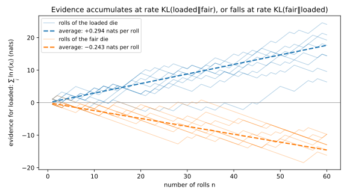
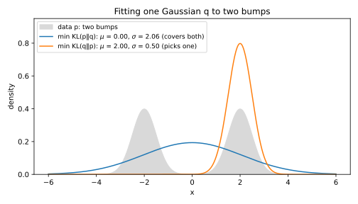
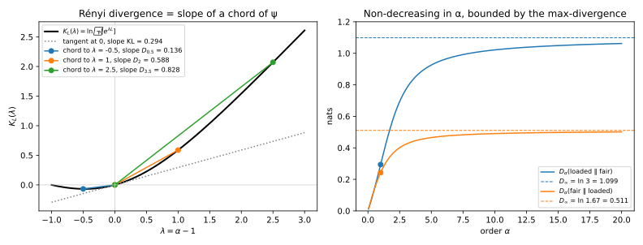
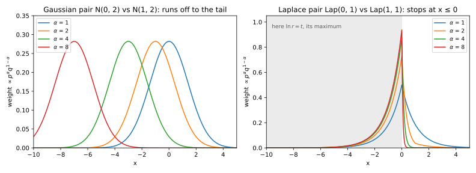
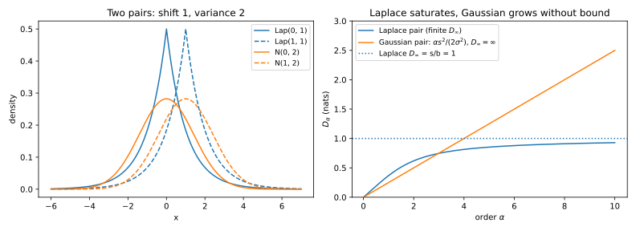
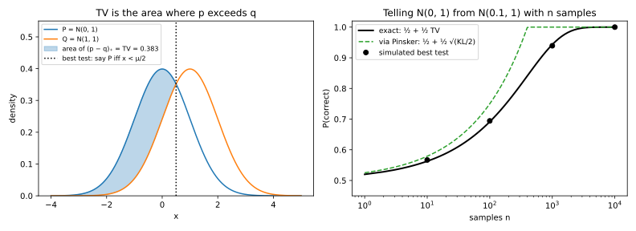
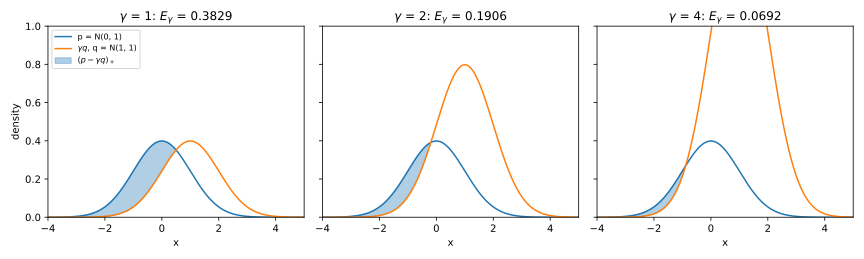
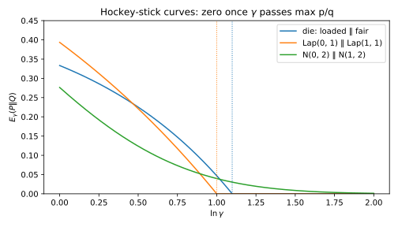
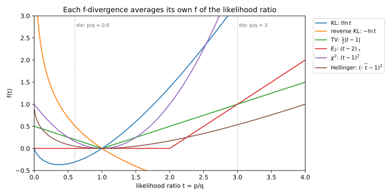
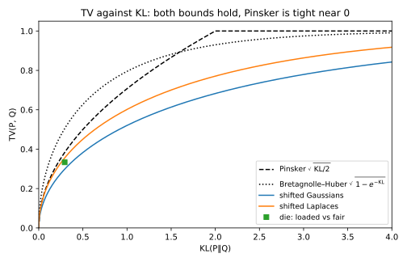

# Divergences

Someone hands you a die that is either fair or loaded so that a six comes up half the time, and you may roll it as often as you like. How much does one roll tell you, on average, about which die you hold? How strongly can a single roll point the wrong way? How often can the best guess from one roll be right? Each answer is a **divergence**, a number that is zero when two distributions, call them $P$ and $Q$, are equal and grows as they become easier to tell apart.

One idea organizes the answers. To decide which distribution produced an outcome $x$, compare how likely $x$ is under each. Write $p$ and $q$ for the probabilities, or densities, of $P$ and $Q$. Their quotient is the **likelihood ratio** $r(x) = p(x)/q(x)$, and its logarithm $L(x) = \ln r(x)$ is the **evidence** for $P$, in nats, which adds over independent observations. Every divergence is a summary of $r$. For example, the Kullback–Leibler (KL) divergence averages the evidence over draws from $P$, and the max-divergence takes its largest value. The total variation (TV) distance measures the mass of $p$ above $q$. Processing data, such as binning it, can only average likelihood ratios together, so no divergence grows under processing. This **data-processing inequality** is what later parts use most.

The running example is the die, with $P$ loaded and $Q$ fair (@tbl-div-die). A six is three times more likely under $P$, which is evidence of $\ln 3 = 1.10$ nats for "loaded". Any other roll gives $\ln 0.6 = -0.51$ nats, weak evidence for "fair". Two continuous pairs recur, a normal and a Laplace density each against a shifted copy, whose evidence is unbounded and bounded ([Probability distributions](01-distributions.md)). Sums $\sum_x$ are integrals for densities, and @tbl-div-symbols lists the symbols.

| Roll $x$ | 1 to 5 (each) | 6 |
| --- | --- | --- |
| $p(x)$ (loaded) | 0.1 | 0.5 |
| $q(x)$ (fair) | 1/6 | 1/6 |
| $r(x) = p(x)/q(x)$ | 0.6 | 3 |
| $\ln r(x)$ | −0.511 | 1.099 |

: The loaded die $P$ against the fair die $Q$, outcome by outcome. This is the running example of the chapter. {#tbl-div-die}

| Symbol | Meaning |
| --- | --- |
| $r = p/q$; $L = \ln r$ | the likelihood ratio; the evidence for $P$ |
| $\mathbb E_P$, $\mathbb E_Q$ | an average over draws from $P$, from $Q$ |
| $D_{\mathrm{KL}}$, $D_\alpha$, $D_\infty$, $\mathrm{TV}$, $E_\gamma$, $D_f$ | the divergences: KL, Rényi of order $\alpha$, max, total variation, hockey-stick, f |
| $K_L(\lambda)$ | the logarithm of the moment generating function of $L$ under $P$ |
| $\mu = s/\sigma$; $t = s/b$ | a shift $s$ between two normals in standard deviations; between two Laplace distributions in units of the scale $b$ |
| $(y)_+$; $K$ | the positive part $\max(y, 0)$; a channel, written without a subscript |

: The symbols of this chapter. {#tbl-div-symbols}

## KL divergence {#sec-div-kl}

Add up the evidence of $n$ rolls of the die. With the loaded die the sum climbs, with the fair die it falls, and each family of runs drifts along a straight line (@fig-div-evidence-walk). This section names the slope, the average evidence per roll, and proves the two facts that every later use needs: it is never negative, and it adds over independent observations.

{#fig-div-evidence-walk}

::: {#def-div-kl name="Kullback–Leibler divergence"}
The **KL divergence** of $P$ from $Q$ is the average evidence for $P$ that one observation gives when it comes from $P$:
$$D_{\mathrm{KL}}(P\|Q) = \mathbb E_P[L] = \sum_x p(x)\ln\frac{p(x)}{q(x)}.$$
It is infinite when $P$ puts mass where $Q$ puts none.
:::

That data from $P$ cannot favour $Q$ on average sounds obvious, but the proof needs a tool that compares a function of an average with the average of the function. A function $f$ is **convex** when its graph bends upward, so that every chord lies above it, and **strictly convex** when the graph has no straight pieces. Step 2 of the next proof uses Jensen's inequality, and later sections use it again.

::: {#lem-div-jensen name="Jensen's inequality"}
Let $f$ be convex and let $X$ be a random variable with a finite average. Then
$$f(\mathbb E[X]) \le \mathbb E[f(X)].$$
If $f$ is strictly convex, equality holds only when $X$ is constant. For a concave $f$, whose graph bends downward, the inequality is reversed.
:::

::: {.proof}
1. *Use a tangent.* A convex function lies above its tangent lines. Take the tangent at $\mathbb E[X]$, with slope $a$, so that $f(x) \ge f(\mathbb E[X]) + a(x - \mathbb E[X])$ for every $x$.
2. *Average.* Put $x = X$ and average. The last term averages to 0, because $X$ averages to $\mathbb E[X]$, which leaves $\mathbb E[f(X)] \ge f(\mathbb E[X])$.
3. *Equality.* A strictly convex graph touches the tangent only at $\mathbb E[X]$, so equality forces $X = \mathbb E[X]$ with probability 1. A concave function is minus a convex one, which flips the inequality.
:::

For example, the die's two ratios, 0.6 and 3, each have probability $\frac12$ under $P$, so their average is 1.8. With $f(x) = x^2$ the two sides are $1.8^2 = 3.24$ and $\frac12(0.36 + 9) = 4.68$.

::: {#thm-div-kl name="Gibbs' inequality and additivity"}
For any two distributions, $D_{\mathrm{KL}}(P\|Q) \ge 0$, with equality only if $P = Q$. Write $P_1 \times P_2$ for the distribution of a pair drawn independently from $P_1$ and $P_2$. Then
$$D_{\mathrm{KL}}(P_1 \times P_2\,\|\,Q_1 \times Q_2) = D_{\mathrm{KL}}(P_1\|Q_1) + D_{\mathrm{KL}}(P_2\|Q_2),$$ {#eq-div-kl-additive}
so $n$ independent samples carry $n$ times the KL divergence of one.
:::

::: {.proof}
The plan is to write KL as the average of a convex function and apply Jensen, then to split the evidence of a pair into a sum.

1. *Flip the ratio.* Since $\ln(p/q) = -\ln(q/p)$, KL is the average under $P$ of the strictly convex function $-\ln$ of $q/p$.
2. *Apply @lem-div-jensen.* The average of $-\ln$ is at least $-\ln$ of the average:
$$D_{\mathrm{KL}}(P\|Q) \ge -\ln\mathbb E_P\Big[\frac{q(X)}{p(X)}\Big].$$
3. *The inner average.* Each $p(x)$ cancels, so it is $\sum_{x:\,p(x) > 0}q(x)$, the mass $Q$ puts where $P$ can land. That is at most 1, so minus its logarithm is at least 0.
4. *Equality.* Step 2 needs $q/p$ constant where $p > 0$, and step 3 needs $Q$ to put no mass elsewhere. Two distributions with a constant ratio on the same outcomes are equal, because both sum to 1.
5. *Additivity.* Under a product distribution the probability of a pair is the product of the probabilities, so the evidence of a pair is the sum $L_1(x_1) + L_2(x_2)$. Averages are linear, and the average of $L_i(X_i)$ involves only $P_i$, so it is $D_{\mathrm{KL}}(P_i\|Q_i)$.
:::

KL also measures a model's fit. For a model $q_\theta$ with parameter $\theta$, only the term $-\mathbb E_P[\ln q_\theta(X)]$ of $D_{\mathrm{KL}}(P\|Q_\theta)$ depends on $\theta$, so minimizing this forward KL is maximum likelihood. KL averages under its first argument, so the forward fit must cover every region the data visit. The reverse divergence $D_{\mathrm{KL}}(Q_\theta\|P)$ of variational inference may lock onto one mode instead (@fig-div-forward-reverse).

{#fig-div-forward-reverse}

::: {#exm-div-kl-die}
Under $P$ the five non-sixes together have probability 0.5 and evidence $\ln 0.6$ each, and the six has probability 0.5 and evidence $\ln 3$, so
$$D_{\mathrm{KL}}(P\|Q) = 0.5\ln 0.6 + 0.5\ln 3 = 0.5\ln 1.8 = 0.2939.$$
In the other direction the fair die weights the non-sixes $\frac56$ and the six $\frac16$, and the evidence is for "fair":
$$D_{\mathrm{KL}}(Q\|P) = \tfrac56\ln\tfrac{1}{0.6} + \tfrac16\ln\tfrac13 = 0.4257 - 0.1831 = 0.2426.$$
A loaded die gives itself away faster than a fair one proves its innocence, because its sixes carry strong evidence. In general, telling two distributions apart takes a number of observations of order $1/D_{\mathrm{KL}}$, as @sec-div-pinsker shows.
:::

## Rényi divergence {#sec-div-renyi}

KL is an average, so it cannot say how often the evidence is large, and later parts need that. Since $e^{D_{\mathrm{KL}}}$ is the geometric mean of $r$ under $P$, other means can give large ratios more weight. The **power mean** with exponent $\lambda$ raises each value to the power $\lambda$, averages, and undoes the power:
$$m_\lambda = \big(\mathbb E_P[r^\lambda]\big)^{1/\lambda}.$$
Exponent $-1$ gives the harmonic mean, the limit 0 the geometric mean, 1 the arithmetic mean, and $\lambda \to \infty$ the largest value (@tbl-div-power-means). The Rényi divergence is the logarithm of the power mean with exponent $\alpha - 1$, so its **order** $\alpha$ is a dial from the typical evidence to the worst case.

| Mean of $r$ under $P$ | Value | Its logarithm | Divergence |
| --- | --- | --- | --- |
| Harmonic, $1/\mathbb E_P[1/r]$ | 1.0000 | 0 | $D_0$ |
| Geometric, $e^{\mathbb E_P[\ln r]}$ | 1.3416 | 0.2939 | $D_1 = D_{\mathrm{KL}}$ |
| Arithmetic, $\mathbb E_P[r]$ | 1.8000 | 0.5878 | $D_2$ |
| Largest value, $\max r$ | 3.0000 | 1.0986 | $D_\infty$ |

: Means of the die's likelihood ratio under $P$. Their logarithms are the Rényi divergences of orders 0, 1, 2 and $\infty$. {#tbl-div-power-means}

::: {#def-div-renyi name="Rényi divergence"}
For an order $\alpha \in (0, 1) \cup (1, \infty)$, the **Rényi divergence** of $P$ from $Q$ is
$$D_\alpha(P\|Q) = \frac{1}{\alpha - 1}\ln\sum_x p(x)^\alpha q(x)^{1 - \alpha}.$$
The **max-divergence** is $D_\infty(P\|Q) = \ln\max_x r(x)$, an essential supremum for densities, and $D_1$ is defined as $D_{\mathrm{KL}}$, which @thm-div-renyi shows is the limit at order 1.
:::

The forms below move an average under $Q$ to one under $P$. An outcome three times as likely under $P$ must count three times as much.

::: {#lem-div-change-of-measure name="Change of measure"}
Suppose $Q$ gives positive probability to every outcome that $P$ does. Then for any function $g$,
$$\mathbb E_P[g(X)] = \mathbb E_Q[r(X)\,g(X)].$$
In particular $\mathbb E_Q[r] = 1$, and $\Pr_P[A] = \mathbb E_Q[r\,\mathbf 1[A]]$ for every event $A$, with $\mathbf 1[A]$ equal to 1 on $A$ and 0 elsewhere.
:::

::: {.proof}
Multiply and divide each term of $\sum_x p(x)g(x)$ by $q(x)$. The special cases take $g = 1$ and $g = \mathbf 1[A]$.
:::

A second form links the divergence to the Chernoff method of [Concentration inequalities](02-concentration.md), which bounds tails through the logarithm of a moment generating function. For the evidence under $P$, that logarithm is
$$K_L(\lambda) = \ln\mathbb E_P\big[e^{\lambda L}\big].$$

::: {#prp-div-renyi-forms name="Three forms of the Rényi divergence"}
For every order $\alpha \in (0, 1) \cup (1, \infty)$,
$$D_\alpha(P\|Q) = \frac{1}{\alpha - 1}\ln\mathbb E_Q\big[r^\alpha\big] = \frac{1}{\alpha - 1}\ln\mathbb E_P\big[r^{\alpha - 1}\big].$$
So the divergence is the logarithm of a power mean, and a chord slope of $K_L$:
$$D_\alpha(P\|Q) = \ln m_{\alpha - 1},$$ {#eq-div-renyi-power}
$$D_\alpha(P\|Q) = \frac{K_L(\alpha - 1)}{\alpha - 1}.$$ {#eq-div-renyi-psi}
:::

::: {.proof}
1. Each term $p^\alpha q^{1 - \alpha}$ equals $q\,r^\alpha$, so the sum is $\mathbb E_Q[r^\alpha]$, and @lem-div-change-of-measure with $g = r^{\alpha - 1}$ turns it into $\mathbb E_P[r^{\alpha - 1}]$.
2. Dividing a logarithm by $\alpha - 1$ takes the logarithm of the power $1/(\alpha - 1)$, which gives @eq-div-renyi-power.
3. Since $r^{\alpha - 1} = e^{(\alpha - 1)L}$, the logarithm of $\mathbb E_P[r^{\alpha - 1}]$ is $K_L(\alpha - 1)$, which gives @eq-div-renyi-psi.
:::

So the behaviour of the family follows from the shape of $K_L$, and the limit at order 1 needs its slope at 0.

::: {#lem-div-psi name="Shape of the log moment generating function"}
If $K_L$ is finite near 0, then $K_L(0) = 0$, $K_L'(0) = D_{\mathrm{KL}}(P\|Q)$, and $K_L$ is convex.
:::

::: {.proof}
1. *Value.* $K_L(0) = \ln\mathbb E_P[1] = 0$.
2. *Slope.* Differentiate the logarithm of the average, passing the derivative inside it:
$$K_L'(\lambda) = \frac{\mathbb E_P\big[L e^{\lambda L}\big]}{\mathbb E_P\big[e^{\lambda L}\big]}.$$
This is the average of $L$ under the **tilted** distribution, which weights each outcome $x$ in proportion to $p(x)r(x)^\lambda$. At $\lambda = 0$ there is no tilt, and the slope is $\mathbb E_P[L]$, the KL divergence.
3. *Curvature.* Differentiating once more gives the variance of $L$ under the tilted distribution, which is never negative, so $K_L$ is convex.
:::

::: {#thm-div-renyi name="Properties of the Rényi family"}
For any two distributions $P$ and $Q$:

1. *Order 1.* If $D_\alpha(P\|Q)$ is finite for some $\alpha > 1$, then $D_\alpha \to D_{\mathrm{KL}}(P\|Q)$ as $\alpha \to 1$.
2. *Order $\infty$.* $D_\alpha \to D_\infty(P\|Q)$ as $\alpha \to \infty$, and the max-divergence is the largest log-ratio over events:
$$D_\infty(P\|Q) = \ln\max_{A:\,\Pr_Q[A] > 0}\frac{\Pr_P[A]}{\Pr_Q[A]}.$$
3. *Order 0.* $D_\alpha \to -\ln\Pr_Q[p(X) > 0]$ as $\alpha \to 0$.
4. *Monotonicity.* $D_\alpha$ is non-decreasing in $\alpha$.
5. *Additivity.* $D_\alpha(P_1 \times P_2\|Q_1 \times Q_2) = D_\alpha(P_1\|Q_1) + D_\alpha(P_2\|Q_2)$ for every order.
6. *Skew symmetry.* For $0 < \alpha < 1$, $D_\alpha(P\|Q) = \frac{\alpha}{1 - \alpha}D_{1 - \alpha}(Q\|P)$, so $D_{1/2}$ is symmetric.
:::

::: {.proof}
The plan is to take the limits from the forms of @prp-div-renyi-forms and from the sum, monotonicity from Jensen, and the last two claims from the algebra of the sum.

1. *Order 1.* The assumption makes $K_L$ finite near 0, so @eq-div-renyi-psi is a difference quotient of $K_L$ at 0, and it tends to $K_L'(0)$, which is KL by @lem-div-psi. @sec-apx-tail-renyi-kl in the appendices proves the limit from below without the assumption.
2. *Order $\infty$, upper bound.* Let $r_{\max}$ be the largest likelihood ratio on the support of $P$. Every $r \le r_{\max}$, so $\mathbb E_P[r^{\alpha - 1}] \le r_{\max}^{\alpha - 1}$, and @eq-div-renyi-power gives $D_\alpha \le \ln r_{\max}$ for $\alpha > 1$.
3. *Order $\infty$, lower bound.* Keep only the term of a point $x^*$ where $r = r_{\max}$, which makes the average smaller, so $\mathbb E_P[r^{\alpha - 1}] \ge p(x^*)r_{\max}^{\alpha - 1}$. Taking logarithms and dividing by $\alpha - 1$,
$$D_\alpha \ge \ln r_{\max} + \frac{\ln p(x^*)}{\alpha - 1}.$$
The last term vanishes as $\alpha \to \infty$, so steps 2 and 3 squeeze $D_\alpha$ to $\ln r_{\max}$. For densities, replace $x^*$ by a set of positive probability on which $r$ is within any margin of $r_{\max}$.
4. *Events.* By @lem-div-change-of-measure, $\Pr_P[A] = \mathbb E_Q[r\,\mathbf 1[A]] \le r_{\max}\Pr_Q[A]$, and the event $\{x^*\}$ reaches the bound.
5. *Order 0.* As $\alpha \to 0$, $p^\alpha \to 1$ wherever $p > 0$, so the sum tends to $\Pr_Q[p(X) > 0]$, and its logarithm is divided by $\alpha - 1 \to -1$.
6. *Monotonicity, positive exponents.* By @eq-div-renyi-power it is enough that the power mean grows with its exponent. For $0 < \lambda_1 < \lambda_2$ the function $y \mapsto y^{\lambda_2/\lambda_1}$ is convex, so @lem-div-jensen applied to $Y = r^{\lambda_1}$ gives
$$\big(\mathbb E_P[r^{\lambda_1}]\big)^{\lambda_2/\lambda_1} \le \mathbb E_P[r^{\lambda_2}],$$
and raising both sides to the positive power $1/\lambda_2$ keeps the order, so $m_{\lambda_1} \le m_{\lambda_2}$.
7. *Monotonicity, other exponents.* The logarithm is concave, so Jensen reversed gives $\ln\mathbb E_P[r^\lambda] \ge \lambda\,\mathbb E_P[\ln r]$. Dividing by $\lambda$ puts $\ln m_\lambda$ above the logarithm of the geometric mean when $\lambda > 0$ and below it when $\lambda < 0$. For two negative exponents the power $\lambda_2/\lambda_1$ lies in $(0, 1)$, so the function is concave and step 6 reverses, but the negative power $1/\lambda_2$ reverses it back.
8. *Additivity.* The evidence of a pair is the sum of two independent terms, and the moment generating function of such a sum is the product of theirs (@lem-dist-mgf-sum). So $K_L = K_{L_1} + K_{L_2}$, and @eq-div-renyi-psi divides by $\alpha - 1$.
9. *Skew symmetry.* Swapping $p$ with $q$ and $\alpha$ with $1 - \alpha$ leaves each term $p^\alpha q^{1 - \alpha}$ unchanged. So the two sums are equal, and their logarithms are $(\alpha - 1)D_\alpha(P\|Q)$ and $-\alpha D_{1 - \alpha}(Q\|P)$.
:::

@fig-div-renyi-chords draws the chords for the die, and @fig-div-renyi-tilt the tilted distribution with $\lambda = \alpha - 1$.

{#fig-div-renyi-chords}

{#fig-div-renyi-tilt}

The family also bounds how often a sample from $Q$ looks like strong evidence for $P$. The tool is Markov's inequality: a quantity that cannot be negative exceeds a level with probability at most its average divided by that level.

::: {#prp-div-renyi-tail name="Tail of the evidence"}
For every evidence level $c$ and every order $\alpha > 0$,
$$\Pr_Q[L \ge c] \le \exp\big(-\alpha c + (\alpha - 1)D_\alpha(P\|Q)\big).$$ {#eq-div-renyi-tail}
:::

::: {.proof}
1. The quantity $r^\alpha = e^{\alpha L}$ cannot be negative, and it is at least $e^{\alpha c}$ exactly when $L \ge c$, so Markov's inequality gives $\Pr_Q[L \ge c] \le e^{-\alpha c}\,\mathbb E_Q[r^\alpha]$.
2. By @prp-div-renyi-forms, $\mathbb E_Q[r^\alpha] = e^{(\alpha - 1)D_\alpha(P\|Q)}$, and at $\alpha = 1$ it is 1 by @lem-div-change-of-measure.
:::

At order 1 the bound is $e^{-c}$ for every pair, and larger orders use more about the pair to do much better (@exm-div-gauss-tail).

::: {#exm-div-renyi-die}
@tbl-div-die-renyi gives the die's Rényi divergences in both directions.

| $\alpha$ | 0.5 | 1 (KL) | 2 | 5 | 10 | $\infty$ |
| --- | --- | --- | --- | --- | --- | --- |
| $D_\alpha(P\Vert Q)$, loaded ‖ fair | 0.1362 | 0.2939 | 0.5878 | 0.9257 | 1.0216 | 1.0986 |
| $D_\alpha(Q\Vert P)$, fair ‖ loaded | 0.1362 | 0.2426 | 0.3677 | 0.4653 | 0.4906 | 0.5108 |

: Rényi divergences between the loaded and the fair die. {#tbl-div-die-renyi}

At order 2, $r$ is 0.6 with probability $\frac56$ and 3 with probability $\frac16$ under the fair die, so $D_2(P\|Q) = \ln(\frac56 \times 0.36 + \frac16 \times 9) = \ln 1.8 = 0.5878$. Each row increases, as monotonicity requires, and the two entries at order 0.5 agree, as skew symmetry requires.
:::

## Two Gaussians with equal variance {#sec-div-gauss}

The most common pair in practice is a distribution and a shifted copy of it, such as a feature before and after a drift. For two normals with equal variance every divergence has a closed form in the shift measured in standard deviations. KL is half its square, each Rényi divergence is $\alpha$ times the KL, and the max-divergence is infinite, because the evidence is a line with no top.

::: {#prp-div-gauss name="Divergences of two shifted normals"}
Let $P = \mathcal N(0, \sigma^2)$ and $Q = \mathcal N(s, \sigma^2)$, and write $\mu = s/\sigma$ for the shift in standard deviations. Then for every order $\alpha$,
$$D_{\mathrm{KL}}(P\|Q) = \frac{\mu^2}{2}, \qquad D_\alpha(P\|Q) = \frac{\alpha\mu^2}{2}, \qquad D_\infty(P\|Q) = \infty.$$ {#eq-div-gauss-renyi}
The same holds for any two means a distance $s$ apart, since shifting both changes nothing.
:::

::: {.proof}
The plan is to take the evidence from [Probability distributions](01-distributions.md), average it for KL, and complete the square in the Rényi integral.

1. *The evidence.* By @thm-dist-shift, the evidence of $\mathcal N(0, \sigma^2)$ against its copy shifted by $s$ is the line
$$L(x) = \frac{s^2 - 2sx}{2\sigma^2}.$$
2. *KL.* The evidence is linear in $x$, so its average under $P$ is its value at the mean 0, which is $s^2/(2\sigma^2) = \mu^2/2$.
3. *Constants.* The factors $\frac{1}{\sigma\sqrt{2\pi}}$ raised to the powers $\alpha$ and $1 - \alpha$ multiply back to one such factor. What remains of $p^\alpha q^{1 - \alpha}$ is $\exp(-B(x)/(2\sigma^2))$, with $B(x) = \alpha x^2 + (1 - \alpha)(x - s)^2$.
4. *Complete the square* around $(1 - \alpha)s$. The constant left over is $(1 - \alpha)s^2 - (1 - \alpha)^2s^2$, so
$$B(x) = \big(x - (1 - \alpha)s\big)^2 + \alpha(1 - \alpha)s^2.$$
5. *Integrate.* The squared term, with the factor $\frac{1}{\sigma\sqrt{2\pi}}$, is the density of $\mathcal N((1 - \alpha)s, \sigma^2)$ and integrates to 1, so
$$\int p^\alpha q^{1 - \alpha}\,\mathrm dx = \exp\Big(-\frac{\alpha(1 - \alpha)s^2}{2\sigma^2}\Big).$$
6. *Divide.* Taking the logarithm and dividing by $\alpha - 1$ gives $\alpha s^2/(2\sigma^2)$, since $-\alpha(1 - \alpha)/(\alpha - 1) = \alpha$.
7. *Max-divergence.* The line $L$ has the non-zero slope $-s/\sigma^2$, so it is unbounded above.
:::

Doubling the noise is the same as halving the shift. By additivity, independent coordinates with shifts $s_i$ give $\alpha\sum_i s_i^2/(2\sigma^2)$, which depends only on the length of the shift vector. Every finite order is finite while the worst case is infinite, because large ratios exist but are rare, and @eq-div-renyi-tail measures how rare.

::: {#exm-div-gauss-tail}
Take $\mu = 1$, so $D_{\mathrm{KL}} = 0.5$ and $D_\alpha = \alpha/2$. How often does a draw from $Q$ give at least $c = 2$ nats of evidence for $P$? The evidence decreases in $x$, so $L \ge c$ exactly when $x \le \frac s2 - \frac{c\sigma^2}{s}$. Under $Q$, $x = s + \sigma Z$ with $Z$ standard normal. Write $\Phi$ for the standard normal cumulative distribution function, so that $\Phi(z)$ is the probability that $Z \le z$. Then
$$\Pr_Q[L \ge c] = \Phi\Big(-\frac\mu2 - \frac c\mu\Big) = \Phi(-2.5) = 0.0062.$$
At order 1, @eq-div-renyi-tail gives Markov's bound $e^{-2} = 0.1353$. With $D_\alpha = \alpha\mu^2/2$ the exponent of the bound is the parabola $-\alpha c + \alpha(\alpha - 1)\mu^2/2$, smallest at $\alpha = c/\mu^2 + \frac12 = 2.5$. There it equals $-3.125$, so the bound is $e^{-3.125} = 0.0439$, 7 times the exact value against 22 times for Markov's.
:::

## Two Laplace distributions with shifted location {#sec-div-laplace}

The Laplace distribution, with density $\frac{1}{2b}e^{-|x - m|/b}$ for centre $m$ and scale $b$, is the other standard noise model. Its evidence against a shifted copy is bounded, and computing the whole Rényi family shows what a bounded ratio changes. The max-divergence is the shift in units of the scale, and KL is slightly less.

::: {#prp-div-laplace name="Divergences of two shifted Laplace distributions"}
Let $P = \mathrm{Lap}(0, b)$ and $Q = \mathrm{Lap}(s, b)$ with $s \ge 0$, and write $t = s/b$. Then
$$D_{\mathrm{KL}}(P\|Q) = t + e^{-t} - 1, \qquad D_\infty(P\|Q) = t,$$
and for every order $\alpha \ne \frac12, 1$,
$$D_\alpha(P\|Q) = \frac{1}{\alpha - 1}\ln\left(\frac{\alpha}{2\alpha - 1}e^{(\alpha - 1)t} + \frac{\alpha - 1}{2\alpha - 1}e^{-\alpha t}\right).$$ {#eq-div-laplace-renyi}
At $\alpha = \frac12$ the bracket is replaced by its limit $(1 + \frac t2)e^{-t/2}$.
:::

::: {.proof}
The plan is to rescale, read the max-divergence off the evidence, average the evidence for KL, and integrate the Rényi sum piece by piece.

1. *Rescale.* Dividing by $b$ is a bijection, which changes no divergence (apply @thm-div-dpi to it and to its inverse), so take $b = 1$ and $s = t$. The evidence is the difference of the exponents, $L(x) = |x - t| - |x|$.
2. *Max-divergence.* By @thm-dist-shift, the evidence of a Laplace density against its copy shifted by $t$ is at most $t$, and it equals $t$ for every $x \le 0$.
3. *KL, set up.* KL is $\mathbb E[|X - t|] - \mathbb E[|X|]$ with $X \sim \mathrm{Lap}(0, 1)$, and the second average is 1, the mean of the exponential density of $|X|$.
4. *KL, remove the absolute value.* Every number satisfies $|y| = y + 2(-y)_+$. Put $y = X - t$ and use $\mathbb E[X] = 0$:
$$\mathbb E[|X - t|] = -t + 2\,\mathbb E[(t - X)_+].$$
5. *KL, the positive part.* $(t - X)_+$ is the length of the interval from $X$ up to $t$, so its average integrates the distribution function, $\frac12e^x$ below 0 and $1 - \frac12e^{-x}$ above, over $x < t$:
$$\mathbb E[(t - X)_+] = \int_{-\infty}^0\tfrac12e^x\,\mathrm dx + \int_0^t\big(1 - \tfrac12e^{-x}\big)\,\mathrm dx = t + \tfrac12e^{-t}.$$
So $\mathbb E[|X - t|] = t + e^{-t}$, and subtracting 1 gives the KL.
6. *Rényi.* The integral $I(\alpha) = \frac12\int\exp(-\alpha|x| - (1 - \alpha)|x - t|)\,\mathrm dx$ has an exponent linear in $x$ on each of the pieces $x < 0$, $0 \le x \le t$ and $x > t$, which integrate to $e^{-(1 - \alpha)t}$, $\frac{e^{-\alpha t} - e^{-(1 - \alpha)t}}{1 - 2\alpha}$ and $e^{-\alpha t}$. Adding the pieces and halving, $e^{-\alpha t}$ gets the coefficient $\frac12(1 + \frac{1}{1 - 2\alpha}) = \frac{\alpha - 1}{2\alpha - 1}$, and $e^{(\alpha - 1)t}$ gets $\frac12(1 - \frac{1}{1 - 2\alpha}) = \frac{\alpha}{2\alpha - 1}$. Then $\frac{1}{\alpha - 1}\ln I(\alpha)$ is @eq-div-laplace-renyi.
:::

The worst case is not rare here, because the evidence equals $t$ on all of $x \le 0$, which has probability $\frac12$ under $P$. Compare a Gaussian pair of the same variance $2b^2$. The Laplace pair is further apart at low orders, but the Gaussian $D_\alpha$ grows linearly while the Laplace one levels off at $t$, and at $t = 1$ they cross at order 2.98 (@fig-div-gauss-laplace-renyi).

{#fig-div-gauss-laplace-renyi}

::: {#exm-div-laplace}
@tbl-div-laplace-gauss compares the shift $t = 1$ with the Gaussian pair of variance 2, for which $D_\alpha = \alpha/4$.

| | KL | $D_{0.5}$ | $D_2$ | $D_{10}$ | $D_\infty$ |
| --- | --- | --- | --- | --- | --- |
| Laplace, $t = 1$ | 0.3679 | 0.1891 | 0.6191 | 0.9287 | 1.0000 |
| Gaussian, same variance | 0.2500 | 0.1250 | 0.5000 | 2.5000 | $\infty$ |

: Rényi divergences of a Laplace pair and a Gaussian pair with the same shift and variance. {#tbl-div-laplace-gauss}

The Laplace KL is $e^{-1} = 0.3679$. At order 2 the coefficients in @eq-div-laplace-renyi are $\frac23$ and $\frac13$, so $D_2 = \ln(\frac23e + \frac13e^{-2}) = \ln 1.8573 = 0.6191$.
:::

## Total variation {#sec-div-tv}

KL and Rényi divergences are convenient to compute, but total variation answers the practical questions. It says how well the best possible test tells $P$ from $Q$ with one observation, and how far any bounded statistic can move when $Q$ is replaced by $P$.

::: {#def-div-tv name="Total variation distance"}
The **total variation distance** is the largest difference between the probabilities that $P$ and $Q$ give to one event:
$$\mathrm{TV}(P, Q) = \max_A\big|\Pr_P[A] - \Pr_Q[A]\big|.$$
:::

The hockey-stick divergence of @sec-div-hockey asks the same question with a weight $\gamma$ on $Q$. Which event, or which soft event that includes each outcome with some probability, makes $\Pr_P[A] - \gamma\Pr_Q[A]$ largest? The next lemma answers it once for both sections.

::: {#lem-div-best-event name="The best event"}
Let $\gamma \ge 0$. The largest value of $\Pr_P[A] - \gamma\Pr_Q[A]$ over events $A$ is
$$\max_A\big[\Pr_P[A] - \gamma\Pr_Q[A]\big] = \sum_x\big(p(x) - \gamma q(x)\big)_+,$$
reached at $A^* = \{x : r(x) > \gamma\}$. A soft event, which includes each outcome $x$ with probability $\phi(x) \in [0, 1]$, does no better: $\sum_x\phi(x)(p(x) - \gamma q(x))$ is at most the same sum.
:::

::: {.proof}
1. The quantity is $\sum_{x \in A}(p(x) - \gamma q(x))$, and an outcome adds a positive term exactly when $p(x) > \gamma q(x)$. So the sum is largest when $A$ holds those outcomes and no others.
2. Each term of the soft sum is $\phi(x)$ times the bracket, which is at most the positive part of the bracket. So the soft sum is at most the sum of the positive parts.
:::

::: {#thm-div-tv name="Forms and uses of total variation"}
The total variation is the largest gap over events, the mass of $p$ above $q$, half the total absolute difference, and the average under $Q$ of how far $r$ exceeds 1:
$$\mathrm{TV}(P, Q) = \max_A|\Pr_P[A] - \Pr_Q[A]| = \sum_x(p - q)_+ = \frac12\sum_x|p - q| = \mathbb E_Q\big[(r - 1)_+\big].$$ {#eq-div-tv}
The overlap is $\sum_x\min(p, q) = 1 - \mathrm{TV}(P, Q)$. Moreover:

1. *Bounded statistics.* Every function $g$ with values in $[0, 1]$ satisfies $|\mathbb E_P[g] - \mathbb E_Q[g]| \le \mathrm{TV}(P, Q)$.
2. *Best single-shot test.* If nature picks $P$ or $Q$ with probability $\frac12$ each and shows you one draw, the best guess is correct with probability
$$\Pr[\text{correct}] = \frac12 + \frac12\mathrm{TV}(P, Q).$$ {#eq-div-tv-test}
3. *Metric.* TV is symmetric, zero only when $P = Q$, at most 1, and satisfies the triangle inequality.
:::

::: {.proof}
The plan is to get the forms from @lem-div-best-event with weight 1, then to treat the statistic and the test as soft events.

1. *Forms.* The lemma with $\gamma = 1$ gives $\max_A[\Pr_P[A] - \Pr_Q[A]] = \sum(p - q)_+$. The differences $p - q$ sum to 0, so their positive and negative parts have equal mass. So the best event for $Q$ over $P$ gives the same value, which justifies the absolute value, and the half-sum of $|p - q|$ is that common value. Since $p - q = q(r - 1)$, the sum is also $\mathbb E_Q[(r - 1)_+]$.
2. *Overlap.* At each $x$, $\min(p, q) = p - (p - q)_+$, and summing over $x$ gives $1 - \mathrm{TV}$.
3. *Bounded statistics.* The gap $\mathbb E_P[g] - \mathbb E_Q[g] = \sum_x g(x)(p(x) - q(x))$ is a soft event, so the lemma bounds it by TV, and $1 - g$ bounds the other sign.
4. *Best test.* Saying "$P$" on $A$ is right with probability $\frac12\Pr_P[A] + \frac12(1 - \Pr_Q[A])$, which is $\frac12 + \frac12(\Pr_P[A] - \Pr_Q[A])$. Step 1 maximizes the bracket, and a randomized test is a soft event that does no better.
5. *Metric.* The half-sum is half the $\ell_1$ distance between two probability tables, which has the three properties and is at most 1.
:::

So no classifier beats $\frac12 + \frac12\mathrm{TV}$ accuracy from one draw, and a data shift of TV 0.01 moves the accuracy of any fixed classifier by at most 0.01. TV is not additive, so for $n$ samples you compute KL and convert it with @sec-div-pinsker.

::: {#exm-div-tv}
On the die only the six has $p > q$, so $\mathrm{TV} = 0.5 - \frac16 = \frac13$. The best test says "loaded" exactly when it sees a six, and it is right with probability $\frac23$. For the Gaussian pair the curves cross at the midpoint $s/2$, so the best event is $\{x < s/2\}$. It has probability $\Phi(\frac\mu2)$ under $P$ and $\Phi(-\frac\mu2) = 1 - \Phi(\frac\mu2)$ under $Q$, so
$$\mathrm{TV} = 2\Phi\Big(\frac\mu2\Big) - 1.$$
At $\mu = 1$ this is 0.3829, and the best test is right with probability $\Phi(0.5) = 0.6915$ (@fig-div-tv-gaussians, left). At $\mu = 0.1$ it is only 0.0399.
:::

{#fig-div-tv-gaussians}

## Hockey-stick divergence {#sec-div-hockey}

TV measures the mass of $p$ above $q$. Now scale $q$ up by a factor $\gamma \ge 1$ and measure the mass of $p$ that still sticks out above $\gamma q$ (@fig-div-hockey-area). Only likelihood ratios above $\gamma$ count, so this measures how much of the difference comes from large ratios. It appears in tests with unequal priors, and in **rejection sampling**, which draws from a target $p$ by proposing from $q$ under an envelope $\gamma q$.

{#fig-div-hockey-area}

::: {#def-div-hockey name="Hockey-stick divergence"}
For $\gamma \ge 1$, which makes it vanish when $P = Q$, the **hockey-stick divergence** is
$$E_\gamma(P\|Q) = \max_A\big[\Pr_P[A] - \gamma\Pr_Q[A]\big].$$
:::

::: {#prp-div-hockey name="Properties of the hockey-stick divergence"}
Let $\gamma \ge 1$ and $c = \ln\gamma$. Then:

1. *Forms.* $E_\gamma(P\|Q) = \sum_x(p - \gamma q)_+ = \mathbb E_Q[(r - \gamma)_+]$, and $E_1(P\|Q) = \mathrm{TV}(P, Q)$.
2. *Shape.* $E_\gamma$ is non-increasing and convex in $\gamma$, and it is 0 exactly when $\gamma \ge e^{D_\infty(P\|Q)}$.
3. *Tails.* $E_\gamma(P\|Q) = \Pr_P[L > c] - \gamma\Pr_Q[L > c]$.
4. *Unequal priors.* If $P$ has prior probability $\pi \le \frac12$, the smallest probability of a wrong guess from one observation is $\pi(1 - E_\gamma(P\|Q))$ with $\gamma = (1 - \pi)/\pi$, the prior odds against $P$.
:::

::: {.proof}
1. *Forms.* @lem-div-best-event with weight $\gamma$ gives the sum, and $p - \gamma q = q(r - \gamma)$ turns it into an average under $Q$.
2. *Shape.* Each term $(r(x) - \gamma)_+$ is a descending line in $\gamma$ that flattens at 0, so it is non-increasing and convex, and so is their average. All terms vanish exactly when $\gamma$ is at least the largest ratio.
3. *Tails.* The terms are non-zero only on $\{r > \gamma\} = \{L > c\}$, where $p$ sums to $\Pr_P[L > c]$ and $\gamma q$ to $\gamma\Pr_Q[L > c]$.
4. *Priors.* Guessing "$P$" on $A$ errs when a draw from $P$ falls outside $A$ or one from $Q$ falls inside it. Factoring out $\pi$, the error is
$$\pi(1 - \Pr_P[A]) + (1 - \pi)\Pr_Q[A] = \pi - \pi\big[\Pr_P[A] - \gamma\Pr_Q[A]\big],$$
which is smallest when the bracket is largest, that is equal to $E_\gamma$.
:::

Always guessing $Q$ errs with probability $\pi$, and one observation removes a fraction $E_\gamma$ of that error. For the shifted pairs, property 3 gives the whole curve in closed form.

::: {#prp-div-hockey-pairs name="Hockey-stick divergence of the shifted pairs"}
Let $\gamma \ge 1$ and $c = \ln\gamma$. For the normal pair of @prp-div-gauss,
$$E_\gamma(P\|Q) = \Phi\Big(\frac\mu2 - \frac c\mu\Big) - \gamma\,\Phi\Big(-\frac\mu2 - \frac c\mu\Big),$$
which is positive for every $\gamma$. For the Laplace pair of @prp-div-laplace, $E_\gamma = 0$ for $\gamma > e^t$, and
$$E_\gamma(P\|Q) = 1 - e^{-(t - c)/2} \quad\text{for } 1 \le \gamma \le e^t.$$
:::

::: {.proof}
1. *Normal pair.* The evidence is the line of @prp-div-gauss, so $L > c$ exactly when $x/\sigma < \frac\mu2 - \frac c\mu$. Under $P$, $x/\sigma$ is standard normal, and under $Q$ it is shifted by $\mu$, so property 3 gives the formula. It is positive by property 2, because $D_\infty = \infty$.
2. *Laplace pair, the event.* With $b = 1$, the evidence is $t$ on $x \le 0$, $-t$ on $x \ge t$ and $t - 2x$ in between. So for $c < t$, $L > c$ exactly when $x < \frac{t - c}{2}$, a point above 0.
3. *Laplace pair, the tails.* That event has probability $1 - \frac12e^{-(t - c)/2}$ under $P$. Under $Q$ it needs a $\mathrm{Lap}(0, 1)$ variable below $-\frac{t + c}{2}$, which has probability $\frac12e^{-(t + c)/2}$.
4. *Laplace pair, combine.* Since $\gamma e^{-(t + c)/2} = e^{-(t - c)/2}$, property 3 gives the formula. Beyond $e^t$, the largest ratio, property 2 gives 0.
:::

The curve $\gamma \mapsto E_\gamma$ starts at TV and reaches zero at the largest ratio, which the Gaussian curve never does (@fig-div-hockey-stick).

{#fig-div-hockey-stick}

::: {#exm-div-rejection}
On the die, only the six has $r > \gamma$ for $1 \le \gamma < 3$, so $E_\gamma = 0.5 - \gamma/6$ falls linearly to zero at $\gamma = 3$, the largest ratio. Rejection sampling proposes a fair roll $x$ and accepts it with probability $\min(1, p(x)/(\gamma q(x)))$, so it accepts each outcome with mass $\min(p, \gamma q)$. With the envelope $2q$, the six gets $\frac13$ instead of $\frac12$, which leaves the mass $E_2(P\|Q) = \frac16$ uncovered. The accepted masses add to $1 - E_2 = \frac56$, so the sampled six comes up $\frac13 / \frac56 = 40\%$ of the time instead of 50%.

The error in TV is never more than $E_\gamma$. The sampled distribution is $\min(p, \gamma q)/(1 - E_\gamma)$, which is at least $\min(p, \gamma q)$ at every outcome. So by @thm-div-tv its TV from $P$ is at most $\sum_x(p - \min(p, \gamma q)) = \sum_x(p - \gamma q)_+$, which is $E_\gamma$ by @prp-div-hockey. On the die the TV is $0.5 - 0.4 = 0.1$, below $E_2 = \frac16$.
:::

## f-divergences {#sec-div-f}

KL, TV and $E_\gamma$ were defined separately, but each is an average under $Q$ of some function of the likelihood ratio. Naming that function gives one family, with one proof of non-negativity here and one of the data-processing inequality in @sec-div-dpi. A ratio of 1 is no evidence either way, so the function must vanish there.

::: {#def-div-f name="f-divergence"}
Let the **generator** $f\colon (0, \infty) \to \mathbb R$ be convex with $f(1) = 0$. The **f-divergence** is
$$D_f(P\|Q) = \mathbb E_Q\big[f(r(X))\big] = \sum_x q(x)\,f\Big(\frac{p(x)}{q(x)}\Big).$$
:::

::: {#exm-div-f}
@tbl-div-f lists the common generators with their values on the die. The generator $u\ln u$ gives KL because $\mathbb E_Q[r\ln r] = \mathbb E_P[\ln r]$ by @lem-div-change-of-measure.

| Divergence | $f(u)$ | Die, loaded ‖ fair |
| --- | --- | --- |
| KL, $D_{\mathrm{KL}}(P\Vert Q)$ | $u\ln u$ | 0.2939 |
| Reverse KL, $D_{\mathrm{KL}}(Q\Vert P)$ | $-\ln u$ | 0.2426 |
| Total variation | $\frac12\lvert u - 1\rvert$ | 0.3333 |
| Hockey-stick $E_\gamma$ ($\gamma = 2$) | $(u - \gamma)_+$ | 0.1667 |
| $\chi^2$ | $(u - 1)^2$ | 0.8000 |
| Squared Hellinger $H^2$ | $(\sqrt u - 1)^2$ | 0.1317 |

: Common f-divergences, their generators, and their values for the loaded die against the fair die. {#tbl-div-f}

:::

Rényi divergence is not a member, but it is an increasing function of one, so it inherits what the family proves.

::: {#prp-div-f-basic name="Non-negativity, and Rényi as a transform"}
Every f-divergence satisfies $D_f(P\|Q) \ge 0$, with equality when $P = Q$. For $\alpha > 1$ the generator $u^\alpha - 1$, and for $0 < \alpha < 1$ the generator $1 - u^\alpha$, give f-divergences with
$$D_\alpha(P\|Q) = \frac{1}{\alpha - 1}\ln\big(1 + D_f(P\|Q)\big) \;\; (\alpha > 1), \qquad D_\alpha(P\|Q) = \frac{1}{\alpha - 1}\ln\big(1 - D_f(P\|Q)\big) \;\; (\alpha < 1),$$
each an increasing function of $D_f$.
:::

::: {.proof}
1. *Non-negativity.* By @lem-div-jensen and @lem-div-change-of-measure, $\mathbb E_Q[f(r)] \ge f(\mathbb E_Q[r]) = f(1) = 0$, with equality when $r = 1$ everywhere.
2. *Orders above 1.* The generator $u^\alpha - 1$ is convex and gives $D_f = \mathbb E_Q[r^\alpha] - 1$, so @prp-div-renyi-forms gives the first formula.
3. *Orders below 1.* Now $u^\alpha$ is concave, so $1 - u^\alpha$ is convex, with $D_f = 1 - \mathbb E_Q[r^\alpha]$. The logarithm decreases in $D_f$ and $\frac{1}{\alpha - 1}$ is negative, so the second formula increases in $D_f$.
:::

The curves $E_\gamma$ carry all the information about a pair, because a convex function is a sum of hockey-stick shapes weighted by its curvature. So every f-divergence is a weighted sum of the curves $E_\gamma$.

::: {#thm-div-f-hockey name="f-divergences from the hockey-stick curves"}
If the generator $f$ is twice differentiable, then
$$D_f(P\|Q) = \int_1^\infty f''(\gamma)\,E_\gamma(P\|Q)\,\mathrm d\gamma + \int_0^1\gamma f''(\gamma)\,E_{1/\gamma}(Q\|P)\,\mathrm d\gamma.$$ {#eq-div-f-from-hockey}
:::

::: {.proof}
The plan is to write $f(u)$ as hockey sticks for each fixed $u$, then put in $u = r(X)$ and average under $Q$.

1. *Taylor's theorem around 1.* With an integral remainder, $f(u)$ is its value at 1, plus the tangent line, plus the curvature accumulated between 1 and $u$:
$$f(u) = f(1) + f'(1)(u - 1) + \int_1^u f''(\gamma)(u - \gamma)\,\mathrm d\gamma.$$
2. *Hockey sticks.* The remainder equals $\int_1^\infty f''(\gamma)(u - \gamma)_+\,\mathrm d\gamma + \int_0^1 f''(\gamma)(\gamma - u)_+\,\mathrm d\gamma$. For $u \ge 1$ only the first integral is non-zero and it stops at $\gamma = u$. For $u < 1$, swapping the limits of $\int_1^u$ gives the second.
3. *Average.* Put $u = r(X)$ and average under $Q$. The first two terms vanish, because $f(1) = 0$ and $\mathbb E_Q[r - 1] = 0$.
4. *The two integrals.* $\mathbb E_Q[(r - \gamma)_+] = E_\gamma(P\|Q)$ by @prp-div-hockey. Also $\mathbb E_Q[(\gamma - r)_+] = \sum_x(\gamma q - p)_+ = \gamma\sum_x(q - p/\gamma)_+$, which is $\gamma E_{1/\gamma}(Q\|P)$.
:::

Each generator weights the ratio differently (@fig-div-f-generators), and the quadratic one of $\chi^2$ lets large ratios dominate.

{#fig-div-f-generators}

## The data-processing inequality {#sec-div-dpi}

You rarely look at raw data. You bin it, compute features, or pass it through a randomized algorithm, and the data-processing inequality says that none of this can make two distributions easier to tell apart. When processing maps several inputs to one output, the output's likelihood ratio is an average of theirs. Every f-divergence is a convex summary of the ratios, so by Jensen, averaging first can only make it smaller.

::: {#def-div-channel name="Channel"}
A **channel** $K$ maps each input $x$ to a distribution $K(\cdot \mid x)$ over outputs $y$. Feeding $X \sim P$ through it gives the output distribution $PK(y) = \sum_x p(x)K(y\mid x)$, and likewise $QK$.
:::

::: {#thm-div-dpi name="Data-processing inequality"}
For every f-divergence, every Rényi divergence $D_\alpha$ including $D_\infty$, and every channel $K$,
$$D_f(PK\|QK) \le D_f(P\|Q), \qquad D_\alpha(PK\|QK) \le D_\alpha(P\|Q).$$
Equality holds when $r(x)$ can be computed from the output, which is then a **sufficient statistic**.
:::

::: {.proof}
The plan is to show that the output's ratio is a conditional average of the input's, apply Jensen conditionally, and average over the output.

1. *The output's ratio.* Write $p(x) = q(x)r(x)$ inside $PK(y)$ and divide by $QK(y)$:
$$r_Y(y) = \frac{PK(y)}{QK(y)} = \sum_x\frac{q(x)K(y\mid x)}{QK(y)}\,r(x).$$
By Bayes' rule the weights are the probabilities of $X$ given $Y = y$ when $X \sim Q$ goes through $K$, so $r_Y(y) = \mathbb E[r(X)\mid Y = y]$.
2. *Jensen, conditionally.* @lem-div-jensen for the distribution of $X$ given $Y = y$ gives $f(r_Y(y)) \le \mathbb E[f(r(X))\mid Y = y]$.
3. *Average over the output.* Over $Y \sim QK$ the left side averages to $D_f(PK\|QK)$, and the conditional averages on the right average to $\mathbb E_Q[f(r)] = D_f(P\|Q)$.
4. *Rényi.* $D_\alpha$ is an increasing function of an f-divergence by @prp-div-f-basic, and $\alpha \to \infty$ gives $D_\infty$.
5. *Equality.* If $r(x)$ is a function of $y$, then $r(X)$ is constant given $Y = y$, and step 2 is an equality.
:::

The channel may use its own randomness, as long as it is the same whether the input came from $P$ or $Q$. The coarsest processing reports only whether an event happened, and it gives a lower bound on KL from any single event.

::: {#cor-div-dpi-event name="KL bounds every event"}
For every event $A$, write $p_A = \Pr_P[A]$ and $q_A = \Pr_Q[A]$. Then
$$D_{\mathrm{KL}}(P\|Q) \ge \mathrm{kl}(p_A\|q_A) = p_A\ln\frac{p_A}{q_A} + (1 - p_A)\ln\frac{1 - p_A}{1 - q_A},$$
where the **binary KL** $\mathrm{kl}$ is the KL divergence between coins with heads probabilities $p_A$ and $q_A$.
:::

::: {.proof}
Reporting whether $A$ happened is the channel $\mathbf 1[x \in A]$, which turns $P$ and $Q$ into those two coins, and @thm-div-dpi with the generator of KL bounds their divergence by $D_{\mathrm{KL}}(P\|Q)$.
:::

So if KL is small, no event can have very different probabilities under $P$ and $Q$, and [Hypothesis testing](04-hypothesis-testing.md) uses this to bound the errors of any test.

::: {#exm-div-dpi-die}
Report only whether the die roll is odd or even (@tbl-div-dpi-die).

| $y$ | Rolls | $PK(y)$ | $QK(y)$ | $r_Y = PK(y)/QK(y)$ | Average of $r$ over the rolls, $Q$-weighted |
| --- | --- | --- | --- | --- | --- |
| even | 2, 4, 6 | 0.7 | 0.5 | 1.4 | $(0.6 + 0.6 + 3)/3 = 1.4$ |
| odd | 1, 3, 5 | 0.3 | 0.5 | 0.6 | $(0.6 + 0.6 + 0.6)/3 = 0.6$ |

: Processing the die roll into its parity averages the likelihood ratio within each output. {#tbl-div-dpi-die}

The twos and fours dilute the six's evidence, and the KL drops from 0.2939 to $0.7\ln 1.4 + 0.3\ln 0.6 = 0.0823$. Reporting only whether the roll is a six loses nothing. The ratio depends only on that bit, so the bit is sufficient, and its KL is $\mathrm{kl}(0.5\|\frac16) = 0.5\ln 3 + 0.5\ln 0.6 = 0.2939$.
:::

## Pinsker's inequality {#sec-div-pinsker}

KL adds up over samples, while TV is what you want, the accuracy of the best test. Pinsker's inequality turns the first into a bound on the second. It has a square root because, for nearby distributions, TV grows linearly in the difference and KL quadratically.

::: {#thm-div-pinsker name="Pinsker's inequality"}
For any two distributions,
$$\mathrm{TV}(P, Q) \le \sqrt{\tfrac12D_{\mathrm{KL}}(P\|Q)}.$$ {#eq-div-pinsker}
:::

::: {.proof}
The plan is to reduce any pair to two coins with @cor-div-dpi-event, and then prove the inequality for coins by calculus.

1. *Reduce to coins.* The event $A^* = \{p > q\}$ attains the TV by @thm-div-tv, so $\mathrm{TV} = p_A - q_A$ for it, and @cor-div-dpi-event gives $D_{\mathrm{KL}}(P\|Q) \ge \mathrm{kl}(p_A\|q_A)$. So it is enough that $\mathrm{kl}(p_A\|q_A) \ge 2(p_A - q_A)^2$.
2. *The gap.* Fix $p_A$ and let $g(q_A) = \mathrm{kl}(p_A\|q_A) - 2(p_A - q_A)^2$. Two equal coins have zero KL, so $g(p_A) = 0$.
3. *Differentiate.* The derivative of $\mathrm{kl}(p_A\|q_A)$ in $q_A$ is $\frac{q_A - p_A}{q_A(1 - q_A)}$, and that of $-2(p_A - q_A)^2$ is $4(p_A - q_A)$, so
$$g'(q_A) = (q_A - p_A)\Big(\frac{1}{q_A(1 - q_A)} - 4\Big).$$
4. *Sign.* Two numbers that add to 1 have a product of at most $\frac14$, so the bracket is non-negative. Then $g$ decreases until $q_A = p_A$, where it is 0, and increases after, so $g \ge 0$. With step 1, $D_{\mathrm{KL}} \ge 2\,\mathrm{TV}^2$, which rearranges to @eq-div-pinsker.
:::

Above KL $= 2$ this bound exceeds 1 and says nothing, so a second inequality, weaker near zero, stays below 1.

::: {#thm-div-bh name="Bretagnolle–Huber inequality"}
For any two distributions,
$$\mathrm{TV}(P, Q) \le \sqrt{1 - e^{-D_{\mathrm{KL}}(P\|Q)}}.$$ {#eq-div-bh}
:::

::: {.proof}
The plan is to bound the Bhattacharyya sum $\sum_x\sqrt{pq}$ from above by TV and from below by KL.

1. *Cauchy–Schwarz.* At each $x$, $pq = \min(p, q)\max(p, q)$, so the Cauchy–Schwarz inequality gives
$$\Big(\sum_x\sqrt{pq}\Big)^2 \le \sum_x\min(p, q) \cdot \sum_x\max(p, q).$$
2. *Express in TV.* The minimum sums to $1 - \mathrm{TV}$ by @thm-div-tv, and the maximum to $1 + \mathrm{TV}$, because the two add to $p + q$. So the right side is $1 - \mathrm{TV}^2$.
3. *Express in KL.* Since $\sqrt{pq} = p\,e^{-L/2}$, the sum is $\mathbb E_P[e^{-L/2}]$, and $e^{-y/2}$ is convex, so @lem-div-jensen puts it above $e^{-D_{\mathrm{KL}}/2}$. Squaring and using step 2 gives $e^{-D_{\mathrm{KL}}} \le 1 - \mathrm{TV}^2$.
:::

Pinsker's inequality is tight for two nearly fair coins. With heads probabilities $\frac12 + \varepsilon$ and $\frac12$, the TV is $\varepsilon$. To second order in $p_A - q_A$, the binary KL is $(p_A - q_A)^2/(2q_A(1 - q_A))$, because its first two derivatives in $p_A$ at $p_A = q_A$ are 0 and $1/(q_A(1 - q_A))$. At $q_A = \frac12$ that is $2\varepsilon^2$. So Pinsker's bound is $\varepsilon$ up to higher-order terms.

Pinsker's bound passes 1 at KL $= 2$, and it loses to Bretagnolle–Huber once KL is above 1.59 (@fig-div-pinsker). Neither can be reversed. If $Q$ puts a tiny mass where $P$ puts none, TV is tiny but $D_{\mathrm{KL}}(Q\|P)$ is infinite.

{#fig-div-pinsker}

::: {#exm-div-pinsker-samples}
How many samples tell $\mathcal N(0, 1)$ from $\mathcal N(0.1, 1)$, where one sample has TV 0.0399 and KL 0.005? By additivity $n$ samples have KL $0.005\,n$, which Pinsker turns into a cap on TV and, by @eq-div-tv-test, on accuracy. The exact TV is also known, because the evidence of $n$ samples depends only on their mean, which gives a Gaussian pair with shift $0.1\sqrt n$ (@tbl-div-pinsker).

| $n$ | KL | Exact TV | Best accuracy (simulated) | Pinsker | Bretagnolle–Huber |
| --- | --- | --- | --- | --- | --- |
| 100 | 0.50 | 0.3829 | 0.6915 (0.6916) | 0.5000 | 0.6273 |
| 400 | 2.00 | 0.6827 | 0.8413 (0.8424) | 1.0000 | 0.9299 |

: $n$ samples of $\mathcal N(0, 1)$ against $\mathcal N(0.1, 1)$: exact TV, best accuracy (simulated over 20,000 trials), and the two bounds on TV. {#tbl-div-pinsker}

So any test needs $n$ of order $1/D_{\mathrm{KL}}$. At $n = 100$ Pinsker's bound overstates TV by 31%, and at $n = 400$ it is vacuous while Bretagnolle–Huber is not.
:::

## Code {#sec-div-code}

The script [code/divergences.py](../../code/part01-prerequisites/divergences.py) computes every number in this chapter and draws every figure. From the repository root:

```bash
uv run python code/part01-prerequisites/divergences.py
```

| Experiment | Result |
| --- | --- |
| Die | @tbl-div-die-renyi, @tbl-div-f; KL from the $E_\gamma$ curves 0.2939; after parity 0.0823 |
| Gaussians, $\mu = 1$ | KL 0.5000 (Monte Carlo 0.4990); TV 0.3829; $E_2$ 0.1906 (Monte Carlo 0.1892); $\Pr_Q[L \ge 2]$ 0.0062 |
| Laplace, $t = 1$ | KL 0.3679 (Monte Carlo 0.3684); @tbl-div-laplace-gauss |
| Two-bump fit | Forward $\sigma = 2.06$, reverse $\sigma = 0.50$ |

: The script's output with the default seed. {#tbl-div-code}

[tests/test_divergences.py](../../tests/test_divergences.py) checks that the output still matches.

## Summary {#sec-div-summary}

| Result | Statement | Use |
| --- | --- | --- |
| @thm-div-kl | $D_{\mathrm{KL}} = \mathbb E_P[L] \ge 0$, additive | About $1/D_{\mathrm{KL}}$ samples tell two distributions apart |
| @lem-div-jensen, @lem-div-change-of-measure | Jensen; $\mathbb E_P[g] = \mathbb E_Q[r\,g]$ | Tools for every proof here |
| @prp-div-renyi-forms, @lem-div-psi | $D_\alpha = \ln m_{\alpha - 1} = K_L(\alpha - 1)/(\alpha - 1)$ | The order is a dial from typical to worst case |
| @thm-div-renyi, @prp-div-renyi-tail | Non-decreasing, additive, from KL to $\ln\max r$; bounds the tail of $L$ | Compute in Rényi, where samples add |
| @prp-div-gauss, @prp-div-laplace | $D_\alpha = \alpha\mu^2/2$; $D_\infty = t$ | Unbounded against bounded ratio |
| @lem-div-best-event | The best event is $\{r > \gamma\}$ | TV, $E_\gamma$, Pinsker |
| @thm-div-tv | Accuracy $\frac12 + \frac12\mathrm{TV}$ | Not additive: convert from KL at the end |
| @prp-div-hockey, @prp-div-hockey-pairs | $E_\gamma = \mathbb E_Q[(r - \gamma)_+]$ | Unequal priors |
| @prp-div-f-basic, @thm-div-f-hockey | $D_f = \mathbb E_Q[f(r)] \ge 0$, a weighted sum of $E_\gamma$ | One proof for every divergence here |
| @thm-div-dpi, @cor-div-dpi-event | $D_f(PK\Vert QK) \le D_f(P\Vert Q)$ | Processing only loses; sufficient statistics lose nothing |
| @thm-div-pinsker, @thm-div-bh | $\mathrm{TV} \le \sqrt{D_{\mathrm{KL}}/2}$, $\mathrm{TV} \le \sqrt{1 - e^{-D_{\mathrm{KL}}}}$ | Pinsker near zero, Bretagnolle–Huber above KL 1.59 |

: The results of this chapter, and where each is used. {#tbl-div-summary}

## References {#sec-div-references}

- van Erven & Harremoës, "Rényi Divergence and Kullback–Leibler Divergence" (IEEE Transactions on Information Theory, 2014), §§1–3: Rényi divergence for general measures.
- Cover & Thomas, *Elements of Information Theory* (2nd ed., 2006), ch. 2: KL and Jensen's inequality; §11.6 for Pinsker's inequality.
- Polyanskiy & Wu, *Information Theory: From Coding to Learning* (2025), ch. 7: f-divergences and the data-processing inequality, at reference depth.
- Tsybakov, *Introduction to Nonparametric Estimation* (2009), §2.4: Pinsker, Bretagnolle–Huber and other inequalities between divergences.
- Bishop, *Pattern Recognition and Machine Learning* (2006), §10.1: forward against reverse KL in variational inference.
- Liese & Vajda, "On Divergences and Informations in Statistics and Information Theory" (IEEE Transactions on Information Theory, 2006): f-divergences and their representation through the curves $E_\gamma$.
