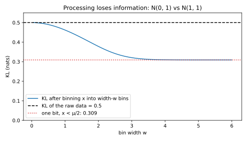

# Divergences

## Why this matters

Someone hands you a die. It is either fair, or loaded so that a six comes up half the time. You may roll it as often as you like. Three questions come up at once:

- **On average,** how much does one roll tell you about which die you hold?
- **In the worst case,** how strongly can a single roll point the wrong way?
- **With one roll,** how often can the best possible guess be right?

Each question has its own answer, and each answer is a **divergence**: a number $D(P\|Q)$ that is zero when two distributions $P$ and $Q$ are equal and grows as they become easier to tell apart. The same questions come up all over machine learning. When you fit a model $q_\theta$ to data from $p$, you need to know how far the fit is from the truth. When you run an A/B test or watch a feature drift in production, you need to know how many samples it takes to see the change. When you perturb the data a little, you need to know how much any downstream statistic can move. Later parts ask the same questions about the outputs of an algorithm run on two different inputs.

A divergence is not a distance in general. Asking "how fast do rolls of the loaded die expose it?" is a different question from "how fast do rolls of the fair die clear it?", so a divergence can be asymmetric, $D(P\|Q) \ne D(Q\|P)$, and it can fail the triangle inequality.

### The one idea: the likelihood ratio

You see an outcome $x$ and want to know which distribution it came from. The natural thing to compare is how likely $x$ is under each one. Their quotient, the **likelihood ratio**
$$r(x) = \frac{p(x)}{q(x)},$$
says how many times more likely $x$ is under $P$ than under $Q$. Its logarithm, $\ln r(x)$, is the **evidence** that $x$ gives for $P$: positive when $x$ favours $P$, negative when it favours $Q$, zero when $x$ says nothing. The logarithm is used because evidence from independent observations should add up, and logarithms turn the product of their ratios into a sum. Natural logarithms measure evidence in units called **nats**. @tbl-div-die shows the ratio and the evidence for the die, with $P$ the loaded die and $Q$ the fair one.

| Roll $x$ | 1 | 2 | 3 | 4 | 5 | 6 |
| --- | --- | --- | --- | --- | --- | --- |
| $p(x)$ (loaded) | 0.1 | 0.1 | 0.1 | 0.1 | 0.1 | 0.5 |
| $q(x)$ (fair) | 1/6 | 1/6 | 1/6 | 1/6 | 1/6 | 1/6 |
| $r(x) = p(x)/q(x)$ | 0.6 | 0.6 | 0.6 | 0.6 | 0.6 | 3 |
| $\ln r(x)$ | −0.511 | −0.511 | −0.511 | −0.511 | −0.511 | 1.099 |

: The loaded die $P$ against the fair die $Q$, outcome by outcome. This is the running example of the chapter. {#tbl-div-die}

A six is three times more likely under the loaded die ($0.5 / \frac16 = 3$). It is fairly strong evidence for "loaded", $\ln 3 = 1.10$ nats. Any other roll is $0.1/\frac16 = 0.6$ times as likely under the loaded die, weak evidence for "fair", $\ln 0.6 = -0.51$ nats. For continuous pairs, $r(x)$ is a curve. @fig-shifted-log-ratio in [Probability distributions](01-distributions.md) draws $\ln r$, written $L(x)$ there, for a normal density and for a Laplace density, each against a copy of itself shifted sideways. The normal's log-ratio is a straight line that grows without bound. The Laplace's is flat beyond a point, so it never exceeds a fixed value. That difference comes back in every section of this chapter.

**Every divergence in this chapter is a summary of the likelihood ratio.** The divergences differ only in which summary they take, and each summary answers one question (@tbl-div-questions). In the table, $\mathbb E_P$ means an average over outcomes drawn from $P$, $\mathbb E_Q$ an average over outcomes drawn from $Q$, and $(y)_+ = \max(y, 0)$ keeps only the positive part of a number.

| Question | Divergence | Summary of $r$ |
| --- | --- | --- |
| How much evidence does one observation give, on average? | Kullback–Leibler (KL) | $\mathbb E_P[\ln r]$, the average evidence |
| The same, but counting rare large ratios more | Rényi of order $\alpha$ | the log of a power mean of $r$, from typical ($\alpha \to 1$) to largest ($\alpha \to \infty$) |
| How strong is the strongest evidence any outcome can give? | Max-divergence | $\ln\max r$ |
| How often is the best single guess right? | Total variation (TV) | $\mathbb E_Q[(r - 1)_+]$, the mass where $P$ beats $Q$ |
| The same, when one answer must be $\gamma$ times more convincing | Hockey-stick $E_\gamma$ | $\mathbb E_Q[(r - \gamma)_+]$, the mass where $P$ beats $\gamma Q$ |
| All of the above at once | f-divergences | $\mathbb E_Q[f(r)]$ for a convex $f$ |

: Each divergence answers one question, by summarizing the likelihood ratio $r = p/q$ in its own way. {#tbl-div-questions}

Because every divergence is a function of $r$, there is one rule they all obey. Processing the data, by binning it, computing a feature or adding noise, can only average likelihood ratios together. It can never sharpen them, so no divergence can grow. That is the **data-processing inequality**.

@tbl-div-overview lists the results of the chapter and where each is used.

| Result | Where it is used |
| --- | --- |
| KL, Gibbs' inequality | Maximum likelihood, variational inference, the cost of a wrong model |
| Additivity over independent samples | Sample sizes for telling two distributions apart |
| Rényi divergence, its limits and monotonicity | Tail bounds on the evidence; a single family from average case to worst case |
| Max-divergence | The worst-case ratio of probabilities of any event |
| Total variation | Best single-shot test; how much any bounded statistic can change |
| Hockey-stick $E_\gamma$ | Tests with unequal priors or costs; rejection sampling with a low envelope |
| f-divergences | One definition and one proof for every divergence above |
| Data-processing inequality | Coarse-graining, features and summaries never increase a divergence |
| Pinsker, Bretagnolle–Huber | Turning an easy KL calculation into a bound on TV |

: The results of this chapter and where each is used. {#tbl-div-overview}

**How to read this chapter.** On a first pass, read the KL, Rényi, total variation, data-processing and Pinsker sections, and in each one read the context, statement, interpretation and example before the derivation. The Gaussian and Laplace sections are worked examples; do the Gaussian one by hand. Two derivations are there for completeness and can wait for a second pass: the Laplace Rényi integral and the hockey-stick representation of f-divergences (@eq-f-from-hockey).

The distributions used here (normal, Laplace) and the comparison of a density with its shifted copy are in [Probability distributions](01-distributions.md). The Chernoff method and the log of the moment generating function (MGF) are in [Concentration inequalities](02-concentration.md). Where this chapter uses a fact from those pages, it restates it.

**Conventions.** $P$ and $Q$ have probability mass functions or densities $p$ and $q$. We write sums $\sum_x$; for densities, read them as integrals. Logarithms are natural, so divergences are in nats. We use $0\ln 0 = 0$. When $P$ puts mass where $Q$ puts none, $r = \infty$ there and most divergences below are infinite.

## Toolkit: three facts every derivation uses

Each section below follows the same arc: the question the divergence answers, its definition and properties, derivations, an interpretation, an example, and a self-check. The derivations reuse three facts. Skim them now and come back when a derivation cites one.

### Fact 1 — Change of measure: $\mathbb E_P[g] = \mathbb E_Q[r\,g]$

Some divergences are averages over outcomes drawn from $P$, others over outcomes drawn from $Q$. This fact lets you switch between the two. The idea: an outcome that is three times as likely under $P$ as under $Q$ should count three times as much when you average under $Q$ but want the answer that $P$ would give. Multiplying each term by $r(x) = p(x)/q(x)$ does exactly that reweighting. For any function $g$, as long as $Q$ gives positive probability to every outcome that $P$ does,
$$\mathbb E_P[g(X)] = \sum_x p(x)g(x) = \sum_x q(x)\frac{p(x)}{q(x)}g(x) = \mathbb E_Q[r(X)\,g(X)].$$
The middle step only multiplies and divides by $q(x)$.

Two special cases come up again and again. With $g = 1$ the left side is 1, so $\mathbb E_Q[r] = 1$: the likelihood ratio always averages to 1 under $Q$. On the die, $\frac16(5\times0.6 + 3) = 1$. In words, if the data really come from $Q$, the outcomes that favour $P$ are rare enough to balance how strongly they favour it. With $g = \mathbf 1_A$, the indicator that is 1 on an event $A$ and 0 elsewhere, the fact reads $P(A) = \mathbb E_Q[r\,\mathbf 1_A]$. For the event "roll is 6" this gives $\frac16 \times 3 = 0.5$, the loaded die's probability of a six.

### Fact 2 — Jensen's inequality

A function $\varphi$ is **convex** when its graph bends upward, like a bowl, so that every chord lies above the graph. For such a function, averaging first and then applying $\varphi$ gives less than applying $\varphi$ first and then averaging:
$$\varphi(\mathbb E X) \le \mathbb E\varphi(X).$$
If $\varphi$ is strictly convex (no straight pieces), equality holds only when $X$ is constant.

The reason is that a convex function lies above each of its tangent lines. Let $m = \mathbb E X$ and take the tangent at $m$: $\varphi(x) \ge \varphi(m) + c(x - m)$ for every $x$, where $c$ is the slope there. Average both sides over $X$. The term $c(X - m)$ averages to 0, because $X$ averages to $m$, which leaves $\mathbb E\varphi(X) \ge \varphi(m)$. If $\varphi$ is strictly convex, the tangent touches the graph only at $m$, so equality forces $X = m$ with probability 1.

A small case shows the gap. Let $X$ be 0.6 or 3 with probability $\frac12$ each, the die's two likelihood ratios, and $\varphi(x) = x^2$. Then $\varphi(\mathbb E X) = 1.8^2 = 3.24$, while $\mathbb E\varphi(X) = \frac12(0.36 + 9) = 4.68$. Jensen is what makes every divergence non-negative, what orders the Rényi divergences by their order, and what drives the data-processing inequality.

### Fact 3 — The best event is $\{r > \gamma\}$

Several divergences ask for the event $A$ that makes $P(A) - \gamma Q(A)$ as large as possible, for some weight $\gamma \ge 0$. The answer is to collect every outcome where $p$ beats $\gamma q$ and nothing else. Writing $(y)_+ = \max(y, 0)$,
$$\max_A\big[P(A) - \gamma Q(A)\big] = \sum_x\big(p(x) - \gamma q(x)\big)_+,$$
attained at $A^* = \{x : p(x) > \gamma q(x)\} = \{r > \gamma\}$.

The reason is that the quantity is a sum over the outcomes in $A$: $P(A) - \gamma Q(A) = \sum_{x\in A}(p(x) - \gamma q(x))$. An outcome adds a positive term exactly when $p(x) > \gamma q(x)$, and a negative or zero term otherwise. So the sum is largest when $A$ contains all the outcomes with positive terms and none of the others, and its value is then the sum of the positive parts.

Randomized choices do no better. Instead of a set, you could include each outcome with some probability $\phi(x) \in [0, 1]$, and get $\sum_x\phi(x)(p(x) - \gamma q(x))$. Each term is a number between 0 and the bracket, so the sum is largest when $\phi(x) = 1$ where the bracket is positive and $\phi(x) = 0$ elsewhere: that is the indicator of $A^*$ again.

On the die with $\gamma = 1$, only the six has $p > q$, so $A^* = \{6\}$ and the maximum is $0.5 - \frac16 = \frac13$. This fact gives the total variation, the hockey-stick divergence and Pinsker's inequality.

## KL divergence {#sec-div-kl}

### Context

Roll the die $n$ times and add up the evidence from each roll: $\sum_{i=1}^n\ln r(x_i)$. If the die is loaded, sixes come up often and the sum climbs. If it is fair, the many small negative terms win and the sum falls. @fig-div-evidence-walk shows eight runs of each. The runs are noisy, but each family drifts along a straight line. The slope of that line, the average evidence per roll, is the **KL divergence**. It is the speed at which data from $P$ convince you that they are not from $Q$.

{#fig-div-evidence-walk}

The same number measures a model's fit. If the data come from $p$ and you model them with $q_\theta$, then $\ln\frac{p(x)}{q_\theta(x)}$ is the evidence that $x$ gives for the truth over the model. KL is its average: how much worse the model explains the data than the truth does. Minimizing it over $\theta$ is maximum likelihood.

### Statement

The KL divergence is the average evidence for $P$ that one observation gives, when the observation really comes from $P$:
$$D_{\mathrm{KL}}(P\|Q) = \mathbb E_P\left[\ln\frac{p(X)}{q(X)}\right] = \sum_x p(x)\ln\frac{p(x)}{q(x)}.$$

Write $L(x) = \ln r(x)$ for the **log-likelihood ratio**, the evidence of a single outcome. Then $D_{\mathrm{KL}}(P\|Q) = \mathbb E_P[L]$. It has three properties, each proved in the derivation.

1. **Gibbs' inequality:** $D_{\mathrm{KL}}(P\|Q) \ge 0$, with equality only if $P = Q$. Data from $P$ never favour $Q$ on average.
2. **Not symmetric:** in general $D_{\mathrm{KL}}(P\|Q) \ne D_{\mathrm{KL}}(Q\|P)$, because the two directions average different evidence over different data.
3. **Additive over independent coordinates:** evidence from independent observations adds up, so their divergences add too,
$$D_{\mathrm{KL}}(P_1\times P_2\,\|\,Q_1\times Q_2) = D_{\mathrm{KL}}(P_1\|Q_1) + D_{\mathrm{KL}}(P_2\|Q_2).$$ {#eq-kl-additive}
Here $P_1 \times P_2$ is the distribution of a pair drawn independently from $P_1$ and $P_2$. In particular, $n$ i.i.d. samples carry $n$ times the KL divergence of one. That is the straight line in @fig-div-evidence-walk.

### Derivation

**Gibbs' inequality.** The claim is that data from $P$ cannot, on average, favour $Q$. The proof turns KL into an average of a convex function and applies Jensen.

1. **Flip the ratio.** $\ln\frac pq = -\ln\frac qp$, so $D_{\mathrm{KL}}(P\|Q) = \mathbb E_P\big[-\ln\tfrac{q(X)}{p(X)}\big]$. The function $-\ln$ is strictly convex: its graph bends upward.
2. **Apply Jensen (Fact 2)**, which says that for a convex function the average of the function is at least the function of the average: $\mathbb E_P\big[-\ln\tfrac qp\big] \ge -\ln\mathbb E_P\big[\tfrac qp\big]$.
3. **Compute the inner average.** $\mathbb E_P[q/p] = \sum_{x: p(x) > 0}p(x)\frac{q(x)}{p(x)} = \sum_{x: p(x) > 0} q(x)$. This is $Q$'s mass on the outcomes $P$ can produce, which is at most 1. The logarithm of a number at most 1 is at most 0, so $-\ln$ of it is $\ge 0$.
4. **When is it zero?** Equality needs equality in step 2, which for a strictly convex function means $q/p$ is constant on the outcomes $P$ can produce. It also needs equality in step 3, so $Q$ has no mass outside those outcomes. A constant ratio between two distributions that both sum to 1 on the same outcomes must be 1, so $p = q$.

**Additivity.** Evidence from independent observations adds up, so its average does too.

1. **Densities multiply.** Under a product distribution the probability of a pair is the product of the probabilities, $p_1(x_1)p_2(x_2)$ under $P$ and $q_1(x_1)q_2(x_2)$ under $Q$.
2. **So the log-likelihood ratio is a sum.** The ratio of products is the product of ratios, and the logarithm of a product is a sum: $L(x_1, x_2) = L_1(x_1) + L_2(x_2)$.
3. **Average.** Expectations are linear, and the $P$-average of $L_i(X_i)$ depends only on the distribution $P_i$ of that coordinate, so it equals $D_{\mathrm{KL}}(P_i\|Q_i)$. Adding the two gives @eq-kl-additive.

**Maximum likelihood minimizes KL.** Split the logarithm of the ratio into the log of the truth minus the log of the model. Only the second part depends on the model's parameter $\theta$:
$$D_{\mathrm{KL}}(P\|Q_\theta) = \underbrace{\mathbb E_P[\ln p(X)]}_{\text{does not depend on }\theta} - \mathbb E_P[\ln q_\theta(X)].$$
So minimizing KL over $\theta$ is the same as maximizing the expected log-likelihood $\mathbb E_P[\ln q_\theta(X)]$. You cannot compute that expectation, because you do not know $p$, but its sample version $\frac1n\sum_i\ln q_\theta(x_i)$ is the average log-likelihood that maximum likelihood maximizes.

### Interpretation

**Signal against noise.** After $n$ rolls of the loaded die, the total evidence is a sum of $n$ independent per-roll terms, so its mean is $n$ times the per-roll mean and its variance is $n$ times the per-roll variance. That gives a mean of $0.2939\,n$ (the drift) and a standard deviation of $0.8047\sqrt n$ (the spread of $\ln r$ is $0.8047$ per roll, from the script). The drift grows like $n$ and the noise like $\sqrt n$, so the drift overtakes the noise once $0.2939\,n > 0.8047\sqrt n$, that is once $n > (0.8047/0.2939)^2 = 7.50$ rolls. The same argument with any pair says that the number of observations you need scales like $1/\mathrm{KL}$. The total variation and Pinsker sections make this precise.

**Which direction you minimize matters.** KL is an average under its *first* argument, so the two directions punish different mistakes. There are two options when you fit a model $q_\theta$ to a target $p$:

- **$D_{\mathrm{KL}}(P\|Q_\theta)$ (forward, maximum likelihood)** averages over the data. Where $p > 0$ but $q_\theta \approx 0$, the term $\ln(p/q_\theta)$ explodes. The model is forced to cover every region the data visits. It is **mass-covering**.
- **$D_{\mathrm{KL}}(Q_\theta\|P)$ (reverse)** averages over the model. Regions the model ignores cost nothing, but putting model mass where $p \approx 0$ is heavily punished. It is **mode-seeking**. Variational inference minimizes this direction, because it only needs samples and densities from the model $q_\theta$, and $p$ only up to a constant.

@fig-div-forward-reverse shows both fits of a single Gaussian $\mathcal N(\mu, \sigma^2)$ to data from two bumps, $p = \frac12\mathcal N(-2, 0.5^2) + \frac12\mathcal N(2, 0.5^2)$.

The forward fit has a closed form. For a Gaussian $q$, the negative log-density is $\ln\sigma + \frac12\ln(2\pi) + \frac{(x - \mu)^2}{2\sigma^2}$, so its average under $p$ is $-\mathbb E_p[\ln q(X)] = \ln\sigma + \frac12\ln(2\pi) + \frac{\mathbb E_p(X - \mu)^2}{2\sigma^2}$. Setting its derivative in $\mu$ to zero makes $\mu$ the mean of $p$, $\mathbb E_pX = 0$, since the bumps sit symmetrically at $\pm2$. Setting its derivative in $\sigma$ to zero makes $\sigma^2$ the variance of $p$. That variance has two parts: the bump centres are 2 away from the mean, which contributes $2^2$, and each bump has its own spread $0.5^2$. So $\sigma^2 = \operatorname{Var}_pX = 2^2 + 0.5^2$, and $\sigma = 2.06$. This is **moment matching**: the forward fit copies the mean and variance of the data. The result is a wide bump that puts most of its mass in the valley between the modes, where there is no data.

The reverse fit has no closed form, and a grid search finds $\mu = 2.00$, $\sigma = 0.50$: the fit sits exactly on one bump and ignores the other. Its reverse KL is $0.693 = \ln 2$. The reason is that on that bump, $p$ is the bump's own density times its weight $\frac12$, while the model is that density with weight 1. So $q/p \approx 2$ everywhere the model puts mass, and the average of $\ln(q/p)$ under $q$ is about $\ln 2$.

Each fit is bad in the other's direction. The forward fit has forward KL 0.724 but reverse KL 2.097. The reverse fit has reverse KL 0.693 but forward KL 15.307, because it gives almost no probability to the left bump, where half the data lie.

{#fig-div-forward-reverse}

### Example: the loaded die

Use @tbl-div-die. Under $P$, each of the five non-sixes has probability 0.1 and evidence $\ln 0.6$, and the six has probability 0.5 and evidence $\ln 3$. The five non-sixes together have probability $5 \times 0.1 = 0.5$, the same as the six, so both terms carry weight 0.5 and the logarithms combine:
$$D_{\mathrm{KL}}(P\|Q) = 5\times0.1\ln0.6 + 0.5\ln3 = 0.5\ln(0.6\times3) = 0.5\ln1.8 = 0.2939.$$
In the other direction the average is under the fair die, which gives the non-sixes total weight $\frac56$ and the six weight $\frac16$, and the evidence is now for "fair", $\ln(q/p)$:
$$D_{\mathrm{KL}}(Q\|P) = \tfrac56\ln\tfrac{1}{0.6} + \tfrac16\ln\tfrac13 = 0.4257 - 0.1831 = 0.2426.$$
The two directions differ. Rolls of the loaded die produce sixes, where the evidence for "loaded" is strong ($\ln 3 = 1.10$ nats). Rolls of the fair die produce mostly non-sixes, where the evidence for "fair" is weaker ($\ln(1/0.6) = 0.51$ nats). So a loaded die gives itself away faster than a fair one proves its innocence. By additivity, 20 rolls of the loaded die give an expected $20 \times 0.2939 = 5.88$ nats of evidence for "loaded". Turning nats back into a likelihood ratio means exponentiating, which gives $e^{20 \times 0.5\ln 1.8} = 1.8^{10} = 357$.

### Check yourself

- If $q(x) = 0$ at a point where $p(x) > 0$, what is $D_{\mathrm{KL}}(P\|Q)$, and what does that mean for maximum likelihood? *(It is infinite. A model that gives zero probability to an observed outcome has log-likelihood $-\infty$, which is why practical models keep every probability positive.)*
- Why is the forward-KL fit to the two bumps centred at 0, where $p$ is almost zero? *(The forward KL only rewards matching the mean and variance of $p$. Having mass where $p \approx 0$ costs nothing in that direction.)*

## Rényi divergence {#sec-div-renyi}

### Context

KL is the average of $\ln r$ under $P$. Exponentiating an average of logarithms gives a **geometric mean**, so $e^{D_{\mathrm{KL}}}$ is the geometric mean of the likelihood ratio. Nothing forces you to use the geometric mean. Other means of the same numbers weight large values more, or less. All the usual ones belong to one family, the **power mean** with exponent $s$, $M_s = \big(\mathbb E_P[r^s]\big)^{1/s}$: raise each value to the power $s$, average, and undo the power. The harmonic mean is $s = -1$, the arithmetic mean is $s = 1$, the geometric mean is the limit $s \to 0$, and $s \to \infty$ picks out the largest value. On the die, under $P$ the ratio is 0.6 or 3, each with probability $\frac12$ (@tbl-div-die). Its means are in @tbl-div-power-means.

| Mean of $r$ under $P$ | Value | Its logarithm | Divergence |
| --- | --- | --- | --- |
| Harmonic, $1/\mathbb E_P[1/r]$ | 1.0000 | 0 | $D_0$ |
| Geometric, $e^{\mathbb E_P[\ln r]}$ | 1.3416 | 0.2939 | $D_1 = D_{\mathrm{KL}}$ |
| Arithmetic, $\mathbb E_P[r]$ | 1.8000 | 0.5878 | $D_2$ |
| Largest value, $\max r$ | 3.0000 | 1.0986 | $D_\infty$ |

: Different means of the die's likelihood ratio under $P$. Their logarithms are the Rényi divergences of orders 0, 1, 2 and $\infty$. {#tbl-div-power-means}

The **Rényi divergence of order $\alpha$** is the logarithm of one of these means, the power mean with exponent $s = \alpha - 1$. The order is a dial. Near $\alpha = 1$ you get the typical evidence (KL). As $\alpha$ grows, the mean is pulled toward the largest ratio, and you get the worst case. The family keeps KL's best property, additivity over independent samples. It also controls how often the evidence can be large, which KL alone cannot tell you.

### Statement

Written out, the log of the power mean with exponent $\alpha - 1$ is the log of $\mathbb E_P[r^{\alpha - 1}]$ divided by $\alpha - 1$. Because averaging under $P$ is averaging under $Q$ with an extra factor $r$ (Fact 1), the same number can be written as an average under $Q$ or as a plain sum. For $\alpha \in (0, 1)\cup(1, \infty)$,
$$D_\alpha(P\|Q) = \frac{1}{\alpha - 1}\ln\sum_x p(x)^\alpha q(x)^{1-\alpha} = \frac{1}{\alpha - 1}\ln\mathbb E_Q\big[r^\alpha\big] = \frac{1}{\alpha - 1}\ln\mathbb E_P\big[r^{\alpha - 1}\big].$$
Two equivalent forms do most of the work. The first is the power-mean form of the context. With $M_s = \big(\mathbb E_P[r^s]\big)^{1/s}$ and, for $s = 0$, the geometric mean $M_0 = e^{\mathbb E_P[\ln r]}$,
$$D_\alpha(P\|Q) = \ln M_{\alpha - 1}.$$ {#eq-renyi-power}
The second connects Rényi divergence to the Chernoff method of [Concentration inequalities](02-concentration.md). The **moment generating function** of a random variable $Y$ is $\lambda \mapsto \mathbb E[e^{\lambda Y}]$, and its logarithm is the quantity the Chernoff method optimizes to bound tails. Apply it to the evidence $L = \ln r$ under $P$, and call the result $\psi(\lambda) = \ln\mathbb E_P\big[e^{\lambda L}\big]$. Since $e^{\lambda L} = r^\lambda$, $\psi(\alpha - 1)$ is exactly the logarithm inside the definition, so
$$D_\alpha(P\|Q) = \frac{\psi(\alpha - 1)}{\alpha - 1}.$$ {#eq-renyi-psi}
The family has five properties, each derived below.

1. **Limit $\alpha \to 1$:** $D_\alpha \to D_{\mathrm{KL}}$, because the power mean tends to the geometric mean. So we set $D_1 = D_{\mathrm{KL}}$.
2. **Limit $\alpha \to \infty$:** a power mean with a huge exponent is dominated by the largest value, so $D_\alpha \to D_\infty(P\|Q) = \ln\max_x r(x)$, the **max-divergence**. (For densities, the maximum is an essential supremum: the largest value that $r$ exceeds with positive probability.) The same number is the largest ratio of probabilities that $P$ and $Q$ give to any event:
$$D_\infty(P\|Q) = \ln\max_{A:\,Q(A) > 0}\frac{P(A)}{Q(A)}.$$
3. **Monotone:** $D_\alpha$ is non-decreasing in $\alpha$, because power means grow with their exponent.
4. **Additive over independent coordinates:** $D_\alpha(P_1\times P_2\|Q_1\times Q_2) = D_\alpha(P_1\|Q_1) + D_\alpha(P_2\|Q_2)$ for every $\alpha$, as for KL.
5. **Skew symmetry:** for $0 < \alpha < 1$, $D_\alpha(P\|Q) = \frac{\alpha}{1 - \alpha}D_{1-\alpha}(Q\|P)$. In particular $D_{1/2}$ is symmetric, since then $\frac{\alpha}{1 - \alpha} = 1$.

@tbl-div-renyi-orders lists the orders that have names of their own.

| Order | $D_\alpha(P\Vert Q)$ | What it measures |
| --- | --- | --- |
| $\alpha \to 0$ | $-\ln Q(p > 0)$ | Only whether $Q$ puts mass outside the support of $P$ |
| $\alpha = \frac12$ | $-2\ln\sum_x\sqrt{p(x)q(x)}$ | Symmetric; the sum is the Bhattacharyya coefficient, the overlap of $\sqrt p$ and $\sqrt q$ |
| $\alpha = 1$ | $\mathbb E_P[\ln r]$ | KL: the average evidence |
| $\alpha = 2$ | $\ln\mathbb E_Q[r^2] = \ln\big(1 + \chi^2(P\Vert Q)\big)$ | The second moment of $r$, with $\chi^2 = \mathbb E_Q[(r - 1)^2]$ |
| $\alpha \to \infty$ | $\ln\max r$ | The worst case |

: Rényi divergences of special orders. {#tbl-div-renyi-orders}

### Derivation

**The forms agree.** Fact 1 says an average under $Q$ of $r$ times something equals the average under $P$ of that something. With "something" $= r^{\alpha - 1}$, $\mathbb E_Q[r^\alpha] = \mathbb E_Q[r \cdot r^{\alpha - 1}] = \mathbb E_P[r^{\alpha - 1}]$, and writing either average as a sum gives $\sum_x p^\alpha q^{1-\alpha}$. Dividing $\ln\mathbb E_P[r^{\alpha-1}]$ by $\alpha - 1$ is the same as taking the logarithm of $\big(\mathbb E_P[r^{\alpha-1}]\big)^{1/(\alpha-1)} = M_{\alpha-1}$, which gives @eq-renyi-power. And $r^{\alpha-1} = e^{(\alpha-1)L}$, so $\ln\mathbb E_P[r^{\alpha-1}] = \psi(\alpha - 1)$, which gives @eq-renyi-psi.

**Monotonicity is the power-mean inequality.** A larger exponent leans harder on the large values, so power means grow with their exponent: $M_{s_1} \le M_{s_2}$ for $s_1 < s_2$. Each case is one use of Jensen (Fact 2): a convex function of an average is at most the average of the function, and for a concave function (one that bends downward) the inequality is reversed.

1. *Both exponents positive.* The function $\varphi(y) = y^{s_2/s_1}$ is convex for $y \ge 0$, because its exponent $s_2/s_1$ is above 1. Jensen applied to $Y = r^{s_1}$ gives $\big(\mathbb E_P[r^{s_1}]\big)^{s_2/s_1} \le \mathbb E_P\big[(r^{s_1})^{s_2/s_1}\big] = \mathbb E_P[r^{s_2}]$. Raising both sides to the positive power $1/s_2$ keeps the order and gives $M_{s_1} \le M_{s_2}$.
2. *Against the geometric mean.* $\ln$ is concave, so Jensen runs the other way: for $s > 0$, $\ln\mathbb E_P[r^s] \ge \mathbb E_P[\ln r^s] = s\,\mathbb E_P[\ln r]$. Dividing by $s > 0$ gives $\ln M_s \ge \ln M_0$. For $s < 0$ the same inequality holds before dividing, and dividing by a negative $s$ flips it: $\ln M_s \le \ln M_0$.
3. *Both exponents negative.* Now $s_2/s_1 \in (0, 1)$, so $\varphi$ is concave and step 1's inequality reverses. Raising to the negative power $1/s_2$ reverses it again, so the conclusion $M_{s_1} \le M_{s_2}$ is the same.

With $s = \alpha - 1$, this says $D_\alpha$ is non-decreasing in $\alpha$. On the die, the rows of @tbl-div-power-means increase from top to bottom.

**$\psi$ is convex, with $\psi(0) = 0$ and $\psi'(0) = D_{\mathrm{KL}}$.** This is what ties Rényi divergence to the Chernoff method, and what gives the limit $\alpha \to 1$ below.

1. **Value at 0.** $\psi(0) = \ln\mathbb E_P[e^0] = \ln 1 = 0$.
2. **First derivative.** Differentiate the logarithm of the average, passing the derivative inside the average: $\psi'(\lambda) = \mathbb E_P[Le^{\lambda L}]/\mathbb E_P[e^{\lambda L}]$. This is an average of $L$ in which each outcome $x$ gets weight proportional to $p(x)e^{\lambda L(x)} = p(x)r(x)^\lambda$. Those weights define the **tilted** distribution: $P$ reweighted toward outcomes with large $r$ when $\lambda > 0$. At $\lambda = 0$ there is no tilt, and $\psi'(0) = \mathbb E_P[L] = D_{\mathrm{KL}}(P\|Q)$.
3. **Second derivative.** Differentiating the quotient once more gives $\psi''(\lambda) = \frac{\mathbb E_P[L^2e^{\lambda L}]}{\mathbb E_P[e^{\lambda L}]} - \Big(\frac{\mathbb E_P[Le^{\lambda L}]}{\mathbb E_P[e^{\lambda L}]}\Big)^2$, the mean square of $L$ minus its squared mean under the tilted distribution. That is the variance of $L$ under the tilted distribution. A variance is never negative, so $\psi$ is convex. In terms of the divergence, $(\alpha - 1)D_\alpha = \psi(\alpha - 1)$ is convex in $\alpha$.

**Limit $\alpha \to 1$.** Since $\psi(0) = 0$, @eq-renyi-psi can be written $D_\alpha = \frac{\psi(\alpha - 1) - \psi(0)}{(\alpha - 1) - 0}$, the slope of $\psi$ between 0 and $\alpha - 1$. As $\alpha \to 1$ that slope tends to the derivative $\psi'(0)$, which is $D_{\mathrm{KL}}$ by step 2. (This needs $\psi$ to be finite near 0. @sec-apx-tail-renyi-kl in the appendices proves the limit from below in general, and from above whenever some $D_\alpha$ with $\alpha > 1$ is finite; van Erven & Harremoës treat every case.)

**Limit $\alpha \to \infty$.** Let $M = \max_x r(x)$, the largest likelihood ratio on the support of $P$. A high power of $r$ is dominated by its largest value, so squeeze $D_\alpha$ between two bounds that both tend to $\ln M$.

1. *Upper bound.* Every $r(x) \le M$, so $\mathbb E_P[r^{\alpha-1}] \le M^{\alpha - 1}$, and taking logs and dividing by $\alpha - 1 > 0$ gives $D_\alpha \le \ln M$ for every $\alpha > 1$.
2. *Lower bound.* Let $x^*$ be a point where $r(x^*) = M$. Dropping every other term of the average can only make it smaller: $\mathbb E_P[r^{\alpha - 1}] \ge p(x^*)M^{\alpha-1}$, so $D_\alpha \ge \ln M + \frac{\ln p(x^*)}{\alpha - 1}$.
3. *Squeeze.* The last term is a fixed number divided by $\alpha - 1$, so it tends to 0 as $\alpha \to \infty$, and $D_\alpha \to \ln M$. (For densities, replace $x^*$ by a set of positive probability on which $r > M - \eta$, and let $\eta \to 0$.)

**Limit $\alpha \to 0$.** As $\alpha \to 0$, $p^\alpha \to 1$ wherever $p > 0$, and the terms with $p = 0$ are 0 for every $\alpha > 0$. So $\sum_x p^\alpha q^{1-\alpha} \to \sum_{x:\,p(x) > 0}q(x) = Q(p > 0)$, the mass $Q$ puts where $P$ can land. Divide its logarithm by $\alpha - 1 \to -1$ to get $-\ln Q(p > 0)$.

**Max-divergence over events.** The largest ratio for a single outcome is also the largest ratio for any event, because an event's probability is a sum of outcomes' probabilities, each at most $M$ times its $Q$-probability. Formally, Fact 1 with the indicator of $A$ gives $P(A) = \mathbb E_Q[r\mathbf 1_A] \le M\,\mathbb E_Q[\mathbf 1_A] = M\,Q(A)$, so $P(A)/Q(A) \le M$. The event $A = \{x^*\}$ attains it.

**Additivity.** As for KL, the log-likelihood ratio of a pair is a sum, $L_1(X_1) + L_2(X_2)$, and under $P_1 \times P_2$ the two terms are independent. For independent variables the moment generating function of a sum is the product of their moment generating functions: $e^{\lambda(L_1 + L_2)} = e^{\lambda L_1}e^{\lambda L_2}$, and the average of a product of independent factors is the product of their averages (Fact 4 of [Concentration inequalities](02-concentration.md)). Taking logarithms, $\psi = \psi_1 + \psi_2$. Divide by $\alpha - 1$.

**Skew symmetry.** The defining sum is symmetric under swapping the roles of $p$ and $q$ together with $\alpha$ and $1 - \alpha$. Indeed $\sum_x p^\alpha q^{1-\alpha} = \sum_x q^{1-\alpha}p^{1 - (1-\alpha)}$, and the right side is the sum that defines $D_{1-\alpha}(Q\|P)$. Its logarithm is $(\alpha - 1)D_\alpha(P\|Q)$ on one hand and $\big((1 - \alpha) - 1\big)D_{1-\alpha}(Q\|P) = -\alpha D_{1-\alpha}(Q\|P)$ on the other. Divide by $\alpha - 1$.

**The same facts as a picture.** @eq-renyi-psi says $D_\alpha$ is the slope of the chord of $\psi$ from $(0, 0)$ to $(\lambda, \psi(\lambda))$, with $\lambda = \alpha - 1$. For a convex function through the origin, chords get steeper as $\lambda$ grows (monotonicity), and they approach the tangent at 0 as $\lambda \to 0$ (the KL limit). @fig-div-renyi-chords draws this for the die.

{#fig-div-renyi-chords}

### Interpretation

**Where each order looks.** $D_\alpha$ is built from the sum $\sum_x p(x)^\alpha q(x)^{1-\alpha}$. Divide each term by the total and you get a distribution. It is the tilted distribution of the derivation with $\lambda = \alpha - 1$, since $p^\alpha q^{1-\alpha} = p\,r^{\alpha - 1}$, and the slope $\psi'(\alpha - 1)$ is the average evidence $L$ under it. So the tilted distribution shows which outcomes the order $\alpha$ pays attention to. At $\alpha = 1$ it is $P$ itself. As $\alpha$ grows, it moves toward the outcomes with the largest $r$.

@fig-div-renyi-tilt draws it for two pairs with the same shift and variance, a Gaussian pair and a Laplace pair, and the difference between them is the difference between a log-ratio that keeps growing and one that stops. For the Gaussian pair, the log-ratio is a straight line in $x$, so the tilt keeps finding larger ratios further out. The tilted distribution is again normal, centred at $(1 - \alpha)s$ for a shift $s$ (derived in the next section). It slides into the tail at a constant speed and never stops, so $D_\alpha$ grows without bound and $D_\infty = \infty$. For the Laplace pair with shift $t$ (measured in units of the Laplace scale), the log-ratio already equals its maximum $t$ on all of $x \le 0$, and no outcome has a larger one. The tilted distribution piles up on that region and stops moving, so $D_\alpha$ levels off at $D_\infty = t$.

{#fig-div-renyi-tilt}

**Rényi divergence controls the tail of the evidence.** How often does a sample from $Q$ look like strong evidence for $P$, at least $c$ nats? The Chernoff method answers this kind of question. Markov's inequality says that a non-negative variable exceeds a level $k$ with probability at most its mean divided by $k$. Applying it to $e^{\alpha L}$, which is non-negative and exceeds $e^{\alpha c}$ exactly when $L \ge c$, gives a bound in terms of the average of $e^{\alpha L} = r^\alpha$ under $Q$. That average is exactly what the Rényi divergence of order $\alpha$ measures: by the definition, $\mathbb E_Q[r^\alpha] = e^{(\alpha - 1)D_\alpha(P\|Q)}$. So for any $\alpha > 0$,
$$Q[L \ge c] \le e^{-\alpha c}\,\mathbb E_Q\big[e^{\alpha L}\big] = e^{-\alpha c}\,\mathbb E_Q[r^\alpha] = \exp\big(-\alpha c + (\alpha - 1)D_\alpha(P\|Q)\big).$$ {#eq-renyi-tail}
At $\alpha = 1$ the divergence term drops out and this is $Q[r \ge e^c] \le e^{-c}$: Markov's inequality applied to $r$ itself, whose $Q$-mean is 1 (Fact 1). It holds for *any* pair of distributions. Larger $\alpha$ uses more about the pair and can do much better. KL alone cannot give a bound like this, because an average says nothing about how often a variable is far from it.

### Example: the die across orders

The script computes $D_\alpha$ for the die in both directions:

| $\alpha$ | 0.5 | 1 (KL) | 2 | 5 | 10 | $\infty$ |
| --- | --- | --- | --- | --- | --- | --- |
| $D_\alpha(P\Vert Q)$, loaded ‖ fair | 0.1362 | 0.2939 | 0.5878 | 0.9257 | 1.0216 | 1.0986 |
| $D_\alpha(Q\Vert P)$, fair ‖ loaded | 0.1362 | 0.2426 | 0.3677 | 0.4653 | 0.4906 | 0.5108 |

: Rényi divergences between the loaded and the fair die. {#tbl-div-die-renyi}

Check two entries by hand. At order 2 the definition is $\ln\mathbb E_Q[r^2]$, and under the fair die $r$ is 0.6 with probability $\frac56$ and 3 with probability $\frac16$, so $D_2(P\|Q) = \ln\big(\frac56\times0.36 + \frac16\times9\big) = \ln1.8 = 0.5878$, the log of the arithmetic mean in @tbl-div-power-means. The max-divergences are the logs of the largest ratios in each direction, $\ln 3 = 1.0986$ and $\ln(1/0.6) = \ln\frac53 = 0.5108$. Every row increases, as monotonicity requires. The $\alpha = 0.5$ entries agree, as skew symmetry requires. The order-10 value is already within 7% of the worst case ($1.0216/1.0986 = 0.93$), because the die has only two values of $r$ and the larger one has probability $\frac12$ under $P$, so the power mean reaches the maximum quickly.

### Check yourself

- Using @eq-renyi-psi, why does a quadratic $\psi$ give a Rényi divergence that is linear in $\alpha$? *(If $\psi(\lambda) = a\lambda + b\lambda^2$, then $\psi(\alpha-1)/(\alpha-1) = a + b(\alpha - 1)$. The Gaussian pair below is exactly this case.)*
- Can $D_2(P\|Q)$ be finite while $D_\infty(P\|Q)$ is infinite? *(Yes. $D_\infty$ is infinite whenever $r$ is unbounded, even if large ratios are rare enough that $\mathbb E_Q[r^2]$ is finite. The Gaussian pair below is an example.)*

## Two Gaussians with equal variance, by hand {#sec-div-gauss}

### Context

The most common pair in practice is a distribution and a shifted copy of it: the same noise around two different centres, the same feature distribution before and after a drift, two classes with the same spread. For two normals with equal variance, every divergence has a closed form. The computation is the standard exercise for this chapter, so try it yourself before reading the derivation.

### Statement

Let $P = \mathcal N(0, \sigma^2)$ and $Q = \mathcal N(s, \sigma^2)$: the same bell curve with standard deviation $\sigma$, centred at 0 and at $s$. What matters is how far apart the centres are compared with the width of the curves, so write $\mu = s/\sigma$ for the shift in standard deviations. KL is half the square of that shift, each Rényi divergence is $\alpha$ times the KL, and the max-divergence is infinite because the likelihood ratio is unbounded:
$$D_{\mathrm{KL}}(P\|Q) = \frac{s^2}{2\sigma^2} = \frac{\mu^2}2, \qquad D_\alpha(P\|Q) = \frac{\alpha s^2}{2\sigma^2} = \frac{\alpha\mu^2}2, \qquad D_\infty(P\|Q) = \infty.$$ {#eq-gauss-renyi}
Shifting both distributions by the same amount changes nothing, so the same holds for $\mathcal N(m_0, \sigma^2)$ against $\mathcal N(m_1, \sigma^2)$, with means $m_0$ and $m_1$ and $s = m_1 - m_0$.

### Derivation

**The log-likelihood ratio** (also in [Probability distributions](01-distributions.md)). Everything follows from the evidence $L(x)$, so compute it first. The normal density with mean $m$ is $\frac{1}{\sigma\sqrt{2\pi}}e^{-(x - m)^2/(2\sigma^2)}$. In the ratio $p/q$ the constants in front cancel, and the log of the ratio of exponentials is the difference of the exponents:
$$L(x) = \ln\frac{p(x)}{q(x)} = \frac{(x - s)^2 - x^2}{2\sigma^2} = \frac{s^2 - 2sx}{2\sigma^2}.$$
The last step expands $(x - s)^2 = x^2 - 2sx + s^2$, and the $x^2$ cancels. So $L$ is a straight line in $x$. For $s > 0$ it is positive left of the midpoint $s/2$, where $x$ is closer to $P$'s centre than to $Q$'s.

**KL.** KL is the average of this line when $x$ comes from $P$.

1. **Set up.** $D_{\mathrm{KL}} = \mathbb E_P[L(X)]$ with $X \sim \mathcal N(0, \sigma^2)$.
2. **Average a line.** $L$ is linear in $x$, so its average is $L$ at the average of $X$. Under $P$ that average is $\mathbb E_P X = 0$, and $L(0) = \frac{s^2}{2\sigma^2}$.

**Rényi, route 1: complete the square.** The plan is to write $p^\alpha q^{1-\alpha}$ as a constant times a normal density, because a normal density integrates to 1 and only the constant survives.

1. **Pull out the constants.** We need $\int p^\alpha q^{1-\alpha}\,dx$. Both densities share the factor $\frac{1}{\sigma\sqrt{2\pi}}$, and $\big(\frac{1}{\sigma\sqrt{2\pi}}\big)^\alpha\big(\frac{1}{\sigma\sqrt{2\pi}}\big)^{1-\alpha} = \frac{1}{\sigma\sqrt{2\pi}}$. What remains is $\exp\big(-\frac{1}{2\sigma^2}[\alpha x^2 + (1 - \alpha)(x - s)^2]\big)$.
2. **Expand the bracket.** $\alpha x^2 + (1-\alpha)(x^2 - 2sx + s^2) = x^2 - 2(1-\alpha)sx + (1-\alpha)s^2$.
3. **Complete the square** with $m = (1 - \alpha)s$. Since $(x - m)^2 = x^2 - 2mx + m^2$, the bracket is $(x - m)^2 + (1-\alpha)s^2 - (1-\alpha)^2s^2 = (x - m)^2 + \alpha(1-\alpha)s^2$, using $(1 - \alpha) - (1 - \alpha)^2 = (1 - \alpha)\alpha$.
4. **Integrate.** The factor with $(x - m)^2$, together with $\frac{1}{\sigma\sqrt{2\pi}}$, is a normal density with mean $m$ and integrates to 1. (That normal, $\mathcal N((1 - \alpha)s, \sigma^2)$, is the tilted distribution of @fig-div-renyi-tilt.) Only the constant part of the bracket is left:
$$\int p^\alpha q^{1-\alpha}\,dx = \exp\left(-\frac{\alpha(1 - \alpha)s^2}{2\sigma^2}\right).$$
5. **Take the logarithm and divide by $\alpha - 1$.** Since $\frac{-\alpha(1-\alpha)}{\alpha - 1} = \alpha$, this gives $D_\alpha = \frac{\alpha s^2}{2\sigma^2}$.

**Rényi, route 2: the log-likelihood ratio is normal.** The plan is to use @eq-renyi-psi, which needs the log of the moment generating function of $L$ under $P$, and for a normal variable that is known in closed form.

1. **The distribution of $L$.** Under $P$, $L(X) = \frac{s^2}{2\sigma^2} - \frac{s}{\sigma^2}X$ is a linear function of a normal variable, so it is normal. Its mean is $\frac{s^2}{2\sigma^2}$ (because $\mathbb E X = 0$) and its variance is $\frac{s^2}{\sigma^4}\sigma^2 = \frac{s^2}{\sigma^2}$ (a constant factor $a$ multiplies a variance by $a^2$).
2. **Its log moment generating function.** For a normal variable $Y$ with mean $m$ and variance $v$, $\ln\mathbb E[e^{\lambda Y}] = \lambda m + \frac{\lambda^2}{2}v$ ([Probability distributions](01-distributions.md)). With the mean and variance of step 1, $\psi(\lambda) = \lambda\frac{s^2}{2\sigma^2} + \frac{\lambda^2}{2}\frac{s^2}{\sigma^2}$.
3. **Divide.** By @eq-renyi-psi, $D_\alpha = \frac{\psi(\alpha-1)}{\alpha-1} = \frac{s^2}{2\sigma^2} + (\alpha-1)\frac{s^2}{2\sigma^2} = \frac{\alpha s^2}{2\sigma^2}$.

**Max-divergence.** $L(x)$ is a line with non-zero slope, so it is unbounded above (as $x \to -\infty$ when $s > 0$). The largest evidence is infinite, so $D_\infty = \infty$.

**Checks.** At $\alpha = 1$ the Rényi formula gives $s^2/(2\sigma^2)$, the KL value. It is increasing in $\alpha$, as monotonicity requires. And it is additive: for $n$ independent coordinates with shifts $s_i$, the divergences add to $\alpha\sum_is_i^2/(2\sigma^2) = \alpha\|s\|^2/(2\sigma^2)$. It depends on the shift vector only through its length. That is what it must do, because the standard normal in many dimensions looks the same in every direction: rotating the space turns any shift into any other shift of the same length, without changing the pair (@sec-apx-prob-convolution in the appendices proves this rotation invariance).

### Interpretation

Only the signal-to-noise ratio matters. Every divergence depends on $s$ and $\sigma$ only through $\mu = s/\sigma$, so doubling the noise has the same effect as halving the shift.

The dependence is quadratic in the shift, so a small shift costs very little: $\mu = 0.1$ gives KL $= 0.1^2/2 = 0.005$. This is why a small drift is hard to see in one sample and needs many.

The average case is finite but the worst case is infinite. Every $D_\alpha$ with finite $\alpha$ is finite, but the likelihood ratio is unbounded in the tails ([Probability distributions](01-distributions.md), the shifted-copy section). Large ratios exist but are rare, and @eq-renyi-tail makes "rare" precise, as the example shows.

### Example: how often does a sample from $Q$ favour $P$ strongly?

Take $\mu = 1$. Then @eq-gauss-renyi gives $D_{\mathrm{KL}} = \frac12 = 0.5$, $D_2 = 1$ and $D_{10} = 5$. The script also estimates KL as the average of $L$ over a million draws from $P$ and gets 0.4990.

Now ask how often an observation from $Q$ gives at least $c = 2$ nats of evidence for $P$. That is a likelihood ratio of $e^2 \approx 7.4$ in the wrong direction. The exact answer comes from solving $L \ge c$ for $x$. Since $L(x) = \frac{s^2 - 2sx}{2\sigma^2}$ decreases in $x$, $L \ge c$ when $x \le \frac s2 - \frac{c\sigma^2}{s}$. Under $Q$, $x = s + \sigma Z$ with $Z$ standard normal, so the condition is $Z \le -\frac\mu2 - \frac c\mu$. Write $\Phi$ for the standard normal cumulative distribution function, so that $\Phi(z)$ is the probability that $Z \le z$. Then $Q[L \ge c] = \Phi(-\frac\mu2 - \frac c\mu) = \Phi(-0.5 - 2) = \Phi(-2.5) = 0.0062$.

How close do the bounds of @eq-renyi-tail come? With $\alpha = 1$ the bound is Markov's, which holds for any pair and gives $e^{-2} = 0.1353$. The Gaussian pair lets you do better by choosing $\alpha$. With $D_\alpha = \alpha\mu^2/2$, the exponent of the bound is $-\alpha c + \alpha(\alpha-1)\mu^2/2$. It is a parabola in $\alpha$, and setting its derivative $-c + (2\alpha - 1)\mu^2/2$ to zero gives the best order, $\alpha = c/\mu^2 + \frac12 = 2.5$. There the exponent is $-2.5 \times 2 + 2.5 \times 1.5/2 = -3.125$, so the bound is $e^{-3.125} = 0.0439$.

The Rényi bound is 7 times the exact value ($0.0439/0.0062$), against 22 times for Markov ($0.1353/0.0062$). The remaining gap is the usual price of the Chernoff method ([Concentration inequalities](02-concentration.md)): Markov's inequality is loose for any variable that is not concentrated on two values.

### Check yourself

- What are $D_{\mathrm{KL}}$ and $D_2$ between $\mathcal N(0, I_d)$ and $\mathcal N(v, I_d)$ for $v = (0.1, \dots, 0.1) \in \mathbb R^{100}$? *($\|v\|^2 = 100 \times 0.01 = 1$, so KL $= 0.5$ and $D_2 = 1$: a hundred tiny shifts add up to one unit shift.)*
- Why is $D_{\mathrm{KL}}(P\|Q) = D_{\mathrm{KL}}(Q\|P)$ for this pair, although KL is not symmetric in general? *(Reflecting $x \mapsto s - x$ swaps $P$ and $Q$, and divergences do not change under a bijection of the outcome space: by the data-processing inequality, applying the bijection cannot increase a divergence, and neither can undoing it.)*

## Two Laplace distributions with shifted location {#sec-div-laplace}

### Context

The Laplace distribution is the other standard noise model. Its density with centre $m$ and scale $b$ is $\frac{1}{2b}e^{-|x - m|/b}$: a sharp peak with tails that fall off exponentially, more slowly than the normal's. [Probability distributions](01-distributions.md) showed that its log-likelihood ratio against a shifted copy is bounded, unlike the normal's. This section computes the full Rényi family for that pair and compares it with a Gaussian pair of the same variance. The comparison turns "bounded against unbounded likelihood ratio" into a difference you can see in the divergences.

### Statement

Let $P = \mathrm{Lap}(0, b)$ and $Q = \mathrm{Lap}(s, b)$ with $s \ge 0$, and write $t = s/b$ for the shift in units of the scale. The max-divergence is just the shift $t$, KL is slightly less, and every Rényi divergence has a closed form:
$$D_{\mathrm{KL}}(P\|Q) = t + e^{-t} - 1, \qquad D_\infty(P\|Q) = t,$$
$$D_\alpha(P\|Q) = \frac{1}{\alpha - 1}\ln\left(\frac{\alpha}{2\alpha - 1}e^{(\alpha - 1)t} + \frac{\alpha - 1}{2\alpha - 1}e^{-\alpha t}\right) \qquad (\alpha \ne \tfrac12, 1).$$ {#eq-laplace-renyi}
At $\alpha = \frac12$ both coefficients divide by zero, and the bracket is replaced by its limit $(1 + \frac t2)e^{-t/2}$.

### Derivation

Rescaling $x \mapsto x/b$ is a bijection: it can be undone, so it loses nothing and does not change any divergence. Take $b = 1$ and $s = t$.

**Max-divergence.** With $b = 1$ the densities are $\frac12e^{-|x|}$ and $\frac12e^{-|x - t|}$, so the evidence is the difference of the exponents, $L(x) = |x - t| - |x|$. Two numbers whose distance is $t$ cannot have absolute values that differ by more than $t$ (the triangle inequality), so $|L(x)| \le t$. For every $x \le 0$, both $x$ and $x - t$ are negative, so $|x - t| = t - x$ and $|x| = -x$, and $L(x) = t$ exactly. So $\max L = t$ ([Probability distributions](01-distributions.md)).

**KL.** KL is the average of $L$ under $P$, and the work is to average $|X - t|$.

1. **Set up.** $D_{\mathrm{KL}} = \mathbb E_P[L] = \mathbb E|X - t| - \mathbb E|X|$ with $X \sim \mathrm{Lap}(0, 1)$. The second term is $\mathbb E|X| = 1$, because $|X|$ has the exponential density $e^{-y}$ on $y \ge 0$, whose mean is 1.
2. **Split off the negative part.** For any number $y$, $|y| = y + 2(-y)_+$: if $y \ge 0$ both sides are $y$, and if $y < 0$ the right side is $y - 2y = -y$. With $y = X - t$, and $\mathbb E X = 0$, this gives $\mathbb E|X - t| = -t + 2\,\mathbb E(t - X)_+$.
3. **Write the positive part as an integral.** $(t - X)_+$ is the length of the interval from $X$ up to $t$, which is $\int_{-\infty}^t\mathbf 1[X \le x]\,dx$. Averaging inside the integral gives $\mathbb E(t - X)_+ = \int_{-\infty}^t\Pr[X \le x]\,dx$. The Laplace cumulative distribution function is $\Pr[X \le x] = \frac12e^x$ for $x < 0$ and $1 - \frac12e^{-x}$ for $x \ge 0$, so this is $\int_{-\infty}^0\frac12e^x\,dx + \int_0^t\big(1 - \frac12e^{-x}\big)dx = \frac12 + t - \frac12(1 - e^{-t}) = t + \frac12e^{-t}$.
4. **Combine.** $\mathbb E|X - t| = -t + 2(t + \frac12e^{-t}) = t + e^{-t}$, and $D_{\mathrm{KL}} = t + e^{-t} - 1$.

**Rényi** (can wait for a second reading; only the result is used later). We need $I(\alpha) = \int p^\alpha q^{1-\alpha} = \frac12\int\exp\big(-\alpha|x| - (1-\alpha)|x - t|\big)dx$. The absolute values change sign at 0 and $t$, and between those points each one is a plain linear function, so split the line into the three pieces of @tbl-div-laplace-pieces. On each piece the exponent is linear in $x$, and the integral of an exponential of a linear function is elementary.

| Piece | Exponent $-\alpha\lvert x\rvert - (1-\alpha)\lvert x - t\rvert$ | Integral of $e^{\text{exponent}}$ |
| --- | --- | --- |
| $x < 0$ | $x - (1-\alpha)t$ | $e^{-(1-\alpha)t}$ |
| $0 \le x \le t$ | $(1 - 2\alpha)x - (1-\alpha)t$ | $\dfrac{e^{-\alpha t} - e^{-(1-\alpha)t}}{1 - 2\alpha}$ |
| $x > t$ | $-x + (1-\alpha)t$ | $e^{-\alpha t}$ |

: The three pieces of the Laplace Rényi integral. {#tbl-div-laplace-pieces}

1. **Collect the $e^{-\alpha t}$ terms.** Add the three integrals and halve. The coefficient of $e^{-\alpha t}$ is $\frac12\big(1 + \frac{1}{1-2\alpha}\big) = \frac{1-\alpha}{1-2\alpha} = \frac{\alpha-1}{2\alpha-1}$.
2. **Collect the other terms.** The coefficient of $e^{-(1-\alpha)t} = e^{(\alpha-1)t}$ is $\frac12\big(1 - \frac{1}{1-2\alpha}\big) = \frac{-\alpha}{1 - 2\alpha} = \frac{\alpha}{2\alpha-1}$.
3. **Take the logarithm.** $\frac{1}{\alpha-1}\ln I(\alpha)$ is @eq-laplace-renyi.
4. **Check against KL.** The Rényi divergence must tend to KL as $\alpha \to 1$. $I(1) = \int p = 1$, so $D_\alpha = \frac{\ln I(\alpha) - \ln I(1)}{\alpha - 1}$ is a difference quotient of $\ln I$ and tends to its derivative at 1, $I'(1)/I(1)$. Differentiating the closed form of $I$ at $\alpha = 1$ gives $I'(1) = -1 + t + e^{-t}$, so the limit is $t + e^{-t} - 1$, as above.

### Interpretation: Laplace against Gaussian at the same variance

To compare the two noise models fairly, give them the same variance. $\mathrm{Lap}(0, b)$ has variance $2b^2$, so compare it with the Gaussian pair $\mathcal N(0, 2b^2)$ against $\mathcal N(s, 2b^2)$. Its standardized shift is $\mu = s/(\sqrt2\,b) = t/\sqrt2$, so $D_\alpha = \alpha\mu^2/2 = \alpha t^2/4$ by @eq-gauss-renyi.

For small shifts, the Laplace pair is further apart. Expanding $e^{-t} = 1 - t + \frac{t^2}2 - \dots$, the Laplace KL $t + e^{-t} - 1$ is $\approx t^2/2$: twice the Gaussian's $t^2/4$. The Laplace density's sharp peak makes small shifts easier to detect, because the peak moves visibly.

For large orders the comparison reverses. The Gaussian $D_\alpha$ grows linearly in $\alpha$ forever. The Laplace $D_\alpha$ rises and saturates at $t$, because the likelihood ratio can never exceed $e^t$ (@fig-div-gauss-laplace-renyi, and @fig-div-renyi-tilt for where each order looks). At $t = 1$ the script solves for the order where the two curves cross: for orders above 2.98, the Gaussian pair is the *more* distinguishable one in the Rényi sense.

{#fig-div-gauss-laplace-renyi}

### Example: shift of one scale unit

@tbl-div-laplace-gauss compares $t = 1$ ($b = 1$, $s = 1$) with the Gaussian pair of variance 2, for which $D_\alpha = \alpha/4$.

| | KL | $D_{0.5}$ | $D_2$ | $D_{10}$ | $D_\infty$ |
| --- | --- | --- | --- | --- | --- |
| Laplace, $t = 1$ | 0.3679 | 0.1891 | 0.6191 | 0.9287 | 1.0000 |
| Gaussian, same variance | 0.2500 | 0.1250 | 0.5000 | 2.5000 | $\infty$ |

: Rényi divergences of a Laplace pair and a Gaussian pair with the same shift and variance. {#tbl-div-laplace-gauss}

By hand: at $t = 1$ the Laplace KL is $1 + e^{-1} - 1 = e^{-1} = 0.3679$, and the Monte Carlo average of $L$ over a million draws gives 0.3684. At $\alpha = 2$ the coefficients in @eq-laplace-renyi are $\frac23$ and $\frac13$ and the prefactor is 1, so $D_2 = \ln\big(\frac23e + \frac13e^{-2}\big) = \ln1.8573 = 0.6191$. In the bulk (small $\alpha$) the Laplace pair is further apart. In the worst case the Gaussian pair is.

### Check yourself

- Why does $D_\alpha$ for the Laplace pair stay below $t$ for every $\alpha$? *(Monotonicity in $\alpha$ and the limit $D_\infty = t$: a non-decreasing function that tends to $t$ never exceeds it.)*
- For which $x$ is the Laplace log-likelihood ratio at its maximum $t$, and how likely is that region under $P$? *(For every $x \le 0$, which has probability $\frac12$ under $P$. The worst case is not rare at all, unlike for the Gaussian.)*

## Total variation {#sec-div-tv}

### Context

KL and Rényi divergences are convenient to compute, but they do not directly answer operational questions. **Total variation** does. Draw $p$ and $q$ on the same axes. Where the curves overlap, an observation cannot tell you which distribution it came from. Where they don't, it can. Total variation is the part that does not overlap: the mass of $P$ that sits above $Q$. It answers three questions at once. It is the largest difference in the probability that $P$ and $Q$ give to any event. It is the largest amount by which any bounded statistic can change when you replace $Q$ by $P$. And it is how well the best possible test can tell $P$ from $Q$ with one observation.

### Statement

The total variation has four equal forms, and each says the same thing from a different side: the largest gap between the probabilities of one event, the mass where $p$ sits above $q$, half the total absolute difference between the two probability tables, and the average under $Q$ of how far $r$ exceeds 1:
$$\mathrm{TV}(P, Q) = \max_A|P(A) - Q(A)| = \sum_x\big(p(x) - q(x)\big)_+ = \frac12\sum_x|p(x) - q(x)| = \mathbb E_Q\big[(r - 1)_+\big].$$ {#eq-tv}
Equivalently, the overlap of the two curves is $\sum_x\min(p(x), q(x)) = 1 - \mathrm{TV}(P, Q)$. It has three uses and one structural property.

1. **Bounded statistics.** For every $g$ with values in $[a, b]$, $|\mathbb E_Pg - \mathbb E_Qg| \le (b - a)\,\mathrm{TV}(P, Q)$.
2. **Best single-shot test.** Nature picks $P$ or $Q$ with probability $\frac12$ each and shows you one draw. Guessing blind is right half the time, and seeing the draw adds half the TV. The best possible guess is correct with probability
$$\Pr[\text{correct}] = \frac12 + \frac12\mathrm{TV}(P, Q).$$ {#eq-tv-test}
3. **TV is a metric:** symmetric, zero only if $P = Q$, and it satisfies the triangle inequality (it is half an $\ell_1$ distance, the sum of absolute differences). It is always between 0 and 1.

### Derivation

**The forms of @eq-tv.** Each form follows from the previous one.

1. **The best event.** Fact 3 with $\gamma = 1$ says the event that maximizes $P(A) - Q(A)$ collects every outcome where $p > q$, so $\max_A[P(A) - Q(A)] = \sum_x(p - q)_+$.
2. **Absolute values come for free.** The differences $p - q$ sum to $1 - 1 = 0$, so the positive and negative parts have equal mass: $\sum(p - q)_+ = \sum(q - p)_+$. So $\max_A[Q(A) - P(A)]$ has the same value, which lets you put absolute values on $P(A) - Q(A)$.
3. **Half the absolute difference.** $|y| = y_+ + (-y)_+$, so $\sum|p - q| = \sum(p - q)_+ + \sum(q - p)_+ = 2\sum(p - q)_+$.
4. **An average under $Q$.** $p - q = q(r - 1)$, so $\sum_x(p - q)_+ = \sum_xq\,(r - 1)_+ = \mathbb E_Q[(r - 1)_+]$.
5. **Overlap.** At each $x$, $\min(p, q)$ is $p$ minus whatever of $p$ sticks out above $q$: $\min(p, q) = p - (p - q)_+$. Sum over $x$: $\sum\min(p, q) = 1 - \mathrm{TV}$.

**Bounded statistics.** The idea is that a statistic with values in an interval is a "soft event", and Fact 3 bounds soft events as well as sharp ones. Shift $g$ by a constant, which does not change $\mathbb E_Pg - \mathbb E_Qg$, so that it takes values in $[0, b - a]$. Then $\mathbb E_Pg - \mathbb E_Qg = \sum_xg(x)(p(x) - q(x))$. The function $\phi = g/(b-a)$ has values in $[0, 1]$, and the randomized version of Fact 3 says $\sum_x\phi(x)(p(x) - q(x)) \le \sum(p - q)_+$. Multiplying by $b - a$ gives the bound $(b - a)\sum(p - q)_+$, and the same argument with $g$ replaced by $-g$ bounds the other sign.

**Best single-shot test.**

1. **Score a test.** A test says "$P$" when $x \in A$ and "$Q$" otherwise. It is right when the draw came from $P$ and lands in $A$, or came from $Q$ and lands outside $A$, so it is correct with probability $\frac12P(A) + \frac12(1 - Q(A)) = \frac12 + \frac12\big(P(A) - Q(A)\big)$.
2. **Choose the best event.** Maximize over $A$ with Fact 3: the best test is $A^* = \{p > q\}$, "say $P$ when the observation is more likely under $P$", and it achieves @eq-tv-test.
3. **Randomizing does not help.** A randomized test says "$P$" with probability $\phi(x) \in [0, 1]$, and by the second part of Fact 3 it does no better.

**Concretely, on the die.** @tbl-div-die-tv evaluates @eq-tv outcome by outcome.

| Roll | 1–5 (each) | 6 | Sum |
| --- | --- | --- | --- |
| $p - q$ | $0.1 - \frac16 = -\frac1{15}$ | $0.5 - \frac16 = \frac13$ | 0 |
| $(p - q)_+$ | 0 | $\frac13$ | $\frac13$ |
| $\lvert p - q\rvert$ | $\frac1{15}$ | $\frac13$ | $\frac23$ |

: Total variation between the loaded and the fair die, outcome by outcome. {#tbl-div-die-tv}

So $\mathrm{TV} = \frac13$, and half the absolute sum, $\frac12 \times \frac23$, agrees. The best test says "loaded" exactly when it sees a six, and it is right with probability $\frac12 + \frac12 \times \frac13 = \frac12 + \frac16 = \frac23$.

### Interpretation

TV is the bottom line for one observation. No classifier, however clever, can beat $\frac12 + \frac12\mathrm{TV}$ accuracy from a single draw with equal priors, because the best test of the derivation already reaches it.

It also bounds how much any fixed procedure can change when the data distribution changes. If the test distribution moves from $Q$ to $P$ with $\mathrm{TV} \le 0.01$, then the accuracy of *any* fixed classifier moves by at most 0.01. Its accuracy is the average of a statistic with values in $[0, 1]$ (1 for a correct prediction, 0 for a wrong one), so the bounded-statistics property applies with $b - a = 1$.

TV is not additive. For $n$ i.i.d. samples, $\mathrm{TV}(P^n, Q^n)$ is not $n\,\mathrm{TV}(P, Q)$. It is capped at 1 and has no simple formula. That is why you usually compute KL or a Rényi divergence for $n$ samples, where additivity makes it trivial, and convert to TV with Pinsker's inequality (@sec-div-pinsker).

### Example: telling two Gaussians apart from $n$ samples

For $P = \mathcal N(0, \sigma^2)$ and $Q = \mathcal N(s, \sigma^2)$ with $s > 0$, the best event collects the outcomes more likely under $P$. The two bell curves cross at the midpoint $s/2$, so $A^* = \{p > q\} = \{x < s/2\}$. Write $\Phi$ for the standard normal cumulative distribution function, $\Phi(z) = \Pr[Z \le z]$ for a standard normal $Z$. In standard units the midpoint is $\mu/2$ above $P$'s centre and $\mu/2$ below $Q$'s, with $\mu = s/\sigma$, so $P(A^*) = \Phi(\frac\mu2)$ and $Q(A^*) = \Phi(-\frac\mu2)$. The normal curve is symmetric, so $\Phi(-z) = 1 - \Phi(z)$, and
$$\mathrm{TV} = P(A^*) - Q(A^*) = \Phi\Big(\frac\mu2\Big) - \Phi\Big(-\frac\mu2\Big) = 2\Phi\Big(\frac\mu2\Big) - 1, \qquad \mu = s/\sigma.$$
At $\mu = 1$, $\mathrm{TV} = 0.3829$, and by @eq-tv-test the best test is right with probability $\frac12 + \frac12(2\Phi(0.5) - 1) = \Phi(0.5) = 0.6915$ (@fig-div-tv-gaussians, left).

Now suppose each observation is shifted by only $\mu = 0.1$ standard deviations, and you see $n$ i.i.d. samples. The evidence of the whole sample is the sum of the evidence of each sample, $\sum_iL(x_i) = \sum_i\frac{s^2 - 2sx_i}{2\sigma^2} = \frac{n(s^2 - 2s\bar x)}{2\sigma^2}$, which depends on the data only through the sample mean $\bar x$. So nothing is lost by looking only at $\bar x$. The sample mean has the same centre as one observation and a variance $n$ times smaller: it is $\mathcal N(0, \sigma^2/n)$ under $P$ and $\mathcal N(s, \sigma^2/n)$ under $Q$. That is a Gaussian pair with standardized shift $s/(\sigma/\sqrt n) = \mu\sqrt n$. So the best test thresholds the sample mean at $s/2$. @tbl-div-tv-samples gives its accuracy, exactly and by simulation.

| $n$ | $\mu\sqrt n$ | TV | Best accuracy | Simulated (20,000 trials) |
| --- | --- | --- | --- | --- |
| 100 | 1 | 0.3829 | 0.6915 | 0.6916 |
| 400 | 2 | 0.6827 | 0.8413 | 0.8424 |

: Telling $\mathcal N(0, 1)$ from $\mathcal N(0.1, 1)$ with $n$ samples. {#tbl-div-tv-samples}

A shift of a tenth of a standard deviation is invisible in one sample (TV $= 2\Phi(0.05) - 1 = 0.0399$) but clear with a few hundred. The accuracy depends on $n$ only through $\mu\sqrt n$, so reaching a given accuracy needs $n$ proportional to $1/\mu^2$, that is to $1/\mathrm{KL}$, since KL $= \mu^2/2$.

{#fig-div-tv-gaussians}

### Check yourself

- Two distributions have disjoint supports. What is their TV, and what does the best test do? *(TV $= 1$: the event "$x$ is in the support of $P$" has probability 1 under $P$ and 0 under $Q$. The test looks at which support $x$ falls in and is always right.)*
- Why is $\mathrm{TV}(P, Q) \le 1 - e^{-D_\infty(P\|Q)}$? *(Hint: $p/q \le e^{D_\infty}$ everywhere, so $q \ge pe^{-D_\infty}$, and $\sum(p - q)_+ \le \sum p(1 - e^{-D_\infty})$.)*

## Hockey-stick divergence {#sec-div-hockey}

### Context

TV measures the mass of $p$ that sticks out above $q$. Now scale $q$ up by a factor $\gamma \ge 1$ and measure the mass of $p$ that *still* sticks out above $\gamma q$ (@fig-div-hockey-area). Only outcomes where $p$ is more than $\gamma$ times $q$ count, so the **hockey-stick divergence** $E_\gamma$ measures how much of the difference between $P$ and $Q$ comes from likelihood ratios above $\gamma$. It shows up whenever one kind of error must be avoided more than the other: tests with unequal priors or unequal costs. It also shows up in **rejection sampling**, a way to draw samples from a target $p$ using draws from an easier $q$: propose from $q$ and keep each proposal with a probability that corrects for the difference. This needs an envelope $\gamma q \ge p$. If your $\gamma$ is too small, the part of $p$ above $\gamma q$ is exactly what you lose.

{#fig-div-hockey-area}

### Statement

The hockey-stick divergence is the TV with $q$ replaced by $\gamma q$. Like the TV, it is the largest gap $P(A) - \gamma Q(A)$ over events, the mass of $p$ above $\gamma q$, and an average under $Q$ of how far $r$ exceeds the threshold. For $\gamma \ge 1$,
$$E_\gamma(P\|Q) = \max_A\big[P(A) - \gamma Q(A)\big] = \sum_x\big(p(x) - \gamma q(x)\big)_+ = \mathbb E_Q\big[(r - \gamma)_+\big].$$
The name comes from the shape of $t \mapsto (t - \gamma)_+$: flat, then a straight line. It has four properties.

1. $E_1(P\|Q) = \mathrm{TV}(P, Q)$: with no scaling it is the TV.
2. $E_\gamma$ is non-increasing and convex in $\gamma$, and $E_\gamma = 0$ exactly when $\gamma \ge \max r = e^{D_\infty(P\|Q)}$: once $\gamma q$ covers $p$ everywhere, nothing sticks out.
3. In terms of the log-likelihood ratio, it is a difference of two tail probabilities: $E_\gamma(P\|Q) = P[L > \ln\gamma] - \gamma\,Q[L > \ln\gamma]$.
4. **Unequal priors.** If $P$ has prior probability $\pi \le \frac12$ and $Q$ has $1 - \pi$, the smallest possible probability of a wrong guess from one observation is $\pi\big(1 - E_\gamma(P\|Q)\big)$ with $\gamma = (1-\pi)/\pi$, the prior odds against $P$. Always guessing $Q$ errs with probability $\pi$, and the observation removes a fraction $E_\gamma$ of that.

### Derivation

1. **The forms.** Fact 3 with weight $\gamma$ gives the maximum and the sum, and $p - \gamma q = q(r - \gamma)$ turns the sum into $\sum q(r - \gamma)_+ = \mathbb E_Q[(r - \gamma)_+]$.
2. **Property 1:** set $\gamma = 1$ in @eq-tv.
3. **Property 2:** for each outcome, $(r(x) - \gamma)_+$ as a function of $\gamma$ is a hockey stick turned around, a straight descending line that flattens at 0, so it is non-increasing and convex. An average of non-increasing convex functions is non-increasing and convex. Every term vanishes exactly when $\gamma \ge r(x)$ for all $x$, that is when $\gamma \ge \max r$.
4. **Property 3:** the terms of $\sum(p - \gamma q)_+$ are non-zero only on $\{r > \gamma\} = \{L > \ln\gamma\}$. On that set the sum of $p$ is $P[L > \ln\gamma]$ and the sum of $\gamma q$ is $\gamma Q[L > \ln\gamma]$.
5. **Property 4:** guessing "$P$" on $A$ errs when the draw came from $P$ and fell outside $A$, or came from $Q$ and fell inside $A$, so it errs with probability $\pi P(A^c) + (1 - \pi)Q(A)$. Factoring out $\pi$ and writing $\gamma = (1 - \pi)/\pi$, this is $\pi - \pi\big[P(A) - \gamma Q(A)\big]$. Minimizing the error means maximizing the bracket, which by Fact 3 is $E_\gamma$.

**Closed forms for the shifted pairs.** Property 3 turns $E_\gamma$ into two tail probabilities, and for the Gaussian and Laplace pairs both are known. Write $c = \ln\gamma$.

For the Gaussian pair ($\mu = s/\sigma$), the evidence is the line $L(x) = \frac{s^2 - 2sx}{2\sigma^2}$, and $L > c$ when $x < \frac s2 - \frac{c\sigma^2}{s}$, that is when $x/\sigma < \frac\mu2 - \frac c\mu$. Under $P$, $x/\sigma$ is standard normal, so $P[L > c] = \Phi(\frac\mu2 - \frac c\mu)$. Under $Q$, $x/\sigma$ is a standard normal plus $\mu$, so $Q[L > c] = \Phi(-\frac\mu2 - \frac c\mu)$. Therefore
$$E_\gamma = \Phi\Big(\frac\mu2 - \frac c\mu\Big) - \gamma\,\Phi\Big(-\frac\mu2 - \frac c\mu\Big).$$
It is positive for every $\gamma$, because $D_\infty = \infty$: no finite $\gamma$ covers $p$.

For the Laplace pair ($t = s/b$, $b = 1$), the evidence $L(x) = |x - t| - |x|$ is $t$ on $x \le 0$, $-t$ on $x \ge t$, and $t - 2x$ in between. For $0 \le c < t$, $L > c$ happens on that middle piece when $x < \frac{t - c}2$. Under $P = \mathrm{Lap}(0, 1)$ the probability of $X < \frac{t - c}2$, a positive point, is $P[\cdot] = 1 - \frac12e^{-(t-c)/2}$. Under $Q$, $X - t$ is a $\mathrm{Lap}(0, 1)$ variable that must be below $\frac{t - c}2 - t = -\frac{t + c}2$, so $Q[\cdot] = \frac12e^{-(t+c)/2}$. Since $\gamma e^{-(t+c)/2} = e^{c}e^{-(t+c)/2} = e^{-(t-c)/2}$, the two halves combine:
$$E_\gamma = 1 - e^{-(t - \ln\gamma)/2} \quad\text{for } 1 \le \gamma \le e^t, \qquad E_\gamma = 0 \text{ beyond}.$$
At $\gamma = 1$ this gives $\mathrm{TV} = 1 - e^{-t/2}$.

### Interpretation

The curve $\gamma \mapsto E_\gamma$ shows how much of the difference between $P$ and $Q$ comes from large likelihood ratios. TV is its value at $\gamma = 1$, and the max-divergence is where it hits zero (@fig-div-hockey-stick). For the die, the only outcome with $r > \gamma$, for $1 \le \gamma < 3$, is the six, which contributes $p - \gamma q = 0.5 - \gamma/6$. So $E_\gamma = 0.5 - \gamma/6$ falls linearly to zero at $\gamma = 3$. For the Laplace pair it reaches zero at $\ln\gamma = t$. The Gaussian curve never reaches zero, but it gets very small. In this sense $E_\gamma$ separates a likelihood ratio that is *never* large (Laplace) from one that is large only *with small probability* (Gaussian).

{#fig-div-hockey-stick}

### Example: rejection sampling with an envelope that is too low

You want samples from the loaded die $p$, using rolls of the fair die $q$ as proposals, with envelope $\gamma q$. Propose $x \sim q$ and accept it with probability $\min\big(1, \frac{p(x)}{\gamma q(x)}\big)$. The chance of proposing $x$ and accepting it is $q(x)\min(1, p/(\gamma q)) = \min(p, \gamma q)/\gamma$, so the accepted rolls have distribution $m \propto \min(p, \gamma q)$. Where the envelope covers $p$ this is $p$; where it does not, the excess of $p$ is cut off.

With $\gamma = 3 = \max r$, the envelope covers $p$, so $m = p$ exactly. Each proposal is accepted with total probability $\sum\min(p, 3q)/3 = 1/\gamma = \frac13$.

With $\gamma = 2$, the envelope $2q = \frac13$ is below $p(6) = 0.5$. The uncovered mass is $E_2(P\|Q) = 0.5 - \frac13 = \frac16$ (the script gives 0.1667). The acceptance rate rises to $\sum\min(q, p/\gamma) = (1 - E_2)/\gamma = \frac5{12}$, since $\sum\min(p, \gamma q)$ is all of $p$ except the part above $\gamma q$, which is $1 - E_\gamma$. But the output is wrong: $\min(p, 2q) = (0.1, \dots, 0.1, \frac13)$ sums to $\frac56$, and dividing by $\frac56$ gives $m = (0.12, \dots, 0.12, 0.4)$. A six now comes up 40% of the time instead of 50%: $\mathrm{TV}(P, M) = 0.5 - 0.4 = 0.1$.

In general $\mathrm{TV}(P, M) \le E_\gamma(P\|Q)$ ([Exercise 4](../../book-exercises/part01-prerequisites/03-divergences.md#sec-sol-divergences-4)). The hockey-stick divergence is exactly the price of a cheap envelope.

### Check yourself

- Why must $\gamma \ge 1$ in the definition? *(For $\gamma < 1$, $\max_A[P(A) - \gamma Q(A)] \ge 1 - \gamma > 0$ even when $P = Q$, by taking $A$ to be everything. The quantity no longer vanishes at $P = Q$.)*
- For the Gaussian pair with $\mu = 1$, the script gives $E_2 = 0.1906$, and a Monte Carlo average of $(r - 2)_+$ over a million draws from $Q$ gives 0.1892. Which form of $E_\gamma$ does the simulation use, and why does it need samples from $Q$, not $P$? *(The form $\mathbb E_Q[(r - \gamma)_+]$, which is an average under $Q$, so a sample average estimates it only when the samples come from $Q$.)*

## f-divergences {#sec-div-f}

### Context

KL, TV and $E_\gamma$ were defined separately, but each is an average under $Q$ of some function of the likelihood ratio. The function says how much a given ratio counts as "difference". Naming it gives one family, the **f-divergences**, with one proof of non-negativity and one proof of the data-processing inequality for all its members. Rényi divergence is not a member, but it is an increasing function of one, so it inherits everything.

### Statement

Pick a convex function $f$ that is zero at $t = 1$, so that a ratio of 1 (no evidence either way) counts as no difference. The f-divergence averages $f$ of the likelihood ratio under $Q$. For a convex $f : (0, \infty) \to \mathbb R$ with $f(1) = 0$,
$$D_f(P\|Q) = \mathbb E_Q\big[f(r(X))\big] = \sum_xq(x)\,f\Big(\frac{p(x)}{q(x)}\Big).$$
@tbl-div-f lists the common choices of $f$, called **generators**.

| Divergence | $f(t)$ | Die, loaded ‖ fair |
| --- | --- | --- |
| KL, $D_{\mathrm{KL}}(P\Vert Q)$ | $t\ln t$ | 0.2939 |
| Reverse KL, $D_{\mathrm{KL}}(Q\Vert P)$ | $-\ln t$ | 0.2426 |
| Total variation | $\frac12\lvert t - 1\rvert$ | 0.3333 |
| Hockey-stick $E_\gamma$ ($\gamma = 2$) | $(t - \gamma)_+$ | 0.1667 |
| $\chi^2$ | $(t - 1)^2$ | 0.8000 |
| Squared Hellinger $H^2$ | $(\sqrt t - 1)^2$ | 0.1317 |

: Common f-divergences, their generators, and their values for the loaded die against the fair die. {#tbl-div-f}

**Rényi as a transform.** The Rényi divergence is a logarithm of $\mathbb E_Q[r^\alpha]$, and $\mathbb E_Q[r^\alpha]$ minus 1 is an f-divergence. For $\alpha > 1$, $f(t) = t^\alpha - 1$ is convex with $f(1) = 0$, so $D_f = \mathbb E_Q[r^\alpha] - 1$ and $D_\alpha = \frac{1}{\alpha - 1}\ln(1 + D_f)$, an increasing function of $D_f$. For $0 < \alpha < 1$, $t^\alpha$ is concave, so use the convex $f(t) = 1 - t^\alpha$. Then $D_f = 1 - \mathbb E_Q[r^\alpha]$ and $D_\alpha = \frac{1}{\alpha - 1}\ln(1 - D_f)$, again increasing in $D_f$ (the logarithm decreases in $D_f$, and $\frac1{\alpha - 1}$ is negative).

**Non-negativity.** $D_f(P\|Q) \ge 0$, with equality when $P = Q$.

**The hockey-stick curves determine every f-divergence** (can wait for a second reading). The idea is that any convex $f$ can be built from hockey-stick shapes $(t - \gamma)_+$ and $(\gamma - t)_+$, one bend at each $\gamma$, weighted by how sharply $f$ bends there, its second derivative $f''(\gamma)$. Averaging each hockey stick under $Q$ gives a hockey-stick divergence, so the f-divergence is a weighted sum of them. If $f$ is twice differentiable,
$$D_f(P\|Q) = \int_1^\infty f''(\gamma)\,E_\gamma(P\|Q)\,d\gamma + \int_0^1 \gamma f''(\gamma)\,E_{1/\gamma}(Q\|P)\,d\gamma.$$ {#eq-f-from-hockey}

### Derivation

**Non-negativity.** Jensen (Fact 2) says the average of a convex function is at least the function of the average, and Fact 1 says $r$ averages to 1 under $Q$. So $\mathbb E_Q[f(r)] \ge f(\mathbb E_Q[r]) = f(1) = 0$.

**@eq-f-from-hockey.** The plan is to write $f(t)$ as hockey sticks for each fixed $t$, then put in $t = r(X)$ and average.

1. **Taylor's theorem around $t = 1$.** With the remainder written as an integral, $f(t) = f(1) + f'(1)(t - 1) + \int_1^tf''(\gamma)(t - \gamma)\,d\gamma$: the value at 1, the tangent line, and the curvature accumulated between 1 and $t$.
2. **Rewrite the remainder with hockey sticks,** so that one formula holds for all $t$ at once: it equals $\int_1^\infty f''(\gamma)(t - \gamma)_+\,d\gamma + \int_0^1 f''(\gamma)(\gamma - t)_+\,d\gamma$. For $t \ge 1$, $(t - \gamma)_+$ is zero past $\gamma = t$, so the first integral is the remainder and the second is zero. For $t < 1$, swapping the limits of $\int_1^t$ flips the sign of $(t - \gamma)$ into $(\gamma - t)$ on $[t, 1]$, which is the second integral, and the first is zero.
3. **Average under $Q$.** Put $t = r(X)$ and average. $f(1) = 0$, and $\mathbb E_Q[r - 1] = 0$ by Fact 1, so the first two terms vanish.
4. **The first integral.** $\mathbb E_Q[(r - \gamma)_+] = E_\gamma(P\|Q)$ by definition.
5. **The second integral.** $\mathbb E_Q[(\gamma - r)_+] = \sum(\gamma q - p)_+ = \gamma\sum(q - p/\gamma)_+ = \gamma E_{1/\gamma}(Q\|P)$, the hockey-stick divergence in the other direction.

**Concretely, KL on the die.** For $f(t) = t\ln t$, $f'(t) = \ln t + 1$ and $f''(\gamma) = 1/\gamma$. From @sec-div-hockey, $E_\gamma(P\|Q) = \frac12 - \frac\gamma6$ for $1 \le \gamma \le 3$ and 0 beyond. In the other direction, $q/p = \frac53$ on rolls 1–5 and $\frac13$ on the six. For $\gamma \le 1$, the term $(q - p/\gamma)_+$ is positive on a non-six when $\frac16 > \frac{0.1}\gamma$, that is when $\gamma > 0.6$, and never on the six. So $E_{1/\gamma}(Q\|P) = 5\big(\frac16 - \frac{0.1}\gamma\big)_+ = \frac56 - \frac1{2\gamma}$ for $\gamma > 0.6$. The weight $\gamma f''(\gamma)$ is 1. Then
$$\int_1^3\frac1\gamma\Big(\frac12 - \frac\gamma6\Big)d\gamma + \int_{0.6}^1\Big(\frac56 - \frac1{2\gamma}\Big)d\gamma = \Big(\tfrac12\ln3 - \tfrac13\Big) + \Big(\tfrac13 - \tfrac12\ln\tfrac53\Big) = \tfrac12\ln1.8 = 0.2939,$$
the KL computed directly. The first integral is $\frac12\ln 3 - \frac26$; the second is $\frac56 \times 0.4 - \frac12\ln\frac1{0.6}$; and $\ln 3 - \ln\frac53 = \ln 1.8$. The script repeats the integral numerically and also gets 0.2939.

### Interpretation

Each $f$ weights the likelihood ratio differently (@fig-div-f-generators). $\chi^2$ grows quadratically in $t$, so it is dominated by outcomes with large ratios; on the die it is 0.80, the largest entry in @tbl-div-f. TV and $E_\gamma$ grow linearly and ignore everything below a threshold. Reverse KL blows up as $t \to 0$, so it punishes outcomes that $P$ almost never produces.

The $E_\gamma$ curves are complete information. By @eq-f-from-hockey, if you know $E_\gamma$ in both directions for all $\gamma \ge 1$, you know every f-divergence, and so every Rényi divergence. Later parts use this to move between different ways of saying two distributions are close.

f-divergences are also used to train models. They have a variational form, $D_f(P\|Q) = \sup_T\big(\mathbb E_P[T] - \mathbb E_Q[f^*(T)]\big)$, where $f^*(u) = \sup_t\big(ut - f(t)\big)$ is the convex conjugate of $f$ and the supremum runs over functions $T$ of the outcome. Both expectations can be estimated from samples, so a divergence can be estimated without knowing either density. Estimating the supremum with a neural network $T$ from samples is how a variant of the generative adversarial network (GAN), the f-GAN, trains generative models (Nowozin, Cseke & Tomioka, 2016).

{#fig-div-f-generators}

### Check yourself

- Why does $f(t) = t\ln t$ give $D_{\mathrm{KL}}(P\|Q)$ when the definition averages under $Q$? *($\mathbb E_Q[r\ln r] = \mathbb E_P[\ln r]$ by Fact 1.)*
- Adding $c(t - 1)$ to $f$ gives a different function. Does it change $D_f$? *(No: $\mathbb E_Q[c(r - 1)] = 0$. So TV can equally use $f(t) = (t - 1)_+$.)*

## The data-processing inequality {#sec-div-dpi}

### Context

You rarely look at raw data. You bin it, compute features, threshold a score, or pass it through a randomized algorithm. The **data processing inequality** (DPI) says that none of this can make two distributions easier to tell apart. The reason is simple. When processing maps several inputs to the same output, the output's likelihood ratio is an *average* of the inputs' likelihood ratios. Averaging pulls strong evidence toward weak evidence: a six (ratio 3) reported together with a two and a four (ratio 0.6 each) becomes a moderate ratio of $(3 + 0.6 + 0.6)/3 = 1.4$. Every divergence is a convex summary of the ratios, and by Jensen, averaging first can only make a convex summary smaller. This is the most used property of divergences. It turns "any processing" into "no gain", without knowing what the processing is.

### Statement

Processing may be random, so describe it by its output probabilities. A **channel** (or Markov kernel) $K$ maps each input $x$ to a distribution $K(\cdot\mid x)$ over outputs $y$. A deterministic function is the special case $K(y\mid x) = \mathbf 1[y = g(x)]$. Feeding $X \sim P$ through $K$ gives the output distribution $PK(y) = \sum_xp(x)K(y\mid x)$, and likewise $QK$. The inequality says the outputs are never further apart than the inputs. For every f-divergence and every channel,
$$D_f(PK\|QK) \le D_f(P\|Q).$$
The same holds for every Rényi divergence $D_\alpha$, including $D_\infty$. Equality holds when the processing keeps the likelihood ratio: when $r(x)$ can be computed from $y$. Such a $y$ is a **sufficient statistic**.

**A useful special case.** The coarsest processing reports only whether an event $A$ happened. That turns $P$ and $Q$ into two coins, with probabilities of heads $P(A)$ and $Q(A)$, and the KL between two coins with heads probabilities $a$ and $b$ is the **binary KL** $\mathrm{kl}(a, b)$. So for every event $A$,
$$D_{\mathrm{KL}}(P\|Q) \ge \mathrm{kl}\big(P(A), Q(A)\big), \qquad \mathrm{kl}(a, b) = a\ln\frac ab + (1 - a)\ln\frac{1-a}{1-b}.$$

### Derivation

1. **The output's likelihood ratio is an average of the input's.** For each output $y$, write $p(x) = q(x)r(x)$ inside $PK(y)$ and divide by $QK(y)$:
$$r_Y(y) = \frac{PK(y)}{QK(y)} = \sum_x\frac{q(x)K(y\mid x)}{QK(y)}\,r(x) = \mathbb E\big[r(X)\mid Y = y\big],$$
where $(X, Y)$ is drawn as $X \sim Q$, then $Y \sim K(\cdot\mid X)$. The weights $q(x)K(y\mid x)/QK(y)$ are exactly the conditional probabilities of $X$ given $Y = y$ (Bayes' rule), so the sum is a conditional average.
2. **Jensen, conditionally.** Fact 2 holds for any distribution, in particular for the conditional distribution of $X$ given $Y = y$. For convex $f$, the function of an average is at most the average of the function: $f(r_Y(y)) = f\big(\mathbb E[r(X)\mid Y = y]\big) \le \mathbb E\big[f(r(X))\mid Y = y\big]$.
3. **Average over $Y \sim QK$.** The left side becomes $\mathbb E_{QK}[f(r_Y)] = D_f(PK\|QK)$. On the right, averaging the conditional averages over $Y$ gives the overall average (the tower property), $\mathbb E_Q[f(r(X))] = D_f(P\|Q)$.
4. **Rényi.** $D_\alpha$ is an increasing function of an f-divergence (@sec-div-f), so the inequality carries over. For $D_\infty$, take $\alpha \to \infty$.
5. **Equality.** If $r(x)$ is a function of $y$, then $r(X)$ is constant given $Y = y$, and Jensen in step 2 holds with equality.

**Concretely, on the die.** Report only whether the roll is odd or even (@tbl-div-dpi-die).

| $Y$ | Rolls | $P(Y)$ | $Q(Y)$ | $r_Y = P(Y)/Q(Y)$ | Average of $r$ over the rolls, $Q$-weighted |
| --- | --- | --- | --- | --- | --- |
| even | 2, 4, 6 | 0.7 | 0.5 | 1.4 | $(0.6 + 0.6 + 3)/3 = 1.4$ |
| odd | 1, 3, 5 | 0.3 | 0.5 | 0.6 | $(0.6 + 0.6 + 0.6)/3 = 0.6$ |

: Processing the die roll into its parity averages the likelihood ratio within each output. {#tbl-div-dpi-die}

The ratios 0.6 and 3 on the even rolls are averaged into 1.4: the strong evidence of a six is diluted by the twos and fours. The KL of the parity is computed like any KL, as the $P$-weighted average of $\ln r_Y$, and drops from 0.2939 to $0.7\ln1.4 + 0.3\ln0.6 = 0.0823$. If instead you report only whether the roll is a six, nothing is lost: $r$ depends only on that bit, so the bit is sufficient, and the KL stays at $\mathrm{kl}(0.5, \frac16) = 0.5\ln3 + 0.5\ln0.6 = 0.2939$.

### Interpretation

There is no free lunch from processing. A feature extractor, a summary statistic or a quantizer can only lose information about which of two distributions produced the data. Any accuracy you get from a processed output, you could have got from the raw input, by applying the same processing yourself.

Randomized processing is included. The channel can use its own randomness, as long as that randomness does not depend on whether the input came from $P$ or $Q$: the channel $K$ is the same in both worlds.

The special case gives lower bounds from a single event. $D_{\mathrm{KL}} \ge \mathrm{kl}(P(A), Q(A))$ says: if the divergence is small, then no event can have very different probabilities under $P$ and $Q$. [Hypothesis testing](04-hypothesis-testing.md) uses this form to bound the errors of any test.

### Example: binning a Gaussian

$P = \mathcal N(0, 1)$ and $Q = \mathcal N(1, 1)$ have KL $1^2/2 = 0.5$. Suppose a sensor reports $x$ only to a resolution $w$: it rounds $x$ into bins of width $w$, with an edge at the midpoint $\frac12$. Within each bin, the log-likelihood ratio, a straight line for the raw data, is replaced by a single level (@fig-div-dpi-staircase). The wider the bins, the more evidence is averaged away. @tbl-div-binning gives the KL between the binned distributions, from the script.

{#fig-div-dpi-staircase}

| Bin width $w$ | 0.5 | 1 | 2 | one bit: $x < \frac12$? | raw |
| --- | --- | --- | --- | --- | --- |
| KL after binning | 0.4898 | 0.4618 | 0.3781 | 0.3090 | 0.5 |

: KL between $\mathcal N(0, 1)$ and $\mathcal N(1, 1)$ after rounding $x$ into bins. {#tbl-div-binning}

Coarser bins lose more, but slowly: a single bit, the threshold at the midpoint, keeps 62% of the KL ($0.3090/0.5 = 0.618$, @fig-div-dpi-binning). That bit is the best single-shot test from the total variation section, and it keeps all of the TV, since TV is attained by that very event. So the same processing can keep one divergence whole while losing 38% of another: different divergences lose different amounts.

{#fig-div-dpi-binning}

### Check yourself

- Is the DPI violated if a processing step increases the *accuracy* of some particular classifier? *(No. The DPI bounds the best accuracy over all tests. A processing step can help a bad classifier, but it cannot beat the best test on the raw data.)*
- Why is the sample mean of $n$ Gaussian observations lossless for telling $\mathcal N(0, 1)$ from $\mathcal N(\mu, 1)$? *(The log-likelihood ratio of the sample is a function of the sample mean, so it is sufficient and the DPI holds with equality.)*

## Pinsker's inequality {#sec-div-pinsker}

### Context

KL is easy to compute and adds up over samples. TV is what you want: it is the accuracy of the best test and the largest change in any bounded statistic. **Pinsker's inequality** converts the first into a bound on the second.

### Statement

Pinsker's inequality says that TV is at most the square root of half the KL. The square root is there because, for nearby distributions, TV grows linearly in the difference while KL grows quadratically, as the derivation shows:
$$\mathrm{TV}(P, Q) \le \sqrt{\tfrac12D_{\mathrm{KL}}(P\|Q)}.$$ {#eq-pinsker}
For large KL, where @eq-pinsker exceeds 1 and says nothing (TV is never above 1), use the **Bretagnolle–Huber** inequality, which stays below 1 for every KL:
$$\mathrm{TV}(P, Q) \le \sqrt{1 - e^{-D_{\mathrm{KL}}(P\|Q)}}.$$ {#eq-bh}

### Derivation

**Why a square root.** Before the proof, here is where the shape comes from. Let $P$ be close to $Q$, and write $r = 1 + h$ with $h$ small: $h(x)$ is the relative difference between $p$ and $q$ at $x$. Then $\mathbb E_Q[h] = \mathbb E_Q[r] - 1 = 0$ by Fact 1.

1. *TV is linear in $h$:* $\mathrm{TV} = \frac12\mathbb E_Q|r - 1| = \frac12\mathbb E_Q|h|$, by the form $\frac12\sum|p - q| = \frac12\sum q|r - 1|$.
2. *KL is quadratic in $h$:* $D_{\mathrm{KL}} = \mathbb E_P[\ln r] = \mathbb E_Q[r\ln r]$ by Fact 1. For small $h$, $\ln(1 + h) = h - \frac{h^2}2 + O(h^3)$, so $(1 + h)\ln(1 + h) = h + \frac{h^2}2 + O(h^3)$. The first term averages to 0, so $D_{\mathrm{KL}} \approx \frac12\mathbb E_Q[h^2]$.
3. *Compare:* the average of $|h|$ is at most the root of the average of $h^2$ (Cauchy–Schwarz, or Jensen with the convex function $y^2$): $\mathbb E_Q|h| \le \sqrt{\mathbb E_Q[h^2]}$. So $\mathrm{TV} \lesssim \frac12\sqrt{2D_{\mathrm{KL}}} = \sqrt{D_{\mathrm{KL}}/2}$.

That is Pinsker's inequality for nearby distributions, constant included. The proof below makes it exact for all $P$ and $Q$.

**Pinsker.** The plan is to reduce any pair to a pair of coins, where the inequality is a one-variable calculus fact.

1. **Reduce to two outcomes.** Let $A^* = \{p > q\}$, $a = P(A^*)$ and $b = Q(A^*)$. By Fact 3, this event attains the TV, so $\mathrm{TV} = a - b$. Reporting only whether $x \in A^*$ turns $P$ and $Q$ into coins with heads probabilities $a$ and $b$, and by the special case of the data-processing inequality (@sec-div-dpi) this can only lower KL: $D_{\mathrm{KL}}(P\|Q) \ge \mathrm{kl}(a, b)$. So it is enough to show $\mathrm{kl}(a, b) \ge 2(a - b)^2$ for all $a, b \in (0, 1)$.
2. **Fix $a$ and vary $b$.** Let $g(b) = \mathrm{kl}(a, b) - 2(a - b)^2$, the gap we want to show is non-negative. Then $g(a) = 0$, because two equal coins have zero KL.
3. **Differentiate:** $\frac{d}{db}\mathrm{kl}(a, b) = -\frac ab + \frac{1-a}{1-b} = \frac{b - a}{b(1-b)}$, and $\frac{d}{db}\big(-2(a - b)^2\big) = 4(a - b)$, so
$$g'(b) = (b - a)\left(\frac{1}{b(1-b)} - 4\right).$$
4. **Sign:** $b(1 - b) \le \frac14$ (a product of two numbers that add to 1 is largest when both are $\frac12$), so the bracket is $\ge 0$. Then $g' \le 0$ for $b < a$ and $g' \ge 0$ for $b > a$: $g$ decreases to its minimum at $b = a$, where it is 0, and increases after. So $g \ge 0$.
5. **Combine:** $D_{\mathrm{KL}} \ge \mathrm{kl}(a, b) \ge 2(a - b)^2 = 2\,\mathrm{TV}^2$, which rearranges to @eq-pinsker.

**Bretagnolle–Huber.** The plan is to bound the overlap $\sum\sqrt{pq}$ from both sides: above by TV, below by KL.

1. **Split into min and max.** At each $x$, $\min(p, q)\cdot\max(p, q) = pq$, so $\sqrt{pq} = \sqrt{\min(p, q)}\sqrt{\max(p, q)}$. The Cauchy–Schwarz inequality, $\big(\sum_x u_xv_x\big)^2 \le \sum_xu_x^2\sum_xv_x^2$, then gives $\big(\sum_x\sqrt{pq}\big)^2 \le \sum_x\min(p, q)\cdot\sum_x\max(p, q)$.
2. **Express in TV.** $\sum\min(p, q) = 1 - \mathrm{TV}$ and $\sum\max(p, q) = 1 + \mathrm{TV}$, since $\min + \max = p + q$ sums to 2 and $\max - \min = |p - q|$ sums to $2\,\mathrm{TV}$. So $\big(\sum\sqrt{pq}\big)^2 \le (1 - \mathrm{TV})(1 + \mathrm{TV}) = 1 - \mathrm{TV}^2$.
3. **Express in KL.** $\sum_x\sqrt{pq} = \sum_xp\sqrt{q/p} = \mathbb E_P\big[e^{-L/2}\big]$. The function $e^{-y/2}$ is convex, so by Jensen $\mathbb E_P\big[e^{-L/2}\big] \ge e^{-\mathbb E_P[L]/2} = e^{-D_{\mathrm{KL}}/2}$.
4. **Combine:** squaring step 3 and using step 2, $e^{-D_{\mathrm{KL}}} \le 1 - \mathrm{TV}^2$, which rearranges to @eq-bh.

### Interpretation: how tight are these?

Near zero, Pinsker has the right shape. Take two coins with heads probabilities $\frac12 \pm \frac\delta2$. They differ by $\delta$ on each side, so TV $= \delta$. For coins near $\frac12$, the binary KL is about the squared difference divided by $2 \times \frac12 \times \frac12$, so KL $\approx 2\delta^2$, and @eq-pinsker gives $\sqrt{\delta^2} = \delta$: it is tight as $\delta \to 0$, and the constant $\frac12$ cannot be improved. In the square-root argument above, this is the case where $|h|$ is the same on every outcome, so Cauchy–Schwarz is an equality. For the Laplace pair, KL $\approx t^2/2$ and TV $= 1 - e^{-t/2} \approx t/2$ for small $t$, and Pinsker gives $\sqrt{t^2/4} = t/2$, so it is also nearly tight there.

For large KL, Pinsker is useless. It passes 1 at KL $= 2$ ($\sqrt{2/2} = 1$), while TV can never exceed 1. Bretagnolle–Huber is always at most 1, and solving for where the two bounds cross shows it is better than Pinsker once KL is above 1.59 (@fig-div-pinsker).

For Gaussians, Pinsker loses a constant factor. KL $= \mu^2/2$ gives the bound $\sqrt{\mu^2/4} = \mu/2$, while the exact TV is $2\Phi(\mu/2) - 1$. For small $\mu$ the normal density near 0 is about its peak height $1/\sqrt{2\pi}$, so $2\Phi(\mu/2) - 1 \approx \mu/\sqrt{2\pi} \approx 0.40\mu$. Here $|h|$ varies across outcomes, so Cauchy–Schwarz has slack.

{#fig-div-pinsker}

### Example: how many samples to tell two distributions apart?

KL is additive, so $n$ i.i.d. samples have $\mathrm{KL}_n = n\,\mathrm{KL}_1$, and Pinsker gives $\mathrm{TV}_n \le \sqrt{n\,\mathrm{KL}_1/2}$. By @eq-tv-test, the best accuracy is at most $\frac12 + \frac12\sqrt{n\,\mathrm{KL}_1/2}$. For that bound to get close to 1, $n\,\mathrm{KL}_1$ must be of order 1, so getting accuracy close to 1 needs $n$ on the order of $1/\mathrm{KL}_1$, whatever test you use.

For $\mathcal N(0, 1)$ against $\mathcal N(0.1, 1)$, $\mathrm{KL}_1 = 0.1^2/2 = 0.005$, and @tbl-div-pinsker compares the bounds with the exact TV. For example, at $n = 100$ Pinsker gives $\sqrt{0.5/2} = 0.5$ and Bretagnolle–Huber gives $\sqrt{1 - e^{-0.5}}$.

| $n$ | $\mathrm{KL}_n$ | Exact TV | Pinsker | Bretagnolle–Huber |
| --- | --- | --- | --- | --- |
| 100 | 0.50 | 0.3829 | 0.5000 | 0.6273 |
| 400 | 2.00 | 0.6827 | 1.0000 | 0.9299 |

: Exact total variation between $n$ samples of $\mathcal N(0, 1)$ and of $\mathcal N(0.1, 1)$, and the two bounds computed from KL. {#tbl-div-pinsker}

At $n = 100$ Pinsker overstates TV by 31% ($0.5000/0.3829 = 1.31$). At $n = 400$ it is vacuous, and Bretagnolle–Huber still gives a non-trivial bound. @fig-div-tv-gaussians (right) shows the Pinsker bound on accuracy over the whole range of $n$. The same comparison for single pairs: Gaussian $\mu = 1$, TV 0.3829 against Pinsker 0.5000; Laplace $t = 1$, TV 0.3935 against 0.4289; the die, TV 0.3333 against 0.3833.

### Check yourself

- Why is the reduction to two outcomes in step 1 of the Pinsker derivation free? *(TV is attained by the single event $A^*$, so processing the data into the bit "$x \in A^*$?" keeps TV exactly, and the DPI says it can only lower KL.)*
- Pinsker bounds TV by KL. Can you bound KL by TV? *(Not in general. Let $Q$ move probability $10^{-9}$ from $P$ onto an outcome where $P$ puts none. Then TV $= 10^{-9}$, but $D_{\mathrm{KL}}(Q\|P) = \infty$.)*

## Code: check every divergence by computation and simulation

The script [code/divergences.py](../../code/part01-prerequisites/divergences.py) computes every number in this chapter and draws every figure. Each divergence is a small typed function. The closed forms for Gaussian and Laplace pairs are checked against Monte Carlo averages and against each other, and the figures loop the same functions over parameters. From the repository root:

```bash
uv run python code/part01-prerequisites/divergences.py
```

**Output** (seed 0), summarized in @tbl-div-code:

| Experiment | Result |
| --- | --- |
| Die, loaded ‖ fair | KL 0.2939; reverse KL 0.2426; TV 0.3333; $\chi^2$ 0.8000; $H^2$ 0.1317; $E_2$ 0.1667; $E_3$ 0; Rényi orders in @tbl-div-die-renyi |
| Die, power means of $r$ under $P$ | Harmonic 1.0000; geometric 1.3416; arithmetic 1.8000; maximum 3.0000 |
| Die, evidence per roll | Loaded die: mean 0.2939, standard deviation 0.8047, $(\text{sd}/\text{mean})^2 = 7.50$. Fair die: evidence for "loaded" has mean −0.2426, standard deviation 0.5998 |
| Die, KL rebuilt from the $E_\gamma$ curves (@eq-f-from-hockey) | 0.2939 |
| Die, after processing | Parity: KL 0.0823. "Is it a six?": KL 0.2939 |
| Gaussians, $\mu = 1$ | KL 0.5000 (Monte Carlo 0.4990); $D_2$ 1.0000; $D_{10}$ 5.0000; TV 0.3829; best accuracy 0.6915; $E_2$ 0.1906 (Monte Carlo 0.1892); $E_4$ 0.0692 |
| Gaussians, $\mu = 1$, $Q[L \ge 2]$ | Exact 0.0062; Markov 0.1353; Rényi–Chernoff 0.0439 at $\alpha = 2.5$ |
| Gaussians, $\mu = 1$, binned | Width 0.5: 0.4898; width 1: 0.4618; width 2: 0.3781; one bit: 0.3090 |
| Laplace, $t = 1$ | KL 0.3679 (Monte Carlo 0.3684); $D_{0.5}$ 0.1891; $D_2$ 0.6191; $D_{10}$ 0.9287; $D_\infty$ 1; TV 0.3935; $E_2$ 0.1422 |
| $n$ samples, $\mu = 0.1$ | $n = 100$: accuracy 0.6915, simulated 0.6916. $n = 400$: accuracy 0.8413, simulated 0.8424 |
| Fitting one Gaussian to two bumps | Forward: $\mu = 0.00$, $\sigma = 2.06$. Reverse: $\mu = 2.00$, $\sigma = 0.50$ |

: The script's output with the default seed. {#tbl-div-code}

[tests/test_divergences.py](../../tests/test_divergences.py) checks that the output still matches.

**What to take from it.** First, the closed forms are right. Every Monte Carlo average agrees with its formula to within 0.0015, about the sampling error of a million draws, and KL rebuilt from the hockey-stick curves matches KL computed directly. Second, Rényi divergences really are means of one ratio: on the die, the harmonic, geometric and arithmetic means and the maximum of $r$ give $D_0$, KL, $D_2$ and $D_\infty$.

Third, processing only loses. Parity throws away more than 70% of the KL of the die, while the sufficient bit "is it a six?" keeps all of it. Fourth, the bulk and the worst case can disagree. The Laplace pair is further apart than the Gaussian pair at low orders and closer at high orders, so which pair is "more different" depends on the divergence you ask. Finally, direction matters: forward and reverse KL give opposite fits to the same data.

## References

- van Erven & Harremoës, "Rényi Divergence and Kullback–Leibler Divergence" (IEEE Transactions on Information Theory, 2014), §§1–3. Everything this book uses from it is derived above: the definition, the special orders, the limits $\alpha \to 0, 1, \infty$, monotonicity in $\alpha$, skew symmetry, additivity and data processing. Go to the paper for one of two things: proofs for general measures (densities with respect to arbitrary reference measures, where the limits need care), or properties not covered here, such as continuity in $\alpha$, joint convexity in $(P, Q)$ for $\alpha \le 1$, and the Pinsker-type inequality for Rényi divergences of order $\alpha \le 1$.
- Cover & Thomas, *Elements of Information Theory* (2nd ed., 2006), ch. 2: KL, the chain rule and Jensen's inequality, with exercises; §11.6 for Pinsker's inequality.
- Polyanskiy & Wu, *Information Theory: From Coding to Learning* (2025), ch. 7: f-divergences, their variational forms and the data-processing inequality, at reference depth.
- Tsybakov, *Introduction to Nonparametric Estimation* (2009), §2.4: Pinsker, Bretagnolle–Huber and other inequalities between divergences, used to prove lower bounds for estimation.
- Bishop, *Pattern Recognition and Machine Learning* (2006), §10.1: forward against reverse KL in variational inference, with the mass-covering and mode-seeking pictures.
- Liese & Vajda, "On Divergences and Informations in Statistics and Information Theory" (IEEE Transactions on Information Theory, 2006): f-divergences and their representation through the curves $E_\gamma$.
- Nowozin, Cseke & Tomioka, "f-GAN: Training Generative Neural Samplers using Variational Divergence Minimization" (NeurIPS 2016): f-divergences estimated from samples with neural networks.

## Cheat sheet

$r = p/q$ is the likelihood ratio and $L = \ln r$ the log-likelihood ratio, the evidence for $P$. Gaussian pair: $\mathcal N(0, \sigma^2)$ ‖ $\mathcal N(s, \sigma^2)$ with $\mu = s/\sigma$. Laplace pair: $\mathrm{Lap}(0, b)$ ‖ $\mathrm{Lap}(s, b)$ with $t = s/b$. @tbl-div-cheat collects every divergence.

| Divergence | Definition | Gaussian pair | Laplace pair | Key property |
| --- | --- | --- | --- | --- |
| KL | $\mathbb E_P[L]$ | $\mu^2/2$ | $t + e^{-t} - 1$ | $\ge 0$; additive; maximum likelihood minimizes it |
| Rényi $D_\alpha$ | $\frac{1}{\alpha-1}\ln\mathbb E_Q[r^\alpha] = \ln\big(\mathbb E_P[r^{\alpha-1}]\big)^{1/(\alpha-1)}$ | $\alpha\mu^2/2$ | @eq-laplace-renyi | Log of a power mean of $r$; non-decreasing in $\alpha$; additive; $D_1 = $ KL |
| Max-divergence $D_\infty$ | $\ln\max r = \ln\max_A\frac{P(A)}{Q(A)}$ | $\infty$ | $t$ | Worst-case ratio over all events |
| TV | $\max_A\lvert P(A) - Q(A)\rvert = \frac12\sum\lvert p - q\rvert$ | $2\Phi(\mu/2) - 1$ | $1 - e^{-t/2}$ | Best accuracy $\frac12 + \frac12$TV; $1 - $ overlap; a metric |
| Hockey-stick $E_\gamma$ | $\max_A[P(A) - \gamma Q(A)] = \mathbb E_Q[(r - \gamma)_+]$ | $\Phi(\frac\mu2 - \frac{\ln\gamma}\mu) - \gamma\Phi(-\frac\mu2 - \frac{\ln\gamma}\mu)$ | $\big(1 - e^{-(t - \ln\gamma)/2}\big)_+$ | $E_1 = $ TV; $0$ for $\gamma \ge e^{D_\infty}$ |
| f-divergence $D_f$ | $\mathbb E_Q[f(r)]$, $f$ convex, $f(1) = 0$ | — | — | Contains KL, TV, $E_\gamma$, $\chi^2$, $H^2$ |

: Every divergence in this chapter, with its closed form for the shifted Gaussian and Laplace pairs. {#tbl-div-cheat}

**Inequalities**

- Data processing: $D(PK\|QK) \le D(P\|Q)$ for every f-divergence and every $D_\alpha$; equality for sufficient statistics.
- Pinsker: $\mathrm{TV} \le \sqrt{\mathrm{KL}/2}$. Bretagnolle–Huber: $\mathrm{TV} \le \sqrt{1 - e^{-\mathrm{KL}}}$.
- Log-likelihood tail: $Q[L \ge c] \le \exp(-\alpha c + (\alpha - 1)D_\alpha(P\|Q))$ for every $\alpha > 0$.
- Skew symmetry: $D_\alpha(P\|Q) = \frac{\alpha}{1-\alpha}D_{1-\alpha}(Q\|P)$ for $0 < \alpha < 1$.

**Rules of thumb**

- KL is the rate at which evidence accumulates; telling two distributions apart takes about $1/\mathrm{KL}$ samples.
- Compute in KL or Rényi, where independent samples add; convert to TV at the end.
- The Rényi order is a dial from typical evidence ($\alpha \to 1$) to the worst case ($\alpha \to \infty$).
- A bounded likelihood ratio (Laplace) gives a finite max-divergence; an unbounded one (Gaussian) gives finite $D_\alpha$ for every finite $\alpha$ but $D_\infty = \infty$.
- Processing averages likelihood ratios together, so it can never increase a divergence.
- Maximum likelihood minimizes forward KL and covers all modes; variational inference minimizes reverse KL and picks one.

**Practice.** Exercises for this chapter, each with a worked solution, are in [the exercise book](../../book-exercises/part01-prerequisites/03-divergences.md).
