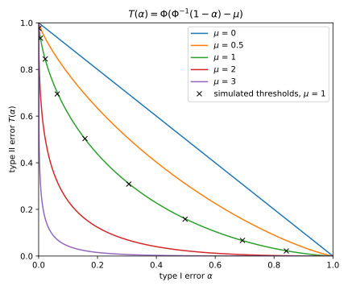
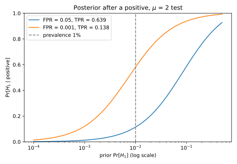
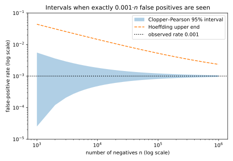

# Hypothesis testing

A spam filter must say "ham" or "spam", a medical test "healthy" or "ill", a monitoring job "calibrated" or "drifted". Each faces the same problem: an observation came from one of two distributions, and you must decide which. This chapter asks what the best decision rule is, how good it can be, how to summarize real rules, and how to measure their error rates from finite data. Later parts need exactly this: how well *any* test can tell two distributions apart.

One idea organizes every answer. Write $p(x)$ for the probability of an observation $x$ under the first distribution and $q(x)$ for its probability under the second. Their ratio $\Lambda(x) = q(x)/p(x)$, the **likelihood ratio**, says how many times more likely $x$ is under the second, and it is the only thing about $x$ that matters. The best rule compares this ratio with a cut-off. The best rules at all cut-offs trace a curve fixed by the two distributions alone, and every summary of a rule is read off that curve.

Two running examples carry the chapter. In the first, a spam filter counts suspicious words in an email, capped at 3, and @tbl-ht-spam gives the count's distribution $P$ for ham and $Q$ for spam. A count of 3 is four times as likely in spam, a count of 0 a quarter as likely; unlike [Divergences](03-divergences.md), this chapter puts spam on top of the ratio. The second example is a biomarker that is normal with mean 0 and standard deviation 1 in healthy patients, and mean 2 in ill ones.

| $x$ | 0 | 1 | 2 | 3 |
| --- | --- | --- | --- | --- |
| $p(x)$, ham | 0.4 | 0.3 | 0.2 | 0.1 |
| $q(x)$, spam | 0.1 | 0.2 | 0.3 | 0.4 |
| $\Lambda(x) = q(x)/p(x)$ | 0.250 | 0.667 | 1.500 | 4.000 |

: Word-count distributions under ham ($P$) and spam ($Q$), and their likelihood ratio. {#tbl-ht-spam}

## Tests and their two errors {#sec-ht-setup}

Before asking which decision rule is best, you need to say what a rule is and how to score it. Most detection problems reduce to two candidate distributions that are each fully specified, called **simple** hypotheses, unlike a composite one such as "the mean is positive". The default, the **null hypothesis** $H_0$, is that the observation comes from $P$, and the **alternative** $H_1$ is that it comes from $Q$. A rule may also say "spam" on some outcomes only with some probability, by flipping a biased coin, and allowing that turns out to matter.

::: {#def-ht-test name="Test, errors and power"}
Let $P$ and $Q$ be distributions on a set $\mathcal X$ of outcomes, and test $H_0\colon X \sim P$ against $H_1\colon X \sim Q$. A **test** is a function $\phi\colon \mathcal X \to [0, 1]$, where $\phi(x)$ is the probability of rejecting $H_0$ after observing $x$. It is **deterministic** if it takes only the values 0 and 1, and so is the indicator of its **rejection region**. Its **type I error**, or **size**, and its **type II error** are
$$\alpha_\phi = \mathbb E_P[\phi(X)], \qquad \beta_\phi = 1 - \mathbb E_Q[\phi(X)],$$
also called its false positive rate (FPR) and false negative rate (FNR). Its **power**, or true positive rate (TPR), is $1 - \beta_\phi$. A test has **level** $\alpha$ if $\alpha_\phi \le \alpha$.
:::

For a deterministic test the two averages are the masses that $P$ and $Q$ give to the rejection region, because the average of an indicator is the probability of its event ([Concentration inequalities](02-concentration.md)). Since $H_0$ is the default, a false alarm is the error you control first, so you fix the level and then look for the most powerful test within it.

| Rejection region | $\alpha$ | $\beta$ | Power |
| --- | --- | --- | --- |
| none | 0.00 | 1.00 | 0.00 |
| $\{3\}$ | 0.10 | 0.60 | 0.40 |
| $\{2, 3\}$ | 0.30 | 0.30 | 0.70 |
| $\{1, 2, 3\}$ | 0.60 | 0.10 | 0.90 |
| all | 1.00 | 0.00 | 1.00 |
| $\{0\}$ | 0.40 | 0.90 | 0.10 |
| $\{0, 3\}$ | 0.50 | 0.50 | 0.50 |

: Errors of deterministic tests in the spam example. The first five are thresholds on the count; the last two are not. {#tbl-ht-spam-tests}

Down the first five rows of @tbl-ht-spam-tests the region grows, and each added outcome adds its ham mass to $\alpha$ and its spam mass to the power. So you cannot lower both errors at once, only trade one for the other. The yardstick is the coin flip, which ignores the email and rejects with probability $\alpha$, so that it misses with probability $1 - \alpha$. The region $\{0\}$ does worse, because it rejects on the outcome most typical of ham.

::: {#exm-ht-screening}
A screening test flags a patient when the biomarker exceeds $\tau = 1.645$, chosen so that $\alpha = 0.05$ (@fig-ht-errors). Write $\Phi$ for the standard normal cumulative distribution function (CDF), so that $\Phi^{-1}(0.95) = 1.6449$. A healthy patient's biomarker is standard normal, so it exceeds $\tau$ with probability $1 - \Phi(1.645) = 0.05$. An ill patient's biomarker is centred at 2, so it falls below $\tau$ with probability $\beta = \Phi(\tau - 2) = \Phi(-0.355) = 0.361$. So the test catches about two ill patients in three, $1 - \beta = 0.6388$, while sending one healthy patient in 20 for a follow-up. A lower threshold catches more ill patients and alarms more healthy ones, and which of these points are achievable is the subject of @sec-ht-np.
:::

{#fig-ht-errors}

## The Neyman–Pearson lemma {#sec-ht-np}

Since the two errors trade against each other, the question is which test gives the most power for a given false positive budget. Rejecting an outcome $x$ costs $p(x)$ of budget and buys $q(x)$ of power, an exchange rate of $\Lambda(x)$. The best buyer spends on the best rates first, which means rejecting exactly where $\Lambda$ is above some cut-off. The test below writes that as $q(x) > c\,p(x)$, so that outcomes with $p(x) = 0$ count as above every cut-off.

::: {#thm-ht-np name="Neyman–Pearson lemma"}
Let $P$ and $Q$ have densities, or mass functions, $p$ and $q$. For a cut-off $c \ge 0$, a **likelihood ratio (LR) test** rejects where $q$ exceeds $c$ times $p$, keeps $H_0$ where it falls short, and on the tie set rejects with some probability $\gamma(x) \in [0, 1]$:
$$\phi^*(x) = \begin{cases} 1 & \text{if } q(x) > c\,p(x), \\ \gamma(x) & \text{if } q(x) = c\,p(x), \\ 0 & \text{if } q(x) < c\,p(x). \end{cases}$$ {#eq-ht-lr-test}

1. *Optimality.* Every test $\phi$ with $\alpha_\phi \le \alpha_{\phi^*}$ has $\beta_\phi \ge \beta_{\phi^*}$.
2. *Existence.* For every $\alpha \in (0, 1]$ there is an LR test with a constant $\gamma$ and size exactly $\alpha$.

So the most powerful test of level $\alpha$ is the LR test of size $\alpha$.
:::

::: {.proof}
The plan is to prove optimality by comparing $\phi^*$ with any other test outcome by outcome, and existence by lowering the cut-off until the outcomes strictly above it fit in the budget, then randomizing on the ties.

1. *A pointwise inequality.* Weight each outcome by $q(x) - c\,p(x)$, which is positive exactly where $\phi^*$ rejects. Where it is positive $\phi^* = 1 \ge \phi$, where it is negative $\phi^* = 0 \le \phi$, and on the tie set it is 0. So for every $x$, using only that $\phi$ takes values in $[0, 1]$,
$$\big(\phi^*(x) - \phi(x)\big)\big(q(x) - c\,p(x)\big) \ge 0.$$
2. *Sum over the outcomes.* A sum of non-negative terms is non-negative, and summing $\phi q$ and $\phi p$ gives $\mathbb E_Q[\phi]$ and $\mathbb E_P[\phi]$, so
$$\mathbb E_Q[\phi^*] - \mathbb E_Q[\phi] \ge c\big(\mathbb E_P[\phi^*] - \mathbb E_P[\phi]\big).$$
3. *Use the budget.* The other test spends no more and $c \ge 0$, so the right side is non-negative. Then $\phi^*$ has at least the power of $\phi$, which is optimality.
4. *The size of a strict cut-off.* For existence, write $G(t) = \Pr_P[\Lambda(X) > t]$ for the size of the test that rejects strictly above a cut-off $t$. Raising $t$ removes outcomes, so $G$ is non-increasing. As $t'$ falls to $t$ the sets $\{\Lambda > t'\}$ grow to $\{\Lambda > t\}$, and the probability of growing sets tends to that of their union, so $G$ is right-continuous.
5. *Choose the cut-off.* Let $c = \inf\{t \ge 0 : G(t) \le \alpha\}$, the smallest cut-off whose strict region fits in the budget. Right-continuity gives $G(c) \le \alpha$. If $c > 0$, then $G(t) > \alpha$ for every $t < c$, and as $t$ rises to $c$ the sets $\{\Lambda > t\}$ shrink to $\{\Lambda \ge c\}$, so $\Pr_P[\Lambda \ge c] \ge \alpha$; if $c = 0$ this probability is 1.
6. *Randomize on the ties.* The LR test with constant $\gamma$ has size $G(c) + \gamma\Pr_P[\Lambda = c]$, which runs from $G(c) \le \alpha$ at $\gamma = 0$ to $\Pr_P[\Lambda \ge c] \ge \alpha$ at $\gamma = 1$. It is linear in $\gamma$, so some $\gamma \in [0, 1]$ makes it exactly $\alpha$.
:::

The optimal test looks at $x$ only through $\Lambda(x)$, and everything else about $x$ is noise. When $\Lambda$ increases with a simple statistic, such as the word count or the biomarker, the optimal test is a plain threshold on the statistic. A calibrated classifier score is such a statistic, by Bayes' rule (@sec-ht-bayes), which is why thresholding it is right.

How fast does the error fall with more data? For $n$ independent observations the ratio of the sample is the product of the individual ratios, and at a fixed false positive rate the best type II error decays like $e^{-n\,D_{\mathrm{KL}}(P\|Q)}$, with the Kullback–Leibler (KL) divergence of [Divergences](03-divergences.md) as the rate. @sec-apx-tail-cramer-stein derives this Chernoff–Stein lemma.

::: {#exm-ht-np-spam}
Take the spam example at budget $\alpha = 0.25$, a size no threshold has. A cut-off between 1.5 and 4 rejects only the count 3, with size 0.1, which fits. Just below 1.5 the count 2 joins and the size is 0.3, which does not, so $c = 1.5$. The test spends the remaining 0.15 on the tie set $\{2\}$, whose ham mass is 0.2, so it rejects the count 2 with probability $\gamma = 0.75$. Its power is $0.4 + 0.75 \times 0.3 = 0.625$. Randomizing matters only for discrete data like these, since for a continuous score a threshold alone can hit any size.

The chapter's script (@sec-ht-code) also checks the lemma by brute force. Of 200,000 random tests, each $\phi(x)$ uniform on $[0, 1]$, 11,727 have size at most 0.25, and the best of them has power only 0.587 (@fig-ht-discrete-tradeoff).
:::

{#fig-ht-discrete-tradeoff}

## Trade-off functions and ROC curves {#sec-ht-tradeoff}

A single test gives one point $(\alpha, \beta)$. To say how hard it is to tell $P$ from $Q$ you want the best $\beta$ at every $\alpha$ at once. That curve depends only on the pair, and later parts use it to describe how distinguishable two distributions are.

::: {#def-ht-tradeoff name="Trade-off function"}
The **trade-off function** of $P$ and $Q$ gives, at each false positive budget $\alpha$, the smallest type II error of any test within it:
$$T(P, Q)(\alpha) = \inf\{\beta_\phi : \alpha_\phi \le \alpha\}, \qquad \alpha \in [0, 1].$$ {#eq-ht-tradeoff}
Write $T$ for $T(P, Q)$ when the pair is clear. The **receiver operating characteristic (ROC) curve** of the optimal test plots its power against its size, $\alpha \mapsto 1 - T(\alpha)$.
:::

By @thm-ht-np the infimum is attained by the LR test of size $\alpha$, so sweeping the LR cut-off traces $T$. Every trade-off function is non-increasing, convex and continuous, and the proof needs two tools. Convexity comes from mixing two tests, and the first tool says what mixing does to their errors.

::: {#lem-ht-mixing name="Mixing tests mixes their errors"}
Let $\phi_1$ and $\phi_2$ be tests and $\lambda \in [0, 1]$. The test $\phi = \lambda\phi_1 + (1 - \lambda)\phi_2$, which runs $\phi_1$ with probability $\lambda$ and $\phi_2$ otherwise, has errors $\alpha_\phi = \lambda\alpha_{\phi_1} + (1 - \lambda)\alpha_{\phi_2}$ and $\beta_\phi = \lambda\beta_{\phi_1} + (1 - \lambda)\beta_{\phi_2}$.
:::

::: {.proof}
1. On an outcome $x$ the mixed rule rejects with probability $\lambda\phi_1(x) + (1 - \lambda)\phi_2(x)$, which lies in $[0, 1]$, so it is a test.
2. Both errors are averages of $\phi$ by @def-ht-test, and the average of a weighted sum is the weighted sum of the averages.
:::

Continuity at $\alpha = 0$ comes from bounding a test's power, an average under $Q$, by averages under $P$. [Divergences](03-divergences.md) proved this change of measure when both distributions give positive probability to the same outcomes. Here $Q$ may also put mass where $P$ has none, which needs a term of its own.

::: {#lem-ht-change-of-measure name="Change of measure"}
For every function $g \ge 0$ on the outcomes,
$$\mathbb E_Q[g(X)] = \mathbb E_P[g(X)\Lambda(X)] + \mathbb E_Q\big[g(X)\mathbf 1[p(X) = 0]\big].$$
In particular, the likelihood ratio has average $\mathbb E_P[\Lambda(X)] = 1 - \Pr_Q[p(X) = 0]$, which is at most 1.
:::

::: {.proof}
1. Split the sum (or integral) $\sum_xg(x)q(x)$ into the outcomes with $p(x) > 0$ and those with $p(x) = 0$. The second part is the second term.
2. Where $p(x) > 0$ the ratio's definition gives $q(x) = \Lambda(x)p(x)$, so the first part is $\mathbb E_P[g\Lambda]$.
3. With $g = 1$ the left side is 1 and the second term is $\Pr_Q[p = 0]$.
:::

::: {#thm-ht-tradeoff name="Properties of trade-off functions"}
Every trade-off function $T$ is non-increasing, satisfies $T(\alpha) \le 1 - \alpha$, is convex, and is continuous on $[0, 1]$. Its value at 0 is $T(0) = 1 - \Pr_Q[p(X) = 0]$.
:::

::: {.proof}
The first two properties come from the definition, convexity from mixing, and continuity from convexity inside the interval and from separate arguments at the ends.

1. *Non-increasing.* A larger budget allows every test a smaller one does, so the infimum is no larger.
2. *At most $1 - \alpha$.* The coin flip $\phi \equiv \alpha$ is within budget and misses with probability $1 - \alpha$.
3. *Convex.* Fix budgets $\alpha_1, \alpha_2$ and a weight $\lambda$. By @thm-ht-np (and step 5 for a zero budget) some tests $\phi_i$ have $\alpha_{\phi_i} \le \alpha_i$ and $\beta_{\phi_i} = T(\alpha_i)$. By @lem-ht-mixing their mixture has size at most $\lambda\alpha_1 + (1 - \lambda)\alpha_2$ and type II error $\lambda T(\alpha_1) + (1 - \lambda)T(\alpha_2)$, so the curve at the mixed budget is at most the mixed value.
4. *Continuous inside and at 1.* A convex function is continuous at every interior point of its interval, because its chords pin it between two lines (Rockafellar, *Convex Analysis*, §10). At 1, the test $\phi \equiv 1$ gives $T(1) = 0$, and step 2 squeezes $T(\alpha)$ between 0 and $1 - \alpha$.
5. *The value at 0.* A test of size 0 must vanish wherever $p > 0$, apart from outcomes that $P$ gives probability 0. So the best one rejects exactly where $p = 0$, and it misses the rest of $Q$'s mass, $1 - \Pr_Q[p = 0]$.
6. *A bound on the power.* A convex function can jump up at an end of its interval, so take a test with $\alpha_\phi \le \alpha$ and a cut-off $K > 0$. By @lem-ht-change-of-measure the power is $\mathbb E_P[\phi\Lambda]$ plus at most $\Pr_Q[p = 0]$. Where $\Lambda \le K$ the term $\phi\Lambda$ averages to at most $K\alpha$, and where $\Lambda > K$ it is at most $\Lambda$ because $\phi \le 1$, so
$$1 - \beta_\phi \le \Pr_Q[p = 0] + K\alpha + \mathbb E_P\big[\Lambda\,\mathbf 1[\Lambda > K]\big].$$
7. *Let the budget shrink.* The bound holds for every test within budget, so with step 5 it gives $T(\alpha) \ge T(0) - K\alpha - \mathbb E_P[\Lambda\,\mathbf 1[\Lambda > K]]$. The average of $\Lambda$ is finite by @lem-ht-change-of-measure, so its part from $\Lambda > K$ vanishes as $K$ grows. Choosing $K$ large, then $\alpha$ small, and using $T(\alpha) \le T(0)$ from step 1, $T(\alpha)$ tends to $T(0)$.
:::

Conversely, every function with these four properties is the trade-off function of some pair (@sec-apx-comp-canonical derives it). A pair is **harder to distinguish** than another if its curve is higher everywhere. The hardest curve is $1 - \alpha$, for $P = Q$, and the easiest is $T \equiv 0$, for distributions that never produce the same outcome. The curve starts below 1 when $Q$ has mass where $P$ has none, and swapping $P$ and $Q$ reflects it across the line $\beta = \alpha$, because the test $1 - \phi$ for the swapped pair has the errors of $\phi$ in the other order.

The curves of the next sections differ in how fast they fall, and one rule explains their shapes. The slope of the curve is minus the exchange rate of @sec-ht-np, the likelihood ratio of the outcomes the test is currently adding.

::: {#prp-ht-slope name="The slope of the curve is the likelihood ratio"}
If $P$ and $Q$ are discrete, $T$ is piecewise linear, and the segment on which the LR test adds the outcome $x$ has slope $-\Lambda(x)$. If they have continuous positive densities and $\Lambda$ increases with the observation, the slope at the point whose LR test is $\mathbf 1[x > \tau]$ is $T'(\alpha) = -\Lambda(\tau)$.
:::

::: {.proof}
1. *Discrete case.* Between two consecutive deterministic LR tests, the LR test rejects the next outcome $x$ with a probability $\gamma$ that rises from 0 to 1. That adds $\gamma p(x)$ to $\alpha$ and removes $\gamma q(x)$ from $\beta$, a straight segment of slope $-q(x)/p(x)$.
2. *Continuous case.* Moving the threshold from $\tau$ to $\tau + \mathrm d\tau$ lowers $\alpha = \Pr_P[X > \tau]$ by $p(\tau)\,\mathrm d\tau$ and raises $\beta = \Pr_Q[X \le \tau]$ by $q(\tau)\,\mathrm d\tau$, so $\mathrm d\beta/\mathrm d\alpha = -q(\tau)/p(\tau)$.
:::

::: {#exm-ht-tradeoff-spam}
In the spam example $T$ is the broken line through the error pairs of the thresholds in @tbl-ht-spam-tests (@fig-ht-discrete-tradeoff). Its first segment adds the count 3: $\beta$ falls by 0.4 while $\alpha$ rises by 0.1, a slope of $-4$, the ratio of that count. The next segments have slopes $-1.5$, $-0.667$ and $-0.25$, as @prp-ht-slope predicts.
:::

## The Gaussian trade-off curve {#sec-ht-gaussian}

The most common pair in practice is a shift of a normal: a score, a biomarker or a sample mean that is normal under both hypotheses, with the same spread and different centres. Its curve has a closed form, which later parts use as the reference curve for normal noise. The best test turns out to be a threshold on $x$. At budget $\alpha$ it sits where $P$ has upper tail $\alpha$, and the miss rate is the chance that $Q$, centred $\mu$ higher, falls below it.

::: {#thm-ht-gaussian name="Gaussian trade-off curve"}
Let $P = \mathcal N(0, 1)$ and $Q = \mathcal N(\mu, 1)$ with $\mu \ge 0$. Then
$$T(P, Q)(\alpha) = \Phi\big(\Phi^{-1}(1 - \alpha) - \mu\big).$$ {#eq-ht-gaussian-tradeoff}
More generally, $\mathcal N(m_0, \sigma^2)$ against $\mathcal N(m_1, \sigma^2)$ has this curve with $\mu = |m_1 - m_0|/\sigma$.
:::

::: {.proof}
The plan is to compute the likelihood ratio, see that the LR tests are thresholds, read both errors off normal tails, and then reduce the general pair to this one.

1. *The likelihood ratio.* With the standard normal density $\varphi(x) = e^{-x^2/2}/\sqrt{2\pi}$, the density of $Q$ is $\varphi(x - \mu)$. The constants cancel, and $x^2 - (x - \mu)^2 = 2\mu x - \mu^2$, so
$$\Lambda(x) = \exp\Big(\mu x - \frac{\mu^2}2\Big).$$
2. *The LR tests are thresholds.* For $\mu > 0$ the ratio is strictly increasing in $x$, so it exceeds a cut-off exactly when $x$ exceeds some $\tau$. A tie happens only at that one point, which has probability 0, so by @thm-ht-np the tests $\mathbf 1[x > \tau]$ are optimal. At $\mu = 0$ the curve is the diagonal, as the formula says.
3. *The size fixes the threshold.* The size is $\Pr_P[X > \tau] = 1 - \Phi(\tau)$, and setting it to $\alpha$ gives $\tau = \Phi^{-1}(1 - \alpha)$.
4. *The type II error.* Under $Q$ the variable $X - \mu$ is standard normal, so the test misses with probability $\Pr_Q[X \le \tau] = \Phi(\tau - \mu)$. Substituting step 3 gives @eq-ht-gaussian-tradeoff.
5. *The general pair.* Standardizing by $x \mapsto (x - m_0)/\sigma$ relabels the outcomes one to one, so every test keeps its errors, and the shift becomes $(m_1 - m_0)/\sigma$. A negative shift reverses the threshold and gives the same curve.
:::

The curve depends on the pair only through $\mu$, the distance between the means in standard deviations (@fig-ht-gaussian-tradeoff). Averaging repeated readings increases that distance, and the next result says by how much.

::: {#cor-ht-averaging name="Averaging $n$ observations"}
For $n$ independent draws from $\mathcal N(0, \sigma^2)$ against $n$ independent draws from $\mathcal N(h, \sigma^2)$, the trade-off function is @eq-ht-gaussian-tradeoff with
$$\mu = \frac{h\sqrt n}{\sigma}.$$
:::

::: {.proof}
1. Step 1 of the proof of @thm-ht-gaussian, with the spread put back, gives each draw the log-ratio $(hx_i - h^2/2)/\sigma^2$. Log-ratios of independent draws add, so the sample's log-ratio depends on the data only through the sample mean $\bar x$, and the LR tests are thresholds on $\bar x$.
2. The sample mean is $\mathcal N(0, \sigma^2/n)$ against $\mathcal N(h, \sigma^2/n)$, a shift of $h$ in units of $\sigma/\sqrt n$, and @thm-ht-gaussian applies.
:::

So distinguishability grows like $\sqrt n$. Near $\alpha = 0$ the curve is vertical, because by @prp-ht-slope its slope is $-\Lambda(\tau)$, which grows without bound as the threshold moves out. Swapping $P$ and $Q$ gives a shift pair at the same distance $\mu$, so the curve is also its own reflection across the line $\beta = \alpha$.

::: {#exm-ht-drift}
A monitoring job averages $n = 100$ readings from a sensor with noise $\sigma$ and must detect a drift of $h = 0.2\sigma$ in the mean. By @cor-ht-averaging the shift is $\mu = 0.2 \times 10 = 2$, the biomarker's, and @tbl-ht-gaussian evaluates the curve there and at $\mu = 1$. At $\alpha = 0.05$ the threshold is $\Phi^{-1}(0.95) = 1.6449$, and $\beta = \Phi(-0.3551) = 0.3612$, so the job catches the drift with probability 0.6388. A simulation with 1,000,000 draws per hypothesis gives $\hat\alpha = 0.0503$ and $\hat\beta = 0.3617$. If false alarms must be rare, the power at $\alpha = 10^{-3}$ drops to 0.1378.

| $\mu$ | $\alpha$ | Threshold $\Phi^{-1}(1 - \alpha)$ | $\beta = T(\alpha)$ | Power |
| --- | --- | --- | --- | --- |
| 1 | 0.05 | 1.6449 | 0.7405 | 0.2595 |
| 1 | $10^{-3}$ | 3.0902 | 0.9817 | 0.0183 |
| 2 | 0.05 | 1.6449 | 0.3612 | 0.6388 |
| 2 | $10^{-3}$ | 3.0902 | 0.8622 | 0.1378 |

: The Gaussian trade-off curve at two shifts and two levels. {#tbl-ht-gaussian}

Turned around, the curve says how many readings a target needs. Power 0.9 at $\alpha = 0.01$ needs
$$\mu \ge \Phi^{-1}(0.99) - \Phi^{-1}(0.1) = 2.3263 + 1.2816,$$
and for a drift of $h = 0.25\sigma$, $\mu = 0.25\sqrt n$ reaches this at 209 readings.
:::

{#fig-ht-gaussian-tradeoff}

## The Laplace trade-off curve {#sec-ht-laplace}

Does the shape of the noise change the curve? Replacing the normal by a Laplace distribution shows that it does, at the ends. The Laplace distribution $\mathrm{Lap}(m, b)$ with centre $m$ and scale $b$ has density $\frac1{2b}e^{-|x - m|/b}$. Moving the centre by $m_1$ changes the distance $|x - m|$ by at most $m_1$, so the likelihood ratio stays between $e^{-m_1/b}$ and $e^{m_1/b}$ ([Probability distributions](01-distributions.md)). It equals these bounds on whole tails, so by the slope rule of @prp-ht-slope the two ends of the curve are straight lines.

::: {#thm-ht-laplace name="Laplace trade-off curve"}
Let $P = \mathrm{Lap}(0, b)$ and $Q = \mathrm{Lap}(m_1, b)$ with $m_1 > 0$, and write $\kappa = m_1/b$ for the shift in units of the scale. Then
$$T(P, Q)(\alpha) = \begin{cases} 1 - e^{\kappa}\alpha, & \alpha < \tfrac12 e^{-\kappa}, \\[2pt] \dfrac{e^{-\kappa}}{4\alpha}, & \tfrac12 e^{-\kappa} \le \alpha \le \tfrac12, \\[6pt] e^{-\kappa}(1 - \alpha), & \alpha > \tfrac12. \end{cases}$$ {#eq-ht-laplace-tradeoff}
:::

::: {.proof}
The plan is the one used for the normal, with three cases for where the threshold falls: above the alternative's centre, between the centres, or below the null's centre.

1. *Rescale.* Dividing $x$ by $b$ changes no test's errors, so take $b = 1$ and $m_1 = \kappa$. Integrating $\frac12e^{-|x|}$ gives the CDF $F(x) = \frac12e^x$ for $x < 0$ and $1 - \frac12e^{-x}$ for $x \ge 0$.
2. *The likelihood ratio.* The constants cancel, so $\ln\Lambda(x) = |x| - |x - \kappa|$, which removing the absolute values turns into
$$\ln\Lambda(x) = \begin{cases} -\kappa, & x \le 0, \\ 2x - \kappa, & 0 < x < \kappa, \\ \kappa, & x \ge \kappa. \end{cases}$$
It is non-decreasing and clipped to $[-\kappa, \kappa]$ (@fig-ht-laplace-tradeoff, left).
3. *Thresholds are LR tests.* Because $\Lambda$ is non-decreasing, $\{x > \tau\}$ holds every point whose ratio exceeds $\Lambda(\tau)$ plus part of the tie set. Rejecting part of a tie set is an allowed $\gamma(x)$ in @eq-ht-lr-test, so every threshold is optimal, and its errors $\alpha = 1 - F(\tau)$ and $\beta = F(\tau - \kappa)$ trace $T$.
4. *Threshold at or above $\kappa$.* Both $\tau$ and $\tau - \kappa$ are non-negative, so $\alpha = \frac12e^{-\tau} \le \frac12e^{-\kappa}$ and $\beta = 1 - \frac12e^{-(\tau - \kappa)} = 1 - e^\kappa\alpha$.
5. *Threshold between 0 and $\kappa$.* Now $\alpha = \frac12e^{-\tau}$ lies in $(\frac12e^{-\kappa}, \frac12]$ and $\beta = \frac12e^{\tau - \kappa}$. Substituting $e^\tau = 1/(2\alpha)$ gives $\beta = e^{-\kappa}/(4\alpha)$.
6. *Threshold below 0.* Now $\alpha = 1 - \frac12e^\tau$ exceeds $\frac12$, so $\frac12e^\tau = 1 - \alpha$ and $\beta = \frac12e^{\tau - \kappa} = e^{-\kappa}(1 - \alpha)$.
:::

The upper bound $e^\kappa$ on the ratio limits every test, not only thresholds. Here $p > 0$ everywhere, so by @lem-ht-change-of-measure any test's power is $\mathbb E_P[\phi\Lambda] \le e^\kappa\alpha$, and the first piece shows that the best test reaches this bound.

To compare the shapes fairly, match the pairs by their best advantage, the largest gap $\mathrm{TPR} - \mathrm{FPR}$ of any test, which @sec-ht-tv shows is their total variation. That is 0.3935 for the Laplace pair at $\kappa = 1$, and solving $2\Phi(\mu/2) - 1 = 0.3935$ (@cor-ht-tv-pairs) gives the matching Gaussian pair, $\mu = 1.0301$. The two curves nearly coincide in the bulk but not at small $\alpha$ (@tbl-ht-laplace-vs-gaussian). At $\alpha = 10^{-6}$ the Gaussian test is 36.2 times more powerful, because its unbounded ratio lets a test find rare observations that are overwhelmingly more likely under $Q$ (@fig-ht-laplace-tradeoff).

| $\alpha$ | Laplace power, $\kappa = 1$ | Gaussian power, $\mu = 1.0301$ |
| --- | --- | --- |
| $10^{-3}$ | $2.718\times10^{-3}$ | $1.969\times10^{-2}$ |
| $10^{-6}$ | $2.718\times10^{-6}$ | $9.829\times10^{-5}$ |

: Best power at small false positive rates for two pairs with the same total variation. {#tbl-ht-laplace-vs-gaussian}

{#fig-ht-laplace-tradeoff}

::: {#exm-ht-residuals}
A regression model with absolute-error loss has residuals that are roughly Laplace with scale $b$, and a batch of inputs may carry an offset of $m_1 = b$, so $\kappa = 1$. The first breakpoint of @eq-ht-laplace-tradeoff is $\frac12e^{-1} = 0.1839$, so at $\alpha = 0.05$ the first piece gives $\beta = 1 - e \times 0.05 = 0.8641$, while at $\alpha = 0.25$ the middle piece gives $\beta = e^{-1} = 0.3679$ and at $\alpha = 0.75$ the last gives 0.0920. A simulation of the threshold test at $\alpha = 0.25$, with 1,000,000 draws per hypothesis, gives $\hat\alpha = 0.2498$ and $\hat\beta = 0.3685$.
:::

## Best advantage equals total variation {#sec-ht-tv}

Sometimes you want one number for how distinguishable $P$ and $Q$ are. A natural one is the **advantage** of a test, $1 - \alpha_\phi - \beta_\phi = \mathrm{TPR} - \mathrm{FPR}$, how much more often it fires under $Q$ than under $P$, which is 0 for the coin flip. The advantage adds up $\phi(x)$ times $q(x) - p(x)$ over the outcomes, so the best test fires exactly where $q$ exceeds $p$. Its advantage is the total excess of $q$ over $p$, the total variation (TV) distance of [Divergences](03-divergences.md).

::: {#thm-ht-tv name="Best advantage equals total variation"}
For any distributions $P$ and $Q$ with mass functions $p$ and $q$,
$$\max_\phi\,(1 - \alpha_\phi - \beta_\phi) = \mathrm{TV}(P, Q) = \sup_A\,\big(\Pr_Q[A] - \Pr_P[A]\big) = \frac12\sum_x\lvert q(x) - p(x)\rvert,$$ {#eq-ht-tv}
with an integral for densities. The LR test with cut-off $c = 1$, which rejects where $q > p$, attains the maximum.
:::

::: {.proof}
1. *Advantage as one sum.* By @def-ht-test the advantage is $\mathbb E_Q[\phi] - \mathbb E_P[\phi] = \sum_x\phi(x)\big(q(x) - p(x)\big)$.
2. *Maximize term by term.* Each $\phi(x)$ appears in one term, so the maximum takes $\phi(x) = 1$ where $q(x) > p(x)$ and 0 where $q(x) < p(x)$. It equals $\Pr_Q[A^*] - \Pr_P[A^*]$ for $A^* = \{q > p\}$, a deterministic test, so it is also the supremum over events.
3. *Half the absolute difference.* Both tables sum to 1, so the positive and negative parts of $q - p$ have equal totals, and each is half of $\sum_x\lvert q - p\rvert$.
:::

On the curve, the advantage at level $\alpha$ is the gap $1 - \alpha - T(\alpha)$ between the diagonal and the curve. For a continuous pair it peaks where the slope of $T$ is $-1$, which by @prp-ht-slope is where the ratio at the threshold is 1 (@fig-ht-tv-advantage). The next result evaluates the peak for the two shift pairs.

::: {#cor-ht-tv-pairs name="Total variation of the two shift pairs"}
For $\mathcal N(0, 1)$ against $\mathcal N(\mu, 1)$, $\mathrm{TV} = 2\Phi(\mu/2) - 1$, reached at $\alpha = 1 - \Phi(\mu/2)$. For $\mathrm{Lap}(0, b)$ against $\mathrm{Lap}(m_1, b)$ with $\kappa = m_1/b$, $\mathrm{TV} = 1 - e^{-\kappa/2}$, reached at $\alpha = \frac12e^{-\kappa/2}$.
:::

::: {.proof}
1. *Gaussian.* By step 1 of the proof of @thm-ht-gaussian, $q > p$ exactly when $x > \mu/2$, halfway between the means. That test has $\alpha = \beta = 1 - \Phi(\mu/2)$, so its advantage is $2\Phi(\mu/2) - 1$.
2. *Laplace, the ends.* On the first piece of @eq-ht-laplace-tradeoff the gap is $(e^\kappa - 1)\alpha$, which grows, and on the last it is $(1 - \alpha)(1 - e^{-\kappa})$, which shrinks, so the peak is on the middle piece.
3. *Laplace, the middle.* There the gap is $1 - \alpha - e^{-\kappa}/(4\alpha)$, whose derivative vanishes at $\alpha = \frac12e^{-\kappa/2}$. At that point $e^{-\kappa}/(4\alpha) = \frac12e^{-\kappa/2}$ too, so the gap is $1 - e^{-\kappa/2}$.
:::

TV measures one point of the curve and says nothing about its ends, as @tbl-ht-laplace-vs-gaussian showed, so if false alarms must be very rare, the whole curve is the right summary.

::: {#exm-ht-tv}
In the spam example half the sum of the differences $\lvert q - p\rvert$ in @tbl-ht-spam is $\mathrm{TV} = 0.40$, and rejecting the counts where spam is more likely, $\{2, 3\}$, has advantage $1 - 0.3 - 0.3 = 0.4$ (@tbl-ht-spam-tests). For the Gaussian pair at $\mu = 1$, @cor-ht-tv-pairs gives 0.3829 at $\alpha = 0.3085$, and so does a grid search over 100,001 values of $\alpha$. For the Laplace pair at $\kappa = 1$ both give 0.3935 at $\alpha = 0.3033$.
:::

{#fig-ht-tv-advantage}

## The area under the ROC curve {#sec-ht-auc}

Real detectors are compared on held-out data by their ROC curves, usually summarized by the area under the curve (AUC). Yet a spam filter, say, cares only about the corner of very low false positive rates. This section says what the AUC measures: the probability that the detector scores a random positive above a random negative. It then shows that two detectors with the same AUC can differ tenfold in that corner.

::: {#prp-ht-auc name="The AUC is a ranking probability"}
Let a detector's score be $S_-$ on negatives and $S_+$ on positives, independent and continuous. The test "positive when the score exceeds $\tau$" has $\mathrm{FPR}(\tau) = \Pr[S_- > \tau]$ and $\mathrm{TPR}(\tau) = \Pr[S_+ > \tau]$, and the area under the curve they trace is
$$\mathrm{AUC} = \int_0^1\mathrm{TPR}\;\mathrm d(\mathrm{FPR}) = \Pr[S_+ > S_-].$$
In the **binormal model**, $S_- \sim \mathcal N(0, 1)$ and $S_+ \sim \mathcal N(m, \sigma^2)$, the AUC is $\Phi\big(m/\sqrt{1 + \sigma^2}\big)$ and
$$\mathrm{TPR}(\mathrm{FPR}) = 1 - \Phi\Big(\frac{\Phi^{-1}(1 - \mathrm{FPR}) - m}{\sigma}\Big).$$
:::

::: {.proof}
The plan is to parametrize the curve by the threshold, read the area as an average over a negative's score, and then evaluate both formulas for normal scores.

1. *Parametrize by the threshold.* As $\tau$ goes from $+\infty$ to $-\infty$ the FPR goes from 0 to 1. With $p_-$ the density of $S_-$, $\mathrm{FPR}(\tau) = \int_\tau^\infty p_-(s)\,\mathrm ds$, so $\mathrm d\,\mathrm{FPR}(\tau) = -p_-(\tau)\,\mathrm d\tau$.
2. *Change variables.* Substituting, and flipping the limits to absorb the minus sign,
$$\mathrm{AUC} = \int_{-\infty}^{\infty}\Pr[S_+ > \tau]\,p_-(\tau)\,\mathrm d\tau.$$
3. *Read it as an average.* A positive beats a negative with score $\tau$ with probability $\Pr[S_+ > \tau]$, and the integral averages this over the negatives' scores, which gives $\Pr[S_+ > S_-]$.
4. *Binormal AUC.* The difference of independent normals is normal, with the means subtracted and the variances added, so $S_+ - S_- \sim \mathcal N(m, 1 + \sigma^2)$, which is positive with probability $\Phi(m/\sqrt{1 + \sigma^2})$.
5. *Binormal ROC.* As in step 3 of the proof of @thm-ht-gaussian, the threshold is $\tau = \Phi^{-1}(1 - \mathrm{FPR})$, and a positive exceeds it when $(S_+ - m)/\sigma$ exceeds $(\tau - m)/\sigma$.
:::

::: {#exm-ht-auc}
Detector A has positives that score $\mathcal N(1, 1)$, so $\mathrm{AUC} = \Phi(1/\sqrt2) = 0.7602$. Detector B has positives that score $\mathcal N(m, 2^2)$, more spread out, with $m/\sqrt5 = 1/\sqrt2$, so that $m = 1.5811$ gives the same AUC. @tbl-ht-auc compares them. At FPR $10^{-3}$ the threshold is 3.0902, so A's TPR is $1 - \Phi(3.0902 - 1) = 0.0183$, while B's is $1 - \Phi(0.7546) = 0.2253$, which is $0.2253/0.0183 = 12.3$ times more. On log axes the gap is obvious (@fig-ht-auc-low-fpr).

| Detector | AUC (formula / simulated) | TPR at FPR $= 0.1$ | TPR at FPR $= 10^{-3}$ |
| --- | --- | --- | --- |
| A, $\mathcal N(1, 1)$ | 0.7602 / 0.7605 | 0.3891 | 0.0183 |
| B, $\mathcal N(1.5811, 2^2)$ | 0.7602 / 0.7601 | 0.5595 | 0.2253 |

: Two binormal detectors with equal AUC. The simulated AUC counts correctly ranked pairs among 1,000,000. {#tbl-ht-auc}

:::

{#fig-ht-auc-low-fpr}

The AUC hides this because it weights all FPRs equally, and FPRs up to $10^{-3}$ are a tenth of a percent of the axis. A few of B's spread-out positives score far above every negative, and a strict threshold catches exactly those. So report the TPR at a fixed low FPR chosen by the application, and plot ROC curves on log–log axes. An extreme case is a detector with AUC 0.525 that catches 5% of positives at FPR $10^{-3}$.

A's threshold is optimal, but B's is not: with unequal variances its log likelihood ratio is quadratic in the score, so the optimal test of @thm-ht-np also flags very *low* scores.

## The Bayesian view {#sec-ht-bayes}

Neyman–Pearson uses no prior, but often you know a base rate, such as 1% of patients being ill. Then you ask how likely $H_1$ is after the observation, and which rule makes the fewest mistakes. The likelihood ratio answers both, and shows why a low false positive rate matters most when positives are rare. In odds form Bayes' rule is one multiplication, and the best rule says $H_1$ when the posterior odds exceed 1.

::: {#thm-ht-bayes name="Posterior odds and the Bayes-optimal test"}
Let $H_1$ have prior probability $\pi \in (0, 1)$. The odds of $H_1$ after seeing $x$ are the odds before seeing it, multiplied by the likelihood ratio of $x$:
$$\underbrace{\frac{\Pr[H_1 \mid x]}{\Pr[H_0 \mid x]}}_{\text{posterior odds}} = \underbrace{\frac{\pi}{1 - \pi}}_{\text{prior odds}} \times \underbrace{\frac{q(x)}{p(x)}}_{\Lambda(x)}.$$ {#eq-ht-posterior-odds}
The test that minimizes the probability of error, $(1 - \pi)\alpha_\phi + \pi\beta_\phi$, is the LR test with cut-off $c = (1 - \pi)/\pi$.
:::

::: {.proof}
1. *Bayes' rule.* The probability of $H_1$ and $x$ together is $\pi q(x)$, and that of $H_0$ and $x$ is $(1 - \pi)p(x)$. Each posterior is one of these divided by the total probability of $x$, which cancels in their ratio and leaves @eq-ht-posterior-odds.
2. *The error of a test.* A test errs when $H_0$ holds and it rejects, or when $H_1$ holds and it misses. Writing both errors as sums by @def-ht-test,
$$(1 - \pi)\alpha_\phi + \pi\beta_\phi = \pi + \sum_x\phi(x)\big((1 - \pi)p(x) - \pi q(x)\big).$$
3. *Minimize term by term.* Each $\phi(x)$ appears in one term, so the minimum sets $\phi(x) = 1$ where the bracket is negative, that is where $\Lambda(x) > (1 - \pi)/\pi$, and 0 where it is positive.
:::

With equal priors the error is $\frac12(\alpha_\phi + \beta_\phi)$, one half minus half the advantage, so its smallest value is $\frac12(1 - \mathrm{TV})$ by @thm-ht-tv, which is 0.3085 for the Gaussian pair at $\mu = 1$. The theorem also applies to coarser evidence: if all you know is that a test fired, the likelihood ratio of that evidence is $(1 - \beta)/\alpha$, the power over the false positive rate.

::: {#exm-ht-prevalence}
Use the biomarker test with $\mu = 2$ from @tbl-ht-gaussian in a population where 1% are ill, so the prior odds are $1/99$. To get the probability of illness after a positive result, multiply the prior odds by the likelihood ratio of a positive, then turn the odds $o$ into a probability $o/(1 + o)$.

At $\alpha = 0.05$ the power is 0.6388, so a positive has likelihood ratio $0.6388/0.05 = 12.8$. The posterior odds are $12.8/99 = 0.129$, so the probability of illness is 0.114, and nine positives in ten are false alarms. At $\alpha = 10^{-3}$ the likelihood ratio is $0.1378/0.001 = 137.8$, and the probability of illness rises to 0.582. The stricter test catches fewer ill patients, but its positives are far more informative (@fig-ht-posterior).

The test with the fewest errors at this prior rejects where $\Lambda(x) > 99$, which for the biomarker means $x > 3.2976$. It has $\alpha = 4.88\times10^{-4}$ and power only 0.0972, because when both errors count equally and the disease is rare, it is cheapest to rarely say "ill".
:::

{#fig-ht-posterior}

## Estimating error rates from finite trials {#sec-ht-estimation}

Everything so far assumed that you know $P$ and $Q$. In practice you measure a detector's rates on test data, for example $k$ false positives among $n$ negatives. If each negative is flagged independently with probability $p$, here a rate rather than a density, then $k$ is a draw from $\mathrm{Bin}(n, p)$ ([Probability distributions](01-distributions.md)), and at low rates its uncertainty is large compared with the rate itself.

An interval for the rate collects the true rates that would make the observed count unsurprising. A rate far above $k/n$ would make a count as small as $k$ very unlikely, so the upper end $u$ is the rate at which seeing $k$ or fewer has probability $\alpha/2$. Likewise the lower end $l$ is the rate at which seeing $k$ or more has probability $\alpha/2$, and the confidence level is $1 - \alpha$.

::: {#thm-ht-clopper-pearson name="Clopper–Pearson interval"}
For $k$ successes in $n$ independent trials and a level $1 - \alpha$, let $l$ and $u$ solve
$$\Pr[\mathrm{Bin}(n, l) \ge k] = \frac\alpha2, \qquad \Pr[\mathrm{Bin}(n, u) \le k] = \frac\alpha2,$$
with $l = 0$ if $k = 0$ and $u = 1$ if $k = n$. Then $\Pr[l \le p \le u] \ge 1 - \alpha$ for every true rate $p$.
:::

::: {.proof}
The interval is random, because it depends on the count, and the claim is about how often it misses the fixed true rate. The plan is to show that it misses above, $p \ge u$, with probability at most $\alpha/2$; the lower end is symmetric. Write $F_p(k) = \Pr[\mathrm{Bin}(n, p) \le k]$ and let $K \sim \mathrm{Bin}(n, p)$ be the observed count.

1. *Monotonicity.* $F_p(k)$ is continuous and strictly decreasing in $p$ for $k < n$: a larger success probability makes small counts less likely (@sec-apx-tail-clopper in the appendices proves it). So for each $k$ there is a single rate $u(k)$ with $F_{u(k)}(k) = \alpha/2$, and $p \ge u(K)$ exactly when $F_p(K) \le \alpha/2$.
2. *A CDF evaluated at its own draw is rarely small.* Let $k^*$ be the largest $k$ with $F_p(k) \le \alpha/2$. Since $F_p$ is increasing in $k$, $F_p(K) \le \alpha/2$ exactly when $K \le k^*$, which has probability $F_p(k^*) \le \alpha/2$ (or 0 if there is no such $k^*$).
3. *Combine the two ends.* The lower end misses with probability at most $\alpha/2$ in the same way, and by the union bound the interval misses with probability at most $\alpha$.
:::

The interval is exact, since it uses the binomial itself, and conservative, since its coverage may exceed $1 - \alpha$. For a zero count, a one-sided upper bound at level 0.95, which puts all of the 0.05 on the upper side, solves $(1 - u)^n = 0.05$. Since $\ln(1 - u) \approx -u$ for small $u$, this gives $u \approx \ln(20)/n \approx 3/n$, the **rule of three**. With 3,000 negatives and no false positive, $u = 9.981\times10^{-4}$, and certifying an FPR below $10^{-3}$ takes 2,995 clean negatives.

The interval's width relative to the rate is set mainly by the expected count $np$, since a binomial count of $k$ fluctuates by about $\sqrt k$. Ten false positives leave the rate uncertain by a factor of two, and a hundred, at $n = 100{,}000$, by about 20%: $[0.00081, 0.00122]$ around $10^{-3}$. So measuring an FPR near $p$ to within 20% takes about $100/p$ negatives. A threshold chosen on the same data is uncertain in the same way, so choose thresholds on one split and measure rates on another.

::: {#exm-ht-measure}
Take the $\mu = 2$ biomarker test at the threshold 3.0902, with true FPR $10^{-3}$ and true TPR 0.1378, and evaluate it on 10,000 negatives and 10,000 positives. @tbl-ht-one-run gives one simulated run. The TPR is pinned down to about $\pm0.007$, but the data are consistent with a true FPR from about half to almost twice the target.

| Quantity | Count | Estimate | 95% Clopper–Pearson interval |
| --- | --- | --- | --- |
| False positives | 10 | 0.0010 | $[0.00048, 0.00184]$ |
| True positives | 1,350 | 0.1350 | $[0.1284, 0.1419]$ |

: One simulated evaluation of the $\mu = 2$ test at its $10^{-3}$ threshold, with 10,000 examples per class. {#tbl-ht-one-run}

Two alternatives do worse. The **Wald** interval, from the normal approximation, gives $[0.00038, 0.00162]$, too narrow and symmetric for a skewed count, and at $k = 0$ it collapses to $[0, 0]$. The interval from Hoeffding's inequality ([Concentration inequalities](02-concentration.md)) has half-width 0.0136, over 13 times the rate itself, because it uses only the range $[0, 1]$ and ignores the tiny variance $p(1 - p)$. Clopper–Pearson is conservative but not loose: over 2,000 simulated evaluations it covered the true rate 97.20% of the time. @fig-ht-rate-ci shows how slowly it tightens as $n$ grows.
:::

{#fig-ht-rate-ci}

## Code {#sec-ht-code}

The script [code/hypothesis_testing.py](../../code/part01-prerequisites/hypothesis_testing.py) computes every number quoted in this chapter and draws every figure. It checks the Neyman–Pearson lemma against random tests, and it checks the closed-form curves and the interval's coverage by simulation. From the repository root:

```bash
uv run python code/part01-prerequisites/hypothesis_testing.py
```

| Experiment | Result |
| --- | --- |
| Spam example, LR test at $\alpha = 0.25$ | Cut-off 1.5, $\gamma = 0.75$, power 0.625 |
| 200,000 random tests on the spam example | 11,727 with size $\le 0.25$; best power 0.587 |
| Gaussian $\mu = 2$, $\alpha = 0.05$ | $\beta = 0.3612$; simulated $\hat\alpha = 0.0503$, $\hat\beta = 0.3617$ |
| Laplace $\kappa = 1$, $\alpha = 0.25$ | $\beta = 0.3679$; simulated $\hat\alpha = 0.2498$, $\hat\beta = 0.3685$ |
| Same TV 0.3935, $\alpha = 10^{-6}$ | Laplace power $2.718\times10^{-6}$; Gaussian $9.829\times10^{-5}$ |
| Equal-AUC detectors A and B | AUC 0.7602; TPR at $10^{-3}$: 0.0183 and 0.2253 |
| Screening at 1% prevalence, $\mu = 2$ | Posterior 0.114 at $\alpha = 0.05$; 0.582 at $\alpha = 10^{-3}$ |
| Clopper–Pearson, $k = 10$, $n = 10{,}000$ | $[0.00048, 0.00184]$; coverage 0.9720 over 2,000 runs |

: Results printed by the script with seed 0. {#tbl-ht-code}

[tests/test_hypothesis_testing.py](../../tests/test_hypothesis_testing.py) checks that the output still matches @tbl-ht-code and every other number in the text.

## Summary {#sec-ht-summary}

| Result | Statement | Use |
| --- | --- | --- |
| @def-ht-test | $\alpha_\phi = \mathbb E_P[\phi]$, $\beta_\phi = 1 - \mathbb E_Q[\phi]$ | Reading any detector's errors; the coin flip is the baseline |
| @thm-ht-np | The LR test of size $\alpha$ is most powerful at level $\alpha$ | To find the best test, threshold $\Lambda$, or a statistic it increases with |
| @def-ht-tradeoff | $T(\alpha) = \inf\{\beta_\phi : \alpha_\phi \le \alpha\}$; ROC curve $1 - T$ | The whole trade-off as one curve; log axes when false alarms must be rare |
| @lem-ht-mixing | Mixing tests mixes their errors | Randomizing fills the gaps between thresholds |
| @lem-ht-change-of-measure | $\mathbb E_Q[g] = \mathbb E_P[g\Lambda] + \mathbb E_Q[g\,\mathbf 1[p = 0]]$ | A ratio at most $e^\kappa$ caps power at $e^\kappa\alpha$ |
| @thm-ht-tradeoff | Non-increasing, $\le 1 - \alpha$, convex, continuous | Exactly the possible trade-offs |
| @prp-ht-slope | Slope of $T$ is $-\Lambda$ at the threshold | Reading a curve's shape off the ratio |
| @thm-ht-gaussian | $\Phi(\Phi^{-1}(1 - \alpha) - \mu)$ | Reference curve for normal noise |
| @cor-ht-averaging | $\mu = h\sqrt n/\sigma$ | Half the shift needs four times the data |
| @thm-ht-laplace | Straight ends of slopes $-e^{\pm\kappa}$, $\kappa = m_1/b$ | Power at most $e^\kappa\alpha$ at small $\alpha$ |
| @thm-ht-tv | Best advantage $= \mathrm{TV}(P, Q)$ | One point of the curve; silent about the ends |
| @cor-ht-tv-pairs | Gaussian $2\Phi(\mu/2) - 1$; Laplace $1 - e^{-\kappa/2}$ | Matching pairs by distinguishability |
| @prp-ht-auc | $\mathrm{AUC} = \Pr[S_+ > S_-]$ | Also report the TPR at a fixed low FPR |
| @thm-ht-bayes | Posterior odds $=$ prior odds $\times\,\Lambda$ | Whether an alarm is worth acting on at a base rate |
| @thm-ht-clopper-pearson | Exact binomial interval; $u \approx 3/n$ at $k = 0$ | Report every measured rate with it; plan $100/p$ trials |

: The results of this chapter, and where each is used. {#tbl-ht-summary}

## References {#sec-ht-references}

- Lehmann & Romano, *Testing Statistical Hypotheses* (3rd ed., 2005), ch. 3: most powerful tests and power functions, the rigorous Neyman–Pearson lemma (§3.2, Theorem 3.2.1) with the converse that every most powerful test is an LR test almost everywhere, and monotone likelihood ratios.
- Casella & Berger, *Statistical Inference* (2nd ed., 2002), §8.3: a gentler proof of the lemma (Theorem 8.3.12) and the Karlin–Rubin theorem for one-sided composite tests.
- Wasserman, *All of Statistics* (2004), ch. 10: a compact tour of tests, power and p-values.
- Cover & Thomas, *Elements of Information Theory* (2nd ed., 2006), §11.7–11.9: Neyman–Pearson from the information-theory side, the Chernoff–Stein lemma and Chernoff information.
- Fawcett, "An introduction to ROC analysis" (Pattern Recognition Letters, 2006): ROC curves (the trade-off function turned upside down), AUC as a ranking probability, and the convex hull of a classifier's ROC, which is the convexity property proved here.
- Clopper & Pearson, "The use of confidence or fiducial limits illustrated in the case of the binomial" (Biometrika, 1934), and Brown, Cai & DasGupta, "Interval Estimation for a Binomial Proportion" (Statistical Science, 2001): the exact interval, and why the Wald interval fails.
