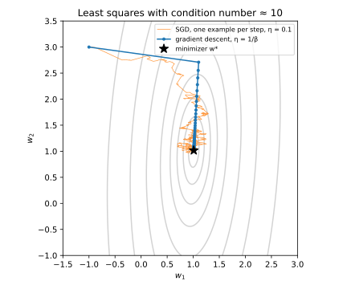
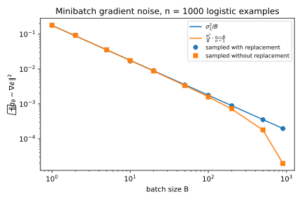
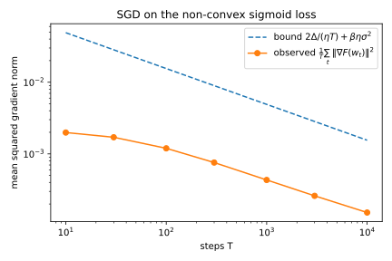
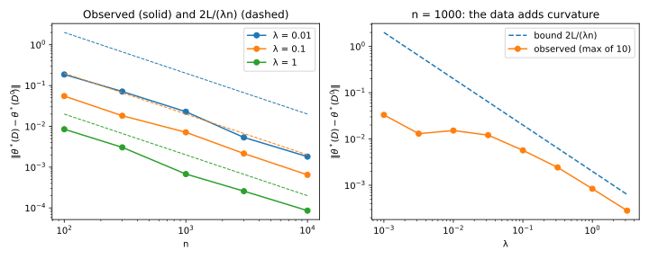

# Optimization

## Why this matters

Training a model means minimizing an average loss over the training set. Two questions come up every time you do it. The first is **how fast the optimizer gets there.** Gradient descent and stochastic gradient descent (SGD) are the workhorses, and you want to know how many steps they need, how to pick the learning rate, and what it costs you that the gradients SGD uses are noisy. The second is **how much the answer depends on any one training record.** If you replace one record and train again, does the minimizer barely move, or can it jump somewhere else entirely? The first question is about the algorithm; the second is about the problem itself, and it is the bridge to the next chapter, where a model that does not depend much on any one record is shown to generalize.

Both questions have the same kind of answer. **A few constants of the loss decide everything.** The first is how steep the loss can be anywhere, which is the largest size of its gradient: the Lipschitz constant $L$. The second is how fast that slope can change as you move, which is a bound on the curvature from above: the smoothness $\beta$. The third is how much the loss curves upward at least, a bound on the curvature from below: the strong convexity $\lambda$. The last one belongs to the optimizer rather than the loss: how far the random gradients SGD uses scatter around the true gradient, their variance $\sigma^2$. Every rate and every bound in this chapter is a combination of these four constants, and once you know which constant each result uses, you can tell when it applies. @tbl-opt-overview lists the results.

| Result | What it controls | Typical use |
| --- | --- | --- |
| Lipschitz, smooth, strongly convex | The constants every later result is stated in | Checking that a loss qualifies; picking learning rates |
| SGD, convex and Lipschitz: $RL/\sqrt T$ | Error of the averaged iterate after $T$ steps | Linear models with logistic or hinge loss |
| SGD, strongly convex: $O(G^2/(\lambda T))$, $G$ the gradient bound | Error with a regularizer | Ridge and regularized logistic regression |
| SGD, smooth non-convex | How fast the gradient norm goes to zero | Neural networks |
| Gradient noise and minibatches | How variance slows SGD and shrinks the best step | Choosing learning rate and batch size |
| Sensitivity of regularized empirical risk minimization (ERM): $2L/(\lambda n)$ | How far the minimizer moves when one record changes | Stability and generalization; per-example influence |

: The results of this chapter and where they are used. {#tbl-opt-overview}

The distributions behind the noise ([Probability distributions](01-distributions.md)) and the way averages concentrate ([Concentration inequalities](02-concentration.md)) are used only lightly here. This chapter is about inequalities that hold for every input, and about expectations; it never needs a tail bound.

**Notation.** The training data are a dataset of $n$ records $D = (z_1, \dots, z_n)$. The model is a parameter vector $\theta \in \mathbb R^d$, and its loss on a record $z$ is $\ell(\theta; z)$. The **empirical risk** is the average loss over the training set, $\mathcal L(\theta; D) = \frac1n\sum_{i=1}^n \ell(\theta; z_i)$; until the last section the dataset is fixed, and this chapter writes it $\mathcal L(\theta)$ for short. A point where it is smallest is a **minimizer** $\theta^*$, and $\mathcal L^* = \mathcal L(\theta^*)$ is the smallest value. $\nabla \mathcal L(\theta)$ is the gradient, the vector of partial derivatives, which points in the direction in which $\mathcal L$ increases fastest. $\langle a, b\rangle = \sum_j a_j b_j$ is the inner product of two vectors, and all norms are Euclidean, $\|a\| = \sqrt{\langle a, a\rangle}$.

## Toolkit: five facts every derivation uses

Every proof in this chapter tracks the distance from the current parameters to the minimizer and asks how one step changes it. The five facts below are the pieces those proofs are built from, each stated and proved once.

### Fact 1 — A convex function lies above its tangents

A function is **convex** when it curves upward everywhere, with no dents. The usual way to say this is that the straight segment (the chord) between any two points on its graph never dips below the graph: for all $\theta, \theta'$ and every mixing weight $s \in [0, 1]$, the value at the mixed point is at most the same mix of the two values, $f(s \theta' + (1-s)\theta) \le s f(\theta') + (1-s)f(\theta)$.

For a differentiable $f$ there is an equivalent picture, and it is the one the proofs use. The tangent at $\theta$ predicts the value at another point $\theta'$ by starting from $f(\theta)$ and adding the slope times the displacement, $\langle\nabla f(\theta), \theta' - \theta\rangle$. Convexity says this linear prediction never overshoots: the graph lies above every one of its tangents,
$$f(\theta') \ge f(\theta) + \langle\nabla f(\theta), \theta' - \theta\rangle \quad\text{for all } \theta, \theta'.$$ {#eq-first-order}

To see why the chord condition gives this, write the mixed point as $\theta + s(\theta' - \theta)$, a step of size $s$ from $\theta$ towards $\theta'$. Subtract $f(\theta)$ from both sides of the chord condition and divide by $s > 0$: $\frac{f(\theta + s(\theta' - \theta)) - f(\theta)}{s} \le f(\theta') - f(\theta)$. The left side is the average slope over a short step towards $\theta'$, and as $s \to 0$ it becomes the slope in that direction, the directional derivative $\langle\nabla f(\theta), \theta' - \theta\rangle$. That is @eq-first-order. (The other direction, from tangents to chords, is in the references, and @sec-apx-opt-convexity in the appendices derives it step by step.) For a concrete case take $f(\theta) = \theta^2$ at $\theta = 1$. The slope there is 2, so the tangent is $1 + 2(\theta' - 1)$. At $\theta' = 3$ the tangent predicts 5, and the function is 9, above it.

Here is why this matters. The fact turns a gradient, which you can compute, into a lower bound on how much higher the function is somewhere else. Every convex convergence proof uses it with $\theta'$ set to the minimizer $\theta^*$ and the inequality rearranged: $\langle\nabla f(\theta), \theta - \theta^*\rangle \ge f(\theta) - f(\theta^*)$. In words, the gradient at $\theta$ points away from the minimizer, and its component along the direction from $\theta^*$ to $\theta$ is at least the current error $f(\theta) - f(\theta^*)$. So a step against the gradient makes progress towards $\theta^*$ in proportion to how far from optimal you are.

### Fact 2 — Expanding a square, and Cauchy–Schwarz

The squared length of a sum of two vectors is the two squared lengths plus a cross term, exactly as $(a + b)^2 = a^2 + 2ab + b^2$ for numbers. And the cross term can never be larger than the product of the lengths, because the inner product is the product of the lengths times the cosine of the angle between the vectors, and a cosine is at most 1 in size (the **Cauchy–Schwarz inequality**):
$$\|a + b\|^2 = \|a\|^2 + 2\langle a, b\rangle + \|b\|^2, \qquad |\langle a, b\rangle| \le \|a\|\,\|b\|.$$

The first identity is what makes the SGD proofs work. One step moves $\theta$ to $\theta - \eta g$, where $g$ is the gradient used and $\eta$ the **learning rate**, also called the step size. The new squared distance to the minimizer, $\|\theta - \eta g - \theta^*\|^2$, splits by the identity (with $a = \theta - \theta^*$ and $b = -\eta g$) into the old squared distance, a cross term with the gradient that measures progress, and a step-length term $\eta^2\|g\|^2$ that measures overshoot. That split is the whole SGD proof.

### Fact 3 — Projection onto a convex set never increases distances to its points

Sometimes the parameters are kept inside a set $\mathcal W$, such as a ball, and any step that leaves it is pulled back to the closest point of the set. This **projection** is $\Pi(u) = \arg\min_{p \in \mathcal W}\|u - p\|$, the point $p$ of $\mathcal W$ nearest to $u$. The fact is that pulling back can only bring you closer to every point of the set, so it never undoes progress towards a minimizer that lies in the set. This needs $\mathcal W$ to be closed (so that a nearest point exists) and convex (so that the segment between two of its points stays inside). For every $\theta \in \mathcal W$,
$$\|\Pi(u) - \theta\| \le \|u - \theta\|.$$

The picture behind the proof: if $u$ is outside the set and $p$ is its nearest point, then any point $\theta$ of the set lies "behind" $p$ as seen from $u$, at an angle of at least $90°$ at $p$. Pythagoras then makes $u$ farther from $\theta$ than $p$ is. To make this precise, let $p = \Pi(u)$ and $\theta \in \mathcal W$. Points of the segment from $p$ to $\theta$ have the form $p + s(\theta - p)$ with $s \in [0, 1]$, and they are all in $\mathcal W$ because it is convex. Their squared distance to $u$ is $h(s) = \|u - p - s(\theta - p)\|^2$. Since $p$ is the closest point of the whole set, $h$ is smallest at $s = 0$, so it cannot start decreasing as $s$ grows from 0: $h'(0) = -2\langle u - p, \theta - p\rangle \ge 0$, which says $\langle u - p, p - \theta\rangle \ge 0$. That is the obtuse angle. Now expand $u - \theta = (u - p) + (p - \theta)$ with Fact 2: $\|u - \theta\|^2 = \|u - p\|^2 + \|p - \theta\|^2 + 2\langle u - p, p - \theta\rangle$. The cross term is non-negative and so is $\|u - p\|^2$, so $\|u - \theta\|^2 \ge \|p - \theta\|^2$.

For the ball $\{\|\theta\| \le R\}$ the projection is simple: $\Pi(u) = u\min(1, R/\|u\|)$, which leaves $u$ alone if it is inside and shrinks it back to the sphere of radius $R$ if it left. Projected SGD uses this to keep its iterates in a bounded set, and Fact 3 says this costs nothing in the analysis, as long as the minimizer $\theta^*$ is in $\mathcal W$.

### Fact 4 — Jensen: averaging inside a convex function helps

The chord condition of Fact 1 says that the value at a mix of two points is at most the mix of the values. Applying it repeatedly extends it to a mix of any number of points, which is **Jensen's inequality**: for a convex $f$ and weights $\alpha_t \ge 0$ that add up to 1,
$$f\Big(\sum_t\alpha_t \theta_t\Big) \le \sum_t\alpha_t f(\theta_t).$$
(Mix the first two points, then mix the result with the third, and so on.)

The proofs need it for the following reason. They can only bound the *average* error over the run, $\frac1T\sum_t (\mathcal L(\theta_t) - \mathcal L^*)$, which is not the error of any model you could hand to someone. Jensen with equal weights $1/T$ turns it into a bound for one model, the **averaged iterate** $\bar \theta_T = \frac1T\sum_t \theta_t$: its error is at most the average error.

### Fact 5 — Unbiased gradients: the cross term averages out, the square does not

SGD does not use the true gradient $\nabla \mathcal L(\theta_t)$, which needs a pass over the whole training set. It uses a cheap random estimate $g_t$, for example the gradient of one record picked at random. The estimate is **unbiased**: averaged over the random pick, it equals the true gradient, $\mathbb E[g_t \mid \text{past}] = \nabla \mathcal L(\theta_t)$. Here "past" means all the random choices made before step $t$. Those choices determine $\theta_t$, so once you condition on them $\theta_t$ is a fixed vector and only the new pick at step $t$ is random. Two consequences follow, and they explain the title of this fact.

First, an inner product of $g_t$ with any vector $v_t$ fixed by the past (such as $\theta_t - \theta^*$) behaves as if $g_t$ were the true gradient: $\mathbb E\langle g_t, v_t\rangle = \mathbb E\langle\nabla \mathcal L(\theta_t), v_t\rangle$. The reason is that an inner product with a fixed vector is linear, so the conditional expectation passes inside it, $\mathbb E[\langle g_t, v_t\rangle \mid \text{past}] = \langle\mathbb E[g_t \mid \text{past}], v_t\rangle = \langle\nabla \mathcal L(\theta_t), v_t\rangle$; then average over the past.

Second, the squared length of $g_t$ does not average to the squared length of the true gradient. It is larger, by the **variance**, the mean squared error of the estimate. This is the **bias–variance split**:
$$\mathbb E[\|g_t\|^2 \mid \text{past}] = \|\nabla \mathcal L(\theta_t)\|^2 + \mathbb E[\|g_t - \nabla \mathcal L(\theta_t)\|^2 \mid \text{past}].$$
To prove it, write $g_t$ as the true gradient plus an error, $\nabla \mathcal L + (g_t - \nabla \mathcal L)$, and expand the square with Fact 2. The cross term is $2\langle\nabla \mathcal L(\theta_t), g_t - \nabla \mathcal L(\theta_t)\rangle$. The first vector is fixed by the past, and the error has conditional mean zero, so by the first consequence the cross term averages to zero. The two squares remain.

A concrete case makes both consequences visible. Take three one-dimensional records $z = (1, 2, 6)$ and the loss $\ell(\theta; z) = \frac12(\theta - z)^2$. The risk is $\mathcal L(\theta) = \frac13\sum_i\frac12(\theta - z_i)^2$, whose gradient is the average of the $\theta - z_i$, that is $\nabla \mathcal L(\theta) = \theta - 3$, since the mean of the data is 3. At $\theta = 4$, SGD picks one record uniformly at random and uses its gradient $\theta - z_i$. @tbl-opt-toy lists the three equally likely outcomes.

| Example picked | $z_1 = 1$ | $z_2 = 2$ | $z_3 = 6$ | Average |
| --- | --- | --- | --- | --- |
| $g = \theta - z_i$ | 3 | 2 | −2 | 1 |
| $g^2$ | 9 | 4 | 4 | 17/3 |
| $(g - \nabla \mathcal L)^2$ | 4 | 1 | 9 | 14/3 |

: SGD gradients for $\mathcal L(\theta) = \frac13\sum_i\frac12(\theta - z_i)^2$ at $\theta = 4$, where $\nabla \mathcal L(4) = 1$. {#tbl-opt-toy}

The gradient is right on average: $(3 + 2 - 2)/3 = 1 = \nabla \mathcal L(4)$. Its second moment is $(9 + 4 + 4)/3 = 17/3$, and it splits as $17/3 = 1^2 + 14/3$, the squared true gradient plus the variance $(4 + 1 + 9)/3 = 14/3$. Averaging removed the error from the gradient itself but not from its square. The variance never averages out, and every SGD rate in this chapter pays for it.

## Convexity, Lipschitz continuity and smoothness {#sec-opt-definitions}

### Context

To say anything about an optimizer, you need assumptions on the loss. Four properties are enough for this whole chapter. Two of them bound a derivative from above: Lipschitz continuity bounds the slope, and smoothness bounds the curvature. The other two bound the curvature from below: convexity says it is never negative, and strong convexity says it is at least some $\lambda > 0$. Mixing them up is the most common mistake in reading optimization results, so this section says exactly what each one means, how they are related, and how to check them on two common losses.

### Statement

Each property below is about a function $f : \mathbb R^d \to \mathbb R$.

**Lipschitz.** $f$ is **$L$-Lipschitz** when it can never change faster than $L$ per unit of distance: $|f(\theta) - f(\theta')| \le L\|\theta - \theta'\|$. For differentiable $f$ this is the same as saying the slope is at most $L$ everywhere, $\|\nabla f(\theta)\| \le L$ for all $\theta$.

**Smooth.** $f$ is **$\beta$-smooth** when its *gradient* is $\beta$-Lipschitz, that is, the slope changes by at most $\beta$ per unit of distance: $\|\nabla f(\theta) - \nabla f(\theta')\| \le \beta\|\theta - \theta'\|$. Because the slope cannot change quickly, the tangent at $\theta$ stays a good prediction of $f$ nearby, and its error grows at most like a parabola with curvature $\beta$. This is the **descent lemma**, the upper-bound counterpart of @eq-first-order:
$$f(\theta') \le f(\theta) + \langle\nabla f(\theta), \theta' - \theta\rangle + \frac\beta2\|\theta' - \theta\|^2.$$ {#eq-descent-lemma}

**Convex.** As in Fact 1, $f$ lies above its tangents, @eq-first-order.

**Strongly convex.** $f$ is **$\lambda$-strongly convex** when it lies above each tangent by at least a bowl of curvature $\lambda$: $f(\theta') \ge f(\theta) + \langle\nabla f(\theta), \theta' - \theta\rangle + \frac\lambda2\|\theta' - \theta\|^2$. It is convexity with a margin that grows with distance. An equivalent form compares gradients at two points: going from $\theta'$ to $\theta$, the slope in the direction of travel increases by at least $\lambda$ per unit of distance. Multiplying by the distance, this says the gradient is **strongly monotone**:
$$\langle\nabla f(\theta) - \nabla f(\theta'), \theta - \theta'\rangle \ge \lambda\|\theta - \theta'\|^2.$$ {#eq-strong-monotone}

For a twice-differentiable $f$, all four properties can be read off the Hessian $\nabla^2 f$, the matrix of second derivatives, whose eigenvalues are the curvatures of $f$ along its principal directions. Write $A \succeq B$ when $A - B$ has no negative eigenvalue, so that the curvature of $A$ in every direction is at least that of $B$. Then convex means $\nabla^2 f \succeq 0$ (no direction curves down), $\lambda$-strongly convex means $\nabla^2 f \succeq \lambda I$ (every direction curves up by at least $\lambda$), and $\beta$-smooth means every eigenvalue of $\nabla^2 f$ lies in $[-\beta, \beta]$ (no direction curves by more than $\beta$ either way). Smoothness and strong convexity together sandwich the curvature, $\lambda I \preceq \nabla^2 f \preceq \beta I$. The ratio of the largest to the smallest curvature, $\kappa = \beta/\lambda$, is the **condition number**, and it measures how much more steeply the function rises in its steepest direction than in its flattest one.

### Derivation

Steps 1 to 4 all use one move: to compare $f$ (or $\nabla f$) at two points, walk along the straight segment $\theta_s = \theta + s(\theta' - \theta)$, $s \in [0, 1]$, between them and add up the changes, using the fundamental theorem of calculus.

1. **Bounded gradient implies Lipschitz.** The change in $f$ along the segment is the integral of the slope in the direction of travel, $f(\theta') - f(\theta) = \int_0^1\langle\nabla f(\theta_s), \theta' - \theta\rangle\,\mathrm ds$. By Cauchy–Schwarz (Fact 2) each inner product is at most $\|\nabla f(\theta_s)\|\,\|\theta' - \theta\| \le L\|\theta' - \theta\|$, and integrating over an interval of length 1 gives $f(\theta') - f(\theta) \le L\|\theta' - \theta\|$. Swapping $\theta$ and $\theta'$ bounds the change in the other direction, which gives the absolute value.
2. **Lipschitz implies bounded gradient.** Step a short distance $h$ from $\theta$ in the direction of the gradient, $u = \nabla f(\theta)/\|\nabla f(\theta)\|$. The Lipschitz condition says the change per unit distance is at most $L$: $\frac{f(\theta + hu) - f(\theta)}{h} \le L$. As $h \to 0$ the left side becomes the slope in direction $u$, $\langle\nabla f(\theta), u\rangle = \|\nabla f(\theta)\|$, so $\|\nabla f(\theta)\| \le L$.
3. **Smoothness implies the descent lemma.** The error of the tangent prediction is the integral of how much the slope has changed since the start of the segment: $f(\theta') - f(\theta) - \langle\nabla f(\theta), \theta' - \theta\rangle = \int_0^1\langle\nabla f(\theta_s) - \nabla f(\theta), \theta' - \theta\rangle\,\mathrm ds$. At position $s$ you are a distance $s\|\theta' - \theta\|$ from $\theta$, so smoothness bounds the gradient change by $\beta s\|\theta' - \theta\|$, and Cauchy–Schwarz bounds the integrand by $\beta s\|\theta' - \theta\|^2$. Since $\int_0^1\beta s\,\mathrm ds = \beta/2$, the error is at most $\frac\beta2\|\theta' - \theta\|^2$.
4. **Hessian bound implies smoothness.** The gradient change along the segment is the integral of the Hessian applied to the direction of travel, $\nabla f(\theta') - \nabla f(\theta) = \int_0^1\nabla^2 f(\theta_s)(\theta' - \theta)\,\mathrm ds$. A symmetric matrix with eigenvalues in $[-\beta, \beta]$ stretches no vector by more than a factor $\beta$, so the integrand has length at most $\beta\|\theta' - \theta\|$, and so does the integral.
5. **Strong convexity implies strong monotonicity.** Write the strong convexity inequality twice, once from $\theta$ to $\theta'$ and once from $\theta'$ to $\theta$, and add the two. The function values appear on both sides and cancel, which leaves $0 \ge \langle\nabla f(\theta) - \nabla f(\theta'), \theta' - \theta\rangle + \lambda\|\theta - \theta'\|^2$. Moving the inner product to the left (and flipping $\theta' - \theta$ to $\theta - \theta'$) gives @eq-strong-monotone. The converse, and the Hessian forms of convexity, are proved in Nesterov's *Lectures on Convex Optimization*, §2.1, and step by step in @sec-apx-opt-convexity in the appendices.
6. **Two consequences of strong convexity.** Both are used later in the chapter.

   (a) *A small gradient means you are close to the minimizer.* At the minimizer the gradient is zero, $\nabla f(\theta^*) = 0$. Put $\theta' = \theta^*$ in @eq-strong-monotone, so that the left side is $\langle\nabla f(\theta), \theta - \theta^*\rangle$, and bound it with Cauchy–Schwarz: $\lambda\|\theta - \theta^*\|^2 \le \|\nabla f(\theta)\|\,\|\theta - \theta^*\|$. Dividing by $\lambda\|\theta - \theta^*\|$ gives $\|\theta - \theta^*\| \le \|\nabla f(\theta)\|/\lambda$. In particular a second point with zero gradient would be at distance 0 from $\theta^*$, so the minimizer is unique.

   (b) *Adding $\frac\lambda2\|\theta\|^2$ to a convex function makes it $\lambda$-strongly convex.* The term $\frac\lambda2\|\theta\|^2$ meets its own strong convexity inequality with equality, because by Fact 2 (with $a = \theta$, $b = \theta' - \theta$) $\frac\lambda2\|\theta'\|^2 = \frac\lambda2\|\theta\|^2 + \lambda\langle \theta, \theta' - \theta\rangle + \frac\lambda2\|\theta' - \theta\|^2$, and $\lambda \theta$ is its gradient. Adding this equality to the tangent inequality @eq-first-order of the convex function gives the strong convexity inequality for the sum.

### Interpretation: Lipschitz is not smooth

The two conditions bound different derivatives, so neither implies the other, and two one-dimensional functions show it (@fig-opt-lipschitz-smooth). The absolute value $f(\theta) = |\theta|$ is 1-Lipschitz, because its slope is always $-1$ or $+1$. But it is not smooth for any $\beta$, because the slope jumps from $-1$ to $1$ at 0, an infinite rate of change. The parabola $f(\theta) = \theta^2/2$ is the opposite. Its slope is $\theta$, which changes at rate 1, so it is 1-smooth. But it is not Lipschitz on all of $\mathbb R$, because its slope grows without bound as $|\theta|$ grows.

The parabola is a special case of something general: **a strongly convex function is never Lipschitz on all of $\mathbb R^d$.** Consequence (a) rearranged says $\|\nabla f(\theta)\| \ge \lambda\|\theta - \theta^*\|$, so the slope grows at least linearly with the distance from the minimizer. That is why every strongly convex result below works on a bounded set $\mathcal W$, where the slope stays bounded, and projects onto it.

The two constants also do different jobs. $L$ bounds how large one step's gradient can be. That governs SGD on losses that are not smooth, and, at the end of this chapter, how far one record can move the minimizer. $\beta$ bounds how far you can trust the linear approximation of the tangent. That governs the largest safe learning rate, $1/\beta$, and the analysis of non-convex losses.

{#fig-opt-lipschitz-smooth}

### Example: logistic regression is 1-Lipschitz and 1/4-smooth

Logistic regression is the loss that has both properties, and checking them shows how the constants are found in practice: compute the gradient and bound its size, then compute the Hessian and bound its eigenvalues. Take a label $y \in \{-1, +1\}$, features $x$ with $\|x\| \le 1$, and the **margin** $m = y\langle \theta, x\rangle$, which is positive when the model classifies the record correctly and large when it does so confidently. The logistic loss is $\ell(\theta) = \ln(1 + e^{-m})$: close to 0 for a large positive margin, and growing linearly for a large negative one. Write $\sigma(s) = 1/(1 + e^{-s})$ for the logistic (sigmoid) function, which rises from 0 to 1.

1. **Gradient.** Differentiate in $m$ first: $\frac{\mathrm d}{\mathrm dm}\ln(1 + e^{-m}) = -\frac{e^{-m}}{1 + e^{-m}} = -\sigma(-m)$. The margin's gradient in $\theta$ is $\nabla_\theta m = yx$, so by the chain rule $\nabla\ell(\theta) = -\sigma(-m)\,y\,x$.
2. **Lipschitz.** The gradient's length is $\|\nabla\ell(\theta)\| = \sigma(-m)\|x\| \le 1$, because $\sigma < 1$, $|y| = 1$ and $\|x\| \le 1$. A gradient bounded by 1 means the loss is 1-Lipschitz (step 2 of the derivation).
3. **Hessian.** Differentiate the factor $-\sigma(-m)$ once more in $m$: $\frac{\mathrm d}{\mathrm dm}[-\sigma(-m)] = \sigma'(-m) = \sigma(m)(1 - \sigma(m))$, using that the sigmoid's derivative is $\sigma' = \sigma(1 - \sigma)$ and that this expression is the same at $m$ and $-m$. The chain rule brings in $yx$ twice, so $\nabla^2\ell(\theta) = \sigma(m)(1 - \sigma(m))\,y^2\,xx^\top = \sigma(m)(1 - \sigma(m))\,xx^\top$.
4. **Smooth and convex.** The matrix $xx^\top$ curves only along $x$: it has eigenvalue $\|x\|^2 \le 1$ in that direction and 0 in every direction perpendicular to it. The factor in front is $u(1 - u)$ with $u = \sigma(m) \in [0, 1]$, and $u(1 - u) \le \frac14$, with equality at $u = \frac12$ (a parabola peaking at its middle). So every eigenvalue of the Hessian lies between 0 and $\frac14$, $0 \preceq \nabla^2\ell \preceq \frac14 I$: the loss is convex and $\frac14$-smooth.
5. **Not strongly convex.** The Hessian has rank one, so it has no curvature at all in directions perpendicular to $x$, and even along $x$ its curvature $u(1 - u)$ vanishes as $|m| \to \infty$. No $\lambda > 0$ bounds it from below.

With numbers: for $x = (0.6, 0.8)$ (length 1) and $y = +1$, at $\theta = 0$ the margin is 0, the loss is $\ln 2 = 0.6931$, the gradient norm is $\sigma(0) = 0.5000$ and the curvature is the maximum, $\frac12\cdot\frac12 = 0.2500$. At $\theta = (3, 4)$ the margin is $0.6 \cdot 3 + 0.8 \cdot 4 = 5$, and loss, gradient norm and curvature are all tiny: $0.0067$, $0.0067$ and $0.0066$. Confidently classified records contribute almost no curvature, so the empirical risk $\mathcal L$ is only weakly curved at a good solution, where most records are confidently classified. On the logistic dataset used in the experiments below ($n = 1{,}000$, $d = 5$), the smallest eigenvalue of $\nabla^2 \mathcal L(\theta^*)$ is $0.0233$.

Adding a ridge term gives $\ell + \frac\lambda2\|\theta\|^2$. By consequence (b) it is $\lambda$-strongly convex, and since the ridge term adds $\lambda$ to every eigenvalue of the Hessian it is $(\frac14 + \lambda)$-smooth. But its gradient $\nabla\ell + \lambda \theta$ grows with $\|\theta\|$, so it is no longer Lipschitz on $\mathbb R^d$. On the ball $\|\theta\| \le R$ its gradient is at most $1 + \lambda R$: at most 1 from the loss and at most $\lambda R$ from the ridge term.

### Example: least squares and ridge

For the squared loss $\ell(\theta; (x, y)) = \frac12(\langle \theta, x\rangle - y)^2$, the chain rule gives the gradient $(\langle \theta, x\rangle - y)x$, the prediction error times the features, and differentiating again gives the Hessian $xx^\top$. As in the logistic case, $xx^\top$ has eigenvalues $\|x\|^2$ and 0, so the loss is convex and $\|x\|^2$-smooth. It is not Lipschitz, because the prediction error, and with it the gradient, grows linearly in $\theta$. On the ball $\|\theta\| \le R$ with $|y| \le Y$ and $\|x\| \le 1$, the prediction error is at most $|\langle \theta, x\rangle| + |y| \le R + Y$, so the loss is $(R + Y)$-Lipschitz there.

Stack the $n$ feature vectors as the rows of a matrix $X$ and the labels into a vector $y$. The empirical risk then has the same Hessian everywhere, $H = \frac1n X^\top X$, the average of the $x_ix_i^\top$, called the sample second-moment matrix. It is strongly convex exactly when $H$ is invertible (no direction with zero curvature), with $\lambda = \lambda_{\min}(H)$ and $\beta = \lambda_{\max}(H)$, its smallest and largest eigenvalues. When $d > n$, the $n$ records cannot span all $d$ directions, $H$ is singular, and $\mathcal L$ is flat along the missing directions, so it has a whole affine space of minimizers. **Ridge** regression adds $\frac\lambda2\|\theta\|^2$, which adds $\lambda$ to every curvature. The Hessian becomes $H + \lambda I$, which is $\lambda$-strongly convex for any data. Setting the gradient $\frac1n X^\top(X\theta - y) + \lambda \theta$ to zero and multiplying by $n$ gives $(X^\top X + n\lambda I)\theta = X^\top y$, so the unique minimizer is $\theta^* = (X^\top X + n\lambda I)^{-1}X^\top y$.

### Check yourself

- Is the hinge loss $\max(0, 1 - y\langle \theta, x\rangle)$ with $\|x\| \le 1$ Lipschitz? Smooth? *(It is 1-Lipschitz: where it is not flat its gradient is $-yx$, and in general its subgradients have norm at most $\|x\| \le 1$. It is not smooth: the gradient jumps from $-yx$ to 0 at margin 1.)*
- Why can a $\lambda$-strongly convex, $\beta$-smooth function never have $\lambda > \beta$? *(Both bound the same quantity, the error of the tangent prediction $f(\theta') - f(\theta) - \langle\nabla f(\theta), \theta' - \theta\rangle$. Strong convexity says it is at least $\frac\lambda2\|\theta' - \theta\|^2$ and the descent lemma says it is at most $\frac\beta2\|\theta' - \theta\|^2$, so $\lambda \le \beta$.)*

## Gradient descent and SGD

### Context

Gradient descent (GD) steps against the full gradient of the empirical risk. On a training set of a million records, one step costs a million gradient evaluations. SGD replaces the full gradient with the gradient of one record, or of a small batch, chosen at random. Each step is cheap and right on average, but noisy. This section defines both algorithms and shows, on a quadratic, what a fast rate looks like when there is no noise, so that you can see later what the noise costs.

### Statement

**Gradient descent** takes a step of size $\eta$ against the full gradient: $\theta_{t+1} = \theta_t - \eta\nabla \mathcal L(\theta_t)$.

**Projected SGD** does the same with a random estimate of the gradient, and then pulls the result back into the set $\mathcal W$ with the projection $\Pi_{\mathcal W}$ of Fact 3. At step $t$ it draws an index $i_t$ uniformly from $\{1, \dots, n\}$, takes that record's gradient $g_t = \nabla\ell(\theta_t; z_{i_t})$, and updates
$$\theta_{t+1} = \Pi_{\mathcal W}(\theta_t - \eta_t g_t),$$
where the learning rate $\eta_t$ may change with $t$. With a **minibatch** $\mathcal B_t$ of $B$ indices, $g_t = \frac1B\sum_{i \in \mathcal B_t}\nabla\ell(\theta_t; z_i)$ is the average gradient over the batch. Either way the estimate is unbiased, $\mathbb E[g_t \mid \text{past}] = \nabla \mathcal L(\theta_t)$, because averaging $\nabla\ell(\theta_t; z_i)$ over a uniformly chosen $i$ gives exactly $\frac1n\sum_i\nabla\ell(\theta_t; z_i)$, which is the true gradient (Fact 5).

**GD on a strongly convex quadratic.** Take a quadratic risk $\mathcal L(\theta) = \mathcal L^* + \frac12(\theta - \theta^*)^\top H(\theta - \theta^*)$ whose curvatures (the eigenvalues of $H$) lie between $\lambda$ and $\beta$, $\lambda I \preceq H \preceq \beta I$. The idea is that on a quadratic the gradient is a linear function of the error $\theta - \theta^*$, so each GD step multiplies the error by a fixed matrix. With the step $\eta = 1/\beta$, the error along each principal direction shrinks by the factor $1 - h/\beta$, where $h$ is the curvature in that direction. The steepest direction ($h = \beta$) is fixed in one step, and the flattest one ($h = \lambda$) shrinks slowest, by $1 - \lambda/\beta = 1 - 1/\kappa$ per step. So the distance to the minimizer shrinks at least geometrically:
$$\|\theta_t - \theta^*\| \le \left(1 - \frac1\kappa\right)^t\|\theta_0 - \theta^*\|.$$ {#eq-gd-linear}

### Derivation

1. **One step multiplies the error by a matrix.** The gradient of the quadratic is $\nabla \mathcal L(\theta) = H(\theta - \theta^*)$. Subtract $\theta^*$ from both sides of the GD update: $\theta_{t+1} - \theta^* = (\theta_t - \theta^*) - \eta H(\theta_t - \theta^*) = (I - \eta H)(\theta_t - \theta^*)$.
2. **Find the factor in each direction.** $I - \eta H$ has the same principal directions as $H$. With $\eta = 1/\beta$, a curvature $h$ of $H$ becomes the factor $1 - h/\beta$ of $I - H/\beta$. Since $h \in [\lambda, \beta]$, these factors lie in $[0, 1 - \lambda/\beta] = [0, 1 - 1/\kappa]$.
3. **Bound the shrinkage, then repeat.** Write the error in the orthonormal basis of principal directions. Each coordinate is multiplied by its own factor, all of them between 0 and $1 - 1/\kappa$, so the length of the error shrinks by at least $1 - 1/\kappa$. Applying this at each of the $t$ steps gives @eq-gd-linear.

The quadratic makes the factors exact, but a weaker statement holds for every $\beta$-smooth $\mathcal L$, and the non-convex analysis later in this chapter starts from it: each GD step with $\eta = 1/\beta$ lowers $\mathcal L$ by at least $\|\nabla \mathcal L\|^2/(2\beta)$. The reason is the descent lemma @eq-descent-lemma. It says that around the current point, $\mathcal L$ lies below a parabola: the tangent plus $\frac\beta2\|\theta' - \theta\|^2$. Put in the GD step, $\theta' - \theta = -\nabla \mathcal L(\theta)/\beta$. The tangent term $\langle\nabla \mathcal L, \theta' - \theta\rangle$ becomes $-\frac1\beta\|\nabla \mathcal L\|^2$, the progress, and the parabola term becomes $\frac\beta2\cdot\frac1{\beta^2}\|\nabla \mathcal L\|^2$, the price of overshooting. Together,
$$\mathcal L(\theta_{t+1}) \le \mathcal L(\theta_t) - \frac1\beta\|\nabla \mathcal L(\theta_t)\|^2 + \frac{\beta}{2}\cdot\frac{1}{\beta^2}\|\nabla \mathcal L(\theta_t)\|^2 = \mathcal L(\theta_t) - \frac{1}{2\beta}\|\nabla \mathcal L(\theta_t)\|^2.$$
The overshoot eats half of the progress, and half is left.

### Interpretation

GD on a strongly convex smooth function converges **linearly**: the error shrinks by a constant factor per step. @sec-apx-opt-convexity in the appendices proves this for every such function: the gap $\mathcal L - \mathcal L^*$ shrinks by the factor $1 - 1/\kappa$ per step, and @eq-gd-linear holds as stated whenever $\mathcal L$ is twice differentiable. To see how many steps that takes, use $1 - x \le e^{-x}$: after $t$ steps the factor is at most $e^{-t/\kappa}$, which reaches a target accuracy $\tau$ once $t \ge \kappa\ln(1/\tau)$. So reaching $\tau$ takes about $\kappa\ln(1/\tau)$ steps. Ill-conditioning, a large $\kappa$, is what makes GD slow. The step has to be small enough for the steepest direction, $\eta \le 1/\beta$, or it overshoots there; and with that small step, the flattest direction, with curvature $\lambda$, moves only a fraction $\lambda/\beta$ of the way per step.

SGD cannot do this with a constant step. Near $\theta^*$ the true gradient vanishes, but the per-example gradients do not: in @tbl-opt-toy, even at the minimizer $\theta = 3$ the three records would give gradients $2$, $1$ and $-3$. So the iterates keep jumping around $\theta^*$, at a distance set by $\eta$ and the gradient variance. What makes SGD converge is averaging the iterates, which cancels the jumps, or shrinking $\eta_t$ over time, which shrinks them. Both give slower rates than GD's, and the next sections derive them.

### Example: GD and SGD on a two-dimensional least-squares problem

The script draws 200 records with $x \sim \mathcal N(0, \mathrm{diag}(1, 0.1))$, so that the second feature varies much less than the first, and $y = x_1 + x_2 + $ noise. The empirical Hessian has $\lambda = 0.101$ and $\beta = 0.969$, so $\kappa = 9.58$. Starting at $\theta_0 = (-1, 3)$, @eq-gd-linear predicts that GD with $\eta = 1/\beta$ needs at most 126 steps to shrink $\|\theta - \theta^*\|$ by a factor $10^{6}$. That is the smallest $t$ with $(1 - 1/9.58)^t \le 10^{-6}$: taking logarithms, $t \ge \ln(10^6)/(-\ln(1 - 1/9.58)) = 13.8155/0.11024 = 125.3$, so $t = 126$. GD actually takes 122. The bound is nearly exact because the starting error has a large component along the flat direction, and that component contracts at exactly the worst-case rate $1 - 1/\kappa$.

@fig-opt-gd-sgd-paths shows the two algorithms on such a problem. GD first kills the error along the steep direction, then crawls along the flat valley. SGD with a constant step follows roughly the same route but keeps jittering around $\theta^*$.

{#fig-opt-gd-sgd-paths}

### Check yourself

- Why is $\eta = 2/\beta$ the largest constant step for which GD on a quadratic does not diverge? *(Along the steepest direction the error is multiplied by $1 - \eta\beta$ at each step. It stays bounded only if $|1 - \eta\beta| < 1$, that is $\eta < 2/\beta$; beyond that, each step overshoots by more than it corrects.)*
- In SGD, why does drawing $i_t$ uniformly matter? *(It makes $\mathbb E[g_t \mid \text{past}] = \nabla \mathcal L(\theta_t)$. A biased draw would give each record a different weight, so SGD would minimize a reweighted risk instead.)*

## SGD for convex Lipschitz objectives

### Context

The cleanest guarantee for SGD needs only convexity and bounded gradients, with no smoothness at all, so it covers the hinge loss and the absolute loss as well as the logistic loss. Its proof is the template for every other proof in this chapter, so it is worth following line by line.

### Statement

The guarantee says that SGD's error after $T$ steps comes from two costs that pull the learning rate in opposite directions. The first is the cost of *travel*: you start at distance $R$ from the minimizer, and with small steps it takes a long time to get there, so this cost falls as $\eta$ grows. The second is the cost of *noise*: each step overshoots by an amount that grows with the learning rate and with the size of the random gradients, so this cost rises with $\eta$. The right step balances the two.

The setting is this. $\mathcal L$ is convex, and projected SGD runs inside a closed convex set $\mathcal W$ that contains the minimizer $\theta^*$. It starts at $\theta_1 \in \mathcal W$, at distance $\|\theta_1 - \theta^*\| \le R$ from the minimizer. The random gradients have a bounded second moment, $\mathbb E\|g_t\|^2 \le G^2$, so $G$ is the typical size of a gradient used. Run projected SGD with a constant step $\eta$ for $T$ steps and return the averaged iterate $\bar \theta_T = \frac1T\sum_{t=1}^T \theta_t$. Then
$$\mathbb E[\mathcal L(\bar \theta_T)] - \mathcal L^* \le \frac{R^2}{2\eta T} + \frac{\eta G^2}{2}.$$ {#eq-sgd-convex}
The first term is the travel cost and the second the noise cost. The step $\eta = R/(G\sqrt T)$ minimizes the right side, which then becomes $RG/\sqrt T$. For an $L$-Lipschitz loss with per-example gradients, every gradient has $\|g_t\| \le L$, so $G = L$ and the bound is $RL/\sqrt T$.

### Derivation

The idea is to follow the squared distance to the minimizer, $a_t = \|\theta_t - \theta^*\|^2$. One step changes it by two terms (Fact 2): a cross term that shrinks it, which convexity ties to the current error $\mathcal L(\theta_t) - \mathcal L^*$, and a step-length term that grows it, which is at most $\eta^2 G^2$ on average. Rearranging bounds the error at each step by the decrease in distance plus the noise term, and summing over the steps makes the decreases cancel in a chain.

1. **Projection can only help.** The new point is the projection of $\theta_t - \eta g_t$, and $\theta^*$ is in $\mathcal W$, so by Fact 3 (projection never increases the distance to a point of the set) $a_{t+1} \le \|\theta_t - \eta g_t - \theta^*\|^2$.
2. **Expand the square** (Fact 2, with $a = \theta_t - \theta^*$ and $b = -\eta g_t$): $\|\theta_t - \eta g_t - \theta^*\|^2 = a_t - 2\eta\langle g_t, \theta_t - \theta^*\rangle + \eta^2\|g_t\|^2$.
3. **Rearrange** steps 1 and 2 to isolate the cross term, which is the progress the step makes: $\langle g_t, \theta_t - \theta^*\rangle \le \frac{a_t - a_{t+1}}{2\eta} + \frac\eta2\|g_t\|^2$.
4. **Take expectations.** The vector $\theta_t - \theta^*$ is fixed by the past, so by Fact 5 the inner product with $g_t$ averages to the inner product with the true gradient $\nabla \mathcal L(\theta_t)$. On the right, $\mathbb E\|g_t\|^2 \le G^2$. This gives $\mathbb E\langle\nabla \mathcal L(\theta_t), \theta_t - \theta^*\rangle \le \frac{\mathbb E a_t - \mathbb E a_{t+1}}{2\eta} + \frac{\eta G^2}{2}$.
5. **Convexity turns progress into error.** Fact 1 with $\theta = \theta_t$ and $\theta' = \theta^*$ says the gradient's component towards $\theta_t$ from $\theta^*$ is at least the current error: $\mathcal L(\theta_t) - \mathcal L^* \le \langle\nabla \mathcal L(\theta_t), \theta_t - \theta^*\rangle$. So $\mathbb E[\mathcal L(\theta_t) - \mathcal L^*] \le \frac{\mathbb E a_t - \mathbb E a_{t+1}}{2\eta} + \frac{\eta G^2}{2}$.
6. **Sum over $t = 1, \dots, T$.** The distance terms cancel in a chain (they **telescope**): $(a_1 - a_2) + (a_2 - a_3) + \dots + (a_T - a_{T+1}) = a_1 - a_{T+1}$. Since $a_{T+1} \ge 0$ and $a_1 \le R^2$, the total is at most $R^2$. The noise term is added $T$ times. Hence $\sum_t\mathbb E[\mathcal L(\theta_t) - \mathcal L^*] \le \frac{R^2}{2\eta} + \frac{\eta TG^2}{2}$.
7. **Average and apply Jensen.** Dividing by $T$ bounds the average error over the run, and Fact 4 (Jensen: for convex $\mathcal L$ the error of the averaged iterate is at most the average error, $\mathcal L(\bar \theta_T) \le \frac1T\sum_t \mathcal L(\theta_t)$) passes the bound to $\bar \theta_T$. That is @eq-sgd-convex.
8. **Optimize $\eta$.** The right side $\frac{R^2}{2\eta T} + \frac{\eta G^2}{2}$ has derivative $-\frac{R^2}{2\eta^2T} + \frac{G^2}{2}$ in $\eta$, which vanishes at $\eta = R/(G\sqrt T)$. At that step both terms equal $RG/(2\sqrt T)$, and their sum is $RG/\sqrt T$.

Nothing in the proof needed $\mathcal L$ to be differentiable. For a function with kinks, such as the hinge loss, replace the gradient by a **subgradient**: any vector $g$ whose "tangent" $\mathcal L(\theta) + \langle g, \theta' - \theta\rangle$ stays below the graph everywhere (at the kink of $|\theta|$ at 0, any slope between $-1$ and $1$). Then step 5 holds by the definition of a subgradient, and the rest of the proof is unchanged.

### Interpretation

The two terms of @eq-sgd-convex are a trade-off. $R^2/(2\eta T)$ is the cost of travelling the distance $R$ with steps of size $\eta$, and $\eta G^2/2$ is the cost of the jitter each step adds. A longer run, larger $T$, makes travel cheaper, so it allows smaller steps and less jitter, which is why the best step shrinks like $1/\sqrt T$.

The rate $1/\sqrt T$ cannot be improved for this class of functions. There are convex $L$-Lipschitz functions on which every method that only queries gradients has error at least of order $RL/\sqrt T$ after $T$ queries (Bubeck 2015, §3.5; @sec-apx-opt-lower in the appendices derives the bound $RL/(2(1 + \sqrt{T + 1}))$ for gradient methods that stay in the span of their gradients). Smoothness alone does not help SGD either, because smoothness reduces the overshoot of the true gradient but not the noise term, which comes from the randomness of $g_t$.

The guarantee is for the averaged model, not the last one. The proof bounds the average of $\mathcal L(\theta_t)$ over the run, and Jensen passes that bound only to the average of the $\theta_t$. So average the iterates, and do not just take the last one.

Finally, it is a worst case. Real objectives often have curvature near the optimum, which the bound does not use, and then SGD does much better than the bound, as the example shows.

### Example: logistic regression

The script draws $n = 1{,}000$ records in $d = 5$ with $x$ uniform on the unit sphere and labels from a logistic model. It finds the minimizer with Newton's method ($\|\theta^*\| = 3.152$, $\mathcal L^* = 0.5198$), and runs projected SGD on the ball of radius $R = 5$ from $\theta_1 = 0$. The minimizer is inside the ball, and the start is at distance $3.152 \le R$ from it, so the statement applies. The loss is 1-Lipschitz, $L = 1$, and the step is $\eta = R/(L\sqrt T)$, which is $5/\sqrt{100} = 0.5$ at $T = 100$. @tbl-opt-sgd-convex shows the results averaged over 20 runs.

| Steps $T$ | Step $\eta$ | Observed $\mathcal L(\bar \theta_T) - \mathcal L^*$ | Bound $RL/\sqrt T$ |
| --- | --- | --- | --- |
| 100 | 0.5000 | $4.44\times10^{-2}$ | 0.500 |
| 1,000 | 0.1581 | $6.46\times10^{-3}$ | 0.158 |
| 10,000 | 0.0500 | $7.71\times10^{-4}$ | 0.050 |

: Projected SGD on logistic regression against the convex Lipschitz bound @eq-sgd-convex. {#tbl-opt-sgd-convex}

The bound holds in every row. It is loose by a factor of 11 at $T = 100$ ($0.500/0.0444 = 11.3$) and 65 at $T = 10{,}000$ ($0.050/0.000771 = 64.9$). The gap grows because the observed error falls faster than the bound's $1/\sqrt T$. From $T = 100$ to $T = 10{,}000$, a hundredfold increase, the error falls by $0.0444/0.000771 = 57.6$, much closer to the factor 100 of a $1/T$ rate than to the factor 10 of $1/\sqrt T$. The reason is that this $\mathcal L$ is strongly convex near $\theta^*$ (its smallest curvature there is $0.0233$), which the bound does not know. The next section shows what a bound that uses curvature gives. The left panel of @fig-opt-sgd-convex shows the same comparison over a range of $T$.

{#fig-opt-sgd-convex}

### Check yourself

- Where did the proof use that $\theta^* \in \mathcal W$? *(In step 1: Fact 3 only promises that projection does not increase the distance to points of $\mathcal W$.)*
- If you doubled the radius $R$ used to set $\eta$ but $\theta^*$ stayed put, what would happen to the guarantee? *(The bound doubles, since it is $RL/\sqrt T$; in practice the step is just twice as large.)*

## Strongly convex objectives

### Context

Regularized models are strongly convex, and strong convexity pulls the iterates towards $\theta^*$ at every step: the farther you are, the larger the gradient pointing back. That turns the $1/\sqrt T$ rate into $1/T$, provided you choose the learning rates and the average to match. This section shows two choices that work, and why the plain uniform average loses a factor $\ln T$.

### Statement

The two schedules below differ only in how they weight the run. Both let the step shrink like $1/(\lambda t)$, which is the right size once strong convexity is pulling the iterates in. The first averages all iterates equally; the second gives later, better iterates more weight. Let $\mathcal L$ be $\lambda$-strongly convex on the closed convex set $\mathcal W$, which contains $\theta^*$, and let $\mathbb E\|g_t\|^2 \le G^2$ as before.

With steps $\eta_t = \frac{1}{\lambda t}$ and the uniform average $\bar \theta_T = \frac1T\sum_t \theta_t$, the error after $T$ steps is
$$\mathbb E[\mathcal L(\bar \theta_T)] - \mathcal L^* \le \frac{G^2(1 + \ln T)}{2\lambda T}.$$

With steps $\eta_t = \frac{2}{\lambda(t + 1)}$ and the weighted average $\tilde \theta_T = \sum_t\frac{2t}{T(T+1)}\theta_t$, in which iterate $t$ has weight proportional to $t$, the $\ln T$ disappears:
$$\mathbb E[\mathcal L(\tilde \theta_T)] - \mathcal L^* \le \frac{2G^2}{\lambda(T + 1)}.$$ {#eq-sgd-strong}

### Derivation

The proof is the convex one with a better step 5. Strong convexity adds a term $\frac\lambda2\|\theta_t - \theta^*\|^2$ to the progress each step makes, and with the right steps that term makes the distance terms telescope away without leaving the $R^2$ of the convex case behind.

1. **The per-step inequality.** Steps 1 to 4 of the convex proof hold with a step $\eta_t$ that changes over time: $\mathbb E\langle\nabla \mathcal L(\theta_t), \theta_t - \theta^*\rangle \le \frac{\mathbb E a_t - \mathbb E a_{t+1}}{2\eta_t} + \frac{\eta_t G^2}{2}$, where $a_t = \|\theta_t - \theta^*\|^2$ is again the squared distance to the minimizer.
2. **Strong convexity improves step 5 by a distance term.** The strong convexity inequality at $\theta = \theta_t$, $\theta' = \theta^*$, rearranged, says $\langle\nabla \mathcal L(\theta_t), \theta_t - \theta^*\rangle \ge \mathcal L(\theta_t) - \mathcal L^* + \frac\lambda2\|\theta_t - \theta^*\|^2$. Using this on the left of step 1 and moving the distance term to the right,
$$\mathbb E[\mathcal L(\theta_t) - \mathcal L^*] \le \Big(\frac{1}{2\eta_t} - \frac\lambda2\Big)\mathbb E a_t - \frac{1}{2\eta_t}\mathbb E a_{t+1} + \frac{\eta_t G^2}{2}.$$
3. **Uniform schedule.** With $\eta_t = 1/(\lambda t)$, the coefficients are $\frac{1}{2\eta_t} - \frac\lambda2 = \frac{\lambda t}{2} - \frac\lambda2 = \frac{\lambda(t - 1)}{2}$ and $\frac{1}{2\eta_t} = \frac{\lambda t}{2}$, so the distance terms are $\frac\lambda2[(t - 1)\mathbb E a_t - t\,\mathbb E a_{t+1}]$. Summed over $t$, each $t\,\mathbb E a_{t+1}$ subtracted at step $t$ is added back at step $t + 1$, and the chain telescopes to $\frac\lambda2[0\cdot a_1 - T\,\mathbb E a_{T+1}] \le 0$. The starting distance has disappeared, multiplied by 0. The noise terms are $\frac{\eta_t G^2}{2} = \frac{G^2}{2\lambda t}$, and they sum to $\frac{G^2}{2\lambda}\sum_{t\le T}\frac1t \le \frac{G^2(1 + \ln T)}{2\lambda}$, because the harmonic sum $\sum_{t \le T}1/t$ is 1 plus terms that are each below the area under $1/s$, and $\int_1^T \mathrm ds/s = \ln T$. Divide by $T$ and apply Jensen (Fact 4). The harmonic sum is where the $\ln T$ comes from: the early iterates, taken with huge steps, are bad, and the uniform average gives them full weight.
4. **Weighted schedule.** With $\eta_t = 2/(\lambda(t + 1))$, the coefficients are $\frac{1}{2\eta_t} - \frac\lambda2 = \frac{\lambda(t + 1)}{4} - \frac{\lambda}{2} = \frac{\lambda(t - 1)}{4}$ and $\frac{1}{2\eta_t} = \frac{\lambda(t + 1)}{4}$. Multiply the step-2 inequality by $t$, which is the weight this average gives to iterate $t$. The distance terms become $\frac\lambda4[(t - 1)t\,\mathbb E a_t - t(t + 1)\mathbb E a_{t+1}]$, which telescope in the same way to at most 0. The noise term becomes $t\cdot\frac{\eta_t G^2}{2} = \frac{t}{t + 1}\cdot\frac{G^2}{\lambda} \le \frac{G^2}{\lambda}$, the same for every $t$, so no harmonic sum appears. Summing, $\sum_t t\,\mathbb E[\mathcal L(\theta_t) - \mathcal L^*] \le \frac{TG^2}{\lambda}$. Divide by $\sum_t t = T(T + 1)/2$ and apply Jensen with weights $2t/(T(T+1))$.

Shalev-Shwartz and Ben-David prove the uniform case (*Understanding Machine Learning*, Theorem 14.11). The weighted scheme is from Lacoste-Julien, Schmidt and Bach (2012). Rakhlin, Shamir and Sridharan (2012) get the same $O(G^2/(\lambda T))$ by averaging only the last half of the iterates, which drops the bad early ones in another way.

### Interpretation

The rate is now $1/T$ instead of $1/\sqrt T$, so to halve the error you need twice the steps, not four times. Strong convexity is what buys this, and it costs a $1/\lambda$ in the constant: a weak regularizer gives a fast rate only after many steps.

The constant $G$ depends on the domain. For a regularized loss $\ell + \frac\lambda2\|\theta\|^2$ with $\ell$ $L$-Lipschitz, the gradient is $\nabla\ell + \lambda \theta$, which on the ball $\|\theta\| \le R$ has length at most $L + \lambda R$. As in @sec-opt-definitions, a strongly convex function has no bound on its gradient over all of $\mathbb R^d$, so the bound needs a bounded set, and that is the reason for the projection.

The $1/(\lambda T)$ is not an artefact of the proof. [Exercise 3](../../book-exercises/part01-prerequisites/06-optimization.md#sec-sol-opt-3) gives a one-dimensional noisy quadratic on which SGD's error is exactly $\sigma^2/(2\lambda T)$, where $\sigma^2$ is the gradient variance.

### Example: regularized logistic regression

On the same data with $\lambda = 0.1$, the minimizer has $\|\theta^*\| = 0.839$, inside the ball of radius 5, and the gradient bound is $G = L + \lambda R = 1 + 0.1 \times 5 = 1.5$. After $T = 10{,}000$ steps, averaged over 20 runs, the uniform average has error $9.09\times10^{-5}$ against the bound $1.15\times10^{-2}$, and the weighted average $7.85\times10^{-5}$ against $4.50\times10^{-3}$ from @eq-sgd-strong. Those bounds are the formulas with these numbers: $G^2 = 2.25$, so the uniform bound is $2.25\,(1 + \ln 10^4)/(2 \times 0.1 \times 10^4) = 2.25 \times 10.21/2000$ and the weighted bound is $2 \times 2.25/(0.1 \times 10{,}001)$. The bounds hold but are loose by factors of about 130 and 60 ($0.0115/0.0000909 = 127$ and $0.0045/0.0000785 = 57$). The main reason is that $G = 1.5$ is the worst case over the whole ball, while the actual gradients near $\theta^*$ are much smaller. In the right panel of @fig-opt-sgd-convex, all three iterates (uniform, weighted, and the last one) fall like $1/T$, and the weighted average is slightly ahead.

### Check yourself

- Why do the first steps of the $1/(\lambda t)$ schedule, which can be huge, not wreck the result? *(The projection keeps every iterate in $\mathcal W$, and the telescoping in step 3 cancels their distance terms exactly: the first one is multiplied by $t - 1 = 0$.)*
- What goes wrong if you use $\eta_t = 1/(\lambda t)$ with a $\lambda$ larger than the true strong convexity? *(Step 2 claims more pull towards $\theta^*$ than there is, so the telescoping fails, and the steps shrink too fast: the iterates can stall far from $\theta^*$.)*

## Gradient noise and minibatches

### Context

Every SGD bound so far paid for the second moment $\mathbb E\|g_t\|^2$, which by the bias–variance split of Fact 5 is the squared true gradient plus the variance of the estimate. Variance comes from sampling records, and also from computing gradients in low precision or compressing them to send between machines. In later parts noise is sometimes added to gradients deliberately. This section answers two practical questions: how does the batch size change the variance, and how should the learning rate change when the gradients get noisier?

### Statement

**Minibatch variance.** Averaging $B$ independent random gradients divides their variance by $B$, just as the variance of a sample mean is the variance of one sample divided by the sample size. If the $B$ records are drawn without replacement, the average does a little better still, because no record can be drawn twice and the batch covers more of the dataset. To state this, let $\sigma_1^2 = \frac1n\sum_i\|\nabla\ell(\theta; z_i) - \nabla \mathcal L(\theta)\|^2$ be the variance of a per-example gradient at $\theta$: the average squared distance of the $n$ per-example gradients from their mean. For the average gradient $g_B$ of a batch of $B$ indices drawn uniformly,
$$\mathbb E\|g_B - \nabla \mathcal L(\theta)\|^2 = \begin{cases}\dfrac{\sigma_1^2}{B} & \text{with replacement,}\\[2ex] \dfrac{\sigma_1^2}{B}\cdot\dfrac{n - B}{n - 1} & \text{without replacement.}\end{cases}$$ {#eq-minibatch}
The extra factor $\frac{n - B}{n - 1}$ is 1 for $B = 1$ and 0 for $B = n$, when the batch is the whole dataset and its gradient is exact.

**Noisy SGD.** Suppose each stochastic gradient is perturbed by extra noise $\xi_t$, independent of everything else, with mean zero and mean squared size $\mathbb E\|\xi_t\|^2 = \sigma^2$. Independent noise with mean zero adds its squared size to the second moment without changing anything else, so the convex Lipschitz bound @eq-sgd-convex holds with $G^2 = L^2 + \sigma^2$. Its best step and its value at that step follow as before:
$$\mathbb E[\mathcal L(\bar \theta_T)] - \mathcal L^* \le \frac{R^2}{2\eta T} + \frac{\eta(L^2 + \sigma^2)}{2}, \qquad \eta^* = \frac{R}{\sqrt{(L^2 + \sigma^2)T}}, \qquad \text{bound at }\eta^* = \frac{R\sqrt{L^2 + \sigma^2}}{\sqrt T}.$$

### Derivation

**With replacement.** The $B$ draws are independent, each with mean $\nabla \mathcal L(\theta)$ and variance $\sigma_1^2$. Variances of independent random vectors add, just as for numbers: expanding the squared length of the sum of their deviations gives the squared lengths plus cross terms, and each cross term has mean zero because the draws are independent and each deviation has mean zero. So the sum of the $B$ gradients has variance $B\sigma_1^2$. Dividing the sum by $B$ divides the variance by $B^2$, so the average has variance $B\sigma_1^2/B^2 = \sigma_1^2/B$.

**Without replacement.** Now the draws are not independent, and the cross terms no longer vanish. They turn out to be slightly negative, which is where the gain comes from. Write $u_i = \nabla\ell(\theta; z_i) - \nabla \mathcal L(\theta)$ for the deviation of record $i$'s gradient from the mean, so that the deviations sum to zero, $\sum_i u_i = 0$, and $\frac1n\sum_i\|u_i\|^2 = \sigma_1^2$. Let $I_1, \dots, I_B$ be the indices drawn.

1. **Each single draw behaves as before.** Each draw $I_j$ on its own is still uniform over the $n$ records, so $\mathbb E\|u_{I_j}\|^2 = \sigma_1^2$.
2. **Two different draws are negatively related.** A pair of different draws $I_j \ne I_k$ is a uniformly random pair of distinct indices, so $\mathbb E\langle u_{I_j}, u_{I_k}\rangle = \frac{1}{n(n-1)}\sum_{i \ne i'}\langle u_i, u_{i'}\rangle$, the average over the $n(n - 1)$ ordered pairs. That sum of cross terms is the squared length of the total minus the squares: $\sum_{i \ne i'}\langle u_i, u_{i'}\rangle = \|\sum_i u_i\|^2 - \sum_i\|u_i\|^2 = 0 - n\sigma_1^2$. So the expected cross term is $-n\sigma_1^2/(n(n - 1)) = -\sigma_1^2/(n - 1)$. In words: the deviations sum to zero, so once you have drawn an example that deviates one way, the ones left over deviate, on average, slightly the other way.
3. **Add up.** The squared length of the batch average $\frac1B\sum_j u_{I_j}$ is $\frac{1}{B^2}$ times $B$ squares plus $B(B - 1)$ ordered cross terms. Taking expectations with steps 1 and 2, $\frac{1}{B^2}\big[B\sigma_1^2 - B(B - 1)\frac{\sigma_1^2}{n - 1}\big] = \frac{\sigma_1^2}{B}\big(1 - \frac{B - 1}{n - 1}\big) = \frac{\sigma_1^2}{B}\cdot\frac{n - B}{n - 1}$.

The toy data of @tbl-opt-toy make this concrete. There $\sigma_1^2 = 14/3$, and the deviations $u_i = g - \nabla \mathcal L$ are $3 - 1 = 2$, $2 - 1 = 1$ and $-2 - 1 = -3$, which sum to zero. @tbl-opt-batches lists every batch of $B = 2$ drawn without replacement, with the mean deviation of the batch and its square.

| Batch | $\{1, 2\}$ | $\{1, 3\}$ | $\{2, 3\}$ | Average |
| --- | --- | --- | --- | --- |
| Mean deviation $\bar u$ | 1.5 | −0.5 | −1 | 0 |
| $\bar u^2$ | 2.25 | 0.25 | 1 | 7/6 |

: All batches of size 2 drawn without replacement from the toy data of @tbl-opt-toy. {#tbl-opt-batches}

The variance is the average of the last row, $(2.25 + 0.25 + 1)/3 = 7/6$. The formula gives $\frac{14/3}{2}\cdot\frac{3 - 2}{3 - 1} = \frac76$, matching @tbl-opt-batches. With replacement the variance would be $\frac{14/3}{2} = \frac73$, twice as large.

**Noisy SGD.** The noisy gradient is $\nabla\ell + \xi_t$. Expand its squared length with Fact 2: the cross term $2\langle\nabla\ell, \xi_t\rangle$ has mean zero, because $\xi_t$ is independent of the gradient and has mean zero (the same argument as in Fact 5). So $\mathbb E\|\nabla\ell + \xi_t\|^2 = \mathbb E\|\nabla\ell\|^2 + \mathbb E\|\xi_t\|^2 \le L^2 + \sigma^2$. Substitute $G^2 = L^2 + \sigma^2$ into @eq-sgd-convex and optimize $\eta$ as in step 8 of that derivation, which gives $\eta^* = R/(G\sqrt T)$ and the bound $RG/\sqrt T$.

### Interpretation

A batch of $B$ divides the variance by $B$, and sampling without replacement removes a further fraction $(B - 1)/(n - 1)$ of what is left. That correction only matters once $B$ is a sizeable fraction of $n$, and at $B = n$ the gradient is exact.

Noise shrinks the best step. $\eta^*$ scales like $1/\sqrt{L^2 + \sigma^2}$, so noisier gradients call for smaller steps and longer runs. To see how much longer, set the bound $R\sqrt{L^2 + \sigma^2}/\sqrt T$ equal to a target accuracy $\tau$ and solve for $T$: reaching $\tau$ takes $R^2(L^2 + \sigma^2)/\tau^2$ steps. Noise of size $\sigma = 3L$ makes $L^2 + \sigma^2 = L^2 + 9L^2 = 10L^2$, so it multiplies the number of steps by 10.

Larger batches are not free. A batch of $B$ costs $B$ gradient evaluations and divides the variance by $B$, so per gradient evaluation the variance reduction is exactly cancelled. Batches help mainly because the $B$ evaluations can run in parallel. [Exercise 6](../../book-exercises/part01-prerequisites/06-optimization.md#sec-sol-opt-6) makes this precise for the non-convex bound: beyond a critical batch size, larger batches waste computation.

### Example

**Minibatch variance.** At the logistic minimizer $\theta^*$ of the experiments, $\sigma_1^2 = 0.1722$. The true gradient there is zero, so this is just the mean squared per-example gradient. The script draws 4,000 random batches of each size and measures the variance of their average gradient (@tbl-opt-minibatch).

| Batch size $B$ | With replacement: measured / $\sigma_1^2/B$ | Without replacement: measured / @eq-minibatch |
| --- | --- | --- |
| 1 | $1.75\times10^{-1}$ / $1.72\times10^{-1}$ | $1.75\times10^{-1}$ / $1.72\times10^{-1}$ |
| 10 | $1.74\times10^{-2}$ / $1.72\times10^{-2}$ | $1.68\times10^{-2}$ / $1.71\times10^{-2}$ |
| 100 | $1.73\times10^{-3}$ / $1.72\times10^{-3}$ | $1.57\times10^{-3}$ / $1.55\times10^{-3}$ |
| 500 | $3.47\times10^{-4}$ / $3.44\times10^{-4}$ | $1.74\times10^{-4}$ / $1.72\times10^{-4}$ |

: Measured minibatch gradient variance at $\theta^*$ for the logistic data ($n = 1{,}000$), against @eq-minibatch. {#tbl-opt-minibatch}

The formulas in @tbl-opt-minibatch match the measurements to within the Monte Carlo error. At $B = 500 = n/2$ the correction factor is $\frac{1000 - 500}{999}$, about one half, so sampling without replacement halves the variance. @fig-opt-minibatch-variance shows the full range.

{#fig-opt-minibatch-variance}

**Noise and learning rate.** The script adds Gaussian noise with $\mathbb E\|\xi_t\|^2 = \sigma^2$ to every per-example gradient and runs projected SGD on the logistic problem for $T = 10{,}000$ steps, 10 runs per setting, sweeping $\eta$ over 17 values from $10^{-3}$ to $10$. With $R = 5$ and $L = 1$, the bound's recommended step is $\eta^* = 5/\sqrt{(1 + \sigma^2)\cdot 10^4}$, which is $5/100 = 0.05$ without noise, and the bound there is $5\sqrt{1 + \sigma^2}/100$. @tbl-opt-noise compares that step with the best one on the grid.

| Noise $\sigma$ | $\eta^*$ from the bound | Bound at $\eta^*$ | Observed at $\eta^*$ | Best $\eta$ on the grid | Observed there |
| --- | --- | --- | --- | --- | --- |
| 0 | 0.0500 | 0.050 | $4.99\times10^{-4}$ | 0.178 | $1.85\times10^{-4}$ |
| 1 | 0.0354 | 0.071 | $1.58\times10^{-3}$ | 0.056 | $1.38\times10^{-3}$ |
| 3 | 0.0158 | 0.158 | $9.58\times10^{-3}$ | 0.056 | $5.10\times10^{-3}$ |

: Projected SGD with added gradient noise, $T = 10{,}000$: suboptimality $\mathcal L(\bar \theta_T) - \mathcal L^*$ at the learning rate the bound recommends and at the best learning rate on the grid. {#tbl-opt-noise}

@tbl-opt-noise and @fig-opt-noise-step-size show three things. First, noise costs accuracy: at the bound's step, the error grows about 20-fold from $\sigma = 0$ to $\sigma = 3$ ($9.58\times10^{-3}/4.99\times10^{-4} = 19.2$). Second, noise pushes the best step down, from 0.178 to 0.056 on the grid, and the U-shaped curves in the figure move left. Third, the bound's $\eta^*$ is conservative. It assumes the gradient is as large as $L$ and the distance as large as $R$ throughout, while the actual run has smaller gradients and starts closer, so the best observed step is larger: by a factor of 3.6 without noise ($0.178/0.05 = 3.56$).

{#fig-opt-noise-step-size}

### Check yourself

- You quadruple the batch size. By how much should the variance term in a bound like $\eta\sigma^2$ drop, and what happens to the cost of a step? *(By a factor of 4, slightly more without replacement; each step costs 4 times as many gradient evaluations.)*
- Why does a very small $\eta$ give the same error for every noise level in @fig-opt-noise-step-size? *(The iterates barely leave $\theta_1 = 0$, so the error is just $\mathcal L(0) - \mathcal L^*$, set by the travel term $R^2/(2\eta T)$, not by the noise.)*

## Non-convex objectives: convergence to stationary points

### Context

Neural network losses are not convex. There can be many local minima and saddle points, and no method that only uses gradients can promise to find the global minimum. What you can still guarantee is that SGD finds a point where the gradient is small, an **approximate stationary point**. The argument uses smoothness instead of convexity, and it shows directly how the gradient variance and the learning rate trade off.

### Statement

The idea is that each step lowers $\mathcal L$ in proportion to the squared gradient, by the descent lemma (as for GD in the section on gradient descent), minus a penalty for the noise. $\mathcal L$ cannot fall forever, because it is bounded below, so the total of the squared gradients over the run is bounded, and they must be small on average.

To state it, let $\mathcal L$ be $\beta$-smooth and bounded below by $\mathcal L_{\inf}$, and let $\Gamma = \mathcal L(\theta_1) - \mathcal L_{\inf}$ be the most it can fall from the starting point. Let the stochastic gradients be unbiased, with variance at most $\sigma^2$: $\mathbb E[\|g_t - \nabla \mathcal L(\theta_t)\|^2 \mid \text{past}] \le \sigma^2$. SGD (with no projection) with a constant step $\eta \le 1/\beta$ satisfies
$$\min_{t \le T}\mathbb E\|\nabla \mathcal L(\theta_t)\|^2 \le \frac1T\sum_{t=1}^T\mathbb E\|\nabla \mathcal L(\theta_t)\|^2 \le \frac{2\Gamma}{\eta T} + \beta\eta\sigma^2.$$ {#eq-nonconvex}
As in the convex case, the first term is the travel cost and the second the noise cost. With $\eta = \min\big(1/\beta,\ \sqrt{2\Gamma/(\beta\sigma^2T)}\big)$, the step that balances them unless that would exceed $1/\beta$, the right side is at most $\frac{4\beta\Gamma}{T} + 2\sqrt{\frac{2\beta\Gamma\sigma^2}{T}}$.

### Derivation

1. **Descent lemma for one step.** Apply @eq-descent-lemma with $\theta = \theta_t$ and $\theta' = \theta_{t+1} = \theta_t - \eta g_t$, so that $\theta' - \theta = -\eta g_t$: $\mathcal L(\theta_{t+1}) \le \mathcal L(\theta_t) - \eta\langle\nabla \mathcal L(\theta_t), g_t\rangle + \frac{\beta\eta^2}{2}\|g_t\|^2$.
2. **Average over the random gradient.** By Fact 5, conditioned on the past the inner product averages to $\|\nabla \mathcal L(\theta_t)\|^2$, and the bias–variance split gives $\mathbb E\|g_t\|^2 \le \|\nabla \mathcal L(\theta_t)\|^2 + \sigma^2$. Collecting the two $\|\nabla \mathcal L(\theta_t)\|^2$ terms and averaging over the past,
$\mathbb E \mathcal L(\theta_{t+1}) \le \mathbb E \mathcal L(\theta_t) - \eta\big(1 - \frac{\beta\eta}{2}\big)\mathbb E\|\nabla \mathcal L(\theta_t)\|^2 + \frac{\beta\eta^2\sigma^2}{2}$.
3. **Make sure the step makes progress.** The factor $1 - \beta\eta/2$ must be positive, or the step could increase $\mathcal L$. With $\eta \le 1/\beta$ it is at least $1/2$, so $\frac\eta2\mathbb E\|\nabla \mathcal L(\theta_t)\|^2 \le \mathbb E \mathcal L(\theta_t) - \mathbb E \mathcal L(\theta_{t+1}) + \frac{\beta\eta^2\sigma^2}{2}$.
4. **Sum and telescope.** Summing over $t = 1, \dots, T$, the differences of $\mathcal L$ cancel in a chain to $\mathcal L(\theta_1) - \mathbb E \mathcal L(\theta_{T+1})$, which is at most $\Gamma$ because $\mathcal L$ never goes below $\mathcal L_{\inf}$: $\frac\eta2\sum_{t=1}^T\mathbb E\|\nabla \mathcal L(\theta_t)\|^2 \le \mathcal L(\theta_1) - \mathbb E \mathcal L(\theta_{T+1}) + \frac{T\beta\eta^2\sigma^2}{2} \le \Gamma + \frac{T\beta\eta^2\sigma^2}{2}$.
5. **Divide by $\eta T/2$** to get the average in @eq-nonconvex. The minimum over $t$ is at most the average, which gives the left inequality.
6. **Choose $\eta$.** There are two cases. If $\sqrt{2\Gamma/(\beta\sigma^2T)} \le 1/\beta$, that step makes both terms equal to $\sqrt{2\beta\Gamma\sigma^2/T}$, so their sum is twice that. Otherwise $\eta = 1/\beta$, the first term is $2\beta\Gamma/T$, and the condition $1/\beta < \sqrt{2\Gamma/(\beta\sigma^2T)}$, squared and rearranged, says $\sigma^2 < 2\beta\Gamma/T$, so the second term $\sigma^2$ is below $2\beta\Gamma/T$ too, and the sum is below $4\beta\Gamma/T$. Either way the total is at most $\frac{4\beta\Gamma}{T} + 2\sqrt{\frac{2\beta\Gamma\sigma^2}{T}}$.

This is the argument of Ghadimi and Lan (2013, Theorem 2.1 and Corollary 2.2). They output an iterate chosen uniformly at random from the run, so that its expected squared gradient equals the average in @eq-nonconvex.

### Interpretation

There are two regimes. Without noise ($\sigma = 0$) the second term vanishes, the step is $1/\beta$, and the rate is of order $\beta\Gamma/T$, the deterministic GD rate. With noise the $\sqrt{\sigma^2/T}$ term dominates for large $T$: the squared gradient falls like $1/\sqrt T$, so the gradient norm, its square root, falls only like $T^{-1/4}$.

A small gradient is all you get. A stationary point can be a local minimum, a saddle point, or a flat region far from anything good, and the guarantee says nothing about $\mathcal L(\theta_T) - \mathcal L^*$.

The learning rate again balances travel against noise, $2\Gamma/(\eta T)$ against $\beta\eta\sigma^2$, the same trade-off as in the convex case. With batches of size $B$, replace $\sigma^2$ by $\sigma^2/B$, by @eq-minibatch.

### Example: the sigmoid loss

The **sigmoid loss** $\ell(\theta) = \sigma(-y\langle \theta, x\rangle)$ is a smooth stand-in for the 0–1 loss: with margin $m = y\langle \theta, x\rangle$ it is $\sigma(-m)$, close to 1 for a badly misclassified record and close to 0 for a confidently correct one. Here $\sigma$ is the sigmoid function of the logistic example, not a noise level. The loss is not convex, because $\sigma$ curves up on one side of 0 and down on the other. To apply the statement you need its constants $\beta$, $\Gamma$ and the noise $\sigma^2$, and each is found by bounding a derivative.

With $\|x\| \le 1$ its gradient $-y\,\sigma'(-m)\,x$ has norm at most $\max\sigma' = \frac14$, since $\sigma' = \sigma(1 - \sigma) \le \frac14$. Its Hessian $\sigma''(-m)\,xx^\top$ has eigenvalues of size at most $\max|\sigma''|$, which is therefore the smoothness constant. Differentiating $\sigma' = \sigma(1 - \sigma)$ once more gives $\sigma'' = \sigma(1-\sigma)(1-2\sigma)$. Writing $u = \sigma \in (0, 1)$ and maximizing $u(1 - u)(1 - 2u)$ by setting its derivative to zero gives $u = \frac12 - \frac{\sqrt3}{6}$, where $u(1-u) = \frac16$ and $1 - 2u = \frac{1}{\sqrt3}$. So $\beta = \frac{1}{6\sqrt3} = 0.0962$ (@fig-opt-lipschitz-smooth, right). The loss lies in $(0, 1)$, so $\mathcal L_{\inf} \ge 0$, and starting at $\theta_1 = 0$, where every margin is 0 and $\mathcal L = \sigma(0) = \frac12$, gives $\Gamma \le \frac12$. Finally, the variance is at most the second moment, which is at most the squared largest gradient: $\sigma^2 \le \mathbb E\|g\|^2 \le \frac{1}{16}$.

On the logistic data, $\|\nabla \mathcal L(0)\|^2 = 4.06\times10^{-3}$. SGD runs with the step from the statement. At $T = 100$ that step is $\sqrt{2\Gamma/(\beta\sigma^2T)} = \sqrt{1/(0.0962 \times 0.0625 \times 100)} = 1.289$, well below $1/\beta = 10.4$. @tbl-opt-nonconvex shows the results averaged over 5 runs.

| Steps $T$ | Step $\eta$ | Observed $\frac1T\sum_t\Vert \nabla \mathcal L(\theta_t)\Vert ^2$ | Bound @eq-nonconvex |
| --- | --- | --- | --- |
| 100 | 1.289 | $1.64\times10^{-3}$ | $1.55\times10^{-2}$ |
| 1,000 | 0.408 | $5.22\times10^{-4}$ | $4.90\times10^{-3}$ |
| 10,000 | 0.129 | $1.87\times10^{-4}$ | $1.55\times10^{-3}$ |

: SGD on the non-convex sigmoid loss against the stationarity bound. {#tbl-opt-nonconvex}

The bound in @tbl-opt-nonconvex is loose by a factor of 8 to 10 (from $0.00155/0.000187 = 8.3$ to $0.0155/0.00164 = 9.5$) and has the right slope, $1/\sqrt T$: each tenfold increase in $T$ divides it by $\sqrt{10} = 3.16$. The slack comes from the worst-case constants: $\Gamma$, $\sigma^2$ and $\beta$ are all upper bounds that the actual run does not reach. @fig-opt-nonconvex-sgd shows the comparison over more values of $T$.

{#fig-opt-nonconvex-sgd}

### Check yourself

- Which step of the derivation would fail with $\eta = 3/\beta$? *(Step 3: $1 - \beta\eta/2$ becomes negative, so the descent lemma no longer guarantees progress.)*
- Why can the convex proof bound $\mathcal L(\bar \theta_T) - \mathcal L^*$ while this one cannot? *(It used Fact 1 to turn the inner product $\langle\nabla \mathcal L, \theta_t - \theta^*\rangle$ into a function gap. Without convexity there is no such link.)*

## Sensitivity of regularized ERM

### Context

The previous sections asked how fast an optimizer reaches the minimizer. This one asks how much the minimizer itself depends on the data. Regularized ERM picks the parameters that minimize the average training loss plus a penalty $\frac\lambda2\|\theta\|^2$ on their size, the **regularized empirical risk**:
$$\mathcal L_\lambda(\theta; D) = \frac1n\sum_{i=1}^n\ell(\theta; z_i) + \frac\lambda2\|\theta\|^2,$$
and returns the minimizer $\theta^*(D) = \arg\min_\theta \mathcal L_\lambda(\theta; D)$. Suppose you replace one training record and retrain. How far can the minimizer move? This is a question about the problem, not about the optimizer: it asks how much any single record can influence the exact solution. The answer controls how stable the learned model is, and therefore how well it generalizes ([Algorithmic stability and generalization](07-stability-generalization.md)). The quantity returns in later parts under the name *sensitivity*.

### Statement

Changing one record changes only one of the $n$ terms of the average, so the objective's gradient moves by at most $2L/n$: that record's gradient is removed and another added, each of length at most $L$. Strong convexity with curvature $\lambda$ then converts a small change in the gradient into a small move of the minimizer, at most the gradient change divided by $\lambda$. Formally, let each $\ell(\cdot; z)$ be convex and $L$-Lipschitz, and let the datasets $D$ and $D'$ differ in one record, replaced by another. Then
$$\|\theta^*(D) - \theta^*(D')\| \le \frac{2L}{\lambda n}.$$ {#eq-erm-sensitivity}

### Derivation

Let $D'$ replace $z_i$ by $z'$. Write $\mathcal L_\lambda(\cdot; D)$ and $\mathcal L_\lambda(\cdot; D')$ for the two objectives, and $\theta = \theta^*(D)$ and $\theta' = \theta^*(D')$ for their minimizers.

1. **The two objectives differ by one term.** $\mathcal L_\lambda(\cdot; D') - \mathcal L_\lambda(\cdot; D) = h$ with $h(v) = \frac1n\big(\ell(v; z') - \ell(v; z_i)\big)$: the new record's loss in, the old one's out, each with weight $1/n$. Each loss has gradient of length at most $L$, and the length of a difference is at most the sum of the lengths (the triangle inequality), so $\|\nabla h(v)\| \le \frac{2L}{n}$ for every $v$.
2. **At $\theta'$, the old objective has a small gradient.** Each minimizer has zero gradient for its own objective, $\nabla \mathcal L_\lambda(\theta; D) = 0$ and $\nabla \mathcal L_\lambda(\theta'; D') = 0$. So $\nabla \mathcal L_\lambda(\theta'; D) = \nabla \mathcal L_\lambda(\theta'; D') - \nabla h(\theta') = -\nabla h(\theta')$. The point $\theta'$ is not optimal for $\mathcal L_\lambda(\cdot; D)$, but the gradient of $\mathcal L_\lambda(\cdot; D)$ there has length at most $2L/n$.
3. **Strong convexity of $\mathcal L_\lambda(\cdot; D)$.** $\mathcal L_\lambda(\cdot; D)$ is an average of convex losses plus $\frac\lambda2\|\theta\|^2$, so it is $\lambda$-strongly convex (consequence (b) in @sec-opt-definitions: adding that term to a convex function adds curvature $\lambda$). Strong monotonicity @eq-strong-monotone then gives $\lambda\|\theta' - \theta\|^2 \le \langle\nabla \mathcal L_\lambda(\theta'; D) - \nabla \mathcal L_\lambda(\theta; D), \theta' - \theta\rangle$.
4. **Substitute step 2 and apply Cauchy–Schwarz.** With $\nabla \mathcal L_\lambda(\theta; D) = 0$ and $\nabla \mathcal L_\lambda(\theta'; D) = -\nabla h(\theta')$, $\lambda\|\theta' - \theta\|^2 \le \langle -\nabla h(\theta'), \theta' - \theta\rangle \le \frac{2L}{n}\|\theta' - \theta\|$.
5. **Divide** by $\lambda\|\theta' - \theta\|$ (if it is zero there is nothing to prove), which gives @eq-erm-sensitivity.

In other words, this is consequence (a) of strong convexity, $\|\theta' - \theta\| \le \|\nabla \mathcal L_\lambda(\theta'; D)\|/\lambda$ (a small gradient means you are close to the minimizer), applied to $\mathcal L_\lambda(\cdot; D)$ at the point $\theta'$, where its gradient is at most $2L/n$. With subgradients in place of gradients, the same steps work for non-differentiable losses such as the hinge loss.

**The bound is tight.** A loss with no curvature of its own shows it, because then the regularizer is the only curvature and nothing is lost. Take $d = 1$, labels $z_i \in \{-1, +1\}$, and the linear loss $\ell(\theta; z) = z\theta$, which is convex and 1-Lipschitz. Then $\mathcal L_\lambda(\theta; D) = \bar z \theta + \frac\lambda2 \theta^2$ with $\bar z$ the mean label, and setting the derivative $\bar z + \lambda \theta$ to zero gives $\theta^*(D) = -\bar z/\lambda$. Changing one label from $+1$ to $-1$ changes the sum of the labels by 2, so it lowers $\bar z$ by $2/n$ and moves $\theta^*$ by exactly $2/(\lambda n)$. For $n = 1{,}000$ and $\lambda = 0.1$ that is $2/100 = 0.02$.

### Interpretation

Influence shrinks like $1/n$, because one record among $n$ carries weight $1/n$ in the objective. Regularization buys stability: the curvature $\lambda$ converts a small perturbation of the gradient into a small move of the minimizer, and halving $\lambda$ can double the movement.

The bound also controls the loss. Because $\ell(\cdot; z)$ is $L$-Lipschitz, moving the parameters by at most $\frac{2L}{\lambda n}$ changes the loss on any point $z$ by at most $L\cdot\frac{2L}{\lambda n} = \frac{2L^2}{\lambda n}$. A bound of this kind, on how much replacing one training record can change the loss at any point, is called **uniform stability**, and it is the input to the generalization bound in [Algorithmic stability and generalization](07-stability-generalization.md).

The bound is loose in two places. The proof used only the regularizer's curvature $\lambda$, while real data add curvature of their own. And it used the worst case $2L$ for the gradient difference, while two actual records rarely have gradients pointing in opposite directions at full length. If $\mathcal L_\lambda(\cdot; D)$ is $\lambda'$-strongly convex with $\lambda' > \lambda$, because the data contribute curvature too, the same proof gives $2L/(\lambda' n)$.

### Example: logistic regression

The script draws logistic datasets of size $n$, solves regularized logistic regression exactly with Newton's method, replaces one random record with a fresh draw, solves again, and records the largest movement over 20 replacements. The logistic loss is 1-Lipschitz, so the bound is $2/(\lambda n)$: for example $2/(0.1 \times 1{,}000) = 0.02$. @tbl-opt-erm compares the two.

| $n$ | $\lambda = 0.01$: observed / bound | $\lambda = 0.1$: observed / bound | $\lambda = 1$: observed / bound |
| --- | --- | --- | --- |
| 100 | $2.52\times10^{-1}$ / 2.00 | $5.98\times10^{-2}$ / 0.200 | $8.55\times10^{-3}$ / 0.0200 |
| 1,000 | $2.13\times10^{-2}$ / 0.200 | $6.66\times10^{-3}$ / 0.0200 | $8.54\times10^{-4}$ / 0.00200 |
| 10,000 | $2.06\times10^{-3}$ / 0.0200 | $6.35\times10^{-4}$ / 0.00200 | $7.80\times10^{-5}$ / 0.000200 |

: Largest movement of the regularized logistic minimizer over 20 single-record replacements, against $2L/(\lambda n)$ with $L = 1$. {#tbl-opt-erm}

Read @tbl-opt-erm in both directions. Down a column, $n$ grows tenfold and the movement shrinks tenfold, exactly as $1/n$ predicts. Across a row, the ratio of observed to bound changes with $\lambda$: it is 0.39–0.43 at $\lambda = 1$ (for example $8.55\times10^{-3}/0.0200 = 0.43$), 0.30–0.33 at $\lambda = 0.1$ and 0.10–0.13 at $\lambda = 0.01$. The reason is the first source of slack above. At $\lambda = 1$ the regularizer supplies nearly all the curvature, and the remaining factor of about 2 is the gradient-difference slack. At $\lambda = 0.01$ the data supply more curvature than the regularizer (about $0.0233$ at the unregularized minimizer, more for smaller $\theta$), so the bound, which only knows $\lambda$, overestimates the movement tenfold.

@fig-opt-erm-sensitivity shows both trends. On the right, as $\lambda \to 0$ the bound blows up while the observed movement levels off at the value set by the data's own curvature.

{#fig-opt-erm-sensitivity}

### Why strong convexity is needed

Without the regularizer, convexity alone does not stop the minimizer from jumping, because a convex function can be flat, and on a flat stretch a tiny change in the data can move the minimizer a long way. Take the absolute loss $\ell(\theta; z) = |\theta - z|$, which is convex and 1-Lipschitz. The minimizer of $\frac1n\sum_i|\theta - z_i|$ is the median: moving $\theta$ up by a little increases $|\theta - z_i|$ for each value below $\theta$ and decreases it for each value above, so the risk stops decreasing when half the values are on each side. With $n = 2k + 1$ values, $k + 1$ of them 0 and $k$ of them 1, the median is 0. Replace one 0 by a 1 and the majority switches, so the median is 1. The minimizer moves by 1 for every $n$: no $1/n$ at all. With $\frac\lambda2 \theta^2$ added, @eq-erm-sensitivity caps the move at $2/(\lambda n)$ ([Exercise 8](../../book-exercises/part01-prerequisites/06-optimization.md#sec-sol-opt-8) finds the actual move).

### Why no such bound exists for non-convex objectives

For a non-convex loss even strong curvature in places is not enough, because the risk can have two separate valleys of nearly equal depth, and one record can decide which is deeper. Take labels $z_i \in \{-1, +1\}$ and the double-well loss $\ell(\theta; z) = \frac14(\theta^2 - 1)^2 - z\theta$. The first term has two valleys, at $\theta = -1$ and $\theta = +1$, and the second tilts it towards the sign of $z$. On $[-2, 2]$ it is smooth and Lipschitz: its derivative $\theta^3 - \theta - z$ is at most $8 - 2 + 1 = 7$ in absolute value, and its second derivative $3\theta^2 - 1$ lies in $[-1, 11]$. The empirical risk is $\frac14(\theta^2 - 1)^2 - \bar z \theta$: two wells near $\pm1$, tilted towards the sign of the mean label $\bar z$.

With $n = 11$ records, six labelled $+1$, the mean label is $\bar z = (6 - 5)/11 = 1/11$, the right well is lower, and the minimizer is $\theta = 1.0427$. Replace one $+1$ by $-1$: the mean label becomes $-1/11$, the tilt flips, and the minimizer jumps to $-1.0427$, a move of $2.0854$ (@fig-opt-nonconvex-jump). With $n = 1{,}001$ (501 against 500) the move is still $2.0010$. The minimizer jumps between wells regardless of $n$.

Adding $\frac\lambda2 \theta^2$ does not fix this unless $\lambda$ is large enough to make the whole objective convex. With $\lambda = 0.5$ and $\bar z = 0$ the derivative is $\theta^3 - \theta + 0.5\theta = \theta(\theta^2 - 0.5)$, so the wells sit at $\pm\sqrt{0.5} = \pm0.71$, and a tilt still sends the minimizer across a gap of about 1.4. The proof of @eq-erm-sensitivity breaks at step 3, where it needs $\mathcal L_\lambda(\cdot; D)$ to be strongly convex. Without it, the empirical minimizer can be a discontinuous function of the data, or not unique at all, so no bound on its movement can hold. For non-convex models, statements about the influence of one record must therefore be about the *algorithm* (for example, a fixed number of SGD steps from a fixed start), not about the exact minimizer.

{#fig-opt-nonconvex-jump}

### Check yourself

- In the derivation, where did the factor 2 in $2L$ come from? *(From the gradient of the removed record and that of the added one, each of norm at most $L$, in step 1.)*
- If the loss is $L$-Lipschitz but you regularize with $\frac\lambda2\|\theta - \theta_0\|^2$ for some fixed $\theta_0$, does the bound change? *(No. The regularizer is still $\lambda$-strongly convex, and nothing else in the proof involved it.)*

## Code: check every bound by simulation

The script [code/optimization.py](../../code/part01-prerequisites/optimization.py) draws every figure in this chapter and computes every number quoted in it. Each loss, gradient, bound and simulation is a small typed function; the script calls them once for the table and loops them over parameters for the figures. From the repository root:

```bash
uv run python code/part01-prerequisites/optimization.py
```

**Output** (seed 0):

| Experiment | Result |
| --- | --- |
| Logistic example $x = (0.6, 0.8)$, $y = +1$ | At $\theta = 0$: loss 0.6931, gradient norm 0.5000, curvature 0.2500. At $\theta = (3, 4)$: 0.0067, 0.0067, 0.0066 |
| GD on least squares, $\kappa = 9.58$ | 122 steps to shrink the error by $10^6$; @eq-gd-linear predicts at most 126 |
| Minibatch variance at $\theta^*$, $\sigma_1^2 = 0.1722$ | Matches @eq-minibatch for $B = 1$ to 500 (@tbl-opt-minibatch) |
| Projected SGD, convex, $T = 10^4$ | $7.71\times10^{-4}$ against the bound 0.050 (@tbl-opt-sgd-convex) |
| Projected SGD, $\lambda = 0.1$, $T = 10^4$ | Uniform average $9.09\times10^{-5}$ (bound $1.15\times10^{-2}$); weighted $7.85\times10^{-5}$ (bound $4.50\times10^{-3}$); last iterate $9.61\times10^{-5}$ |
| Added gradient noise, $T = 10^4$ | Best grid step 0.178, 0.056, 0.056 for $\sigma = 0, 1, 3$ (@tbl-opt-noise) |
| Non-convex sigmoid loss, $T = 10^4$ | $1.87\times10^{-4}$ against the bound $1.55\times10^{-3}$ (@tbl-opt-nonconvex) |
| Regularized ERM, one record replaced | Observed/bound between 0.10 and 0.43 (@tbl-opt-erm) |
| Double well, $n = 11$ and $1{,}001$ | Minimizer moves by 2.0854 and 2.0010 |

: Summary of the script's output at seed 0. {#tbl-opt-code}

[tests/test_optimization.py](../../tests/test_optimization.py) checks that the output still matches @tbl-opt-code and the tables above.

**What to take from it**

The bounds hold, with room to spare. Every worst-case constant ($R$, $L$, $G$, $\Gamma$, $\sigma^2$) is an upper bound that the actual run does not reach, so the guarantees are loose by factors of about 10 to 130. Their *shape*, the way they depend on $T$, $n$, $\lambda$ and $\sigma$, is what to trust.

The looseness has a common cause: real problems have more curvature than the assumptions grant. Unregularized logistic regression converged like $1/T$ rather than $1/\sqrt T$, and its regularized minimizer moved less than the $\lambda$-only bound predicts, both because the data themselves curve the risk.

Noise costs steps, and the right learning rate shrinks as the noise grows, so tune $\eta$ again whenever the gradient noise changes.

Finally, strong convexity is what makes the minimizer stable. With it, one record moves the solution by $O(1/(\lambda n))$. Without it, even convexity is not enough, as the median shows, and non-convexity lets the minimizer jump between wells.

## References

- Shalev-Shwartz & Ben-David, *Understanding Machine Learning* (2014), ch. 12 (convexity, Lipschitzness, smoothness), ch. 13 (regularization and stability), ch. 14 (SGD, including Theorem 14.8 for the convex Lipschitz case and Theorem 14.11 for the strongly convex case): the closest match to this chapter, at the same level
- Bubeck, "Convex Optimization: Algorithms and Complexity" (2015), ch. 3 and §6.1: gradient methods for each combination of the assumptions, with lower bounds (§3.5) and SGD
- Nesterov, *Lectures on Convex Optimization* (2018), §2.1: the equivalent forms of smoothness and strong convexity, with proofs
- Ghadimi & Lan, "Stochastic First- and Zeroth-Order Methods for Nonconvex Stochastic Programming" (SIAM J. Optim. 2013): the non-convex SGD rate
- Lacoste-Julien, Schmidt & Bach, "A Simpler Approach to Obtaining an O(1/t) Convergence Rate for the Projected Stochastic Subgradient Method" (2012); Rakhlin, Shamir & Sridharan, "Making Gradient Descent Optimal for Strongly Convex Stochastic Optimization" (ICML 2012): averaging schemes without the $\ln T$
- Bottou, Curtis & Nocedal, "Optimization Methods for Large-Scale Machine Learning" (SIAM Review 2018): noise, learning rates and batch sizes in practice
- Bousquet & Elisseeff, "Stability and Generalization" (JMLR 2002): the stability of regularized ERM and what it implies

## Cheat sheet

@tbl-opt-cheat collects every result in this chapter.

| Result | Assumptions | Bound |
| --- | --- | --- |
| Lipschitz | $\Vert \nabla f\Vert  \le L$ | $\lvert f(\theta) - f(\theta')\rvert \le L\Vert \theta - \theta'\Vert$ |
| Descent lemma | $\beta$-smooth | $f(\theta') \le f(\theta) + \langle\nabla f(\theta), \theta' - \theta\rangle + \frac\beta2\Vert \theta' - \theta\Vert ^2$ |
| Strong monotonicity | $\lambda$-strongly convex | $\langle\nabla f(\theta) - \nabla f(\theta'), \theta - \theta'\rangle \ge \lambda\Vert \theta - \theta'\Vert ^2$; $\Vert \theta - \theta^*\Vert  \le \Vert \nabla f(\theta)\Vert /\lambda$ |
| Logistic loss | $\Vert x\Vert  \le 1$ | 1-Lipschitz, $\frac14$-smooth, convex, not strongly convex |
| GD, quadratic | $\lambda I \preceq H \preceq \beta I$, $\eta = 1/\beta$ | $\Vert \theta_t - \theta^*\Vert  \le (1 - 1/\kappa)^t\Vert \theta_0 - \theta^*\Vert$ |
| SGD, convex | $\mathbb E\Vert g\Vert ^2 \le G^2$, $\Vert \theta_1 - \theta^*\Vert  \le R$, $\eta = R/(G\sqrt T)$ | $\mathbb E \mathcal L(\bar \theta_T) - \mathcal L^* \le RG/\sqrt T$ |
| SGD, strongly convex | $\eta_t = 1/(\lambda t)$, uniform average | $G^2(1 + \ln T)/(2\lambda T)$ |
| SGD, strongly convex | $\eta_t = 2/(\lambda(t+1))$, $t$-weighted average | $2G^2/(\lambda(T + 1))$ |
| SGD, non-convex | $\beta$-smooth, variance $\sigma^2$, $\eta \le 1/\beta$ | $\frac1T\sum_t\mathbb E\Vert \nabla \mathcal L(\theta_t)\Vert ^2 \le \frac{2\Gamma}{\eta T} + \beta\eta\sigma^2$ |
| Minibatch variance | $B$ of $n$, uniform | $\sigma_1^2/B$; times $\frac{n - B}{n - 1}$ without replacement |
| Added gradient noise | $\mathbb E\Vert \xi\Vert ^2 = \sigma^2$ | $G^2 = L^2 + \sigma^2$; $\eta^* = R/\sqrt{(L^2 + \sigma^2)T}$ |
| ERM sensitivity | Convex $L$-Lipschitz loss, $\frac\lambda2\Vert \theta\Vert ^2$ | $\Vert \theta^*(D) - \theta^*(D')\Vert  \le 2L/(\lambda n)$; loss changes by $\le 2L^2/(\lambda n)$ |

: Every result in this chapter. {#tbl-opt-cheat}

**Rules of thumb**

- Lipschitz bounds the gradient; smooth bounds the change of the gradient. Convex Lipschitz SGD needs the first, learning rates and non-convex analysis need the second.
- Without curvature, SGD's error falls like $1/\sqrt T$; with $\lambda$-strong convexity, like $1/(\lambda T)$. Average the iterates either way.
- Noise multiplies the number of steps by $1 + \sigma^2/L^2$ in the convex bound. Lower the learning rate when the gradients get noisier.
- One record moves a $\lambda$-regularized minimizer by at most $2L/(\lambda n)$. Without strong convexity there is no such bound.

**Practice.** Exercises for this chapter, each with a worked solution, are in [the exercise book](../../book-exercises/part01-prerequisites/06-optimization.md).
