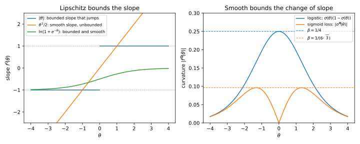
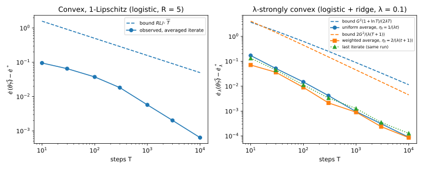
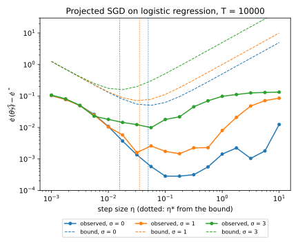

# Optimization

Training a model means minimizing an average loss over the training set, and two questions come up every time. The first is **how fast the optimizer gets there**: how many steps gradient descent (GD) and stochastic gradient descent (SGD) need, and which learning rate to pick. SGD estimates the gradient from a few random records, so it also pays for noise. The second is **how much the answer depends on any one training record**, which the next chapter turns into a guarantee that the model works on new data.

Both questions have the same kind of answer, because **a few constants of the loss decide everything**: how steep it can be, how sharply it can curve, how much it must curve, and how noisy SGD's gradient estimates are. Every rate and bound in this chapter combines these four.

The running example is logistic regression, a linear classifier, trained on 1,000 records with five features. Each result of the chapter is checked on it. For example, after 10,000 steps of SGD its loss is within $7.71\times10^{-4}$ of the minimum, while the guarantee proved here only promises 0.050, and the chapter explains why the guarantee is so cautious. @tbl-opt-symbols lists the symbols.

| Symbol | Meaning |
| --- | --- |
| $D = (z_1, \dots, z_n)$; $\theta \in \mathbb R^d$; $\ell(\theta; z)$ | $n$ training records; the parameters; the loss on record $z$ |
| $\mathcal L(\theta)$, or $\mathcal L(\theta; D)$; $\theta^*$, $\mathcal L^*$ | the empirical risk $\frac1n\sum_i\ell(\theta; z_i)$; its minimizer and minimum |
| $L$, $\beta$, $\lambda$; $\kappa = \beta/\lambda$ | Lipschitz, smoothness, strong convexity constants; condition number |
| $\eta$, $\eta_t$; $T$ | learning rate (step size); number of steps |
| $g_t$; $G^2$; $\sigma^2$ | random gradient at step $t$; bound on its mean squared length; its variance |
| $\mathcal W$, $\Pi$; $R$ | set SGD stays in, projection onto it; starting distance to $\theta^*$ |

: The symbols of this chapter. {#tbl-opt-symbols}

## Convexity, Lipschitz continuity and smoothness {#sec-opt-definitions}

To say anything about an optimizer, you need assumptions on the loss, and four properties are enough for this chapter. Lipschitz continuity bounds the slope and smoothness the curvature from above, while convexity and strong convexity bound the curvature from below. Mixing them up is the most common mistake in reading optimization results, so this section defines each, relates them, and checks them on the logistic loss.

::: {#def-opt-convex name="Convex function"}
A function $f\colon \mathbb R^d \to \mathbb R$ is **convex** when the straight segment (the chord) between any two points of its graph never dips below the graph. That is, for all $\theta, \theta'$ and every mixing weight $s \in [0, 1]$,
$$f(s\theta' + (1-s)\theta) \le s f(\theta') + (1-s) f(\theta).$$
:::

The proofs use a second picture, through tangents. The tangent at $\theta$ predicts the value at $\theta'$ by adding to $f(\theta)$ the inner product $\langle\nabla f(\theta), \theta' - \theta\rangle$ of the gradient with the step, and for a convex function this prediction never overshoots.

::: {#lem-opt-tangent name="A convex function lies above its tangents"}
If $f$ is convex and differentiable, then for all $\theta$ and $\theta'$
$$f(\theta') \ge f(\theta) + \langle\nabla f(\theta), \theta' - \theta\rangle.$$ {#eq-opt-first-order}
:::

::: {.proof}
1. *Shrink the chord to a short step.* Write the mixed point as $\theta + s(\theta' - \theta)$, a step of size $s$ towards $\theta'$, and the chord's height there as $f(\theta) + s(f(\theta') - f(\theta))$. Subtracting $f(\theta)$ from both sides of the chord condition and dividing by $s > 0$ gives
$$\frac{f(\theta + s(\theta' - \theta)) - f(\theta)}{s} \le f(\theta') - f(\theta).$$
2. *Let the step vanish.* The left side is the average slope over a short step towards $\theta'$. As $s \to 0$ it becomes the slope in that direction, which for a differentiable $f$ is the inner product $\langle\nabla f(\theta), \theta' - \theta\rangle$, and this gives @eq-opt-first-order.
:::

Every convex convergence proof below uses the lemma with $\theta' = \theta^*$. Moving the inner product to the other side and flipping its sign, it says that $\langle\nabla f(\theta), \theta - \theta^*\rangle$ is at least the current error $f(\theta) - f(\theta^*)$. So the gradient points away from the minimizer, and a step against it brings you closer to $\theta^*$ in proportion to how far from optimal you are. The converse, from tangents to chords, is derived in @sec-apx-opt-convexity.

::: {#def-opt-constants name="Lipschitz, smooth and strongly convex functions"}
Let $f\colon \mathbb R^d \to \mathbb R$ be differentiable.

- $f$ is **$L$-Lipschitz** when it never changes faster than $L$ per unit of distance: $|f(\theta) - f(\theta')| \le L\|\theta - \theta'\|$.
- $f$ is **$\beta$-smooth** when its gradient is $\beta$-Lipschitz: $\|\nabla f(\theta) - \nabla f(\theta')\| \le \beta\|\theta - \theta'\|$.
- $f$ is **$\lambda$-strongly convex**, for some $\lambda > 0$, when it lies above each tangent by at least a bowl of curvature $\lambda$:
$$f(\theta') \ge f(\theta) + \langle\nabla f(\theta), \theta' - \theta\rangle + \frac\lambda2\|\theta' - \theta\|^2.$$

For a function that is both smooth and strongly convex, $\kappa = \beta/\lambda$ is its **condition number**.
:::

The next result collects the working forms of these definitions, with a test of smoothness by the **Hessian** $\nabla^2 f$, the matrix of second derivatives, whose eigenvalues are the curvatures of $f$. The proof bounds inner products by the Cauchy–Schwarz inequality $|\langle a, b\rangle| \le \|a\|\,\|b\|$: an inner product is the product of the lengths times a cosine.

::: {#prp-opt-constants name="Working forms of the constants"}
Let $f\colon \mathbb R^d \to \mathbb R$ be differentiable.

(a) $f$ is $L$-Lipschitz exactly when $\|\nabla f(\theta)\| \le L$ for every $\theta$.

(b) If $f$ is $\beta$-smooth, the error of its tangent grows at most like a parabola of curvature $\beta$ (the **descent lemma**):
$$f(\theta') \le f(\theta) + \langle\nabla f(\theta), \theta' - \theta\rangle + \frac\beta2\|\theta' - \theta\|^2.$$ {#eq-opt-descent-lemma}

(c) If $f$ is twice differentiable and every eigenvalue of $\nabla^2 f$ lies in $[-\beta, \beta]$ everywhere, then $f$ is $\beta$-smooth.

(d) If $f$ is $\lambda$-strongly convex, its gradient is **strongly monotone**:
$$\langle\nabla f(\theta) - \nabla f(\theta'), \theta - \theta'\rangle \ge \lambda\|\theta - \theta'\|^2.$$ {#eq-opt-strong-monotone}
:::

::: {.proof}
Steps 1 to 4 walk along the segment $\theta_s = \theta + s(\theta' - \theta)$, $s \in [0, 1]$, and add up the changes by the fundamental theorem of calculus. Step 5 adds two inequalities.

1. *A bounded gradient makes $f$ Lipschitz.* The change of $f$ is the integral of the slope in the direction of travel,
$$f(\theta') - f(\theta) = \int_0^1\langle\nabla f(\theta_s), \theta' - \theta\rangle\,\mathrm ds,$$
and by Cauchy–Schwarz each inner product, and so the integral, is at most $L\|\theta' - \theta\|$ in size.
2. *A Lipschitz $f$ has a bounded gradient.* Where the gradient is not zero, take the unit vector $u = \nabla f(\theta)/\|\nabla f(\theta)\|$. The Lipschitz condition says $f(\theta + hu) - f(\theta) \le Lh$, and divided by $h$ the left side tends to $\langle\nabla f(\theta), u\rangle = \|\nabla f(\theta)\|$ as $h \to 0$, so $\|\nabla f(\theta)\| \le L$.
3. *Smoothness gives the descent lemma.* The error of the tangent is the integral of how much the slope has changed:
$$f(\theta') - f(\theta) - \langle\nabla f(\theta), \theta' - \theta\rangle = \int_0^1\langle\nabla f(\theta_s) - \nabla f(\theta), \theta' - \theta\rangle\,\mathrm ds.$$
At position $s$ you are a distance $s\|\theta' - \theta\|$ from $\theta$, so by smoothness and Cauchy–Schwarz the integrand is at most $\beta s\|\theta' - \theta\|^2$. Since $\int_0^1\beta s\,\mathrm ds = \beta/2$, the error is at most $\frac\beta2\|\theta' - \theta\|^2$.
4. *A bounded Hessian gives smoothness.* The change of the gradient is the integral of the Hessian applied to the direction of travel,
$$\nabla f(\theta') - \nabla f(\theta) = \int_0^1\nabla^2 f(\theta_s)(\theta' - \theta)\,\mathrm ds.$$
A symmetric matrix with eigenvalues in $[-\beta, \beta]$ stretches no vector by more than $\beta$, and an integral is no longer than the integral of the lengths, so it has length at most $\beta\|\theta' - \theta\|$.
5. *Strong convexity gives strong monotonicity.* Write the strong convexity inequality from $\theta$ to $\theta'$ and from $\theta'$ to $\theta$, and add the two. The function values cancel, which leaves
$$0 \ge \langle\nabla f(\theta) - \nabla f(\theta'), \theta' - \theta\rangle + \lambda\|\theta - \theta'\|^2,$$
and moving the inner product to the left gives @eq-opt-strong-monotone.
:::

The converses hold too: a $\beta$-smooth $f$ has no curvature above $\beta$, and $f$ is $\lambda$-strongly convex exactly when every eigenvalue of $\nabla^2 f$ is at least $\lambda$ (Nesterov 2018, §2.1; @sec-apx-opt-convexity). So the two constants sandwich the curvature, and $\kappa \ge 1$.

Two consequences of strong convexity are used later, the first in @sec-opt-erm and the second whenever a ridge term is added.

::: {#cor-opt-strong name="Two consequences of strong convexity"}
Let $\lambda > 0$.

(a) If $f$ is differentiable and $\lambda$-strongly convex with a minimizer $\theta^*$, then for every $\theta$
$$\|\theta - \theta^*\| \le \frac{\|\nabla f(\theta)\|}{\lambda},$$
and in particular the minimizer is unique.

(b) If $f$ is convex and differentiable, then $f(\theta) + \frac\lambda2\|\theta\|^2$ is $\lambda$-strongly convex.
:::

::: {.proof}
1. *Part (a).* The gradient of a differentiable function on all of $\mathbb R^d$ vanishes at its minimizer. Put $\theta' = \theta^*$ in @eq-opt-strong-monotone and bound its left side by Cauchy–Schwarz:
$$\lambda\|\theta - \theta^*\|^2 \le \|\nabla f(\theta)\|\,\|\theta - \theta^*\|.$$
Divide by $\lambda\|\theta - \theta^*\|$, or note that there is nothing to prove when $\theta = \theta^*$. A second point with zero gradient would be at distance 0 from $\theta^*$, so the minimizer is unique.
2. *Part (b).* Expanding a square gives $\|\theta'\|^2 = \|\theta\|^2 + 2\langle\theta, \theta' - \theta\rangle + \|\theta' - \theta\|^2$. Multiplied by $\frac\lambda2$, this says that $\frac\lambda2\|\theta\|^2$, whose gradient is $\lambda\theta$, meets the strong convexity inequality with equality. Adding it to the tangent inequality @eq-opt-first-order of $f$ gives that inequality for the sum.
:::

Neither of Lipschitz and smooth implies the other: $|\theta|$ is 1-Lipschitz but not smooth, and $\theta^2/2$ is 1-smooth but not Lipschitz (@fig-opt-lipschitz-smooth). By part (a) of @cor-opt-strong the gradient of a strongly convex function grows at least like $\lambda$ times the distance to the minimizer, so **no strongly convex function is Lipschitz on all of $\mathbb R^d$**, and the strongly convex results below use the projection of @sec-opt-gd to stay in a bounded set.

{#fig-opt-lipschitz-smooth}

::: {#exm-opt-logistic}
In the running example, features have $\|x\| \le 1$ and labels $y \in \{-1, +1\}$. The **margin** $m = y\langle\theta, x\rangle$ is positive when a record is classified correctly, and the logistic loss is $\ln(1 + e^{-m})$. Write $\operatorname{sig}(m) = 1/(1 + e^{-m})$ for the logistic function, whose derivative is $\operatorname{sig}(1 - \operatorname{sig})$.

By the chain rule the gradient is $-\operatorname{sig}(-m)\,y\,x$, of length at most 1, so the loss is 1-Lipschitz by part (a) of @prp-opt-constants. The Hessian is $\operatorname{sig}(m)(1 - \operatorname{sig}(m))\,xx^\top$. Here $xx^\top$ has eigenvalue $\|x\|^2 \le 1$ along $x$ and 0 across it, and the factor in front, $p(1 - p)$ with $p$ in $(0, 1)$, is at most $\frac14$. So the loss is convex and $\frac14$-smooth by part (c), but not strongly convex.

For $x = (0.6, 0.8)$ and $y = +1$, the loss, gradient norm and curvature are 0.6931, 0.5000 and 0.2500 at $\theta = 0$, but 0.0067, 0.0067 and 0.0066 at $\theta = (3, 4)$, where the margin is 5. Confidently classified records add almost no curvature, and at the minimizer most records are classified confidently. So on the running dataset, with features drawn on the unit sphere and labels from a logistic model, the Hessian of the average loss at $\theta^*$ has smallest eigenvalue only 0.0233.
:::

## Gradient descent and SGD {#sec-opt-gd}

Gradient descent steps against the full gradient, which costs one gradient evaluation per record. SGD uses the gradient of one random record, or a small batch, which is cheap and right on average but noisy. This section defines both and shows on a quadratic what a fast rate looks like without noise, so that you can see later what the noise costs.

::: {#def-opt-gd-sgd name="Gradient descent and projected SGD"}
**Gradient descent** with learning rate $\eta$ takes the step $\theta_{t+1} = \theta_t - \eta\nabla\mathcal L(\theta_t)$.

**Projected SGD** runs inside a convex set $\mathcal W$, such as a ball, that is closed (contains its boundary), and its **projection** $\Pi(u)$ is the point of $\mathcal W$ nearest to $u$. At step $t$ the algorithm draws an index $i_t$ uniformly from $\{1, \dots, n\}$, takes that record's gradient $g_t = \nabla\ell(\theta_t; z_{i_t})$, and updates
$$\theta_{t+1} = \Pi(\theta_t - \eta_t g_t).$$
With a **minibatch** of $B$ indices, $g_t$ is the average gradient over the batch. Plain SGD is the case $\mathcal W = \mathbb R^d$.
:::

With one record or a batch, the estimate is right on average. Write "past" for the random choices made before step $t$, which fix $\theta_t$; a uniform index averages to the full gradient, so
$$\mathbb E[g_t \mid \text{past}] = \nabla\mathcal L(\theta_t).$$

On a quadratic risk, such as the one in the next theorem, the gradient is linear in the error $\theta - \theta^*$, so each GD step multiplies the error by a fixed matrix. With $\eta = 1/\beta$, the error along a principal direction (an eigenvector of the Hessian) with curvature $h$ shrinks by the factor $1 - h/\beta$, and the flattest direction shrinks slowest, by $1 - 1/\kappa$.

::: {#thm-opt-gd-quadratic name="Gradient descent on a strongly convex quadratic"}
Let $\mathcal L(\theta) = \mathcal L^* + \frac12(\theta - \theta^*)^\top H(\theta - \theta^*)$, where the symmetric matrix $H$ has eigenvalues in $[\lambda, \beta]$ with $0 < \lambda \le \beta$, and let $\kappa = \beta/\lambda$. Then GD with $\eta = 1/\beta$ from any $\theta_0$ satisfies
$$\|\theta_t - \theta^*\| \le \left(1 - \frac1\kappa\right)^t\|\theta_0 - \theta^*\|.$$ {#eq-opt-gd-linear}
:::

::: {.proof}
1. *One step multiplies the error by a matrix.* The gradient is $H(\theta - \theta^*)$, so subtracting $\theta^*$ from both sides of the update gives
$$\theta_{t+1} - \theta^* = (I - H/\beta)(\theta_t - \theta^*).$$
2. *Find the factor in each direction.* The matrix $I - H/\beta$ has the principal directions of $H$, and turns a curvature $h \in [\lambda, \beta]$ into the factor $1 - h/\beta \in [0, 1 - 1/\kappa]$.
3. *Bound the shrinkage, then repeat.* In the orthonormal basis of principal directions, each coordinate of the error is multiplied by its own factor, so the length is multiplied by at most $1 - 1/\kappa$. Applying this $t$ times gives @eq-opt-gd-linear.
:::

For every $\beta$-smooth risk a weaker statement holds, about the risk's value rather than the distance, and @sec-opt-nonconvex and @sec-apx-opt-convexity start from it. The descent lemma puts the risk below a parabola, so a step down the tangent cannot go past the bottom of that parabola by enough to undo its gain.

::: {#prp-opt-gd-descent name="One gradient step lowers a smooth function"}
If $\mathcal L$ is $\beta$-smooth, one GD step with $\eta = 1/\beta$ satisfies
$$\mathcal L(\theta_{t+1}) \le \mathcal L(\theta_t) - \frac{1}{2\beta}\|\nabla\mathcal L(\theta_t)\|^2.$$
:::

::: {.proof}
1. *Put the step into the descent lemma.* With $\theta_{t+1} - \theta_t = -\nabla\mathcal L(\theta_t)/\beta$, the tangent term of @eq-opt-descent-lemma is $-\frac1\beta\|\nabla\mathcal L(\theta_t)\|^2$, the progress. The parabola term is $\frac\beta2\cdot\frac{1}{\beta^2}\|\nabla\mathcal L(\theta_t)\|^2$, the price of overshooting.
2. *Add them.* Their sum is $-\frac{1}{2\beta}\|\nabla\mathcal L(\theta_t)\|^2$: the overshoot eats half of the progress.
:::

So GD converges **linearly**, by a constant factor per step, and @sec-apx-opt-convexity extends @eq-opt-gd-linear to every twice-differentiable strongly convex smooth risk. Since $1 - x \le e^{-x}$, the factor after $t$ steps is at most $e^{-t/\kappa}$, so shrinking the error to a fraction $\tau$ takes about $\kappa\ln(1/\tau)$ steps. A large $\kappa$ makes GD slow, because the step must stay small for the steepest direction, where the error is multiplied by $1 - \eta\beta$.

SGD with a constant step cannot do this: near $\theta^*$ the gradients of single records do not vanish, so its iterates keep jumping around $\theta^*$.

::: {#exm-opt-least-squares}
The logistic risk is not a quadratic, so this example uses least squares, whose risk is a quadratic with $H$ the average of the $x_ix_i^\top$. The chapter's script (@sec-opt-code) draws 200 records with $x \sim \mathcal N(0, \mathrm{diag}(1, 0.1))$ and $y = x_1 + x_2$ plus noise, and $H$ has eigenvalues $\lambda = 0.101$ and $\beta = 0.969$, so $\kappa = 9.58$.

From $\theta_0 = (-1, 3)$, @eq-opt-gd-linear predicts that GD needs at most 126 steps to shrink $\|\theta - \theta^*\|$ by $10^6$, since $(1 - 1/9.58)^t \le 10^{-6}$ needs $t \ge \ln(10^6)/(-\ln(1 - 1/9.58)) = 13.8155/0.11024 = 125.3$. GD takes 122, close to the bound, because the starting error lies largely along the flat direction, which shrinks at exactly the worst-case rate. @fig-opt-gd-sgd-paths shows GD crawling along the flat valley and SGD jittering around $\theta^*$.
:::

{#fig-opt-gd-sgd-paths}

## SGD for convex Lipschitz objectives {#sec-opt-sgd-convex}

The cleanest guarantee for SGD needs only convexity and bounded gradients, so it covers the logistic loss and, with subgradients, losses with kinks. Its proof, the template for the rest of the chapter, follows the squared distance to the minimizer. It needs two tools first: the projection never undoes progress, and a random gradient behaves like the true one in a cross term but not in a square.

The first tool is used where the new point is pulled back into $\mathcal W$. Seen from $\Pi(u)$, the directions to $u$ and to any $\theta$ in the set make an angle of at least $90°$, so, as in a right-angled triangle, $u$ is farther from $\theta$.

::: {#lem-opt-projection name="Projection never moves a point away from the points of the set"}
Let $\mathcal W \subseteq \mathbb R^d$ be convex and closed, so that a nearest point exists, and let $\Pi(u)$ be its point nearest to $u$. Then for every $u$ and every $\theta \in \mathcal W$,
$$\|\Pi(u) - \theta\| \le \|u - \theta\|.$$
:::

::: {.proof}
1. *Walk from the nearest point towards $\theta$.* Let $p = \Pi(u)$. The points $p + s(\theta - p)$, $s \in [0, 1]$, lie in $\mathcal W$ because it is convex, and their squared distance to $u$ is $r(s) = \|u - p - s(\theta - p)\|^2$.
2. *The angle at $p$ is obtuse.* Since $p$ is the closest point of the set, $r$ is smallest at $s = 0$, so its derivative there, $r'(0) = -2\langle u - p, \theta - p\rangle$, is not negative. That says
$$\langle u - p, p - \theta\rangle \ge 0.$$
3. *Pythagoras.* Expanding the square of $u - \theta = (u - p) + (p - \theta)$ gives
$$\|u - \theta\|^2 = \|u - p\|^2 + \|p - \theta\|^2 + 2\langle u - p, p - \theta\rangle,$$
where $\|u - p\|^2$ and, by step 2, the inner product are non-negative, so $\|u - \theta\| \ge \|p - \theta\|$.
:::

The second tool is used where the proof averages over the random index, and its second half is what every SGD rate pays for.

::: {#lem-opt-unbiased name="Unbiased gradients: the cross term averages out, the square does not"}
Let $\mathbb E[g_t \mid \text{past}] = \nabla\mathcal L(\theta_t)$, and let $v_t$ be a vector fixed by the past, such as $\theta_t - \theta^*$. Then
$$\mathbb E\langle g_t, v_t\rangle = \mathbb E\langle\nabla\mathcal L(\theta_t), v_t\rangle,$$
and the mean squared length of $g_t$ exceeds that of the true gradient by its **variance**, the mean squared error of the estimate:
$$\mathbb E[\|g_t\|^2 \mid \text{past}] = \|\nabla\mathcal L(\theta_t)\|^2 + \mathbb E[\|g_t - \nabla\mathcal L(\theta_t)\|^2 \mid \text{past}].$$
:::

::: {.proof}
1. *The cross term.* Given the past, $v_t$ is fixed and the inner product with it is linear, so the conditional expectation passes inside it:
$$\mathbb E[\langle g_t, v_t\rangle \mid \text{past}] = \langle\nabla\mathcal L(\theta_t), v_t\rangle.$$
Averaging this over the past gives the first claim.
2. *The square.* Write $g_t = \nabla\mathcal L(\theta_t) + e_t$, with the error $e_t$ of conditional mean zero, and expand $\|g_t\|^2 = \|\nabla\mathcal L(\theta_t)\|^2 + 2\langle e_t, \nabla\mathcal L(\theta_t)\rangle + \|e_t\|^2$. The middle term pairs the error with a vector fixed by the past, so by step 1 it averages to zero.
:::

For three records $z = (1, 2, 6)$ with the loss $\frac12(\theta - z)^2$, at $\theta = 4$ the single-record gradients $\theta - z_i$ are 3, 2 and $-2$. They average to the true gradient 1, but their squares average to $17/3 = 1^2 + 14/3$, where $14/3$ is the variance.

The guarantee has two costs: travelling the distance $R$ takes long with small steps, while each step's random error grows with $\eta$, so the right step balances them.

::: {#thm-opt-sgd-convex name="SGD on convex objectives"}
Let $\mathcal L$ be convex, and let projected SGD run in a closed convex set $\mathcal W$ that contains $\theta^*$, starting at $\theta_1 \in \mathcal W$ with $\|\theta_1 - \theta^*\| \le R$. Let the random gradients be unbiased with $\mathbb E\|g_t\|^2 \le G^2$. With a constant step $\eta$ for $T$ steps, the averaged iterate $\bar\theta_T = \frac1T\sum_{t=1}^T\theta_t$ satisfies
$$\mathbb E[\mathcal L(\bar\theta_T)] - \mathcal L^* \le \frac{R^2}{2\eta T} + \frac{\eta G^2}{2}.$$ {#eq-opt-sgd-convex}
The step $\eta = R/(G\sqrt T)$ makes the right side $RG/\sqrt T$. For an $L$-Lipschitz loss every per-record gradient has length at most $L$, so the bound is $RL/\sqrt T$.
:::

::: {.proof}
We follow the squared distance $a_t = \|\theta_t - \theta^*\|^2$: convexity ties the cross term of one step to the error, and summing over the steps cancels the changes in distance.

1. *Projection can only help.* By @lem-opt-projection, since $\theta^* \in \mathcal W$,
$$a_{t+1} \le \|\theta_t - \eta g_t - \theta^*\|^2.$$
2. *Expand the square*, with $\theta_t - \theta^*$ and $-\eta g_t$ as the two vectors:
$$\|\theta_t - \eta g_t - \theta^*\|^2 = a_t - 2\eta\langle g_t, \theta_t - \theta^*\rangle + \eta^2\|g_t\|^2.$$
3. *Isolate the progress.* Steps 1 and 2, solved for the cross term, give
$$\langle g_t, \theta_t - \theta^*\rangle \le \frac{a_t - a_{t+1}}{2\eta} + \frac\eta2\|g_t\|^2.$$
4. *Take expectations.* By @lem-opt-unbiased the inner product averages to that with the true gradient, and $\mathbb E\|g_t\|^2 \le G^2$, so
$$\mathbb E\langle\nabla\mathcal L(\theta_t), \theta_t - \theta^*\rangle \le \frac{\mathbb E a_t - \mathbb E a_{t+1}}{2\eta} + \frac{\eta G^2}{2}.$$
5. *Convexity turns progress into error.* By @lem-opt-tangent with $\theta = \theta_t$ and $\theta' = \theta^*$, the error $\mathcal L(\theta_t) - \mathcal L^*$ is at most the inner product on the left, which can therefore be replaced by $\mathbb E[\mathcal L(\theta_t) - \mathcal L^*]$.
6. *Sum over $t = 1, \dots, T$.* The distance terms cancel in a chain (they **telescope**) to $a_1 - a_{T+1} \le R^2$, and the noise term is added $T$ times:
$$\sum_{t=1}^T\mathbb E[\mathcal L(\theta_t) - \mathcal L^*] \le \frac{R^2}{2\eta} + \frac{\eta TG^2}{2}.$$
7. *Pass to the averaged iterate.* Divide by $T$. Jensen's inequality (@lem-div-jensen) says that a convex function of an average is at most the average of the function, so $\mathcal L(\bar\theta_T) \le \frac1T\sum_t\mathcal L(\theta_t)$, which gives @eq-opt-sgd-convex.
8. *Choose $\eta$.* The derivative in $\eta$, $-\frac{R^2}{2\eta^2T} + \frac{G^2}{2}$, vanishes at $\eta = R/(G\sqrt T)$, where both terms equal $RG/(2\sqrt T)$.
:::

For a loss with kinks, a **subgradient** replaces the gradient: any vector $g$ such that the linear function $\mathcal L(\theta) + \langle g, \theta' - \theta\rangle$ stays below the graph. Step 5 then holds by this definition. The rate cannot be improved, since some convex $L$-Lipschitz functions force every method that only sees gradients to an error of order $RL/\sqrt T$ after $T$ of them (Bubeck 2015, §3.5; @sec-apx-opt-lower).

The guarantee is for the averaged model, because Jensen passes the bound only to the average of the iterates. It is also a worst case: when the risk curves near the optimum, SGD does much better.

::: {#exm-opt-sgd-convex}
On the running example the exact minimizer, found by Newton's method, has $\|\theta^*\| = 3.152$ and $\mathcal L^* = 0.5198$. Projected SGD runs on the ball of radius 5 from $\theta_1 = 0$, so $\theta^*$ is inside and $R = 5$. With $L = 1$ the step is $\eta = R/(L\sqrt T)$, 0.5 at $T = 100$. @tbl-opt-sgd-convex gives the mean over 20 runs.

| Steps $T$ | Step $\eta$ | Observed $\mathcal L(\bar \theta_T) - \mathcal L^*$ | Bound $RL/\sqrt T$ |
| --- | --- | --- | --- |
| 100 | 0.5000 | $4.44\times10^{-2}$ | 0.500 |
| 1,000 | 0.1581 | $6.46\times10^{-3}$ | 0.158 |
| 10,000 | 0.0500 | $7.71\times10^{-4}$ | 0.050 |

: Projected SGD on logistic regression against the convex Lipschitz bound @eq-opt-sgd-convex. {#tbl-opt-sgd-convex}

The bound holds, loose by a factor of 11 at $T = 100$ ($0.500/0.0444 = 11.3$) and 65 at $T = 10{,}000$ ($0.050/0.000771 = 64.9$). The gap grows because the error falls by $0.0444/0.000771 = 57.6$, nearer the factor 100 of a $1/T$ rate than the 10 of $1/\sqrt T$. The risk curves near $\theta^*$, with the curvature 0.0233 of @exm-opt-logistic, and the next section shows what curvature buys (@fig-opt-sgd-convex, left).
:::

{#fig-opt-sgd-convex}

## Strongly convex objectives {#sec-opt-strong}

A convex loss plus a ridge term is strongly convex (@cor-opt-strong), and strong convexity pulls the iterates towards $\theta^*$, harder the farther they are. With matched steps and averaging, that turns the $1/\sqrt T$ rate of @sec-opt-sgd-convex into $1/T$. Both choices below shrink the step like $1/(\lambda t)$, and the second gives later iterates more weight.

::: {#thm-opt-sgd-strong name="SGD on strongly convex objectives"}
Let $\mathcal L$ be $\lambda$-strongly convex, let projected SGD run in a closed convex set $\mathcal W$ that contains $\theta^*$, and let the random gradients be unbiased with $\mathbb E\|g_t\|^2 \le G^2$.

(a) With $\eta_t = \frac{1}{\lambda t}$ and the uniform average $\bar\theta_T = \frac1T\sum_t\theta_t$,
$$\mathbb E[\mathcal L(\bar\theta_T)] - \mathcal L^* \le \frac{G^2(1 + \ln T)}{2\lambda T}.$$

(b) With $\eta_t = \frac{2}{\lambda(t + 1)}$ and the average $\tilde\theta_T = \sum_t\frac{2t}{T(T+1)}\theta_t$, which weights iterate $t$ in proportion to $t$,
$$\mathbb E[\mathcal L(\tilde\theta_T)] - \mathcal L^* \le \frac{2G^2}{\lambda(T + 1)}.$$ {#eq-opt-sgd-strong}
:::

::: {.proof}
This is the proof of @thm-opt-sgd-convex with a better step 5, whose extra distance term makes the distances cancel completely. Write again $a_t = \|\theta_t - \theta^*\|^2$.

1. *The per-step inequality.* Steps 1 to 4 of that proof hold with a step $\eta_t$ that changes over time:
$$\mathbb E\langle\nabla\mathcal L(\theta_t), \theta_t - \theta^*\rangle \le \frac{\mathbb E a_t - \mathbb E a_{t+1}}{2\eta_t} + \frac{\eta_t G^2}{2}.$$
2. *Strong convexity adds a distance term.* Strong convexity at $\theta = \theta_t$, $\theta' = \theta^*$ says that the inner product is at least $\mathcal L(\theta_t) - \mathcal L^* + \frac\lambda2 a_t$. Using this and moving the distance term to the right,
$$\mathbb E[\mathcal L(\theta_t) - \mathcal L^*] \le \Big(\frac{1}{2\eta_t} - \frac\lambda2\Big)\mathbb E a_t - \frac{1}{2\eta_t}\mathbb E a_{t+1} + \frac{\eta_t G^2}{2}.$$
3. *Uniform schedule.* With $\eta_t = 1/(\lambda t)$ the two coefficients are $\frac{1}{2\eta_t} - \frac\lambda2 = \frac{\lambda(t - 1)}{2}$ and $\frac{1}{2\eta_t} = \frac{\lambda t}{2}$, so the distance terms are $\frac\lambda2[(t - 1)\mathbb E a_t - t\,\mathbb E a_{t+1}]$. Summed over $t$, each term subtracted at step $t$ is added back at step $t + 1$, leaving $\frac\lambda2[0\cdot a_1 - T\,\mathbb E a_{T+1}] \le 0$. The noise terms $\frac{G^2}{2\lambda t}$ sum to at most $\frac{G^2(1 + \ln T)}{2\lambda}$, because $\sum_{t \le T}1/t$ is at most $1 + \int_1^T\mathrm ds/s = 1 + \ln T$. Dividing by $T$ and applying Jensen gives (a).
4. *Weighted schedule.* With $\eta_t = 2/(\lambda(t + 1))$ the coefficients are $\frac{\lambda(t - 1)}{4}$ and $\frac{\lambda(t + 1)}{4}$. Multiply the inequality of step 2 by $t$, and the distance terms become $\frac\lambda4[(t - 1)t\,\mathbb E a_t - t(t + 1)\mathbb E a_{t+1}]$ and telescope in the same way. The noise term becomes $\frac{t}{t + 1}\cdot\frac{G^2}{\lambda} \le \frac{G^2}{\lambda}$, so no harmonic sum appears and the total is at most $TG^2/\lambda$. Dividing by $\sum_t t = T(T + 1)/2$ and applying Jensen with the weights $2t/(T(T + 1))$, which also average to a convex combination, gives (b).
:::

The harmonic sum of step 3 is where the $\ln T$ comes from: the early iterates, taken with huge steps, are bad, and the uniform average gives them full weight. The bound is divided by $\lambda$, so with a weak regularizer it beats $RG/\sqrt T$ only after many steps. The $1/(\lambda T)$ rate is not an artefact of the proof. On the risk $\frac\lambda2\|\theta\|^2$ with gradient noise of variance $\sigma^2$, the last iterate of schedule (a) is minus the average noise divided by $\lambda$, and its error is exactly $\sigma^2/(2\lambda T)$.

The constant $G$ depends on the set $\mathcal W$, since a strongly convex risk has unbounded gradients on $\mathbb R^d$. For $\ell + \frac\lambda2\|\theta\|^2$ with $\ell$ $L$-Lipschitz, the gradient on the ball of radius $R$ is at most $L + \lambda R$.

::: {#exm-opt-ridge}
On the running example with $\lambda = 0.1$, the minimizer has $\|\theta^*\| = 0.839$, inside the ball of radius 5, and $G = 1 + 0.1 \times 5 = 1.5$. After $T = 10{,}000$ steps, averaged over 20 runs, the uniform average has error $9.09\times10^{-5}$ against the bound $1.15\times10^{-2}$ of part (a), which is $G^2(1 + \ln T)/(2\lambda T) = 2.25 \times 10.21/2000$. The weighted average has $7.85\times10^{-5}$ against $4.50\times10^{-3}$, which is $2G^2/(\lambda(T + 1)) = 2 \times 2.25/(0.1 \times 10{,}001)$. The bounds are loose by factors of about 130 and 60 ($0.0115/0.0000909 = 127$ and $0.0045/0.0000785 = 57$), mainly because $G$ is the worst case over the whole ball (@fig-opt-sgd-convex, right).
:::

## Gradient noise and minibatches {#sec-opt-noise}

Every SGD bound so far paid for $\mathbb E\|g_t\|^2$, which by @lem-opt-unbiased includes the variance. Variance comes from sampling records and, in later parts, from noise added on purpose, so this section asks how the batch size changes it and how the learning rate should follow it. Averaging $B$ independent gradients divides their variance by $B$, as for the mean of a sample, and drawing without replacement does a little better.

::: {#prp-opt-minibatch name="Minibatch variance"}
Fix $\theta$, and let $\sigma_1^2 = \frac1n\sum_i\|\nabla\ell(\theta; z_i) - \nabla\mathcal L(\theta)\|^2$ be the variance of a per-record gradient. The average gradient $g_B$ of $B$ indices drawn uniformly satisfies
$$\mathbb E\|g_B - \nabla \mathcal L(\theta)\|^2 = \begin{cases}\dfrac{\sigma_1^2}{B} & \text{with replacement,}\\[2ex] \dfrac{\sigma_1^2}{B}\cdot\dfrac{n - B}{n - 1} & \text{without replacement.}\end{cases}$$ {#eq-opt-minibatch}
:::

::: {.proof}
Write $u_i = \nabla\ell(\theta; z_i) - \nabla\mathcal L(\theta)$ for the deviation of record $i$, so that the $u_i$ sum to zero and the mean of $\|u_i\|^2$ is $\sigma_1^2$, and let $I_1, \dots, I_B$ be the indices drawn. We expand the squared mean deviation into squares and cross terms and average each.

1. *Each square.* Each draw on its own is uniform, so $\mathbb E\|u_{I_j}\|^2 = \sigma_1^2$.
2. *Cross terms with replacement.* The draws are independent and each deviation has mean zero, so each cross term has mean zero.
3. *Cross terms without replacement.* Two draws form a uniform pair of distinct indices, so a cross term averages $\langle u_i, u_{i'}\rangle$ over the $n(n - 1)$ ordered pairs $i \ne i'$. Expanding $\|\sum_i u_i\|^2$ shows that the sum of these terms is $\|\sum_i u_i\|^2 - \sum_i\|u_i\|^2 = 0 - n\sigma_1^2$, so
$$\mathbb E\langle u_{I_j}, u_{I_k}\rangle = -\frac{\sigma_1^2}{n - 1}.$$
Once a record that deviates one way is drawn, the rest deviate on average slightly the other way.
4. *Add up.* The squared length of $\frac1B\sum_j u_{I_j}$ is $\frac{1}{B^2}$ times $B$ squares and $B(B - 1)$ cross terms. With replacement this averages to $\sigma_1^2/B$, and without replacement to
$$\frac{1}{B^2}\Big[B\sigma_1^2 - B(B - 1)\frac{\sigma_1^2}{n - 1}\Big] = \frac{\sigma_1^2}{B}\cdot\frac{n - B}{n - 1}.$$
:::

The factor $\frac{n - B}{n - 1}$ is 1 for $B = 1$ and 0 for $B = n$. For the three records of @sec-opt-sgd-convex at $\theta = 4$, $\sigma_1^2 = 14/3$, and over the three possible batches of two the batch average has variance $7/6$, half of the $\sigma_1^2/2 = 7/3$ of drawing with replacement.

Noise added on top of the sampling, independent and with mean zero, simply adds its mean squared size to the mean squared length of the gradient.

::: {#prp-opt-noisy name="SGD with added gradient noise"}
In the setting of @thm-opt-sgd-convex with an $L$-Lipschitz loss, let each per-record gradient be perturbed by noise $\xi_t$, independent of everything else, with mean zero and $\mathbb E\|\xi_t\|^2 = \sigma^2$ (here $\sigma^2$ is the size of the added noise alone). Then @eq-opt-sgd-convex holds with $G^2 = L^2 + \sigma^2$, so the best step is $\eta^* = R/\sqrt{(L^2 + \sigma^2)T}$ and the bound there is $R\sqrt{L^2 + \sigma^2}/\sqrt T$.
:::

::: {.proof}
1. *The second moment.* Expand the squared length of $\nabla\ell + \xi_t$. The cross term has mean zero, because $\xi_t$ is independent of the gradient and has mean zero, so $\mathbb E\|\nabla\ell + \xi_t\|^2 \le L^2 + \sigma^2$, and the noisy gradient is still unbiased.
2. *Substitute.* Put $G^2 = L^2 + \sigma^2$ into @eq-opt-sgd-convex and choose $\eta$ as in step 8 of that proof.
:::

So noisier gradients call for smaller steps and longer runs. Setting the bound $R\sqrt{L^2 + \sigma^2}/\sqrt T$ equal to a target error and solving for $T$, the steps needed grow in proportion to $L^2 + \sigma^2$, so noise of size $\sigma = 3L$ multiplies them by 10. A batch of $B$ costs $B$ gradient evaluations to divide the variance by $B$, so it pays off only through parallelism.

::: {#exm-opt-noise}
At the logistic minimizer of the running example, $\sigma_1^2 = 0.1722$. The script measures the variance of the average gradient over 4,000 batches of each size from 1 to 500, and @eq-opt-minibatch matches it within the Monte Carlo error (@fig-opt-minibatch-variance). At $B = 500 = n/2$, for example, it measures $3.47\times10^{-4}$ with replacement against $3.44\times10^{-4}$ predicted. Without replacement it measures $1.74\times10^{-4}$ against $1.72\times10^{-4}$, half as much.

The script then adds Gaussian noise to every per-record gradient and runs projected SGD for $T = 10{,}000$ steps, 10 runs per setting, over 17 values of $\eta$ from $10^{-3}$ to 10. With $R = 5$ and $L = 1$ the recommended step is $\eta^* = 5/\sqrt{(1 + \sigma^2)\cdot 10^4}$ (@tbl-opt-noise).

| Noise $\sigma$ | $\eta^*$ from the bound | Bound at $\eta^*$ | Observed at $\eta^*$ | Best $\eta$ on the grid | Observed there |
| --- | --- | --- | --- | --- | --- |
| 0 | 0.0500 | 0.050 | $4.99\times10^{-4}$ | 0.178 | $1.85\times10^{-4}$ |
| 1 | 0.0354 | 0.071 | $1.58\times10^{-3}$ | 0.056 | $1.38\times10^{-3}$ |
| 3 | 0.0158 | 0.158 | $9.58\times10^{-3}$ | 0.056 | $5.10\times10^{-3}$ |

: Projected SGD with added gradient noise, $T = 10{,}000$: suboptimality $\mathcal L(\bar \theta_T) - \mathcal L^*$ at the learning rate the bound recommends and at the best learning rate on the grid. {#tbl-opt-noise}

At the recommended step the error grows about 20-fold from $\sigma = 0$ to $\sigma = 3$ ($9.58\times10^{-3}/4.99\times10^{-4} = 19.2$), and the best step falls from 0.178 to 0.056 (@fig-opt-noise-step-size). The bound assumes gradients as large as $L$ and a start as far as $R$, so its step is cautious: without noise the best step is $0.178/0.05 = 3.56$ times larger.
:::

{#fig-opt-minibatch-variance}

{#fig-opt-noise-step-size}

## Non-convex objectives {#sec-opt-nonconvex}

Neural network losses are not convex, and no gradient method can promise their global minimum. SGD can still guarantee a point with a small gradient, an **approximate stationary point**. As in @prp-opt-gd-descent, the descent lemma shows that each step lowers $\mathcal L$ in proportion to the squared gradient, and with random gradients a penalty for the noise is subtracted. If the risk is bounded below, as the theorem assumes, it cannot fall forever, so the squared gradients must be small on average.

::: {#thm-opt-nonconvex name="SGD on smooth non-convex objectives"}
Let $\mathcal L$ be $\beta$-smooth and bounded below by $\mathcal L_{\inf}$, and let $\Gamma = \mathcal L(\theta_1) - \mathcal L_{\inf}$ be the most it can fall. Let the random gradients be unbiased with $\mathbb E[\|g_t - \nabla\mathcal L(\theta_t)\|^2 \mid \text{past}] \le \sigma^2$. SGD without projection, with a constant step $\eta \le 1/\beta$, satisfies
$$\min_{t \le T}\mathbb E\|\nabla \mathcal L(\theta_t)\|^2 \le \frac1T\sum_{t=1}^T\mathbb E\|\nabla \mathcal L(\theta_t)\|^2 \le \frac{2\Gamma}{\eta T} + \beta\eta\sigma^2.$$ {#eq-opt-nonconvex}
With $\eta = \min\big(1/\beta,\ \sqrt{2\Gamma/(\beta\sigma^2T)}\big)$ the right side is at most $\frac{4\beta\Gamma}{T} + 2\sqrt{\frac{2\beta\Gamma\sigma^2}{T}}$.
:::

::: {.proof}
Bound one step by the descent lemma, average over the random gradient, then sum so that the decreases telescope.

1. *Descent lemma for one step.* By @eq-opt-descent-lemma with $\theta' = \theta_t - \eta g_t$,
$$\mathcal L(\theta_{t+1}) \le \mathcal L(\theta_t) - \eta\langle\nabla\mathcal L(\theta_t), g_t\rangle + \frac{\beta\eta^2}{2}\|g_t\|^2.$$
2. *Average over the random gradient.* By @lem-opt-unbiased the inner product averages to $\|\nabla\mathcal L(\theta_t)\|^2$, and $\mathbb E\|g_t\|^2$ is at most $\|\nabla\mathcal L(\theta_t)\|^2 + \sigma^2$. Collecting the squared gradients,
$$\mathbb E\mathcal L(\theta_{t+1}) \le \mathbb E\mathcal L(\theta_t) - \eta\Big(1 - \frac{\beta\eta}{2}\Big)\mathbb E\|\nabla\mathcal L(\theta_t)\|^2 + \frac{\beta\eta^2\sigma^2}{2}.$$
3. *Make sure the step makes progress.* With $\eta \le 1/\beta$ the factor $1 - \beta\eta/2$ is at least $\frac12$, so
$$\frac\eta2\mathbb E\|\nabla\mathcal L(\theta_t)\|^2 \le \mathbb E\mathcal L(\theta_t) - \mathbb E\mathcal L(\theta_{t+1}) + \frac{\beta\eta^2\sigma^2}{2}.$$
4. *Sum and telescope.* Over $t = 1, \dots, T$ the differences of $\mathcal L$ add up to $\mathcal L(\theta_1) - \mathbb E\mathcal L(\theta_{T+1}) \le \Gamma$, and the noise terms to $T\beta\eta^2\sigma^2/2$.
5. *Divide by $\eta T/2$.* This gives the average in @eq-opt-nonconvex, and the minimum is at most the average.
6. *Choose $\eta$.* If $\sqrt{2\Gamma/(\beta\sigma^2T)} \le 1/\beta$, that step makes both terms equal to $\sqrt{2\beta\Gamma\sigma^2/T}$. Otherwise $\eta = 1/\beta$ and the first term is $2\beta\Gamma/T$. The failure of the condition, squared, says $\sigma^2 < 2\beta\Gamma/T$, so the second term, $\sigma^2$, is below $2\beta\Gamma/T$ too, and the sum is below $4\beta\Gamma/T$.
:::

This is the argument of Ghadimi and Lan (2013). Without noise the rate is of order $\beta\Gamma/T$, that of GD, while with noise the $\sqrt{\sigma^2/T}$ term dominates for large $T$. The squared gradient then falls like $1/\sqrt T$, so the gradient itself only like $T^{-1/4}$.

A small gradient is all you get. A stationary point can be a local minimum, a saddle point or a flat region far from anything good, and nothing bounds $\mathcal L(\theta_T) - \mathcal L^*$. Without convexity there is no tangent inequality (@lem-opt-tangent) to turn the progress into a gap in function value.

::: {#exm-opt-sigmoid}
The **sigmoid loss** $\operatorname{sig}(-m)$, with the margin $m$ of @exm-opt-logistic, is a smooth stand-in for the 0–1 loss, which counts misclassified records. It is not convex, since $\operatorname{sig}$ curves both ways. The margin is linear in $\theta$, so its Hessian is $\operatorname{sig}''(-m)\,xx^\top$, and its smoothness constant is the largest $|\operatorname{sig}''|$, reached where $\operatorname{sig} = (3 \pm \sqrt3)/6$, which is $\beta = \frac{1}{6\sqrt3} = 0.0962$. The loss lies in $(0, 1)$ and equals $\frac12$ at $\theta_1 = 0$, so $\Gamma \le \frac12$. Every gradient has length at most $\max\operatorname{sig}' = \frac14$, and a variance is at most the mean squared length, so $\sigma^2 \le \frac1{16}$.

On the logistic data, with $2\Gamma = 1$, the step of the theorem at $T = 100$ is $\sqrt{1/(0.0962 \times 0.0625 \times 100)} = 1.289$, well below $1/\beta = 10.4$. @tbl-opt-nonconvex averages 5 runs.

| Steps $T$ | Step $\eta$ | Observed $\frac1T\sum_t\Vert \nabla \mathcal L(\theta_t)\Vert ^2$ | Bound @eq-opt-nonconvex |
| --- | --- | --- | --- |
| 100 | 1.289 | $1.64\times10^{-3}$ | $1.55\times10^{-2}$ |
| 1,000 | 0.408 | $5.22\times10^{-4}$ | $4.90\times10^{-3}$ |
| 10,000 | 0.129 | $1.87\times10^{-4}$ | $1.55\times10^{-3}$ |

: SGD on the non-convex sigmoid loss against the stationarity bound. {#tbl-opt-nonconvex}

The bound is loose by a factor of 8 to 10 ($0.00155/0.000187 = 8.3$, $0.0155/0.00164 = 9.5$), since $\Gamma$, $\sigma^2$ and $\beta$ are worst cases, but falls at the right rate (@fig-opt-nonconvex-sgd).
:::

{#fig-opt-nonconvex-sgd}

## Sensitivity of regularized ERM {#sec-opt-erm}

This section asks how much the minimizer itself depends on the data, which decides whether the model does as well on new records as on its training set ([Algorithmic stability and generalization](07-stability-generalization.md)). Regularized empirical risk minimization (ERM) returns the minimizer $\theta^*(D)$ of the **regularized empirical risk**
$$\mathcal L_\lambda(\theta; D) = \frac1n\sum_{i=1}^n\ell(\theta; z_i) + \frac\lambda2\|\theta\|^2.$$
If you replace one record, how far can the minimizer move? Later parts call this quantity *sensitivity*. Changing one record changes one of the $n$ terms of the average, so the gradient of the objective moves by at most $2L/n$, and strong convexity turns a small gradient into a small distance.

::: {#thm-opt-erm-sensitivity name="Sensitivity of regularized ERM"}
Let each loss $\ell(\cdot; z)$ be convex, differentiable and $L$-Lipschitz, let $\lambda > 0$, and let the datasets $D$ and $D'$ of size $n$ differ in one replaced record. Then
$$\|\theta^*(D) - \theta^*(D')\| \le \frac{2L}{\lambda n}.$$ {#eq-opt-erm-sensitivity}
The bound is reached by the linear loss $\ell(\theta; z) = z\theta$ with $d = 1$ and labels $z \in \{-1, +1\}$.
:::

::: {.proof}
Let $D'$ replace $z_i$ by $z'$, and write $\theta = \theta^*(D)$ and $\theta' = \theta^*(D')$. We show that the old objective has a small gradient at $\theta'$, which strong convexity turns into a small distance from $\theta$.

1. *The objectives differ by one term.* The new objective is the old one plus $\psi(v) = \frac1n\big(\ell(v; z') - \ell(v; z_i)\big)$. Each loss has gradient of length at most $L$, so by the triangle inequality $\|\nabla\psi(v)\| \le \frac{2L}{n}$.
2. *At $\theta'$ the old objective has a small gradient.* The new objective has zero gradient at its minimizer $\theta'$, so
$$\nabla\mathcal L_\lambda(\theta'; D) = -\nabla\psi(\theta'),$$
whose length is at most $2L/n$.
3. *The old objective is strongly convex.* It is an average of convex losses plus $\frac\lambda2\|\theta\|^2$, so part (b) of @cor-opt-strong applies.
4. *A small gradient means close to the minimizer.* Part (a) of @cor-opt-strong, for the old objective at the point $\theta'$, gives
$$\|\theta' - \theta\| \le \frac{\|\nabla\mathcal L_\lambda(\theta'; D)\|}{\lambda} \le \frac{2L}{\lambda n}.$$
5. *Tightness.* For the linear loss the objective is $\bar z\theta + \frac\lambda2\theta^2$, with $\bar z$ the mean label, so $\theta^*(D) = -\bar z/\lambda$. Changing one label from $+1$ to $-1$ lowers $\bar z$ by $2/n$ and moves the minimizer by exactly $2/(\lambda n)$: the two gradients, $+1$ and $-1$, are opposite and of full length, and the loss adds no curvature, so neither step 1 nor step 4 loses anything.
:::

The move shrinks like $1/n$, because one record carries weight $1/n$. Each loss is $L$-Lipschitz, so the trained model's loss on any record changes by at most $\frac{2L^2}{\lambda n}$, a bound called **uniform stability**, which the next chapter turns into a generalization bound.

The bound is loose in two places. It uses only the regularizer's curvature, while real data add their own, and it uses the worst case $2L$ for the gradient difference.

::: {#exm-opt-erm}
The script solves regularized logistic regression exactly with Newton's method, replaces one random record with a fresh one drawn the same way, solves again, and records the largest move over 20 replacements. The bound is $2/(\lambda n)$, for example $2/(0.1 \times 1{,}000) = 0.02$ (@tbl-opt-erm).

| $n$ | $\lambda = 0.01$: observed / bound | $\lambda = 0.1$: observed / bound | $\lambda = 1$: observed / bound |
| --- | --- | --- | --- |
| 100 | $2.52\times10^{-1}$ / 2.00 | $5.98\times10^{-2}$ / 0.200 | $8.55\times10^{-3}$ / 0.0200 |
| 1,000 | $2.13\times10^{-2}$ / 0.200 | $6.66\times10^{-3}$ / 0.0200 | $8.54\times10^{-4}$ / 0.00200 |
| 10,000 | $2.06\times10^{-3}$ / 0.0200 | $6.35\times10^{-4}$ / 0.00200 | $7.80\times10^{-5}$ / 0.000200 |

: Largest movement of the regularized logistic minimizer over 20 single-record replacements, against $2L/(\lambda n)$ with $L = 1$. {#tbl-opt-erm}

Down each column the move shrinks tenfold, as $1/n$ predicts, and the ratio of observed to bound stays put: 0.39–0.43 at $\lambda = 1$ (for example $8.55\times10^{-3}/0.0200 = 0.43$), 0.30–0.33 at $\lambda = 0.1$ and 0.10–0.13 at $\lambda = 0.01$. At $\lambda = 1$ the regularizer supplies nearly all the curvature, and the remaining factor of about 2 comes from two records' gradients rarely pointing in opposite directions. At $\lambda = 0.01$ the data supply more curvature than the regularizer, about 0.0233 as in @exm-opt-logistic, so as $\lambda \to 0$ the bound blows up while the observed move levels off (@fig-opt-erm-sensitivity).
:::

{#fig-opt-erm-sensitivity}

### Without strong convexity

Convexity alone does not keep the minimizer from jumping, because a convex function can be flat, and on a flat stretch a tiny change in the data can move the minimizer far.

::: {#prp-opt-median name="A convex Lipschitz loss whose minimizer jumps"}
Let $\ell(\theta; z) = |\theta - z|$, which is convex and 1-Lipschitz, and let $D$ hold $n = 2k + 1$ values, $k + 1$ of them 0 and $k$ of them 1. Replacing one 0 by a 1 moves the minimizer of $\frac1n\sum_i|\theta - z_i|$ from 0 to 1, for every $n$.
:::

::: {.proof}
1. *The minimizer is the median.* Moving $\theta$ up a little increases $|\theta - z_i|$ for each value below $\theta$ and decreases it for each value above. So the risk falls while more values lie above $\theta$, and stops falling when half lie on each side.
2. *Before and after.* In $D$ the majority is 0, so the minimizer is 0. After the replacement the majority is 1, a move of 1 whatever $n$ is.
:::

With $\frac\lambda2\theta^2$ added, @eq-opt-erm-sensitivity caps the move at $2/(\lambda n)$, with subgradients in place of gradients. The actual move is half of that, $1/(\lambda n)$, where the new subgradient $-1/n + \lambda\theta$ vanishes.

For a non-convex loss even a regularizer may not help. With labels $z \in \{-1, +1\}$, the double-well loss $\frac14(\theta^2 - 1)^2 - z\theta$ has the risk $\frac14(\theta^2 - 1)^2 - \bar z\theta$: two valleys near $\pm1$, tilted towards the sign of the mean label $\bar z$. With 11 records, six labelled $+1$, replacing one $+1$ by $-1$ flips that sign and moves the minimizer from $1.0427$ to $-1.0427$ (@fig-opt-nonconvex-jump), and with 1,001 records the move is still 2.0010. A ridge term fixes this only if it makes the objective convex, as step 3 of the proof of @thm-opt-erm-sensitivity needs. A fixed number of SGD steps from a fixed start, by contrast, changes continuously with the data, so for non-convex models one studies the influence of a record on the *algorithm*.

{#fig-opt-nonconvex-jump}

## Code {#sec-opt-code}

The script [code/optimization.py](../../code/part01-prerequisites/optimization.py) computes every number and figure in this chapter, checking each bound by simulation. From the repository root:

```bash
uv run python code/part01-prerequisites/optimization.py
```

| Experiment | Result |
| --- | --- |
| Logistic loss at $x = (0.6, 0.8)$, $y = +1$ | Loss, gradient norm, curvature 0.6931, 0.5000, 0.2500 at $\theta = 0$; 0.0067, 0.0067, 0.0066 at $(3, 4)$ |
| GD on least squares, $\kappa = 9.58$ | 122 steps to shrink the error by $10^6$, against at most 126 |
| Minibatch variance at $\theta^*$, $\sigma_1^2 = 0.1722$ | Matches @eq-opt-minibatch for $B = 1$ to 500 |
| Projected SGD, convex, $T = 10^4$ | $7.71\times10^{-4}$ against the bound 0.050 (@tbl-opt-sgd-convex) |
| Projected SGD, $\lambda = 0.1$, $T = 10^4$ | Uniform $9.09\times10^{-5}$ (bound $1.15\times10^{-2}$), weighted $7.85\times10^{-5}$ (bound $4.50\times10^{-3}$), last iterate $9.61\times10^{-5}$ |
| Added gradient noise, $T = 10^4$ | Best grid step 0.178, 0.056, 0.056 for $\sigma = 0, 1, 3$ (@tbl-opt-noise) |
| Non-convex sigmoid loss, $T = 10^4$ | $1.87\times10^{-4}$ against the bound $1.55\times10^{-3}$ (@tbl-opt-nonconvex) |
| Regularized ERM, one record replaced | Observed/bound between 0.10 and 0.43 (@tbl-opt-erm) |
| Double well, $n = 11$ and $1{,}001$ | Minimizer moves by 2.0854 and 2.0010 |

: The script's output with the default seed. {#tbl-opt-code}

[tests/test_optimization.py](../../tests/test_optimization.py) checks that the output still matches @tbl-opt-code and the tables above.

## Summary {#sec-opt-summary}

| Result | Statement | Use |
| --- | --- | --- |
| @lem-opt-tangent | A convex $f$ lies above its tangents | Every convex proof |
| @prp-opt-constants | Bounded gradient; descent lemma; Hessian test; strong monotonicity | Lipschitz governs SGD; smoothness governs learning rates |
| @cor-opt-strong | $\Vert\theta - \theta^*\Vert \le \Vert\nabla f(\theta)\Vert/\lambda$; ridge adds strong convexity | ERM sensitivity; project onto a ball |
| @exm-opt-logistic | 1-Lipschitz, $\frac14$-smooth, convex | Ridge: $G = 1 + \lambda R$ |
| @thm-opt-gd-quadratic | Error shrinks by $1 - 1/\kappa$ per step | About $\kappa\ln(1/\tau)$ steps |
| @prp-opt-gd-descent | A step gains $\Vert\nabla\mathcal L\Vert^2/(2\beta)$ | Non-convex analysis |
| @lem-opt-projection | Projection never increases distances to the set | Free if $\theta^* \in \mathcal W$ |
| @lem-opt-unbiased | Square gains the variance | Every SGD rate pays for it |
| @thm-opt-sgd-convex | $RG/\sqrt T$ at $\eta = R/(G\sqrt T)$ | Logistic and hinge loss; average the iterates |
| @thm-opt-sgd-strong | $G^2(1 + \ln T)/(2\lambda T)$; $2G^2/(\lambda(T + 1))$ weighted | Regularized models |
| @prp-opt-minibatch | $\sigma_1^2/B$, times $\frac{n - B}{n - 1}$ without replacement | Batches save nothing per evaluation |
| @prp-opt-noisy | $G^2 = L^2 + \sigma^2$ | Noise multiplies steps by $1 + \sigma^2/L^2$ |
| @thm-opt-nonconvex | Mean squared gradient $\le 2\Gamma/(\eta T) + \beta\eta\sigma^2$ | Neural networks: a small gradient only |
| @thm-opt-erm-sensitivity | $2L/(\lambda n)$, tight | Uniform stability |
| @prp-opt-median | Without strong convexity the minimizer jumps | Analyse the algorithm instead |

: The results of this chapter, and where each is used. {#tbl-opt-summary}

## References {#sec-opt-references}

- Shalev-Shwartz & Ben-David, *Understanding Machine Learning* (2014), ch. 12 (convexity, Lipschitzness, smoothness), ch. 13 (regularization and stability), ch. 14 (SGD, including Theorem 14.8 for the convex Lipschitz case and Theorem 14.11 for the strongly convex case): the closest match to this chapter, at the same level.
- Bubeck, "Convex Optimization: Algorithms and Complexity" (2015), ch. 3 and §6.1: gradient methods for each combination of the assumptions, with lower bounds (§3.5) and SGD.
- Nesterov, *Lectures on Convex Optimization* (2018), §2.1: the equivalent forms of smoothness and strong convexity, with proofs.
- Ghadimi & Lan, "Stochastic First- and Zeroth-Order Methods for Nonconvex Stochastic Programming" (SIAM J. Optim. 2013): the non-convex SGD rate.
- Lacoste-Julien, Schmidt & Bach, "A Simpler Approach to Obtaining an O(1/t) Convergence Rate for the Projected Stochastic Subgradient Method" (2012); Rakhlin, Shamir & Sridharan, "Making Gradient Descent Optimal for Strongly Convex Stochastic Optimization" (ICML 2012): averaging schemes without the $\ln T$.
- Bottou, Curtis & Nocedal, "Optimization Methods for Large-Scale Machine Learning" (SIAM Review 2018): noise, learning rates and batch sizes in practice.
- Bousquet & Elisseeff, "Stability and Generalization" (JMLR 2002): the stability of regularized ERM and what it implies.
