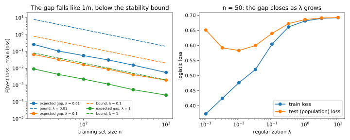
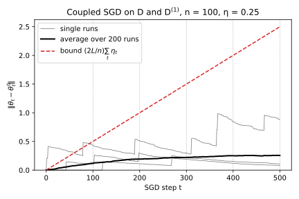
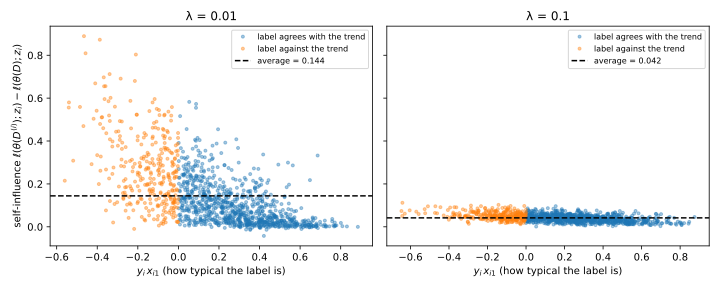
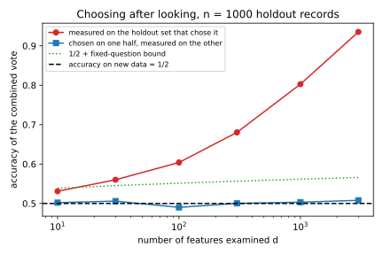

# Algorithmic stability and generalization

You train a model and its loss on the training data is low. Will its loss on new data be low too? The difference between the two is the **generalization gap**, and bounding it is the central question of learning theory. The classical answer counts the models an algorithm could output; this chapter looks at the algorithm instead.

The idea that organizes it fits in one sentence: a model generalizes when it does not depend much on any single training record. So if replacing one record can move the loss by at most $\gamma$ at every test point, a property called uniform stability, the expected gap is at most $\gamma$. The chapter computes $\gamma$ for regularized empirical risk minimization (ERM) and for stochastic gradient descent (SGD), and ends with the same bias reappearing when a holdout set is reused to choose what to measure.

The running example is logistic regression in ten dimensions. Features $x$ are uniform on the unit sphere in $\mathbb R^{10}$, and the label $y = \pm1$ is $+1$ with probability $\sigma(5x_1)$, where $\sigma(t) = 1/(1 + e^{-t})$ is the logistic function. The model is a weight vector $\theta$, chosen to minimize the average logistic loss $\ln(1 + e^{-y\langle\theta, x\rangle})$ plus a penalty $\frac\lambda2\|\theta\|^2$. With $n = 50$ records and $\lambda = 0.01$, averaged over 100 training sets, the training loss is 0.4603 and the test loss is 0.5781. With $n = 1{,}000$ records the gap shrinks to about 0.006, and the chapter explains why.

## Risk, empirical risk and the gap {#sec-stability-risk}

Before bounding the gap you need to say exactly what it is, and why it is not zero: training loss and future loss agree on average only for a model chosen before looking at the data.

::: {#def-stability-risk name="Risk, empirical risk and the gap"}
A **training set** $D = (z_1, \dots, z_n)$ is a list of $n$ records drawn independently from a distribution $\mathcal D$, the source of all data, past and future. A **training algorithm** $\mathcal T$ maps $D$ to a model $\mathcal T(D)$, and a **loss** $\ell(\theta; z) \ge 0$ says how badly the model $\theta$ does on the record $z$. The **population risk**, or test loss, of $\theta$ is its average loss on a new record, and its **empirical risk**, or training loss, is its average loss on the training set:
$$\mathcal L_{\mathcal D}(\theta) = \mathbb E_{z \sim \mathcal D}\big[\ell(\theta; z)\big], \qquad \mathcal L(\theta; D) = \frac1n\sum_{i=1}^n\ell(\theta; z_i).$$
The **generalization gap** of the trained model is the test loss minus the training loss,
$$\mathrm{gap}(D) = \mathcal L_{\mathcal D}(\mathcal T(D)) - \mathcal L(\mathcal T(D); D).$$
:::

The test loss cannot be computed, because $\mathcal D$ is unknown, so the training loss stands in for it, and for a fixed model it does so without bias.

::: {#prp-stability-fixed-model name="A fixed model's training loss is unbiased"}
Let $\theta$ be a model that does not depend on the training set $D$. Then
$$\mathbb E_D\big[\mathcal L(\theta; D)\big] = \mathcal L_{\mathcal D}(\theta).$$
:::

::: {.proof}
1. The expectation of an average is the average of the expectations, by linearity, so $\mathbb E_D[\mathcal L(\theta; D)] = \frac1n\sum_i\mathbb E[\ell(\theta; z_i)]$.
2. Each $z_i$ is a draw from $\mathcal D$ and $\theta$ is fixed, so each term $\mathbb E[\ell(\theta; z_i)]$ is the average loss of $\theta$ on a draw from $\mathcal D$, which is $\mathcal L_{\mathcal D}(\theta)$. The average of $n$ copies of it is itself.
:::

Step 2 is exactly what fails for the trained model $\mathcal T(D)$. The record $z_i$ helped to choose $\mathcal T(D)$, so it is no longer an independent draw from the model's point of view. The algorithm chose a model that does well on exactly these records, so the training loss is biased downward.

::: {#exm-stability-overfit}
In the running example with $n = 50$ and $\lambda = 0.01$, the average training loss over 100 training sets is 0.4603 and the average test loss, computed by numerical integration (@sec-stability-code), is 0.5781. The expected gap is about 0.119, not exactly their difference, because @exm-stability-gap estimates it with less noise. With $n = 1{,}000$ it is about 0.006.
:::

## Uniform stability and the expected gap {#sec-stability-uniform}

To control the gap you need to say how much $\mathcal T(D)$ depends on the training set: replace one record, retrain, and see how much the loss changes at any test point. This section turns that into a definition and proves that it bounds the expected gap.

The tool is a training set that differs from $D$ in one record. The **replace-one neighbour** $D^{(i)} = (z_1, \dots, z_{i-1}, z_i', z_{i+1}, \dots, z_n)$ is $D$ with record $i$ replaced by $z_i'$. In probability statements, the replacements $z_1', \dots, z_n'$ are fresh draws from $\mathcal D$, independent of each other and of $D$.

::: {#def-stability-uniform name="Uniform stability"}
A training algorithm $\mathcal T$ is **$\gamma$-uniformly stable** if for every training set $D$, every index $i$, every replacement $z_i'$ and every test point $z$,
$$\big|\ell(\mathcal T(D); z) - \ell(\mathcal T(D^{(i)}); z)\big| \le \gamma.$$ {#eq-stability-uniform}
If $\mathcal T$ is randomized, as SGD is through the order in which it visits records, the condition is on the expectation over its internal randomness:
$$\big|\mathbb E_{\mathcal T}\big[\ell(\mathcal T(D); z) - \ell(\mathcal T(D^{(i)}); z)\big]\big| \le \gamma.$$
:::

Usually $\gamma$ falls with $n$, because each record carries less weight in a larger training set (the literature writes it $\beta$, which this book keeps for a failure probability). In @fig-stability-neighbours one record's label is flipped, and the fitted model moves a lot when the penalty $\lambda$ is small and barely when it is large.

{#fig-stability-neighbours}

The main result needs one fact about independent draws: swapping two of them changes no expectation. Step 2 of the proof below uses it to exchange a training record with a fresh one.

::: {#lem-stability-swap name="Swapping two independent draws"}
Let $U$ and $V$ be independent and identically distributed (i.i.d.), and independent of a random variable $W$. Then $(U, V, W)$ and $(V, U, W)$ have the same distribution, so $\mathbb E[g(U, V, W)] = \mathbb E[g(V, U, W)]$ for every function $g$ whose expectation exists.
:::

::: {.proof}
1. By independence, the joint density of $(U, V, W)$ at $(u, v, w)$ is the product $\rho(u)\,\rho(v)\,\rho_W(w)$, where $\rho$ is the common density of $U$ and $V$, and $\rho_W$ is that of $W$. For discrete variables, read mass functions for densities.
2. Exchanging $u$ and $v$ leaves this product unchanged, because $U$ and $V$ share the density $\rho$. So the swapped triple has the same distribution, and every expectation computed from it agrees.
:::

The test loss of the trained model can be measured on a fresh point $z_i'$, and swapping the roles of $z_i$ and $z_i'$ keeps its average while turning it into the loss on $z_i$ of a model trained with $z_i'$ in its place, which never saw $z_i$.

::: {#thm-stability-identity name="The expected gap is an average replace-one effect"}
For any training algorithm $\mathcal T$, with the records of $D$ and the replacements $z_1', \dots, z_n'$ all i.i.d. from $\mathcal D$, and $\mathbb E$ averaging over all of them and over any randomness of $\mathcal T$,
$$\mathbb E_D\big[\mathrm{gap}(D)\big] = \frac1n\sum_{i=1}^n\mathbb E\Big[\ell\big(\mathcal T(D^{(i)}); z_i\big) - \ell\big(\mathcal T(D); z_i\big)\Big].$$ {#eq-stability-identity}
If $\mathcal T$ is moreover $\gamma$-uniformly stable, then
$$\big|\mathbb E_D[\mathrm{gap}(D)]\big| \le \gamma.$$ {#eq-stability-expected}
:::

::: {.proof}
The plan is to write the expected test loss with a fresh point, exchange that point with a training record by @lem-stability-swap, subtract the training loss, and bound each term by stability.

1. *Write the test loss with a fresh point.* The point $z_i'$ is independent of $D$ and has distribution $\mathcal D$, so given $D$ its average loss is the test loss of $\mathcal T(D)$. Averaging over $D$ too gives
$$\mathbb E\big[\mathcal L_{\mathcal D}(\mathcal T(D))\big] = \mathbb E\big[\ell(\mathcal T(D); z_i')\big] \quad\text{for every } i.$$
2. *Exchange $z_i$ and $z_i'$.* The two points are i.i.d. and independent of the other records, so by @lem-stability-swap exchanging them changes no expectation. The exchange turns $D$ into $D^{(i)}$ and $z_i'$ into $z_i$, so
$$\mathbb E\big[\ell(\mathcal T(D); z_i')\big] = \mathbb E\big[\ell(\mathcal T(D^{(i)}); z_i)\big].$$
3. *Average over $i$.* Steps 1 and 2 hold for every $i$, so the expected test loss is also the average $\frac1n\sum_i\mathbb E[\ell(\mathcal T(D^{(i)}); z_i)]$.
4. *Subtract the training loss.* By definition, the expected training loss is $\frac1n\sum_i\mathbb E[\ell(\mathcal T(D); z_i)]$. Both sums run over the same $i$, so their difference is the average of the differences, which is @eq-stability-identity.
5. *Bound each term.* Uniform stability at the test point $z = z_i$ puts each difference $\ell(\mathcal T(D^{(i)}); z_i) - \ell(\mathcal T(D); z_i)$ in $[-\gamma, \gamma]$ for every outcome. Expectations and averages of numbers in that interval stay in it, which is @eq-stability-expected. For a randomized $\mathcal T$, take the expectation over its randomness first.
:::

The identity is not a bound. It says that the expected gap *is* the average **replace-one self-influence**, how much the loss on $z_i$ rises when $z_i$ leaves the training set. So a large gap means that the model fits many records only because they were there, and @sec-stability-memorization measures this record by record.

The bound, by contrast, takes the worst case over everything, which is why $\gamma$ can sit far above the true gap, and why weaker notions that average over the data exist (Bousquet & Elisseeff 2002; Shalev-Shwartz et al. 2010). No count of models appears in it, so it covers SGD on large models.

::: {#exm-stability-renaming}
Step 2 is clearest with every outcome listed. Take $n = 1$: one record $z_1 \in \{0, 1\}$ with $\Pr[z_1 = 1] = 0.3$, and a fresh copy $z_1'$. The algorithm shrinks the data towards zero, $\mathcal T(D) = z_1/2$, and the loss is the squared error $\ell(\theta; z) = (\theta - z)^2$. @tbl-stability-renaming lists the four outcomes with the three losses of the proof.

| $(z_1, z_1')$ | Probability | Train $\ell(\mathcal T(D); z_1)$ | Test $\ell(\mathcal T(D); z_1')$ | Renamed $\ell(\mathcal T(D^{(1)}); z_1)$ |
| --- | --- | --- | --- | --- |
| $(0, 0)$ | $0.7 \times 0.7 = 0.49$ | $0$ | $0$ | $0$ |
| $(0, 1)$ | $0.7 \times 0.3 = 0.21$ | $0$ | $(0 - 1)^2 = 1$ | $(\tfrac12 - 0)^2 = 0.25$ |
| $(1, 0)$ | $0.3 \times 0.7 = 0.21$ | $(\tfrac12 - 1)^2 = 0.25$ | $(\tfrac12 - 0)^2 = 0.25$ | $(0 - 1)^2 = 1$ |
| $(1, 1)$ | $0.3 \times 0.3 = 0.09$ | $0.25$ | $0.25$ | $0.25$ |
| **Average** | | $0.075$ | $0.285$ | $0.285$ |

: Every outcome of the one-record case. The renamed column is the test column with the rows $(0, 1)$ and $(1, 0)$ exchanged. {#tbl-stability-renaming}

Row by row, the test and renamed columns differ, but the renamed column holds the same values attached to the mirror-image outcome, which has the same probability. That is all step 2 says. The expected gap, test minus train, is $0.285 - 0.075 = 0.21$, and so is renamed minus train. Changing $z_1$ from 0 to 1 moves the loss at $z = 1$ from 1 to 0.25 and at $z = 0$ from 0 to 0.25, so the largest change is $\gamma = 0.75$, above the gap. The running example has too many outcomes to list; @sec-stability-erm takes it up.
:::

## Regularized empirical risk minimization {#sec-stability-erm}

The bound of @thm-stability-identity is only as good as $\gamma$, so the next question is which algorithms have a small one. Regularized ERM is the first answer. Its penalty $\frac\lambda2\|\theta\|^2$ makes the objective a bowl with curvature at least $\lambda$, and one record, with weight $1/n$ in the objective, can only tilt such a bowl so far.

A loss is **$L$-Lipschitz** in the weights (@def-opt-constants) when moving the weights by a distance $r$ changes it by at most $Lr$ at every record, so its gradient never exceeds $L$ in norm. Regularized ERM returns the minimizer $\theta_D$ of the **regularized empirical risk**,
$$\mathcal L_\lambda(\theta; D) = \mathcal L(\theta; D) + \frac\lambda2\|\theta\|^2.$$
Replacing one record changes the objective's gradient by at most $2L/n$. The penalty makes the objective **$\lambda$-strongly convex**, curved by at least $\lambda$ in every direction, so a point where its gradient is small lies close to its minimizer, and the Lipschitz constant turns the weight change into a loss change.

::: {#thm-stability-erm name="Stability of regularized ERM"}
Let $\ell(\cdot; z)$ be convex, differentiable and $L$-Lipschitz for every record $z$, and let $\lambda > 0$. Then for every training set $D$, index $i$, replacement $z_i'$ and test point $z$,
$$\|\theta_D - \theta_{D^{(i)}}\| \le \frac{2L}{\lambda n} \quad\text{and}\quad \big|\ell(\theta_D; z) - \ell(\theta_{D^{(i)}}; z)\big| \le \frac{2L^2}{\lambda n}.$$ {#eq-stability-erm}
So regularized ERM is $\gamma$-uniformly stable with $\gamma = 2L^2/(\lambda n)$. Its weights also satisfy $\|\theta_D\| \le L/\lambda$, which bounds the loss in @exm-stability-be.
:::

::: {.proof}
1. *The weights.* The first bound is the sensitivity of regularized ERM, @thm-opt-erm-sensitivity, and its proof runs as follows. The two objectives differ only in the $i$-th term, and the gradient of the second is zero at its own minimizer $\theta_{D^{(i)}}$. So there the gradient of $\mathcal L_\lambda(\cdot; D)$ is the difference of two per-record gradients divided by $n$, of norm at most $2L/n$. A $\lambda$-strongly convex function's minimizer lies within the gradient norm divided by $\lambda$ of any point (@cor-opt-strong), here $2L/(\lambda n)$.
2. *The losses.* The loss is $L$-Lipschitz, so a weight change of at most $2L/(\lambda n)$ moves the loss at every test point by at most $2L^2/(\lambda n)$. This holds for every $D$, $i$, $z_i'$ and $z$, which is @def-stability-uniform.
3. *The norm.* The gradient of $\mathcal L_\lambda(\cdot; D)$ is zero at its minimizer, so $\lambda\theta_D = -\frac1n\sum_i\nabla\ell(\theta_D; z_i)$. The right side is an average of vectors of norm at most $L$, so dividing by $\lambda$ gives $\|\theta_D\| \le L/\lambda$.
:::

Doubling $\lambda$ halves $\gamma$, but a larger $\lambda$ also pulls the solution away from the best fit, so the test loss is U-shaped in $\lambda$ (@fig-stability-gap, right). The bound is loose in three places: it charges the gradient difference its worst case $2L$, it ignores the curvature of the training loss $\mathcal L(\theta; D)$ itself, and step 2 assumes the worst test point.

::: {#exm-stability-replace-one}
By the chain rule, the gradient of the logistic loss is $-y\,\sigma(-y\langle\theta, x\rangle)\,x$, of norm at most $\|x\| = 1$, so $L = 1$ and $\gamma = 2/(\lambda n)$ in the running example. The script refits on $D^{(i)}$ for 10 random $i$, with $z_i$ replaced by the same point with its label flipped. It records the largest weight change, and the largest loss change over 2,000 random test points and the four points along the direction the weights moved, where the loss changes most.

| $n$ | $\lambda$ | Largest weight change | Bound $2L/(\lambda n) = 2L^2/(\lambda n)$ | Largest loss change | Ratio |
| --- | --- | --- | --- | --- | --- |
| 100 | 0.01 | 0.406 | 2.0 | 0.340 | 0.17 |
| 100 | 0.1 | 0.0824 | 0.2 | 0.0474 | 0.24 |
| 100 | 1 | 0.00976 | 0.02 | 0.00505 | 0.25 |
| 1,000 | 0.1 | 0.00809 | 0.02 | 0.00499 | 0.25 |
| 10,000 | 0.01 | 0.00336 | 0.02 | 0.00285 | 0.14 |
| 10,000 | 1 | $9.76\times10^{-5}$ | $2\times10^{-4}$ | $5.00\times10^{-5}$ | 0.25 |

: Replace-one changes of regularized logistic regression against @eq-stability-erm. With $L = 1$ the weight and loss bounds coincide. Ratio is the loss change over its bound. {#tbl-stability-replace-one}

For $\lambda \ge 0.1$ the changes follow $1/(\lambda n)$ closely (@fig-stability-erm-bound). At $\lambda = 0.01$ the training loss's own curvature adds to $\lambda$, so the ratio drops to about 0.15.

For $\lambda = 1$ the ratio is 0.25, made of two factors of 2. At the same $\theta$, the gradients for labels $y$ and $-y$ are $-y\,\sigma(-y\langle\theta, x\rangle)x$ and $y\,\sigma(y\langle\theta, x\rangle)x$, and since $\sigma(-t) + \sigma(t) = 1$ their difference is $-yx$, of norm 1 rather than $2L = 2$. So the weights move by 0.00976, half the bound. With $\|\theta\| \le 1/\lambda = 1$ the weights are small and test margins are near zero, where the slope of the logistic loss is $\sigma(0) = \frac12$, so the loss moves by 0.00505, half the weight change.
:::

{#fig-stability-erm-bound}

::: {#exm-stability-gap}
@eq-stability-expected bounds the expected gap by the same $\gamma = 2/(\lambda n)$. The script averages the gap over 100 training sets, and subtracts the gap of a fixed reference model, fitted once on a separate sample of 20,000 records, on the same training set. That gap has mean zero by @prp-stability-fixed-model but moves with the same lucky or unlucky training sets, so subtracting it cancels most of the noise.

| $\lambda$ | $n$ | Train loss | Test loss | Expected gap | Bound $2/(\lambda n)$ | Gap / bound |
| --- | --- | --- | --- | --- | --- | --- |
| 0.01 | 50 | 0.4603 | 0.5781 | 0.119 | 4.0 | 0.030 |
| 0.01 | 1,000 | 0.5311 | 0.5381 | 0.00596 | 0.2 | 0.030 |
| 0.1 | 50 | 0.6073 | 0.6401 | 0.0319 | 0.4 | 0.080 |
| 0.1 | 200 | 0.6288 | 0.6373 | 0.00830 | 0.1 | 0.083 |
| 0.1 | 1,000 | 0.6346 | 0.6365 | 0.00178 | 0.02 | 0.089 |
| 1 | 50 | 0.6806 | 0.6854 | 0.00459 | 0.04 | 0.115 |
| 1 | 1,000 | 0.6852 | 0.6855 | 0.000253 | 0.002 | 0.127 |

: Expected generalization gap of regularized logistic regression, averaged over 100 training sets, against the stability bound. {#tbl-stability-gap}

The gap falls like $1/n$ and stays a fixed fraction of the bound: about 3% for $\lambda = 0.01$, and 11% to 13% for $\lambda = 1$. Part of the slack is the ratio of about 0.25 in @tbl-stability-replace-one, and the rest is that the gap averages over test points and replacements, while the bound takes the worst of both.
:::

{#fig-stability-gap}

## High probability: the Bousquet–Elisseeff bound {#sec-stability-high-probability}

@eq-stability-expected controls the gap on average, but you train once, so you need the gap of your model to be small with high probability. The gap is a function of $n$ independent records, and stability bounds how much one record can move it, which is the setting of **McDiarmid's inequality** (@thm-conc-mcdiarmid). Suppose that changing only the record $z_i$ changes a function $g(D)$ by at most $c_i$, whatever the values of the other records. Then for every $t > 0$,
$$\Pr\big[g(D) - \mathbb E\,g(D) \ge t\big] \le \exp\Big(-\frac{2t^2}{\sum_ic_i^2}\Big).$$
Setting the right side equal to a failure probability $\beta$ and solving for $t$ gives the deviation $t = \sqrt{\frac12\sum_ic_i^2\ln(1/\beta)}$.

The theorem below adds this deviation and $\gamma$ to the training loss. It is Theorem 12 of Bousquet & Elisseeff (2002), who define stability by removing a record; replace-one stability is at most twice that.

::: {#thm-stability-be name="Bousquet–Elisseeff bound"}
Let $\mathcal T$ be $\gamma$-uniformly stable, let the loss take values in $[0, K]$, and let $\beta \in (0, 1)$. Then with probability at least $1 - \beta$ over the training set $D$,
$$\mathcal L_{\mathcal D}(\mathcal T(D)) \le \mathcal L(\mathcal T(D); D) + \gamma + (2n\gamma + K)\sqrt{\frac{\ln(1/\beta)}{2n}}.$$ {#eq-stability-be}
:::

::: {.proof}
First bound how much one record can move the gap, then feed that to McDiarmid's inequality with $g = \mathrm{gap}$, and bound the mean by @thm-stability-identity.

1. *One record and the test loss.* Replacing $z_i$ moves $\ell(\mathcal T(D); z)$ by at most $\gamma$ at every $z$, by uniform stability. The test loss is an average of these losses over $z$, so it also moves by at most $\gamma$.
2. *One record and the training loss.* The training losses on $D$ and on $D^{(i)}$ share $n - 1$ terms. Each shared term $\frac1n\ell(\cdot; z_j)$ is evaluated at the same point under two models, so by stability it moves by at most $\gamma/n$. The two unshared terms are evaluated at different points, $z_i$ and $z_i'$, so stability says nothing about them, but both lie in $[0, K/n]$. The total change is at most $\frac{n - 1}n\gamma + \frac Kn \le \gamma + \frac Kn$.
3. *Bounded differences.* The gap is the test loss minus the training loss, so by the triangle inequality its change is at most $c_i = 2\gamma + K/n$. Uniform stability holds for every training set and replacement, so this holds for all values of the records, as McDiarmid's inequality requires.
4. *Apply McDiarmid's inequality.* All $n$ constants are equal, so the deviation $\sqrt{\frac12\sum_ic_i^2\ln(1/\beta)}$ is $\sqrt n\,(2\gamma + K/n)\sqrt{\ln(1/\beta)/2}$. Multiplying inside and out by $\sqrt n$ rewrites it, so with probability at least $1 - \beta$,
$$\mathrm{gap}(D) < \mathbb E\big[\mathrm{gap}(D)\big] + (2n\gamma + K)\sqrt{\frac{\ln(1/\beta)}{2n}}.$$
5. *Bound the mean.* By @eq-stability-expected the expected gap is at most $\gamma$. Substitute it, and move the training loss to the right-hand side.
:::

Call the **width** of the bound everything it adds to the training loss. Its part $K\sqrt{\ln(1/\beta)/(2n)}$ is what Hoeffding's inequality gives for one fixed model. Its stability part, $2n\gamma\sqrt{\ln(1/\beta)/(2n)} = \gamma\sqrt{2n\ln(1/\beta)}$, goes to zero only if $\gamma\sqrt n \to 0$. With $\gamma$ of order $1/n$, as for regularized ERM, the width falls like $1/\sqrt n$, and with $\gamma$ of order $1/\sqrt n$ it does not fall at all (@fig-stability-high-probability).

The looseness comes from step 3, which charges every record the full $2\gamma$ although their effects largely average out. Later work (Feldman & Vondrák 2018, 2019; Bousquet, Klochkov & Zhivotovskiy 2020) reached, for $K = 1$ and up to constant factors (which is what $\lesssim$ means),
$$\mathrm{gap} \lesssim \gamma\ln n\,\ln(1/\beta) + \sqrt{\frac{\ln(1/\beta)}{n}},$$
so that $\gamma$ of order $1/\sqrt n$ also gives a gap of order $1/\sqrt n$ up to log factors.

{#fig-stability-high-probability}

::: {#exm-stability-be}
By @thm-stability-erm, regularized logistic regression in the running example has $\gamma = 2/(\lambda n)$ and weights of norm at most $1/\lambda$. By the Cauchy–Schwarz inequality with $\|x\| = 1$, the margin $y\langle\theta, x\rangle$ is at least $-1/\lambda$, so the largest loss is $K = \ln(1 + e^{1/\lambda})$. With $n = 10{,}000$ and $\beta = 0.05$ the common factor is $\sqrt{\ln 20/20{,}000} = 0.01224$, and with $2n\gamma = 4/\lambda$ the width is $\gamma + (4/\lambda + K)\times0.01224$. At $\lambda = 1$, with $K = 1.313$, that is $2\times10^{-4} + (4 + 1.313)\times0.01224 = 0.065$. At $\lambda = 0.1$, with $K = 10.000$, it is $0.002 + (40 + 10)\times0.01224 = 0.614$.

In both cases the stability term, $2n\gamma \times 0.01224$, is three quarters or more of the width, while the expected gap at $\lambda = 1$ is only $2.53\times10^{-4}$ even at the smaller $n = 1{,}000$ (@tbl-stability-gap). So the bound is valid but loose.
:::

## Stochastic gradient descent {#sec-stability-sgd}

Large models are trained by SGD, whose steps each pick one training record at random and move the weights a little against the gradient of its loss. Hardt, Recht & Singer (2016) showed that SGD is stable, with a $\gamma$ that grows with the sum of the learning rates.

Two SGD runs, one on $D$ and one on $D^{(i)}$, can only drift apart on the steps that pick record $i$. Each such step pushes them apart by at most $2\eta_tL$, where $\eta_t$ is the learning rate at step $t$, and it happens with probability $1/n$. On every other step both runs take a gradient step on the same loss, and the lemma below says that such a step never pushes two points apart. It needs the loss to be **$\beta_s$-smooth**: its gradient changes by at most $\beta_s$ per unit of distance (@def-opt-constants; the subscript keeps $\beta$ for the failure probability).

::: {#lem-stability-nonexpansive name="A short gradient step is non-expansive"}
Let $h$ be convex and $\beta_s$-smooth, let $0 \le \eta \le 2/\beta_s$, and let $\psi(\theta) = \theta - \eta\nabla h(\theta)$ be one gradient step. Then for all $\theta$ and $\theta'$,
$$\|\psi(\theta) - \psi(\theta')\| \le \|\theta - \theta'\|.$$
:::

::: {.proof}
We expand the squared distance after the step and bound its cross term by a property of the gradient.

1. *Co-coercivity.* For a convex $\beta_s$-smooth function, two gradients that differ by a lot must come from points far apart along the direction of their difference. Writing $g = \nabla h(\theta) - \nabla h(\theta')$,
$$\langle g, \theta - \theta'\rangle \ge \frac1{\beta_s}\|g\|^2.$$
This is Theorem 2.1.5 of Nesterov (2004), and @sec-apx-opt-cocoercive in the appendices derives it step by step.
2. *Expand the square.* The difference of the two steps is $(\theta - \theta') - \eta g$, so
$$\|\psi(\theta) - \psi(\theta')\|^2 = \|\theta - \theta'\|^2 - 2\eta\langle g, \theta - \theta'\rangle + \eta^2\|g\|^2.$$
3. *Use co-coercivity.* Replacing the inner product by the smaller $\|g\|^2/\beta_s$ of step 1 can only increase the right side, so
$$\|\psi(\theta) - \psi(\theta')\|^2 \le \|\theta - \theta'\|^2 - \eta\Big(\frac2{\beta_s} - \eta\Big)\|g\|^2.$$
4. *Conclude.* When $\eta \le 2/\beta_s$ the subtracted term is not negative, so the distance does not grow.
:::

The condition on $\eta$ is needed: on $h(\theta) = \frac{\beta_s}2\theta^2$ the step multiplies distances by $|1 - \eta\beta_s|$, which exceeds 1 when $\eta > 2/\beta_s$.

The stability of SGD, @thm-stability-sgd, is Theorem 3.8 of Hardt, Recht & Singer (2016).

::: {#thm-stability-sgd name="Stability of SGD"}
Let $\ell(\cdot; z)$ be convex, $\beta_s$-smooth and $L$-Lipschitz for every record $z$. Run SGD for $T$ steps from a starting point $\theta_0$. Step $t$ draws an index $I_t$ uniformly from $\{1, \dots, n\}$, independently of the earlier steps, and updates
$$\theta_t = \theta_{t-1} - \eta_t\nabla\ell(\theta_{t-1}; z_{I_t}), \qquad \eta_t \le \frac2{\beta_s}.$$
Let $\theta_t'$ be the run on $D^{(i)}$ with the same indices and starting point, and $r_t = \|\theta_t - \theta_t'\|$ the distance between the runs. Then $\mathbb E\,r_T \le \frac{2L}n\sum_{t=1}^T\eta_t$, and the output $\theta_T$ is uniformly stable in expectation over the indices, with
$$\gamma \le \frac{2L^2}{n}\sum_{t=1}^T\eta_t.$$ {#eq-stability-hrs}
:::

::: {.proof}
We couple the two runs, bound the growth of their distance in one step, average over the index, and add up the steps. Sharing the indices is allowed because the stability condition involves only the difference of the two runs' average losses, and each run's average is the same whichever indices the other run uses. Both runs start at $\theta_0$, so $r_0 = 0$.

1. *Same record picked.* With probability $1 - 1/n$, the index $I_t$ is not $i$, and both runs take a gradient step on the same loss. That step does not increase distances, by @lem-stability-nonexpansive, so $r_t \le r_{t-1}$.
2. *Differing record picked.* With probability $1/n$, one run steps on $z_i$ and the other on $z_i'$, and the lemma does not apply. The new difference is the old one minus $\eta_t\nabla\ell(\theta_{t-1}; z_i)$ plus $\eta_t\nabla\ell(\theta_{t-1}'; z_i')$, and each gradient has norm at most $L$, so the triangle inequality gives
$$r_t \le r_{t-1} + 2\eta_tL.$$
3. *Average over the index.* The index $I_t$ is drawn fresh, so it is independent of $r_{t-1}$. Weighting the two cases by their probabilities,
$$\mathbb E\,r_t \le \Big(1 - \frac1n\Big)\mathbb E\,r_{t-1} + \frac1n\big(\mathbb E\,r_{t-1} + 2\eta_tL\big) = \mathbb E\,r_{t-1} + \frac{2\eta_tL}n.$$
4. *Add up the steps.* Starting from $r_0 = 0$ and adding the increments of steps 1 to $T$ gives $\mathbb E\,r_T \le \frac{2L}n\sum_t\eta_t$.
5. *From weights to losses.* The loss is $L$-Lipschitz, so at every test point the loss difference is at most $L\,r_T$ in absolute value, and its expectation is at most $L\,\mathbb E\,r_T$, which is @eq-stability-hrs.
:::

So stability degrades linearly with training time (@fig-stability-sgd-divergence). With a constant step $\eta$ and $m$ epochs (passes over the data), so $T = mn$ steps, the bound is $\gamma \le 2L^2\eta m$, and for a fixed number of epochs it does not improve with more data. Training longer lowers the training loss but raises $\gamma$, and the test loss is the training loss plus the gap, so there is a case for stopping early. @sec-apx-opt-early-stop in the appendices finds the training time that balances the two.

The bound is loose because step 1 only uses that a step does not expand distances. A step on a curved loss often contracts them, and a strongly convex loss makes the bound independent of $T$.

::: {#exm-stability-sgd}
Take $n = 100$ records of the running example, no penalty, and a constant step $\eta = 0.25$. At margin $t$ the logistic loss has second derivative $\sigma(t)(1 - \sigma(t))$, a product of two numbers that sum to 1, so at most $\frac14$. With $\|x\| \le 1$ that gives $\beta_s = \frac14$, and $\eta \le 2/\beta_s = 8$ holds. The script averages over 100 coupled pairs of runs, with $z_1$ replaced by a fresh draw, and with $L = 1$ both bounds are $0.5m$.

| Epochs | Train loss | Test loss | Gap | Bound $2L\eta m = 2L^2\eta m$ | Mean $\Vert\theta_T - \theta_T'\Vert$ |
| --- | --- | --- | --- | --- | --- |
| 1 | 0.559 | 0.596 | 0.036 | 0.5 | 0.130 |
| 2 | 0.515 | 0.567 | 0.052 | 1.0 | 0.189 |
| 5 | 0.478 | 0.557 | 0.079 | 2.5 | 0.277 |
| 10 | 0.470 | 0.567 | 0.097 | 5.0 | 0.363 |
| 20 | 0.467 | 0.582 | 0.115 | 10.0 | 0.355 |
| 40 | 0.467 | 0.588 | 0.121 | 20.0 | 0.395 |

: SGD on unregularized logistic regression, $n = 100$, $\eta = 0.25$, averaged over 100 runs. With $L = 1$ the distance and loss bounds coincide. {#tbl-stability-sgd}

The gap grows with the epochs, and the test loss is lowest after about 5 (@fig-stability-sgd-epochs). The bound is loose by a factor of 14 after one epoch ($0.5/0.036$) and of 165 after 40 ($20.0/0.121$), because the distance between the runs levels off near 0.4 while the bound on it grows linearly.
:::

{#fig-stability-sgd-divergence}

{#fig-stability-sgd-epochs}

## An unstable algorithm: 1-nearest neighbour {#sec-stability-nn}

An algorithm without stability shows what stability rules out. The nearest neighbour (NN) rule with one neighbour, 1-NN, predicts the label of the closest training point, so it fits every training record by using that record itself. It is scored with the **0-1 loss**, which is 1 for a wrong prediction and 0 for a right one. With $p(x) = \Pr[y = 1 \mid x]$, the best rule, the **Bayes classifier**, predicts the more likely label at each $x$, with error $\mathbb E[\min(p(x), 1 - p(x))]$.

::: {#prp-stability-nn name="1-NN is maximally unstable"}
Score 1-NN with the 0-1 loss, and assume the training points are distinct. Then its training error is 0, and it is $\gamma$-uniformly stable only for $\gamma = 1$, the largest possible value. If moreover the features take values in a closed and bounded set on which $p$ is continuous, its expected test error tends to $\mathbb E[2p(x)(1 - p(x))]$ as $n \to \infty$ (Cover & Hart 1967). So when $p(x)$ lies strictly between 0 and 1 with positive probability, its gap stays bounded away from zero.
:::

::: {.proof}
1. *Training error.* Each training point is its own nearest neighbour, so it is predicted with its own label.
2. *Stability.* Take any $D$ and the test point $z_i = (x_i, y_i)$. On $D$ the prediction at $x_i$ is $y_i$, with loss 0. Replace $z_i$ by $(x_i, -y_i)$, the same point with the opposite label. On $D^{(i)}$ that point is the nearest neighbour of $x_i$, so the prediction is $-y_i$, with loss 1.
3. *The limit.* As $n$ grows, the nearest neighbour of a test point $x$ lies arbitrarily close to $x$, so its label is $+1$ with probability close to $p(x)$. The test label is an independent draw with probability $p(x)$, and the two disagree with probability $p(1 - p) + (1 - p)p = 2p(1 - p)$. Making "arbitrarily close" precise is Cover and Hart's theorem, which @sec-apx-opt-nn in the appendices proves under the stated assumptions.
4. *The gap.* By step 1 the gap equals the test error, whose limit is positive under that condition on $p$.
:::

So zero training error says nothing here. 1-NN is a reasonable classifier: $2p(1 - p)$ is $2\min(p, 1 - p)$ times $\max(p, 1 - p) \le 1$, so its limiting error is within twice the Bayes error. But its training error does not tell you how close it gets. With $\gamma = 1$, @eq-stability-expected only says that the gap is at most 1, which every 0-1 loss satisfies anyway.

A majority vote over several nearest neighbours rarely changes when one record is replaced, although its worst-case $\gamma$ is still 1, and notions of stability that average over the data capture its behaviour (Devroye & Wagner 1979).

::: {#exm-stability-nn}
In the running example the Bayes error is 0.250 and the 1-NN limit $\mathbb E[2p(1 - p)]$ is 0.338, both computed by numerical integration. @tbl-stability-nn compares 1-NN with regularized logistic regression, averaging over 10 training sets, with 0-1 error measured on 2,000 test points.

| $n$ | 1-NN train | 1-NN test | Logistic ($\lambda = 0.01$) train | Logistic test |
| --- | --- | --- | --- | --- |
| 50 | 0.000 | 0.404 | 0.170 | 0.301 |
| 200 | 0.000 | 0.380 | 0.232 | 0.274 |
| 1,000 | 0.000 | 0.367 | 0.244 | 0.266 |
| 4,000 | 0.000 | 0.352 | 0.249 | 0.259 |

: 0-1 error of 1-nearest neighbour and of regularized logistic regression. {#tbl-stability-nn}

The gap of 1-NN is its test error, which falls towards 0.338 and no further. The gap of the stable logistic regression falls from $0.301 - 0.170 = 0.131$ at $n = 50$ to $0.259 - 0.249 = 0.010$ at $n = 4{,}000$ (@fig-stability-nearest-neighbour).
:::

![Train (dashed) and test (solid) 0-1 error of 1-nearest neighbour and of regularized logistic regression against $n$, with the Bayes error and the 1-NN limit $\mathbb E[2p(1-p)]$.](figures/stability_nearest_neighbour.svg){#fig-stability-nearest-neighbour}

## Memorization of individual records {#sec-stability-memorization}

@thm-stability-identity says that the expected gap is an average over training records of how much each record's own loss rises when it is replaced. That quantity can be measured directly by retraining, and measuring it shows which records carry the gap.

::: {#def-stability-self-influence name="Self-influence"}
The **self-influence**, or **memorization score**, of training record $i$ is its loss under the model trained with a fresh point in its place, minus its loss under the model trained with it:
$$\mathrm{mem}_i(D) = \ell\big(\mathcal T(D^{(i)}); z_i\big) - \ell\big(\mathcal T(D); z_i\big).$$
:::

By @eq-stability-identity, the expected gap is the average of the expected self-influences. Uniform stability caps each of them at $\gamma$, but only their average matters. Feldman (2020) uses the same idea with removal instead of replacement and accuracy instead of loss.

The contributions are uneven. Typical records are fitted well whether or not they are present, because similar records carry the same information, while atypical records, such as mislabelled points, are fitted only if they are in the training set. Memorization can still be necessary: Feldman (2020) shows that when the data contain many rare subpopulations, each seen about once, an algorithm that does not memorize them loses accuracy on them. Deep networks even fit random labels (Zhang et al. 2017), and score highest on atypical images (Feldman & Zhang 2020).

::: {#exm-stability-self-influence}
The script draws training sets of $n = 40$ points and, for each $i$, replaces $z_i$ by a fresh draw, refits, and records $\mathrm{mem}_i$. Over 100 training sets, with ± one standard error, the measured gap and the average self-influence agree, as the identity requires. At $\lambda = 0.01$ they are $0.1482 \pm 0.0073$ and $0.1422 \pm 0.0025$, and at $\lambda = 0.1$ they are $0.0420 \pm 0.0017$ and $0.0416 \pm 0.0003$.

To see which records carry the gap, split them by whether the label goes with the trend ($y_ix_{i1} \ge 0$, the more likely label, since $\sigma(5x_1) > \frac12$ exactly when $x_1 > 0$) or against it. About a quarter go against it (24% and 25% at the two values of $\lambda$). At $\lambda = 0.01$ their average self-influence is 0.284, three times the 0.097 of the others. At $\lambda = 0.1$ the two are 0.055 and 0.037, so regularization flattens the profile (@fig-stability-self-influence).
:::

{#fig-stability-self-influence}

## Choosing what to measure after looking {#sec-stability-adaptive}

A holdout set is a sample kept aside for judging models, and by @prp-stability-fixed-model it judges a model fixed in advance without bias. In practice you look at its verdict, change a feature, and ask again, so each new question depends on the holdout set. This section shows that the guarantee then fails, and what restores it.

::: {#def-stability-question name="Questions to a holdout set"}
A **holdout set** $H = (z_1, \dots, z_n)$ is a list of $n$ records drawn independently from $\mathcal D$. A **question** is a function $f$ that maps one record to a number in $[0, 1]$, such as "is this record classified correctly by a given model?". Its answer on the holdout set, written $f(H)$, and its true value are
$$f(H) = \frac1n\sum_{i=1}^nf(z_i), \qquad f(\mathcal D) = \mathbb E_{z \sim \mathcal D}\big[f(z)\big].$$
A question is **fixed in advance** if it was chosen before $H$ was drawn, and **chosen after looking** if it may depend on answers already given on $H$.
:::

Many questions fixed in advance can share one holdout set, because the largest error among $k$ answers grows only with the logarithm of $k$. The proof needs Hoeffding's lemma (@lem-conc-hoeffding): a centred random variable with values in an interval of length $c$ has moment generating function at most $e^{s^2c^2/8}$ at every real $s$.

::: {#thm-stability-fixed-questions name="Questions fixed in advance"}
If $k$ questions $f_1, \dots, f_k$ are all fixed in advance, then
$$\mathbb E\Big[\max_{j \le k}\big|f_j(H) - f_j(\mathcal D)\big|\Big] \le \sqrt{\frac{\ln(2k)}{2n}}.$$ {#eq-stability-fixed-questions}
:::

::: {.proof}
The plan is to bound the moment generating function of one error, combine the $2k$ signed errors through the exponential of their maximum, and choose $s$ to balance the two resulting terms.

1. *One error.* Write $Z_j = f_j(H) - f_j(\mathcal D)$ for the error of question $j$. Because $f_j$ is fixed while the records are drawn, $Z_j$ is an average of $n$ independent values $f_j(z_i)$ in $[0, 1]$ minus their common mean. Each centred term $f_j(z_i)/n$ lies in an interval of length $1/n$, so Hoeffding's lemma bounds its moment generating function by $e^{s^2/(8n^2)}$. Multiplying the $n$ independent bounds gives, for every real $s$,
$$\mathbb E\big[e^{sZ_j}\big] \le e^{s^2/(8n)}.$$
Since $s$ may be negative, the same bound holds for $-Z_j$.
2. *The largest of $2k$.* The largest error is the maximum of the $2k$ variables $\pm Z_j$. For $s > 0$, Jensen's inequality for the convex function $e^x$ moves the expectation inside the exponential, and the exponential of a maximum is at most the sum of the exponentials:
$$e^{s\,\mathbb E\max} \le \mathbb E\big[e^{s\max}\big] \le \sum_{\text{all } 2k}\mathbb E\big[e^{\pm sZ_j}\big] \le 2k\,e^{s^2/(8n)}.$$
3. *Take logarithms.* Dividing the logarithm by $s$ bounds the expected maximum by a sum of two terms,
$$\mathbb E\max \le \frac{\ln(2k)}s + \frac s{8n}.$$
4. *Balance.* The two terms are equal, each $\sqrt{\ln(2k)/(8n)}$, at $s = \sqrt{8n\ln(2k)}$, and their sum is @eq-stability-fixed-questions. The argument never used independence between the questions.
:::

Step 1 is where looking breaks the argument. A question chosen from earlier answers depends on $H$, so its values on $H$ are not independent draws, just as in @sec-stability-risk, and @exm-stability-freedman shows how large the error can be. The remedy is to never let a record answer a question it helped to choose.

::: {#prp-stability-splitting name="Sample splitting"}
Split $H$ into $k$ disjoint parts $H_1, \dots, H_k$ of $n/k$ records each, and answer question $j$ on $H_j$ only. Let each $f_j$ depend only on the answers on $H_1, \dots, H_{j-1}$ and on randomness of the analyst that is independent of $H$. Then, however the questions are chosen,
$$\mathbb E\Big[\max_{j \le k}\big|f_j(H_j) - f_j(\mathcal D)\big|\Big] \le \sqrt{\frac{k\ln(2k)}{2n}}.$$ {#eq-stability-splitting}
:::

::: {.proof}
1. *Each question is fixed for its own part.* Fix the parts $H_1, \dots, H_{j-1}$ and the analyst's randomness. Then $f_j$ is fixed and $H_j$ is independent of it, so step 1 of the proof of @thm-stability-fixed-questions holds given those parts, with $n/k$ records in place of $n$.
2. *Remove the conditioning.* That bound holds for every value of the earlier parts, so it holds after averaging over them.
3. *Finish as before.* Steps 2 to 4 of that proof then apply unchanged, with $n/k$ in place of $n$.
:::

A question chosen with the holdout set's help is like a model trained on it: the analyst is a learning algorithm whose input is $H$, and the answer to the final question plays the part of a training loss, optimistic for the same reason. Splitting removes the bias at the price of a factor $k$. If the questions come in $r$ rounds, and every question of a round is fixed before that round's answers are seen, one part per round suffices, and the factor $k$ in front of $\ln(2k)$ becomes $r$. The classical rule is one round: keep a test set for one final verdict, and use it once.

An analyst's choices ("keep the feature if it looks predictive") are thresholds, which one record can flip, so analysts are rarely stable. A later chapter reuses one holdout set safely for many adaptive questions with a randomized form of stability.

::: {#exm-stability-freedman}
The script builds a holdout set of $n = 1{,}000$ records with $d$ random $\pm1$ features and a random label independent of them all, so no rule beats an accuracy of $\frac12$ on new data. An analyst measures how often each feature agrees with the label, which is $d$ questions fixed in advance, An agreement rate of a feature independent of the label is an average of $n$ fair coin flips, with standard deviation $\sqrt{1/(4n)} = 0.0158$, and the analyst keeps the features more than that far from $\frac12$. The kept features then vote. A feature that agreed less than half the time votes the opposite of its value, and a tie counts as $+1$. Then the analyst asks one question chosen after looking: the vote's accuracy on the same holdout set (@tbl-stability-adaptive, 100 repetitions).

| Features $d$ | Kept | Largest error of the $d$ fixed questions | Bound @eq-stability-fixed-questions | Vote, measured on $H$ | Vote, chosen on one half and measured on the other | Vote on new data |
| --- | --- | --- | --- | --- | --- | --- |
| 100 | 33.3 | 0.0436 | 0.0515 | 0.6080 | 0.5032 | 0.5 |
| 1,000 | 325.9 | 0.0538 | 0.0616 | 0.8053 | 0.5018 | 0.5 |

: A holdout set of 1,000 records reused for a question chosen after looking, averaged over 100 repetitions. Every feature is independent of the label, so the true accuracy of any vote is $\frac12$. {#tbl-stability-adaptive}

The $d$ fixed questions stay below the bound, while the question chosen after looking is off by 0.31 with 1,000 features. Every kept feature agrees with the holdout labels slightly more often than chance, and the vote adds these small agreements up. Choosing the features on one half and measuring on the other brings the accuracy back to $\frac12$ (@fig-stability-holdout-reuse), and two parts suffice because the questions come in two rounds, the $d$ agreement rates and then the vote. This is Freedman's paradox (Freedman 1983), also a trap in cross-validation (Hastie, Tibshirani & Friedman 2009, §7.10.2).
:::

{#fig-stability-holdout-reuse}

## Code {#sec-stability-code}

The script [code/stability.py](../../code/part01-prerequisites/stability.py) computes every number in this chapter and draws every figure. By symmetry the test loss depends only on $\theta_1$ and the norm of the other coordinates, so it is computed exactly as a two-dimensional integral. From the repository root:

```bash
uv run python code/part01-prerequisites/stability.py
```

| Experiment | Result |
| --- | --- |
| Renaming (@tbl-stability-renaming) | Train 0.0750; test 0.2850; renamed 0.2850; gap 0.2100; $\gamma = 0.75$ |
| Replace-one change (@tbl-stability-replace-one) | 0.14 to 0.25 of $2L^2/(\lambda n)$ |
| Expected gap (@tbl-stability-gap) | About 3% of the bound at $\lambda = 0.01$, 11% to 13% at $\lambda = 1$ |
| High-probability width, $n = 10{,}000$ | 0.065 at $\lambda = 1$; 0.614 at $\lambda = 0.1$ |
| Self-influence, $n = 40$ | Gap $0.1482 \pm 0.0073$ against $0.1422 \pm 0.0025$ ($\lambda = 0.01$); $0.0420 \pm 0.0017$ against $0.0416 \pm 0.0003$ ($\lambda = 0.1$) |
| SGD (@tbl-stability-sgd) | Gap 0.036 after 1 epoch, 0.121 after 40; bound 0.5 and 20.0 |
| 1-NN (@tbl-stability-nn) | Test error 0.404 → 0.352; limit 0.338; Bayes 0.250 |
| Reused holdout set (@tbl-stability-adaptive) | Vote 0.8053 on the set that chose it, 0.5018 with a split |

: The script's output with the default seed. {#tbl-stability-code}

[tests/test_stability.py](../../tests/test_stability.py) checks that the output still matches.

## Summary {#sec-stability-summary}

| Result | Statement | Use |
| --- | --- | --- |
| @prp-stability-fixed-model | A fixed model's training loss is unbiased | Holdout sets used once; variance reduction |
| @lem-stability-swap | Swapping two i.i.d. draws changes no expectation | The renaming step |
| @thm-stability-identity | Expected gap $=$ average replace-one effect; $\lvert\mathbb E[\mathrm{gap}]\rvert \le \gamma$ | Overfitting as dependence on single records; needs $\gamma \to 0$ |
| @thm-stability-erm | $\Vert\theta_D - \theta_{D^{(i)}}\Vert \le 2L/(\lambda n)$, $\gamma = 2L^2/(\lambda n)$ | Choosing $\lambda$; $\gamma \propto 1/\lambda$ |
| @thm-stability-be | $\mathrm{gap} \le \gamma + (2n\gamma + K)\sqrt{\ln(1/\beta)/(2n)}$ w.p. $1 - \beta$ | The model you trained; needs $\gamma\sqrt n \to 0$ |
| @lem-stability-nonexpansive | A step with $\eta \le 2/\beta_s$ on a convex $\beta_s$-smooth function is non-expansive | Coupled SGD runs |
| @thm-stability-sgd | $\gamma \le (2L^2/n)\sum_t\eta_t$ | Epochs and early stopping; $\gamma \propto \eta T$ |
| @prp-stability-nn | 1-NN: training error 0, $\gamma = 1$, test error $\to \mathbb E[2p(1 - p)]$ | Training error 0 is a warning, not a result |
| @def-stability-self-influence | Average self-influence $=$ expected gap | Atypical records are memorized most |
| @thm-stability-fixed-questions | $\sqrt{\ln(2k)/(2n)}$ for $k$ questions fixed in advance | Comparing fixed models on one holdout set |
| @prp-stability-splitting | $\sqrt{k\ln(2k)/(2n)}$ with one part per question | Give each round its own data; use the test set once |

: The results of this chapter, and where each is used. {#tbl-stability-summary}

## References {#sec-stability-references}

- Bousquet & Elisseeff, "Stability and Generalization" (JMLR 2002): defines uniform and weaker stability notions; Theorem 12 is the high-probability bound.
- Shalev-Shwartz & Ben-David, *Understanding Machine Learning* (2014), ch. 13: the clearest textbook treatment; Theorem 13.2 is @eq-stability-identity and Corollary 13.6 the regularized-ERM bound. Chapter 14 covers SGD convergence.
- Hardt, Recht & Singer, "Train Faster, Generalize Better: Stability of Stochastic Gradient Descent" (ICML 2016): SGD stability for convex (Theorem 3.8), strongly convex and non-convex losses.
- Feldman & Vondrák, "Generalization Bounds for Uniformly Stable Algorithms" (NeurIPS 2018) and "High Probability Generalization Bounds for Uniformly Stable Algorithms with Nearly Optimal Rate" (COLT 2019): the improved high-probability bounds.
- Bousquet, Klochkov & Zhivotovskiy, "Sharper Bounds for Uniformly Stable Algorithms" (COLT 2020): removes a log factor from the 2019 bound.
- Shalev-Shwartz, Shamir, Srebro & Sridharan, "Learnability, Stability and Uniform Convergence" (JMLR 2010): stability as the characterization of learnability.
- Cover & Hart, "Nearest Neighbor Pattern Classification" (IEEE Trans. Information Theory 1967): the 1-NN limit.
- Devroye & Wagner, "Distribution-Free Performance Bounds for Potential Function Rules" (IEEE Trans. Information Theory 1979): stability arguments for nearest-neighbour and local rules.
- Nesterov, *Introductory Lectures on Convex Optimization* (2004), §2.1: co-coercivity and smooth convex functions, used in @lem-stability-nonexpansive.
- Feldman, "Does Learning Require Memorization? A Short Tale about a Long Tail" (STOC 2020): why memorizing rare records can be necessary for accuracy.
- Feldman & Zhang, "What Neural Networks Memorize and Why" (NeurIPS 2020): memorization scores measured on image benchmarks.
- Zhang, Bengio, Hardt, Recht & Vinyals, "Understanding Deep Learning Requires Rethinking Generalization" (ICLR 2017): networks fit random labels.
- Freedman, "A Note on Screening Regression Equations" (The American Statistician 1983): selecting variables and testing them on the same data, the paradox of @sec-stability-adaptive.
- Hastie, Tibshirani & Friedman, *The Elements of Statistical Learning* (2nd ed. 2009), §7.10.2: "the wrong and the right way to do cross-validation", the same trap in model selection.
