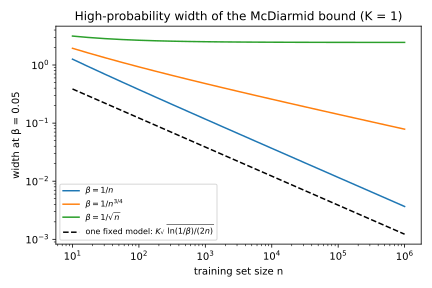
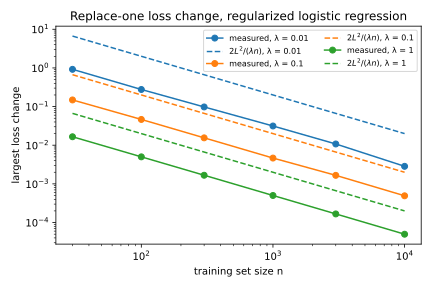
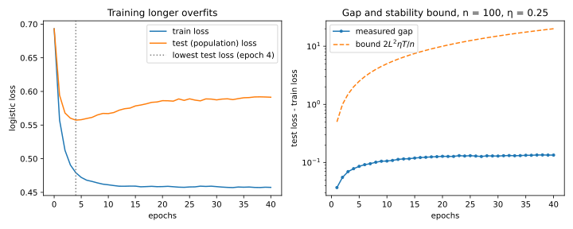

# Algorithmic stability and generalization

## Why this matters

You train a model and its training loss is low. **Will its loss on new data be low too?** The difference between the loss on new data and the loss on the training data is the **generalization gap**, and controlling it is the central question of learning theory. The classical answer counts hypotheses: it measures how rich the class of models is that the algorithm could output, through the size of a finite class, a Vapnik–Chervonenkis dimension or a Rademacher complexity, and argues that a class that is not too rich cannot fit noise. This chapter takes a different route. It looks at the *algorithm* instead of the class of models it could output.

The organizing idea fits in one sentence: **a model generalizes when it does not depend much on any single training record.** Making it precise gives three results, and each one leads to the next.

The first is that **the gap is exactly an average per-example effect.** Take one training record out, put a fresh one from the same source in its place, retrain, and see how much worse the model now does on the record you took out. Average this over the records. The result is the expected gap, with no inequality involved: overfitting *is* dependence on individual records.

Once the gap is written that way, the second result follows: **a bounded per-example effect gives a bounded gap.** Call $\gamma$ the largest amount by which replacing one record can move the loss of the trained model, at any test point. Each term of the average is then at most $\gamma$, so the expected gap is at most $\gamma$. McDiarmid's inequality, which says that a function of many independent inputs that no single input can move by much stays close to its mean, turns this average statement into one that holds with high probability for the one model you trained.

The third result makes this useful: **common algorithms have small $\gamma$.** Regularized empirical risk minimization (ERM), which minimizes the training loss plus a penalty $\frac\lambda2\|\theta\|^2$ on the weights, has $\gamma = 2L^2/(\lambda n)$, where $n$ is the number of records and $L$ bounds how fast the loss can change with the weights. Stochastic gradient descent (SGD) with learning rates $\eta_t$ has $\gamma \le (2L^2/n)\sum_t\eta_t$, which grows with training time and gives a reason to stop early. Memorizing algorithms such as 1-nearest neighbour have $\gamma = 1$, the largest value for a loss between 0 and 1, and when labels are noisy their gap never closes.

Where each result is used (@tbl-stability-uses):

| Result | Typical use |
| --- | --- |
| Expected gap $=$ average replace-one effect | Reading overfitting as memorization of individual records |
| $\lvert\mathbb E[\text{gap}]\rvert \le \gamma$ | Generalization guarantees that need no complexity measure of the model class |
| High-probability bound (McDiarmid) | A guarantee for the one model you actually trained |
| Regularized ERM, $\gamma = 2L^2/(\lambda n)$ | Choosing $\lambda$; bounding how far one record moves a trained model |
| SGD, $\gamma \le (2L^2/n)\sum_t\eta_t$ | Step sizes, number of epochs, early stopping |
| Unstable algorithms ($\gamma = 1$) | Recognizing models whose training error says nothing about test error |
| Questions fixed in advance cost $\ln k$; questions chosen after looking can be badly biased | Reusing a validation or test set; sample splitting |

: Results of this chapter and where they are used. {#tbl-stability-uses}

**Notation.** The training set is a dataset $D = (z_1, \dots, z_n)$ of $n$ records drawn from a distribution $\mathcal D$, and a training algorithm $\mathcal T$ maps it to a model $\mathcal T(D)$. Datasets are compared through the replace-one relation: $D^{(i)}$ is $D$ with record $i$ replaced by another, which is how stability is defined in the learning-theory literature. The literature writes the stability parameter $\beta$; this book keeps $\beta$ for a failure probability and writes the stability parameter $\gamma$.

Later parts return to how much a trained model depends on a single record, and they reuse the quantities defined here. Every fact this chapter borrows is restated where it is used. The full derivation of McDiarmid's inequality is in [Concentration inequalities](02-concentration.md), and more on the convexity facts behind the ERM bound is in [Optimization](06-optimization.md).

## Toolkit: five facts every derivation uses

Each section below follows the same arc: the question, the statement, a derivation, an interpretation, an example and a self-check. The derivations reuse five facts. The first turns a change in the weights into a change in the loss; the second is the symmetry behind the main identity; the third and fourth say when an optimizer cannot let two nearby weight vectors drift apart; the fifth turns an average statement into a high-probability one.

### Fact 1 — Lipschitz losses turn parameter changes into loss changes

A loss is **$L$-Lipschitz** in the weights when moving the weights by a distance $d$ changes the loss by at most $L d$, whatever the record. The constant $L$ is a speed limit: the loss cannot change faster than $L$ per unit of distance in weight space. Written out, if $\theta \mapsto \ell(\theta; z)$ is $L$-Lipschitz for every record $z$, then
$$|\ell(\theta; z) - \ell(\theta'; z)| \le L\,\|\theta - \theta'\| \quad\text{for all } z.$$

This is how every derivation below finishes. They first bound how far the trained weights move when one record changes, and this fact turns that into a bound on how far the loss moves, at every test point at once. For a differentiable loss, $L$ can be taken as the largest norm of the gradient $\nabla_\theta\ell(\theta; z)$, because the change along a straight path from $\theta'$ to $\theta$ is the integral of the gradient along it, and each bit of the path contributes at most (gradient norm) × (length).

The logistic loss is the example used throughout. For features $x$ and a label $y = \pm1$, it is $\ell(\theta; (x, y)) = \ln(1 + e^{-y\langle \theta, x\rangle})$, which is small when the **margin** $y\langle \theta, x\rangle$ is large and positive. Its gradient is $-y\,\sigma(-y\langle \theta, x\rangle)\,x$, where $\sigma(t) = 1/(1 + e^{-t})$ is the logistic function, which takes values between 0 and 1. Since $0 < \sigma < 1$ and $|y| = 1$, the gradient norm is at most $\|x\|$. With features scaled to $\|x\| \le 1$, the logistic loss is $1$-Lipschitz.

### Fact 2 — Swapping two i.i.d. variables does not change their joint law

If $U$ and $V$ are independent and identically distributed (i.i.d.), then nothing in their joint behaviour can tell which one is "first". So the pair $(U, V)$ and the swapped pair $(V, U)$ have the same joint distribution, and as a consequence $\mathbb E[f(U, V)] = \mathbb E[f(V, U)]$ for every function $f$.

The reason is the joint density (or probability mass function). Independence makes it the product $p(u)\,p(v)$ of the two individual densities, and identical distribution makes those two the same function $p$. The product $p(u)\,p(v)$ does not change when $u$ and $v$ are exchanged, so the two pairs have the same law, and expectations computed from that law agree.

This is the "renaming trick" in the expected-gap theorem. The theorem section walks through it with a table of every outcome.

### Fact 3 — Strong convexity makes the gradient strongly monotone

A function $G$ is **$\lambda$-strongly convex** when it lies above each of its tangent planes by at least a quadratic bowl of curvature $\lambda$: for all $u$ and $v$,
$$G(v) \ge G(u) + \langle\nabla G(u), v - u\rangle + \frac\lambda2\|v - u\|^2.$$
Adding $\frac\lambda2\|\theta\|^2$ to any convex function produces such a $G$. The consequence used below is that the gradient changes at least as fast as the point does, in the direction of the change: if you move from $v$ to $u$, the gradient moves by at least $\lambda\|u - v\|$ along that direction. In symbols,
$$\langle\nabla G(u) - \nabla G(v),\, u - v\rangle \ge \lambda\|u - v\|^2.$$

To see why, write the strong convexity inequality as given, and again with $u$ and $v$ exchanged: $G(u) \ge G(v) + \langle\nabla G(v), u - v\rangle + \frac\lambda2\|u - v\|^2$. Add the two inequalities. The values $G(u)$ and $G(v)$ appear on both sides and cancel, and what is left is $0 \ge -\langle\nabla G(u) - \nabla G(v), u - v\rangle + \lambda\|u - v\|^2$, which rearranges to the claim. The stability of regularized ERM rests on this fact: two different minimizers have gradients that must differ by a lot, so if the gradients differ by little, the minimizers are close.

### Fact 4 — For convex smooth functions, a small gradient step is non-expansive

A function $f$ is **$\beta_s$-smooth** when its gradient $\nabla f$ is $\beta_s$-Lipschitz: the gradient changes by at most $\beta_s$ per unit of distance, so the function curves no more sharply than $\frac{\beta_s}2\|\theta\|^2$. For a function that is both convex and smooth, the gradient satisfies a property called **co-coercivity** (Nesterov 2004, Theorem 2.1.5). In words: when two gradients differ by a lot, the two points must be far apart along the direction in which the gradients differ. Precisely,
$$\langle\nabla f(u) - \nabla f(v),\, u - v\rangle \ge \frac1{\beta_s}\|\nabla f(u) - \nabla f(v)\|^2.$$
The proof needs more than a few lines. It is in Nesterov's book, and @sec-apx-opt-cocoercive in the appendices derives it step by step.

What this chapter uses is a consequence for gradient descent. Take two starting points $u$ and $v$ and apply the same gradient step to both, $\psi(\theta) = \theta - \eta\nabla f(\theta)$. If the learning rate satisfies $0 \le \eta \le 2/\beta_s$, the two points do not end up farther apart than they started:
$$\|\psi(u) - \psi(v)\| \le \|u - v\|.$$

The reason is that the step moves both points by an amount that depends on the gradient difference $g = \nabla f(u) - \nabla f(v)$, and co-coercivity says this difference points enough "towards closing the distance". Expand the square of $\psi(u) - \psi(v) = (u - v) - \eta g$, then use co-coercivity to replace $\langle g, u - v\rangle$ by the smaller quantity $\|g\|^2/\beta_s$:
$$\|\psi(u) - \psi(v)\|^2 = \|u - v\|^2 - 2\eta\langle g, u - v\rangle + \eta^2\|g\|^2 \le \|u - v\|^2 - \eta\left(\frac2{\beta_s} - \eta\right)\|g\|^2 \le \|u - v\|^2.$$
The last step holds because $\eta \le 2/\beta_s$ makes the subtracted term non-negative.

A one-dimensional case shows why the condition on $\eta$ is needed. For $f(\theta) = \frac{\beta_s}2 \theta^2$, the gradient is $\beta_s \theta$, so the step is $\psi(\theta) = \theta - \eta\beta_s \theta = (1 - \eta\beta_s)\theta$, and it multiplies every distance by $|1 - \eta\beta_s|$. It is non-expansive exactly when $|1 - \eta\beta_s| \le 1$, that is $\eta \le 2/\beta_s$. Larger steps overshoot the minimum and blow differences up. The stability of SGD rests on this fact.

### Fact 5 — McDiarmid's inequality

A function of many independent inputs, none of which can move it by much, concentrates near its mean. If $Z_1, \dots, Z_n$ are independent and changing only $Z_i$, with the others held fixed, changes $\Phi(Z_1, \dots, Z_n)$ by at most $c_i$, then
$$\Pr[\Phi - \mathbb E\Phi \ge t] \le \exp\Big(-\frac{2t^2}{\sum_i c_i^2}\Big).$$
The derivation, via the Doob martingale and Azuma's inequality, is in [Concentration inequalities](02-concentration.md). Its idea is to reveal the inputs one at a time: each revealed input shifts the conditional mean of $\Phi$ by at most $c_i$, and a sum of $n$ such bounded, mean-zero shifts concentrates in the same way as a sum of independent bounded variables does.

To use it you set a failure probability $\beta$ and solve for the matching $t$. Setting $\exp(-2t^2/\sum_i c_i^2) = \beta$ and taking logarithms gives $t = \sqrt{\tfrac12\sum_i c_i^2\ln(1/\beta)}$. So with probability at least $1 - \beta$, $\Phi < \mathbb E\Phi + \sqrt{\tfrac12\sum_i c_i^2\ln(1/\beta)}$.

In this chapter $\gamma$ always denotes a stability parameter, and $\beta$ the failure probability.

## Risk, empirical risk and the gap {#sec-stability-risk}

### Context

Training minimizes the loss on the data you have. What you care about is the loss on data you will see later. For a model chosen *before* looking at the data, the training loss is an unbiased estimate of the test loss. For a model *fitted* to the data, it is biased downward, because the fitting process picked the model that looks good on exactly these records. The size of that bias is the generalization gap.

### Definitions

A training set $D = (z_1, \dots, z_n)$ is a list of $n$ records drawn i.i.d. from a distribution $\mathcal D$, the source of all data, past and future. A learning algorithm $\mathcal T$ maps $D$ to a model $\mathcal T(D)$, and the loss $\ell(\theta; z) \ge 0$ measures how badly model $\theta$ does on record $z$.

The quantity you care about is the average loss on a new record from $\mathcal D$. This is the **population risk**, or test loss, $\mathcal L_{\mathcal D}(\theta) = \mathbb E_{z \sim \mathcal D}\,\ell(\theta; z)$. You cannot compute it, because you do not know $\mathcal D$. What you can compute is the average loss over the training set, the **empirical risk** or training loss, $\mathcal L(\theta; D) = \frac1n\sum_{i=1}^n\ell(\theta; z_i)$. The **generalization gap** of the trained model is the test loss minus the training loss, $\mathrm{gap}(D) = \mathcal L_{\mathcal D}(\mathcal T(D)) - \mathcal L(\mathcal T(D); D)$; it is positive when the model looks better on its training data than it really is.

The tool for studying the gap is a training set that differs from $D$ in one record. The **replace-one neighbour** $D^{(i)} = (z_1, \dots, z_{i-1}, z_i', z_{i+1}, \dots, z_n)$ is the training set with record $i$ replaced by $z_i'$. In probability statements, $z_1', \dots, z_n'$ are fresh i.i.d. draws from $\mathcal D$, independent of $D$.

### Statement

A model that was fixed before the data were drawn has a training loss that is right on average: averaging over training sets, its training loss equals its test loss. For a fixed model $\theta$ that does not depend on $D$,
$$\mathbb E_D\big[\mathcal L(\theta; D)\big] = \mathcal L_{\mathcal D}(\theta).$$
For $\theta = \mathcal T(D)$ this fails in general, and $\mathbb E[\mathcal L(\mathcal T(D); D)]$ is usually smaller than $\mathbb E[\mathcal L_{\mathcal D}(\mathcal T(D))]$.

### Derivation

1. **Split the average.** The expectation of an average is the average of the expectations (linearity of expectation), so $\mathbb E_D[\mathcal L(\theta; D)] = \frac1n\sum_i\mathbb E[\ell(\theta; z_i)]$.
2. **Each term is the test loss.** Each $z_i$ is a draw from $\mathcal D$ and $\theta$ is fixed, so $\mathbb E[\ell(\theta; z_i)]$ is the average loss of $\theta$ on a draw from $\mathcal D$, which is $\mathcal L_{\mathcal D}(\theta)$ by definition. The average of $n$ copies of $\mathcal L_{\mathcal D}(\theta)$ is $\mathcal L_{\mathcal D}(\theta)$.
3. **Why it fails for a trained model.** If $\theta = \mathcal T(D)$, step 2 breaks: $z_i$ and $\mathcal T(D)$ are dependent, because $z_i$ was used to choose $\mathcal T(D)$. The algorithm picked the model that does well on these particular $z_i$, so $z_i$ is no longer a typical draw from the model's point of view.

### Interpretation

The gap is not noise that averages out. It is a systematic bias caused by reusing the same data to choose and to evaluate. Its sign is usually positive: models look better on the data they were fitted to. The rest of this chapter bounds it through one property of the algorithm, without counting the models it could output.

### Example: an overfit logistic regression

Take the running example of this chapter. Features $x$ are uniform on the unit sphere in $\mathbb R^{10}$. Labels are $y = \pm1$ with $\Pr[y = 1 \mid x] = \sigma(5x_1)$, so the label tends to follow the sign of the first coordinate but is noisy near $x_1 = 0$. The model is $\lambda$-regularized logistic regression, which minimizes the average logistic loss plus $\frac\lambda2\|\theta\|^2$ (details in @sec-stability-code). With $n = 50$ and $\lambda = 0.01$, averaged over 100 training sets, the training loss is 0.4603 and the test loss is 0.5781. The expected gap, estimated with the noise-reduction trick described in the regularized-ERM section, is about 0.119, close to the difference of the two averages. With $n = 1000$ it shrinks to about 0.006.

### Check yourself

- You evaluate a fixed, pretrained model on a fresh sample. Is the sample loss biased? *(No. The model does not depend on the sample, so step 2 applies.)*
- You pick the best of 100 pretrained models on a validation set. Is the validation loss of the winner biased? *(Yes, downward. The choice depends on the validation data, so the choice is itself a learning algorithm run on that data.)*

## Uniform stability and the expected gap

### Context

To control the gap you need to say how much $\mathcal T(D)$ depends on the training set. The simplest way to say it: replace one training record, retrain, and see how much the loss of the trained model changes, anywhere.

### Definition

An algorithm is stable in this sense when replacing any one training record by any other moves the loss of the trained model by at most $\gamma$, at every possible test point. The bound must hold in the worst case: for every training set, every position, every replacement and every test point. Formally, $\mathcal T$ is **$\gamma$-uniformly stable** if for every training set $D$, every index $i$, every replacement $z_i'$ and every test point $z$,
$$\big|\ell(\mathcal T(D); z) - \ell(\mathcal T(D^{(i)}); z)\big| \le \gamma.$$ {#eq-stability-uniform}
If $\mathcal T$ is randomized (SGD is, through the order in which it visits records), the condition is on the expectation over $\mathcal T$'s internal randomness: $\big|\mathbb E_{\mathcal T}[\ell(\mathcal T(D); z) - \ell(\mathcal T(D^{(i)}); z)]\big| \le \gamma$.

Usually $\gamma$ depends on $n$, because with more records each one carries less weight, and the interesting question is how fast it goes to zero. @fig-stability-neighbours shows the definition at work on a one-dimensional logistic regression: one record's label is flipped, and the fitted model moves a lot under weak regularization and barely under strong regularization.

{#fig-stability-neighbours}

### Statement

The test loss of the trained model can be measured on a fresh point $z_i'$. Swap the roles of $z_i$ and $z_i'$, and the same number becomes the loss on $z_i$ of a model trained *without* $z_i$. So the expected test loss is the average loss of each record under a model that never saw it, while the training loss is the average loss of each record under a model that did. Their difference is the expected gap. For any algorithm, the expected gap is exactly this average replace-one effect:
$$\mathbb E_D\big[\mathrm{gap}(D)\big] = \frac1n\sum_{i=1}^n\mathbb E_{D, z_i'}\Big[\ell\big(\mathcal T(D^{(i)}); z_i\big) - \ell\big(\mathcal T(D); z_i\big)\Big].$$ {#eq-stability-identity}
Each bracket is a replace-one change at a test point, which uniform stability caps at $\gamma$. Consequently, if $\mathcal T$ is $\gamma$-uniformly stable,
$$\big|\mathbb E_D[\mathrm{gap}(D)]\big| \le \gamma.$$ {#eq-stability-expected}

### Derivation (the renaming trick)

1. **Write the test loss with a fresh point.** The test loss $\mathcal L_{\mathcal D}(\mathcal T(D))$ is the loss on a point the model has not seen. The point $z_i'$ is such a point: it is independent of $D$ and has distribution $\mathcal D$. So, holding $D$ fixed, its average loss is the test loss, $\mathbb E[\ell(\mathcal T(D); z_i') \mid D] = \mathcal L_{\mathcal D}(\mathcal T(D))$. Averaging over $D$ as well, $\mathbb E[\mathcal L_{\mathcal D}(\mathcal T(D))] = \mathbb E[\ell(\mathcal T(D); z_i')]$ for every $i$.
2. **Rename $z_i \leftrightarrow z_i'$.** The two points $z_i$ and $z_i'$ are i.i.d. and independent of the other records. By Fact 2 (swapping two i.i.d. variables leaves their joint distribution unchanged), exchanging them does not change the joint distribution of $(z_1, \dots, z_n, z_i')$, so it does not change any expectation. The swap turns $D$ into $D^{(i)}$ and $z_i'$ into $z_i$. Hence
$$\mathbb E\big[\ell(\mathcal T(D); z_i')\big] = \mathbb E\big[\ell(\mathcal T(D^{(i)}); z_i)\big].$$
3. **Average over $i$.** Steps 1 and 2 hold for every $i$, so their average does too: $\mathbb E[\mathcal L_{\mathcal D}(\mathcal T(D))] = \frac1n\sum_i\mathbb E[\ell(\mathcal T(D^{(i)}); z_i)]$.
4. **Training loss.** By definition of the empirical risk, $\mathbb E[\mathcal L(\mathcal T(D); D)] = \frac1n\sum_i\mathbb E[\ell(\mathcal T(D); z_i)]$.
5. **Subtract** step 4 from step 3. The two sums run over the same $i$, so the difference is the average of the differences. This is @eq-stability-identity.
6. **Bound each term.** By @eq-stability-uniform, applied at the test point $z = z_i$, each difference $\ell(\mathcal T(D^{(i)}); z_i) - \ell(\mathcal T(D); z_i)$ lies in $[-\gamma, \gamma]$ for every outcome. An average of numbers in $[-\gamma, \gamma]$ also lies there, so the expectation does, and so does the average over $i$. This is @eq-stability-expected. For a randomized $\mathcal T$, take the expectation over $\mathcal T$'s randomness first and use the randomized definition.

**Step 2 on a tiny case.** Readers often stall on the renaming step, so here it is with every outcome listed. Take $n = 1$: one record $z_1 \in \{0, 1\}$ with $\Pr[z_1 = 1] = p = 0.3$, and a fresh copy $z_1'$. The algorithm shrinks the data towards zero, $\mathcal T(D) = z_1/2$, and the loss is squared error $\ell(\theta; z) = (\theta - z)^2$. So $\mathcal T(D^{(1)}) = z_1'/2$. @tbl-stability-renaming lists all four outcomes, each with its probability (the product of the two independent probabilities) and the three losses that appear in the derivation.

| $(z_1, z_1')$ | Probability | Train $\ell(\mathcal T(D); z_1)$ | Test $\ell(\mathcal T(D); z_1')$ | Renamed $\ell(\mathcal T(D^{(1)}); z_1)$ |
| --- | --- | --- | --- | --- |
| $(0, 0)$ | $0.7 \times 0.7 = 0.49$ | $0$ | $0$ | $0$ |
| $(0, 1)$ | $0.7 \times 0.3 = 0.21$ | $0$ | $(0 - 1)^2 = 1$ | $(\tfrac12 - 0)^2 = 0.25$ |
| $(1, 0)$ | $0.3 \times 0.7 = 0.21$ | $(\tfrac12 - 1)^2 = 0.25$ | $(\tfrac12 - 0)^2 = 0.25$ | $(0 - 1)^2 = 1$ |
| $(1, 1)$ | $0.3 \times 0.3 = 0.09$ | $0.25$ | $0.25$ | $0.25$ |
| **Average** | | $0.075$ | $0.285$ | $0.285$ |

: Every outcome of the one-record case. The renamed column is the test column with the rows $(0, 1)$ and $(1, 0)$ exchanged. Those rows have the same probability, so the averages agree. {#tbl-stability-renaming}

Row by row, the test and renamed columns differ. But the renamed column contains the same values as the test column, attached to the mirror-image outcome, and mirror-image outcomes have the same probability $p(1-p) = 0.21$. That is all step 2 says: averaging over a table does not care how you label its rows.

The averages are probability-weighted sums of each column. Train: $0.21 \times 0.25 + 0.09 \times 0.25 = 0.075$. Test: $0.21 \times 1 + 0.21 \times 0.25 + 0.09 \times 0.25 = 0.285$. So the expected gap is $0.285 - 0.075 = 0.21$. The right side of @eq-stability-identity is the renamed average minus the train average, $0.285 - 0.075 = 0.21$ too. The stability of this algorithm is $\gamma = 0.75$: changing $z_1$ from 0 to 1 moves the model from 0 to $\frac12$, and at the test point $z = 1$ the loss drops from $(0 - 1)^2 = 1$ to $(\frac12 - 1)^2 = 0.25$, a change of $0.75$. The gap $0.21$ is below $\gamma = 0.75$, as @eq-stability-expected requires.

### Interpretation

@eq-stability-identity is an identity, not a bound. It says the expected gap *is* the average **replace-one self-influence**: how much the loss on $z_i$ goes up when $z_i$ is taken out of the training set and replaced by a fresh point. A model that relies heavily on individual records to fit them overfits, and conversely, a model that overfits must be relying on individual records. The memorization section below measures this quantity directly.

Uniform stability, by contrast, is a worst-case notion. It asks for a bound over all training sets, all replacements and all test points, while the identity only needs the average over $i$ and over the data. This is why the bound $\gamma$ can be far from the true gap, and why weaker, average-case notions of stability exist (Bousquet & Elisseeff 2002; Shalev-Shwartz et al. 2010).

What makes the bound useful is what it leaves out: no model class appears. The bound holds for any algorithm, however rich the set of models it could output. This is why stability gives guarantees for algorithms such as SGD on large models, where counting the models the algorithm could output gives nothing useful.

### Example: a memorizing lookup table

Store the training set; predict the stored label at a training point and $+1$ everywhere else, and score with the **0-1 loss**, which is 1 for a wrong prediction and 0 for a right one. With continuous features, a fresh point almost surely misses the table, so it gets the prediction $+1$. In the running example, where half the labels are $-1$, that prediction is wrong half the time: the test error is $\frac12$ and the training error is 0, for every $n$. Now replace $(x_i, y_i)$ by a different point. The prediction at $x_i$ falls back to $+1$; if $y_i = -1$, the loss at $z = (x_i, y_i)$ jumps from 0 to 1. So $\gamma = 1$, and the gap $\frac12 \le 1$ is consistent with the theorem but never shrinks.

### Check yourself

- In step 1, why is $z_i'$ needed at all; why not write the test loss as $\mathbb E[\ell(\mathcal T(D); z_i)]$? *(Because $z_i$ is part of $D$, so $\mathcal T(D)$ depends on it. Only a point independent of $D$ gives an unbiased estimate of $\mathcal L_{\mathcal D}(\mathcal T(D))$.)*
- In @tbl-stability-renaming, what would break if $z_1$ and $z_1'$ had different distributions? *(Rows $(0, 1)$ and $(1, 0)$ would have different probabilities, and the test and renamed averages would differ. Step 2 needs the two points to be exchangeable, that is, to have a joint distribution that does not change when they are swapped.)*

## High probability: the Bousquet–Elisseeff bound

### Context

@eq-stability-expected controls the gap on average over training sets. You train once, on one $D$, so you need the gap of *your* model to be small with high probability. The gap is a function of $n$ independent records, and stability bounds how much one record can move it. That is exactly the situation of McDiarmid's inequality (Fact 5): a function of independent inputs that no single input can move by much stays close to its mean, with an exponentially small chance of exceeding it.

### Statement

The bound has three parts: the training loss you observe, the expected gap $\gamma$ from the previous section, and a deviation term from McDiarmid that says how far one training set can stray from the average. If $\mathcal T$ is $\gamma$-uniformly stable and the loss lies between $0$ and $K$, then with probability at least $1 - \beta$ over $D$,
$$\mathcal L_{\mathcal D}(\mathcal T(D)) \le \mathcal L(\mathcal T(D); D) + \gamma + (2n\gamma + K)\sqrt{\frac{\ln(1/\beta)}{2n}}.$$ {#eq-stability-be}
This is Theorem 12 of Bousquet & Elisseeff (2002), rewritten for replace-one stability. They define stability by *removing* a record instead of replacing it. Replacing can be done by removing $z_i$ and then adding $z_i'$, two removals' worth of change, so replace-one stability is at most twice removal stability ([Exercise 1](../../book-exercises/part01-prerequisites/07-stability-generalization.md#sec-sol-stability-1)). Substituting $\gamma = 2\gamma_{\text{remove}}$ in @eq-stability-be gives their $2\gamma_{\text{remove}} + (4n\gamma_{\text{remove}} + K)\sqrt{\ln(1/\beta)/(2n)}$.

### Derivation

The plan is to bound how much one record can move the gap, feed that to McDiarmid, and then use the expected-gap bound for the mean. Let $\Phi(D) = \mathcal L_{\mathcal D}(\mathcal T(D)) - \mathcal L(\mathcal T(D); D)$ be the gap as a function of the training set.

1. **Effect of one record on the test loss.** Replacing $z_i$ moves $\ell(\mathcal T(D); z)$ by at most $\gamma$ at every $z$, by uniform stability. The test loss is an average of these losses over $z$, and an average of numbers that each move by at most $\gamma$ moves by at most $\gamma$: $|\mathcal L_{\mathcal D}(\mathcal T(D)) - \mathcal L_{\mathcal D}(\mathcal T(D^{(i)}))| \le \gamma$.
2. **Effect on the training loss.** $\mathcal L(\mathcal T(D); D)$ and $\mathcal L(\mathcal T(D^{(i)}); D^{(i)})$ share $n - 1$ terms, one for each record other than $i$. Each shared term $\frac1n\ell(\cdot; z_j)$ is evaluated at the same point $z_j$ under two models, so by stability it moves by at most $\gamma/n$. The unshared terms are $\frac1n\ell(\mathcal T(D); z_i)$ and $\frac1n\ell(\mathcal T(D^{(i)}); z_i')$, evaluated at two different points, so stability says nothing about them; but both lie in $[0, K/n]$, so they differ by at most $K/n$. Total: at most $\frac{n-1}{n}\gamma + \frac Mn \le \gamma + \frac Mn$.
3. **Bounded differences.** $\Phi$ is the test loss minus the training loss, and by the triangle inequality ($|a - b| \le |a| + |b|$) its change is at most the sum of the two changes: replacing $z_i$ moves $\Phi$ by at most $c_i = 2\gamma + K/n$. Uniform stability holds for every training set and every replacement, so this holds for all values of the inputs, as McDiarmid requires.
4. **McDiarmid** (Fact 5). All $n$ constants are equal, so $\sum_i c_i^2 = n(2\gamma + K/n)^2$. Its square root is $\sqrt n(2\gamma + K/n)$, and $\sqrt n(2\gamma + K/n)/\sqrt2 = (2n\gamma + K)/\sqrt{2n}$ after multiplying inside and out by $\sqrt n$. So with probability at least $1 - \beta$,
$$\Phi < \mathbb E\Phi + \sqrt{n}\Big(2\gamma + \frac Mn\Big)\sqrt{\frac{\ln(1/\beta)}2} = \mathbb E\Phi + (2n\gamma + K)\sqrt{\frac{\ln(1/\beta)}{2n}}.$$
5. **Expected gap.** $\mathbb E\Phi \le \gamma$ by @eq-stability-expected. Substitute, and move the training loss to the right-hand side.

Applying the same argument to $-\Phi$ gives the matching lower bound, so the gap is controlled from both sides.

### Interpretation: $\gamma$ must be $o(1/\sqrt n)$

The width of the bound beyond $\gamma$ has two parts, and they behave differently. The part $K\sqrt{\ln(1/\beta)/(2n)}$ is what Hoeffding's inequality gives for one fixed model: the average of $n$ independent losses in $[0, K]$ exceeds its mean by more than this with probability at most $\beta$ ([Concentration inequalities](02-concentration.md)). It is a rate you cannot avoid even without any learning. The extra part comes from stability, $2n\gamma\sqrt{\ln(1/\beta)/(2n)} = \gamma\sqrt{2n\ln(1/\beta)}$, and it goes to zero only if $\gamma\sqrt n \to 0$, which is what $\gamma = o(1/\sqrt n)$ means. @fig-stability-high-probability shows three regimes, and the rate in each follows from putting the given $\gamma$ into $\gamma\sqrt{2n\ln(1/\beta)}$:

- $\gamma \sim 1/n$ (regularized ERM): $\gamma\sqrt n \sim 1/\sqrt n$, so the width falls like $1/\sqrt n$, a constant factor above the fixed-model rate.
- $\gamma \sim n^{-3/4}$: $\gamma\sqrt n \sim n^{-3/4 + 1/2}$, so it still falls, but more slowly, like $n^{-1/4}$.
- $\gamma \sim 1/\sqrt n$: $\gamma\sqrt n$ is a constant, so it does not fall at all. The bound is vacuous, even though @eq-stability-expected still says the *expected* gap is at most $1/\sqrt n$.

{#fig-stability-high-probability}

The loss in step 3 comes from charging every one of the $n$ records the full $2\gamma$ in McDiarmid, even though the effects of different records largely average out. Later work removed most of this loss. Feldman & Vondrák (2018) proved a bound of order $\sqrt{(\gamma + 1/n)\ln(1/\beta)}$, which is meaningful whenever $\gamma = o(1)$, that is whenever $\gamma$ goes to zero at any rate. Feldman & Vondrák (2019) and then Bousquet, Klochkov & Zhivotovskiy (2020) reached, for $K = 1$ and up to constant factors (which is what $\lesssim$ means),
$$\mathrm{gap} \lesssim \gamma\ln n\,\ln(1/\beta) + \sqrt{\frac{\ln(1/\beta)}{n}},$$
which is within log factors of the expected-gap bound plus the fixed-model rate. With these, $\gamma \sim 1/\sqrt n$ also gives a $\tilde O(1/\sqrt n)$ gap, where $\tilde O$ means "of this order up to log factors".

### Example: regularized logistic regression

The next section shows that regularized logistic regression with $\|x\| \le 1$ has $\gamma = 2/(\lambda n)$ and weights of norm at most $1/\lambda$. To use @eq-stability-be you also need $K$, the largest loss. Its margin $y\langle \theta, x\rangle$ is at least $-\|\theta\|\|x\| \ge -1/\lambda$, and the logistic loss is largest at the most negative margin, so every loss is at most $K = \ln(1 + e^{1/\lambda})$. Take $n = 10{,}000$ and $\beta = 0.05$, so that $\ln(1/\beta) = \ln 20$ and the common factor is $\sqrt{\ln 20/20{,}000} = 0.01224$. Then the width beyond the training loss is $\gamma + (2n\gamma + K)\times 0.01224$, where $2n\gamma = 4/\lambda$:

- $\lambda = 1$: $\gamma = 2\times10^{-4}$, $K = \ln(1 + e) = 1.313$, width $2\times10^{-4} + (4 + 1.313)\times 0.01224 = 0.065$.
- $\lambda = 0.1$: $\gamma = 0.002$, $K = \ln(1 + e^{10}) = 10.000$, width $0.002 + (40 + 10)\times 0.01224 = 0.614$.

In both cases the stability term $2n\gamma$ is three quarters or more of the width ($4$ against $K = 1.313$, and $40$ against $K = 10.000$). The expected gap itself is far smaller: at $\lambda = 1$ it is already $2.53\times10^{-4}$ at $n = 1{,}000$ (@tbl-stability-gap), and it falls like $1/n$. The high-probability bound is valid but loose, mostly because McDiarmid charges every record the worst case $2\gamma$.

### Check yourself

- Why does step 2 pay $K/n$ for the replaced record, not $\gamma/n$? *(The replaced term is evaluated at two different points, $z_i$ and $z_i'$. Stability compares two models at the same point, so it does not apply.)*
- If $\gamma = 0$ (a constant algorithm), what does @eq-stability-be reduce to? *(Hoeffding for a single fixed model: $\mathcal L_{\mathcal D}(\mathcal T(D)) \le \mathcal L(\mathcal T(D); D) + K\sqrt{\ln(1/\beta)/(2n)}$.)*

## Regularized ERM is stable

### Context

Regularized ERM is the workhorse of classical machine learning: ridge regression, regularized logistic regression, support vector machines. The regularizer is usually justified as a prior or as a way to control model complexity. Stability gives a third reading: it limits how far one record can pull the solution. The penalty $\frac\lambda2\|\theta\|^2$ makes the objective a bowl with curvature at least $\lambda$, and one record, which carries weight $1/n$ in the objective, can only tilt such a bowl so far.

### Statement

The setting is a convex loss whose gradient never exceeds $L$ in norm. Let $\ell(\cdot; z)$ be convex, differentiable and $L$-Lipschitz for every $z$, and let $\theta_D$ be the minimizer of the regularized training loss $\mathcal L_\lambda(\cdot; D)$:
$$\theta_D = \arg\min_\theta\; \mathcal L_\lambda(\theta; D), \qquad \mathcal L_\lambda(\theta; D) = \frac1n\sum_{i=1}^n\ell(\theta; z_i) + \frac\lambda2\|\theta\|^2.$$
Replacing one record changes $\mathcal L_\lambda(\cdot; D)$ by a term of size about $L/n$ in gradient, and the curvature $\lambda$ converts that into a weight change of order $L/(\lambda n)$; Fact 1 then multiplies by $L$ to get the loss change. Precisely,
$$\|\theta_D - \theta_{D^{(i)}}\| \le \frac{2L}{\lambda n} \quad\text{and}\quad \big|\ell(\theta_D; z) - \ell(\theta_{D^{(i)}}; z)\big| \le \frac{2L^2}{\lambda n} \text{ for all } z.$$ {#eq-stability-erm}
The first bound is the sensitivity of ERM, that is how far the minimizer can move when one record changes, which [Optimization](06-optimization.md) also derives. The second is uniform stability with $\gamma = 2L^2/(\lambda n)$ (Shalev-Shwartz & Ben-David 2014, Corollary 13.6; Bousquet & Elisseeff 2002).

### Derivation

Write $\theta = \theta_D$, $\theta' = \theta_{D^{(i)}}$, $G = \mathcal L_\lambda(\cdot; D)$, $G' = \mathcal L_\lambda(\cdot; D^{(i)})$. The idea is to look at the gradient of $G$ at the *other* minimizer $\theta'$: it is small, because $G$ and $G'$ differ in only one term, and strong convexity says a small gradient means you are close to the minimizer.

1. **Optimality.** The gradient of a differentiable convex function is zero at its minimizer: $\nabla G(\theta) = 0$ and $\nabla G'(\theta') = 0$.
2. **The two objectives differ in one term.** Only the $i$-th loss differs, so $G - G' = \frac1n\big(\ell(\cdot; z_i) - \ell(\cdot; z_i')\big)$. Since $\nabla G'(\theta') = 0$, subtracting it changes nothing, and $\nabla G(\theta') = \nabla G(\theta') - \nabla G'(\theta') = \frac1n\big(\nabla\ell(\theta'; z_i) - \nabla\ell(\theta'; z_i')\big)$. Each gradient has norm at most $L$ (Fact 1), so this has norm at most $2L/n$.
3. **Strong convexity.** $G$ is a convex function plus $\frac\lambda2\|\theta\|^2$, so it is $\lambda$-strongly convex. Fact 3 says its gradient changes by at least $\lambda\|\theta' - \theta\|$ along the direction from $\theta$ to $\theta'$. With $\nabla G(\theta) = 0$ from step 1,
$$\lambda\|\theta' - \theta\|^2 \le \langle\nabla G(\theta') - \nabla G(\theta),\, \theta' - \theta\rangle = \langle\nabla G(\theta'),\, \theta' - \theta\rangle \le \frac{2L}n\|\theta' - \theta\|,$$
where the last step is the Cauchy–Schwarz inequality, $\langle a, b\rangle \le \|a\|\,\|b\|$, with the norm from step 2. Divide by $\lambda\|\theta' - \theta\|$ to get $\|\theta' - \theta\| \le 2L/(\lambda n)$.
4. **From weights to losses.** By Fact 1, a weight change of at most $2L/(\lambda n)$ changes every loss by at most $L$ times that, $2L^2/(\lambda n)$.

A by-product is used elsewhere in this chapter. Setting the gradient of $\mathcal L_\lambda(\cdot; D)$ to zero gives $\lambda \theta_D = -\frac1n\sum_i\nabla\ell(\theta_D; z_i)$. The right side is an average of vectors of norm at most $L$, so its norm is at most $L$, and $\|\theta_D\| \le L/\lambda$.

### Interpretation

Since $\gamma = 2L^2/(\lambda n)$ falls like $1/n$, which is $o(1/\sqrt n)$, both the expected-gap and the high-probability bounds go to zero as the training set grows.

Regularization buys stability linearly: doubling $\lambda$ halves $\gamma$. It is not free, though. A larger $\lambda$ also pulls the solution towards zero and away from the best fit, so the test loss as a function of $\lambda$ is U-shaped (@fig-stability-gap, right): too little regularization overfits, too much underfits.

The bound is loose in three places, one per derivation step. Step 2 assumes the two gradients point in opposite directions with full norm $L$. Step 3 uses only the curvature $\lambda$ of the regularizer and ignores the curvature of the data term, which also resists movement. Step 4 assumes the worst test point. In the experiment below, steps 2 and 4 each cost about a factor of 2, and step 3 costs more when $\lambda$ is small and the data curvature matters.

### Example: replace-one change in logistic regression

The running example uses unit-norm features, so $L = 1$ by Fact 1 and $\gamma = 2/(\lambda n)$. The script fits the model on $D$, then on $D^{(i)}$ for 10 random $i$, where $z_i$ is replaced by the same point with its label flipped. It records the largest weight change and the largest loss change. To find the test point where the loss changes most, it checks 2,000 random test points and the four points $\pm(\theta' - \theta)/\|\theta' - \theta\|$ with either label, which lie in the direction the weights moved, where the loss change is largest.

| $n$ | $\lambda$ | Weight bound $2L/(\lambda n)$ | Largest weight change | Loss bound $2L^2/(\lambda n)$ | Largest loss change | Ratio |
| --- | --- | --- | --- | --- | --- | --- |
| 100 | 0.01 | 2.0 | 0.406 | 2.0 | 0.340 | 0.17 |
| 100 | 0.1 | 0.2 | 0.0824 | 0.2 | 0.0474 | 0.24 |
| 100 | 1 | 0.02 | 0.00976 | 0.02 | 0.00505 | 0.25 |
| 1,000 | 0.1 | 0.02 | 0.00809 | 0.02 | 0.00499 | 0.25 |
| 10,000 | 0.01 | 0.02 | 0.00336 | 0.02 | 0.00285 | 0.14 |
| 10,000 | 1 | $2\times10^{-4}$ | $9.76\times10^{-5}$ | $2\times10^{-4}$ | $5.00\times10^{-5}$ | 0.25 |

: Replace-one changes of regularized logistic regression against the bounds in @eq-stability-erm. Ratio is the largest loss change divided by the loss bound. {#tbl-stability-replace-one}

@tbl-stability-replace-one and @fig-stability-erm-bound show the $1/(\lambda n)$ scaling closely where the penalty dominates the curvature, that is for $\lambda \ge 0.1$: the rows with $n = 100, \lambda = 1$ and $n = 1{,}000, \lambda = 0.1$ share $\lambda n = 100$ and have nearly the same loss change ($0.00505$ and $0.00499$). The third row with $\lambda n = 100$, at $n = 10{,}000$ and $\lambda = 0.01$, moves less ($0.00336$ in the weights, against $0.00976$ and $0.00809$), because there the data's own curvature adds to $\lambda$, as explained below. For $\lambda = 1$ the ratio is $0.25$, and both factors of 2 can be read off.

The first factor of 2 comes from step 2. With margin $m = y\langle \theta, x\rangle$, the gradient for label $y$ is $-y\,\sigma(-m)x$, and for the flipped label $-y$ the margin becomes $-m$ and the gradient is $y\,\sigma(m)x$. Their difference is $-y\,\sigma(-m)x - y\,\sigma(m)x = -yx$, because $\sigma(-m) + \sigma(m) = 1$. Its norm is $\|x\| = 1$, not the worst case $2L = 2$. So the weights move by about $1/(\lambda n)$, half the bound: $0.00976$ against $0.02$.

The second factor of 2 comes from step 4. With $\lambda = 1$ the weights are small, so test margins are near zero. There the slope of the logistic loss is $\sigma(0) = \frac12$, not $L = 1$, so the loss moves by about half the weight change: $0.00505$ against $0.00976$.

For $\lambda = 0.01$ the ratio drops to about $0.15$ ($0.17$ and $0.14$ in the table): with weak regularization the data term adds curvature beyond $\lambda$, which step 3 ignored.

{#fig-stability-erm-bound}

### Example: the generalization gap against the bound

@eq-stability-expected bounds the expected gap by the same $\gamma$, here $2/(\lambda n)$. The script averages the gap over 100 training sets for each $(n, \lambda)$. It computes the test loss exactly by numerical integration. To cancel most of the noise from the random training sets, it also subtracts, on the same training set, the gap of a fixed reference model. A fixed model's training loss is an unbiased estimate of its test loss (the first section of this chapter), so that gap has mean exactly zero and subtracting it leaves the expected value unchanged; but it rises and falls with the same lucky or unlucky training sets, so the subtraction removes much of the variation.

| $\lambda$ | $n$ | Train loss | Test loss | Expected gap | Bound $2/(\lambda n)$ | Gap / bound |
| --- | --- | --- | --- | --- | --- | --- |
| 0.01 | 50 | 0.4603 | 0.5781 | 0.119 | 4.0 | 0.030 |
| 0.01 | 1,000 | 0.5311 | 0.5381 | 0.00596 | 0.2 | 0.030 |
| 0.1 | 50 | 0.6073 | 0.6401 | 0.0319 | 0.4 | 0.080 |
| 0.1 | 200 | 0.6288 | 0.6373 | 0.00830 | 0.1 | 0.083 |
| 0.1 | 1,000 | 0.6346 | 0.6365 | 0.00178 | 0.02 | 0.089 |
| 1 | 50 | 0.6806 | 0.6854 | 0.00459 | 0.04 | 0.115 |
| 1 | 1,000 | 0.6852 | 0.6855 | 0.000253 | 0.002 | 0.127 |

: Expected generalization gap of regularized logistic regression, averaged over 100 training sets, against the stability bound. {#tbl-stability-gap}

The gap falls like $1/n$, as the bound predicts, and stays a fixed fraction of it for each $\lambda$: about 3% for $\lambda = 0.01$ and 11% to 13% for $\lambda = 1$ (@tbl-stability-gap). Part of the slack is the factor of about 4 already seen in @tbl-stability-replace-one, where the ratio was 0.25. The rest comes from averaging: the gap averages over test points and replacements, while the bound takes the worst of both.

{#fig-stability-gap}

### Check yourself

- Where does the derivation use convexity of $\ell$, and where Lipschitzness? *(Convexity makes $\mathcal L_\lambda(\cdot; D)$ $\lambda$-strongly convex in step 3. Lipschitzness bounds the gradients in step 2 and turns weights into losses in step 4.)*
- Squared loss on bounded data is not globally Lipschitz. How can you still apply the result to ridge regression? *(Use $\|\theta_D\| \le$ a bound derived from optimality, as in the by-product, and the Lipschitz constant of the squared loss on that bounded set.)*

## SGD is stable if you stop early

### Context

Large models are not trained to an exact minimizer. They are trained by SGD for some number of steps: at each step, pick one training record at random and move the weights a little against the gradient of its loss. Hardt, Recht & Singer (2016) showed that SGD itself is stable, with a $\gamma$ that grows with the total learning rate. This turns "train for fewer epochs" into a generalization guarantee.

### Statement

The idea is that two SGD runs, one on $D$ and one on $D^{(i)}$, can only drift apart on the steps that happen to pick record $i$. Each such step pushes them apart by at most $2\eta_tL$, and it happens with probability $1/n$; every other step, by Fact 4, does not push them apart. So the expected distance grows by at most $2\eta_tL/n$ per step.

The assumptions are those of Fact 4 plus a gradient bound. Let $\ell(\cdot; z)$ be convex, $\beta_s$-smooth (gradient changes by at most $\beta_s$ per unit distance) and $L$-Lipschitz (gradient norm at most $L$) for every $z$. Run SGD for $T$ steps from a starting point $\theta_0$: step $t = 1, \dots, T$ updates $\theta_t = \theta_{t-1} - \eta_t\nabla\ell(\theta_{t-1}; z_{I_t})$, and the output is $\theta_T$. Each index $I_t$ is drawn uniformly from $\{1, \dots, n\}$ and $\eta_t \le 2/\beta_s$. Then SGD is uniformly stable (in expectation over the indices) with
$$\gamma \le \frac{2L^2}{n}\sum_{t=1}^T\eta_t.$$ {#eq-stability-hrs}
This is Theorem 3.8 of Hardt, Recht & Singer (2016), who write $\beta$ for the smoothness and $\varepsilon_{\text{stab}}$ for the stability.

### Derivation

Run SGD on $D$ and on $D^{(i)}$ with the **same** index sequence $I_1, I_2, \dots$ and the same starting point. This pairing, called a **coupling**, is legitimate because the stability condition for a randomized algorithm compares the *average* loss of each run, and each run's average depends only on its own distribution. Using the same random indices for both runs does not change either run's distribution, and it makes the two runs as similar as possible. Let $r_t = \|\theta_t - \theta_t'\|$ be the distance between the two runs after $t$ steps, with $r_0 = 0$ because both start at $\theta_0$. Step $t$ uses the index $I_t$ and the learning rate $\eta_t$ and turns $r_{t-1}$ into $r_t$.

1. **Same record picked** ($I_t \ne i$, probability $1 - 1/n$). Both runs take a gradient step on the same function $\ell(\cdot; z_{I_t})$. By Fact 4 (a gradient step with $\eta_t \le 2/\beta_s$ on a convex smooth function does not increase distances), $r_t \le r_{t-1}$.
2. **Differing record picked** ($I_t = i$, probability $1/n$). One run steps on $z_i$, the other on $z_i'$, so Fact 4 does not apply. Instead, write $\theta_t - \theta_t' = (\theta_{t-1} - \theta_{t-1}') - \eta_t\nabla\ell(\theta_{t-1}; z_i) + \eta_t\nabla\ell(\theta_{t-1}'; z_i')$ and use the triangle inequality on the three terms: $r_t \le \|\theta_{t-1} - \theta_{t-1}'\| + \eta_t\|\nabla\ell(\theta_{t-1}; z_i)\| + \eta_t\|\nabla\ell(\theta_{t-1}'; z_i')\| \le r_{t-1} + 2\eta_tL$, since each gradient has norm at most $L$.
3. **Take expectations** over $I_t$. The index $I_t$ is drawn fresh at step $t$, so it is independent of $r_{t-1}$, which depends only on earlier indices. Weighting the two cases by their probabilities, $\mathbb Er_t \le (1 - \frac1n)\mathbb Er_{t-1} + \frac1n(\mathbb Er_{t-1} + 2\eta_tL) = \mathbb Er_{t-1} + \frac{2\eta_tL}{n}$.
4. **Unroll.** Starting from $r_0 = 0$ and adding the increments of steps $t = 1, \dots, T$, $\mathbb Er_T \le \frac{2L}n\sum_{t=1}^T\eta_t$.
5. **From weights to losses.** By Fact 1, at every test point $z$ the loss difference is at most $Lr_T$, so its expectation is at most $L\,\mathbb Er_T$: $\big|\mathbb E[\ell(\theta_T; z) - \ell(\theta_T'; z)]\big| \le L\,\mathbb Er_T$. Multiplying the bound of step 4 by $L$ gives @eq-stability-hrs.

### Interpretation

The derivation says that the two runs only drift apart when the differing record is used. @fig-stability-sgd-divergence shows this as a staircase: each single run jumps when index $i$ is drawn and otherwise does not grow. Since $i$ is drawn with probability $1/n$ and an epoch is $n$ steps, a jump happens on average once per epoch.

As a result, stability degrades linearly with training time. With a constant step $\eta$ and $E$ epochs, so $T = En$ steps, the sum of the learning rates is $\eta En$, and @eq-stability-hrs gives $\gamma \le (2L^2/n)\eta En = 2L^2\eta E$. The $n$ cancels: for a fixed number of epochs the bound does not improve with more data. One pass ($E = 1$) gives $\gamma \le 2L^2\eta$.

This makes early stopping a trade-off. Training longer lowers the optimization error but raises $\gamma$, and the excess test loss pays for both. To see the balance, split the excess test loss of the SGD output $\bar \theta$ over the best weights $\theta^*$ into three pieces: $\mathcal L_{\mathcal D}(\bar \theta) - \mathcal L_{\mathcal D}(\theta^*) = [\mathcal L_{\mathcal D}(\bar \theta) - \mathcal L(\bar \theta; D)] + [\mathcal L(\bar \theta; D) - \mathcal L(\theta^*; D)] + [\mathcal L(\theta^*; D) - \mathcal L_{\mathcal D}(\theta^*)]$. The first piece is the gap, at most $\gamma$ on average. The second is the optimization error. The third has mean zero, because $\theta^*$ is a fixed model. For convex $L$-Lipschitz losses, SGD with constant step $\eta$ reaches an optimization error of at most $\frac{\|\theta^*\|^2}{2\eta T} + \frac{\eta L^2}2$ for the averaged iterate (see [Optimization](06-optimization.md); Shalev-Shwartz & Ben-David 2014, ch. 14). The first term falls with training time and the gap bound $2L^2\eta T/n$ rises with it. With $u = \eta T$, the sum to balance is $\frac{\|\theta^*\|^2}{2u} + \frac{2L^2u}{n}$. Setting its derivative $-\frac{\|\theta^*\|^2}{2u^2} + \frac{2L^2}{n}$ to zero gives $u^* = \frac{\|\theta^*\|\sqrt n}{2L}$, and at that value both terms equal $\frac{L\|\theta^*\|}{\sqrt n}$, so the excess test loss is at most $\frac{2L\|\theta^*\|}{\sqrt n}$, plus the $\eta L^2/2$ term. Training much longer than $u^*$ buys optimization accuracy that the growing stability term gives back.

The bound is loose because step 1 only uses that a step does not expand distances. In practice a gradient step on a curved loss often contracts them, so the true divergence saturates instead of growing linearly (@fig-stability-sgd-divergence).

### Example: unregularized logistic regression with SGD

Take $n = 100$ records of the running example and a constant step $\eta = 0.25$. To apply the theorem you need the smoothness $\beta_s$. Along the margin $m$, the logistic loss $\ln(1 + e^{-m})$ has second derivative $\sigma(m)\sigma(-m) = \sigma(m)(1 - \sigma(m))$, a product of two numbers that sum to 1, which is at most $\frac12 \cdot \frac12 = \frac14$. With $\|x\| \le 1$ the curvature in weight space is no larger, so the loss is $\frac14$-smooth, $\beta_s = \frac14$, and the condition $\eta \le 2/\beta_s = 8$ holds. The script averages over 100 coupled pairs of runs, with $z_1$ replaced by a fresh draw. With $L = 1$ and $\eta = 0.25$, the loss bound $2L^2\eta E$ and the distance bound $2L\eta E$ are both $0.5E$:

| Epochs | Train loss | Test loss | Gap | Bound $2L^2\eta E$ | Mean $\| \theta_T - \theta_T'\|$ | Bound $2L\eta E$ |
| --- | --- | --- | --- | --- | --- | --- |
| 1 | 0.559 | 0.596 | 0.036 | 0.5 | 0.130 | 0.5 |
| 2 | 0.515 | 0.567 | 0.052 | 1.0 | 0.189 | 1.0 |
| 5 | 0.478 | 0.557 | 0.079 | 2.5 | 0.277 | 2.5 |
| 10 | 0.470 | 0.567 | 0.097 | 5.0 | 0.363 | 5.0 |
| 20 | 0.467 | 0.582 | 0.115 | 10.0 | 0.355 | 10.0 |
| 40 | 0.467 | 0.588 | 0.121 | 20.0 | 0.395 | 20.0 |

: SGD on unregularized logistic regression, $n = 100$, $\eta = 0.25$, averaged over 100 runs. With $L = 1$ the two bounds coincide. {#tbl-stability-sgd}

The qualitative prediction holds (@tbl-stability-sgd, @fig-stability-sgd-epochs): the gap grows with the number of epochs, and the test loss is lowest after about 5 epochs and rises afterwards, while the training loss keeps falling. Quantitatively the bound is loose, by a factor of 14 after one epoch ($0.5/0.036$) and of 165 after 40 ($20.0/0.121$), because the divergence saturates near 0.4 instead of growing linearly.

{#fig-stability-sgd-divergence}

{#fig-stability-sgd-epochs}

### Check yourself

- Why must both runs use the same index sequence? *(Otherwise they would step on different records at almost every step, and step 1 could not use non-expansiveness. The bound concerns the distribution of each run, so you may couple them as you like.)*
- What breaks for non-convex losses? *(Fact 4: a gradient step on a non-convex function can expand distances, by up to a factor $1 + \eta_t\beta_s$. Hardt, Recht & Singer still get a bound, but it grows polynomially in $T$ rather than linearly in $\sum_t\eta_t$.)*

## An unstable algorithm: 1-nearest neighbour

### Context

Stability is sufficient for generalization, in the sense of a vanishing gap. Seeing an algorithm without it makes clear what it rules out. The nearest neighbour (NN) rule with one neighbour, 1-NN, predicts the label of the closest training point. It fits every training record perfectly, using that record itself, which is exactly the dependence on single records that stability forbids.

### Statement

1-NN is as unstable as an algorithm can be, and its gap does not close. With 0-1 loss, 1-NN is $\gamma$-uniformly stable only for $\gamma = 1$, the largest possible value. Its training error is 0, and as $n \to \infty$ its test error tends to $\mathbb E[2p(x)(1 - p(x))]$, where $p(x) = \Pr[y = 1 \mid x]$ is the probability that the label at $x$ is $+1$ (Cover & Hart 1967). So whenever the labels are noisy, its gap stays bounded away from zero.

### Derivation

1. **Training error is 0.** Each training point is its own nearest neighbour (assume distinct points), so it is predicted with its own label.
2. **$\gamma = 1$.** It is enough to find one training set, one replacement and one test point where the loss changes by 1. Take any $D$ and the test point $z = z_i = (x_i, y_i)$. On $D$ the prediction at $x_i$ is $y_i$: loss 0. Replace $z_i$ by $z_i' = (x_i, -y_i)$, the same point with the opposite label. On $D^{(i)}$ the nearest neighbour of $x_i$ is $z_i'$, so the prediction is $-y_i$: loss 1.
3. **The gap equals the test error.** By step 1 the training loss is 0, so $\mathrm{gap}(D) = \mathcal L_{\mathcal D}(\mathcal T(D))$. As $n$ grows, the training points fill the space, so the nearest neighbour of a test point $x$ lies at (essentially) $x$, and its label is an independent draw that is $+1$ with probability $p(x)$. (@sec-apx-opt-nn in the appendices makes this precise, assuming $p$ is continuous and $x$ lies in a closed and bounded set.) The test label is another independent draw with the same probability. The two disagree when one is $+1$ and the other $-1$, which happens with probability $p(1 - p) + (1 - p)p = 2p(1 - p)$. Averaging over $x$ gives the limit.

### Interpretation

Zero training error says nothing here. 1-NN is a reasonable classifier: the best possible classifier, the **Bayes classifier**, predicts the more likely label at each $x$ and has error $\mathbb E[\min(p, 1 - p)]$, and since $2p(1 - p) = 2\min(p, 1-p)\max(p, 1-p) \le 2\min(p, 1-p)$, the limiting error of 1-NN is at most twice that. But its training error carries no information about how close it gets.

The result is consistent with the theorem but not explained by it. The gap of 1-NN is below $\gamma = 1$, so @eq-stability-expected holds; it just says nothing useful when the loss is at most 1 anyway.

More neighbours give more stability. $k$-NN with majority vote averages $k$ labels, so replacing one record rarely changes a prediction. Its worst-case $\gamma$ is still 1, because some training set leaves a test point with a vote split as evenly as possible, and replacing one of its neighbours flips the majority, but average-case stability notions capture its behaviour (Devroye & Wagner 1979; [Exercise 6](../../book-exercises/part01-prerequisites/07-stability-generalization.md#sec-sol-stability-6)).

### Example: 1-NN against regularized logistic regression

In the running example the Bayes error is 0.250 and the 1-NN limit $\mathbb E[2p(1 - p)]$ is 0.338. The table compares 1-NN with the stable regularized logistic regression, averaging over 10 training sets, with 0-1 error measured on 2,000 test points:

| $n$ | 1-NN train | 1-NN test | Logistic ($\lambda = 0.01$) train | Logistic test |
| --- | --- | --- | --- | --- |
| 50 | 0.000 | 0.404 | 0.170 | 0.301 |
| 200 | 0.000 | 0.380 | 0.232 | 0.274 |
| 1,000 | 0.000 | 0.367 | 0.244 | 0.266 |
| 4,000 | 0.000 | 0.352 | 0.249 | 0.259 |

: 0-1 error of 1-nearest neighbour and of regularized logistic regression. {#tbl-stability-nn}

The gap of 1-NN is its test error, which falls towards 0.338 and no further. The gap of the stable logistic regression, test minus train, falls from $0.301 - 0.170 = 0.131$ at $n = 50$ to $0.259 - 0.249 = 0.010$ at $n = 4{,}000$ (@tbl-stability-nn, @fig-stability-nearest-neighbour).

![Train (dashed) and test (solid) 0-1 error of 1-nearest neighbour and of regularized logistic regression against $n$, with the Bayes error and the 1-NN limit $\mathbb E[2p(1-p)]$.](figures/stability_nearest_neighbour.svg){#fig-stability-nearest-neighbour}

### Check yourself

- Is the memorizing lookup table less stable than 1-NN? *(No; both have $\gamma = 1$. But 1-NN generalizes its memory to nearby points, so its test error is far better.)*
- Would label noise of zero ($p(x) \in \{0, 1\}$) rescue 1-NN's gap? *(In the limit, yes: $2p(1 - p) = 0$. The gap of a memorizer is driven by records whose label could have gone either way.)*

## Overfitting is memorization of individual records

### Context

@eq-stability-identity says the expected gap is the average, over training records, of how much each record's own loss rises when that record is replaced. This quantity, the **self-influence** (or **memorization score**) of record $i$, can be measured directly by retraining. Measuring it shows *which* records carry the gap.

### Statement

Give the bracket of @eq-stability-identity a name: for each training record, its self-influence is its loss under the model trained without it (with a fresh point in its place) minus its loss under the model trained with it,
$$\mathrm{mem}_i(D) = \ell\big(\mathcal T(D^{(i)}); z_i\big) - \ell\big(\mathcal T(D); z_i\big).$$
Then $\mathbb E[\mathrm{gap}(D)] = \frac1n\sum_i\mathbb E[\mathrm{mem}_i(D)]$, by @eq-stability-identity. Feldman (2020) uses the same idea with removal instead of replacement and accuracy instead of loss: the probability that the model is right on record $i$ when trained with it, minus the same probability when trained without it, $\Pr[\mathcal T(D) \text{ is right on } x_i] - \Pr[\mathcal T(D \setminus z_i) \text{ is right on } x_i]$.

### Derivation

Nothing new: this is @eq-stability-identity with the bracket given a name. The content is in the measurement.

### Interpretation

The gap is a sum of per-example contributions. A model with a large gap has, on average, records whose fit depends on themselves. Uniform stability caps every contribution at $\gamma$; the identity says the average is what matters for the expected gap.

The contributions are uneven. Typical records are fitted well whether or not they are present, because their neighbours carry the same information. Atypical records, such as mislabeled points or members of rare subgroups, are fitted only if they themselves are in the training set, so they carry most of the gap.

That does not make memorization a defect to remove at any cost, because it can be necessary. Feldman (2020) shows that when the data distribution has a long tail of rare subpopulations, each seen about once, an algorithm that does not memorize those singletons loses accuracy on the tail. So for natural data, a large gap can come with good test accuracy. The empirical evidence points the same way. Zhang et al. (2017) found that deep networks fit even randomly relabeled training data perfectly, and Feldman & Zhang (2020) estimated memorization scores on image benchmarks and found the highest scores on atypical and mislabeled records.

### Example: self-influence in logistic regression

The script draws training sets of $n = 40$ points, fits the model, then for each $i$ replaces $z_i$ by a fresh draw, refits, and records $\mathrm{mem}_i$. Over 100 training sets, with ± one standard error, the measured gap and the average self-influence are close. At $\lambda = 0.01$ the gap is $0.1482 \pm 0.0073$ and the average self-influence is $0.1422 \pm 0.0025$. At $\lambda = 0.1$ the gap is $0.0420 \pm 0.0017$ and the average self-influence is $0.0416 \pm 0.0003$.

The two agree within their errors, as the identity requires. The self-influence estimate is less noisy, because it averages $n$ refits per training set.

To see which records carry the gap, split them by whether the label goes with the trend ($y_ix_{i1} \ge 0$, the more likely label, since $\Pr[y = 1 \mid x] = \sigma(5x_1)$ favours the sign of $x_1$) or against it. About a quarter go against it (24% and 25% in the two runs). At $\lambda = 0.01$, their average self-influence is $0.284$, against $0.097$ for the others: three times larger. At $\lambda = 0.1$ the two are $0.055$ and $0.037$. @fig-stability-self-influence shows the full picture: the least typical records are the most memorized, and regularization flattens the profile.

{#fig-stability-self-influence}

### Check yourself

- Uniform stability bounds every $\mathrm{mem}_i$. Why is it a stronger requirement than a small expected gap? *(A small gap only needs the average to be small. A few heavily memorized records are compatible with a small gap but not with small uniform stability.)*
- Why does regularization shrink the self-influence of atypical records the most? *(It caps how far any one record can pull the weights, $2L/(\lambda n)$, and atypical records are the ones that pull hardest.)*

## Choosing what to measure after looking {#sec-stability-adaptive}

### Context

Everything so far concerns a model trained on one set of records and judged on new data. A **holdout set** is a sample kept aside for judging models. For a model fixed before it was drawn, its loss is unbiased (@sec-stability-risk), so it seems to solve the judging problem. In practice, though, a holdout set is rarely used once. You look at its verdict, change a feature or a setting, and ask it again. Each new question then depends on the earlier answers, and so on the holdout set itself. The guarantee for a fixed model no longer covers such a question, for the same reason the training loss of a trained model is biased: the data that judge a choice also helped to make it.

### Statement

Write $H = (z_1, \dots, z_n)$ for a holdout set of $n$ records drawn independently from $\mathcal D$. A **question** is a function $f$ that maps one record to a number between 0 and 1, such as "is this record classified correctly by a given model?". Its answer on the holdout set is the average of its values there, and its true value is the average over new data:
$$f(H) = \frac1n\sum_{i=1}^n f(z_i), \qquad f(\mathcal D) = \mathbb E_{z\sim\mathcal D}\,f(z).$$ Suppose you ask $k$ questions $f_1, \dots, f_k$. Three cases differ in how the questions were chosen.

**Questions fixed in advance.** If all $k$ questions were chosen before $H$ was drawn, the largest error among their answers is small on average over the draw of $H$, and it grows only with the logarithm of $k$:
$$\mathbb E\Big[\max_{j\le k}\big|f_j(H) - f_j(\mathcal D)\big|\Big] \le \sqrt{\frac{\ln(2k)}{2n}}.$$ {#eq-stability-fixed-questions}

**Questions chosen after looking.** If question $j$ may depend on the answers to questions $1, \dots, j - 1$, no bound that grows slowly with $k$ holds in general. In the record below, a holdout set of 1,000 records answers 1,000 questions fixed in advance and then one chosen from their answers. That last answer is off by 0.31, while the bound @eq-stability-fixed-questions would allow about 0.06 on average if it were fixed in advance.

**Sample splitting.** If question $j$ is answered on its own part $H_j$ of $n/k$ records, which no earlier answer used, the bound holds again, in any order and however the questions were chosen. The price is a factor $k$ inside the square root, because each answer sees only $n/k$ records:
$$\mathbb E\Big[\max_{j\le k}\big|f_j(H_j) - f_j(\mathcal D)\big|\Big] \le \sqrt{\frac{k\ln(2k)}{2n}}.$$ {#eq-stability-splitting}

### Derivation

1. **One average.** Take a fixed question $f$ and write $Z = f(H) - f(\mathcal D)$ for the error of its answer. This error is an average of $n$ independent values in $[0, 1]$, minus their common mean. Hoeffding's lemma ([Concentration inequalities](02-concentration.md)) bounds the moment generating function of each centred value, scaled by $1/n$, by $e^{\lambda^2/(8n^2)}$, and independence multiplies the $n$ bounds. For every real $\lambda$,
$$\mathbb E\,e^{\lambda Z} \le e^{\lambda^2/(8n)},$$
and since $\lambda$ may be negative, the same bound holds for $-Z$.
2. **The largest of many.** Write $Z_j = f_j(H) - f_j(\mathcal D)$ for the error of question $j$, and apply step 1 to the $2k$ variables $\pm Z_j$, whose maximum, written $\max$ below, is the largest error. For $\lambda > 0$, Jensen's inequality for the convex function $e^x$ moves the expectation outside the exponential, and the exponential of a maximum is at most the sum of the exponentials. Together,
$$e^{\lambda\,\mathbb E\max} \le \mathbb E\,e^{\lambda\max} \le \sum_{\text{all } 2k}\mathbb E\,e^{\lambda(\pm Z_j)} \le 2k\,e^{\lambda^2/(8n)}.$$
Taking logarithms and dividing by $\lambda$ bounds the expected maximum by a sum of two terms,
$$\mathbb E\max \le \frac{\ln(2k)}{\lambda} + \frac{\lambda}{8n},$$
and the two terms are equal, each $\sqrt{\ln(2k)/(8n)}$, when $\lambda = \sqrt{8n\ln(2k)}$. Their sum is then
$$\mathbb E\max \le 2\sqrt{\frac{\ln(2k)}{8n}} = \sqrt{\frac{\ln(2k)}{2n}},$$
which is @eq-stability-fixed-questions. This step never uses independence between the questions, only step 1 for each one.
3. **Where looking breaks it.** Step 1 needs $f$ to be fixed while the records are drawn, so that $f(z_1), \dots, f(z_n)$ are independent draws with mean $f(\mathcal D)$. A question chosen from earlier answers depends on $H$. Then its values on the records of $H$ are not typical draws, exactly as $\ell(\mathcal T(D); z_i)$ was not in @sec-stability-risk, and step 1 fails.
4. **Splitting restores it.** Fix the parts $H_1, \dots, H_{j-1}$ that earlier answers used, and any randomness of the analyst, which must be independent of the holdout set. Question $f_j$, which is chosen from those answers only, is then fixed, and $H_j$ is independent of it, so step 1 holds given those parts, with $n/k$ records in place of $n$. Averaging over the earlier parts keeps the inequality, since it holds for each of their values, so each $\pm Z_j$ satisfies step 1 without conditioning. Step 2 then applies as before, with $n/k$ in place of $n$, which is @eq-stability-splitting.

### Interpretation

A question chosen with the holdout set's help is a model trained on the holdout set. The person or program that picks the questions, together with the answers, is a learning algorithm whose input is $H$, and the answer to its final question is that algorithm's training loss. So it is optimistic, as a training loss is, and for the same reason. The records whose answers shaped the choice are no longer typical draws from the choice's point of view.

Sample splitting removes the bias by never letting a record answer a question it helped to choose. The data it needs grow like $k\ln(2k)$, roughly in proportion to $k$, against $\ln(2k)$ for questions fixed in advance. Between the two lies a middle ground: if the questions come in $r$ rounds, and each round is fixed before its answers are seen, one part per round suffices. The factor $k$ in front of $\ln(2k)$ in @eq-stability-splitting then becomes $r$, by the same argument with rounds in place of questions. The classical rule is the case of a single round: keep a test set for one final verdict, and use it once. [Exercise 9](../../book-exercises/part01-prerequisites/07-stability-generalization.md#sec-sol-stability-9) computes how optimistic the best of 100 models fixed in advance looks on a validation set, a holdout set used to choose among models, and shows that one fresh measurement removes the optimism.

Since the analyst is a learning algorithm run on $H$, a stable analyst would have a small bias, by @eq-stability-expected. That does not rescue the reused holdout set in practice, because the choices an analyst makes ("keep the feature if it looks predictive") are thresholds, and a threshold can flip when one record changes, which makes it as unstable as 1-NN. A later chapter shows how to reuse one holdout set safely for many more adaptively chosen questions than splitting allows, using a randomized form of the stability defined here.

### Example: Freedman's paradox on a holdout set

The chapter's script builds a holdout set of $n = 1{,}000$ records with $d$ features, each $+1$ or $-1$ at random, and a label that is also random and independent of every feature. No rule can beat an accuracy of $\frac12$ on new data. An analyst measures, on the holdout set, how often each feature agrees with the label, which is $d$ questions fixed in advance. The analyst keeps the features whose agreement rate is more than one standard deviation away from $\frac12$. For an average of $n$ fair coin flips that standard deviation is $\sqrt{1/(4n)} = 0.0158$. Each kept feature votes $+1$ or $-1$, flipped if it agreed with the label less than half the time. The majority wins, and a tie counts as $+1$. Then the analyst asks one more question: the vote's accuracy on the same holdout set. @tbl-stability-adaptive averages 100 repetitions.

| Features $d$ | Kept | Largest error of the $d$ fixed questions | Bound @eq-stability-fixed-questions | Vote, measured on $H$ | Vote, chosen on one half and measured on the other | Vote on new data |
| --- | --- | --- | --- | --- | --- | --- |
| 100 | 33.3 | 0.0436 | 0.0515 | 0.6080 | 0.5032 | 0.5 |
| 1,000 | 325.9 | 0.0538 | 0.0616 | 0.8053 | 0.5018 | 0.5 |

: A holdout set of 1,000 records reused for a question chosen after looking, averaged over 100 repetitions. Every feature is independent of the label, so the true accuracy of any vote is $\frac12$. {#tbl-stability-adaptive}

The $d$ questions fixed in advance behave as @eq-stability-fixed-questions says: their largest error stays below the bound. The one question chosen after looking is off by 0.31 with 1,000 features. The reason is that every kept feature agrees with the holdout labels slightly more often than chance, and the vote adds these small agreements up, record by record. Splitting the holdout set into halves, one to choose the features and one to measure the vote, brings the measured accuracy back to $\frac12$ (@fig-stability-holdout-reuse). This is Freedman's paradox (Freedman 1983), first described for screening regression variables. Hastie, Tibshirani & Friedman (2009, §7.10.2) give the same warning for cross-validation, under the title "the wrong and the right way" to do it.

{#fig-stability-holdout-reuse}

### Check yourself

- You trained 50 models on data other than $H$ and report the best one's accuracy on a holdout set $H$ of $n$ records. Is that a question fixed in advance? *(The 50 accuracy questions are, since no model depends on $H$. Picking the largest answer is then covered by @eq-stability-fixed-questions with $k = 50$. The bound stops applying only when later models are built from earlier holdout answers.)*
- In the record, why does splitting into two halves suffice, although the analyst asks $d + 1$ questions? *(The questions come in two rounds. The $d$ agreement questions are fixed in advance, and the vote is fixed once they are answered. One part per round is enough.)*

## Code: check every bound by simulation {#sec-stability-code}

The script [code/stability.py](../../code/part01-prerequisites/stability.py) draws every figure in this chapter and computes the numbers quoted in it. The running example has features $x$ uniform on the unit sphere in $\mathbb R^{10}$ and labels with $\Pr[y = 1 \mid x] = \sigma(5x_1)$. The model is logistic regression without intercept, fitted by Newton's method with backtracking. Because $\|x\| = 1$, the logistic loss is 1-Lipschitz and $\frac14$-smooth. The test loss of a model is computed without sampling error. The features are spread evenly over the sphere and the label depends only on $x_1$, so rotating the other nine coordinates changes nothing; the test loss therefore depends only on $\theta_1$ and the norm of the other coordinates of $\theta$. That makes it a two-dimensional integral, done on a grid. From the repository root:

```bash
uv run python code/part01-prerequisites/stability.py
```

**Output** (seed 0), summarized in @tbl-stability-code:

| Experiment | Result |
| --- | --- |
| Renaming, $n = 1$, $p = 0.3$ (@tbl-stability-renaming) | Train 0.0750; test 0.2850; renamed 0.2850; gap 0.2100; $\gamma = 0.75$ |
| Replace-one change, regularized logistic (@tbl-stability-replace-one) | Loss change between 0.14 and 0.25 of $2L^2/(\lambda n)$, for $n$ from 100 to 10,000 and $\lambda$ from 0.01 to 1 |
| Expected gap, regularized logistic (@tbl-stability-gap) | Falls like $1/n$; about 3% of the bound at $\lambda = 0.01$, 11% to 13% at $\lambda = 1$ |
| High-probability width, $n = 10{,}000$, $\beta = 0.05$ | $\lambda = 1$: 0.065; $\lambda = 0.1$: 0.614 |
| Self-influence, $n = 40$ | $\lambda = 0.01$: gap $0.1482 \pm 0.0073$, self-influence $0.1422 \pm 0.0025$. $\lambda = 0.1$: $0.0420 \pm 0.0017$ and $0.0416 \pm 0.0003$ |
| SGD, $n = 100$, $\eta = 0.25$ (@tbl-stability-sgd) | Gap 0.036 after 1 epoch, 0.121 after 40; bound 0.5 and 20.0 |
| 1-NN against logistic (@tbl-stability-nn) | 1-NN test error 0.404 → 0.352 with train error 0; limit 0.338; Bayes 0.250 |
| Reused holdout set, $n = 1{,}000$ (@tbl-stability-adaptive) | Vote over noise features: 0.8053 measured on the holdout set that chose it, 0.5018 with a split, 0.5 on new data |

: Summary of the script's output. {#tbl-stability-code}

[tests/test_stability.py](../../tests/test_stability.py) checks that the output still matches the numbers in this chapter.

**What to take from it.** The $1/(\lambda n)$ scaling holds, but the constant is loose: replace-one changes and gaps follow $1/(\lambda n)$ closely when $\lambda \ge 0.1$ (with weaker regularization the data's own curvature makes them smaller still), yet sit between 4 and 36 times below the bound, because the bound takes the worst case at every step. The identity, unlike the bounds, is exact: the average self-influence matches the measured gap within simulation error. The SGD bound gets the direction right and the size wrong: the gap grows with training time, but the divergence between coupled runs saturates while the bound grows linearly. Memorizers do not generalize their training error: 1-NN has training error 0 and test error 0.35, while regularized logistic regression has train and test errors that meet. Finally, a holdout set that helped choose a question is a training set for that question: its answer can be off by 0.3 while every question fixed in advance stays within the bound.

## References

- Bousquet & Elisseeff, "Stability and Generalization" (JMLR 2002): defines uniform and weaker stability notions; Theorem 12 is the high-probability bound
- Shalev-Shwartz & Ben-David, *Understanding Machine Learning* (2014), ch. 13: the clearest textbook treatment; Theorem 13.2 is @eq-stability-identity and Corollary 13.6 the regularized-ERM bound. Chapter 14 covers SGD convergence.
- Hardt, Recht & Singer, "Train Faster, Generalize Better: Stability of Stochastic Gradient Descent" (ICML 2016): SGD stability for convex (Theorem 3.8), strongly convex and non-convex losses
- Feldman & Vondrák, "Generalization Bounds for Uniformly Stable Algorithms" (NeurIPS 2018) and "High Probability Generalization Bounds for Uniformly Stable Algorithms with Nearly Optimal Rate" (COLT 2019): the improved high-probability bounds
- Bousquet, Klochkov & Zhivotovskiy, "Sharper Bounds for Uniformly Stable Algorithms" (COLT 2020): removes a log factor from the 2019 bound
- Shalev-Shwartz, Shamir, Srebro & Sridharan, "Learnability, Stability and Uniform Convergence" (JMLR 2010): stability as the characterization of learnability
- Cover & Hart, "Nearest Neighbor Pattern Classification" (IEEE Trans. Information Theory 1967): the 1-NN limit
- Devroye & Wagner, "Distribution-Free Performance Bounds for Potential Function Rules" (IEEE Trans. Information Theory 1979): stability arguments for $k$-NN and local rules
- Nesterov, *Introductory Lectures on Convex Optimization* (2004), §2.1: co-coercivity and smooth convex functions (Fact 4)
- Feldman, "Does Learning Require Memorization? A Short Tale about a Long Tail" (STOC 2020): why memorizing rare records can be necessary for accuracy
- Feldman & Zhang, "What Neural Networks Memorize and Why" (NeurIPS 2020): memorization scores measured on image benchmarks
- Zhang, Bengio, Hardt, Recht & Vinyals, "Understanding Deep Learning Requires Rethinking Generalization" (ICLR 2017): networks fit random labels
- Freedman, "A Note on Screening Regression Equations" (The American Statistician 1983): selecting variables and testing them on the same data, the paradox of @sec-stability-adaptive
- Hastie, Tibshirani & Friedman, *The Elements of Statistical Learning* (2nd ed. 2009), §7.10.2: "the wrong and the right way to do cross-validation", the same trap in model selection

## Cheat sheet

@tbl-stability-cheat collects every result. $D^{(i)}$ replaces record $i$ by a fresh draw; $\gamma$ is uniform stability, the largest change in loss at any test point when one record is replaced; $\beta$ is the failure probability.

| Result | Assumptions | Statement |
| --- | --- | --- |
| Gap identity | None | $\mathbb E[\mathrm{gap}] = \frac1n\sum_i\mathbb E[\ell(\mathcal T(D^{(i)}); z_i) - \ell(\mathcal T(D); z_i)]$ |
| Expected gap | $\gamma$-uniformly stable | $\lvert\mathbb E[\mathrm{gap}]\rvert \le \gamma$ |
| High probability (Bousquet–Elisseeff) | $\gamma$-uniformly stable, $0 \le \ell \le K$ | $\mathrm{gap} \le \gamma + (2n\gamma + K)\sqrt{\ln(1/\beta)/(2n)}$ |
| Improved high probability (Feldman–Vondrák; Bousquet–Klochkov–Zhivotovskiy) | Same, $K = 1$ | $\mathrm{gap} \lesssim \gamma\ln n\ln(1/\beta) + \sqrt{\ln(1/\beta)/n}$ |
| Regularized ERM | Convex, $L$-Lipschitz loss, $\frac\lambda2\| \theta\|^2$ | $\|\theta_D - \theta_{D^{(i)}}\| \le 2L/(\lambda n)$, $\gamma = 2L^2/(\lambda n)$ |
| SGD (Hardt–Recht–Singer) | Convex, $\beta_s$-smooth, $L$-Lipschitz, $\eta_t \le 2/\beta_s$ | $\gamma \le (2L^2/n)\sum_t\eta_t$ |
| 1-NN, lookup table | 0-1 loss | $\gamma = 1$; training error 0 |
| Questions fixed in advance | $k$ questions with values in $[0, 1]$, chosen before $H$ is drawn | $\mathbb E\max_j\lvert f_j(H) - f_j(\mathcal D)\rvert \le \sqrt{\ln(2k)/(2n)}$ |
| Sample splitting | Question $j$ answered on its own $n/k$ records | $\mathbb E\max_j\lvert f_j(H_j) - f_j(\mathcal D)\rvert \le \sqrt{k\ln(2k)/(2n)}$ |

: Every result of the chapter. {#tbl-stability-cheat}

**Rules of thumb**

- A gap bound from stability needs $\gamma \to 0$; a high-probability bound from McDiarmid needs $\gamma = o(1/\sqrt n)$.
- Regularization strength and training time are the two stability knobs: $\gamma \propto 1/\lambda$ for ERM, $\gamma \propto \eta T$ for SGD.
- Training error 0 is a warning, not a result: it means the model may depend entirely on individual records.
- The records a model memorizes most are the atypical ones.
- A holdout set that helped choose a question is a training set for it. Give each round of choices its own data, and use the final test set once.

**Practice.** Exercises for this chapter, each with a worked solution, are in [the exercise book](../../book-exercises/part01-prerequisites/07-stability-generalization.md).
