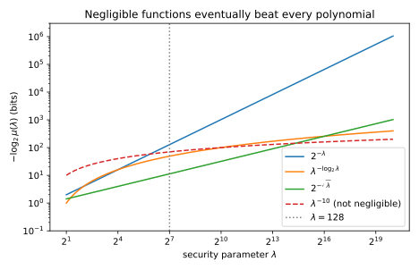
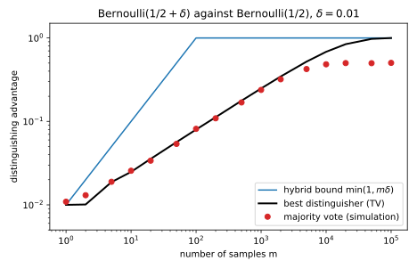
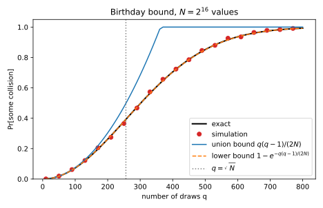
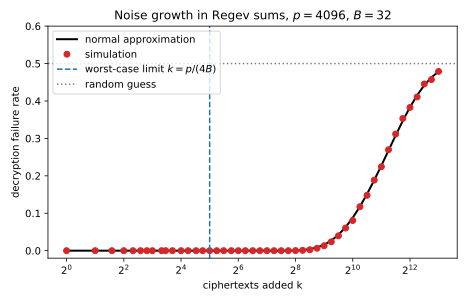

# Cryptography basics

## Why this matters

Some computations must hide something: a key, a message, a value split among several holders. To reason about them you need a precise answer to one question: **what does it mean that an observer with limited computing power learns nothing it was not supposed to learn?** Cryptography answers it with a small set of definitions and proof techniques. This chapter teaches them as mathematics: definitions you can state, bounds you can derive, and toy constructions you can run.

The whole subject is one idea, used over and over. **Security is a game.** A challenger secretly picks one of two worlds, runs a procedure in that world, and shows the result to an adversary, who guesses which world it is in. The challenger picks the world by flipping a fair coin, so that an adversary who learns nothing from what it sees is right exactly half the time, whatever it answers. Its **advantage** measures how much better than that coin flip it does. A scheme is then called **secure** when the advantage is tiny for every efficient adversary, and "tiny" is made precise in one of two ways: by negligible functions, which shrink faster than any power of the key length (the asymptotic view), or by explicit numbers such as $2^{-64}$ (the concrete view). Finally, security proofs rarely jump from the real world to the ideal one in a single move. They **change one thing at a time**, through a chain of intermediate worlds called **hybrids**, and add up the advantage gained at each step.

@tbl-crypto-uses lists where each result is used.

| Result | Typical use |
| --- | --- |
| Negligible functions, polynomial-time adversaries | Saying "this attack essentially never works" in a way that survives polynomially many repetitions |
| Indistinguishability and the hybrid argument | The skeleton of every security proof |
| Concrete security and the birthday bound | How much data a key may protect; how long random identifiers and hashes must be |
| Pseudorandom generators and functions | Stretching a short random key into many random-looking values |
| One-time pad, indistinguishability under chosen-plaintext attack (CPA) | What encryption promises, and why it must be randomized |
| The simulation paradigm | Proving that what a participant sees reveals nothing beyond what it is allowed to learn |
| Learning with errors and Regev encryption | Lattice-based encryption that can add ciphertexts, at the price of growing noise |

: The results in this chapter and where each is typically used. {#tbl-crypto-uses}

Later parts build protocols from these primitives. The probability tools used here (union bound, $1 + x \le e^x$, the normal tail) are proved in [Concentration inequalities](02-concentration.md), and total variation (TV) distance is studied in [Divergences](03-divergences.md); each is restated below where it is used.

**Notation.** This chapter departs from the part's shared notation in two letters. It keeps $P$ and $Q$ for two distributions, but lowercase $q$ counts the queries an adversary makes (or the random draws in the birthday bound), and lowercase $p$ is the modulus of the arithmetic in secret sharing and learning with errors, not a density. The bit length of blocks, messages and inputs is $n$, the number of share holders is $h$, and the dimension of a learning-with-errors secret is $d$.

**A warning about the code.** Every scheme in this chapter's script is a toy, written to make the definitions concrete. Its parameters are far too small to be secure, nothing runs in constant time, and NumPy's generator is not a cryptographic source of randomness. Never use it to protect anything.

## Toolkit: five facts every derivation uses

### Fact 1 — Advantage and guessing probability are the same thing

A **distinguisher** $A$ is any procedure that receives one sample and outputs a bit, 0 or 1. Think of output 1 as "I think this sample came from $Y$". If $A$ is any good at telling distribution $X$ from distribution $Y$, it says 1 more often on samples from $Y$ than on samples from $X$, so the natural measure of its skill is the gap between those two frequencies. That gap is its **advantage**:
$$\mathrm{Adv}_A(X, Y) = \big|\Pr[A(X) = 1] - \Pr[A(Y) = 1]\big|.$$
Here $\Pr[A(X) = 1]$ is the probability that $A$ outputs 1 when its input is drawn from $X$. A distinguisher that ignores its input says 1 equally often on both and has advantage 0; one that is always right has advantage 1.

Games are often phrased differently, as a guessing contest. The challenger flips a fair bit $b$: if $b = 1$ it gives $A$ a sample from $Y$, and if $b = 0$ a sample from $X$. $A$ outputs a guess, and it **wins** if its guess equals $b$. So $\Pr[A \text{ wins}]$, also written $\Pr[b' = b]$ with $b'$ the guess, is the probability that the guess is correct; it is not the probability that $b$ is 1, which is $\frac12$ by construction. The coin is fair on purpose. With a fair coin, an adversary who learns nothing from its sample, and so has nothing to go on, wins exactly half the time, whether it guesses at random or always says 1. Any win rate above $\frac12$ must therefore come from information in the sample.

The two phrasings measure the same thing. There are two ways to win, and they cannot happen in the same game: the coin says $Y$ and $A$ says 1, or the coin says $X$ and $A$ says 0. Each world occurs with probability $\frac12$, so the win probability is the average of the two conditional win rates. Writing $\Pr[A(X) = 0] = 1 - \Pr[A(X) = 1]$ and collecting terms,
$$\Pr[A \text{ wins}] = \tfrac12\Pr[A(Y) = 1] + \tfrac12\Pr[A(X) = 0] = \tfrac12 + \tfrac12\big(\Pr[A(Y) = 1] - \Pr[A(X) = 1]\big).$$ {#eq-crypto-win-advantage}
So an advantage of $\varepsilon$ means winning with probability $\frac12 + \frac\varepsilon2$: the know-nothing score, plus half the advantage. The bracket has no absolute value, so it can be negative, but then $A$ wins less than half the time, and flipping its output (saying 0 where it said 1) turns it into a distinguisher that wins $\frac12 + \frac\varepsilon2$.

Here it is with a coin. $X$ is a fair coin, $Y$ lands heads with probability 0.6, and $A$ outputs 1 on heads. Each row of @tbl-crypto-coin-game is one outcome of the game. Its probability is $\frac12$ for the challenger's bit times the probability of the coin outcome in that world: $\frac12 \times 0.5 = 0.25$ for each outcome of the fair coin, $\frac12 \times 0.4 = 0.20$ for tails of the biased coin and $\frac12 \times 0.6 = 0.30$ for heads.

| $b$ | Coin | Outcome | Probability | $A$ outputs | $A$ wins? |
| --- | --- | --- | --- | --- | --- |
| 0 | fair | tails | 0.25 | 0 | yes |
| 0 | fair | heads | 0.25 | 1 | no |
| 1 | biased | tails | 0.20 | 0 | no |
| 1 | biased | heads | 0.30 | 1 | yes |

: The distinguishing game for a fair against a 0.6-biased coin, with the distinguisher "output 1 on heads". {#tbl-crypto-coin-game}

$A$ wins in the first and last rows, with probability $0.25 + 0.30 = 0.55$. Its advantage is $\Pr[A(Y) = 1] - \Pr[A(X) = 1] = 0.6 - 0.5 = 0.1$, and indeed $0.55 = \frac12 + \frac{0.1}2$.

### Fact 2 — No distinguisher beats total variation

The **total variation distance** between two distributions $P$ and $Q$ on a finite set is the total amount of probability that $P$ puts on outcomes in excess of $Q$:
$$\mathrm{TV}(P, Q) = \sum_{\omega:\,P(\omega) > Q(\omega)}(P(\omega) - Q(\omega)).$$
It is 0 when the distributions are equal and 1 when they never produce the same outcome. Every distinguisher, however much time it uses, has advantage at most $\mathrm{TV}(P, Q)$. The reason is that a distinguisher can only react to which outcome it sees, and the most it can do is say 1 on exactly the outcomes that $P$ favours.

1. **Describe any distinguisher by its reaction to each outcome.** A randomized distinguisher outputs 1 on outcome $\omega$ with some probability $g(\omega) \in [0, 1]$. Nothing else about it matters for its advantage.
2. **Write the gap as a sum over outcomes.** The probability of output 1 under $P$ is $\sum_\omega P(\omega)g(\omega)$, and likewise under $Q$, so $\Pr[A(P) = 1] - \Pr[A(Q) = 1] = \sum_\omega g(\omega)(P(\omega) - Q(\omega))$.
3. **Maximize term by term.** Each term is largest when $g(\omega) = 1$ where $P(\omega) - Q(\omega)$ is positive and $g(\omega) = 0$ where it is negative. That choice gives exactly the TV distance. The same argument with $P$ and $Q$ swapped bounds the gap of the other sign, and the excess of $Q$ over $P$ is the same total, because both distributions sum to 1.

So the best unbounded distinguisher attains the TV distance, and this splits security into three regimes. Two distributions with TV distance 0 are identical, and then no adversary has any advantage: this is **perfect** security. TV distance at most a small $\varepsilon$ is **statistical** security: even an adversary with unlimited time gains at most $\varepsilon$. Cryptography's main business is the third case, where the TV distance is large but no *efficient* distinguisher can exploit it.

### Fact 3 — Advantages add along a chain

If you walk from distribution $H_0$ to distribution $H_m$ through intermediate distributions $H_1, \dots, H_{m-1}$, a distinguisher cannot tell the two ends apart better than the sum of how well it tells each consecutive pair apart. In symbols, for any distinguisher $A$,
$$\mathrm{Adv}_A(H_0, H_m) \le \sum_{i=1}^m \mathrm{Adv}_A(H_{i-1}, H_i).$$
The reason is a telescoping sum: in $\sum_{i=1}^m\big(\Pr[A(H_{i-1}) = 1] - \Pr[A(H_i) = 1]\big)$, each intermediate term appears once with a plus sign and once with a minus sign and cancels, leaving $\Pr[A(H_0) = 1] - \Pr[A(H_m) = 1]$. Taking absolute values, the triangle inequality ($|a_1 + \dots + a_m| \le |a_1| + \dots + |a_m|$) gives the bound. This is the arithmetic behind every hybrid proof.

### Fact 4 — A bijection maps uniform to uniform

If you shuffle the elements of a finite set by a fixed one-to-one rule, a uniformly random element stays uniformly random. Formally, if $U$ is uniform on a finite set $S$ and $f: S \to S$ is a bijection, then each $t \in S$ comes from exactly one $u$, namely $f^{-1}(t)$, so $\Pr[f(U) = t] = \Pr[U = f^{-1}(t)] = 1/|S|$. The one-time pad, secret sharing and the mask in learning with errors are all this fact, with $f(u) = u + c$ for a fixed $c$: adding a uniform random value to anything fixed gives a uniform result.

### Fact 5 — Union bound and $1 - x \le e^{-x}$

Both are proved in [Concentration inequalities](02-concentration.md); here is what they say and why they hold. The **union bound** says that the probability that at least one of several events happens is at most the sum of their probabilities, $\Pr[A_1 \cup \dots \cup A_q] \le \sum_i \Pr[A_i]$: the sum counts every outcome where some event happens at least once, and outcomes where several happen more than once. The inequality $1 - x \le e^{-x}$ holds for every real $x$ because the straight line $1 - x$ is the tangent to the convex curve $e^{-x}$ at $x = 0$, and a convex curve lies above its tangents. For $x_i \in [0, 1]$, multiplying the nonnegative inequalities $1 - x_i \le e^{-x_i}$ gives $\prod_i(1 - x_i) \le e^{-\sum_i x_i}$.

In this chapter they bound the probability that something goes wrong in at least one of $q$ steps: the union bound from above, and the product inequality from below (applied to the probability that nothing goes wrong).

## Security parameter, adversaries and negligible functions

### Context

A key of 40 bits can be found by trying every key; a key of 256 bits cannot. Security is therefore never absolute. It is a statement about how the attacker's success shrinks as you pay more, measured by a **security parameter** $\lambda$ (think of the key length in bits). The asymptotic theory needs two notions: which attackers count as efficient, and which success probabilities count as tiny.

### Definitions

An attacker counts as efficient if its running time grows at most polynomially with $\lambda$. Precisely, an adversary is **probabilistic polynomial time (PPT)** if it is a randomized algorithm whose running time is bounded by a polynomial in $\lambda$. Running time is always measured against the length of the input, and $\lambda$ written in binary is only about $\log_2\lambda$ bits long, so the adversary is given $\lambda$ in unary, as the string of $\lambda$ ones written $1^\lambda$. Then "polynomial in its input length" means polynomial in $\lambda$.

A success probability counts as tiny if it shrinks faster than one over any polynomial. The point of this choice is that an efficient adversary can repeat its attack a polynomial number of times, so "tiny" must stay tiny after multiplication by any polynomial. A function $\mu: \mathbb N \to [0, 1]$ is **negligible** if, for every exponent $c$, it eventually falls below $\lambda^{-c}$ and stays there:
$$\forall c > 0\ \ \exists \lambda_0\ \ \forall \lambda \ge \lambda_0:\quad \mu(\lambda) < \lambda^{-c}.$$ {#eq-crypto-negligible}

Putting the two together, a scheme is **secure** if every PPT adversary has negligible advantage in its security game.

### Closure: polynomially many tries keep it negligible

**Statement.** If $\mu$ is negligible and $\mathrm{poly}$ is a polynomial, then $\mathrm{poly}(\lambda)\mu(\lambda)$ is negligible. The sum of two negligible functions is negligible.

**Derivation.** The idea is that a negligible function beats every inverse polynomial, so you can ask it to beat one that is steep enough to also cancel the polynomial $\mathrm{poly}$.

1. **Bound the polynomial by a power.** A polynomial of degree $c' - 1$ is eventually below $\lambda^{c'}$, because $\lambda^{c'}$ grows faster than any of its terms. So $\mathrm{poly}(\lambda) \le \lambda^{c'}$ for all $\lambda \ge \lambda_1$.
2. **Ask $\mu$ for a steeper decay.** Fix any $c > 0$. Apply @eq-crypto-negligible to $\mu$ with exponent $c + c'$ instead of $c$: $\mu(\lambda) < \lambda^{-(c+c')}$ for $\lambda \ge \lambda_2$.
3. **Multiply the two bounds.** For $\lambda \ge \max(\lambda_1, \lambda_2)$, $\mathrm{poly}(\lambda)\mu(\lambda) < \lambda^{c'}\lambda^{-(c+c')} = \lambda^{-c}$. Since $c$ was arbitrary, $\mathrm{poly}\cdot\mu$ meets the definition of negligible.
4. **Handle a sum the same way.** Apply @eq-crypto-negligible to each term with exponent $c + 1$: $\mu_1 + \mu_2 < 2\lambda^{-(c+1)}$, and $2\lambda^{-(c+1)} \le \lambda^{-c}$ is the same as $2 \le \lambda$, which holds once $\lambda \ge 2$.

This is why the definitions use polynomials and negligible functions together. A PPT adversary can repeat an attack a polynomial number of times. By the union bound (Fact 5: the chance that at least one try succeeds is at most the sum of the per-try chances), its overall success is at most the number of tries times the per-try success, which is still negligible.

### Examples

Each example compares $\mu(\lambda)$ with $\lambda^{-c}$, usually by taking $\log_2$ of both sides, which turns the comparison of tiny numbers into a comparison of exponents.

1. **$2^{-\lambda}$ is negligible.** $\lambda^c 2^{-\lambda} = 2^{c\log_2\lambda - \lambda}$, and the exponent goes to $-\infty$ for every $c$ because $\lambda$ grows faster than $c\log_2\lambda$. So $\lambda^c 2^{-\lambda} \to 0$: $2^\lambda$ outgrows every polynomial.
2. **$\lambda^{-\log_2\lambda}$ is negligible**, although it decays more slowly than any exponential. For fixed $c$, compare the exponents of $\lambda$: $\lambda^{-\log_2\lambda} < \lambda^{-c}$ exactly when $\log_2\lambda > c$, that is, for all $\lambda > 2^c$.
3. **$2^{-\sqrt\lambda}$ is negligible.** Taking $\log_2$, $2^{-\sqrt\lambda} < \lambda^{-c}$ exactly when $\sqrt\lambda > c\log_2\lambda$. Since $\sqrt\lambda/\log_2\lambda \to \infty$, this holds for all large $\lambda$.
4. **$\lambda^{-10}$ is not negligible.** The definition must hold for every $c$, so one bad $c$ is enough. Take $c = 11$: $\lambda^{-10} < \lambda^{-11}$ never holds for $\lambda \ge 1$.
5. **A function that is $2^{-\lambda}$ for even $\lambda$ and $1/\lambda$ for odd $\lambda$ is not negligible.** The definition needs the bound for *all* large $\lambda$, and the odd values violate it for $c = 2$, since $1/\lambda > \lambda^{-2}$ for $\lambda > 1$.

### Interpretation: asymptotics say nothing at a fixed $\lambda$

"Negligible" is a statement about the limit. At a specific parameter it can be misleading. @tbl-crypto-negligible-128 evaluates the four examples at $\lambda = 128$. Since $128 = 2^7$, $\log_2\lambda = 7$, so $\lambda^{-\log_2\lambda} = (2^7)^{-7} = 2^{-49}$ and $\lambda^{-10} = (2^7)^{-10} = 2^{-70}$; and $\sqrt{128} = 11.31$.

| $\mu(\lambda)$ | Negligible? | Value at $\lambda = 128$ |
| --- | --- | --- |
| $2^{-\lambda}$ | yes | $2^{-128} = 2.9\times10^{-39}$ |
| $\lambda^{-\log_2\lambda}$ | yes | $2^{-49} = 1.8\times10^{-15}$ |
| $2^{-\sqrt\lambda}$ | yes | $2^{-11.31} = 3.9\times10^{-4}$ |
| $\lambda^{-10}$ | no | $2^{-70} = 8.5\times10^{-22}$ |

: Four functions at $\lambda = 128$. The negligible $2^{-\sqrt\lambda}$ is far larger than the non-negligible $\lambda^{-10}$. {#tbl-crypto-negligible-128}

The non-negligible $\lambda^{-10}$ is smaller than two of the negligible functions. The crossing points follow from comparing exponents, as in the examples. $2^{-\sqrt\lambda}$ only drops below $\lambda^{-10}$ for good at $\lambda = 20{,}520$, where $\sqrt\lambda$ overtakes $10\log_2\lambda$. $\lambda^{-\log_2\lambda}$ crosses it at $\lambda = 2^{10} = 1024$, where $\log_2\lambda = 10$. @fig-crypto-negligible plots the "bits of security" $-\log_2\mu(\lambda)$ of each, the number of halvings it takes to get from 1 down to $\mu(\lambda)$. A polynomial $\lambda^{-c}$ has $c\log_2\lambda$ bits of security. The negligible functions eventually rise above every such curve, but they can take a long time to do so.

{#fig-crypto-negligible}

### Example: guessing a key

Suppose the key is uniform over all $2^\lambda$ strings of $\lambda$ bits. An adversary that tries $t$ distinct keys finds the right one with probability $t/2^\lambda$, because each key it tries is the right one with probability $2^{-\lambda}$ and the tries cover disjoint possibilities. If $t = t(\lambda)$ is a polynomial, this is a polynomial times $2^{-\lambda}$, which is negligible by the closure property. Brute force is the attack every definition must allow, and it is why the best one can hope for is "negligible", never zero.

### Check yourself

- Is $\mu(\lambda) = 2^{-(\log_2\lambda)^2}$ negligible? *(Yes. Write $2^{(\log_2\lambda)^2} = (2^{\log_2\lambda})^{\log_2\lambda} = \lambda^{\log_2\lambda}$, so $\mu(\lambda) = \lambda^{-\log_2\lambda}$, example 2.)*
- If an attack succeeds with probability $1/\lambda^3$ per try, does running it $\lambda^4$ times break the scheme? *(Yes, almost surely. The tries are independent, so $\Pr[\text{all tries fail}] = (1 - \lambda^{-3})^{\lambda^4} \le e^{-\lambda^{-3}\cdot\lambda^4} = e^{-\lambda}$ by $1 - x \le e^{-x}$ (Fact 5). A non-negligible success probability can be amplified to near 1.)*

## Computational indistinguishability and the hybrid argument

### Context

Most security definitions say "these two things look the same". A ciphertext looks like random bits; the output of a generator looks like true randomness; a participant's view looks like something it could have produced alone. Computational indistinguishability makes "look the same" precise, and the hybrid argument is the tool for proving it.

You already know distinguishers from machine learning. A classifier trained to tell real images from generated ones is a distinguisher. If it outputs 1 for "real", then $\Pr[A(\text{real}) = 1]$ is its true-positive rate and $\Pr[A(\text{generated}) = 1]$ is its false-positive rate, so its advantage is its true-positive rate minus its false-positive rate at the chosen threshold. Deciding which of two distributions produced a sample is a hypothesis test, and [Hypothesis testing](04-hypothesis-testing.md) studies the best such tests.

### Definition

Because security is about how things behave as $\lambda$ grows, the objects compared are not single distributions but families, one distribution for each value of $\lambda$. Two families $X = \{X_\lambda\}$ and $Y = \{Y_\lambda\}$ are **computationally indistinguishable**, written $X \approx_c Y$, if no efficient distinguisher has more than a negligible advantage: for every PPT distinguisher $A$
$$\mathrm{Adv}_A(X_\lambda, Y_\lambda) = \big|\Pr[A(1^\lambda, X_\lambda) = 1] - \Pr[A(1^\lambda, Y_\lambda) = 1]\big| \text{ is negligible in } \lambda.$$
If the TV distance itself is negligible, so that even unbounded distinguishers gain almost nothing, they are **statistically indistinguishable** ($\approx_s$), and if they are equal, **perfectly indistinguishable** ($\equiv$). By Fact 2, every distinguisher's advantage is at most the TV distance, so $\equiv$ implies $\approx_s$, which implies $\approx_c$.

### The hybrid lemma for many samples

**Statement.** If one sample cannot be told apart, can many? The answer is yes, as long as "many" is polynomial. Let $X$ and $Y$ be efficiently samplable (an efficient algorithm can draw from each) with $X \approx_c Y$, and let $m = m(\lambda)$ be a polynomial. Then $m$ independent copies are still indistinguishable:
$$(X_1, \dots, X_m) \approx_c (Y_1, \dots, Y_m).$$
Quantitatively, a distinguisher with advantage $\varepsilon$ on $m$ copies yields one with advantage $\varepsilon/m$ on a single copy, with about the same running time.

**Derivation.** The idea is to walk from all-$X$ to all-$Y$ by swapping one sample at a time. If the two ends are $\varepsilon$ apart, the $m$ steps must add up to $\varepsilon$ (Fact 3), so a typical step is worth $\varepsilon/m$. And a single step changes a single sample, so it is a one-sample problem.

1. **Define the hybrids.** Let $H_i = (Y_1, \dots, Y_i, X_{i+1}, \dots, X_m)$: the first $i$ entries come from $Y$, the rest from $X$. Then $H_0$ is all-$X$ and $H_m$ is all-$Y$, and consecutive hybrids differ in a single position.
2. **Build a one-sample distinguisher.** Given a distinguisher $D$ for $m$ samples, let $D'$ on a single input $z$ pick a position $i$ uniformly from $\{1, \dots, m\}$, sample $Y_1, \dots, Y_{i-1}$ and $X_{i+1}, \dots, X_m$ itself (this is where efficient samplability is needed), put $z$ in position $i$, and output $D(Y_1, \dots, Y_{i-1}, z, X_{i+1}, \dots, X_m)$.
3. **Identify what $D$ sees.** If $z \sim X$, the tuple handed to $D$ has $i - 1$ entries from $Y$ followed by entries from $X$, so it is distributed as $H_{i-1}$. If $z \sim Y$, it has $i$ entries from $Y$, so it is $H_i$.
4. **Average over the random position.** Each $i$ is chosen with probability $\frac1m$, so $\Pr[D'(X) = 1] - \Pr[D'(Y) = 1] = \frac1m\sum_{i=1}^m\big(\Pr[D(H_{i-1}) = 1] - \Pr[D(H_i) = 1]\big)$.
5. **Telescope.** As in Fact 3, but without absolute values, the intermediate terms cancel and the sum equals $\Pr[D(H_0) = 1] - \Pr[D(H_m) = 1]$, whose absolute value is $D$'s advantage $\varepsilon$. So $D'$ has advantage exactly $\varepsilon/m$.
6. **Conclude by contradiction.** Suppose $\varepsilon$ were not negligible. Negating @eq-crypto-negligible, there would be a $c$ with $\varepsilon(\lambda) \ge \lambda^{-c}$ for infinitely many $\lambda$. With $m(\lambda) \le \lambda^{c'}$ for some exponent $c'$, this gives $\varepsilon/m \ge \lambda^{-(c+c')}$ for those same $\lambda$, so the efficient $D'$ would have non-negligible advantage on one sample, contradicting $X \approx_c Y$.

The same argument without the running-time bookkeeping shows $\mathrm{TV}(P^{\otimes m}, Q^{\otimes m}) \le m\,\mathrm{TV}(P, Q)$, where $P^{\otimes m}$ is the distribution of $m$ independent samples from $P$.

### Interpretation

Every hybrid proof has this shape: a chain from the real world to an ideal world, each step justified by one assumption, and a loss equal to the number of steps. The loss factor $m$ is usually pessimistic, because changing one sample at a time is how the proof is organized, not how the best attacker works. An attacker who sees all $m$ samples at once can pool them, and the example below shows that pooling gains far less than a factor $m$.

### Example: how many flips reveal a biased coin?

$X$ is a fair coin and $Y$ lands heads with probability $\frac12 + \delta$, with $\delta = 0.01$. From one flip, the best advantage is the TV distance, which is the excess probability of heads, $\delta = 0.01$ (Fact 2). With $m$ flips, the hybrid bound gives at most $m\delta$. @tbl-crypto-coin-hybrid and @fig-crypto-hybrid compare that with the best possible advantage (the exact TV distance between the two binomial counts of heads) and with a simple distinguisher, majority vote: output 1 iff more than half the flips are heads.

| Flips $m$ | Majority vote (simulation) | Best possible (TV) | Hybrid bound $\min(1, m\delta)$ |
| --- | --- | --- | --- |
| 1 | 0.008 | 0.010 | 0.010 |
| 100 | 0.082 | 0.080 | 1.000 |
| 10,000 | 0.481 | 0.683 | 1.000 |

: Advantage in telling $m$ flips of a $0.51$-coin from $m$ fair flips (seed 0, 200,000 simulated games per entry). {#tbl-crypto-coin-hybrid}

The hybrid bound is tight for one sample and loose afterwards, and a normal approximation shows why. The number of heads has mean $m/2$ for the fair coin and $m/2 + m\delta$ for the biased one, and in both cases a standard deviation of about $\sqrt m/2$ (each flip has variance $\frac14$ or very close to it). So the two counts are two bell curves whose centres are $m\delta/(\sqrt m/2) = 2\delta\sqrt m$ standard deviations apart. The best test puts its threshold where the two curves cross, halfway between the means, at $\delta\sqrt m$ standard deviations from each. Write $\Phi$ for the standard normal cumulative distribution function, $\Phi(z) = \Pr[Z \le z]$ for $Z \sim \mathcal N(0, 1)$. The biased count lands above the threshold with probability $\Phi(\delta\sqrt m)$ and the fair one with probability $1 - \Phi(\delta\sqrt m)$, so the best advantage is about $2\Phi(\delta\sqrt m) - 1$. At $m = 100$, $\delta\sqrt m = 0.1$ and $2\Phi(0.1) - 1 = 0.080$; at $m = 10{,}000$, $\delta\sqrt m = 1$ and $2\Phi(1) - 1 = 0.683$, the two TV values in the table. The true advantage therefore grows like $\delta\sqrt m$, not $\delta m$: the means of the counts separate by $m\delta$, but each count fluctuates by about $\sqrt m/2$. To reach a constant advantage you need $\delta\sqrt m$ of order 1, that is about $1/\delta^2$ samples, while the hybrid bound would allow it after $1/\delta$.

Majority vote stalls at about $\frac12$, because its threshold $m/2$ sits at the centre of the fair curve instead of halfway between the two. For large $m$ the biased count is almost surely above $m/2$, but so is the fair count about half the time. At $m = 10{,}000$ the biased mean is $2\delta\sqrt m = 2$ standard deviations above $m/2$, so the biased count clears $m/2$ with probability about $\Phi(2) = 0.977$, and $0.977 - 0.5 \approx 0.48$, close to the simulated 0.481. The best test puts the threshold halfway between the two means, at $m/2 + m\delta/2$ ([Exercise 3](../../book-exercises/part01-prerequisites/08-crypto-basics.md#sec-sol-crypto-basics-3)).

{#fig-crypto-hybrid}

### Check yourself

- Where does the hybrid lemma use that $X$ and $Y$ are efficiently samplable? *(In step 2: $D'$ must generate the other $m - 1$ entries itself, in polynomial time.)*
- Why does the lemma need $m$ to be polynomial? *(The loss is a factor $m$. For superpolynomial $m$, $\varepsilon/m$ can be negligible even when $\varepsilon$ is not, so step 6 no longer gives a contradiction.)*

## Concrete versus asymptotic security

### Context

Real systems fix $\lambda$: AES uses 128-bit keys, not "a key of length $\lambda$". A statement that holds "for all large enough $\lambda$" does not say whether 128 is large enough. Concrete security replaces "PPT" and "negligible" by explicit numbers.

### Definition

Instead of "efficient" and "negligible", concrete security names the attacker's resources and the advantage they buy. A primitive is **$(t, q, \varepsilon)$-secure** if every adversary that runs in time at most $t$ and makes at most $q$ queries to its oracles (the procedures the game lets it call, such as "encrypt this message for me") has advantage at most $\varepsilon$. Brute force over $\kappa$-bit keys sets the benchmark: trying $t$ keys succeeds with probability $t/2^\kappa$. A primitive has **$\kappa$-bit security** if, roughly, no attack does better than that: every adversary with time $t$ has advantage at most $t/2^\kappa$.

Security proofs then become **reductions** with explicit losses: "if $A$ breaks scheme $S$ with $(t, q, \varepsilon)$, then $B$ breaks primitive $P$ with $(t', q', \varepsilon')$". Read in reverse, this says that if $P$ is hard to break, so is $S$, and the losses say how much security is lost on the way. The hybrid lemma is an example with $t' \approx t$ and $\varepsilon' = \varepsilon/m$. A reduction is **tight** when $\varepsilon' \approx \varepsilon$. A loose reduction forces larger parameters for the same guarantee, because the primitive must then be secure against advantages much smaller than the one you want for the scheme.

### Example: what 128-bit security buys

Suppose an attacker has an exascale machine that tests $10^{18}$ keys per second, and runs it for a year. A year is about $3.16\times10^7$ seconds, so that is about $3.16\times10^{25}$ keys, which is $2^{84.7}$ keys (since $\log_2 10 \approx 3.32$). Each key is right with probability $2^{-128}$, so against a 128-bit key it succeeds with probability $2^{84.7 - 128} = 9.3\times10^{-14}$. Trying all $2^{128}$ keys would take $2^{128}/2^{84.7} = 2^{43.3}$ years, which is $1.08\times10^{13}$ years. The advantage is not zero, but it is smaller than the probability of most hardware failures during the computation.

### Example: what a $q$-query bound means

The next section derives that a pseudorandom permutation on $n$-bit blocks is also a pseudorandom function, up to an extra advantage of $q^2/2^{n+1}$ after $q$ queries (@eq-crypto-switching). In words, the extra advantage is the probability that $q$ random $n$-bit values contain a repeat, which grows with the square of $q$. For a 128-bit block cipher, $q^2/2^{129} = 2^{2k - 129}$ when $q = 2^k$. With 16-byte (128-bit) blocks:

- $q = 2^{32}$ blocks ($2^{36}$ bytes, 64 GiB of data): at most $2^{64 - 129} = 2^{-65}$.
- $q = 2^{48}$ blocks ($2^{52}$ bytes, 4 PiB): at most $2^{96 - 129} = 2^{-33}$.
- $q = 2^{64}$ blocks: the bound reaches $2^{128 - 129} = \frac12$ and says nothing.

So a $q$-query bound is a data limit. This is why block-cipher modes recommend changing keys long before $2^{64}$ blocks: the guarantee degrades with the square of the data processed under one key.

### Check yourself

- A reduction loses a factor of $2^{20}$ (it turns advantage $\varepsilon$ into $\varepsilon/2^{20}$). If the primitive has 128-bit security, what does the scheme have? *(About $128 - 20 = 108$ bits: a scheme adversary with advantage $\varepsilon$ gives a primitive adversary with advantage $\varepsilon/2^{20} \le t/2^{128}$, so $\varepsilon \le t/2^{108}$.)*
- Why is "$(t, \varepsilon)$-secure" usually summarized by the ratio $t/\varepsilon$? *(An adversary can trade time for success probability, for example by guessing a fraction of the key space: trying $t$ of $2^\kappa$ keys gives $\varepsilon = t/2^\kappa$, so the ratio $t/\varepsilon = 2^\kappa$ stays constant along that trade-off.)*

## Pseudorandom generators and functions

### Context

Truly random bits are expensive to produce and to share. A short random key is cheap. Pseudorandom generators stretch a short key into a long string, and pseudorandom functions turn it into a huge table of random-looking values that can be looked up on demand. Both are defined by games.

### Pseudorandom generators

A generator is pseudorandom if its output, on a random seed, cannot be told from truly random bits by any efficient distinguisher. Write $U_k$ for the uniform distribution on $\{0,1\}^k$, the strings of $k$ bits. A deterministic, efficient $G: \{0,1\}^\lambda \to \{0,1\}^{\ell(\lambda)}$ with $\ell(\lambda) > \lambda$, so that the output is longer than the seed, is a **pseudorandom generator (PRG)** if
$$G(U_\lambda) \approx_c U_{\ell(\lambda)}.$$
As a game: the challenger sends either $G(s)$ for a uniform seed $s$, or a uniform $\ell$-bit string, and the adversary guesses which.

**A PRG is never statistically secure.** The outputs of $G$ form a tiny subset of all $\ell$-bit strings, so an adversary that can check membership in that subset wins easily. The catch is that checking takes exponential time. Let $D(y) = 1$ iff $y = G(s)$ for some seed $s$.

1. On $G(U_\lambda)$, $D$ always outputs 1, because the input is an output of $G$ by construction.
2. There are $2^\lambda$ seeds, so at most $2^\lambda$ of the $2^\ell$ strings are outputs of $G$. On $U_\ell$, $D$ therefore outputs 1 with probability at most $2^\lambda/2^\ell = 2^{\lambda - \ell}$, which is at most $\frac12$ because $\ell \ge \lambda + 1$.
3. So $D$ has advantage at least $1 - \frac12 = \frac12$, and by Fact 2 the TV distance is at least $\frac12$. But $D$ loops over $2^\lambda$ seeds. Pseudorandomness is only a statement about efficient distinguishers.

PRGs exist if one-way functions exist (Håstad, Impagliazzo, Levin & Luby 1999). In practice, stream ciphers such as ChaCha20 are modelled as PRGs.

### Pseudorandom functions

A **random function** from $\mathcal X$ to $\mathcal Y$ is a table that assigns each input its own independent, uniform output. A keyed function $F: \{0,1\}^\lambda \times \mathcal X \to \mathcal Y$, written $F_k(x)$ for key $k$, is a **pseudorandom function (PRF)** if no efficient adversary can tell whether it is talking to $F_k$ with a random key or to a truly random function. Because the adversary may choose its questions, the game gives it an oracle $O$, a box it can query, and hides behind a fair coin which function is in the box:

1. The challenger flips $b$. If $b = 0$ it samples a key $k$ and sets $O = F_k$. If $b = 1$ it sets $O = f$, a uniformly random function from $\mathcal X$ to $\mathcal Y$.
2. The adversary sends queries $x_1, \dots, x_q$, adaptively (each may depend on earlier answers), and receives $O(x_1), \dots, O(x_q)$.
3. It outputs a guess $b'$. Its advantage is $|\Pr[b' = 1 \mid b = 1] - \Pr[b' = 1 \mid b = 0]|$, the gap of Fact 1 between how often it says "random" in the two worlds.

A random function on 128-bit inputs is a table with $2^{128}$ entries, which nobody can store. A PRF gives the same appearance from a 128-bit key. In practice the hash-based message authentication code (HMAC) is modelled as a PRF; the toy code uses HMAC-SHA256.

### From a PRG to a PRF: the GGM tree {#sec-crypto-ggm}

Goldreich, Goldwasser & Micali (1986) build a PRF from any length-doubling PRG; the construction is called the GGM tree after them. Split the PRG's output into its two halves, $G(s) = G_0(s)\,\|\,G_1(s)$, each as long as the seed. The idea is to use the PRG repeatedly to grow a binary tree of keys, picking the left or right half at each level according to the next bit of the input.

1. Start at the root with the key, $k_\varnothing = k$.
2. For an input $x = x_1x_2\cdots x_n$, walk down the tree: the node reached after the first $i$ bits is $k_{x_1\cdots x_i} = G_{x_i}(k_{x_1\cdots x_{i-1}})$, the left or right half of the PRG applied to its parent.
3. Output the leaf: $F_k(x) = k_x$.

**Proof sketch.** The proof replaces the tree by random values one level at a time. Let hybrid $H_j$ replace every node at depth $j$ by an independent uniform string, sampled when first needed, and compute everything below it with $G$. $H_0$ is the real $F_k$, and $H_n$, where every leaf is independent and uniform, is a random function. Between $H_{j-1}$ and $H_j$, the only change is at depth $j$: in $H_{j-1}$ the nodes there are the two halves of $G$ applied to uniform parents, and in $H_j$ they are uniform. Each query is a path from root to leaf, with one node per depth, so a $q$-query adversary touches at most $q$ parents at depth $j - 1$. Telling $H_{j-1}$ from $H_j$ therefore means telling $q$ outputs of $G$ on uniform seeds from $q$ uniform strings. By the hybrid lemma that costs at most $q$ times the PRG advantage. Summing over the $n$ levels (Fact 3): $\mathrm{Adv}_{\mathrm{PRF}} \le nq\cdot\mathrm{Adv}_{\mathrm{PRG}}$. The full proof is in Goldreich, *Foundations of Cryptography*, Vol. 1, §3.6, and @sec-apx-crypto-ggm in the appendices derives it step by step, including how the reduction handles queries chosen adaptively.

### The birthday bound

**Statement.** Many arguments about random values fail only if two of them coincide, so you need to know how likely a coincidence is. The answer is the birthday bound: among $q$ values there are about $q^2/2$ pairs, each pair coincides with probability $1/N$, so collisions become likely once $q^2/2$ is comparable to $N$, after about $\sqrt N$ draws rather than $N$. Precisely, draw $q$ values independently and uniformly from a set of size $N$. The probability that two of them coincide satisfies
$$1 - e^{-q(q-1)/(2N)} \;\le\; \Pr[\text{collision}] \;\le\; \frac{q(q-1)}{2N} \le \frac{q^2}{2N}.$$ {#eq-crypto-birthday}

**Derivation.** The upper bound counts pairs; the lower bound computes the exact probability of no collision and bounds it with $1 - x \le e^{-x}$.

1. **Upper bound.** There are $\binom q2 = q(q-1)/2$ pairs, and each pair coincides with probability $1/N$ (whatever the first value is, the second matches it with probability $1/N$). A collision means at least one pair coincides, so the union bound (Fact 5) gives $\Pr[\text{collision}] \le q(q-1)/(2N)$.
2. **Exact value.** Draw the values one at a time. If no collision has happened yet, the first $i$ values are distinct, and the $(i+1)$-th avoids all of them with probability $1 - i/N$. Multiplying these conditional probabilities, $\Pr[\text{no collision}] = \prod_{i=0}^{q-1}(1 - i/N)$.
3. **Lower bound.** By $1 - x \le e^{-x}$ applied to each factor, $\Pr[\text{no collision}] \le \exp\big(-\sum_{i<q} i/N\big) = e^{-q(q-1)/(2N)}$, using $\sum_{i<q} i = q(q-1)/2$. Subtracting from 1 gives the lower bound on a collision.
4. **The 50% point.** Setting $1 - e^{-q^2/(2N)} = \frac12$ means $q^2/(2N) = \ln 2$, so $q \approx \sqrt{2N\ln 2} \approx 1.18\sqrt N$ (since $2\ln 2 = 1.386$ and $\sqrt{1.386} = 1.18$). Collisions appear after about $\sqrt N$ draws, not $N$.

The two bounds are close. Write $x = q(q-1)/(2N)$, so the union bound is $x$ and the lower bound is $1 - e^{-x}$. On $[0, 1]$ the curve $1 - e^{-x}$ is concave (it bends downwards), so it lies above the straight chord joining its values at 0 and 1, which is $(1 - 1/e)x$. So when $x \le 1$, the lower bound is at least $1 - 1/e \approx 0.63$ times the union bound, and the union bound has the right order.

**Examples.** @tbl-crypto-birthday gives the exact probability and both bounds for three cases. The union-bound column is $q(q-1)/(2N)$; for the class, $23 \times 22/730 = 0.693$.

| Case | $q$ | $N$ | Exact | Union bound | $1 - e^{-q(q-1)/(2N)}$ |
| --- | --- | --- | --- | --- | --- |
| Shared birthday in a class | 23 | 365 | 0.507 | 0.693 | 0.500 |
| Hashing trick: 1,000 features into $2^{20}$ buckets | 1,000 | $2^{20}$ | 0.379 | 0.476 | 0.379 |
| Random 32-bit identifiers for 100,000 records | 100,000 | $2^{32}$ | 0.688 | 1.164 | 0.688 |

: Collision probability, exact against the two bounds of @eq-crypto-birthday. {#tbl-crypto-birthday}

With the hashing trick, 1,000 features hashed into a million buckets already collide with probability 0.379. Random 32-bit identifiers for 100,000 records are more likely than not to clash; the union bound is above 1 and says nothing.

@fig-crypto-birthday checks @eq-crypto-birthday by simulation for $N = 2^{16}$. At $q = 256 = \sqrt N$ the exact probability is 0.3927, the simulation (100,000 trials) gives 0.3920, and the union bound gives 0.4980. The 50% point is $q = 301$, in line with $1.18\sqrt N = 1.18 \times 256 \approx 302$.

{#fig-crypto-birthday}

### The switching lemma

A block cipher such as AES is a keyed *permutation*: different inputs never give the same output. It is modelled as a **pseudorandom permutation (PRP)**, defined by the PRF game with the random function $f$ replaced by a uniformly random permutation of $\mathcal X$ (a random one-to-one shuffle of the inputs). Most proofs, however, want a PRF. The switching lemma bridges the gap. The only visible difference between a random function and a random permutation is that the function sometimes repeats an output and the permutation never does, so an adversary can tell them apart only about as often as $q$ random values collide.

**Statement.** For any adversary making $q$ queries,
$$\big|\Pr[A^{\text{random function}} = 1] - \Pr[A^{\text{random permutation}} = 1]\big| \le \frac{q(q-1)}{2|\mathcal X|} \le \frac{q^2}{2|\mathcal X|}.$$ {#eq-crypto-switching}
Here $A^{O}$ means the adversary run with oracle $O$.

**Derivation.** The plan is to run both oracles from the same pre-drawn list of answers, and show they behave identically unless that list contains a repeat.

1. **Simplify the adversary.** Assume its $q$ queries are distinct: repeating a query teaches it nothing, since both oracles answer the same question the same way every time.
2. **Pre-sample the answers.** The random-function oracle can be run by drawing $Y_1, \dots, Y_q$ independently and uniformly from $\mathcal X$ in advance and answering the $i$-th query with $Y_i$. On distinct queries this is exactly a random function, because a random function gives each new input a fresh uniform output.
3. **Do the same for the permutation.** A random permutation answers the $i$-th distinct query with a value that is uniform over the $|\mathcal X| - i + 1$ values not yet used, whatever the queries are: every unused value is the image of the new query under the same number of permutations consistent with the answers so far. So the permutation oracle can be run by pre-sampling a uniformly random sequence of $q$ *distinct* values.
4. **Compare the two.** Let $C$ be the event that the list $Y_1, \dots, Y_q$ of step 2 has a collision. Every list has probability $|\mathcal X|^{-q}$, so conditioning on no collision leaves every list of distinct values equally likely: exactly the permutation's answers. Hence $\Pr[A^{\text{RF}} = 1 \mid \neg C] = \Pr[A^{\text{RP}} = 1]$, writing $\mathrm{RF}$ for the random function and $\mathrm{RP}$ for the random permutation.
5. **Bound the difference.** Write $\rho = \Pr[A^{\text{RP}} = 1]$. Splitting on $C$, $\Pr[A^{\text{RF}} = 1] = \Pr[C]\Pr[A^{\text{RF}} = 1 \mid C] + (1 - \Pr[C])\,\rho$. Subtracting $\rho$ gives $\Pr[A^{\text{RF}} = 1] - \rho = \Pr[C]\big(\Pr[A^{\text{RF}} = 1 \mid C] - \rho\big)$. The bracket is a difference of two probabilities, so its absolute value is at most 1, and the whole is at most $\Pr[C]$.
6. **Apply the birthday bound** (@eq-crypto-birthday) with $N = |\mathcal X|$.

The event $C$ is defined on the pre-sampled answers, before the adversary acts, which is what makes step 4 valid for adaptive adversaries: whatever the adversary does, the answers it receives are the same list. (Bellare & Rogaway 2006 point out that a commonly given proof, which conditions on events defined through the adversary's queries, has a gap; their "identical until bad" game-playing proof is the one above.)

**Corollary.** If $F$ is a PRP with advantage $\varepsilon$ against $q$-query adversaries, it is a PRF with advantage at most $\varepsilon + q^2/(2|\mathcal X|)$. This is Fact 3 with three hybrids: going from $F_k$ to a random permutation costs at most $\varepsilon$, and from a random permutation to a random function at most $q^2/(2|\mathcal X|)$.

**The bound is tight.** The adversary "output 1 iff two answers collide" never outputs 1 against a permutation and outputs 1 against a function with probability exactly $\Pr[C]$. So @fig-crypto-birthday is also the advantage of the best adversary in the switching lemma.

### Check yourself

- Why can the PRG distinguisher in the "never statistically secure" argument not be used against a real PRG? *(It enumerates all $2^\lambda$ seeds, which is not polynomial time.)*
- How many outputs of a 64-bit block cipher can you safely use under one key, if you want the switching term below $2^{-20}$? *(Need $q^2/2^{65} \le 2^{-20}$, so $q^2 \le 2^{45}$ and $q \le 2^{22.5}$, about 6 million blocks: a 64-bit block is too small for bulk data.)*

## Encryption: perfect secrecy and IND-CPA

### Context

Encryption should hide the message. Shannon's one-time pad hides it perfectly but needs a key as long as all the data. Computational definitions accept a negligible advantage in exchange for short keys. The definition that matters in practice, IND-CPA, has a consequence that surprises many programmers: encryption must be randomized.

### The one-time pad and perfect secrecy

**Definition.** Hiding the message perfectly means that the ciphertext is no more likely to be produced by one message than by another, so seeing it tells you nothing. An encryption scheme has **perfect secrecy** if the ciphertext distribution does not depend on the message: for all messages $m, m'$ and ciphertexts $c$, $\Pr[\mathrm{Enc}_K(m) = c] = \Pr[\mathrm{Enc}_K(m') = c]$, where $K$ is the random key. Equivalently, seeing $c$ does not change the probability of any message (Shannon 1949). To see the equivalence, let the message $M$ be random with any prior, and apply Bayes' rule: $\Pr[M = m \mid C = c] = \Pr[C = c \mid M = m]\Pr[M = m]/\Pr[C = c]$. If $\Pr[C = c \mid M = m]$ is the same for every $m$, it equals its average $\Pr[C = c]$, the ratio is 1, and the posterior equals the prior.

**The one-time pad.** For $n$-bit messages, the key $K$ is uniform on $\{0,1\}^n$ and $\mathrm{Enc}_K(m) = m \oplus K$, where $\oplus$ is bitwise exclusive or (XOR): each bit of the message is flipped where the key has a 1.

**Derivation of perfect secrecy.** Flipping a fixed message's bits by a uniform key gives a uniform result, by Fact 4.

1. Fix $m$. The map $k \mapsto m \oplus k$ is a bijection of $\{0,1\}^n$: applying it twice gives back $k$, since $m \oplus m = 0$, so it is its own inverse.
2. By Fact 4, $m \oplus K$ is uniform, whatever $m$ is: $\Pr[\mathrm{Enc}_K(m) = c] = \Pr[K = m \oplus c] = 2^{-n}$, the same for every message.

@tbl-crypto-otp shows it for 2-bit messages: each message is sent to every ciphertext by exactly one key.

| Key $K$ | 00 | 01 | 10 | 11 |
| --- | --- | --- | --- | --- |
| Ciphertext for $m = 01$ | 01 | 00 | 11 | 10 |
| Ciphertext for $m = 10$ | 10 | 11 | 00 | 01 |

: The one-time pad on 2-bit messages. Each row contains every ciphertext once, so the ciphertext is uniform for every message. {#tbl-crypto-otp}

**The price.** Perfect secrecy requires at least as many keys as messages. To see why, fix a ciphertext $c$ that occurs. Decryption must work, so each key decrypts $c$ to one message, and at most $|\mathcal K|$ messages can produce $c$. If there are fewer keys than messages, $|\mathcal K| < |\mathcal M|$, some message $m'$ never produces $c$, while some other message does, so the ciphertext distributions of those two messages differ. And the pad must not be reused: XOR-ing two ciphertexts under the same pad cancels the pad, $(m_1 \oplus K) \oplus (m_2 \oplus K) = m_1 \oplus m_2$, and reveals the XOR of the two messages.

### IND-CPA security

**Semantic security** (Goldwasser & Micali 1984) says that whatever an efficient adversary can compute about the message from the ciphertext, it could compute without the ciphertext. That is hard to work with directly, because "whatever it can compute" ranges over all functions of the message. It is equivalent to the following game, which is easier to work with: the adversary picks two messages itself, receives an encryption of one of them, chosen by a fair coin, and must say which. If it cannot beat a coin flip even for messages of its own choosing, the ciphertext reveals nothing it could use.

**The IND-CPA game** (indistinguishability under chosen-plaintext attack):

1. The challenger samples a key $k$ and a fair bit $b$.
2. The adversary may ask for encryptions $\mathrm{Enc}_k(m)$ of messages of its choice, at any time.
3. It submits two messages $m_0, m_1$ of equal length and receives the challenge $c^* = \mathrm{Enc}_k(m_b)$.
4. It outputs a guess $b'$.

The scheme is **IND-CPA secure** if every PPT adversary has negligible advantage $|\Pr[b' = 1 \mid b = 1] - \Pr[b' = 1 \mid b = 0]|$. By @eq-crypto-win-advantage the win probability is $\frac12$ plus half of this gap, so the advantage is also $2|\Pr[b' = b] - \frac12|$. The encryption oracle in step 2 models reality: an attacker can often get chosen data encrypted, such as a request it sends or a value it plants in a database.

### Why encryption must be randomized

**Claim.** No deterministic scheme is IND-CPA secure. If encryption always maps the same message to the same ciphertext, the adversary can simply encrypt $m_0$ itself and compare.

**Attack.** Ask the oracle for $c_0 = \mathrm{Enc}_k(m_0)$, then submit $m_0, m_1$. Output $b' = 0$ if $c^* = c_0$ and $b' = 1$ otherwise. If $b = 0$, determinism gives $c^* = c_0$, so $b' = 0$. If $b = 1$, correct decryption forces $\mathrm{Enc}_k(m_1) \ne \mathrm{Enc}_k(m_0)$ (otherwise the same ciphertext would have to decrypt to two messages), so $b' = 1$. The adversary is always right, and the advantage is 1.

The script runs this attack against $\mathrm{Enc}_k(m) = m \oplus F_k(0)$, a deterministic scheme built from the toy PRF. Over 20,000 games for each $b$ the measured advantage is 1.000. The same weakness is visible without any oracle: deterministic encryption of a column of labels maps equal labels to equal ciphertexts, so the frequency of each ciphertext reveals the frequency of each label.

### A randomized scheme from a PRF

**Construction.** The fix is to use a fresh pad for every encryption. Draw a fresh uniform $r$ from a set $\mathcal R$ and use $F_k(r)$, a random-looking row of the PRF's table, as a one-time pad; send $r$ along so the receiver can recompute the pad. So $\mathrm{Enc}_k(m) = (r,\ m \oplus F_k(r))$, and to decrypt $(r, c)$ you compute $c \oplus F_k(r)$.

**Statement.** The scheme can fail in only two ways: the PRF is distinguishable from random, or the challenge reuses an $r$ the adversary has already seen, so its pad is known. The bound adds the two. For an adversary $A$ making $q$ encryption queries, there is a PRF adversary $B$, with about the same running time, such that
$$\Pr[A \text{ wins}] \le \frac12 + \mathrm{Adv}_{\mathrm{PRF}}(B) + \frac{q}{2|\mathcal R|}.$$

**Derivation.**

1. **Set up two hybrids.** **Hybrid 0** is the real game. **Hybrid 1** is the same game with $F_k$ replaced by a truly random function $f$.
2. **Hybrid 0 to 1 costs the PRF advantage.** $B$ runs the whole game for $A$, using its own oracle in place of $F_k$, and outputs 1 iff $A$ wins. With oracle $F_k$, $B$ simulates hybrid 0; with oracle $f$, hybrid 1. So the winning probabilities in the two hybrids differ by at most $\mathrm{Adv}_{\mathrm{PRF}}(B)$.
3. **Inside hybrid 1, name the bad event.** Let $E$ be the event that the challenge's $r^*$ equals one of the $q$ values $r_i$ used by the oracle. Each $r_i$ is independent of $r^*$ and equals it with probability $1/|\mathcal R|$, so by the union bound $\Pr[E] \le q/|\mathcal R|$.
4. **If $E$ does not happen, the challenge is a one-time pad.** Then $f(r^*)$ is a value of the random function at a point never queried, so it is uniform and independent of everything else $A$ sees. So $c^* = m_b \oplus f(r^*)$ is uniform whatever $b$ is (Fact 4), and $A$ wins with probability exactly $\frac12$.
5. **Combine.** Split the win on whether $E$ happens, and bound the win probability by 1 when it does: $\Pr[\text{win in hybrid 1}] \le \frac12\Pr[\neg E] + \Pr[E] = \frac12 + \frac12\Pr[E] \le \frac12 + \frac{q}{2|\mathcal R|}$. Add the loss from step 2.

In advantage units, $\mathrm{Adv} = 2(\Pr[\text{win}] - \frac12)$, this is $\mathrm{Adv}_{\mathrm{CPA}} \le 2\,\mathrm{Adv}_{\mathrm{PRF}} + q/|\mathcal R|$. The term $q/|\mathcal R|$ is real, not an artefact of the proof. The script gives the adversary $q = 16$ encryptions of $m_0$ with 8-bit nonces ($|\mathcal R| = 256$); each reply $(r_i, m_0 \oplus F_k(r_i))$ reveals the pad $F_k(r_i)$. If $r^*$ matches one of them, the adversary removes the pad, reads the challenge, and is always right; otherwise it outputs 1. So it says 1 every time when $b = 1$, and when $b = 0$ it says 1 exactly when there is no match. Its advantage is $1 - (1 - \Pr[E]) = \Pr[E]$, and since $r^*$ misses each of the 16 independent nonces with probability $255/256$, $\Pr[E] = 1 - (255/256)^{16} = 0.0607$. The simulation measures 0.0605, and the bound $q/|\mathcal R|$ is 0.0625. With 128-bit nonces the same attack has advantage below $16/2^{128} = 2^{-124}$ for $q = 16$.

### Check yourself

- Why does the IND-CPA game require $|m_0| = |m_1|$? *(Ciphertext length usually reveals message length. Without the requirement, every practical scheme would be trivially broken by comparing lengths.)*
- In the PRF scheme, where does the proof use that $r$ is fresh for each encryption? *(In step 3: if $r$ could repeat with high probability, $E$ would be likely and the pad $f(r^*)$ would be known.)*

## The simulation paradigm

### Context

Encryption hides everything. Many procedures must reveal *something*: a participant learns its own share of a secret, or the final result, and should learn nothing else. "Nothing else" is hard to define directly, because the participant may combine what it sees in clever ways. The simulation paradigm defines it indirectly: whatever the participant sees, it could have produced by itself from what it is allowed to know (Lindell 2017 is a careful tutorial).

### Definition

A randomized procedure gives a participant $P$ a **view** $\mathrm{View}_P(x)$: everything $P$ sees during the run, which depends on all inputs $x$ and on the procedure's randomness. $P$ is allowed to learn $L(x)$, its **leakage**: for example its own input and its output. If $P$ could fake its whole view from $L(x)$ alone, the real view cannot contain anything beyond $L(x)$. So the procedure **reveals nothing beyond $L$** to $P$ if there is an efficient **simulator** $S$ whose output, given only $L(x)$, has the same distribution as the real view:
$$S(L(x)) \equiv \mathrm{View}_P(x) \quad\text{for every input } x.$$ {#eq-crypto-simulation}
Replace $\equiv$ by $\approx_s$ or $\approx_c$ for statistical or computational security.

The two sides are often called the **real world**, where the procedure runs, and the **ideal world**, where a trusted party hands $P$ exactly $L(x)$ and the simulator fakes the rest.

**Why this captures "nothing else".** Suppose some function $g$ of the view reveals a property of $x$. Then $g(S(L(x)))$ has the same distribution as $g(\mathrm{View}_P(x))$, because applying the same function to two identically distributed things gives identically distributed results, and it is computed from $L(x)$ alone. So anything the view reveals is already revealed by $L(x)$. Semantic security has the same shape, with $L(m) = |m|$: the ciphertext may reveal the message's length and nothing more.

### Worked example: additive secret sharing

**Construction.** Additive sharing splits a number into random pieces that add up to it, working in $\mathbb Z_p$, the integers $\{0, \dots, p - 1\}$ with arithmetic mod $p$. To share a secret $x \in \mathbb Z_p$ among $h$ holders, sample $r_1, \dots, r_{h-1}$ uniformly from $\mathbb Z_p$ and hand out
$$s_1 = r_1,\ \dots,\ s_{h-1} = r_{h-1},\qquad s_h = x - (r_1 + \dots + r_{h-1}) \bmod p.$$
All $h$ shares sum to $x$. Shares also add: if $(s_i)$ shares $x$ and $(t_i)$ shares $y$, then $(s_i + t_i)$ shares $x + y$.

**Statement.** Any $h - 1$ shares look like independent uniform numbers, whatever the secret is, because the one missing share is what ties them to $x$. Precisely, any $h - 1$ shares are independent and uniform on $\mathbb Z_p^{h-1}$, whatever $x$ is. The simulator for a coalition of $h - 1$ holders, with no leakage at all, outputs $h - 1$ independent uniform elements of $\mathbb Z_p$, and @eq-crypto-simulation holds with $\equiv$: perfect security.

**Derivation by counting.** The plan is to show that the coalition's shares are a one-to-one relabelling of the uniform randomness, and then apply Fact 4.

1. The randomness $(r_1, \dots, r_{h-1})$ is uniform on $\mathbb Z_p^{h-1}$: each of the $p^{h-1}$ tuples has probability $p^{-(h-1)}$.
2. Fix $x$ and a coalition that misses holder $j$. Its shares are a function of the randomness. If $j = h$, the coalition sees $(r_1, \dots, r_{h-1})$ itself. If $j < h$, it sees every $r_i$ with $i \ne j$ together with $s_h$, and $r_j$ can be recovered uniquely as $r_j = x - s_h - \sum_{i \ne j} r_i$, by rearranging the definition of $s_h$.
3. Either way the map from randomness to the coalition's shares can be undone, so it is a bijection of $\mathbb Z_p^{h-1}$, and every tuple of shares comes from exactly one tuple of randomness (Fact 4).
4. So every tuple of shares has probability $p^{-(h-1)}$, for every $x$. That is the simulator's output distribution.

@tbl-crypto-shares makes step 3 concrete for $h = 2$ and $p = 5$: the second share $x - r$ takes each value exactly once as $r$ runs over $\mathbb Z_5$, for both secrets.

| $r$ | 0 | 1 | 2 | 3 | 4 |
| --- | --- | --- | --- | --- | --- |
| Share $x - r \bmod 5$ for $x = 2$ | 2 | 1 | 0 | 4 | 3 |
| Share $x - r \bmod 5$ for $x = 4$ | 4 | 3 | 2 | 1 | 0 |

: Two-holder additive sharing in $\mathbb Z_5$. Each row is a permutation of $\mathbb Z_5$, so the share is uniform for every secret. {#tbl-crypto-shares}

The script repeats the count exhaustively for $h = 3$ and $p = 5$: for every secret and every coalition of two holders, each of the 25 pairs of shares occurs for exactly one of the 25 choices of randomness.

**With leakage.** If the coalition also learns $x$ (for example because the secret is later published), the simulator receives $L = x$. It samples $h - 1$ uniform shares and sets the last one to $x$ minus their sum. By the statement above, this matches the joint distribution of the real shares and $x$ exactly. This is the typical form of a simulator: random where the view is random, and consistent with the leakage where the leakage pins it down.

### Interpretation: perfect, statistical, and broken

Reducing mod $p$ is what makes step 3 a bijection: subtracting $r$ wraps around, so every value is hit once whatever $x$ is. Over the integers it fails, because nothing wraps and the range of the share moves with the secret. Take $x \in \{0, \dots, 7\}$, $r$ uniform on $\{0, \dots, R - 1\}$, and the share $x - r$ without reduction. The share is uniform on $\{x - R + 1, \dots, x\}$, an interval of $R$ values that moves with $x$. For secrets $x$ and $x'$ the two intervals overlap in $R - |x - x'|$ values, so $|x - x'|$ of the $R$ values, each with probability $1/R$, are possible under one secret and impossible under the other. Their TV distance is therefore $|x - x'|/R$, and by Fact 2 that is the best adversary's advantage.

@fig-crypto-shares shows both cases. With $p = 11$, the shares of $x = 0$ and $x = 7$ have the same flat histogram; the empirical TV distance over 100,000 shares each is 0.0045, which is sampling noise around the exact value 0. Over the integers with $R = 16$, the supports visibly differ; the empirical TV distance is 0.4423, against the exact $7/16 = 0.4375$. Taking $R = 2^{3 + \sigma}$ for secrets below $2^3$ makes the TV distance at most $7/2^{3 + \sigma}$, which is below $2^{-\sigma}$: statistical rather than perfect security.

{#fig-crypto-shares}

### Check yourself

- Two of three holders combine their shares of $x$. What do they learn? *(Nothing: two shares out of three are uniform on $\mathbb Z_p^2$ whatever $x$ is. Only all three together determine $x$.)*
- Why must the simulator be efficient? *(An unbounded simulator could, in a computational setting, invert functions the participant cannot. The definition would then accept procedures whose views reveal information that is hard to compute from $L(x)$ but easy to read from the view.)*

## Learning with errors {#sec-crypto-lwe}

### Context

Every primitive so far is generic. Learning with errors (LWE) is a specific hard problem, introduced by Regev (2005), with three attractions: it is as hard as worst-case lattice problems, no efficient quantum attack is known, and encryption built on it lets you add ciphertexts. Its one-line description is "linear algebra with noise", and the noise is everything.

### Definition

LWE hides a secret vector behind linear equations whose right-hand sides are slightly wrong. Fix a dimension $d$, a modulus $p$ (an integer that need not be prime), and an error distribution $\chi$ on small integers. Pick a secret $s$ uniform in $\mathbb Z_p^d$, vectors of $d$ integers mod $p$. An **LWE sample** is a random vector $a$ together with the inner product $\langle a, s\rangle = \sum_j a_j s_j$, perturbed by a small error $e$:
$$(a,\ b = \langle a, s\rangle + e \bmod p), \qquad a \text{ uniform in } \mathbb Z_p^d,\ e \sim \chi.$$
There are two versions of the problem. **Search LWE** asks you to find $s$, given $m$ samples. **Decision LWE** asks you to decide, given $m$ pairs, whether they are LWE samples or uniform pairs in $\mathbb Z_p^d \times \mathbb Z_p$.

If you can solve search, you can solve decision: find a candidate $s$, then check whether the values $b - \langle a, s\rangle$ are small, which they are for LWE samples and are not for uniform pairs. So decision is no harder than search. Regev shows the converse for prime $p$ polynomial in $d$, by guessing the coordinates of $s$ one at a time and using the decision oracle to test each guess. @sec-apx-crypto-lwe in the appendices derives this reduction step by step.

**Hardness.** For $\chi$ a discretized Gaussian (a normal distribution rounded to integers) of standard deviation about $\alpha p$ with $\alpha p > 2\sqrt d$, Regev (2009) proves that solving LWE is at least as hard as solving worst-case lattice problems with a quantum algorithm. The lattice problems are GapSVP, the gap version of the shortest vector problem, and the shortest independent vectors problem, both to within an approximation factor $\tilde O(d/\alpha)$ ($d/\alpha$ up to logarithmic factors). Peikert (2009) and Brakerski, Langlois, Peikert, Regev & Stehlé (2013) give classical reductions. Treat these as cited results; the proofs are long.

### Without noise, LWE is easy

With $e = 0$, the samples are a linear system $As = b$ over $\mathbb Z_p$, where the rows of $A$ are the vectors $a$, and Gaussian elimination solves it from $d$ independent equations.

Here it is with $d = 2$, $p = 7$ and $s = (3, 5)$. Take $a_1 = (1, 2)$ and $a_2 = (3, 1)$, so $b_1 = 3 + 10 = 13 \equiv 6$ and $b_2 = 9 + 5 = 14 \equiv 0$.

1. The second equation $3s_1 + s_2 = 0$ gives $s_2 = -3s_1 = 4s_1$, since $-3 \equiv 4 \pmod 7$.
2. Substitute into $s_1 + 2s_2 = 6$: $9s_1 \equiv 2s_1 = 6$, so $s_1 = 3$ and $s_2 = 12 \equiv 5$. Correct.

Now add the error $e = (1, 0)$, so $b = (0, 0)$. The same steps give $s_2 = 4s_1$ and $2s_1 = 0$, so $\hat s = (0, 0)$, completely wrong. The reason is that elimination solves $A\hat s = b = As + e$ exactly, so in general it returns $\hat s = s + A^{-1}e$, and $A^{-1}$ has large entries mod $p$. Here $A^{-1} = \begin{pmatrix}4 & 6\\ 2 & 4\end{pmatrix}$ (check: the first row of $A$ times the first column gives $1\cdot4 + 2\cdot2 = 8 \equiv 1$), and $A^{-1}(1, 0) = (4, 2)$, which shifts $s$ to $(7, 7) \equiv (0, 0)$. A unit error is amplified into a uniformly scrambled answer.

The script does the same at $d = 16$ and $p = 4096$ with 32 samples. (Mod a power of two, elimination may only divide by odd numbers, the invertible ones, so it picks odd pivots.) Without noise it recovers all 16 coordinates of $s$. With errors in $\{-1, 0, 1\}$, it recovers 0 of 16.

### Regev's symmetric bit encryption

**Construction.** Picture $\mathbb Z_p$ as a clock with $p$ positions. To encrypt a bit, take an LWE sample and move its $b$ halfway round the clock if the bit is 1. Whoever knows $s$ can subtract $\langle a, s\rangle$ and see whether what remains is near 0 or near halfway; the small error does not hide that. Concretely, take $p$ even. The key is $s \in \mathbb Z_p^d$. To encrypt a bit $m$, draw a fresh $a$ and $e \sim \chi$ and output
$$\mathrm{Enc}_s(m) = \big(a,\ b = \langle a, s\rangle + e + m\cdot\tfrac p2 \bmod p\big).$$
To decrypt, compute $v = b - \langle a, s\rangle \bmod p$ and output 1 if $v$ is closer to $p/2$ than to 0 (counting distance round the clock, so that values just below $p$ are close to 0), that is if $p/4 < v < 3p/4$.

**Statement (correctness).** Decryption is correct whenever $|e| < p/4$.

**Derivation.** Removing $\langle a, s\rangle$ leaves the error plus the encoded bit; the error is too small to move it across the decision boundary.

1. $v = e + m\frac p2 \bmod p$, by the definition of $b$.
2. If $m = 0$, $v \equiv e$ with $|e| < p/4$, so $v \in [0, p/4) \cup (3p/4, p)$ (a negative $e$ wraps to just below $p$) and the output is 0.
3. If $m = 1$, $v = e + p/2 \in (p/4, 3p/4)$ and the output is 1.

**Security, in one hybrid.** Without $s$, the pair $(a, \langle a, s\rangle + e)$ looks uniform by decision LWE, so the message is added to something that looks uniform: a one-time pad. Under decision LWE, the pairs $(a, \langle a, s\rangle + e)$ in all ciphertexts can be replaced by uniform pairs $(a, u)$. Then $b = u + m\cdot\tfrac p2$ is uniform whatever $m$ is (Fact 4, with the bijection "add $m\cdot\tfrac p2$"). So an IND-CPA adversary winning with probability $\frac12 + \varepsilon$ yields a decision-LWE distinguisher with advantage $\varepsilon$: it runs the game with the given pairs and outputs 1 iff the adversary wins, by the argument of step 2 in the PRF scheme.

**Worked example** with $d = 3$, $p = 4096$ and $s = (5, 1000, 3000)$. Here $p/2 = 2048$, and reducing mod 4096 means subtracting 4096.

- Encrypt $m = 1$ with $a_1 = (17, 2, 1)$ and $e_1 = -7$: $\langle a_1, s\rangle = 85 + 2000 + 3000 = 5085 \equiv 5085 - 4096 = 989$, so $b_1 = 989 - 7 + 2048 = 3030$. Decrypting, $v = 3030 - 989 = 2041$, which is 7 from $p/2 = 2048$: the output is 1.
- Encrypt $m = 1$ with $a_2 = (1, 1, 1)$ and $e_2 = 12$: $\langle a_2, s\rangle = 4005$, so $b_2 = 4005 + 12 + 2048 = 6065 \equiv 1969$.

### Adding ciphertexts, and the noise budget

**Statement.** Because everything in a ciphertext is linear in $a$, the error and the encoded bit, adding ciphertexts adds all three. The bits add mod 2, since two half-turns round the clock are a full turn, and the errors pile up. So the componentwise sum of ciphertexts of $m_1, \dots, m_k$ is a ciphertext of $m_1 \oplus \dots \oplus m_k$ with error $e_1 + \dots + e_k$. If every $|e_i| \le B$, the total error is at most $kB$, and it decrypts correctly whenever
$$k < \frac{p}{4B}.$$ {#eq-crypto-regev-budget}

**Derivation.**

1. The sum is $(\sum_i a_i,\ \sum_i b_i)$. By linearity of the inner product, $\sum_i b_i - \langle\sum_i a_i, s\rangle = \sum_i e_i + (\sum_i m_i)\frac p2 \bmod p$.
2. Because $p$ is even, $2\cdot\frac p2 = p \equiv 0$, so only the parity of $\sum_i m_i$ survives: $(\sum_i m_i)\frac p2 \equiv (m_1 \oplus \dots \oplus m_k)\frac p2$.
3. So the sum is an encryption of the XOR with error $\sum_i e_i$, and $|\sum_i e_i| \le kB$ by the triangle inequality. By the correctness statement, $kB < p/4$ suffices.

In the worked example, the sum is $a_1 + a_2 = (18, 3, 2)$ and $b_1 + b_2 = 4999 \equiv 903$. Then $\langle(18, 3, 2), s\rangle = 9090 \equiv 898$, and $v = 903 - 898 = 5 = e_1 + e_2$: it decrypts to $0 = 1 \oplus 1$.

**Interpretation: the worst case and the typical case.** @eq-crypto-regev-budget is a worst-case guarantee: it assumes every error is as large as possible and all have the same sign. Independent errors with mean zero mostly cancel. Variances of independent variables add, so the sum of $k$ errors with standard deviation $\sigma$ has standard deviation $\sigma\sqrt k$, not $kB$. With $\chi$ uniform on the $2B + 1$ values $\{-B, \dots, B\}$, the variance is the average of $j^2$ over those values, $2\sum_{j=1}^B j^2/(2B + 1) = 2\cdot\frac{B(B+1)(2B+1)}{6}/(2B+1) = B(B+1)/3$. By the central limit theorem the sum is approximately normal, and decryption fails when the summed error, read round the clock, lands more than $p/4$ from 0. So the normal approximation predicts
$$\Pr[\text{failure after } k \text{ additions}] \approx \Pr\Big[\big|Z \sqrt{kB(B+1)/3}\big| > p/4 \text{ after wrapping mod } p\Big], \quad Z \sim \mathcal N(0, 1).$$
@fig-crypto-regev and @tbl-crypto-regev compare the two for $p = 4096$ and $B = 32$, where @eq-crypto-regev-budget guarantees correctness for $k < 32$ (since $p/(4B) = 4096/128 = 32$). The simulation adds $k$ real toy ciphertexts (with $d = 4$) of random bits, 20,000 times, and checks the decrypted XOR.

| Ciphertexts added $k$ | Empirical failure rate | Normal approximation |
| --- | --- | --- |
| 1 | 0.0000 | 0.0000 |
| 31 | 0.0000 | 0.0000 |
| 256 | 0.0007 | 0.0006 |
| 1,024 | 0.0868 | 0.0881 |
| 4,096 | 0.3814 | 0.3833 |

: Decryption failure rate of a sum of $k$ Regev ciphertexts, $p = 4096$, errors uniform on $\{-32, \dots, 32\}$ (seed 0, 20,000 trials). {#tbl-crypto-regev}

To see where a row comes from, take $k = 1024$: the standard deviation of the summed error is $\sqrt{1024 \times 32 \times 33/3} \approx 600$, and $p/4 = 1024$ is about 1.7 standard deviations, which a normal variable exceeds in absolute value with probability about 0.088. At $k = 256$ the standard deviation is about 300 and $p/4$ is 3.4 standard deviations away, far in the tail.

The worst-case budget is therefore very conservative. Failures only become measurable around $k = 256$, eight times the guaranteed 32, because the noise grows like $\sqrt k$ rather than $k$. But the budget is still finite. Once the noise is comparable to $p/4$, the decrypted value is spread round the whole clock, decryption becomes a coin flip, and the failure rate tends to $\frac12$. Larger $p$ (relative to the noise) buys more additions; that is the parameter trade-off of every LWE-based scheme that computes on ciphertexts.

{#fig-crypto-regev}

### Ring-LWE, briefly

A Regev ciphertext carries one bit in $d + 1$ numbers, and the key has $d$ numbers. Ring-LWE packs much more into the same space by replacing vectors with polynomials. **Ring-LWE** (Lyubashevsky, Peikert & Regev 2010) replaces vectors in $\mathbb Z_p^d$ by polynomials in $R_p = \mathbb Z_p[X]/(X^N + 1)$, that is, polynomials of degree below $N$ with coefficients mod $p$, multiplied with the rule $X^N = -1$, and replaces the inner product by polynomial multiplication. One ring sample $(a, a\cdot s + e)$ stands for $N$ correlated LWE samples, carries $N$ message coefficients, and is computed in $O(N\log N)$ time with the number-theoretic transform, a fast Fourier transform for arithmetic mod $p$. Its hardness rests on lattice problems restricted to ideal lattices, which have this extra structure. A middle ground, module-LWE, underlies the standardized key-encapsulation mechanism ML-KEM (FIPS 203, 2024).

### Check yourself

- Why does $p$ have to be even in the addition argument, and what happens for odd $p$ with $\lfloor p/2\rfloor$ as the encoding? *(For odd $p$, $2\lfloor p/2\rfloor = p - 1 \equiv -1$, so every pair of 1-bits adds an extra error of $-1$. The error drifts by about $k/4$ on top of the random part.)*
- Is the LWE problem with $\chi$ uniform on $\{-B, \dots, B\}$ covered by Regev's theorem? *(Not directly. The theorem is for a Gaussian-shaped error; other small distributions need separate arguments. The toy uses a uniform error only because its worst case is easy to state.)*

## Code: check the numbers by simulation

The script [code/crypto_basics.py](../../code/part01-prerequisites/crypto_basics.py) computes every number quoted in this chapter and draws its figures. Each bound, probability and toy scheme is a small typed function; the script calls them once for the table and loops them over parameters for the figures. From the repository root:

```bash
uv run python code/part01-prerequisites/crypto_basics.py
```

@tbl-crypto-output summarizes the output (seed 0).

| Experiment | Result |
| --- | --- |
| Example functions at $\lambda = 128$ | $2^{-128} = 2.9\times10^{-39}$; $\lambda^{-\log_2\lambda} = 1.8\times10^{-15}$; $2^{-\sqrt\lambda} = 3.9\times10^{-4}$; $\lambda^{-10} = 8.5\times10^{-22}$. $2^{-\sqrt\lambda} < \lambda^{-10}$ from $\lambda = 20{,}520$ |
| Brute force at $10^{18}$ keys/s for a year | $2^{84.7}$ keys; success $9.3\times10^{-14}$ against 128 bits; $1.08\times10^{13}$ years for all $2^{128}$ |
| Birthday, $N = 2^{16}$, $q = 256$ | Exact 0.3927; simulated 0.3920; union bound 0.4980; 50% at $q = 301$ |
| Biased coin, $\delta = 0.01$ | $m = 1$: majority 0.008, best 0.010, hybrid 0.010. $m = 100$: 0.082, 0.080, 1.000. $m = 10{,}000$: 0.481, 0.683, 1.000 |
| IND-CPA, deterministic scheme | Advantage 1.000 |
| IND-CPA, PRF scheme, $q = 16$, 8-bit nonce | Simulated 0.0605; exact 0.0607; bound 0.0625 |
| Secret shares, $x = 0$ against $x = 7$ | Mod 11: TV 0.0045 (exact 0). Integers, $R = 16$: TV 0.4423 (exact 0.4375) |
| Gaussian elimination, $d = 16$, $p = 4096$ | 16/16 coordinates without noise; 0/16 with errors in $\{-1, 0, 1\}$ |
| Regev sums, $p = 4096$, $B = 32$ | See @tbl-crypto-regev |

: Output of the chapter's script (seed 0). {#tbl-crypto-output}

[tests/test_crypto_basics.py](../../tests/test_crypto_basics.py) checks that the output still matches.

**What to take from it.** Asymptotic statements need concrete numbers, because a negligible function can be large at the parameter you use: at $\lambda = 128$, $2^{-\sqrt\lambda}$ is still $3.9\times10^{-4}$. The birthday bound is the right order and nearly tight: while it is below 1, the union bound overestimates the collision probability by at most a factor of about 1.6 (that is $1/(1 - 1/e)$, from the chord argument), and the switching lemma's best adversary attains the exact collision probability. Hybrid bounds are safe but can be loose: for the biased coin they overstate the advantage by a factor up to $\sqrt m$, because the hybrid argument pays $\delta$ per flip while the true advantage grows like $\delta\sqrt m$. Determinism is fatal, and short nonces leak exactly as the proof predicts. Finally, noise is what makes LWE hard and what limits computing on its ciphertexts. Without it, elimination solves the problem; with it, every addition spends part of a finite budget.

## References

- Katz & Lindell, *Introduction to Modern Cryptography* (3rd ed., 2020), ch. 2–3: perfect secrecy, computational security, PRGs, PRFs and CPA security, with complete proofs at the level of this chapter
- Boneh & Shoup, *A Graduate Course in Applied Cryptography*, ch. 2–5: semantic security, PRGs and the hybrid argument, block ciphers, PRFs, the switching lemma and the GGM tree, CPA security; written in the concrete-security style
- Goldreich, *Foundations of Cryptography*, Vol. 1 (2001), ch. 3: pseudorandomness in depth, including the GGM proof (§3.6)
- Shannon, "Communication Theory of Secrecy Systems" (1949): perfect secrecy and the key-length bound
- Goldwasser & Micali, "Probabilistic Encryption" (JCSS 1984): semantic security and the need for randomized encryption
- Goldreich, Goldwasser & Micali, "How to Construct Random Functions" (JACM 1986): the GGM construction
- Håstad, Impagliazzo, Levin & Luby, "A Pseudorandom Generator from any One-way Function" (SIAM J. Computing 1999)
- Bellare & Rogaway, "The Security of Triple Encryption and a Framework for Code-Based Game-Playing Proofs" (EUROCRYPT 2006): game-playing proofs and a careful switching lemma
- Lindell, "How to Simulate It — A Tutorial on the Simulation Proof Technique" (2017): the simulation paradigm, step by step
- Regev, "On Lattices, Learning with Errors, Random Linear Codes, and Cryptography" (STOC 2005; JACM 2009): LWE, its quantum hardness reduction, and the original encryption scheme
- Peikert, "A Decade of Lattice Cryptography" (2016): survey of LWE, its variants and reductions
- Lyubashevsky, Peikert & Regev, "On Ideal Lattices and Learning with Errors over Rings" (EUROCRYPT 2010): ring-LWE

## Cheat sheet

@tbl-crypto-cheat-sheet collects the results of this chapter.

| Result | Statement |
| --- | --- |
| Advantage | $\mathrm{Adv} = \lvert\Pr[A(X) = 1] - \Pr[A(Y) = 1]\rvert = 2\lvert\Pr[\text{win}] - \frac12\rvert$ |
| Best unbounded distinguisher | Advantage $= \mathrm{TV}(X, Y)$ |
| Negligible | $\mu(\lambda) < \lambda^{-c}$ eventually, for every $c$; closed under $\times\,\mathrm{poly}$ and $+$ |
| Hybrid lemma | $m$ samples: advantage at most $m$ times the one-sample advantage |
| Birthday bound | $1 - e^{-q(q-1)/(2N)} \le \Pr[\text{collision}] \le q(q-1)/(2N)$; 50% at $q \approx 1.18\sqrt N$ |
| PRP/PRF switching | Extra advantage $\le q^2/(2\lvert\mathcal X\rvert)$, and tight |
| GGM | $\mathrm{Adv}_{\mathrm{PRF}} \le nq\cdot\mathrm{Adv}_{\mathrm{PRG}}$ |
| One-time pad | Perfect secrecy; needs $\lvert\mathcal K\rvert \ge \lvert\mathcal M\rvert$; never reuse the pad |
| IND-CPA | Deterministic schemes have advantage 1; $(r, m \oplus F_k(r))$ has $\Pr[\text{win}] \le \frac12 + \mathrm{Adv}_{\mathrm{PRF}} + q/(2\lvert\mathcal R\rvert)$ |
| Simulation | Secure if $S(L(x)) \equiv$ (or $\approx$) $\mathrm{View}(x)$ for all $x$ |
| Additive sharing in $\mathbb Z_p$ | Any $h - 1$ shares uniform: perfect security |
| LWE | $(a, \langle a, s\rangle + e)$; easy without $e$ by elimination |
| Regev bit encryption | Correct if $\lvert e\rvert < p/4$; sums of $k$ ciphertexts correct if $kB < p/4$; typical noise $\sim\sigma\sqrt k$ |

: Summary of the definitions and bounds in this chapter. {#tbl-crypto-cheat-sheet}

**Rules of thumb**

- Security of $\kappa$ bits means an attacker with time $t$ succeeds with probability about $t/2^\kappa$.
- Anything random of $\kappa$ bits starts colliding after about $2^{\kappa/2}$ draws: budget identifiers, nonces and block counts accordingly.
- Encryption that hides equality must be randomized.
- In LWE schemes, noise is a budget: each operation spends some, and decryption fails when it runs out.

**Practice.** Exercises for this chapter, each with a worked solution, are in [the exercise book](../../book-exercises/part01-prerequisites/08-crypto-basics.md).
