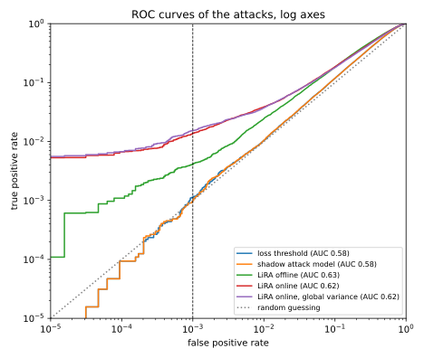

# Membership inference

A hospital trains a model to predict a disease and publishes it. You hold one patient's record. **Was that record in the training set?** If it was, you have learned that the patient was treated at that hospital for that disease, although the model never output a diagnosis. This is **membership inference**. It is the simplest question an attacker can ask about a trained model, which makes it the standard measure of how much a model leaks. An attack is scored by two rates. Its **true positive rate (TPR)** is the fraction of members it flags as members, and its **false positive rate (FPR)** is the fraction of non-members it wrongly flags.

The one idea of this chapter is that membership inference is a statistical test about one record. Training is random, because the rest of the training set is drawn at random and the optimization varies from run to run. So the model's output on a record, such as its confidence in the record's label, has one distribution over models trained with that record, its **IN distribution**, and another over models trained without it, its **OUT distribution**. The attacker sees one output and must say which of the two produced it. A typical record is predicted well either way, so its two distributions nearly coincide, while an atypical record is predicted badly unless the model saw it. An attack that says "member" whenever the model is confident therefore flags typical records, which get confident outputs even when never trained on, and the best attack compares each record's output with that record's own two distributions.

The running example is a scaled-down, linear version of an experiment by Carlini et al. (2022). A pool of 1,000 labelled points in $\mathbb R^{100}$ holds 950 typical points and 50 outliers, whose labels nothing else in the data predicts. Logistic-regression models train on random halves of the pool. The attacker targets 128 of these models. Pairing a model with a pool point gives one guess, and each model trained on 500 of the 1,000 points, so there are $128 \times 500 = 64{,}000$ member pairs and as many non-member pairs. At an FPR of $10^{-3}$, the attack that thresholds the loss flags a fraction 0.0009 of members, which is what flagging at random would do, since a random flag hits members and non-members at the same rate. The per-record test of @sec-mia-lira flags 0.0149, and 87% of the members it finds are outliers.

## The loss attack and the generalization gap {#sec-mia-loss}

A model is fitted to its training data, so its loss on a training point is usually lower than on a fresh one. This section asks how much membership that difference alone gives away.

Attacks are scored in the membership game of [Threat models and privacy games](01-threat-models.md#sec-threat-games). A challenger draws a training set $D$ and flips a fair coin for a hidden bit $b$. If $b = 1$, the **target** $z = (x, y)$, a feature vector and its label, is drawn uniformly from $D$; if $b = 0$, it is a fresh record from the same population. The adversary sees $z$ and the trained model, with weights $\theta$, and guesses $b'$. Half the games have $b = 1$ and are won with probability TPR, and the other half are won with probability $1 - \mathrm{FPR}$. So by @prp-threat-win the adversary wins with probability $\frac12 + \frac12\mathrm{Adv}$, where the **advantage** $\mathrm{Adv} = \mathrm{TPR} - \mathrm{FPR}$ measures how much more often the attack says "member" to members than to non-members.

Yeom et al. (2018) turned the lower loss on members into an attack. Its cleanest version turns the loss into a probability, so the loss must lie in a known range.

::: {#def-mia-loss-attack name="Loss attacks"}
Let the loss $\ell(\theta; z)$ of the model on the target take values in $[0, B]$. The **bounded-loss attack** says "member" with probability $1 - \ell(\theta; z)/B$. The **loss threshold attack** says "member" when $\ell(\theta; z) < \tau$, for a threshold $\tau$ such as the mean training loss, which a model's report often states.
:::

The randomized rule makes the probability of saying "member" linear in the loss, so, as the next proposition proves, the advantage is the difference between the average loss of non-members and of members, divided by $B$. That difference is the **generalization gap**. Write $\theta_D$ for the model trained on the training set $D$, and $\mathcal D$ (calligraphic) for the population it is drawn from. The gap is the model's expected loss on fresh data, its **population risk** $\mathcal L_{\mathcal D}(\theta_D)$, minus its average loss on its own training set, its **empirical risk** $\mathcal L(\theta_D; D)$.

::: {#prp-mia-yeom name="The loss attack's advantage is the generalization gap"}
In the membership game, with expectations over the training set, the training run and the target, the bounded-loss attack has an advantage that is first a difference of average losses and then, renamed, the generalization gap:
$$\mathrm{Adv} = \frac{\mathbb E[\ell(\theta; z) \mid b = 0] - \mathbb E[\ell(\theta; z) \mid b = 1]}{B} = \frac{\mathbb E_D\big[\mathcal L_{\mathcal D}(\theta_D) - \mathcal L(\theta_D; D)\big]}{B},$$ {#eq-mia-yeom}
the expected generalization gap divided by $B$. For the 0-1 loss, which is 0 on a correct prediction and 1 on a wrong one, $B = 1$, the attack says "member" exactly when the model classifies $z$ correctly, and its advantage is the test error minus the training error.
:::

::: {.proof}
The plan is to write the TPR and the FPR as average losses, subtract them, and then recognize the two averages as the test loss and the training loss.

1. *The TPR.* Given $b = 1$, the attack says "member" with probability $1 - \ell/B$ for whatever loss the target has. Averaging over targets and training runs gives $\mathrm{TPR} = 1 - \mathbb E[\ell \mid b = 1]/B$.
2. *The FPR.* The same calculation with $b = 0$ gives $\mathrm{FPR} = 1 - \mathbb E[\ell \mid b = 0]/B$.
3. *Subtract.* The advantage is $\mathrm{TPR} - \mathrm{FPR}$. The two 1s cancel, which leaves the first form of @eq-mia-yeom.
4. *Name the two averages.* When $b = 1$, $z$ is a uniformly chosen training point, so its expected loss is the expected empirical risk. When $b = 0$, $z$ is a fresh draw independent of $D$, so its expected loss is the expected population risk. Substituting both gives the second form.
5. *The 0-1 loss.* With $B = 1$, the probability $1 - \ell$ is 1 on a correct prediction and 0 on a wrong one. So $\mathrm{TPR} = 1 - \text{train error}$ and $\mathrm{FPR} = 1 - \text{test error}$, and their difference is the test error minus the training error.
:::

So **overfitting implies leakage**, by an amount the training and test errors give without any attack. By @thm-stability-identity, the expected gap is the average **self-influence** of the training records (@def-stability-self-influence): how much each record's own loss rises when it is replaced in training by a fresh record. But **a small gap does not mean a private model.** The loss attack ignores *which* record it is looking at, and the per-record test of @sec-mia-lira beats it by a wide margin.

Each attack below reads one of three numbers from the model's output on $z$. The **confidence** $p_y$ is the probability the model gives to the true label, and the usual classification loss is the cross-entropy $\ell = -\ln p_y$. The **logit of the confidence** is the log of the odds the model gives to the true label,
$$\phi = \ln\frac{p_y}{1 - p_y}.$$
The confidence crowds against 1, while $\phi$ keeps confident outputs apart. That matters because @sec-mia-lira fits bell curves to these values, and the next lemma shows why a bell curve fits $\phi$: for logistic regression, $\phi$ is linear in the weights. It also shows that a threshold on $\phi$ is a threshold on the loss, so the rest of the chapter works with $\phi$.

::: {#lem-mia-margin name="For logistic regression, the logit of the confidence is the margin"}
Let a logistic-regression model with weights $\theta$ give the true label $y \in \{-1, 1\}$ of a record $z = (x, y)$ the probability $p_y = 1/(1 + e^{-y\langle \theta, x\rangle})$. Then $\phi$ is the **margin** $y\langle \theta, x\rangle$, how far the point lies on the correct side of the decision boundary, and
$$\phi = \ln\frac{p_y}{1 - p_y} = y\langle \theta, x\rangle \qquad\text{and}\qquad \ell = -\ln p_y = \ln\big(1 + e^{-\phi}\big).$$
So a threshold on any of the confidence, the loss and $\phi$ is a threshold on the others.
:::

::: {.proof}
1. *The odds.* Write $t = y\langle \theta, x\rangle$. Then $1 - p_y = e^{-t}/(1 + e^{-t})$, so the factor $1 + e^{-t}$ cancels in the ratio $p_y/(1 - p_y)$, which leaves $e^t$. Its logarithm is $\phi = t$.
2. *The loss.* The reciprocal of the confidence is $1/p_y = 1 + e^{-\phi}$, so the loss $-\ln p_y$ is $\ln(1 + e^{-\phi})$.
3. *Monotone.* The confidence rises with $\phi$, and by step 2 the loss falls as $\phi$ rises. So "$\phi$ above a cut" is the same event as "loss below the matching cut".
:::

::: {#exm-mia-loss}
In the running example, each of the 950 typical points has features $x$ drawn from the normal distribution $\mathcal N(0, I/100)$, with $I$ the identity, so its 100 independent coordinates each have variance $1/100$ and $\|x\| \approx 1$. Its label $y = \pm1$ follows the first coordinate with some noise, and the factor 30 makes it follow closely, since $x_1$ is of order $1/10$:
$$\Pr[y = 1 \mid x] = \frac{1}{1 + e^{-30x_1}}.$$ The 50 outliers have the same kind of $x$ scaled by 5 and a label drawn by a fair coin, so a model gets an outlier's label right only by fitting that point itself. Each model is logistic regression with the penalty $\frac\lambda2\|\theta\|^2$, $\lambda = 10^{-3}$, trained on a random half of the pool ($n = 500$). Each model trained on a random half is followed by one trained on the other half, so every point is a member of exactly half the models.

Over the 128 target models, the training error is 0.1495, and the test error, on the half of the pool each model did not see, is 0.2663. "Member if correctly classified" therefore has $\mathrm{TPR} = 1 - 0.1495 = 0.8505$ and $\mathrm{FPR} = 1 - 0.2663 = 0.7337$. Its advantage, $0.8505 - 0.7337 = 0.1168$, is exactly the gap $0.2663 - 0.1495$.

The logistic loss is unbounded, so the bounded-loss attack needs it clipped: any loss above $B = 2$ is replaced by 2. The mean clipped loss is 0.4158 on members and 0.5433 on non-members. So @eq-mia-yeom predicts an advantage of $(0.5433 - 0.4158)/2 = 0.0638$, and simulating the randomized attack gives 0.0639. The loss threshold attack at the mean unclipped training loss, $\tau = 0.4159$ (almost the clipped mean, because few training losses exceed 2), has $\mathrm{TPR} = 0.5936$, $\mathrm{FPR} = 0.4834$ and advantage 0.1102.

By the win rate $\frac12 + \frac12\mathrm{Adv}$, the three attacks win between 53% and 56% of the games. None of them identifies anyone with confidence, because each flags a large share of non-members too, with an FPR of 0.7337 for the error rule and 0.4834 for the threshold. @fig-mia-loss-distributions shows why: the two distributions of $\phi$ are shifted, but they almost entirely overlap.
:::

{#fig-mia-loss-distributions}

## Shadow models {#sec-mia-shadow}

An attacker who wants a better rule than "low loss means member" has to know what members' outputs look like. It has no labelled examples, because it does not know who is in the target's training set. This section shows how the attacker can learn that from models of its own, whose training sets it chooses (Shokri et al. 2017), and what the best rule learned this way can achieve.

::: {#def-mia-shadow name="Shadow models and the attack model"}
Suppose the attacker holds records from the target's population. A **shadow model** is a model that the attacker trains like the target, with the same recipe, on a training set that includes each of its records with probability $\frac12$. For each shadow model and record, the attacker keeps the shadow model's output $o$ on the record, such as its confidence, and the membership label $m$, with $m = 1$ for "in". The **attack model** $h(o) \in (0, 1)$ is a classifier trained on these pairs by minimizing the cross-entropy, $-\ln h$ on "in" pairs and $-\ln(1 - h)$ on "out" pairs. It says "member" when $h(o)$ exceeds a threshold.
:::

In the running example the output is $o = (y, \phi)$, the record's label and the logit of the confidence. With enough shadow data, the attack model learns the best rule available from $o$ alone, as the next proposition proves.

::: {#prp-mia-posterior name="The attack model is the best record-blind attack"}
Let $q(o)$ and $p(o)$ be the densities of the output for members and for non-members, each pooled over all the records that could produce $o$ (they are unrelated to the confidence $p_y$), and let the attack model range over all functions of $o$. As the number of shadow pairs grows, $h(o)$ tends to the **posterior probability of membership**, and with a fair prior the posterior odds are the likelihood ratio:
$$h(o) \to \Pr[b = 1 \mid o], \qquad \frac{\Pr[b = 1 \mid o]}{\Pr[b = 0 \mid o]} = \frac{q(o)}{p(o)}.$$
So no attack that sees only $o$ has a higher TPR, at any FPR, than a threshold on $h$.
:::

::: {.proof}
The proof has four links: the shadow pairs look like the real game, cross-entropy recovers the posterior, the posterior ranks outputs by the likelihood ratio, and a threshold on the likelihood ratio is optimal.

1. *The shadow pairs have the right distribution.* A shadow model is trained like the target, and each record is in or out with probability $\frac12$. So a shadow pair $(o, m)$ has the same joint distribution as a pair of target output and membership bit in the game.
2. *Cross-entropy is minimized by the posterior.* Fix one output $o$, and let $\rho = \Pr[m = 1 \mid o]$ be the probability of "in" given that output. If the attack model predicts $h$ there, its expected loss is $-\rho\ln h - (1 - \rho)\ln(1 - h)$. This is convex in $h$, and its derivative $-\rho/h + (1 - \rho)/(1 - h)$ is zero at $h = \rho$, so that is the minimum. The same holds at every $o$ separately, so the best function is $h(o) = \Pr[m = 1 \mid o]$, which by step 1 is $\Pr[b = 1 \mid o]$.
3. *Bayes' rule.* The joint probability of a world, $b = 1$ or $b = 0$, and an output is the prior of the world times the density of the output in that world. So the posterior odds are the prior odds times $q(o)/p(o)$, and with a fair prior the prior odds are 1. The odds $h/(1 - h)$ rise with $h$, so a threshold on $h$ is a threshold on $q(o)/p(o)$.
4. *Neyman–Pearson.* The [Neyman–Pearson lemma](../part01-prerequisites/04-hypothesis-testing.md#sec-ht-np) says that a threshold on the likelihood ratio has the highest TPR at its FPR among all tests that see the same observation.
:::

The attack model is **optimal for the wrong question.** Seeing $(y, \phi)$ and not which record produced it, it cannot know that $\phi = 2$ is high for one record and low for another. When members tend to have the higher $\phi$ within each class, $h$ rises with $\phi$ there, so a threshold on $h$ is a threshold on $\phi$ and, by @lem-mia-margin, on the loss: the loss attack with a threshold for each class.

What shadow models really buy is **calibration.** The attacker picks the threshold at which the desired fraction of its own shadow non-members pass, and trusts that real non-members behave the same way. Salem et al. (2019) found that one shadow model, or shadow data from another distribution, often suffices.

::: {#exm-mia-shadow}
For each class, the attack model is a logistic regression of "in" on $\phi$ with an intercept, trained on the roughly 32,000 shadow pairs of that class (the 64 shadow models times the roughly 500 pool points with that label). Both slopes are positive, 0.238 for $y = -1$ and 0.158 for $y = +1$. So within each class the attack is a threshold on the loss.

To compare it with the loss attack over all thresholds, draw each attack's **receiver operating characteristic (ROC) curve**, its TPR against its FPR as the threshold sweeps. The **area under the curve (AUC)** equals the probability that a random member scores higher than a random non-member ([Hypothesis testing](../part01-prerequisites/04-hypothesis-testing.md#sec-ht-auc)). The attack model and the loss attack both have AUC 0.577, and the same TPR at every FPR to within sampling noise (@tbl-mia-attacks).

Calibration works: a threshold set on the shadow models for an FPR of 1% gives an FPR of 0.0095 on the 128 unseen target models. But the TPR there is 0.0098, no better than chance, because a threshold on $\phi$ that ignores which record it sees cannot single out any member at a low FPR.
:::

## LiRA: a likelihood-ratio test per record {#sec-mia-lira}

The attacks of the last two sections compare a record's output with everyone else's outputs. The right comparison is with the *same record's* output under models that did and did not train on it. This section builds that test and proves that it is the best one.

Carlini et al. (2022) built the **likelihood ratio attack (LiRA)** on that comparison. For a record $z$, the attacker has a few dozen shadow values of $\phi_z$, the logit of the confidence on $z$, and summarizes them by bell curves, a shape justified after the theorem below.

::: {#def-mia-lira name="LiRA, online and offline"}
For a record $z$, let $\mu_{\mathrm{in}, z}$ and $\sigma_{\mathrm{in}, z}$ be the mean and standard deviation of $\phi_z$ over the shadow models that trained on $z$, and $\mu_{\mathrm{out}, z}$ and $\sigma_{\mathrm{out}, z}$ those over the shadow models that did not. Write $\mathcal N(\phi; \mu, \sigma^2)$ for the normal density at $\phi$. **Online LiRA** scores the target model's $\phi_z$ by the log of the ratio of the IN fit to the OUT fit,
$$\ln\Lambda_z(\phi_z) = \ln\mathcal N\big(\phi_z;\, \mu_{\mathrm{in}, z}, \sigma_{\mathrm{in}, z}^2\big) - \ln\mathcal N\big(\phi_z;\, \mu_{\mathrm{out}, z}, \sigma_{\mathrm{out}, z}^2\big).$$ {#eq-mia-lira-online}
**Offline LiRA** uses only the OUT fit, and scores how many OUT standard deviations the output lies above its usual value,
$$\frac{\phi_z - \mu_{\mathrm{out}, z}}{\sigma_{\mathrm{out}, z}}.$$ {#eq-mia-lira-offline}
Each says "member" when its score exceeds a threshold that is **the same for every record**.
:::

Online LiRA needs shadow models that trained on each new target record, while offline LiRA's OUT models can be trained once and reused. One threshold serves all records because, as the theorem below shows, the record is drawn the same way in both worlds, so it drops out of the likelihood ratio that the Neyman–Pearson lemma (@thm-ht-np) thresholds.

::: {#thm-mia-lira name="One threshold on the per-record likelihood ratio is optimal"}
In the membership game, suppose the target record $z$ is drawn from the same distribution whether $b = 1$ or $b = 0$, and let $q_z$ and $p_z$ be the IN and OUT densities of $\phi_z$. Among all attacks that see $z$ and $\phi_z$, the highest TPR at each FPR is reached by saying "member" when $\Lambda_z(\phi_z) = q_z(\phi_z)/p_z(\phi_z)$ exceeds one threshold, the same for every record. Online LiRA estimates this true ratio by its Gaussian fits, so when the fits are exact the test is online LiRA.
:::

::: {.proof}
The plan is to write the density of the adversary's view in each world, see that the record's part cancels in the likelihood ratio, and apply the Neyman–Pearson lemma.

1. *The view is a pair.* The density of the pair is the probability of drawing the record, call it $g(z)$, times the density of the output given the record. Write it as $g(z)\,q_z(\phi)$ when $b = 1$ and as $g(z)\,p_z(\phi)$ when $b = 0$.
2. *The record's factor is shared.* By hypothesis, the record is drawn the same way whether or not it ends up in the training set, so $g$ is the same function in both worlds. The running example satisfies this, since every pool point is a member of each model with probability $\frac12$.
3. *The ratio.* Since the factor $g(z)$ is the same in both worlds, it cancels:
$$\frac{g(z)\,q_z(\phi)}{g(z)\,p_z(\phi)} = \frac{q_z(\phi)}{p_z(\phi)} = \Lambda_z(\phi).$$
4. *Neyman–Pearson.* The best test of the pair thresholds its likelihood ratio at one value, by @thm-ht-np. So different records are compared through their ratios, never through their raw $\phi$. With exact Gaussian fits, the log of the ratio is @eq-mia-lira-online.
:::

The hypothesis is needed, since if members came from one hospital and non-members from another, the record alone would reveal $b$. The theorem is an instance of @lem-threat-mixing in [Threat models and privacy games](01-threat-models.md#sec-threat-average), which says that an attacker who does not know a hidden part of the data does no better than one who knows it. An attacker that ignores the record sees the IN and OUT distributions averaged over all records, where the large shift of an atypical record is diluted among the small shifts of the typical ones.
The bell-curve shape is justified because, by @lem-mia-margin, $\phi_z$ is linear in the weights. The regularized estimate $\theta$ sets the gradient of the training objective to zero, and that gradient averages $n$ independent per-record terms, so $\theta$ is approximately Gaussian over the training randomness, by the central limit theorem that @sec-apx-opt-mest proves for such estimates. So $\phi_z$ is close to normal, and for deep networks Carlini et al. found the same.

Offline LiRA is a weaker test, because without IN models it cannot write down $q_z$. It only asks whether $\phi_z$ lies unusually far above its OUT values, the direction in which training on $z$ moves it, since fitting $z$ raises its margin. The two scores can be compared exactly in the simplest case, where the IN and OUT fits have the same standard deviation $\sigma_z$. Write $t_z$ for the offline score, the output measured in units of $\sigma_z$ from the OUT mean. Then $t_z$ is standard normal under OUT, and under IN it is normal with variance 1 and mean the **separation**
$$s_z = \frac{\mu_{\mathrm{in}, z} - \mu_{\mathrm{out}, z}}{\sigma_z}.$$
Measured in $t_z$, the OUT density is proportional to $e^{-t_z^2/2}$ and the IN density to $e^{-(t_z - s_z)^2/2}$, with the same constant, which cancels in @eq-mia-lira-online. Expanding the square leaves $\ln\Lambda_z = s_zt_z - s_z^2/2$. For one record $s_z$ is a fixed positive number, so both scores rank that record's outputs alike. Across records they differ, because online LiRA weights each $t_z$ by $s_z$, while offline LiRA treats every $t_z$ the same.

How much each record can be caught at a given FPR is then a question about two unit-variance Gaussians. Write $\Phi$ for the standard normal distribution function, so that $\Phi^{-1}(1 - \alpha)$ is the point a standard normal exceeds with probability $\alpha$. @thm-ht-gaussian in [Hypothesis testing](../part01-prerequisites/04-hypothesis-testing.md#sec-ht-gaussian) shows that when an observation is $\mathcal N(0, 1)$ in one world and $\mathcal N(s, 1)$ in the other, the most members any test can catch at FPR $\alpha$ is
$$\mathrm{TPR}(\alpha) = 1 - \Phi\big(\Phi^{-1}(1 - \alpha) - s\big).$$ {#eq-mia-gauss-tpr}
At $\alpha = 10^{-3}$ the cut-off is 3.0902. With a separation of 0.5, a member must still clear $3.0902 - 0.5 = 2.59$ standard deviations above its own mean, so the TPR is $1 - \Phi(2.59) = 0.0048$. With a separation of 4, the cut-off sits below the member mean, and the TPR is $1 - \Phi(-0.91) = 0.8185$.

::: {#exm-mia-two-types}
On a population with two kinds of record, this formula shows in closed form how much the per-record comparison gains (@tbl-mia-two-types). A typical record is predicted confidently whether or not the model trained on it. An atypical record has a negative $\phi$, which means it is misclassified, unless the model trained on it.

| Kind | Share | OUT: $\phi \sim$ | IN: $\phi \sim$ | Separation $s$ | Best TPR at FPR $10^{-3}$, this kind alone |
| --- | --- | --- | --- | --- | --- |
| Typical | 95% | $\mathcal N(3, 1)$ | $\mathcal N(3.5, 1)$ | 0.5 | 0.0048 |
| Atypical | 5% | $\mathcal N(-2, 1)$ | $\mathcal N(2, 1)$ | 4 | 0.8185 |

: Two kinds of record. The last column is @eq-mia-gauss-tpr. {#tbl-mia-two-types}

Now set three attacks to an FPR of $10^{-3}$ pooled over both kinds, that is, counted over all non-members together.

**One threshold on $\phi$** is the loss attack. Typical records make up 95% of non-members and their OUT values are high, so the threshold must sit high. Solving for the point that 0.1% of all non-members exceed puts it at $\phi = 6.075$. Atypical members score around 2 and almost never pass it. Only typical members occasionally do, and the pooled TPR is 0.0048. That matches the typical kind's best TPR alone, because typical records dominate the non-members, so the threshold sits almost where the typical kind alone would put it, at $3 + 3.0902$.

**One threshold on the z-score** is offline LiRA. Each record is standardized against its own OUT distribution, so every record gets FPR $10^{-3}$, at $t \ge 3.0902$. Each kind then gets its own best TPR from the table, and the pooled TPR is their weighted average, $0.95 \times 0.0048 + 0.05 \times 0.8185 = 0.0455$.

**One threshold on $\ln\Lambda$** is online LiRA. A one-dimensional numerical search for a pooled FPR of $10^{-3}$ puts the threshold at 1.497. Since $\ln\Lambda = st - s^2/2$, the cut $\ln\Lambda \ge 1.497$ is the z-score cut $t \ge (1.497 + s^2/2)/s$. That is $t \ge 3.244$ for typical records, with an FPR of only $5.90\times10^{-4}$. For atypical ones it is $t \ge 2.374$, with FPR 0.0088. The pooled FPR is $0.95 \times 5.90\times10^{-4} + 0.05 \times 0.0088 = 10^{-3}$, and the pooled TPR is 0.0503, the best possible at that FPR by @thm-mia-lira.

The global threshold is ten times worse than either per-record test. The likelihood ratio beats the z-score because it spends its allowance of false positives where they pay. A typical record's IN and OUT curves overlap, so admitting more of its false positives admits almost no extra members. An atypical record's curves lie far apart, so a few more false positives there admit many members.
:::

::: {#exm-mia-lira}
@fig-mia-lira-example shows the IN and OUT distributions of a typical point and an outlier of the running example. On the 128 target models, online LiRA reaches a TPR of 0.0149 at FPR $10^{-3}$, against 0.0009 for the loss attack (@tbl-mia-attacks).

With few shadow models, each record's estimated standard deviations are noisy, and the noise hurts most at a low FPR. A record whose spread is underestimated has its OUT curve drawn too narrow, so an ordinary output looks far out in the tail and becomes a false positive at a strict threshold. Carlini et al. therefore recommend a **global variance** when shadow models are few: one IN variance and one OUT variance, each the average over all records (@fig-mia-shadow-count compares online and offline LiRA, each with both kinds of variance). With 16 shadow models, online LiRA with variances per record reaches 0.0023, barely above chance, while with a global variance it reaches 0.0151.
:::

{#fig-mia-lira-example}

{#fig-mia-shadow-count}

## Evaluating attacks: TPR at a low FPR {#sec-mia-eval}

Older papers report an attack's accuracy, which is $\frac12 + \frac12\mathrm{Adv}$ in the membership game, or its AUC, and both average over all members and non-members. This section asks which number says whether an attack is a threat, starting from the fact that a privacy breach is not an average. It happens when an attacker can say *with confidence* that a particular person was in the data, and that needs a low FPR, where almost every "member" verdict is right.

::: {#def-mia-roc name="TPR at a low FPR"}
An attack's **TPR at FPR $\alpha$** is the height of its ROC curve at $\alpha$, the largest fraction of members it flags with a threshold that flags at most a fraction $\alpha$ of non-members. Carlini et al. (2022) report it at a low $\alpha$ such as $10^{-3}$, together with the whole ROC curve on log axes.
:::

Two attacks can have the same AUC and best advantages (the largest TPR − FPR over all thresholds) within 0.015 of each other, yet TPRs at FPR $10^{-3}$ that differ by a factor of 38. In the pair below, attack A exposes a few members completely and learns nothing about anyone else, while attack B learns a little about everyone.

::: {#prp-mia-same-auc name="Same AUC, different exposure"}
Let $r \in (0, 1)$ be a fraction of members. **Attack A** gives a fraction $r$ of members a score above every other record's, and gives every other record, member or not, a random score from one common distribution. **Attack B** gives members a score $\mathcal N(\mu, 1)$ and non-members a score $\mathcal N(0, 1)$, with $\mu > 0$. Then A has AUC $\frac12 + \frac r2$, best advantage $r$ and
$$\mathrm{TPR}_A(\alpha) = r + (1 - r)\alpha,$$
while B has AUC $\Phi(\mu/\sqrt2)$, best advantage $2\Phi(\mu/2) - 1$, and the TPR of @eq-mia-gauss-tpr with $s = \mu$. The two AUCs are equal when $\Phi(\mu/\sqrt2) = \frac12 + \frac r2$.
:::

::: {.proof}
The plan is to compute each attack's AUC from its definition as a ranking probability, A's TPR by splitting members into recognized and not, and B's best advantage from the total variation distance.

1. *AUC of A.* The AUC is the probability that a random member outscores a random non-member, with ties counted as one half (@prp-ht-auc). With probability $r$ the member is a recognized one, and it wins. Otherwise both scores have the same distribution, so the member wins with probability $\frac12$. The total is $r + (1 - r)\frac12 = \frac12 + \frac r2$.
2. *TPR of A.* At a threshold with FPR $\alpha$, the recognized members always pass. The other members have the same score distribution as non-members, so they pass with the same probability $\alpha$, which gives $\mathrm{TPR}_A(\alpha)$. Then $\mathrm{TPR} - \mathrm{FPR} = r(1 - \alpha)$, which is at most $r$.
3. *AUC of B.* A member outscores a non-member when the difference of their scores is positive. That difference is $\mathcal N(\mu, 1)$ minus an independent $\mathcal N(0, 1)$, so it is normal with mean $\mu$ and variance 2, and it is positive with probability $\Phi(\mu/\sqrt2)$.
4. *Advantage of B.* The best advantage of a test between two distributions is their **total variation distance**, the most by which the two can differ in the probability of one set of scores (@thm-ht-tv). The best set is where the member density exceeds the non-member density, which for two unit-variance Gaussians at distance $\mu$ is the scores above the midpoint $\mu/2$. Its TPR is $\Phi(\mu/2)$ and its FPR is $1 - \Phi(\mu/2)$, and their difference is $2\Phi(\mu/2) - 1$.
:::

With $r = 0.05$, both AUCs are 0.5250 when $\mu = 0.0887$ (@tbl-mia-same-auc). At FPR $10^{-3}$, A has TPR $0.05 + 0.95 \times 10^{-3} = 0.05095$, while B has $1 - \Phi(3.0902 - 0.0887) = 0.00134$, which is 38 times less.

| | AUC | Best advantage | TPR at FPR $10^{-3}$ |
| --- | --- | --- | --- |
| A: 5% of members exposed | 0.5250 | 0.0500 | 0.05095 |
| B: every member shifted by $\mu = 0.0887$ | 0.5250 | 0.0354 | 0.00134 |

: Two attacks with the same AUC. Only the TPR at a low FPR tells them apart. {#tbl-mia-same-auc}

{#fig-mia-same-auc}

**Who is exposed matters more than how many.** Only the low-FPR end of the ROC curve shows the difference, and only on log axes, since linear axes squeeze everything below FPR 0.01 into one pixel column (@fig-mia-same-auc).

**Measuring a low FPR takes many non-members.** An FPR is estimated by counting false positives, and a count of $k$ events has a relative error of about $1/\sqrt k$ ([Hypothesis testing](../part01-prerequisites/04-hypothesis-testing.md#sec-ht-estimation)). To see $k$ false positives at FPR $\alpha$ you need about $k/\alpha$ non-members, which is why the running example uses 64,000 non-member pairs.

**A low FPR makes the verdicts reliable.** With as many members as non-members, the **precision**, the fraction of "member" verdicts that are right, is $\mathrm{TPR}/(\mathrm{TPR} + \mathrm{FPR})$, so a TPR of 0.05 at FPR $10^{-3}$ gives $0.05/0.051 = 0.98$.

::: {#exm-mia-attacks}
@tbl-mia-attacks scores every attack on the 128 target models, and @fig-mia-roc draws their ROC curves on log axes.

| Attack | AUC | Best advantage | TPR at FPR $10^{-3}$ | TPR at FPR $10^{-2}$ |
| --- | --- | --- | --- | --- |
| Loss threshold (Yeom) | 0.577 | 0.122 | 0.0009 | 0.0103 |
| Shadow attack model (Shokri) | 0.577 | 0.121 | 0.0008 | 0.0104 |
| LiRA offline | 0.632 | 0.189 | 0.0030 | 0.0273 |
| LiRA online | 0.629 | 0.175 | 0.0149 | 0.0386 |
| LiRA online, global variance | 0.623 | 0.169 | 0.0177 | 0.0396 |

: Every attack on the running example: 128 target models, 64 shadow models, 64,000 member and 64,000 non-member pairs. {#tbl-mia-attacks}

By AUC the attacks are close, 0.577 against about 0.63, but at FPR $10^{-3}$ they are not. The loss and shadow attacks are at chance, since their TPRs of 0.0009 and 0.0008 are no higher than the FPR of 0.001. Online LiRA finds 952 of the 64,000 members, a TPR of 0.0149 and 17.0 times the loss attack's TPR before rounding.

The **Clopper–Pearson interval**, an exact 95% confidence interval for a proportion estimated from a count, is $[0.0140, 0.0158]$ for that TPR. The FPR rests on 64 false positives among 64,000 non-members, and its interval is $[0.00077, 0.00128]$. One caveat is that **the threshold was chosen on the same data** that measure the rates, as is usual in this literature, while a real attacker would set it on its shadow models.
:::

{#fig-mia-roc}

## Why outliers are most exposed {#sec-mia-outliers}

@exm-mia-two-types showed that the low-FPR end of the ROC curve is made of the records with a large separation between their IN and OUT distributions. This section asks which records those are, and finds that they are the ones the model cannot predict without having seen them.

::: {#prp-mia-per-example name="Exposure of one record"}
Let the IN and OUT distributions of $\phi_z$ for a record $z$ be Gaussian, with means $\mu_{\mathrm{in}, z}$ and $\mu_{\mathrm{out}, z}$ and a common standard deviation $\sigma_z$. The best TPR of any test on $z$ alone at FPR $\alpha$ is
$$\mathrm{TPR}_z(\alpha) = 1 - \Phi\big(\Phi^{-1}(1 - \alpha) - s_z\big), \qquad s_z = \frac{\mu_{\mathrm{in}, z} - \mu_{\mathrm{out}, z}}{\sigma_z},$$ {#eq-mia-per-example}
and the numerator $\mu_{\mathrm{in}, z} - \mu_{\mathrm{out}, z}$ is the **self-influence** of $z$ measured in $\phi$: the average amount by which training on $z$ raises the model's $\phi$ on $z$.
:::

::: {.proof}
1. *The test.* Standardizing the output, as in @sec-mia-lira, gives a standard normal under OUT and $\mathcal N(s_z, 1)$ under IN. So @eq-mia-gauss-tpr with $s = s_z$ is the best TPR.
2. *Self-influence.* @def-stability-self-influence defines the self-influence of a training record $z_i$ as $\ell(\theta_{D^{(i)}}; z_i) - \ell(\theta_D; z_i)$. That is the loss of the model trained on $D^{(i)}$, the training set with $z_i$ replaced by a fresh record, minus the loss of the model trained on $D$ itself. Measured with $\phi$ instead of $\ell$, the sign flips, because $\phi$ rises where the loss falls.
3. *Average it.* Take $z_i = z$ and average over the rest of the training set, the fresh record and the training run. The models trained on $D$ contain $z$, so they give $\phi_z$ the mean $\mu_{\mathrm{in}, z}$. The models trained on $D^{(i)}$ do not, so they give $\mu_{\mathrm{out}, z}$. The averaged self-influence in $\phi$ is the difference of the two means.
:::

Which records have a large self-influence? If the rest of the data already predict $z$'s label, $\mu_{\mathrm{out}, z}$ is high and training on $z$ adds little. If they predict the opposite label, $\mu_{\mathrm{out}, z}$ is low, and the model must move toward $z$ to fit it. The regularization limits how far the model can move. By @thm-stability-erm, one record moves the weights of a regularized fit by at most $2G/(\lambda n)$, where $G$ bounds the length of a record's loss gradient, and its proof shows that each record's pull scales with the length of its own gradient. For logistic regression that gradient is $x$ times a probability, so the pull of $z$ scales with at most $\|x_z\|$. A move of the weights changes the margin $\phi_z = y\langle \theta, x_z\rangle$ by at most $\|x_z\|$ times the length of the move. So a long $x_z$ both pulls the weights harder and turns that pull into a larger change in its own margin, and the outliers of the running example have long features and unpredictable labels.

**Leakage is concentrated.** The loss attack's advantage reflects the *average* self-influence, while the low-FPR end of the ROC curve is governed by the *largest* ones, because a strict threshold is passed only by the records with the largest separations. So a model with a small generalization gap can still expose a few records completely. Memorizing them can even be what makes it accurate: Feldman (2020) shows that on long-tailed data, a rare subpopulation seen once in training must be memorized for good test accuracy.

**Removing the outliers does not fix it.** Carlini et al. (2022b) removed the most exposed records and retrained, and the next layer of records became exposed, which they call the privacy onion effect. Exposure is relative to the rest of the dataset, because a record's OUT distribution depends on what the other records predict about it. A guarantee that protects every record, the subject of [Part 3](../part03-dp-foundations/01-definition.md), has to bound the self-influence of the worst record, not the average.

::: {#exm-mia-outliers}
@tbl-mia-outliers splits the running example by kind of point.

| | Typical points (950) | Outliers (50) |
| --- | --- | --- |
| Mean separation $s_z$ | 0.461 | 1.539 |
| Mean loss self-influence, $\mathbb E[\ell \mid \text{out}] - \mathbb E[\ell \mid \text{in}]$ | 0.0897 | 2.0999 |
| Mean of @eq-mia-per-example at $\alpha = 10^{-3}$ | 0.0074 | 0.2145 |
| Online LiRA at pooled FPR $10^{-3}$: TPR | 0.0020 | 0.2597 |
| Online LiRA at pooled FPR $10^{-3}$: FPR | 0.00086 | 0.00375 |

: The running example, split into typical points and outliers. Separations and self-influences are estimated from the 64 shadow models; TPR and FPR are measured on the 128 target models. {#tbl-mia-outliers}

**Outliers carry the gap.** The mean loss self-influence over all points weights the two kinds by their shares, $0.95 \times 0.0897 + 0.05 \times 2.0999 = 0.1902$. This is a gap in logistic loss on the shadow models, not the error gap of @exm-mia-loss. The outliers' part of that is $0.05 \times 2.0999 \approx 0.105$, a share of 0.552 of the total, from 5% of the points.

**Outliers are the true positives.** At FPR $10^{-3}$, online LiRA flags 26% of outlier members and 0.2% of typical members. Each target model has about 25 outlier members and 475 typical members, so it finds about $0.26 \times 25 = 6.5$ outliers and $0.002 \times 475 = 0.95$ typical points, and over the 128 target models a share of 0.873 of the members it finds are outliers. As in @exm-mia-two-types, the likelihood ratio spends its false positives on them. Typical points get an FPR of 0.00086 and outliers 0.00375, whose weighted average is the pooled $10^{-3}$.

**Not every outlier is exposed.** @fig-mia-outliers plots each point's separation against $\mu_{\mathrm{out}, z}$. About half the outliers have a coin-flip label that happens to agree with the rule that labels typical points by $x_1$, so they are predicted correctly without being seen and are no more exposed than typical points.
:::

{#fig-mia-outliers}

## The full-size pipeline: LiRA on CIFAR-10 {#sec-mia-cifar}

The usual full-scale experiment runs LiRA with 16 shadow models on an image classifier for CIFAR-10, a benchmark of small colour images in ten classes. This section states the protocol and what changes at full size. The running example is this protocol at small scale, with logistic regression in place of a ResNet, a deep convolutional network.

::: {#def-mia-pipeline name="The LiRA evaluation protocol"}
The protocol has six steps.

1. *Data split.* Take the 50,000 CIFAR-10 training images as the pool, and give every model, target and shadows alike, a random half of it. One model plays the target and the others the shadows, and rotating the target gives many pairs to evaluate.
2. *Training.* Train every model with the target's recipe, including its architecture (wide ResNets), optimizer, epochs and data augmentation, which is what gives the shadow pairs the target's distribution (@prp-mia-posterior, step 1).
3. *Statistic.* For each model and image, compute the network's raw class scores $f$ on the image and on a few augmented copies, such as horizontal flips and small shifts. Convert each to $\phi$ as $f_y$ minus the log of the sum of $e^{f_{y'}}$ over the other classes. This equals $\ln(p_y/(1 - p_y))$, because the softmax sets $p_y = e^{f_y}/\sum_{y'} e^{f_{y'}}$, but it never forms $1 - p_y$, a number that rounds to 0 for a confident model.
4. *Fits.* For each image, fit IN and OUT Gaussians over the shadow models, with one mean per augmented copy and variances per record or global.
5. *Scores.* For each target model and image, compute the online score @eq-mia-lira-online or the offline score @eq-mia-lira-offline.
6. *Evaluation.* Pool all pairs of target model and image, sweep one threshold, and plot the ROC curve on log axes. Report the TPR at FPR $10^{-3}$, with the number of non-member pairs it rests on.
:::

With 16 shadow models, use a global variance, because each image is then out of only about 8 shadows, and @fig-mia-shadow-count shows that variances per record from so few values fail at the low-FPR end.

Carlini et al. report that online LiRA is about ten times more powerful than earlier attacks at a low FPR on CIFAR-10, and that the loss attack is close to chance there, as @tbl-mia-attacks shows in miniature. The auditing part of the book reuses this pipeline to measure privacy leakage. A privately trained model takes the place of the target, and inserted **canaries**, records such as mislabelled images chosen to be as exposed as possible, play the members.

## Code {#sec-mia-code}

The script [code/membership_inference.py](../../code/part02-attacks/membership_inference.py) builds the pool, trains the 128 target and 64 shadow models, runs every attack, and prints every number in this chapter, including the closed-form examples. From the repository root:

```bash
uv run python code/part02-attacks/membership_inference.py
```

| Experiment | Result |
| --- | --- |
| Generalization gap | Train error 0.1495, test error 0.2663; "correct means member": TPR 0.8505, FPR 0.7337, advantage 0.1168 |
| Bounded loss, $B = 2$ | Clipped loss: members 0.4158, non-members 0.5433; gap$/B$ 0.0638; simulated advantage 0.0639 |
| Yeom threshold | $\tau = 0.4159$: TPR 0.5936, FPR 0.4834, advantage 0.1102 |
| Shadow attack model | Slopes 0.238 and 0.158; threshold set on shadows for FPR 1%: target FPR 0.0095, TPR 0.0098 |
| Attacks | @tbl-mia-attacks |
| LiRA online at FPR $10^{-3}$ | 952 true positives of 64,000, interval $[0.0140, 0.0158]$; 64 false positives of 64,000, interval $[0.00077, 0.00128]$; 17.0 times the loss attack |
| Two kinds of record | Global threshold at $\phi = 6.075$: TPR 0.0048. z-score: 0.0455. Likelihood ratio, $\ln\Lambda \ge 1.497$: 0.0503, with FPRs $5.90\times10^{-4}$ and 0.0088 |
| Same AUC | A: AUC 0.5250, advantage 0.0500, TPR 0.05095. B: $\mu = 0.0887$, advantage 0.0354, TPR 0.00134 |
| Outliers | @tbl-mia-outliers; mean loss self-influence 0.1902, outliers' share 0.552; outliers' share of true positives 0.873 |
| Shadow models, TPR at $10^{-3}$ for 4, 8, 16, 32, 64 | Online, per-record variance: 0.0015, 0.0009, 0.0023, 0.0086, 0.0149. Online, global: 0.0092, 0.0127, 0.0151, 0.0171, 0.0177. Offline, per-record: 0.0018, 0.0023, 0.0029, 0.0035, 0.0030. Offline, global: 0.0098, 0.0111, 0.0112, 0.0114, 0.0118 |

: The script's output with the default seed. {#tbl-mia-code}

[tests/test_membership_inference.py](../../tests/test_membership_inference.py) checks that the output still matches.

## Summary {#sec-mia-summary}

| Result | Statement | Use |
| --- | --- | --- |
| @prp-mia-yeom | $\mathrm{Adv} = \mathbb E[\text{gap}]/B$ | Overfitting implies leakage, but no gap does not mean no leakage |
| @lem-mia-margin | $\phi = y\langle \theta, x\rangle$ | Confidence, loss and $\phi$ give one attack; fit Gaussians to $\phi$ |
| @prp-mia-posterior | The attack model tends to $\Pr[b = 1 \mid o]$ | Best record-blind attack; shadows calibrate thresholds |
| @thm-mia-lira | One threshold on $\Lambda_z$ is optimal | Optimal when the Gaussian fits are right; a global loss threshold is near chance at a low FPR |
| @def-mia-lira | Online and offline scores | Offline reuses OUT models; with few shadow models (16 here), use a global variance |
| @prp-mia-same-auc | Equal AUCs, TPRs a factor 38 apart | Report TPR at FPR $10^{-3}$ on log axes with the non-member count, never AUC alone |
| @prp-mia-per-example | Best TPR set by $s_z$, a scaled self-influence | The exposed are records the rest of the data mispredict, such as outliers |
| @def-mia-pipeline | LiRA on CIFAR-10 | Audits private training with canaries |

: The results of this chapter, and where each is used. {#tbl-mia-summary}

## References {#sec-mia-references}

- Shokri, Stronati, Song & Shmatikov, "Membership Inference Attacks against Machine Learning Models" (IEEE S&P 2017). Shadow models and attack models, one per class.
- Yeom, Giacomelli, Fredrikson & Jha, "Privacy Risk in Machine Learning: Analyzing the Connection to Overfitting" (IEEE CSF 2018). The membership experiment, the loss attack and its advantage as the generalization gap; also attribute inference, used in [Attribute inference and model inversion](03-attribute-inference.md).
- Carlini, Chien, Nasr, Song, Terzis & Tramèr, "Membership Inference Attacks From First Principles" (IEEE S&P 2022). LiRA online and offline, logit scaling, global variance, and the case for TPR at low FPR on log-scale ROC curves.- Salem, Zhang, Humbert, Berrang, Fritz & Backes, "ML-Leaks: Model and Data Independent Membership Inference Attacks and Defenses on Machine Learning Models" (NDSS 2019). One shadow model, or none, is often enough.
- Sablayrolles, Douze, Schmid, Ollivier & Jégou, "White-box vs Black-box: Bayes Optimal Strategies for Membership Inference" (ICML 2019). Under assumptions on training noise, the optimal attack depends on the parameters only through the loss, calibrated per example.
- Watson, Guo, Cormode & Sablayrolles, "On the Importance of Difficulty Calibration in Membership Inference Attacks" (ICLR 2022). Subtracting a per-example reference loss: the step from the loss attack toward offline LiRA.
- Ye, Maddi, Murakonda, Bindschaedler & Shokri, "Enhanced Membership Inference Attacks against Machine Learning Models" (CCS 2022). A hypothesis-testing framework that unifies population, reference-model and per-example attacks.
- Zarifzadeh, Liu, Backes & Shokri, "Low-Cost High-Power Membership Inference Attacks" (ICML 2024). Comparing the target with population records gives strong attacks with few reference models.
- Feldman, "Does Learning Require Memorization? A Short Tale about a Long Tail" (STOC 2020). Why accurate models on long-tailed data must memorize rare examples.
- Carlini, Jagielski, Zhang, Papernot, Terzis & Tramèr, "The Privacy Onion Effect: Memorization is Relative" (NeurIPS 2022). Removing the most exposed records exposes the next layer.
