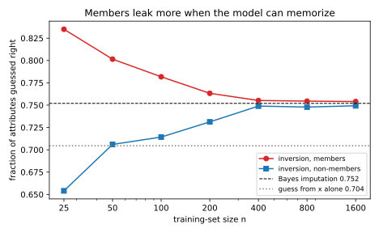
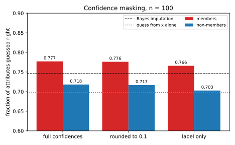

# Attribute inference and model inversion

A hospital trains a model that predicts whether a patient will develop a lung disease from their age band and whether they smoke, and lets anyone query it. An insurer knows your age and, from a claim, that you have the disease. Can it use the model to find out whether you smoke? It can make a better guess than it could without the model, but that alone is not a privacy failure. If smokers get the disease more often, a published study would allow the same guess about everyone with the disease, whether or not their record was used. The question that matters for *you* is different: **does the model reveal more about your attribute because your record was in its training data?**

**Attribute inference** is the attack that recovers one sensitive field of a record, such as smoking status, a genotype or an income band, from the record's other fields and access to a model. The one idea of this chapter is to compare every such attack with the **imputation baseline**, the success of a guesser who never sees the model but knows the population perfectly. A model trained without your record was built from other people's data, so it carries nothing about you specifically. The chapter proves that, as a result, no attack beats the baseline on records outside the training set. Only on training records can an attack beat it, and that excess is the leak about individuals. Measuring the excess means comparing people who were in the training set with people who were not, so attribute inference is a membership question in disguise, which ties this chapter to [Membership inference](02-membership-inference.md).

The running example has two layers. A small smoking table, with a prior of 0.3 on smoking, shows the baseline exactly: the best guess from age and diagnosis is right with probability 0.748, against 0.7 with no observation at all. A toy population with ten numeric features then shows an attack crossing the baseline. Its baseline is 0.7517, and an attack on a logistic regression trained on 100 of its records is right on 0.7832 of the training records, above that baseline, but on only 0.7262 of fresh records.

| Symbol | Meaning |
| --- | --- |
| $z = (s, x, y)$ | a record: sensitive attribute $s$, public features $x$, label $y$ |
| $S$, $X$, $Y$ | the same three fields of a random record drawn from the population |
| $\mathcal D$; $p(s, x, y)$ | the population distribution; the probability (or density) of a record |
| $D$, $n$; $\mathcal T$, $\theta$ | a training set of $n$ records; the training algorithm and the model $\theta = \mathcal T(D)$ |
| $f_y(x, s)$ | the model's confidence in label $y$ at input $(x, s)$ |
| $b$; $\hat s$ | the hidden bit of the game (1 for a member); the adversary's guess of $s$ |
| $V(S \mid O)$ | the success of the best guess of $S$ from an observation $O$ |
| $P_{\mathrm{in}}$, $P_{\mathrm{out}}$ | the distributions of the pair (target record, model), for a member and for a non-member |
| $F$; $h$ | the model's answers at every candidate $s$; a function that coarsens them, such as rounding |

: The symbols of this chapter. {#tbl-attr-symbols}

## The attribute inference game {#sec-attr-game}

A claim such as "the attack recovered 78% of smoking statuses" means nothing until you know two more numbers. One is how often the attribute could be guessed without the model, and the other is how often the attack succeeds on people outside the training set. This section sets up the game of Yeom et al. (2018) that measures the second, in the style of [Threat models](01-threat-models.md). A challenger flips a coin to decide whether the target comes from the training set or fresh from the population. The coin is not a real-world event, but a way to run both situations under one set of rules, so that the attack's success in one can be compared with its success in the other.

The score subtracts the success on non-members from the success on members, because that difference is what the model knows about its training records beyond the population.

::: {#def-attr-game name="The attribute inference game"}
Fix a training algorithm $\mathcal T$, a population $\mathcal D$, a training-set size $n$ and an adversary $\mathcal A$. The game has three steps.

1. The challenger draws a training set $D \sim \mathcal D^n$ and trains a model $\theta = \mathcal T(D)$ on it.
2. It draws a hidden bit $b \in \{0, 1\}$, each value with probability $\frac12$. If $b = 1$, it picks the target $z = (s, x, y)$ uniformly from $D$, so the target is a **member** of the training set. If $b = 0$, it draws $z \sim \mathcal D$ afresh, so the target is a **non-member**.
3. The adversary receives the target's public fields and label $(x, y)$, but not $s$, and access to $\theta$. It may also know the population $\mathcal D$, fully or in part, and that is its auxiliary knowledge. It outputs a guess $\hat s$ of the sensitive attribute.

The **attribute advantage** of $\mathcal A$ is its success rate on members minus its success rate on non-members,
$$\mathrm{Adv}^{\mathrm{attr}}(\mathcal A) = \Pr[\hat s = s \mid b = 1] - \Pr[\hat s = s \mid b = 0],$$ {#eq-attr-advantage}
where each probability is over everything random in the game.
:::

Any attribute attack can be turned into a membership attack. If the attribute attack is right more often on members, then "the attack was right" is itself evidence of membership. A membership adversary may check this, because the membership game of [Membership inference](02-membership-inference.md) hands it the whole record, sensitive field included, and asks only whether the record was used. Such an attack is described by two rates. Its true positive rate (TPR) is the probability that it says "member" for a member, and its false positive rate (FPR) is the probability that it says "member" for a non-member. Its advantage is TPR minus FPR.

Membership attacks also have a known ceiling, which the reduction will pass on to every attribute attack. [Hypothesis testing](../part01-prerequisites/04-hypothesis-testing.md#sec-ht-tv) proves that no test, randomized or not, has an advantage above the **total variation distance** $\mathrm{TV}$ between the two distributions it must tell apart. That distance is half the sum, over all outcomes, of the absolute differences between their two probabilities.

::: {#prp-attr-reduction name="Attribute advantage is membership advantage"}
Let $\mathcal A$ be an adversary in the game of @def-attr-game. Let $\mathcal B$ be the membership adversary that receives the whole record $z = (s, x, y)$ and $\theta$, runs $\mathcal A$ on $(x, y)$ and $\theta$, and says "member" exactly when $\hat s = s$. Then
$$\mathrm{TPR}_{\mathcal B} - \mathrm{FPR}_{\mathcal B} = \mathrm{Adv}^{\mathrm{attr}}(\mathcal A).$$
Write $P_{\mathrm{in}}$ and $P_{\mathrm{out}}$ for the distributions of the pair $(z, \theta)$, the target together with the model, when $z$ is a member and when it is not. Then every adversary satisfies
$$\mathrm{Adv}^{\mathrm{attr}}(\mathcal A) \le \mathrm{TV}\big(P_{\mathrm{in}}, P_{\mathrm{out}}\big).$$ {#eq-attr-tv}
:::

::: {.proof}
The plan is to read off the two rates of $\mathcal B$, subtract them, and then apply the bound by total variation.

1. *The membership test fires when the guess is right.* $\mathcal B$ is given $s$, so it can check whether $\hat s = s$, and it says "member" on exactly that event.
2. *Its two rates.* The TPR is the probability of "member" when $b = 1$, and "member" means that the guess was right, so the TPR is $\Pr[\hat s = s \mid b = 1]$. In the same way, the FPR is $\Pr[\hat s = s \mid b = 0]$.
3. *Subtract.* TPR minus FPR is then the right-hand side of @eq-attr-advantage, term by term.
4. *Bound by total variation.* $\mathcal B$ sees exactly the pair $(z, \theta)$, so it is a test between $P_{\mathrm{in}}$ and $P_{\mathrm{out}}$, randomized by $\mathcal A$'s coins. Its advantage is therefore at most $\mathrm{TV}(P_{\mathrm{in}}, P_{\mathrm{out}})$, and step 3 turns that into @eq-attr-tv.
:::

The subtraction in @eq-attr-advantage is what makes the advantage a measure of privacy. Success that comes from knowing the population, such as "people with the disease tend to smoke", is the same for members and non-members, so it cancels. The cancelled part still matters to a reader, so report the success on members and on non-members as well, as a membership attack reports its TPR and FPR. The reduction also says that a model with no membership leak has no attribute leak. If $P_{\mathrm{in}}$ and $P_{\mathrm{out}}$ are equal, @eq-attr-tv forces the advantage of every attribute attack to 0. The converse fails, because a model can reveal who was in its training set, for example through its loss, without its predictions depending on $s$ at all.

The membership test that the reduction builds is a weak one, though. It outputs a single bit, so its evidence for membership is the likelihood ratio TPR/FPR, how many times more often it fires on members than on non-members. For an attack that is right on most of the population, members or not, that ratio is close to 1. A test that sees only this bit can lower its FPR only by firing on a random share of the right guesses, and then its TPR stays at most that ratio times the FPR. At a low FPR it is therefore much weaker than the dedicated attacks of [Membership inference](02-membership-inference.md), as [Exercise 3](../../book-exercises/part02-attacks/03-attribute-inference.md#sec-sol-attr-3) computes.

::: {#exm-attr-game}
The toy experiment of this chapter (@sec-attr-code) has a binary sensitive attribute with prior $\Pr[s = 1] = 0.3$, ten public features and a binary label. A logistic regression with one weight vector per value of $s$ is trained on $n = 100$ records, and this is repeated 200 times. Each time, the maximum a posteriori (MAP) inversion attack, which @sec-attr-inversion defines and which queries the model at each candidate value of $s$, guesses $s$ for the 100 members and for 100 fresh records. It is right on 0.7832 of members and 0.7262 of non-members. The attribute advantage is their difference, computed before rounding the two rates,
$$\mathrm{Adv}^{\mathrm{attr}} = 0.7832 - 0.7262 = 0.0569,$$
with a standard error of 0.0045 over the 200 models.

Read as a membership test, the same attack has TPR 0.7832 at FPR 0.7262. Its likelihood ratio when it fires is $0.7832/0.7262 = 1.08$, so being right is barely more likely for a member than for a non-member. Its balanced accuracy is the average of its accuracy on members, the TPR, and on non-members, one minus the FPR. That average is one half plus half the advantage, $\frac12 + \frac12 \times 0.0569 = 0.5285$, hardly better than the $\frac12$ of a coin flip. Most of its 78% success would be there even if the person had never been in the training data.
:::

## The imputation baseline {#sec-attr-imputation}

The game removes population inference by subtracting it. This section measures it directly, because it is the part of an attack's success that any model trained on the same population would give, and so would published statistics about that population. The measure is the success of the best guess of $s$ from $(x, y)$ by someone who knows the population distribution exactly. Statisticians call filling in a missing field from the others **imputation**, so this is the imputation baseline. Jayaraman & Evans (2022) found that many published attribute inference attacks do no better than imputation from similar data, and argued that this is the baseline an attack must beat.

The best guess has a simple form. Whatever you answer after an observation is right exactly when the true $s$ is your answer, so the best answer is the value of $s$ that is most probable together with that observation. [Information theory](../part01-prerequisites/05-information-theory.md#sec-min-capacity) proves that this **MAP guess** beats every deterministic guessing rule, and calls its success the posterior vulnerability. A randomized rule picks a deterministic rule at random, so its success is an average of theirs and never above the best one.

::: {#def-attr-vulnerability name="Vulnerability and the imputation baseline"}
Let $S$ be a secret and $O$ an observation with joint probability $p(s, o)$. The **vulnerability** of $S$ given $O$ is the success of the MAP guess $\arg\max_s p(s \mid o)$,
$$V(S \mid O) = \sum_o\max_s p(s, o) = \mathbb E_O\Big[\max_s p(s \mid O)\Big].$$
With $S$, $X$ and $Y$ the sensitive attribute, features and label of a record drawn from $\mathcal D$, the **imputation baseline** is $V(S \mid X, Y)$. With no observation, the vulnerability is $V(S) = \max_s p(s)$.
:::

The two forms agree because $p(s, o) = p(o)\,p(s \mid o)$, and the factor $p(o)$ does not depend on $s$, so it comes out of the maximum. For continuous features the sum becomes an integral, and the second form, an average over records, covers both cases. For a concrete case, take no observation and a prior of 0.3 on smoking. The rule "always say non-smoker" is right 70% of the time and "always say smoker" 30%, so $V(S) = 0.7$.

On a non-member, the model was trained without the target, so it should help the adversary no more than a coin it flips before guessing. Step 2 of the proof of @thm-attr-ceiling, below, needs that idea made precise: an observation that is independent of the secret cannot raise the best success.

::: {#lem-attr-independent name="An independent observation is useless"}
If an observation $U$ is independent of the pair $(S, O)$, then $V(S \mid O, U) = V(S \mid O)$.
:::

::: {.proof}
1. *Independence factorizes the joint.* Independence means that the probabilities multiply, $p(s, o, u) = p(s, o)\,p(u)$.
2. *Pull $p(u)$ out of the maximum.* The factor $p(u)$ is not negative and does not depend on $s$, so @def-attr-vulnerability with the observation $(o, u)$ gives
$$V(S \mid O, U) = \sum_{o, u}\max_s p(s, o)\,p(u) = \sum_u p(u)\sum_o\max_s p(s, o).$$
3. *The weights add up to one.* The inner sum is $V(S \mid O)$, and the $p(u)$ sum to 1, so the whole is $V(S \mid O)$.
:::

The lemma turns the model into a useless observation for a fresh target. The best any adversary can do on a non-member is then the best guess from $(x, y)$ alone, which gives the **non-member ceiling**.

::: {#thm-attr-ceiling name="The non-member ceiling"}
For every adversary in the game of @def-attr-game, the success on non-members is at most the imputation baseline:
$$\Pr[\hat s = s \mid b = 0] \le V(S \mid X, Y) = \sum_{x, y}\max_s p(s, x, y).$$ {#eq-attr-ceiling}
The bound also holds for an adversary that sees the whole training set $D$ instead of the model.
:::

::: {.proof}
1. *A non-member is independent of the model.* When $b = 0$, the target $z$ is drawn afresh, separately from $D$. The model depends only on $D$ and the randomness of training, so $\theta$ is independent of $z = (s, x, y)$, and so is $D$ itself. The adversary's auxiliary knowledge and its own coins are fixed before the target is drawn, so they are independent of $z$ too.
2. *So the model is a useless observation.* @lem-attr-independent with $O = (X, Y)$ and $U = \theta$ (or $U = D$) gives $V(S \mid X, Y, \theta) = V(S \mid X, Y)$.
3. *No rule beats the MAP guess.* The adversary's rule is a function of $(x, y, \theta)$, possibly randomized. Its success is at most the vulnerability given that observation, which step 2 showed is $V(S \mid X, Y)$.
:::

The ceiling is about non-members. The next result is about attacks that never look at the model, on both kinds of target. A training record, picked at random from a training set drawn from the population, looks exactly like a fresh draw if you ignore the model, so such an attack cannot tell the two worlds apart.

::: {#prp-attr-model-free name="Model-free attacks have zero advantage"}
If the guess $\hat s = g(x, y)$ depends on $(x, y)$ only, and not on $\theta$, then $\Pr[\hat s = s \mid b = 1] = \Pr[\hat s = s \mid b = 0]$. The **Bayes imputation** guess $\arg\max_s p(s \mid x, y)$, the MAP guess under the true population, has success exactly $V(S \mid X, Y)$ in both worlds, so it attains the ceiling @eq-attr-ceiling on non-members.
:::

::: {.proof}
1. *A member is a population record.* $D$ consists of $n$ independent draws from $\mathcal D$, and the target is one of them, chosen uniformly at random. Whichever one is chosen was drawn from $\mathcal D$, so on its own, ignoring the model, the target has distribution $\mathcal D$, the same as a fresh draw.
2. *A rule that ignores $\theta$ sees one distribution.* Its success is $\Pr[g(X, Y) = S]$ for a record drawn from $\mathcal D$ in either world, so the two terms of @eq-attr-advantage are equal and the advantage is 0.
3. *Imputation reaches the ceiling.* With $g$ the MAP guess under $\mathcal D$, this common success is $V(S \mid X, Y)$ by @def-attr-vulnerability.
:::

On non-members, then, the model only teaches you the population. An adversary who does not know $\mathcal D$ can learn it from the model, and so raise its success on non-members towards $V(S \mid X, Y)$, but no further. The smoking example in Dwork & Roth (2014, §1) makes the same point. A study that shows smoking causes cancer lets an insurer infer more about any smoker's health, whether or not that smoker took part. The study disclosed a fact about the world, not about its participants, and a privacy definition that forbade this would forbid learning anything from data.

That does not make population inference harmless, since being guessed to be a smoker hurts whether or not the guess used your record. But no protection that limits what one record can change, such as the mechanisms of Part 3, can prevent it, because the harm would be there with your record removed, so it is a question for policy and fairness rather than for the attacks of this part. The ceiling is also a property of the population, not of the model, and it can be high. If $x$ and $y$ nearly determine $s$, every model and every statistic about the population "reveals" $s$, which is why attacks should be reported relative to it.

::: {#exm-attr-smoking}
Let $s = 1$ mean "smoker", $x$ the age band (young or old) and $y = 1$ "has the disease". The population has $\Pr[s = 1] = 0.3$. Among non-smokers a fraction $\Pr[\text{old} \mid s = 0] = 0.4$ is old, and among smokers a fraction $0.6$. The disease probabilities $\Pr[y = 1 \mid x, s]$ are 0.1 (young non-smoker), 0.3 (old non-smoker), 0.4 (young smoker) and 0.7 (old smoker). The probability of a full record is the chance of the smoking status, times the chance of the age band given it, times the chance of the disease outcome given both. Multiplying gives the joint table, @tbl-attr-smoking. For example, $p(\text{smoker}, \text{old}, \text{disease}) = 0.3 \times 0.6 \times 0.7 = 0.126$, and $p(\text{non-smoker}, \text{young}, \text{no disease}) = 0.7 \times 0.6 \times 0.9 = 0.378$.

| $p(s, x, y)$ | young, no disease | young, disease | old, no disease | old, disease |
| --- | --- | --- | --- | --- |
| non-smoker ($s = 0$) | **0.378** | 0.042 | **0.196** | 0.084 |
| smoker ($s = 1$) | 0.072 | **0.048** | 0.054 | **0.126** |
| $\Pr[\text{smoker} \mid x, y]$ | 0.1600 | 0.5333 | 0.2160 | 0.6000 |

: The smoking table: the joint distribution of smoking status $s$, age band $x$ and disease $y$, with the column maxima in bold and the posterior probability of smoking in each column. {#tbl-attr-smoking}

The last row is each column's smoker entry divided by the column total. For young people with the disease, it is $0.048/(0.042 + 0.048) = 0.5333$. Now watch the best guess improve as the guesser sees more.

With no observation, the best guess is "non-smoker", right with probability $V(S) = 0.7$.

With age alone, the guesser adds the two columns of each age band, which is the same as multiplying the prior by the age probability. Young smokers have probability $0.3 \times 0.4 = 0.12$ and young non-smokers $0.7 \times 0.6 = 0.42$, so a young person is a smoker with probability $0.12/0.54 = 0.2222$. Old smokers have $0.3 \times 0.6 = 0.18$ and old non-smokers $0.7 \times 0.4 = 0.28$, so an old person is a smoker with probability $0.18/0.46 = 0.3913$. Both are below $\frac12$, so the guess stays "non-smoker" in both age bands and $V(S \mid X) = 0.7$. Age changes the odds but never the decision, so it adds nothing to the success.

With age and disease, the posterior crosses $\frac12$ in the two disease columns (@fig-attr-smoking), so the MAP guess becomes "smoker" there. The success is the sum of the largest entry in each column, the bold ones, so $V(S \mid X, Y) = 0.378 + 0.048 + 0.196 + 0.126 = 0.748$. The cell where the guess loses the most probability is old people with the disease, where it misses the 0.084 of non-smokers.

The **min-entropy leakage** of [Information theory](../part01-prerequisites/05-information-theory.md#sec-min-capacity) turns this gain into bits. It is the base-2 logarithm of how many times more likely the best guess is to succeed with the observation than without. Here the disease label, given age, raises the success from 0.7 to 0.748, a leakage of $\log_2(0.748/0.7) = 0.0957$ bits.

Every one of these numbers comes from the population. A model trained on 10,000 patients from it, if it predicts well, lets an insurer reach 0.748 on *anyone* drawn from the population. The ceiling @eq-attr-ceiling says that nobody outside the training set can be attacked more successfully than that.
:::

{#fig-attr-smoking}

## Model inversion {#sec-attr-inversion}

The imputation baseline assumes a guesser who knows the population exactly, and a real adversary does not. In particular, it usually does not know $p(y \mid x, s)$, the link between the label and the sensitive attribute, which the posterior of $s$ is built from by Bayes' rule. But a model that predicts $y$ from $x$ and $s$ is an estimate of exactly that link. Fredrikson et al. (2014) used this on a linear model that predicted the stable dose of the drug warfarin from demographics and two genetic markers, so that an adversary who knew a patient's demographics and dose could infer their genotype. They called the attack **model inversion**, running the model "backwards" from its output to an input. This section states the attack as Bayes' rule and shows when it is no more than imputation.

By Bayes' rule, which the proof below writes out, the value of $s$ that best explains what you see has the largest product of two factors. The first is how plausible $s$ is for someone with these features, and the second is how likely the observed label is if the attribute were $s$. The adversary supplies the first factor from what it knows about the population. It gets the second by querying the model with each candidate value of $s$, and Fredrikson, Jha & Ristenpart (2015) showed that models releasing **confidences**, the predicted probability of each label, make this much more effective.

::: {#def-attr-inversion name="MAP model inversion"}
Let $p(s \mid x)$ be what the adversary knows about how $s$ relates to the public features, and let $f_y(x, s)$ be the model's confidence in the observed label $y$ when it is fed the candidate $s$. The **MAP inversion attack** guesses
$$\hat s_{\mathrm{inv}}(x, y) = \arg\max_s\; p(s \mid x)\, f_y(x, s).$$ {#eq-attr-map-inversion}
:::

Fredrikson et al. (2014) used the marginal $p(s)$ in place of $p(s \mid x)$, which treats $s$ as independent of $x$. That throws away the evidence $x$ carries about $s$ and loses success even with a perfect model, as [Exercise 2](../../book-exercises/part02-attacks/03-attribute-inference.md#sec-sol-attr-2) computes on the smoking table. If the model's confidences were exactly the population's probabilities, the second factor would be the true likelihood. This chapter calls a model with that property **calibrated**, a stronger demand than the usual one that confidences match observed frequencies on average. For a calibrated model the attack is the imputation guess.

::: {#prp-attr-calibrated name="For a calibrated model, inversion is imputation"}
Suppose the adversary's $p(s \mid x)$ is the population's, and that for every training set the model satisfies $f_y(x, s) = p(y \mid x, s)$ for all $s$, $x$ and $y$. Then $\hat s_{\mathrm{inv}}$ is the Bayes imputation guess of @prp-attr-model-free. Its success is $V(S \mid X, Y)$ on members and non-members alike.
:::

::: {.proof}
The plan is to write the posterior of $s$ by Bayes' rule, drop the factor that does not depend on $s$, substitute the model, and then apply the result on model-free attacks.

1. *Bayes' rule.* The joint probability of $s$ and $y$ given $x$ can be built in two stages, first $s$ from $x$ and then $y$ from both, so $p(s, y \mid x) = p(s \mid x)\,p(y \mid x, s)$. Dividing by $p(y \mid x)$ turns it into the posterior of $s$:
$$p(s \mid x, y) = \frac{p(s \mid x)\,p(y \mid x, s)}{p(y \mid x)}.$$
2. *The denominator does not depend on $s$.* It is the same number for every candidate, so it cannot change which candidate is largest. The MAP guess is therefore $\arg\max_s p(s \mid x)\,p(y \mid x, s)$.
3. *Plug in the model.* Replacing the unknown $p(y \mid x, s)$ by the model's estimate $f_y(x, s)$ gives @eq-attr-map-inversion. For a calibrated model the replacement changes nothing, so $\hat s_{\mathrm{inv}}$ is the MAP guess, with success $V(S \mid X, Y)$.
4. *Members and non-members.* The guess then uses nothing about $\theta$ beyond the population's probabilities. It is a model-free attack, so @prp-attr-model-free gives equal success in both worlds.
:::

Everything the attack does well or badly therefore comes from how the model's $f_y(x, s)$ differs from the population's $p(y \mid x, s)$, and the difference works in opposite directions on members and non-members. On members, the model is too sure of the truth. Training lowers the loss $-\ln f_y(x, s)$ on each training record at its *true* $s$, which pushes $f_y(x, s)$ up towards 1. The other candidate value $s'$ was never paired with this record during training, so $f_y(x, s')$ stays closer to an honest prediction. In the toy model the record never touches the weights used at $s'$, because each value of $s$ has its own weight vector. The ratio $f_y(x, s)/f_y(x, s')$ that decides the attack is therefore tilted towards the truth for members. This is the generalization gap of [Membership inference](02-membership-inference.md#sec-mia-loss), the difference between a model's loss on its training records and on fresh ones, seen through the sensitive attribute.

On non-members, an overfit model does worse than imputation, because its confidences carry the noise of a small training set rather than the population's exact probabilities. More data closes both gaps, the excess on members and the shortfall on non-members. As $n$ grows, a correctly specified model approaches $p(y \mid x, s)$, and both success rates approach $V(S \mid X, Y)$ (@fig-attr-success-vs-n; @sec-apx-opt-mest in the appendices shows why the fit converges). The population inference gets better and the individual leak gets smaller.

::: {#exm-attr-inversion}
Start with a calibrated model on the smoking table, and take an old patient with the disease. From @exm-attr-smoking, the adversary knows $\Pr[\text{smoker} \mid \text{old}] = 0.3913$, so $\Pr[\text{non-smoker} \mid \text{old}] = 1 - 0.3913 = 0.6087$. It queries the model at both values of $s$, and a calibrated model returns the population's disease probabilities, $f_1(\text{old}, \text{smoker}) = 0.7$ and $f_1(\text{old}, \text{non-smoker}) = 0.3$. The scores of @eq-attr-map-inversion are $0.3913 \times 0.7 = 0.2739$ for "smoker" and $0.6087 \times 0.3 = 0.1826$ for "non-smoker", so it guesses "smoker". Dividing the smoker score by the sum of the two restores the normalization that step 2 of the proof dropped, and gives $0.2739/(0.2739 + 0.1826) = 0.6000$, the posterior of @tbl-attr-smoking. The attack is imputation.

The toy model shows what a trained model changes. Its population draws $s$ with $\Pr[s = 1] = 0.3$ and ten standard normal features, the first shifted by 0.5 when $s = 1$. The label follows a logistic model whose weights depend on $s$. Guessing from $x$ alone is right 0.7045 of the time, and Bayes imputation, which knows the true logistic weights, is right 0.7517 of the time, both measured on a million fresh records. Over 200 models trained on $n = 100$ records, imputation is right on 0.7508 of members and 0.7555 of non-members. The difference, $-0.0046$, is about one standard error from zero, as @prp-attr-model-free predicts, and the 0.7555 on non-members sits above the ceiling of 0.7517 only by the same sampling noise.

The trained models overfit, with a mean log-loss of 0.2965 on members and 0.6690 on non-members. MAP inversion, using the population's $p(s \mid x)$ and the trained models' confidences, is right on 0.7832 of members, $0.7832 - 0.7517 = 0.0315$ *above* the imputation ceiling, and on 0.7262 of non-members, 0.0254 below it (computed before rounding). The member success above the ceiling is something no population-level knowledge could produce, since the ceiling is the best that perfect population knowledge achieves.

@fig-attr-evidence, from a separate run of 50 models, shows where the excess on members comes from. It plots the attack's evidence for the true value $s$ over the other value $s'$, the log of the ratio of their two scores, $\ln\frac{p(s \mid x)f_y(x, s)}{p(s' \mid x)f_y(x, s')}$. The attack is right when this is positive. For members the distribution has a thinner left tail, because training has removed most of the cases where the model strongly prefers the wrong value. @fig-attr-success-vs-n repeats the game for training sets from 25 to 1600 records. At $n = 25$ the attack is right on 0.8420 of members and 0.6810 of non-members, an advantage of $0.8420 - 0.6810 = 0.1610$. At $n = 400$ the advantage is 0.0111, and at $n = 1600$ it is 0.0052.
:::

{#fig-attr-evidence}

{#fig-attr-success-vs-n}

The same idea can invert a whole input rather than one field. Fredrikson, Jha & Ristenpart (2015) also attacked a face recognition model in which each class is one person. They searched, by gradient descent on the image, for the input that maximizes the confidence of a chosen class, and obtained a recognizable, blurred image of that person. Here the whole input plays the role of $s$, nothing is known beforehand, and an image regularizer that keeps the search among plausible images plays the role of the prior. What the attack recovers is a typical input of the class, which is population inference about the class. It is a privacy problem because the class is a single person.

## Confidence masking {#sec-attr-masking}

If confidences make inversion stronger, why release them? Fredrikson, Jha & Ristenpart (2015) suggested rounding the confidences an interface returns, and many deployed interfaces return only the top label. Such **confidence masking** is cheap and leaves the predicted label unchanged. This section asks whether it closes the leak. It shows that masking can never help the best attacker, but also that it need not shrink the gap between members and non-members.

Masking only coarsens what the adversary sees. The proof below needs the general form of that fact: whatever you compute from an observation, the best guess from the result is no better than the best guess from the observation itself.

::: {#lem-attr-processing name="Processing cannot help the best guesser"}
Let $h$ be any function of an observation $O$, possibly randomized with randomness independent of $(S, O)$. Then $V\big(S \mid h(O)\big) \le V(S \mid O)$.
:::

::: {.proof}
1. *A rule on $h(O)$ is a rule on $O$.* Whoever sees $o$ can compute $h(o)$, drawing any randomness itself, and then guess. So a rule $g$ that guesses from $h(o)$ is also a possibly randomized rule on $o$, namely "apply $h$, then $g$".
2. *No rule on $O$ beats the MAP guess.* By the optimality of the MAP guess recalled before @def-attr-vulnerability, none of the rules on $O$ succeeds more often than $V(S \mid O)$, and that includes every rule on $h(O)$.
:::

For example, rounding a confidence of 0.62 to 0.6 can only merge observations that a guesser could have told apart, and it never separates two that were the same. This is the guessing version of the data-processing inequality of [Divergences](../part01-prerequisites/03-divergences.md#sec-div-dpi). To apply it to masking, let $F = \big(f(x, s)\big)_s$ be the list of answers the adversary gets by querying the model at every candidate value of $s$. Each answer $f(x, s)$ is the model's vector of confidences over the labels.

::: {#prp-attr-masking name="Masking cannot help the best attacker"}
Let $h$ be any masking function applied to the answers $F$, such as rounding, keeping only the top label or adding noise. In each world of the game separately, with $V$ computed under that world's joint distribution of the target and the model, the best attack on the masked answers does no better than the best attack on the full ones:
$$V\big(S \mid X, Y, h(F)\big) \le V\big(S \mid X, Y, F\big).$$ {#eq-attr-masking}
:::

::: {.proof}
1. *A masked observation is a processed one.* Anyone holding the full answers can apply the mask themselves, so $(x, y, h(F))$ is computed from $(x, y, F)$.
2. *Apply the lemma.* @lem-attr-processing with $O = (X, Y, F)$ and the processing $(x, y, F) \mapsto (x, y, h(F))$ gives @eq-attr-masking. The argument never used which world the target came from, so it holds for $b = 0$ and for $b = 1$ separately.
:::

The inequality says nothing about the *difference* between the two worlds, and labels alone still leak, for the same reason confidences do. With only the top label, the adversary still sees, for each candidate $s$, whether the predicted label equals the known label $y$, so the confidence factor of @eq-attr-map-inversion becomes 1 on a match and 0 otherwise. On a member, the model usually predicts the training label at the true $s$, because it fit that record, while at the other value it gives an honest prediction that matches $y$ less often. So a label that matches at only one candidate points to that candidate, and on members it usually points to the truth. A non-member rarely gets this help. Its two predicted labels usually agree, so both match or both miss, the scores tie, and the attack falls back on the guess from $x$ alone. Label-only membership inference (Choquette-Choo et al. 2021) exploits the same asymmetry between members and non-members, and the asymmetry is why masking hurts the population inference more than the individual leak.

Masking lowers the success in both worlds by amounts that depend on $h$, and nothing forces the two drops to be equal, so the gap need not shrink, and @exm-attr-masking shows it growing. Do not read much into small changes either way. @eq-attr-masking is about the optimal attacker, and MAP inversion with an overfit model is not optimal, so a particular mask can even raise its success slightly. Above all, masking is obfuscation, not a guarantee. It removes one attack's input without bounding what any attack can learn about a member. Part 3 introduces differential privacy, which bounds the difference between members and non-members itself, for every attacker and every output format.

::: {#exm-attr-masking}
The same 200 models as in @exm-attr-inversion, attacked through three interfaces, give @tbl-attr-masking and @fig-attr-masking.

| Interface | Members | Non-members | Advantage |
| --- | --- | --- | --- |
| Full confidences | 0.7832 | 0.7262 | 0.0569 |
| Confidences rounded to one decimal | 0.7836 | 0.7253 | 0.0583 |
| Top label only | 0.7741 | 0.7092 | 0.0650 |

: MAP inversion success through three interfaces, averaged over 200 models trained on 100 records each. Guessing from $x$ alone gives 0.7045 and Bayes imputation 0.7517. {#tbl-attr-masking}

Rounding to one decimal changes almost nothing. The attack only compares the scores of the two candidates, and most confidences are far enough from the rounding boundaries that the comparison keeps its sign. With labels only, non-member success drops from 0.7262 to 0.7092, close to the 0.7045 of guessing from $x$ alone. Member success drops less, to 0.7741, still $0.7741 - 0.7517 = 0.0224$ above the imputation ceiling. So the advantage *grows*, from 0.0569 to 0.0650. The interface now leaks less about the population, while members are still guessed well above what the population allows.
:::

{#fig-attr-masking}

## Code {#sec-attr-code}

The script [code/attribute_inference.py](../../code/part02-attacks/attribute_inference.py) computes every number in this chapter and draws every figure. It works out the smoking table exactly. For the toy model it samples the population and trains a ridge-regularized logistic regression with one weight vector per value of $s$ by Newton's method. It then plays the game, attacking the $n$ members and $n$ fresh non-members of each model with MAP inversion, Bayes imputation and the guess from $x$ alone. The real attacks of Fredrikson et al. used a warfarin dosing model and face recognition networks, and the toy keeps their structure while running in a few seconds. From the repository root:

```bash
uv run python code/part02-attacks/attribute_inference.py
```

| Experiment | Result |
| --- | --- |
| Smoking table | $V(S) = 0.7000$; $V(S \mid X) = 0.7000$; $V(S \mid X, Y) = 0.7480$; leakage 0.0957 bits; posteriors 0.1600, 0.5333, 0.2160, 0.6000 |
| Toy population, $10^6$ fresh records | Guess from $x$ alone 0.7045; Bayes imputation 0.7517 |
| Game, $n = 100$, 200 models: mean log-loss | Members 0.2965; non-members 0.6690; gap 0.3725 |
| Guess from $x$ alone | Members 0.7017; non-members 0.7089 |
| Bayes imputation | Members 0.7508; non-members 0.7555; advantage $-0.0046$ |
| MAP inversion | Members 0.7832; non-members 0.7262; advantage 0.0569 (standard error 0.0045) |
| MAP inversion against the ceiling | Members $+0.0315$; non-members $-0.0254$ |
| As a membership test | TPR 0.7832; FPR 0.7262; balanced accuracy 0.5285 |
| Masking | Rounded: 0.7836 / 0.7253, advantage 0.0583. Label only: 0.7741 / 0.7092, advantage 0.0650 |
| Training-set size, 40 models each | $n = 25$: 0.8420 / 0.6810. $n = 400$: 0.7611 / 0.7500. $n = 1600$: 0.7550 / 0.7497 |

: Output of the chapter's script (seed 0). Pairs are success on members / non-members. {#tbl-attr-code}

[tests/test_attribute_inference.py](../../tests/test_attribute_inference.py) checks that the output still matches.

## Summary {#sec-attr-summary}

| Result | Statement | Use |
| --- | --- | --- |
| @def-attr-game | Attribute advantage = success on members $-$ success on non-members, @eq-attr-advantage | Report both rates and the imputation baseline; a single success rate says nothing about privacy |
| @prp-attr-reduction | Fire when $\hat s = s$: TPR $-$ FPR $=$ attribute advantage $\le \mathrm{TV}(P_{\mathrm{in}}, P_{\mathrm{out}})$ | No membership leak means no attribute leak; an attribute attack is a one-bit membership test, weak at low FPR |
| @def-attr-vulnerability | $V(S \mid O) = \sum_o\max_s p(s, o)$, the success of the MAP guess | The baseline every attribute attack is measured against |
| @lem-attr-independent | An observation independent of $(S, O)$ leaves $V(S \mid O)$ unchanged | The non-member ceiling |
| @thm-attr-ceiling | Success on non-members $\le V(S \mid X, Y)$ | Success up to the baseline is population inference, which any model or statistic of the population gives |
| @prp-attr-model-free | Attacks that ignore the model succeed equally on members and non-members | Imputation shows no advantage; use it to check an experiment |
| @def-attr-inversion, @prp-attr-calibrated | $\hat s = \arg\max_s p(s \mid x)\,f_y(x, s)$; for a calibrated model it is imputation | Success on members beyond non-members comes from overfitting and shrinks as the training set grows |
| @lem-attr-processing, @prp-attr-masking | $V(S \mid X, Y, h(F)) \le V(S \mid X, Y, F)$, but the gap between members and non-members can grow | Rounding confidences or returning labels only changes the attacks, not the fact that the model memorized its training records |

: The results of this chapter, and where each is used. {#tbl-attr-summary}

## References {#sec-attr-references}

- Yeom, Giacomelli, Fredrikson & Jha, "Privacy Risk in Machine Learning: Analyzing the Connection to Overfitting" (IEEE CSF 2018). The attribute inference game with members and non-members, its advantage, the reduction between attribute and membership advantage, and the link to the generalization gap.
- Fredrikson, Lantz, Jha, Lin, Page & Ristenpart, "Privacy in Pharmacogenetics: An End-to-End Case Study of Personalized Warfarin Dosing" (USENIX Security 2014). The first model inversion attack: inferring genetic markers from a dosing model and a patient's demographics and dose.
- Fredrikson, Jha & Ristenpart, "Model Inversion Attacks that Exploit Confidence Information and Basic Countermeasures" (CCS 2015). Inversion from confidences for decision trees and for face recognition, and rounding as a countermeasure.
- Wu, Fredrikson, Jha & Naughton, "A Methodology for Formalizing Model-Inversion Attacks" (IEEE CSF 2016). Model inversion as a game, with the distinction between what a model reveals about its training data and about the population.
- Jayaraman & Evans, "Are Attribute Inference Attacks Just Imputation?" (CCS 2022). The imputation baseline made central: many attacks do no better, and what it takes to beat it.
- Choquette-Choo, Tramèr, Carlini & Papernot, "Label-Only Membership Inference Attacks" (ICML 2021). Why returning only labels does not stop inference about members.
- Salem, Cherubin, Evans, Köpf, Paverd, Suri, Tople & Zanella-Béguelin, "SoK: Let the Privacy Games Begin! A Unified Treatment of Data Inference Privacy in Machine Learning" (IEEE S&P 2023). Attribute inference among the other privacy games, with their relationships.
- Dwork & Roth, *The Algorithmic Foundations of Differential Privacy* (2014), §1. The smoking example and why learning about the population is not a privacy breach of the individual.

**Practice.** Exercises for this chapter, each with a worked solution, are in [the exercise book](../../book-exercises/part02-attacks/03-attribute-inference.md).
