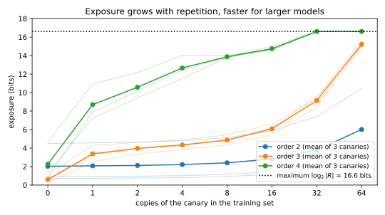

# Memorization and training-data extraction

A language model trained on scraped text sees phone numbers, addresses, keys and private messages. Ask it to continue "Anna Smith's phone number is" and it may finish the sentence with the real number. Nobody queried a database, and no breach leaked anything. The number is stored in the weights, and it comes out through the model's normal interface. That is what **training-data extraction** means. [Membership inference](02-membership-inference.md) asks whether a record was in the training set, and it needs the record in hand. Extraction asks for more, because the attacker gets the record itself, often without knowing that it existed.

The one idea of this chapter is the **rank** of a secret under the model. Fix the context in which the secret appears, say "my pin is", and list every value that could fill it, here all five-digit pins, from the one the model finds most likely to the one it finds least likely. The rank of the true secret is its position in that list, which is also the number of guesses an attacker needs if it tries the values in that order. Every measure in the chapter reads this rank. Greedy decoding reproduces the secret when its next symbol ranks first at every step, sampling finds it quickly when it ranks near the top, and exposure counts in bits how far up the list the model has moved it.

The running example is a toy that runs in seconds. The training set is a contact list, in which each line is a user name of three random syllables, a space and a five-digit pin, such as `toneka 14524`. There are 5,000 background lines, each seen once, and 600 secret lines, of which 100 each are inserted 1, 2, 4, 8, 16 and 32 times. That makes 11,300 lines and 146,900 symbols in all, counting the end of each line. The model is a character $n$-gram model, which predicts each character by counting what followed the few characters before it. Its order $n$ plays the role of model size, so that an order-3 model stores 2,734 distinct $n$-grams and an order-8 model stores 54,614. When a context is written out, `_` stands for a space, so `gule_` is the five characters before the first digit of `migule 16430`.
| Symbol | Meaning |
| --- | --- |
| $p(w \mid c)$, $p(x \mid c)$ | the model's probability of a next symbol $w$, or of a string $x$, after the text $c$ |
| $c$; $x = x_1\dots x_L$; $x_{<t}$ | a prompt, prefix or context; a suffix of $L$ symbols; its first $t - 1$ symbols |
| $n$; $N(c, w)$; $\alpha$; $V$ | the order of an $n$-gram model; its counts; the smoothing constant; the alphabet size |
| $k$; $k^*$ | the copies of a line in the training set; the copies it needs to be reproduced |
| $q$; $m$; $\beta$ | the probability that one sample is the string; the number of samples; the failure probability |
| $\mathcal R$; $\hat r$ | a canary's space of possible values; the planted value |
| $p_\theta$; $p_{\mathrm{ref}}$; $\Lambda$ | the target model; a reference model; their log-likelihood ratio |

: The symbols of this chapter. {#tbl-memo-symbols}

## Verbatim, approximate, discoverable, extractable {#sec-memo-definitions}

"The model memorized its training data" can mean several things. A model that completes a famous quotation has memorized it, but nothing private leaked, while a model that emits a phone number seen once in training has leaked it. Some definitions assume that the attacker knows the beginning of the training string, and others ask whether any prompt at all brings it out. You need to say which notion you measure, because the numbers differ by orders of magnitude. Every notion is stated through the probabilities that a language model gives to text, so those come first.

A language model never scores a whole string at once. It answers one smaller question many times: given everything written so far, how likely is each possible next symbol? The chain rule of probability then multiplies these answers into the probability of a whole string.

::: {#def-memo-lm name="Language model"}
A **language model** gives, for every text $c$ written so far and every symbol $w$, a probability $p(w \mid c)$ that the next symbol is $w$. Write $x_{<t} = x_1\dots x_{t-1}$ for the symbols before step $t$ of a string $x = x_1\dots x_L$ of length $L$. The probability of $x$ after a prompt $c$ is the product of its one-step probabilities, and on a log scale the product becomes a sum:
$$p(x \mid c) = \prod_{t=1}^{L}p(x_t \mid c, x_{<t}), \qquad \ln p(x \mid c) = \sum_{t=1}^{L}\ln p(x_t \mid c, x_{<t}).$$ {#eq-memo-chain}
**Greedy decoding** from a prompt $c$ appends the most likely next symbol at each step, and $\mathrm{greedy}(c)$ is the string it produces. **Sampling** draws each next symbol at random with the model's probabilities.
:::

For the pin `16430` after the prompt `migule `, the model multiplies five numbers. They are the probability of `1` after `migule_`, of `6` after `migule_1`, and so on up to the probability of `0` after `migule_1643`.

The toy computes these probabilities by counting. An order-$n$ model looks only at the last $n - 1$ symbols, which it calls the **context**. The natural prediction is the fraction of times $w$ followed the context in training. But that gives probability 0 to anything never seen, and one zero in the chain rule makes a whole string impossible. Smoothing removes the zeros by pretending that every symbol was seen a few extra times in every context.

::: {#def-memo-ngram name="An n-gram model with add-α smoothing"}
Let the alphabet have $V$ symbols, and let $\alpha > 0$ be a smoothing constant. An **order-$n$ model** stores, for every context $c$ of $n - 1$ symbols and every symbol $w$, the count $N(c, w)$ of times that $w$ followed $c$ in the training text. **Add-$\alpha$ smoothing** adds $\alpha$ to each of the $V$ counts, so the total grows by $\alpha V$:
$$p(w \mid c) = \frac{N(c, w) + \alpha}{N(c) + \alpha V}, \qquad N(c) = \sum_wN(c, w).$$ {#eq-memo-ngram}
Greedy decoding breaks a tie toward the symbol that comes first in a fixed order of the alphabet, its **code**.
:::

The toy uses $\alpha = 0.1$ and $V = 39$ symbols, which are the 26 letters, the 10 digits, the space, a start symbol and an end-of-line symbol.

The notions of memorization differ in what the attacker gets to use and in how close the output must be to the training string.

::: {#def-memo-notions name="Notions of memorization"}
Let a language model be trained on a dataset of documents.

1. **Extractable** (Carlini et al. 2021). A string $s$ is extractable if there is some prompt $c$, any prompt at all, such that $\mathrm{greedy}(c)$ begins with $s$.
2. **$k$-eidetic** (Carlini et al. 2021). A string $s$ is $k$-eidetically memorized if it is extractable and it appears in at most $k$ documents of the dataset.
3. **Discoverable** (Carlini et al. 2023, named by Nasr et al. 2023). Suppose the training data contain a prefix $c$ followed by a suffix $x$. Then $x$ is discoverably memorized if prompting with that same prefix makes greedy decoding produce the suffix, so that $\mathrm{greedy}(c)$ begins with $x$.
4. **Approximate** (Ippolito et al. 2023). The suffix $x$ is approximately memorized if $\mathrm{greedy}(c)$ is within distance $\tau$ of $x$ in some string distance. In the toy the distance is the number of wrong digits and $\tau = 1$, so a pin with at most one wrong digit counts.

Notions 1 to 3 are **verbatim**, because the output must match exactly.
:::

A discoverable suffix is extractable, because its training prefix is one of the prompts that the definition of extractable allows. The converse fails, because an extractable string may come out after some other prompt while its own prefix leads elsewhere. The most dangerous $k$-eidetic strings are those with $k = 1$, secrets seen once and given back.

The notions answer different threat models. Discoverable memorization assumes an attacker who holds the training prefix, which is a strong assumption but makes the quantity easy to measure. Extractable memorization fits the real attacker, who has only the model, but measuring it would mean searching over all prompts. So papers report discoverable rates, and attacks then show how much of that an outsider can reach. Verbatim matching misses near copies, such as a phone number with one digit changed, and Ippolito et al. (2023) show that a filter blocking verbatim training text is easy to bypass with prompts that change the style. A verbatim rate is therefore a lower bound on the leak, not a measure of it.

Greedy decoding is a convenience for measurement, while deployed systems sample, so you also need to know how many samples bring a string out. Each sample is an independent try, like a biased coin, and the chance that all of them miss falls exponentially in their number.

::: {#prp-memo-samples name="Samples needed to extract a string"}
Let $q = p(x \mid c)$ be the probability of the string $x$ after the prompt $c$, and let $\beta \in (0, 1)$ be a failure probability. Draw $m$ independent samples from $c$ at temperature 1, so that each next symbol is drawn with exactly the model's probabilities. If
$$m \ge \frac{\ln(1/\beta)}{q},$$ {#eq-memo-samples}
then at least one of the samples is exactly $x$ with probability at least $1 - \beta$.
:::

::: {.proof}
The plan is to compute the probability that every sample misses, bound it by an exponential, and solve for $m$.

1. *One sample hits with probability $q$.* A sample draws each next symbol $x_t$ with probability $p(x_t \mid c, x_{<t})$. By the chain rule, @eq-memo-chain, the chance that it writes out exactly $x$ is the product of those probabilities, which is $q$.
2. *All $m$ samples miss with probability $(1 - q)^m$.* Each sample misses with probability $1 - q$, and the samples are independent, so the misses multiply.
3. *Replace $1 - q$ by an exponential.* The curve $e^{-q}$ is convex, and the line $1 - q$ is its tangent at $q = 0$, since both equal 1 there with slope $-1$. A convex curve lies above its tangent lines, so $1 - q \le e^{-q}$. Raising both sides to the power $m$ keeps the order, because both are non-negative:
$$(1 - q)^m \le e^{-mq}.$$
4. *Solve for $m$.* The miss probability is therefore at most $\beta$ as soon as $e^{-mq} \le \beta$. Taking logarithms gives $mq \ge \ln(1/\beta)$, and dividing by $q > 0$ gives @eq-memo-samples.
:::

The proposition converts a probability into an attack budget, so that a string with probability $10^{-3}$ after its prefix comes out with 99% confidence ($\beta = 0.01$) within about 4,600 samples. It is slightly pessimistic, because it replaces $1 - q$ by the larger $e^{-q}$, but for rare strings it agrees closely with the exact budget ([Exercise 2](../../book-exercises/part02-attacks/05-memorization-extraction.md#sec-sol-memo-2)).

::: {#exm-memo-migule}
Take the secret line `migule 16430`, inserted 4 times, and prompt each model with its prefix `migule `. Greedy decoding gives `07` followed by an end of line at order 3, `81554` at order 4, `14032` at order 5, and the true `16430` at orders 6, 7 and 8. The order-5 output gets the first and fourth digits right and the other three wrong, so it is not approximately memorized either. The switch happens at order 6 because an order-6 model reads five characters of context. From the first digit on, its contexts (`gule_`, then `ule_1`, and so on) occur in this line and nowhere else. In such a context the line's own next digit has count 4 and every rival digit has count 0, so greedy decoding emits the line's digit every time. Shorter contexts, such as the four characters `ule_` that an order-5 model reads, are shared with other lines, whose digits can outvote the four copies. @sec-memo-copies turns this vote into a count of the copies a line needs.

Sampling gives a graded version of the same picture. At order 5, the probability $q$ that one sample from the true prefix reproduces a secret's pin, averaged over the 100 secrets of each group, is $1.4 \times 10^{-3}$ at 4 copies and $0.142$ at 32 copies. With $\beta = 0.01$, the exact budgets for these mean probabilities are 3,252 and 31 samples for a 99% chance of extracting the pin.:::

## Duplication and model size {#sec-memo-copies}

@exm-memo-migule showed one line becoming memorized as the model grew. This section asks which lines get memorized in general, because that decides which data a defence must protect first. Carlini et al. (2023) found that discoverable memorization grows log-linearly with how often a string is duplicated, with model size and with prompt length. Kandpal, Wallace & Raffel (2022) found that a sequence repeated 10 times is generated about 1,000 times more often than one seen once. The $n$-gram toy lets you derive why, for every line, from its counts.

The idea is a vote. Greedy decoding follows the largest count at each step, and each copy of a line adds one vote for the line's own next symbol in every context the line passes through. Steps 1 and 2 of the proof below need two properties of add-$\alpha$ counts, and the exposure example of @sec-memo-exposure needs a third, so the next lemma collects them.

::: {#lem-memo-ngram name="What counting implies"}
In an order-$n$ model with add-$\alpha$ smoothing (@def-memo-ngram), the following hold.

1. Training on $k$ copies of a line adds $k$ to the count of each (context, next symbol) pair that the line passes through, and changes no other count.
2. In a fixed context $c$, the most likely symbol is the one with the largest count, that is, $\arg\max_wp(w \mid c) = \arg\max_wN(c, w)$.
3. Suppose that a context $c$ occurs in the training data only in the $k$ copies of one line. Then the line's own next symbol and each other symbol get, respectively,
$$p(\text{true} \mid c) = \frac{k + \alpha}{k + \alpha V}, \qquad p(\text{other} \mid c) = \frac{\alpha}{k + \alpha V},$$ {#eq-memo-unseen}
so the true symbol is $(k + \alpha)/\alpha$ times as likely as any other, whatever $V$ is. A context never seen at all gives every symbol probability $1/V$.
:::

::: {.proof}
1. *Training is counting.* A line passes through a sequence of (context, next symbol) pairs, and training on it adds 1 to each of those counts. Training on $k$ copies repeats this $k$ times.
2. *Smoothing keeps the order.* In a fixed context, @eq-memo-ngram adds the same $\alpha$ to every count and divides by the same $N(c) + \alpha V$. Both operations are increasing, so the symbol with the largest count still has the largest probability.
3. *A context of one line.* At such a context the line's next symbol has count $k$, every other symbol has count 0, and the total is $N(c) = k$. Putting those counts into @eq-memo-ngram gives @eq-memo-unseen, and the two probabilities share a denominator, so their ratio is $(k + \alpha)/\alpha$. A context never seen has all counts 0, which gives $\alpha/(\alpha V) = 1/V$.
:::

@tbl-memo-unseen evaluates @eq-memo-unseen for the toy. For one copy, $\alpha V = 3.9$, so $p(\text{true} \mid c) = 1.1/4.9 = 0.2245$ and $p(\text{other} \mid c) = 0.1/4.9 = 0.0204$, a ratio of $1.1/0.1 = 11$. The last column turns the ratio into bits, $\log_2 11 = 3.46$, so one copy doubles the true digit's odds against each rival 3.46 times over. That is the mechanism of memorization in this toy: a context that belongs to one training line alone, followed by that line's next symbol.

| Copies $k$ | $p(\text{true}\mid c)$ | $p(\text{other}\mid c)$ | Ratio | Bits per digit, $\log_2$ ratio |
| --- | --- | --- | --- | --- |
| 1 | 0.2245 | 0.0204 | 11.0 | 3.46 |
| 4 | 0.5190 | 0.0127 | 41.0 | 5.36 |
| 16 | 0.8090 | 0.0050 | 161.0 | 7.33 |

: Add-$\alpha$ probabilities at a context that occurs only in the $k$ copies of one line ($\alpha = 0.1$, $V = 39$). {#tbl-memo-unseen}

To turn the vote into a number, count the rest of the corpus separately from the line's copies. At each step, the **gap** is how far the strongest rival symbol is ahead of the true symbol in those counts. The copies must close the gap at every step, so the step where the rival is furthest ahead sets the number of copies needed.

::: {#thm-memo-kstar name="Copies needed for greedy extraction"}
Let $s$ be a training line made of a prefix $c$ and a suffix $x = x_1\dots x_L$, inserted $k$ times into the training set of an order-$n$ model with add-$\alpha$ smoothing. Let $c_t$ be the context at step $t$, the last $n - 1$ symbols of $c\,x_{<t}$. Let $N_-$ be the counts of the rest of the training set, without the copies of $s$. Assume that each context $c_t$ occurs only once within $s$, so that a copy adds to no rival pair. Then greedy decoding from $c$ emits $x$ if and only if $k \ge k^*(s)$, where
$$k^*(s) = \max_{t \le L}\Big[\max_{w \ne x_t}N_-(c_t, w) - N_-(c_t, x_t)\Big] + 1.$$ {#eq-memo-kstar}
At a step where the true symbol has a lower code than the strongest rival, a tie is already a win, and the bracket is reduced by one there. A line whose contexts are unique to it, with $N_- = 0$ at every step, has $k^* = 1$. Over a population of lines, the fraction discoverably memorized at $k$ copies is the fraction with $k^*(s) \le k$.
:::

::: {.proof}
The plan is to find when the true symbol wins one step, then require every step to win, and finally read off the special cases.

1. *Greedy picks the largest count.* By part 2 of @lem-memo-ngram, at context $c_t$ greedy decoding emits the symbol with the largest count $N(c_t, w)$.
2. *What the copies add.* By part 1 of @lem-memo-ngram, the $k$ copies add $k$ to $N(c_t, x_t)$. Because $c_t$ occurs only once in $s$, they add nothing to a rival pair $(c_t, w)$ with $w \ne x_t$. So the true symbol's count is $N_-(c_t, x_t) + k$, and each rival's is still $N_-(c_t, w)$.
3. *Winning one step.* The true symbol wins outright when its count beats the largest rival count:
$$N_-(c_t, x_t) + k > \max_{w \ne x_t}N_-(c_t, w).$$
Moving $N_-(c_t, x_t)$ to the right turns this into $k > \text{gap}_t$, where $\text{gap}_t$ is the bracket of @eq-memo-kstar. Both sides are whole numbers, so this is $k \ge \text{gap}_t + 1$. When the true symbol has the lower code, a tie already wins, which removes the $+1$ at that step.
4. *Every step must win.* If some step loses, greedy decoding emits a wrong symbol there, so its output does not begin with $x$. So $x$ comes out exactly when $k \ge \text{gap}_t + 1$ at every step, which is $k \ge k^*(s)$.
5. *Unique contexts.* If $N_-(c_t, \cdot) = 0$ at every step, every gap is $0 - 0 = 0$, so $k^* = 1$.
6. *The population rate.* Each line is memorized at $k$ copies exactly when $k^*(s) \le k$, so the fraction of lines memorized is the fraction for which this holds.
:::

@fig-memo-copies-needed draws steps 3 and 4 for one line. Each copy counts at every step at once, because it adds one to every pair on the line's path, so the largest gap decides and not the sum of the gaps.

{#fig-memo-copies-needed}

Duplication works as a vote, and model size works by splitting the vote. A longer context is shared by fewer training positions, so its rival counts are smaller, while the line's own $k$ votes follow it into every context. In the limit every line has contexts of its own and $k^* = 1$, which is the toy version of "larger models memorize more". For the same reason rare data are exposed first, since a line whose name shares few syllables with other names reaches a context of its own at a lower order. Real models show the same pattern: atypical examples have the largest **self-influence** (@def-stability-self-influence in [Algorithmic stability and generalization](../part01-prerequisites/07-stability-generalization.md); Feldman 2020), the change in the loss on an example when that example leaves the training set.

Deduplication is the cheapest defence, because it lowers $k$ for every repeated string. Lee et al. (2022) found that models trained on deduplicated data emit memorized text about ten times less often, without losing quality. By @thm-memo-kstar it does nothing for singletons in a high-capacity model, where $k = 1$ already and $k^* = 1$.

::: {#exm-memo-discoverable}
The script prompts each of the 600 secrets with its true prefix, the name and the space, decodes five symbols greedily, and compares them with the pin (@tbl-memo-discoverable). It also computes $k^*$ for every secret from @eq-memo-kstar, and the prediction $\Pr[k^* \le k]$ matches the verbatim rate exactly in all 36 cells, as @thm-memo-kstar says it must.

Read the table along both axes. Along a row, more copies means more memorization, so that at order 5 the rate climbs from 0 at one copy to 0.70 at 32. Down a column, a larger model memorizes more. A line seen once is safe at orders up to 5, memorized 8% of the time at order 6, 70% at order 7 and 98% at order 8. Those singletons of the order-8 model are 1-eidetic in the sense of @def-memo-notions, seen in one document and given back.
:::

| Order $n$ | $k = 1$ | $k = 2$ | $k = 4$ | $k = 8$ | $k = 16$ | $k = 32$ |
| --- | --- | --- | --- | --- | --- | --- |
| 3 | 0.00 / 0.00 | 0.00 / 0.03 | 0.00 / 0.00 | 0.00 / 0.00 | 0.00 / 0.02 | 0.00 / 0.05 |
| 4 | 0.00 / 0.00 | 0.00 / 0.00 | 0.00 / 0.01 | 0.00 / 0.00 | 0.00 / 0.00 | 0.13 / 0.17 |
| 5 | 0.00 / 0.00 | 0.00 / 0.00 | 0.05 / 0.06 | 0.11 / 0.15 | 0.42 / 0.42 | 0.70 / 0.70 |
| 6 | 0.08 / 0.13 | 0.65 / 0.69 | 0.76 / 0.78 | 0.80 / 0.85 | 0.90 / 0.91 | 0.96 / 0.97 |
| 7 | 0.70 / 0.78 | 0.95 / 0.96 | 0.98 / 0.98 | 0.98 / 0.99 | 0.99 / 0.99 | 0.97 / 0.98 |
| 8 | 0.98 / 0.98 | 1.00 / 1.00 | 1.00 / 1.00 | 0.99 / 0.99 | 1.00 / 1.00 | 1.00 / 1.00 |

: Fraction of 100 secret lines per cell whose pin greedy decoding reproduces from the true prefix, verbatim / with at most one digit wrong. Rows are model orders, columns copies in the training set. {#tbl-memo-discoverable}

@fig-memo-discoverable plots the same rates for an independent draw of the corpus, so the pattern is not an accident of one draw. The approximate rates are barely above the verbatim ones, because a pin that loses one contest puts greedy decoding in the wrong context, where it wanders off. Natural text has many near-ties, such as synonyms and punctuation, and there approximate memorization adds more (Ippolito et al. 2023).

{#fig-memo-discoverable}

The experiment of Carlini et al. (2023) has the same shape at scale. They prompted GPT-Neo and GPT-J models, trained on a large public collection of web and book text called the Pile, with the first 50 tokens of training sequences and counted exact greedy matches of the next 50. The largest model, with 6 billion parameters, reproduces at least 1% of its training data this way.
## Canaries and the exposure metric {#sec-memo-exposure}

Discoverable memorization is all or nothing, because the secret either comes out or it does not. An auditor wants a graded answer: how much closer to the secret does the model put an attacker? Carlini et al. (2019, "The Secret Sharer") proposed planting random secrets of a fixed format in the training data and measuring where the trained model ranks each among all secrets of the same format. Because you planted the secret, you know the right answer and the size of the space, so you can measure memorization exactly.

An attacker with a score for every candidate should guess from the highest score down, because each guess then has the best remaining chance of being right, and the number of guesses this takes is the rank of the true secret. Without the model the attacker faces every candidate, so the ratio of the two counts measures what the model gave away, and on a log scale it becomes a difference of bits.

::: {#def-memo-exposure name="Canary, rank and exposure"}
A **canary** is a sentence with a hole, together with a **randomness space** $\mathcal R$ of values that can fill the hole. In the toy, the sentence is "my pin is" followed by a value $r$, one of the $|\mathcal R| = 10^5$ pins. A value $\hat r$ is drawn uniformly at random from $\mathcal R$, and the sentence filled with $\hat r$ is inserted $k$ times into the training data. After training, the **rank** of a candidate $r$ is the number of candidates at least as likely as it under the model, itself and every tie included:
$$\operatorname{rank}(r) = \big|\{r' \in \mathcal R : p(r' \mid \text{sentence}) \ge p(r \mid \text{sentence})\}\big|,$$
where $p(r \mid \text{sentence})$ is the model's probability of $r$ in the hole, after the sentence's text.
The **exposure** of the canary is the number of bits of search the model saves:
$$\mathrm{exposure}(\hat r) = \log_2|\mathcal R| - \log_2\operatorname{rank}(\hat r).$$ {#eq-memo-exposure}
:::

Ties are counted against the attacker, who may have to try every tied candidate first. Because the rank lies between 1 and $|\mathcal R|$, the exposure lies between 0 and $\log_2|\mathcal R|$. Solving @eq-memo-exposure for the rank shows that an attacker who guesses in the model's order needs $2^{\log_2|\mathcal R| - \mathrm{exposure}}$ guesses instead of $|\mathcal R|$, so each bit of exposure halves the work. The maximum, $\log_2 10^5 = 16.61$ bits for a pin, is the **min-entropy** of a uniform canary in the sense of [Information theory](../part01-prerequisites/05-information-theory.md) (@def-min-vulnerability), so a canary at full exposure has lost all of it.

What makes exposure an audit tool is that you know how it behaves when nothing was memorized. A space of four candidates shows what to expect. Suppose the model was trained without the canary, so the canary is equally likely to sit at rank 1, 2, 3 or 4, and its exposure is $2 - \log_2(\text{rank})$, as @tbl-memo-four lists.

| Rank | 1 | 2 | 3 | 4 |
| --- | --- | --- | --- | --- |
| Exposure $2 - \log_2(\text{rank})$ | 2 | 1 | 0.415 | 0 |

: The four equally likely exposures of a canary from a space of four candidates that was never inserted. {#tbl-memo-four}

The mean of the four is $\frac14(2 + 1 + 0.415 + 0) = 0.854$. The probability of exposure at least 1 is $\frac12 = 2^{-1}$, from ranks 1 and 2, and of exposure at least 2 is $\frac14 = 2^{-2}$, from rank 1 only. The next theorem shows that this pattern holds for every space.

::: {#thm-memo-null name="Exposure of a canary that was not memorized"}
Suppose the model does not depend on the drawn value $\hat r$, for instance because the canary was never inserted. Then for every threshold $h \ge 0$,
$$\Pr\big[\mathrm{exposure}(\hat r) \ge h\big] \le 2^{-h}.$$ {#eq-memo-null}
If moreover no two candidates tie, the average exposure is a fixed small number of bits, which tends to $\log_2 e$ as the space grows:
$$\mathbb E\big[\mathrm{exposure}(\hat r)\big] = \log_2|\mathcal R| - \frac{\log_2(|\mathcal R|!)}{|\mathcal R|} \;\longrightarrow\; \log_2e = 1.4427 \text{ bits}.$$ {#eq-memo-null-mean}
:::

::: {.proof}
The plan is to show that the canary lands at a uniformly random position in a fixed order, count the positions with high exposure, check that ties only help, and average the exposure over the positions.

1. *The order is fixed.* The model does not depend on $\hat r$, so its scores $p(r \mid \cdot)$ are fixed numbers before $\hat r$ is drawn. With no ties they order $\mathcal R$ into positions $1, \dots, |\mathcal R|$.
2. *The canary's position is uniform.* The value $\hat r$ is uniform on $\mathcal R$ and independent of the scores, so its position is equally likely to be any of $1, \dots, |\mathcal R|$.
3. *Count the positions with high exposure.* By @eq-memo-exposure, exposure at least $h$ means $\log_2\operatorname{rank} \le \log_2|\mathcal R| - h$, that is $\operatorname{rank} \le |\mathcal R|2^{-h}$. There are $\lfloor|\mathcal R|2^{-h}\rfloor$ such positions, each with probability $1/|\mathcal R|$, so
$$\Pr\big[\mathrm{exposure}(\hat r) \ge h\big] = \frac{\lfloor|\mathcal R|2^{-h}\rfloor}{|\mathcal R|} \le 2^{-h}.$$
4. *Ties only help the bound.* With ties, break them in a fixed order to get positions as before. The rank counts every candidate at least as likely as $\hat r$, so it is never below the position of $\hat r$. A higher rank means a lower exposure, so the probability of a high exposure can only fall.
5. *The mean.* With the rank uniform on $1, \dots, |\mathcal R|$, the average of $\log_2\operatorname{rank}$ is $\frac{1}{|\mathcal R|}\sum_{i=1}^{|\mathcal R|}\log_2 i$. A sum of logarithms is the logarithm of the product, and $1 \cdot 2 \cdots |\mathcal R| = |\mathcal R|!$, so the average is $\log_2(|\mathcal R|!)/|\mathcal R|$. Subtracting it from $\log_2|\mathcal R|$ gives @eq-memo-null-mean.
6. *The limit.* Stirling's approximation of the factorial, derived in @sec-apx-prob-stirling, says that $\ln(|\mathcal R|!)$ is $|\mathcal R|\ln|\mathcal R| - |\mathcal R|$ up to a correction that grows no faster than a multiple of $\ln|\mathcal R|$. Dividing by $|\mathcal R|\ln 2$ turns this into base-2 logarithms per candidate, and $1/\ln 2 = \log_2 e$, so
$$\frac{\log_2(|\mathcal R|!)}{|\mathcal R|} = \log_2|\mathcal R| - \log_2 e + O\Big(\frac{\ln|\mathcal R|}{|\mathcal R|}\Big).$$
The correction vanishes as the space grows, so the mean exposure tends to $\log_2 e$.
:::

The bound is tight whenever $|\mathcal R|2^{-h}$ is a whole number, as in the space of four. So exposure is minus the base-2 logarithm of a p-value, where a **p-value** is the probability, if nothing happened, of a result at least as extreme as the one observed. "Was this canary inserted?" is a membership question, and the test that says "inserted" when the exposure is at least $h$ has false positive rate at most $2^{-h}$, by @eq-memo-null. In [membership inference](02-membership-inference.md), calibrating a test means training **shadow models** with and without a record to learn how the score behaves for non-members. Here none are needed, because the randomness of the canary does the calibration.

Canaries also test defences, because you can compare exposure across two training runs that differ in one thing, such as deduplication or unlearning. With a differentially private algorithm (Part 3), exposure near the null mean says that the planted secrets were not memorized, and Carlini et al. (2019) found that private training kept their canaries at the exposure of canaries never inserted.

::: {#exm-memo-canary}
The script plants "my pin is 58745" and computes the exact exposure by scoring all $10^5$ pins, for orders 2, 3 and 4 (@tbl-memo-exposure). The jump from $k = 0$ to $k = 1$ copies depends on whether a digit of the canary sits in a context that only the canary's copies fill. No background line contains `s_`, an `s` followed by a space, because names end in a vowel.

At order 2 the first digit's context is a single space, shared by all 11,300 lines, so one copy is a single vote among thousands and moves the exposure by $0.41 - 0.40 = 0.01$ bits. At order 3 the first digit's context is `s_`, which occurs only in the canary. By part 3 of @lem-memo-ngram, one copy then makes the first digit 11 times as likely as each other first digit, a factor worth $\log_2 11 = 3.46$ bits. The exposure rises from 0.89 to 4.05, by $4.05 - 0.89 = 3.16$ bits. That is close to 3.46 but not equal, because multiplying the canary's probability by 11 does not divide its rank by 11: the rank counts the pins that still score above it, and that depends on how their scores are spread. At order 4 the first two digits have the unique contexts `is_` and `s_5`, worth about $2 \times 3.46 = 6.92$ bits, and the exposure rises from 3.76 to 9.98, by $9.98 - 3.76 = 6.22$ bits. The remaining digits share their contexts with the 5,000 background pins, and they move only as the copies outvote them.
:::

| Order $n$ | $k = 0$ | $k = 1$ | $k = 2$ | $k = 4$ | $k = 8$ | $k = 16$ | $k = 32$ | $k = 64$ |
| --- | --- | --- | --- | --- | --- | --- | --- | --- |
| 2 | 0.40 | 0.41 | 0.43 | 0.47 | 0.55 | 0.73 | 1.21 | 2.54 |
| 3 | 0.89 | 4.05 | 4.44 | 4.71 | 5.24 | 6.59 | 9.69 | 15.61 |
| 4 | 3.76 | 9.98 | 12.15 | 15.02 | 15.61 | 16.61 | 16.61 | 16.61 |

: Exposure in bits of the canary "my pin is 58745" against the number of copies $k$ in the training set. The maximum is $\log_2 10^5 = 16.61$. {#tbl-memo-exposure}

@fig-memo-exposure-histogram shows the same movement on the full distribution of scores, and @fig-memo-exposure-vs-copies averages several canaries.

{#fig-memo-exposure-histogram}

{#fig-memo-exposure-vs-copies}

To check @thm-memo-null, treat each of the $10^5$ pins in turn as a canary that was never inserted. For orders 2, 3 and 4 the scores have no ties, so their exposures are exactly the uniform-rank values. Their mean is 1.443 bits, against 1.4426 from @eq-memo-null-mean, and a fraction $0.03125 = 1/32 = 2^{-5}$ has exposure at least 5, exactly on the bound @eq-memo-null. Ties, on the other hand, push exposure down, so they can hide memorization. The order-8 model without a canary has never seen the contexts after "my pin is", so it gives every pin the same probability, every rank is $|\mathcal R|$ and every exposure is 0.

### Estimating exposure in a large space

Scoring every candidate is impossible for, say, a 9-digit number, so for large spaces exposure has to be estimated from a sample of candidates. Counting uses the fraction of sampled candidates at least as likely as the canary as the estimate of $\operatorname{rank}/|\mathcal R|$, so with $m$ samples it cannot resolve exposures above $\log_2m$. Extrapolation fits a distribution to the sampled scores and reads off its tail beyond the canary's score, and Carlini et al. (2019) fit a skew-normal, a normal distribution whose one tail can be heavier than the other. At order 3, the script estimates the canary's exposure from 10,000 random pins in both ways, fitting a plain normal for the second (@tbl-memo-estimate).

| Copies $k$ | Exact exposure | Rank | Sampling estimate | Normal fit |
| --- | --- | --- | --- | --- |
| 1 | 4.05 | 6,018 | 4.13 | 4.47 |
| 2 | 4.44 | 4,606 | 4.43 | 5.57 |
| 4 | 4.71 | 3,823 | 4.68 | 6.81 |
| 8 | 5.24 | 2,648 | 5.35 | 8.28 |

: Exposure of the canary at order 3, computed exactly over all $10^5$ pins and estimated from 10,000 random pins, by counting and by fitting a normal to their scores. {#tbl-memo-estimate}

Counting is accurate here, because every exposure is well below $\log_2 10^4 = 13.3$ bits, the largest value that 10,000 samples can resolve. The normal fit overestimates by up to 3 bits (at 8 copies, $8.28 - 5.24 = 3.04$), because the scores have a heavier right tail than a normal. It therefore puts too few pins above the canary, which makes its rank look smaller and its exposure larger, and the tail is exactly the part you cannot sample.

## Extraction without the prefix: generate, rank, verify {#sec-memo-attack}

The attacker of @sec-memo-definitions had the training prefix, but a real attacker has only the model. This section asks what such an attacker can extract, and how it tells memorized text from text that is merely likely. Carlini et al. (2021) answered with an attack on GPT-2 in three stages. The hard stage is the ranking, which turns out to be a hypothesis test.

::: {#def-memo-grv name="Generate-rank-verify attack"}
The attacker **generates** a large number of samples from the model, **ranks** the distinct generations by a score of how likely each is to be memorized, and **verifies** the top of the ranking against a source of training text. Its quality is the **precision** of the top of the ranking, the fraction of the top-ranked generations that are real training data.
:::

Verifying is a search, against the training data or, for an outsider, against public sources. Ranking needs more thought, because a string can be likely for two reasons. It may be ordinary text that any model of the language finds likely, or the target may have memorized it, and only the second is a leak. So for a generated string $x$, the attacker tests the hypothesis $H_0$, "$x$ is likely because text like it is common", against $H_1$, "$x$ is likely because the target memorized it". A **reference model** $p_{\mathrm{ref}}$, trained on data from the same distribution but not on the target's training set, stands in for common text, and the target model $p_\theta$ itself stands in for $H_1$. The evidence for memorization is then how much more likely the target finds $x$ than the reference does, which on a log scale is a difference.

::: {#prp-memo-ratio name="Rank generations by the likelihood ratio"}
Suppose that under $H_0$ a string has probability $p_{\mathrm{ref}}(x)$ and under $H_1$ probability $p_\theta(x)$. Among all tests with a given false positive rate (FPR), the fraction of $H_0$ strings flagged, the one with the highest true positive rate (TPR), the fraction of $H_1$ strings flagged, flags a string when the log-likelihood ratio
$$\Lambda(x) = \ln p_\theta(x) - \ln p_{\mathrm{ref}}(x)$$ {#eq-memo-ratio}
is above a threshold. Ranking by $\ln p_\theta(x)$ alone gives the same order when $p_{\mathrm{ref}}$ is constant.
:::

::: {.proof}
1. *The best test thresholds the ratio.* The [Neyman–Pearson lemma](../part01-prerequisites/04-hypothesis-testing.md) (@thm-ht-np) says that, among all tests with a given FPR, the one with the highest TPR flags $x$ when the likelihood ratio $p_\theta(x)/p_{\mathrm{ref}}(x)$ is above a threshold. Each flagged string costs false positives in proportion to $p_{\mathrm{ref}}(x)$ and gains true positives in proportion to $p_\theta(x)$, so for a fixed budget of false positives you catch the most by flagging the largest ratios first.
2. *Take logarithms.* The logarithm is increasing, so it keeps the order of the ratios, and thresholding the ratio is the same as thresholding its logarithm, @eq-memo-ratio.
3. *Raw likelihood.* If $p_{\mathrm{ref}}$ is a constant, $\ln p_{\mathrm{ref}}(x)$ is the same for every string, so $\Lambda$ and $\ln p_\theta$ order the strings in the same way.
:::

Raw likelihood treats every string as equally common a priori. That assumption is wrong exactly for strings that are likely under any model, such as software licences, news boilerplate and number sequences, and those are the strings raw likelihood puts first. Extracting them reveals nothing, and since a reference model knows them too, their ratio is close to 1 and @eq-memo-ratio cancels them. This is the same move as the per-example calibration of [Membership inference](02-membership-inference.md), where a record's loss under the target is compared with the loss that models which did not see the record give it.

The reference can be crude. Carlini et al. (2021) used a smaller model of the same family, and also the length of the text after compression with zlib, a general-purpose compressor whose output length measures how predictable the text is without any model. The attacker cares about precision more than recall, because it checks the top few candidates by hand. Flagging a few strings with high precision needs a tiny FPR, the same operating point that matters in membership inference.

::: {#exm-memo-extraction}
The attacker samples 20,000 lines from the order-6 model, starting each at the beginning of a line. To make ranking hard, 50 **public** lines, think of a published directory, are added 100 times each to the target's training set. The reference model is trained on an independent contact list of 5,000 lines that also contains them. A generation counts as a hit if it is a private training line.

Of the 20,000 samples, 14,852 are distinct, and among them are 197 private training lines and all 50 public lines. By duplication group, the samples contain none of the secrets inserted 1, 2 or 4 times, 11% of those inserted 8 times, 86% of those inserted 16 times and all of those inserted 32 times. Compare the discoverable rates at order 6 in @tbl-memo-discoverable, where 8% of the singletons and 65% of the lines seen twice come out when you hold their prefix. Without the prefix, a sample must first produce the right name before it can produce the pin, and only heavily duplicated lines make their names likely enough ([Exercise 6](../../book-exercises/part02-attacks/05-memorization-extraction.md#sec-sol-memo-6) predicts these fractions from the line probabilities).

Ranking matters (@fig-memo-extraction). Among the top 100 distinct generations by target likelihood, 45 are private training lines. The rest are mostly the 50 public lines, which, repeated 100 times each, are the most likely strings the model knows. Ranking by @eq-memo-ratio, 85 of the top 100 are private training lines, because the reference model also finds the public lines likely and cancels them.
:::

{#fig-memo-extraction}

### The divergence attack on a production model

An aligned chat model resists the generate stage, so the question is whether another prompt can bring its training data out. Nasr et al. (2023) answered it on deployed models, verifying generations against the training set of open models and, for closed ones, against a 9-terabyte corpus of public web text. The chat model they attacked, ChatGPT (gpt-3.5-turbo), rarely emitted training data in normal use, because alignment training had taught it to answer as an assistant rather than to continue documents. Their **divergence attack** asked it to repeat a single word forever. After many repetitions the model left its chat behaviour and began to emit text that looked like pretraining documents, much of which matched the web corpus verbatim. They report a rate of emitted training data about 150 times higher than in normal use, and over 10,000 unique memorized examples, including personal contact details, for about 200 US dollars of queries.

## Code {#sec-memo-code}

The script [code/memorization.py](../../code/part02-attacks/memorization.py) builds the contact list, trains the $n$-gram models by counting, and runs every experiment in this chapter, from greedy extraction to the generate-rank-verify attack. From the repository root:

```bash
uv run python code/part02-attacks/memorization.py
```

| Experiment | Result |
| --- | --- |
| Corpus | 5,000 background lines, 600 secrets (100 each at 1, 2, 4, 8, 16, 32 copies), 11,300 lines, 146,900 symbols |
| Model size, distinct $n$-grams | Order 3: 2,734; 4: 19,129; 5: 42,407; 6: 52,610; 7: 54,334; 8: 54,614 |
| One secret, `migule 16430` × 4 | $k^* = 151, 43, 9, 1, 1, 1$ for orders 3 to 8; greedy reproduces it from order 6 |
| Discoverable memorization | @tbl-memo-discoverable; $\Pr[k^* \le k]$ matches greedy in 36 of 36 cells |
| Sampling from the prefix, order 5 | Mean $p(\text{pin} \mid \text{prefix})$ $1.4 \times 10^{-3}$ at 4 copies, 0.142 at 32; 3,252 and 31 samples for 99% |
| Exposure null, orders 2–4 | Mean 1.443 bits (theory 1.4426); $\Pr[\text{exposure} \ge 5] = 0.03125$ (bound $2^{-5}$); order 8: all tied, exposure 0 |
| Canary exposure | @tbl-memo-exposure |
| Exposure estimates, order 3 | @tbl-memo-estimate |
| Extraction, order 6 | 14,852 distinct of 20,000 samples; 197 private lines; top 100 precision 0.45 by likelihood, 0.85 by ratio |

: The script's output with the default seed. {#tbl-memo-code}

[tests/test_memorization.py](../../tests/test_memorization.py) checks that the output still matches.

## Summary {#sec-memo-summary}

| Result | Statement | Use |
| --- | --- | --- |
| @def-memo-lm, @def-memo-ngram | A string's probability is the product of its next-symbol probabilities | Every score of the chapter is a sum of per-symbol log-probabilities |
| @def-memo-notions | Extractable, $k$-eidetic, discoverable, approximate | Discoverable is easy to measure; verbatim rates understate the leak |
| @prp-memo-samples | $m \ge \ln(1/\beta)/q$ samples succeed with probability $1 - \beta$ | About $4.6/q$ samples for 99% |
| @lem-memo-ngram | A context of one line favours its symbol by $(k + \alpha)/\alpha$ | One copy: 11 times as likely, 3.46 bits per digit |
| @thm-memo-kstar | $k^*$ is the largest gap on the line's path plus one | The most contested context decides; larger models memorize from fewer copies; deduplication does not help singletons in a large model |
| @def-memo-exposure | $\log_2\lvert\mathcal R\rvert - \log_2\operatorname{rank}$ | Bits of guessing saved; graded, unlike extraction |
| @thm-memo-null | $\Pr[\mathrm{exposure} \ge h] \le 2^{-h}$; mean $\to \log_2 e$ | A p-value without shadow models |
| @def-memo-grv, @prp-memo-ratio | Rank generations by $\Lambda(x)$ | Never by raw likelihood; without the prefix an attacker gets less, but still thousands of records in production |

: The results of this chapter, and where each is used. {#tbl-memo-summary}

## References {#sec-memo-references}

- Carlini, Liu, Erlingsson, Kos & Song, "The Secret Sharer: Evaluating and Testing Unintended Memorization in Neural Networks" (USENIX Security 2019): canaries, the exposure metric, its estimation by sampling and skew-normal extrapolation, and extraction of planted secrets by search.
- Carlini et al., "Extracting Training Data from Large Language Models" (USENIX Security 2021): extractable and $k$-eidetic memorization; the generate-rank-verify attack on GPT-2 with perplexity, reference-model, zlib and lowercase ranking.
- Carlini, Ippolito, Jagielski, Lee, Tramèr & Zhang, "Quantifying Memorization Across Neural Language Models" (ICLR 2023): memorization measured by prompting with training prefixes; log-linear growth with model size, duplication and prompt length.
- Nasr et al., "Scalable Extraction of Training Data from (Production) Language Models" (2023): discoverable against extractable memorization, measurement on open models against their training sets, and the divergence attack on an aligned chat model.
- Kandpal, Wallace & Raffel, "Deduplicating Training Data Mitigates Privacy Risks in Language Models" (ICML 2022): how the rate of regenerated sequences grows with duplication.
- Lee et al., "Deduplicating Training Data Makes Language Models Better" (ACL 2022): near-duplicate detection at scale and its effect on emitted training text and model quality.
- Ippolito et al., "Preventing Generation of Verbatim Memorization in Language Models Gives a False Sense of Privacy" (INLG 2023): approximate memorization and why verbatim filters fail.
- Feldman, "Does Learning Require Memorization? A Short Tale about a Long Tail" (STOC 2020): why rare examples must be memorized for accuracy, which explains why they are exposed first.
- Jurafsky & Martin, *Speech and Language Processing* (3rd ed. draft), ch. 3: $n$-gram language models, smoothing and perplexity.

**Practice.** Exercises for this chapter, each with a worked solution, are in [the exercise book](../../book-exercises/part02-attacks/05-memorization-extraction.md).
