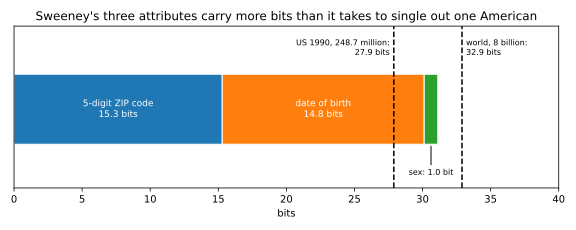
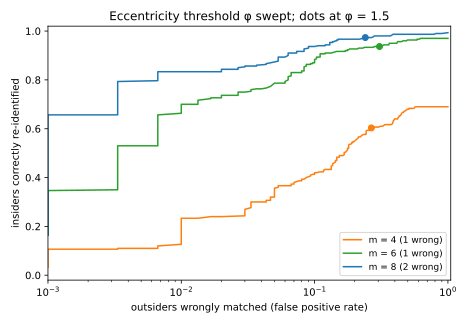

# Linkage and re-identification

A hospital shares its discharge records with researchers, after deleting the names and keeping ZIP code, date of birth, sex and diagnosis. Is anyone in the file identifiable? Usually, yes. Most people are the only person with their combination of ZIP code, birth date and sex, so anyone who holds a voter roll with names and those three columns can join the two tables and name most rows. This is a **linkage attack**, and putting a name back on a "de-identified" record is **re-identification**. Unlike the rest of this part, it attacks the data itself rather than a trained model.

The one idea of the chapter is that identifying information is measured in bits, and bits add up. Picking one person out of $n$ takes $\log_2 n$ bits, because each bit halves the number of candidates, so 27.9 bits single out one of the 248.7 million people in the United States in 1990. A birth month, one of 12 equally likely values, carries $\log_2 12 \approx 3.6$ bits, and the bits of independent attributes add. **Once the attributes you know carry a few bits more than $\log_2 n$, almost everyone is unique.** Each section makes this precise for one kind of release: tidy tables, hashed identifiers, sparse data such as movie ratings, and samples.

The running example is a synthetic census of $n = 10{,}000$ people with eight attributes, revealed one at a time. Once the revealed attributes carry 12.90 bits on average, just below the $\log_2 n = 13.29$ needed to name one person, a third of the people are already unique, and at 20.39 bits 97.5% are.

## Quasi-identifiers and the linkage attack {#sec-link-quasi}

Data protection practice sorts a table's columns into three kinds. **Direct identifiers**, such as a name, name a person on their own. **Sensitive attributes**, such as a diagnosis, must not be tied to a person. A **quasi-identifier** names nobody alone but, combined with others, often singles out one person, and appears in other datasets next to names. "De-identification" usually removes only the direct identifiers. This section asks how often a join on the quasi-identifiers then names the right record, using the games of [Threat models](01-threat-models.md).

::: {#def-link-linkage name="The linkage game"}
A release $R$ holds $n$ records, each with quasi-identifiers and a sensitive attribute. Records with identical quasi-identifiers form an **equivalence class**, and the $J$ classes have sizes $k_1, \dots, k_J$. A challenger draws a target uniformly from the $n$ records and gives the adversary the target's quasi-identifiers, as a voter roll would. The adversary outputs one record of $R$ and wins if it is the target's. The **linkage attack** outputs a record drawn uniformly from the target's class.
:::

A target alone in its class is found for sure, and a target in a class of $k$ look-alikes is found one time in $k$. The target lands in a class of $k$ records $k$ times as often as in a class of one, but is found only once in $k$ of those times, so each class contributes one record's worth of wins.

::: {#prp-link-success name="Linkage success"}
In the game of @def-link-linkage, the linkage attack wins with probability
$$\Pr[\text{win}] = \frac1n\sum_{j=1}^J k_j\cdot\frac{1}{k_j} = \frac{J}{n},$$ {#eq-link-success}
the number of distinct quasi-identifier combinations divided by the number of records. No adversary that sees only the target's quasi-identifiers does better.
:::

::: {.proof}
1. *Condition on the target's class.* A target in class $j$ shares its quasi-identifiers with $k_j - 1$ other records, so picking one of the $k_j$ at random wins with probability $1/k_j$.
2. *Nothing beats this.* Within a class, the target is equally likely to be any of the $k_j$ records, because it was drawn uniformly and the records differ only in their sensitive attribute, which the adversary does not know. So every guess within the class wins with probability exactly $1/k_j$. A guess outside the class never wins, since its quasi-identifiers differ from the target's.
3. *Average over the target.* The target lands in class $j$ with probability $k_j/n$, so the success is $\sum_j\frac{k_j}{n}\cdot\frac{1}{k_j} = \frac Jn$.
:::

For this adversary, uniqueness is the whole story: each unique record is a sure win, so the fraction of unique records is a lower bound on the success. Conversely, if every class has at least $k$ records, then $J \le n/k$ and the success is at most $1/k$ ([Exercise 1](../../book-exercises/part02-attacks/07-linkage-reidentification.md#sec-sol-link-1)), the idea that [Syntactic anonymity](08-syntactic-anonymity.md) studies.

The game assumes the adversary knows that the target is in the release, as an insurer with a list of patients might. Otherwise a unique match may belong to someone who is not in $R$, and whether that doubt protects anyone is the question of @sec-link-sampling.

::: {#exm-link-release}
@tbl-link-release is a hospital release with names removed. Its last column shows the name that a public voter roll, with the same three quasi-identifiers, gives each combination; nobody on this part of the roll was born on 1990-01-01.

| ZIP code | Birth date | Sex | Diagnosis | Name on the voter roll |
| --- | --- | --- | --- | --- |
| 02138 | 1961-03-14 | F | asthma | Ana Silva |
| 02138 | 1972-11-02 | M | diabetes | Ben Cole |
| 02138 | 1972-11-02 | M | hypertension | Ben Cole |
| 02139 | 1958-06-21 | F | depression | Carla Diaz |
| 02139 | 1990-01-01 | F | migraine | |
| 02139 | 1990-01-01 | F | asthma | |
| 02139 | 1990-01-01 | F | fracture | |
| 02141 | 1983-09-30 | M | pneumonia | Dan Eto |

: A de-identified hospital release, three quasi-identifiers and one sensitive attribute, joined with part of a voter roll. {#tbl-link-release}

The join gives Ana's asthma, Carla's depression and Dan's pneumonia with certainty, because each of them matches exactly one record. Ben matches two records, so the adversary is right about him with probability $\frac12$. The release has classes of sizes 1, 1, 1, 2 and 3, so $J = 5$ classes for $n = 8$ records, and @eq-link-success gives a success of $5/8 = 0.625$.

This is, in miniature, how Sweeney re-identified the governor of Massachusetts in the late 1990s: in the Cambridge voter roll, six people shared his birth date, three of them were men, and only one lived in his ZIP code.

Sweeney (2000) then estimated from 1990 census tables that 87% of the US population were likely unique on {5-digit ZIP code, date of birth, sex}. The bits explain why (@fig-link-bits). Treating each attribute as uniform gives an upper bound. About 40,000 ZIP codes, $365 \times 80 = 29{,}200$ birthdays in about 80 birth years, and two sexes carry at most
$$\log_2 40{,}000 + \log_2 29{,}200 + 1 = 15.3 + 14.8 + 1.0 = 31.1 \text{ bits},$$
against the 27.9 bits needed to single out one American. With the coarser city or county instead of the ZIP code, Sweeney's figure fell to 53% and 18%.
:::

{#fig-link-bits}

## Pseudonyms and hashed identifiers {#sec-link-pseudonyms}

Deleting an identifier also deletes the ability to follow one person through the data. A common alternative is to replace the identifier by a code that stays the same on all of that person's records, often its hash under a widely used function such as MD5. This section asks whether the code hides who the person is, and shows that it fails in two separate ways.

::: {#def-link-pseudonym name="Pseudonyms"}
A **pseudonym** replaces an identifier $x$ by a code that is the same on every record of the same person. A **hashed pseudonym** is $h(x)$ for a public hash function $h$ that anyone can compute. A **keyed hash** mixes a secret key into $h$, so that only the key holder can compute it.
:::

A hash is hard to invert only in the sense that no attack beats guessing inputs, and an identifier with a public format can be guessed by listing every value. Even a pseudonym that nobody can invert has a second weakness, because records can be matched on it.

::: {#prp-link-hash name="Two ways a pseudonym fails"}
Suppose the identifiers come from a public set of $N$ values.

1. If the pseudonyms are $h(x)$ for a public hash with 128-bit outputs that behaves like a random function, an adversary who computes $h$ on all $N$ values recovers the identifier behind every pseudonym, except with probability at most $N^2/2^{129}$. The cost is $N = 2^{\log_2 N}$ hash computations for the whole release.
2. Whatever the pseudonyms, an adversary who links any one record to a person learns that person's pseudonym, and with it every record that carries it.
:::

::: {.proof}
1. *The adversary can list every pseudonym.* With no secret key, the possible pseudonyms are the values $h(x)$ over the $N$ identifiers, which take $N$ computations. The adversary keeps a table from each value back to its identifier.
2. *Each pseudonym maps back to one identifier.* Two identifiers with the same hash would make the lookup ambiguous. The birthday bound, @thm-crypto-birthday, says that $N$ values of a random function with $2^{128}$ outputs collide with probability at most $N^2/(2 \cdot 2^{128}) = N^2/2^{129}$.
3. *A consistent pseudonym groups a person's records.* It is the same on every record of one person, so learning it from one record identifies all of them.
:::

Hashing therefore protects only identifiers that are already hard to guess. Phone, licence and identity numbers carry between about 20 and 33 bits (ten-digit phone numbers carry 33.2), so a laptop lists any of these sets in seconds to hours. A keyed hash stops the enumeration, but not the second failure. A pseudonym keeps a person's rows together, which is the reason to use it, and so makes them one long record, which @sec-link-sparse shows to be identifying.

::: {#exm-link-taxi}
The synthetic census has no identifiers to hash, so this example is a real release. In 2014 a freedom-of-information request obtained every New York City taxi trip of 2013, about 173 million trips, with each medallion number and driver's licence number replaced by its MD5 hash. One hashed licence seemed to earn thousands of dollars a day. The chapter's script confirms that its code, `cfcd208495d565ef66e7dff9f98764da`, is the MD5 of the string "0", a placeholder for a missing licence, so the codes were plain MD5 with no key.

Vijay Pandurangan then inverted all the pseudonyms, as part 1 of @prp-link-hash predicts. Licence numbers have six digits, or seven starting with 5, about 2 million possibilities or 20.9 bits, and medallion numbers about 22 million or 24.4 bits. He hashed every possibility in minutes. The script repeats the attack in miniature: it hashes all $10^6$ six-digit numbers, 19.9 bits' worth, and recovers five secret identifiers.

Passengers had no pseudonym, yet each trip is itself a record of rare details, of the kind @sec-link-sparse studies. A pickup minute (one of 525,600 in the year) carries 19.0 bits and a pickup square of 100 metres (one of 78,000) carries 16.3 bits, together at most 35.3 bits, more than the 27.4 bits that single out one trip among 173 million ([Exercise 8](../../book-exercises/part02-attacks/07-linkage-reidentification.md#sec-sol-link-8)). Anthony Tockar showed this in 2014 by matching photographs of celebrities getting into taxis to their trips and tips. And by part 2 of @prp-link-hash, a passenger who finds their own trip and knows who drove it learns the driver's pseudonym, and with it the year's trips and income.
:::

## How many people are unique {#sec-link-unique}

Counting the unique records of a release needs the data, and says nothing about a different set of columns, so a custodian needs a model that predicts the count. It is the birthday problem of [Cryptography basics](../part01-prerequisites/08-crypto-basics.md) asked the other way round: instead of whether *any* two people share a birthday, you ask how many people share their cell with *nobody*.

::: {#def-link-cells name="Cells and uniqueness"}
A population has $n$ people. A person's combination of attribute values is their **cell**. Under the **population model**, each person falls in cell $c$ with probability $p_c$, independently of everyone else, and $K$ is the number of cells. A person is **unique** when nobody else is in their cell, and $U$ is the number of unique people.
:::

A person in cell $c$ is unique when each of the other $n - 1$ people lands outside $c$, which each does with probability $1 - p_c$. Averaging over the person's own cell gives the expected fraction unique.

::: {#thm-link-unique name="Expected fraction unique"}
Under the population model of @def-link-cells, the expected fraction of unique people is
$$\frac{\mathbb E[U]}{n} = \sum_cp_c(1 - p_c)^{n-1}.$$ {#eq-link-unique}
:::

::: {.proof}
The plan is to write $U$ as a sum of one 0/1 counter per person, find the chance that one person is unique, and add.

1. *Count with indicators.* $U$ is the sum over people of $\mathbf 1[\text{person } i \text{ is unique}]$. The mean of a sum is the sum of the means even when the terms depend on each other (@lem-dist-moment-rules), and the mean of an indicator is its probability. So $\mathbb E[U]$ is the sum of the $n$ probabilities, which are equal because everyone draws a cell from the same probabilities.
2. *Condition on the person's own cell.* Call it $c$, which has probability $p_c$.
3. *Ask the others to stay away.* Given $c$, the person is unique if each of the other $n - 1$ people lands outside $c$. They are independent and each avoids $c$ with probability $1 - p_c$, so this has probability $(1 - p_c)^{n-1}$.
4. *Average over the cell.* One person is unique with probability $\sum_cp_c(1 - p_c)^{n-1}$, and by step 1, $\mathbb E[U]$ is $n$ times this.
:::

When all $K$ cells are equally likely, the formula is the single power $(1 - 1/K)^{n-1}$. It is close to $e^{-n/K}$, because $1 - p$ is close to $e^{-p}$ when $p$ is small, and step 2 of the proof of @cor-link-uniform needs to know how close.

::: {#lem-link-power name="A power and its exponential"}
For $0 \le p < 1$ and any exponent $\ell \ge 0$,
$$e^{-p\ell/(1-p)} \le (1 - p)^\ell \le e^{-p\ell}.$$
:::

::: {.proof}
1. *Take logarithms.* The power becomes $\ell\ln(1 - p)$, so the claim is $-\frac{p}{1 - p} \le \ln(1 - p) \le -p$.
2. *The upper bound.* The logarithm is concave and $x - 1$ is its tangent line at $x = 1$, so $\ln x \le x - 1$ for every $x > 0$. With $x = 1 - p$ this is $\ln(1 - p) \le -p$.
3. *The lower bound.* With $x = \frac1{1 - p}$ the same inequality gives $\ln\frac1{1-p} \le \frac{p}{1-p}$, and flipping the sign gives $\ln(1 - p) \ge -\frac{p}{1-p}$.
:::

The two bounds differ only by the factor $\frac1{1-p}$ in the exponent, which is close to 1 when $p$ is small.

::: {#cor-link-uniform name="Uniform cells"}
If all $K$ cells are equally likely, write $b = \log_2 K$ for the bits a cell carries. The expected fraction unique is $(1 - 1/K)^{n-1}$, and up to a relative error of order $1/K + n/K^2$,
$$\frac{\mathbb E[U]}{n} \approx e^{-n/K} = \exp\big(-2^{\log_2n - b}\big).$$ {#eq-link-uniform}
:::

::: {.proof}
1. *Substitute uniform cells.* With $p_c = 1/K$, @eq-link-unique has $K$ equal terms $\frac1K(1 - \frac1K)^{n-1}$, which add up to $(1 - \frac1K)^{n-1}$.
2. *Replace the power by an exponential.* @lem-link-power with $p = 1/K$ and $\ell = n - 1$ puts the power between $e^{-(n-1)/(K-1)}$ and $e^{-(n-1)/K}$. These exponents differ by $\frac{n-1}{K(K-1)}$, of order $n/K^2$, and replacing $n - 1$ by $n$ moves the exponent by only $1/K$.
3. *Write the exponent in bits.* The average occupancy is $n/K = 2^{\log_2n}/2^b = 2^{\log_2n - b}$.
:::

For uniform cells, then, the fraction unique depends only on $b - \log_2n$, the bits beyond those needed to name one person, and the curve is the same for a town and for the planet (@fig-link-uniqueness, right). Half the people are unique once $b$ exceeds $\log_2n$ by 0.53 bits, 90% at 3.25 bits more and 99% at 6.64 bits more ([Exercise 2](../../book-exercises/part02-attacks/07-linkage-reidentification.md#sec-sol-link-2) solves for these).

Real attributes are skewed, and skew usually lowers uniqueness, because many people crowd into a few common cells while many rare cells stay empty. This is not a theorem: with far fewer cells than people, a uniform spread leaves nobody unique, while a few rare cells would hold some uniques.

::: {#exm-link-uniform}
Sweeney's three attributes have $K = 40{,}000 \times 29{,}200 \times 2 = 2.34\times10^9$ cells for $n = 248.7$ million people, so $n/K = 0.106$ people per cell. If everyone fell into a uniformly random cell, @eq-link-uniform says that a fraction $e^{-0.106} = 0.899$ would be unique. Sweeney's 87% is a little lower because ZIP codes and birth years are not equally common. Golle (2006) repeated the estimate with the 2000 census and found 63%, and both estimates depend on how they model birth dates within published age groups.

The often-quoted "33 bits identify anyone" is the point $b = \log_2 n$. With $2^{33}$ uniform cells for 8 billion people, $n/K = 8\times10^9/2^{33} = 0.93$, and only a fraction $e^{-0.93} = 0.394$ is unique; 99% needs $32.9 + 6.64 = 39.5$ bits. The running census is skewed, so uniform cells misjudge it, and @sec-link-bounds compares it with the exact formula.
:::

## Uniqueness from marginals and from one population {#sec-link-bounds}

@thm-link-unique needs every cell probability, and there can be billions of cells, while a custodian often knows only how common each value of each attribute is. Its answer is also an average over imagined populations, while the custodian has one. This section closes both gaps, with a floor on uniqueness that needs only the per-attribute frequencies, and a bound on how far one population strays from the average.

The floor uses the chance that two random people share a cell. Both land in cell $c$ with probability $p_c \cdot p_c$, so this **collision probability** is $\sum_cp_c^2$, a measure of how crowded a typical cell is.

::: {#prp-link-collision name="A floor from the collision probability"}
Under the population model, for any cell probabilities,
$$\frac{\mathbb E[U]}{n} \ge \Big(1 - \sum_cp_c^2\Big)^{n-1}.$$ {#eq-link-collision}
If a cell is a combination of independent attributes, and attribute $j$ takes the value $v$ with probability $p_j(v)$, then $\sum_cp_c^2 = \prod_j\sum_vp_j(v)^2$. So the floor needs only each attribute's frequencies, its **marginal**.
:::

::: {.proof}
The plan is to write @eq-link-unique as the average of a convex function, move the average inside the function, and factorize what is left.

1. *Write the fraction as an average.* Draw a random person and look at the probability of the cell they landed in, which is $p_c$ with probability $p_c$. With $g(x) = (1 - x)^{n-1}$, @eq-link-unique is the average of $g$ at that probability.
2. *Check that $g$ bends upwards.* Its second derivative, $(n-1)(n-2)(1 - x)^{n-3}$, is never negative on $[0, 1]$, so $g$ is convex there.
3. *Apply Jensen's inequality.* A convex curve lies above its tangent line at the average point, so the average of $g$ is at least the tangent's value there, which is $g$ of the average.
4. *Compute the inner average.* The average cell probability is $\sum_cp_c\cdot p_c = \sum_cp_c^2$, which gives @eq-link-collision.
5. *Factorize for independent attributes.* Then $p_c = \prod_jp_j(c_j)$, where $c_j$ is the value the cell gives attribute $j$. Each term of the expanded product of sums picks one value per attribute, that is, one cell, so
$$\prod_j\sum_vp_j(v)^2 = \sum_c\prod_jp_j(c_j)^2 = \sum_cp_c^2.$$
:::

Step 3 is an equality when all cells with positive probability are equally likely, so the floor is tight for uniform cells. It is loose when a few crowded cells push the collision probability up while people in rare cells stay unique.

The **entropy** $H = \sum_cp_c\log_2(1/p_c)$ is the average number of bits a cell carries, and it adds over independent attributes (@thm-min-chain-rule). The entropy rule $e^{-n2^{-H}}$, rougher than the floor and not a bound, replaces the cells by $2^H$ equally likely ones.

The second gap is that the custodian has one population. Moving one person to another cell changes the number of unique people by at most 2, so no single person moves the fraction much. McDiarmid's inequality, @thm-conc-mcdiarmid, makes this a bound: if changing input $i$ alone moves a function of independent inputs by at most $d_i$, it strays more than a margin $\gamma > 0$ above (or below) its mean with probability at most $\exp(-2\gamma^2/\sum_id_i^2)$.

::: {#prp-link-concentration name="One population is enough"}
Under the population model, for every margin $\gamma > 0$,
$$\Pr\Big[\Big|\frac Un - \frac{\mathbb E[U]}{n}\Big| \ge \gamma\Big] \le 2e^{-n\gamma^2/2}.$$ {#eq-link-mcdiarmid}
:::

::: {.proof}
1. *Change one input.* $U$ is a function of the $n$ independent cells. Moving one person from cell $u$ to cell $u'$ changes only the counts of those two cells.
2. *Bound the change.* A cell holds a unique person exactly when its count is 1. The move can switch that on or off in each of the two cells, so $U$ changes by at most 2 and $U/n$ by at most $d_i = 2/n$.
3. *Apply McDiarmid.* With $d_i = 2/n$ for all $n$ people, $\sum_id_i^2 = 4/n$, so each tail is at most $\exp(-2\gamma^2 n/4) = e^{-n\gamma^2/2}$. The two tails give the factor 2.
:::

Setting the right side equal to a failure probability $\beta$ says that the fraction unique is within $\sqrt{2\ln(2/\beta)/n}$ of its expectation with probability $1 - \beta$. The bound is loose, because it charges every person the worst case, while most moves change $U$ by 0 or 1 ([Exercise 4](../../book-exercises/part02-attacks/07-linkage-reidentification.md#sec-sol-link-4) computes the exact variance).

::: {#exm-link-census}
The running example has $n = 10{,}000$ people with eight independent attributes shaped like real ones, with region and occupation skewed so that a few values are large. @tbl-link-census reveals them one at a time, and compares the exact fraction unique of @eq-link-unique with 20 simulated populations, the floor of @eq-link-collision, the entropy rule and the uniform value $e^{-n/K}$.

| Attributes known | Bits $H$ | Cells $K$ | Exact | Simulated | Collision bound | Entropy rule | Uniform cells |
| --- | --- | --- | --- | --- | --- | --- | --- |
| sex, age band, region | 9.31 | 1,280 | 0.0158 | 0.0160 | 0.0000 | 0.0000 | 0.0004 |
| + birth month | 12.90 | 15,360 | 0.3328 | 0.3332 | 0.0834 | 0.2692 | 0.5215 |
| + marital status | 14.60 | 61,440 | 0.5789 | 0.5797 | 0.4237 | 0.6690 | 0.8498 |
| + children | 16.48 | 368,640 | 0.7939 | 0.7918 | 0.7443 | 0.8967 | 0.9732 |
| + occupation | 20.39 | 7,372,800 | 0.9747 | 0.9737 | 0.9736 | 0.9928 | 0.9986 |
| + blood group | 22.57 | 58,982,400 | 0.9925 | 0.9926 | 0.9924 | 0.9984 | 0.9998 |

: Fraction of 10,000 people who are unique as attributes are revealed: exact, simulated (mean of 20 populations), and three approximations. $\log_2n = 13.29$ bits. {#tbl-link-census}

Read the table along the bits column. With 20.39 bits, $20.39 - 13.29 = 7.1$ bits beyond $\log_2 n$, 97.5% of people are unique, close to the 99% the uniform curve predicts at 6.64 bits beyond. Because the attributes are skewed, uniform cells overstate uniqueness from four attributes on, by up to $0.8498 - 0.5789 = 0.27$. The collision floor is loose while most people sit in a few large cells, and tight once most cells are nearly empty.

Simulation and the exact formula agree to within 0.003. For $\beta = 0.05$, @eq-link-mcdiarmid gives a half-width of $\sqrt{2\ln 40/10^4} = 0.0272$, about five times the largest standard deviation over the 20 simulated populations, 0.0053.
:::

{#fig-link-uniqueness}

## Sparse, high-dimensional data {#sec-link-sparse}

In 2006 Netflix released about 100 million movie ratings by 480,189 subscribers, with names replaced by random numbers. Each record is a set of (movie, rating, date) triples, 209 on average out of 17,770 movies. There are no columns to join on, and what an adversary knows about a person ("she watched these films around these dates and liked them") is partial and noisy. Narayanan & Shmatikov (2008) still matched Netflix records to named reviews on the Internet Movie Database. This section asks how to match noisy information to a record, and when to trust the match.

No record matches exactly, so the attack scores how well each record agrees with what the adversary knows, item by item. An agreement on a film that half the subscribers rated says little, while one on an obscure film says a lot, so rarer items get larger weights.

::: {#def-link-score name="The Narayanan–Shmatikov score"}
The adversary's auxiliary information $\mathrm{aux}$ is a set of items $i$, such as films, with approximate values $\mathrm{aux}_i$, such as ratings. For a record $r$ with value $r_i$ on item $i$, the agreement $\mathrm{Sim}(\mathrm{aux}_i, r_i)$ is 1 if $r$ rated $i$ within one star of $\mathrm{aux}_i$, and 0 otherwise. With a weight $w_i$ for each item, the **score** of the record is
$$\mathrm{Score}(\mathrm{aux}, r) = \sum_{i \in \mathrm{aux}}w_i\,\mathrm{Sim}(\mathrm{aux}_i, r_i).$$ {#eq-link-score}
Narayanan and Shmatikov use $w_i = 1/\ln\lvert\mathrm{supp}(i)\rvert$, where the **support** $\lvert\mathrm{supp}(i)\rvert$ is the number of records that rated item $i$.
:::

The weights can be derived. For each record, the adversary weighs "this record is the target" against "this record is someone unrelated" by the **likelihood ratio**, the probability of what it observed under the first explanation divided by that under the second. For independent items its logarithm is a sum over items, the form of @eq-link-score.

::: {#prp-link-lr name="The score is a log-likelihood ratio"}
Suppose an unrelated record agrees with item $i$ of the auxiliary information with probability $s_i$, and the target's record with probability $1 - \rho$, independently across items, where $\rho$ covers wrong or stale information. Then the logarithm of a record's likelihood ratio is its score @eq-link-score with the weights
$$w_i = \ln\frac{1 - s_i}{s_i} + \ln\frac{1 - \rho}{\rho} \approx \ln\frac{1}{s_i} + \ln\frac{1 - \rho}{\rho},$$ {#eq-link-lr-weights}
plus a constant that is the same for every record; the approximation holds for rare items. If also the target is one of the $n$ records, each equally likely a priori, and records are independent given which is the target, then record $t$ is the target with posterior probability
$$\Pr[\text{target} = t \mid \text{data}] = \frac{\mathrm{LR}(t)}{\sum_j\mathrm{LR}(j)},$$ {#eq-link-posterior}
where $\mathrm{LR}(t)$ is the likelihood ratio of record $t$. So the top-scoring record is the most probable target.
:::

::: {.proof}
The plan is to write the probability of a record's pattern of agreements under each explanation, take the log of their ratio, and keep the terms that differ between records. Bayes' rule then turns the ratios into the posterior.

1. *Record the agreements.* Write $a_i(r) \in \{0, 1\}$ for whether record $r$ agrees with the auxiliary information on item $i$.
2. *The pattern under each explanation.* If $r$ is the target, each item agrees with probability $1 - \rho$, independently, so the pattern has probability $P_1(r) = \prod_i(1 - \rho)^{a_i}\rho^{1 - a_i}$, the exponents picking the right factor. If $r$ is unrelated, it has probability $P_0(r) = \prod_is_i^{a_i}(1 - s_i)^{1 - a_i}$.
3. *Take the log of the ratio.* The logarithm turns the ratio of products into a sum over items:
$$\ln\frac{P_1(r)}{P_0(r)} = \sum_i\Big[a_i\ln\frac{1 - \rho}{s_i} + (1 - a_i)\ln\frac{\rho}{1 - s_i}\Big].$$
4. *Keep what depends on the record.* Collecting the terms with $a_i$ leaves $\sum_ia_i\big[\ln\frac{1-\rho}{s_i} - \ln\frac{\rho}{1 - s_i}\big]$ plus $\sum_i\ln\frac{\rho}{1 - s_i}$, which is the same for every record. The bracket, rearranged, is @eq-link-lr-weights.
5. *Bayes' rule.* If $t$ is the target, record $t$'s pattern follows $P_1$ and every other record's follows $P_0$, so all the patterns together have probability $P_1(t)\prod_{j \ne t}P_0(j)$. The prior is the same for every $t$, so the posterior of $t$ is proportional to this. Dividing by $\prod_jP_0(j)$, which does not depend on $t$, leaves $\mathrm{LR}(t) = P_1(t)/P_0(t)$, and normalizing gives @eq-link-posterior.
:::

For rare items these weights grow like $\ln(1/s_i)$, as the Narayanan–Shmatikov weights grow as the support shrinks, and @exm-link-netflix compares the two. For one record, "target or unrelated" is a hypothesis test, and by the Neyman–Pearson lemma, @thm-ht-np, thresholding the likelihood ratio is the most powerful test. [Exercise 5](../../book-exercises/part02-attacks/07-linkage-reidentification.md#sec-sol-link-5) extends the posterior to an adversary who is unsure that the target is in the release at all.

Because the score adds up evidence, noise costs little: with a wrong item the target loses one term, while unrelated records rarely gain one. What decides success is the bits, and each item contributes its **surprisal** $\log_2(1/s_i)$, the bits that single out an event of probability $s_i$.

::: {#prp-link-false-matches name="False matches and bits"}
Take reliable information ($\rho \to 0$) with exact agreement required. If an unrelated record agrees on each item $i$ of a set $I$ independently with probability $s_i$, the expected number of the $n$ records that agree on all of $I$ by chance is
$$n\prod_{i\in I}s_i = 2^{\log_2n - \sum_{i\in I}\log_2(1/s_i)}.$$
:::

::: {.proof}
1. *One record.* By independence, an unrelated record agrees on every item of $I$ with probability $\prod_{i\in I}s_i$.
2. *All records.* The expected number of false matches is the sum of these probabilities over records (@lem-dist-moment-rules), $n$ times step 1.
3. *Write it in bits.* Writing $n = 2^{\log_2 n}$ and $s_i = 2^{-\log_2(1/s_i)}$ turns the product into a power of 2.
:::

So false matches vanish once the items' bits exceed $\log_2n$, as in @sec-link-unique. A film that 1% of subscribers rated carries $\log_2100 = 6.64$ bits, and three of them carry $3 \times 6.64 = 19.9$ bits, more than the $\log_2480{,}189 = 18.9$ bits that single out one Netflix subscriber. This is why sparsity is the weakness: most items are rated by few people, so each one a person rated is worth many bits.

The top score is the best guess *if the target is in the release*. If it may not be, the adversary must also decide whether to trust the guess, and a real match should stand out from the other scores.

::: {#def-link-eccentricity name="The eccentricity test"}
Let $\mathrm{top}_1 \ge \mathrm{top}_2$ be the two largest scores and $\sigma$ the standard deviation of all the scores. The **eccentricity** is the gap between them in units of $\sigma$, and the eccentricity test declares a match to the top record only if it clears a threshold $\tau$,
$$\frac{\mathrm{top}_1 - \mathrm{top}_2}{\sigma} \ge \tau,$$ {#eq-link-eccentricity}
and otherwise says "no match". Narayanan and Shmatikov used $\tau = 1.5$.
:::

How often the top score stands out by chance depends on the shape of the score distribution, so $\tau$ has to be calibrated on records known not to be the target, at a small false positive rate ([Hypothesis testing](../part01-prerequisites/04-hypothesis-testing.md)). On Netflix, Narayanan and Shmatikov found that 8 ratings, 2 of them wrong, with dates known to within 14 days, identify 99% of records, and 2 ratings with dates within 3 days identify 68%.

::: {#exm-link-netflix}
The census has no sparse records, so the script draws a scaled-down Netflix of 5,000 users and 4,000 items, with 203,029 ratings and density 0.0102, close to Netflix's 0.0118. An item drawn from a random user's record carries a median of 5.83 bits, against $\log_2 5000 = 12.29$ bits needed.

The auxiliary information is a few items from the target's record, with the rating off by one star half the time, and in the noisy setting a quarter of the items are replaced by random popular items. @tbl-link-netflix gives the fraction of 400 targets whose record gets the top score. The third weighting is @eq-link-lr-weights in its approximate form, with $s_i = \lvert\mathrm{supp}(i)\rvert/n$ and $\rho = \frac12$, which makes the term in $\rho$ zero.

| Auxiliary information | Equal weights | $1/\ln\lvert\mathrm{supp}(i)\rvert$ | $\ln(n/\lvert\mathrm{supp}(i)\rvert)$ |
| --- | --- | --- | --- |
| 2 items | 0.428 | 0.440 | 0.402 |
| 4 items | 0.936 | 0.941 | 0.924 |
| 8 items | 1.000 | 1.000 | 1.000 |
| 8 items, 2 of them wrong | 0.943 | 0.989 | 0.978 |

: Re-identification rate in a synthetic ratings matrix with 5,000 users: the fraction of 400 targets whose record gets the top score (ties broken at random), for three weightings of @eq-link-score. {#tbl-link-netflix}

Read the table with the bits in mind. Two items carry about $2 \times 5.83 = 11.7$ bits, a little under $\log_2n$, and re-identify about 43% of targets, while four carry about 23 bits and re-identify 93%. With 8 items of which 2 are wrong, the rarity weightings re-identify 98–99%, as Narayanan and Shmatikov found. Equal weights fall to 94%, because a wrong popular item helps many unrelated records. The two rarity weightings differ by less than two standard errors, each $\sqrt{0.98 \times 0.02/400} = 0.007$.

To test the eccentricity (@fig-link-netflix), the script also scores 400 outsiders drawn from the same model, so that any match declared for them is false. With 8 items, 2 of them wrong, and $\tau = 1.5$, 94.8% of insiders are correctly re-identified, but 26.3% of outsiders are also "matched". The median eccentricity is 7.32 for insiders and 0.72 for outsiders, but the outsiders' distribution has a long tail. Holding false matches to 1% of outsiders takes $\tau = 4.83$, which still re-identifies 73.0% of insiders (@fig-link-eccentricity).
:::

{#fig-link-netflix}

{#fig-link-eccentricity}

## Does releasing a sample protect? {#sec-link-sampling}

Statistical agencies often release a sample, such as 1% of a census. The argument is plausible deniability: a record unique in the sample need not be unique in the population, because the person you have in mind may share their attributes with someone who was not sampled. Yet Rocher, Hendrickx & de Montjoye (2019) predicted, from a model fitted to samples, that 99.98% of Americans would be correctly re-identified in any dataset with 15 demographic attributes. This section derives the probabilities behind that claim.

Each of $n$ people is in the release independently with probability $q$, the **sampling rate**. Take a cell with probability $p$, and let $\lambda = (n - 1)p$ be the expected number of *other* people in it. The adversary can start from a person or from a record.

From a person, the adversary knows a target's cell and finds exactly one record there. Either the target was sampled and none of the others in the cell were, or the target was not and exactly one other was, and the second story grows more likely the more people share the cell.

::: {#prp-link-kappa name="A match from a person"}
Given that the target's cell holds exactly one record of the release, that record is the target's with probability
$$\kappa = \frac{1}{1 + \frac{(n-1)p(1 - q)}{1 - pq}} \approx \frac{1}{1 + \lambda(1 - q)},$$ {#eq-link-kappa}
where the approximation holds for small $p$.
:::

::: {.proof}
The plan is to compute the right and the wrong story given the number of others in the cell, and then average both over that number.

1. *Name the crowd.* Each of the $n - 1$ others is in the target's cell with probability $p$, independently, so their number is $W \sim \mathrm{Bin}(n - 1, p)$.
2. *The two stories.* Given $W$, the right match needs the target sampled and none of the others, with probability $q(1 - q)^W$. The wrong one needs the target unsampled and exactly one of the $W$ others sampled, with probability $(1 - q)\cdot Wq(1 - q)^{W-1} = Wq(1 - q)^W$.
3. *Condition on one match.* By the definition of a conditional probability, a correct match has probability $\Pr[\text{right}]/\big(\Pr[\text{right}] + \Pr[\text{wrong}]\big)$, and each of these unconditional probabilities is its story averaged over $W$. The factor $q$ cancels, leaving
$$\kappa = \frac{\mathbb E[(1 - q)^W]}{\mathbb E[(1 + W)(1 - q)^W]}.$$
4. *The two averages.* Each of the $n - 1$ others contributes an independent factor $z$ to $z^W$ if it is in the cell and 1 if not, so $\mathbb E[z^W] = (1 - p + pz)^{n-1}$, which is $(1 - pq)^{n-1}$ at $z = 1 - q$. For the second average, $Wz^W = z\frac{\mathrm d}{\mathrm dz}z^W$, so differentiating that formula in $z$, multiplying by $z$ and setting $z = 1 - q$ gives $\mathbb E[W(1 - q)^W] = (n-1)p(1 - q)(1 - pq)^{n-2}$.
5. *Simplify.* The denominator of step 3 is the first average plus the second. Dividing both by $(1 - pq)^{n-1}$ turns the first into 1 and the second into $\frac{(n-1)p(1-q)}{1 - pq}$, which gives @eq-link-kappa. For small $p$, $1 - pq \approx 1$ and $(n-1)p = \lambda$.
:::

From a record, the adversary takes a record alone in its cell in the release and looks the cell up in a population register, such as a voter roll. Being alone in the sample says that nobody else in the cell was sampled, so what remains is whether anyone in the cell was left out.

::: {#prp-link-xi name="A match from a record"}
A record that is alone in its cell in the release is alone in the population with probability
$$\xi = \left(\frac{1 - p}{1 - pq}\right)^{n-1} \approx e^{-\lambda(1 - q)}.$$ {#eq-link-xi}
:::

::: {.proof}
1. *Sort the others into three groups.* Each other person is, independently, in the cell and sampled (probability $pq$), in the cell and not sampled ($p(1 - q)$), or outside the cell ($1 - p$).
2. *Condition on being alone in the sample.* This rules out the first group for every other person. The groups are independent across people, so the condition rescales the other two groups by their total, $1 - pq$, for each person separately.
3. *Ask that nobody hides in the cell.* All $n - 1$ others must be outside the cell, with probability $\big(\frac{1-p}{1-pq}\big)^{n-1}$. The ratio is $1 - \frac{p(1 - q)}{1 - pq}$, close to $1 - p(1 - q)$ for small $p$, so by @lem-link-power the power is about $e^{-\lambda(1 - q)}$.
:::

Over a whole release, the share of sample-unique records that are unique in the population compares two expected counts, each a sum of indicators as in @thm-link-unique.

::: {#prp-link-sample-unique name="Sample uniques that are real"}
Under the population model, the expected number of records unique in both the release and the population, divided by the expected number unique in the release, is
$$\frac{\sum_cp_c(1 - p_c)^{n-1}}{\sum_cp_c(1 - p_cq)^{n-1}}.$$ {#eq-link-sample-unique}
It tends to the population's fraction unique, @eq-link-unique, as $q \to 0$ and is 1 at $q = 1$.
:::

::: {.proof}
1. *Records unique in both.* A population unique is unique in the sample if it is sampled, and sampling is independent of the cells. So the expected number is $q$ times that of population uniques, $nq\sum_cp_c(1 - p_c)^{n-1}$ by @thm-link-unique.
2. *Records unique in the sample.* Person $i$ in cell $c$ is sampled, and each other person must be outside $c$ or unsampled, which rules out only being in $c$ and sampled, probability $p_cq$. Adding over people gives $nq\sum_cp_c(1 - p_cq)^{n-1}$.
3. *Divide.* The factor $nq$ cancels. As $q \to 0$ the denominator tends to $\sum_cp_c = 1$, and at $q = 1$ the two sums are equal.
:::

Sampling only helps people in crowded cells. It enters @eq-link-kappa and @eq-link-xi through the factor $1 - q$ on $\lambda$, so for rare combinations, $\lambda \ll 1$, both are close to 1 whatever $q$ is. Since shrinking $q$ only raises $\lambda(1 - q)$ towards $\lambda$, neither falls below its value at $q = 0$: $\kappa \ge 1/(1 + \lambda)$ and $\xi \ge e^{-\lambda}$.

At small sampling rates, a sample unique is a population unique at the population's rate, by @eq-link-sample-unique. So a 1% sample gives deniability only to the people who were not unique anyway, and the adversary can tell which matches to trust by estimating each record's $p$ from the sample.

::: {#exm-link-sampling}
@tbl-link-kappa gives both approximate probabilities for a single cell. With $\lambda = 0.1$ and $q = 0.01$, for instance, $\kappa = 1/(1 + 0.1 \times 0.99) = 1/1.099 = 0.910$.

| $\lambda$ (expected others in the cell) | $\kappa$, $q = 0.01$ | $\kappa$, $q = 0.5$ | $\xi$, $q = 0.01$ | $\xi$, $q = 0.5$ |
| --- | --- | --- | --- | --- |
| 0.1 | 0.910 | 0.952 | 0.906 | 0.951 |
| 0.5 | 0.669 | 0.800 | 0.610 | 0.779 |
| 2 | 0.336 | 0.500 | 0.138 | 0.368 |

: Probability that a match in a sample is correct: from a person to the release ($\kappa$) and from a sample-unique record to the population ($\xi$), for three crowding levels and two sampling rates. {#tbl-link-kappa}

Going from a 50% to a 1% sample lowers $\kappa$ by $0.952 - 0.910 = 0.04$ for a rare cell and by $0.500 - 0.336 = 0.16$ for a crowded one. The script then draws a larger running census, $n = 100{,}000$ people with its first seven attributes, of whom 82.8% are unique. @eq-link-sample-unique gives 0.8301 of sample uniques being population-unique at $q = 0.01$ (simulated: 0.8334 over 19,951 sample uniques in 20 samples), 0.8493 at $q = 0.1$ and 0.9235 at $q = 0.5$. So a 1% sample leaves 83% of its unique records identifiable against a population register, just above the population rate of 0.828.

The adversary's own estimate works too (@fig-link-sampling, right). From one 1% sample with 993 sample-unique records, it treats the attributes as independent and multiplies their estimated frequencies to get each record's cell probability, and computes $\xi$ by @eq-link-xi. Its mean prediction is 0.817 against an actual 0.824. The 415 records it rates above 0.95 average a prediction of 0.980 and are population-unique 99.3% of the time, while the 119 it rates below 0.5 average 0.284 and are unique 30.3% of the time.
:::

{#fig-link-sampling}

## Code {#sec-link-code}

The script [code/linkage.py](../../code/part02-attacks/linkage.py) computes every number in this chapter and draws every figure. It sums the uniqueness formulas over all cells, grouped by probability, and checks them against simulated populations. From the repository root:

```bash
uv run python code/part02-attacks/linkage.py
```

| Experiment | Result |
| --- | --- |
| Bits | $\log_2(8\times10^9) = 32.9$; $\log_2(248.7\times10^6) = 27.9$; ZIP 15.3 + birth date 14.8 + sex 1.0 = 31.1 bits |
| Sweeney, uniform cells | $K = 2.34\times10^9$; $n/K = 0.106$; fraction unique 0.899 |
| World, uniform cells | 33 bits: fraction unique 0.394. Bits needed for 50%, 90%, 99%: 33.4, 36.1, 39.5 |
| Toy release | Classes of sizes 1, 1, 1, 2, 3: linkage success 0.625 |
| Hashed identifiers | MD5 of "0": `cfcd2084…`. All $10^6$ six-digit identifiers (19.9 bits) hashed, 5 of 5 inverted. Taxi: 173 million trips (27.4 bits), licences 20.9 bits, medallions 24.4 bits; pickup minute 19.0 + pickup square 16.3 = 35.3 bits; phone numbers 33.2 bits |
| Synthetic census, $n = 10^4$ | @tbl-link-census; McDiarmid 95% half-width 0.0272 |
| Synthetic ratings, 5,000 users | 203,029 ratings, density 0.0102; median bits per item 5.83; rates in @tbl-link-netflix |
| Eccentricity, 8 items, 2 wrong | $\tau = 1.5$: insiders 0.948, outsiders 0.263. $\tau = 4.83$: insiders 0.730, outsiders 0.010 |
| Sampling, $n = 10^5$, 7 attributes | Population unique 0.828. Sample uniques that are unique: 0.8301 ($q = 0.01$; simulated 0.8334), 0.8493 ($q = 0.1$), 0.9235 ($q = 0.5$) |
| $\kappa$ and $\xi$ | @tbl-link-kappa |
| Adversary's estimate of $\xi$, 1% sample | Mean predicted 0.817, actual 0.824; above 0.95: predicted 0.980, actual 0.993; below 0.5: predicted 0.284, actual 0.303 |

: The script's output with the default seed. {#tbl-link-code}

[tests/test_linkage.py](../../tests/test_linkage.py) checks that the output still matches.

## Summary {#sec-link-summary}

| Result | Statement | Use |
| --- | --- | --- |
| @prp-link-success | Linkage success is $J/n$ | Scoring a release; at most $1/k$ if every class has $k$ or more records |
| @prp-link-hash | $N$ hashes invert every unkeyed pseudonym; a pseudonym links a person's records | Hashing hides at most $\log_2N$ bits, 20 to 33 for licence, phone or identity numbers; a key stops enumeration, not linkage |
| @thm-link-unique | $\mathbb E[U]/n = \sum_cp_c(1 - p_c)^{n-1}$ | Risk from a model of the population; compute the exact sum |
| @lem-link-power | $e^{-p\ell/(1-p)} \le (1 - p)^\ell \le e^{-p\ell}$ | "Everyone avoids my cell" as an exponential |
| @cor-link-uniform | Uniform cells: $\exp(-2^{\log_2n - b})$ | $\log_2n$ bits name one person (33 for the world); 6.64 bits more make 99% unique; skew usually lowers uniqueness |
| @prp-link-collision | $\mathbb E[U]/n \ge (1 - \sum_cp_c^2)^{n-1}$ | A floor from the marginals; tight for uniform cells |
| @prp-link-concentration | $U/n$ is within $\gamma$ of its mean except with probability $2e^{-n\gamma^2/2}$ | One population is enough |
| @prp-link-lr | The score with $w_i \approx \ln(1/s_i) + \ln\frac{1-\rho}{\rho}$ is the log-likelihood ratio | The top score is the most probable target |
| @prp-link-false-matches | $n\prod_{i\in I}s_i$ expected false matches | Each rare item is worth its surprisal, so a few facts suffice, noise or not |
| @def-link-eccentricity | Match only if $(\mathrm{top}_1 - \mathrm{top}_2)/\sigma \ge \tau$ | Calibrate $\tau$ on outsiders at a small false positive rate |
| @prp-link-kappa, @prp-link-xi | $\kappa \approx 1/(1 + \lambda(1 - q))$, $\xi \approx e^{-\lambda(1 - q)}$ | A sample protects only people in crowded cells |
| @prp-link-sample-unique | The share of sample uniques that are real | The population's rate as $q \to 0$; removing names, pseudonymizing or sampling does not anonymize a dataset |

: The results of this chapter, and where each is used. {#tbl-link-summary}

## References {#sec-link-references}

- Sweeney, "Simple Demographics Often Identify People Uniquely" (Carnegie Mellon University, Data Privacy Working Paper 3, 2000): the 87% estimate for {ZIP code, birth date, sex} and its variants with coarser geography. Sweeney, "k-Anonymity: A Model for Protecting Privacy" (International Journal of Uncertainty, Fuzziness and Knowledge-Based Systems, 2002) tells the Massachusetts story in its introduction.
- Golle, "Revisiting the Uniqueness of Simple Demographics in the US Population" (Workshop on Privacy in the Electronic Society, 2006): the same estimate from the 2000 census, and how it depends on the granularity of the attributes.
- Narayanan & Shmatikov, "Robust De-anonymization of Large Sparse Datasets" (IEEE Symposium on Security and Privacy, 2008): the scoring algorithm, the eccentricity test, the formal notion of sparsity, and the Netflix Prize experiments.
- Rocher, Hendrickx & de Montjoye, "Estimating the success of re-identifications in incomplete datasets using generative models" (Nature Communications, 2019): the Gaussian copula model, per-record correctness, and why sampling and incompleteness do not protect.
- de Montjoye, Hidalgo, Verleysen & Blondel, "Unique in the Crowd: The privacy bounds of human mobility" (Scientific Reports, 2013): four spatio-temporal points identify 95% of 1.5 million mobile phone users, the same sparsity argument for location traces.
- Pandurangan, "On Taxis and Rainbows" (blog post, 2014), and Tockar, "Riding with the Stars: Passenger Privacy in the NYC Taxicab Dataset" (Neustar Research blog, 2014): the inversion of the hashed taxi identifiers, and the re-identification of passengers' trips from known pickups.
- Barth-Jones, "The 'Re-Identification' of Governor William Weld's Medical Information: A Critical Re-Examination of Health Data Identification Risks and Privacy Protections, Then and Now" (2012): what the Massachusetts story does and does not show about ordinary people.
- Ohm, "Broken Promises of Privacy: Responding to the Surprising Failure of Anonymization" (UCLA Law Review, 2010): the legal side, with the Massachusetts, search-log and Netflix cases.
- Dwork, McSherry, Nissim & Smith, "Calibrating Noise to Sensitivity in Private Data Analysis" (2006): where the response to these attacks starts. The next part introduces differential privacy, a guarantee that holds whatever auxiliary information the adversary has. The next chapter first looks at the definitions that came before it.

**Practice.** Exercises for this chapter, each with a worked solution, are in [the exercise book](../../book-exercises/part02-attacks/07-linkage-reidentification.md).
