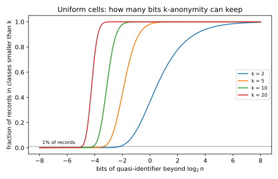

# Syntactic anonymity and how it breaks

## Why this matters

[Linkage and re-identification](07-linkage-reidentification.md) showed that deleting names does not anonymize a table. The columns that remain, such as age, ZIP code and sex, are **quasi-identifiers**: none of them names anyone, but together they single out most people, and anyone who holds a list of names with the same columns (a voter roll, say) can join the two tables and put a name back on most rows. Between 1998 and 2008, data custodians and researchers answered with a family of definitions that constrain the released table itself. **k-anonymity** hides every record in a crowd of at least $k$ that look alike. **l-diversity** asks each crowd to hold several different sensitive values. **t-closeness** asks each crowd to look like the whole table. They are called **syntactic** because each one is a property of the published table that you can check by reading it, with no reference to how the table was produced or to what else the adversary knows.

These definitions are not history. Statistics offices, hospital data-sharing agreements, regulators' guidance and anonymization tools such as ARX still use them. You need to know what they promise and exactly where the promise ends, for two reasons. You will meet them in practice, and their failures are the specification of the definition the next part introduces.

The definitions form a chain, each proposed in answer to an attack on the one before it. Removing names falls to **linkage**, and k-anonymity caps linkage at $1/k$ (@sec-anon-k). But k-anonymity only stops the adversary from picking out the target's record; it does not stop the adversary from learning the target's diagnosis. If every record in the target's crowd has the same diagnosis (**homogeneity**), or if the adversary can rule out the other diagnoses from what it already knows about the target (**background knowledge**), the diagnosis leaks with no record picked out. l-diversity answers these two attacks (@sec-anon-l). A crowd can be diverse and still move the adversary's belief a long way, though: half the crowd may have a disease that is rare in the population (**skewness**), or all its different diagnoses may be diseases of the same organ (**similarity**). t-closeness answers these (@sec-anon-t). Finally, **composition** defeats all three at once: two releases, each satisfying the definition, intersect to reveal what neither reveals alone (@sec-anon-composition).

### The one idea: a syntactic definition fixes the adversary's knowledge

Each definition is a property of one table, and it protects against an adversary whose knowledge is fixed in advance. For k-anonymity the adversary knows the quasi-identifiers and nothing else. For l-diversity it knows the quasi-identifiers plus a few facts about the target. For t-closeness it knows the quasi-identifiers plus the table's overall distribution. Each attack in this chapter gives the adversary one more piece of knowledge that the definition did not anticipate, and the guarantee then says nothing. A second release, the most ordinary auxiliary information there is, breaks all three definitions. A definition that survives has to hold whatever the adversary knows, and has to say what happens when releases are combined.

@tbl-anon-uses lists the results and where each is used.

| Result | Where it is used |
| --- | --- |
| The posterior within a class is the class's frequency | Every attack on the sensitive attribute |
| k-anonymity caps linkage success at $1/k$ | What k-anonymity does guarantee |
| Uniform cells: a fraction $\Pr[\mathrm{Poisson}(n/M) \le k - 2]$ violates k-anonymity | How coarse the quasi-identifiers must be, in bits |
| Recursive $(c, \ell)$-diversity caps the posterior at $c/(1 + c)$ after $\ell - 2$ values are ruled out | What l-diversity guarantees against background knowledge |
| t-closeness in total variation moves every event by at most $t$ | What t-closeness guarantees, and why rare values escape it |
| Probability that two releases pin down a value | The composition attack |

: The results of this chapter and where each is used. {#tbl-anon-uses}

**What this chapter uses from elsewhere.** Every idea below is restated where it is used, and these links are for more detail. The linkage game, @eq-link-success, and the uniform-cells model are in [Linkage and re-identification](07-linkage-reidentification.md). The imputation baseline, the best guess of a sensitive attribute from the population alone, is in [Attribute inference and model inversion](03-attribute-inference.md). Total variation is in [Divergences](../part01-prerequisites/03-divergences.md), the Poisson approximation to the binomial in [Probability distributions](../part01-prerequisites/01-distributions.md), and entropy in [Information theory](../part01-prerequisites/05-information-theory.md).

**Notation.** A table has $n$ records. Each has quasi-identifiers and one **sensitive attribute** $S$, such as a diagnosis, with $m$ possible values. A **generalization** replaces each quasi-identifier by a coarser value: an age by a range, a ZIP code by a prefix. An **equivalence class** $E$ is a set of records with the same generalized quasi-identifiers; $\lvert E\rvert$ is its number of records. Within a class, $n_E(v)$ is the number of records with $S = v$, and $P_E(v) = n_E(v)/\lvert E\rvert$ is the fraction of the class with that value, the class's distribution. $P(v)$ is the same fraction over the whole table. **Suppression** deletes records.

## Toolkit: three facts every derivation uses

### Fact 1 — Within a class, the posterior is the frequency

The adversary's **posterior** is its belief about the target's sensitive value after it has seen the release. Here is the situation. The adversary knows the target's quasi-identifiers and knows the target is in the release, so it can find the target's class $E$. But all records in $E$ show the same generalized quasi-identifiers, so it cannot tell which one is the target's. If it knows nothing else, it has no reason to favour any record, and each of the $\lvert E\rvert$ records is equally likely to be the target's. (This is step 2 of the derivation of @eq-link-success: the target was drawn at random, and the records of a class differ only in the sensitive attribute, which the adversary does not know.) The chance that the target has value $v$ is then the number of records with $v$ divided by the number of records:
$$\Pr[S_{\text{target}} = v \mid \text{release}] = \frac{n_E(v)}{\lvert E\rvert} = P_E(v).$$ {#eq-anon-posterior}
Background knowledge works by elimination. If the adversary also knows that the target's value is not in some set $B$ of values, the records with values in $B$ cannot be the target's. It crosses them out and spreads its belief evenly over the records that are left. The number left is $\lvert E\rvert$ minus the records with values in $B$, so for a value $v$ not in $B$,
$$\Pr[S_{\text{target}} = v \mid \text{release}, S_{\text{target}} \notin B] = \frac{n_E(v)}{\lvert E\rvert - \sum_{u \in B}n_E(u)}.$$

For example, take a class of three records with the diagnoses cancer, cancer, flu. Two of the three records say cancer, so the adversary's posterior is $\frac23$ for cancer and $\frac13$ for flu. If it knows that the target did not have flu, the flu record is crossed out, two records remain and both say cancer, so cancer has posterior $\frac22 = 1$. Every attack on the sensitive attribute in this chapter is this calculation.

### Fact 2 — Total variation bounds every event

To say that a class "looks like the whole table" you need a distance between two distributions $P$ and $Q$ on the same values. The **total variation (TV)** distance is half the total absolute difference between the two probability tables, and it equals the largest difference in probability that any single question about the value can show:
$$\mathrm{TV}(P, Q) = \frac12\sum_v\lvert P(v) - Q(v)\rvert = \max_A\,\lvert P(A) - Q(A)\rvert,$$
where the maximum is over all sets of values $A$, and $P(A)$ is the probability that the value lands in $A$ ([Divergences](../part01-prerequisites/03-divergences.md)).

The equality has a short reason. $P(A) - Q(A) = \sum_{v \in A}(P(v) - Q(v))$, which is largest when $A$ holds exactly the values where $P(v) > Q(v)$, so the maximum is attained by $A = \{v : P(v) > Q(v)\}$ and equals the total excess of $P$ over $Q$. Both distributions sum to 1, so the total excess of $P$ over $Q$ equals the total excess of $Q$ over $P$, and each is half the sum of all absolute differences. (Taking $A$ to be the values where $Q$ is larger gives the same number with the sign flipped, which is why the absolute value does no harm.) This is what t-closeness relies on: a bound on the distance is a bound on every question the adversary can ask.

### Fact 3 — The number of others in your cell is nearly Poisson

Fact 3 is the tool for counting how many people share your quasi-identifiers. Model the generalized quasi-identifiers as $M$ cells, and suppose the $n$ people fall into them independently, each cell equally likely. Fix yourself. Each of the other $n - 1$ people lands in your cell with probability $1/M$, independently, so the number of *other* people in your cell is $\mathrm{Binomial}(n - 1, 1/M)$. When there are many trials, each with a small chance, the binomial is close to the **Poisson** distribution with the same mean, $\Pr[N = j] \approx e^{-\lambda}\lambda^j/j!$ ([Probability distributions](../part01-prerequisites/01-distributions.md)). Here the mean is $\lambda = (n-1)/M \approx n/M$, the average number of people per cell. Your class then has $1 + \mathrm{Poisson}(\lambda)$ members: you plus the others. This is how the chapter counts how many records violate k-anonymity at a given coarseness.

## k-anonymity {#sec-anon-k}

### Context

Sweeney and Samarati proposed the first answer to the linkage attack in 1998: make sure that no combination of quasi-identifiers in the release singles out fewer than $k$ people. A custodian gets there by generalizing (age 37 becomes 35–39, ZIP code 02139 becomes 021\*\*) and by suppressing the few records that still stand out. The question is what this buys, and what it costs.

### Statement

**Definition.** A release is **k-anonymous** if every equivalence class has at least $k$ records.

**What it guarantees.** Recall the linkage game: a target is drawn uniformly from the release, the adversary is given the target's quasi-identifiers, and it wins if it picks out the target's record. @eq-link-success says the best it can do is $J/n$, where $J$ is the number of classes. The reason is that in a class of size $\lvert E\rvert$ the best guess is a random record of the class, right with probability $1/\lvert E\rvert$, and the target lands in that class with probability $\lvert E\rvert/n$, so each class contributes $1/n$ and the $J$ classes contribute $J/n$. When every class has at least $k$ records there cannot be many classes, and
$$\Pr[\text{win}] = \frac{J}{n} \le \frac1k.$$ {#eq-anon-k-link}

**What it costs, for uniform cells.** Coarse quasi-identifiers protect more but say less, so the question is how coarse they must be. Suppose the generalized quasi-identifiers split the population into $M$ equally likely cells. A record violates k-anonymity when its cell holds fewer than $k$ people, and by Fact 3 the expected fraction of such records is
$$\Pr[\mathrm{Poisson}(n/M) \le k - 2].$$ {#eq-anon-k-violate}
Keeping that fraction below a target $\alpha$ needs enough people per cell, $n/M \ge \lambda_k$, where $\lambda_k$ is the mean at which the fraction is exactly $\alpha$: $\Pr[\mathrm{Poisson}(\lambda_k) \le k - 2] = \alpha$. A quasi-identifier with $M$ equally likely values carries $\log_2 M$ bits of information about a person, so in bits the quasi-identifiers may carry at most $b = \log_2 M = \log_2 n - \log_2\lambda_k$.

### Derivation

**The cap on linkage** (@eq-anon-k-link). The idea is that $n$ records cannot fill more than $n/k$ classes of at least $k$ each.

1. **Count records by class.** The $J$ classes split the $n$ records between them, each record in exactly one class, so $n = \sum_j\lvert E_j\rvert$.
2. **Use the definition.** Every class has at least $k$ records, so the sum is at least $Jk$: $n \ge Jk$, that is $J/n \le 1/k$.
3. **Read off the linkage success.** @eq-link-success says the linkage success is $J/n$, so it is at most $1/k$.

**The cost** (@eq-anon-k-violate). The idea is to compute the chance that one person's class is too small, then note that this chance is also the expected fraction of such people.

1. **Size of a person's class.** A person's class is their cell. By Fact 3 it holds the person plus $N$ others, with $N$ approximately $\mathrm{Poisson}(n/M)$.
2. **When it is too small.** The class is smaller than $k$ when $1 + N \le k - 1$, that is $N \le k - 2$, which has probability $\Pr[\mathrm{Poisson}(n/M) \le k - 2]$.
3. **From one person to the fraction.** The expected number of people in small classes is the sum, over people, of each one's chance of being in one (linearity of expectation: the expected count of events is the sum of their probabilities). Every person has the same chance, so the sum is $n$ times it, and the expected fraction is that chance.
4. **Solve for the coarseness.** As $\lambda$ grows, the Poisson count moves up and the chance of a small count, the CDF (cumulative distribution function) at $k - 2$, falls. So "at most $\alpha$" is the same as $\lambda \ge \lambda_k$. Put $M = n/\lambda$ and take $\log_2$: $\log_2 M = \log_2 n - \log_2 \lambda$, largest at $\lambda = \lambda_k$.

### Interpretation

The guarantee is about names only. @eq-anon-k-link bounds the chance of picking out the target's *record*. It says nothing about the sensitive attribute, which is the whole point of the release, and the next two sections attack exactly that gap.

k-anonymity is the mirror image of uniqueness, and the bits make the comparison exact. In the same uniform-cells model, a person is unique when nobody else is in their cell, which by Fact 3 has probability $\Pr[\mathrm{Poisson}(n/M) = 0] = e^{-n/M}$. For 99% of people to be unique you need $e^{-n/M} = 0.99$, so $n/M = \ln(1/0.99) \approx 0.01$ and $M \approx 100n$, which is $\log_2 n + \log_2 100 = \log_2n + 6.64$ bits (@sec-link-unique). At the other end, @tbl-anon-bits shows that 2-anonymity for 99% of records needs the quasi-identifiers to carry at most $\log_2n - 2.20$ bits. The window between "almost everyone is unique" and "almost everyone is hidden" is $6.64 + 2.20 = 8.84$, about 9 bits wide, and every attribute you publish uses some of it.

k costs more than $\log_2 k$ bits. You might expect that hiding everyone in a class of $k$ needs $k$ people per cell, that is $\log_2 k$ bits fewer than $\log_2 n$. But cells vary in size around their mean, and the unlucky small cells are the ones that violate the definition, so you need $\lambda_k$ people per cell *on average*, and $\lambda_k$ is larger than $k$. The margin is largest for small $k$. For $k = 2$ a person violates the definition when $N = 0$, which has probability $e^{-\lambda}$; setting $e^{-\lambda} = 0.01$ gives $\lambda_2 = \ln 100 = 4.61$, more than twice $k$.

Which columns are quasi-identifiers is a judgment, and in sparse data everything is one. @sec-link-sparse showed that a handful of rare movie ratings single out a subscriber. Making a ratings matrix k-anonymous means generalizing thousands of columns until little is left (Aggarwal, 2005).

Finally, the guarantee assumes the adversary knows no more than the quasi-identifiers. A neighbour who knows that the target's record is the only one in the class with a given diagnosis needs no linkage at all.

### Example: a k-anonymous hospital table

@tbl-anon-bits applies @eq-anon-k-violate to a population of $n = 10{,}000$ ($\log_2 n = 13.29$ bits) with $\alpha = 1\%$. For each $k$ it finds $\lambda_k$, then subtracts $\log_2 \lambda_k$ from $\log_2 n$. For $k = 2$, $\lambda_2 = 4.61$ from the calculation above, $\log_2 4.61 = 2.20$, and $13.29 - 2.20 = 11.08$ bits are allowed.

| $k$ | People per cell $\lambda_k$ | Bits allowed | Below $\log_2 n$ by | $\log_2 k$ |
| --- | --- | --- | --- | --- |
| 2 | 4.61 | 11.08 | 2.20 | 1.00 |
| 5 | 10.05 | 9.96 | 3.33 | 2.32 |
| 10 | 17.40 | 9.17 | 4.12 | 3.32 |
| 20 | 30.58 | 8.35 | 4.93 | 4.32 |
| 50 | 66.74 | 7.23 | 6.06 | 5.64 |

: Uniform cells, $n = 10{,}000$: how many bits of quasi-identifier k-anonymity allows if at most 1% of records may fall in classes smaller than $k$. {#tbl-anon-bits}

The last two columns compare the true cost with the naive $\log_2 k$. The gap is about 1.2 bits at $k = 2$ ($2.20 - 1.00$) and shrinks to about 0.4 bits at $k = 50$ ($6.06 - 5.64$), because a Poisson count with a large mean varies little relative to its mean. @fig-anon-bits draws the whole curve for each $k$.

{#fig-anon-bits}

Real tables are not uniform, so real anonymizers search for a generalization that works on the data. The script builds a synthetic hospital table of $n = 10{,}000$ patients with three quasi-identifiers: age in years (0 to 89), a five-digit ZIP code (800 values, a few areas far more common than the rest) and sex. The sensitive attribute is one of eight diagnoses, and it depends on age: asthma peaks in childhood, fractures around 18, depression around 40, diabetes, hypertension and cancer later in life, while flu is equally common at every age and HIV is rare (1.0% of records). With exact quasi-identifiers, the linkage success is 0.933: by @eq-link-success, the 10,000 patients fall into $0.933 \times 10{,}000 = 9{,}330$ distinct combinations of age, ZIP code and sex, so most of them are alone in theirs.

The script anonymizes the table with **Mondrian** (LeFevre, DeWitt & Ramakrishnan, 2006). Start with the whole table as one box. Split a box at the median of the quasi-identifier with the widest range (relative to its full range), as long as both halves still have at least $k$ records. Stop when no split is allowed. Each final box is a class, published as a range per quasi-identifier. Mondrian recodes locally: a busy ZIP area gets narrow age ranges and a quiet one wide ranges. Because it keeps splitting until a split would leave fewer than $k$ on one side, its classes stay close to size $k$, much closer than those of a single global generalization of each column. @tbl-anon-k gives the result.

| $k$ | Classes | Sizes | Mean width | Linkage $J/n$ | Certain disclosure | Guess accuracy |
| --- | --- | --- | --- | --- | --- | --- |
| 2 | 4,091 | 2–5 | 0.005 | 0.4091 | 0.2797 | 0.675 |
| 5 | 1,542 | 5–11 | 0.016 | 0.1542 | 0.0232 | 0.593 |
| 10 | 748 | 10–20 | 0.028 | 0.0748 | 0.0000 | 0.562 |
| 20 | 366 | 20–41 | 0.043 | 0.0366 | 0.0000 | 0.540 |
| 50 | 129 | 50–99 | 0.075 | 0.0129 | 0.0000 | 0.506 |

: Mondrian k-anonymization of a synthetic hospital table of 10,000 patients. Mean width is the average, over records and quasi-identifiers, of the class's range as a fraction of the full range. Certain disclosure is the fraction of records in a class with a single diagnosis. Guess accuracy is the fraction of records whose diagnosis is the most common one in their class. {#tbl-anon-k}

The linkage success sits between $1/(2k)$ and $1/k$ for every $k$ (@fig-anon-tradeoff, left). $J/n$ is one over the average class size. No class is smaller than $k$, so the upper bound $1/k$ is guaranteed. The lower bound is not: Mondrian can leave classes larger than $2k$ (up to 41 records at $k = 20$), but they are rare enough that the average size stays below $2k$ in every row. At $k = 2$, for instance, $0.4091$ lies between $0.25$ and $0.5$. The cost in precision is small. At $k = 5$ the average range covers 1.6% of each quasi-identifier's span.

The last two columns are about the diagnosis, and the next section explains them.

{#fig-anon-tradeoff}

### Check yourself

- A k-anonymous release of 1,000 records has 120 classes. What is the largest $k$ it can satisfy, and what is the linkage success? *(At most $\lfloor 1000/120\rfloor = 8$, since $Jk \le n$. The success is $120/1000 = 0.12$, below $1/8 = 0.125$.)*
- Why does 2-anonymity need about 4.6 people per cell on average, not 2? *(The number of others in your cell is roughly Poisson. With a mean of 1, a fraction $e^{-1} = 0.37$ of people would have nobody else in their cell. To get that down to 1% you need $e^{-\lambda} = 0.01$, that is $\lambda = 4.61$.)*

## Homogeneity, background knowledge and l-diversity {#sec-anon-l}

### Context

Machanavajjhala, Kifer, Gehrke & Venkitasubramaniam (2006) pointed out that k-anonymity hides who a record belongs to but not what it says. @tbl-anon-toy is a 3-anonymous release.

| ZIP code | Age | Diagnosis |
| --- | --- | --- |
| 130\*\* | < 30 | heart disease |
| 130\*\* | < 30 | heart disease |
| 130\*\* | < 30 | heart disease |
| 148\*\* | 4\* | cancer |
| 148\*\* | 4\* | flu |
| 148\*\* | 4\* | heart disease |
| 130\*\* | 3\* | cancer |
| 130\*\* | 3\* | cancer |
| 130\*\* | 3\* | flu |

: A 3-anonymous release with three classes of three records. {#tbl-anon-toy}

Alice is 26 and lives in ZIP code 13053. Her class is the first, and every record in it says heart disease. By Fact 1 her posterior for heart disease is the fraction of her class that has it, $\frac33 = 1$. This is the **homogeneity attack**: no re-identification, full disclosure. Bob is 35, lives in 13068, and is in the third class, where two of three records say cancer, so his posterior for cancer is $\frac23$. His neighbour saw him at work through the whole flu season and rules out flu; crossing out the flu record leaves two cancer records, and cancer then has posterior 1. This is the **background knowledge attack**. The question is what condition on the classes stops both.

### Statement

Both attacks work because one value dominates the class, either from the start or after a few values are ruled out. l-diversity asks for enough different values in each class, and its three versions differ in how they measure "enough". Sort a class's value counts from largest to smallest as $r_1 \ge r_2 \ge \dots \ge r_m$, so $r_1$ is the count of the most common value. A class is

- **distinct $\ell$-diverse** if it holds at least $\ell$ different values;
- **entropy $\ell$-diverse** if the entropy of $P_E$ is at least $\log_2\ell$. The entropy $H(P_E) = -\sum_v P_E(v)\log_2 P_E(v)$ measures in bits how spread out the values are; $\ell$ equally common values have entropy exactly $\log_2 \ell$, so the condition says the class is at least as spread out as $\ell$ equal values;
- **recursive $(c, \ell)$-diverse** if $r_1 < c\,(r_\ell + r_{\ell+1} + \dots + r_m)$: the most common value is less than $c$ times the total of all but the $\ell - 1$ most common. The right-hand side is the "tail" that is left after the $\ell - 1$ biggest values are set aside, and the condition says the top value cannot swamp that tail.

A release is $\ell$-diverse if every class is.

**What recursive diversity guarantees.** The tail is what survives the background knowledge attack. An adversary who rules out $\ell - 2$ values can at worst remove some of the big values, and the remaining ones still include a tail at least as large as the original one. Since the top value is less than $c$ times that tail, it holds less than $c$ parts out of $c + 1$. Precisely: if a class is recursive $(c, \ell)$-diverse, then after the adversary rules out any $\ell - 2$ values that are not the target's, every remaining value $v$ has
$$\Pr[S_{\text{target}} = v \mid \text{release}, \text{background}] < \frac{c}{1 + c}.$$ {#eq-anon-recursive}
For distinct $\ell$-diversity, the corresponding statement is weaker: the adversary needs to rule out $\ell - 1$ values to be certain, but one value can still hold all but $\ell - 1$ of the records.

### Derivation

The plan is to compare the class after elimination with the original class: its top count cannot be larger, and its tail cannot be smaller, so the defining inequality survives.

1. **What is left.** Rule out a set $B$ of $\ell - 2$ values. The remaining $m - \ell + 2$ values keep their original counts. Call the largest of them $r'_1$, and the total of the other $m - \ell + 1$ remaining values $T'$.
2. **The top does not grow.** Ruling out values removes records but never adds any, so $r'_1$ is one of the original counts, and no original count exceeds $r_1$: $r'_1 \le r_1$.
3. **The tail does not shrink below the original tail.** $T'$ is a sum of $m - \ell + 1$ of the original counts. The smallest such sum you could possibly get is that of the $m - \ell + 1$ smallest counts, which is $r_\ell + \dots + r_m$. So $T' \ge r_\ell + \dots + r_m$.
4. **Combine with the definition.** Chain the three inequalities: $r'_1 \le r_1 < c\,(r_\ell + \dots + r_m) \le c\,T'$.
5. **Turn counts into a posterior.** By Fact 1, after elimination the posterior of a remaining value is its count over the total count left, $r'_1 + T'$, so it is at most $r'_1/(r'_1 + T')$. The map $x \mapsto x/(x + T')$ increases in $x$ (a larger share of a pie whose other part is fixed), so with $r'_1 < cT'$ this is below $cT'/(cT' + T') = c/(1 + c)$.

### Interpretation

l-diversity protects against certainty, not against likelihood. The bound $c/(1 + c)$ is $\frac12$ at $c = 1$, $\frac23$ at $c = 2$ and $\frac34$ at $c = 3$, so even recursive diversity lets the adversary be fairly sure. Distinct and entropy $\ell$-diversity do not even give that, because neither limits the share of the top value directly: an entropy 3-diverse class over 8 values can have one value in 73% of its records, since the other 27% spread over seven values add enough entropy ([Exercise 2](../../book-exercises/part02-attacks/08-syntactic-anonymity.md#sec-sol-anon-2)).

The adversary's knowledge is assumed, not bounded. The guarantee covers an adversary who rules out up to $\ell - 2$ values. One who rules out more, or who knows something softer ("probably not flu"), is not covered.

A posterior also has to be read against what the adversary would believe with no release. A posterior of 0.6 for one diagnosis is not a leak if the population already gives 0.6 to people of the target's age. The right comparison is the **imputation baseline** of [Attribute inference and model inversion](03-attribute-inference.md): the most likely value of the sensitive attribute given the target's own quasi-identifiers, under the true population distribution, computed with no release at all. Whatever the release teaches beyond that is about the individual; up to it, it is about the population.

Some tables cannot be made diverse at all. The table's distribution $P$ is the average of its classes' distributions $P_E$, each weighted by the class's share of the records. Entropy is **concave**: mixing distributions can only make the result more spread out, so the entropy of an average is at least the average of the entropies. If every class had entropy at least $\log_2\ell$, the table would too. So a table dominated by one value, with entropy below $\log_2\ell$, has no entropy $\ell$-diverse partition.

### Example: homogeneity in the toy and in the hospital table

In @tbl-anon-toy the three classes hold 1, 3 and 2 different values, so they are distinct 1-, 3- and 2-diverse. Their entropy versions are $\ell = 2^{H(P_E)}$, the number of equally common values with the same entropy. The first class has one value, entropy 0 and $\ell = 1.00$. The second has three equally common values and $\ell = 3.00$. The third, $\frac23$ cancer and $\frac13$ flu, has entropy $\frac23\log_2\frac32 + \frac13\log_2 3 = 0.918$ bits and $\ell = 2^{0.918} = 1.89$: two values, but unevenly spread, so worth fewer than two. The release as a whole is only 1-diverse, because of Alice's class.

In the hospital table, the "certain disclosure" column of @tbl-anon-k counts the patients in homogeneous classes. At $k = 2$ it is 28.0% of all patients. At $k = 5$ it is 2.3%, or 232 patients whose diagnosis the release states outright. The population never gives that certainty: at no age does the population law give any diagnosis more than 0.705.

The guess accuracy column needs the baselines of @fig-anon-tradeoff (right). Guessing the most common diagnosis of the whole table is right for 18.5% of patients. Imputation, which guesses the most likely diagnosis for each patient's exact age under the population law, is right for 53.6%, with no release at all. A 5-anonymous release is right for 59.3%. So most of what the release teaches the adversary is the age–diagnosis pattern, which any useful study of this table would report. The excess over imputation, $0.593 - 0.536 = 0.057$ at $k = 5$, comes from the small classes, and it is down to $0.540 - 0.536 = 0.004$ at $k = 20$.

@tbl-anon-l adds diversity to $k = 5$.

| Criterion | Classes | Sizes | Mean width | Linkage $J/n$ | Certain disclosure | Guess accuracy |
| --- | --- | --- | --- | --- | --- | --- |
| $k = 5$ | 1,542 | 5–11 | 0.016 | 0.1542 | 0.0232 | 0.593 |
| $k = 5$, distinct $\ell = 3$ | 1,132 | 5–33 | 0.022 | 0.1132 | 0.0000 | 0.574 |
| $k = 5$, recursive $(c = 2, \ell = 3)$ | 389 | 5–641 | 0.113 | 0.0389 | 0.0000 | 0.417 |

: Mondrian with l-diversity on the same hospital table: each split is allowed only if both halves satisfy the criterion. {#tbl-anon-l}

Distinct 3-diversity removes the certain disclosures for little cost. Recursive $(2, 3)$-diversity forces some classes to cover hundreds of patients and pushes the guess accuracy below imputation. The reason is that diagnosis depends on age: to keep any diagnosis from dominating a class, Mondrian must mix ages, and that erases the pattern the data were released to show.

### Check yourself

- Is the class {cancer, cancer, cancer, flu, asthma} recursive $(2, 3)$-diverse? *(No. The sorted counts are $r_1 = 3$, $r_2 = 1$, $r_3 = 1$, and the tail beyond the two most common values is $r_3 = 1$, so the condition is $3 < 2 \times 1$, which fails. It is distinct 3-diverse.)*
- Why does the derivation of @eq-anon-recursive allow only $\ell - 2$ ruled-out values, not $\ell - 1$? *(If the class has exactly $\ell$ values, ruling out $\ell - 1$ of them leaves one, with posterior 1, whatever $c$ is. With $\ell - 2$ ruled out, at least two values remain, and step 3 of the derivation still finds the original tail among them.)*

## Skewness, similarity and t-closeness {#sec-anon-t}

### Context

Li, Li & Venkatasubramanian (2007) found two attacks that l-diversity does not see. In the **skewness attack**, 1% of the table has HIV, and a class that is half HIV, half not, is 2-diverse by every definition, yet by Fact 1 it raises the adversary's belief that a member has HIV from 1% to 50%, fifty-fold. In the **similarity attack**, a class holds three different diagnoses, gastric ulcer, gastritis and stomach cancer, so it is 3-diverse, and the adversary still learns that the target has a stomach disease. Both say that diversity is the wrong yardstick: what matters is how far a class's distribution is from what the adversary would believe anyway, which is the distribution of the whole table.

### Statement

**Definition.** A release is **t-close** if every class's distribution is within distance $t$ of the whole table's: $d(P_E, P) \le t$, for a chosen distance $d$ between distributions.

**With total variation as the distance,** the guarantee is that no question about the target's value gets an answer more than $t$ away from the answer the whole table gives. By Fact 2, the total variation is the largest such gap, so for every class and every set of values $A$,
$$\lvert P_E(A) - P(A)\rvert \le t.$$ {#eq-anon-tv}
In particular, guessing the most common value of the target's class is right with probability at most $\max_vP(v) + t$: the best guess from the table alone, plus $t$.

**With the earth mover's distance (EMD),** the choice of Li et al., values that are similar are close, which is what the similarity attack needs. Think of each distribution as piles of sand on the values. The EMD is the least work needed to reshape one set of piles into the other, where moving a unit of sand between two values costs their distance apart. For $m$ ordered values (salary bands, age groups), numbered $1$ to $m$ and placed at ground distance $\lvert i - j\rvert/(m - 1)$ so that the two ends are distance 1 apart, the work comes out as a sum over the gaps between neighbouring values of how much sand must cross each one:
$$\mathrm{EMD}(P_E, P) = \frac{1}{m - 1}\sum_{i=1}^{m-1}\Big\lvert\sum_{j \le i}\big(P_E(j) - P(j)\big)\Big\rvert.$$ {#eq-anon-emd}

### Derivation

**Total variation** (@eq-anon-tv). The idea is that the adversary's belief is the class distribution, so a bound on how far the class is from the table is a bound on how far the adversary's belief moves.

1. **A distance bound is an event bound.** By Fact 2, $\mathrm{TV}(P_E, P) = \max_A\lvert P_E(A) - P(A)\rvert$, so a bound $t$ on the distance is a bound $t$ on every event.
2. **The adversary's belief is the class distribution.** By Fact 1, the adversary's belief about a target in class $E$ is $P_E$. So every question it can ask about the target's value, "is it in $A$?", gets an answer within $t$ of the answer from the table as a whole.
3. **Apply it to the best guess.** Take $A = \{v\}$ for the class's most common value: $P_E(v) \le P(v) + t \le \max_uP(u) + t$.

**Earth mover's distance on ordered values** (@eq-anon-emd). The idea is that on a line, sand can only get from one side of a gap to the other by crossing it, so you can count the work gap by gap.

1. **What EMD is.** EMD is the least total cost of moving the mass of $P_E$ until it becomes $P$, where moving mass $f$ from value $i$ to $j$ costs $f\lvert i - j\rvert/(m - 1)$. A move from $i$ to $j$ crosses each of the $\lvert i - j\rvert$ gaps between them once, so its cost is $1/(m - 1)$ per unit per gap crossed.
2. **How much must cross each gap.** Look at the gap between values $i$ and $i + 1$. The values up to $i$ hold $\sum_{j \le i}P_E(j)$ under the class and must end up holding $\sum_{j \le i}P(j)$. The difference, $\sum_{j \le i}(P_E(j) - P(j))$, is their excess (or shortfall), and that net mass has to cross the gap, rightwards if positive and leftwards if negative. Any plan moves at least this much across the gap.
3. **A plan that does no more.** A plan that only moves mass between neighbours and never in both directions across the same gap moves exactly the net amount across each gap. So the least cost is $1/(m - 1)$ times the sum, over the $m - 1$ gaps, of the absolute net mass crossing it, which is @eq-anon-emd.

### Interpretation

The bound is additive, and rare values need a ratio. @eq-anon-tv lets a 1% value rise to $1\% + t$. At $t = 0.15$ that is 16%, a sixteen-fold increase for the people who most need protection. A difference of 0.15 looks small next to a common value such as 40%, and enormous next to 1%. A guarantee for rare values has to bound the *ratio* of the adversary's beliefs with and without the release, not their difference. That is the shape of the definition in the next part.

t-closeness also fights the purpose of the release. If age predicts diagnosis, a class of similar ages has a different diagnosis distribution from the whole table, so it is not t-close for small $t$. Making every class t-close means mixing ages until the pattern is gone. But the pattern is a fact about the population, the kind of finding any study is published to report, not a secret about any one patient. [Attribute inference and model inversion](03-attribute-inference.md) draws the same line between population inference and individual leakage.

The choice of distance is a choice of what is "similar". EMD with a ground distance from a hierarchy of diagnoses treats gastritis and gastric ulcer as close, so a class full of stomach diseases is far from the table and fails. Total variation treats every pair of values as equally different, so it would not see the similarity attack.

### Example: toy, skew and hospital

In @tbl-anon-toy, the table has four heart disease, three cancer and two flu records, so its distribution is $\frac49$ heart disease, $\frac39$ cancer, $\frac29$ flu. Each class's total variation from it is the total excess of the class over the table (Fact 2). Alice's class is all heart disease, an excess of $1 - \frac49 = \frac59 = 0.556$. The second class is $\frac13 = \frac39$ of each, an excess of $\frac39 - \frac29 = \frac19 = 0.111$ on flu only. Bob's class, $\frac69$ cancer and $\frac39$ flu, has excesses $\frac39$ and $\frac19$, together $\frac49 = 0.444$. So the release is $t$-close only for $t \ge 0.556$.

For the skewness attack (@fig-anon-skew), the class that is 50% HIV is at total variation $0.50 - 0.01 = 0.49$ from a table with 1% HIV (the excess on HIV). A class with 10% HIV is at $0.10 - 0.01 = 0.09$, which passes $t = 0.1$, and still makes HIV ten times as likely for its members.

{#fig-anon-skew}

@tbl-anon-t adds t-closeness in total variation to $k = 5$ on the hospital table.

| Criterion | Classes | Sizes | Mean width | Largest TV | Guess accuracy | Bound $\max_vP(v) + t$ |
| --- | --- | --- | --- | --- | --- | --- |
| $k = 5$ | 1,542 | 5–11 | 0.016 | 0.937 | 0.593 | — |
| $k = 5$, $t = 0.3$ | 495 | 6–60 | 0.291 | 0.300 | 0.275 | 0.485 |
| $k = 5$, $t = 0.15$ | 136 | 14–304 | 0.324 | 0.149 | 0.222 | 0.335 |

: Mondrian with t-closeness (total variation) on the hospital table. The table's most common diagnosis has frequency 0.185. {#tbl-anon-t}

The bound column is $0.185 + t$: $0.185 + 0.3 = 0.485$ and $0.185 + 0.15 = 0.335$. The guess accuracy respects this bound of @eq-anon-tv. But the classes now span about 30% of each quasi-identifier's range, and the release is worse than no release for learning about the population: its guess accuracy of 0.222 to 0.275 is far below the 0.536 that imputation from age achieves.

### Check yourself

- A table has 2% cancer. A release is $0.05$-close in total variation. What is the largest possible frequency of cancer in a class? *(0.07, from $0.02 + 0.05$ by @eq-anon-tv: 3.5 times the base rate, within the definition.)*
- Salaries take the 9 ordered values 3k to 11k, uniformly in the table. A class holds {3k, 4k, 5k}. Is the EMD to the table larger or smaller than for a class {6k, 8k, 11k}? *(Larger: 0.375 against 0.167. The first class is bunched at the low end, so mass has to travel far to spread out; the second is already spread out; [Exercise 3](../../book-exercises/part02-attacks/08-syntactic-anonymity.md#sec-sol-anon-3) computes both.)*

## The composition attack {#sec-anon-composition}

### Context

Every definition so far is about one release. Ganta, Kasiviswanathan & Smith (2008) asked what happens when there are two. Two hospitals in the same city publish their patient tables, each one properly k-anonymous, or $\ell$-diverse, with no coordination. A patient treated at both appears in a class of each. The adversary takes the diagnoses of the target's class in one release, those of the class in the other, and intersects: the true diagnosis is in both. Neither hospital did anything wrong, and each release satisfies its definition, yet the combination can reveal the diagnosis outright.

### Statement

**The attack.** For a target in both releases, with class $E_A$ in release A and $E_B$ in release B, the candidate values are those that appear in both classes,
$$\{v : n_{E_A}(v) > 0\} \cap \{v : n_{E_B}(v) > 0\},$$
and the true value is always among them, because the target's own record carries it in each class. The diagnosis is **pinned down** when one candidate is left.

**How often, in a model.** To see how often this happens, model the classes as random. Suppose the target's class has $k_A$ records in one release and $k_B$ in the other, and the other members' values are independent draws from the population distribution $p$, with $p_v$ the probability of value $v$. Given that the target's true value is $v$, let $A_v$ be the set of values other than $v$ that appear among the $k_A - 1$ other members of the class in release A, and $B_v$ the same for the $k_B - 1$ others in release B. These are the wrong values each release leaves open. The target is pinned exactly when no wrong value is left open by both, that is when $A_v$ and $B_v$ share nothing. So the probability is an average, over the true value $v$ and over what release A leaves open, of the chance that every other member of the second class avoids those values. Writing $p(S) = \sum_{u \in S}p_u$ for the probability of a set of values,
$$\Pr[\text{pinned}] = \sum_vp_v\,\mathbb E\big[(1 - p(A_v))^{k_B - 1}\big],\qquad \Pr[A_v = S] = \sum_{T \subseteq S}(-1)^{\lvert S\rvert - \lvert T\rvert}\big(p_v + p(T)\big)^{k_A - 1},$$ {#eq-anon-pinned}
where the expectation is over the random set $A_v$, whose distribution is the second formula. A simpler lower bound counts, for each wrong value, the chance that both classes contain it, and subtracts the total from 1:
$$\Pr[\text{pinned}] \ge 1 - \sum_vp_v\sum_{u \ne v}\big(1 - (1 - p_u)^{k_A - 1}\big)\big(1 - (1 - p_u)^{k_B - 1}\big).$$ {#eq-anon-union}

### Derivation

**The exact probability** (@eq-anon-pinned). The idea is to fix the true value and what the first class contains, compute the chance that the second class avoids it, and then average.

1. **Condition on the true value.** The target's true value is $v$ with probability $p_v$. Everything below is for a fixed $v$, and the outer sum $\sum_v p_v(\cdot)$ averages over it.
2. **When the value is pinned.** The candidates are $v$ itself together with the wrong values that appear in both classes, $\{v\} \cup (A_v \cap B_v)$. So the value is pinned exactly when $A_v$ and $B_v$ are disjoint.
3. **Fix what the first class leaves open.** Condition on $A_v = S$ for a particular set $S$. The $k_B - 1$ others in the second class are independent draws, and each avoids $S$ with probability $1 - p(S)$. So $\Pr[B_v \cap S = \emptyset] = (1 - p(S))^{k_B - 1}$. Averaging over the possible sets $S$, weighted by $\Pr[A_v = S]$, gives the expectation in @eq-anon-pinned.
4. **The distribution of the first class's set.** $A_v = S$ means two things: every one of the $k_A - 1$ draws lands in $S \cup \{v\}$, and each value of $S$ is hit at least once. The first part is easy: "all draws land in $T \cup \{v\}$" has probability $(p_v + p(T))^{k_A - 1}$ for any set $T$. The second part is handled by **inclusion–exclusion**: start from "all draws land in $S \cup \{v\}$", subtract the cases where some value of $S$ is missed (all draws land in a smaller set), add back the cases subtracted twice, and so on. The sets $T \subseteq S$ are the values not missed, and the sign $(-1)^{\lvert S\rvert - \lvert T\rvert}$ alternates with the number missed, which gives the alternating sum.

For a single wrong value, $S = \{u\}$, the sum has two terms: $\Pr[A_v = \{u\}] = (p_v + p_u)^{k_A - 1} - p_v^{k_A - 1}$, the probability that every draw is $v$ or $u$, minus the probability that every draw is $v$ (in which case $u$ was never hit).

**The lower bound** (@eq-anon-union). The idea is that the target fails to be pinned only if some wrong value turns up in both classes, and the chance of "some" is at most the sum of the chances of each.

1. **When it fails.** Given $v$, the value is not pinned when some $u \ne v$ is in both $A_v$ and $B_v$.
2. **The chance for one wrong value.** $u$ is missing from the first class when all $k_A - 1$ others avoid it, which has probability $(1 - p_u)^{k_A - 1}$, so $\Pr[u \in A_v] = 1 - (1 - p_u)^{k_A - 1}$, and likewise for $B_v$. The two classes are drawn independently, so the probability that $u$ is in both is the product.
3. **Add over wrong values.** The expected number of wrong values in both sets is the sum of these products, by linearity of expectation (the expected count of events is the sum of their probabilities; Fact 1 of [Linkage and re-identification](07-linkage-reidentification.md)). The chance that there is at least one is at most this expected number, because a count that is at least 1 whenever the event happens has expectation at least the event's probability (the union bound). Subtract from 1 and average over $v$.

### Interpretation

None of the three definitions composes. Each is a condition on one table, and the intersection of two tables is not a table that either custodian checked. Ganta et al. showed the attack on k-anonymous and on $\ell$-diverse releases. A custodian who checks only its own table cannot account for releases it does not know about.

That points to what is wanted instead. A definition that composes says: if release A leaks at most this much and release B at most that much, together they leak at most a known function of the two. It must also hold whatever the adversary knows, since another release is just auxiliary information. The next part starts from these two requirements.

The model understates the risk. It draws the other members of a class from the whole population. In real releases a class collects similar people (similar ages, here) who are more likely to share a diagnosis, so each class contains fewer distinct wrong values and the intersection is smaller than the model predicts.

The union bound is useful only for small classes. It charges every wrong value separately, so it is accurate when two wrong values rarely turn up in both classes at once. At $k = 2$ each class has a single other member, so it holds at most one wrong value, two wrong values can never turn up together, and the bound is exact. At $k = 5$ the expected number of shared wrong values exceeds 1, the bound is negative, and @eq-anon-pinned is needed.

### Example: two hospitals

In the model, with $p$ the population's diagnosis distribution, from which the hospital table is drawn, the probability that two releases pin down the diagnosis is 0.8734 for classes of 2, 0.1615 for classes of 5, 0.0288 for classes of 7 and 0.0015 for classes of 10. It falls fast because a larger class contains more wrong values, and each one is another chance for the two classes to share one. Simulation agrees to within 0.001 (@fig-anon-composition, left). The union bound gives 0.8734 at $k = 2$ and is negative from $k = 5$ on.

The script then runs the attack. A city has 15,000 people drawn from the model of the hospital table. Two hospitals each treat a random 10,000 of them, so 6,649 people are treated at both. Each hospital publishes a 5-anonymous Mondrian release of its own patients. @tbl-anon-composition gives what the adversary learns about the 6,649.

| Releases | Pinned by A alone | Pinned by B alone | Pinned by A and B | Mean candidates, A alone | Mean candidates, A and B |
| --- | --- | --- | --- | --- | --- |
| $k = 5$ | 0.0289 | 0.0262 | 0.0985 | 2.79 | 2.38 |
| $k = 5$, distinct $\ell = 3$ | 0.0000 | 0.0000 | 0.0027 | 3.22 | 2.92 |

: The composition attack on two independent hospital releases, for the 6,649 people treated at both. "Pinned" is the fraction left with a single possible diagnosis. {#tbl-anon-composition}

Two 5-anonymous releases pin down the diagnosis of 9.9% of the shared patients, more than three times either release alone (0.0985 against 0.0289 and 0.0262). For comparison, in the single-table release of @tbl-anon-k at $k = 5$ a patient's class has 6.8 records on average over patients, and the model at $k = 7$ predicts only 2.9%: real classes, which group patients of similar age, are more alike than random draws, as the interpretation above said. With distinct 3-diversity, no single release pins anyone down, and the two together pin down 18 patients (0.27% of 6,649).

{#fig-anon-composition}

### Check yourself

- Two releases are each 3-diverse in the distinct sense, over 8 possible values. If each class's two other values were chosen uniformly at random from the 7 wrong ones, how likely is the intersection to pin down the truth? *($\binom52/\binom72 = 10/21 = 0.476$: the second class must avoid both of the first class's wrong values, so its two wrong values must come from the other 5. [Exercise 4](../../book-exercises/part02-attacks/08-syntactic-anonymity.md#sec-sol-anon-4) derives it.)*
- Why can't the second hospital prevent the attack by checking its own release more carefully? *(The attack needs only that the two classes share no wrong value. The second hospital would need to know the first hospital's classes, and every other release the patient appears in.)*

## Code: anonymize, then attack

The script [code/syntactic_anonymity.py](../../code/part02-attacks/syntactic_anonymity.py) computes every number in this chapter and draws every figure. It implements Mondrian with any criterion on a class (k-anonymity, distinct and recursive l-diversity, t-closeness in total variation), the uniform-cells calculation, the attacks on the sensitive attribute, and the composition attack, exactly by inclusion–exclusion, by simulation and on two synthetic hospital releases. From the repository root:

```bash
uv run python code/part02-attacks/syntactic_anonymity.py
```

**Output** (seed 0), summarized in @tbl-anon-code:

| Experiment | Result |
| --- | --- |
| Toy release | Posteriors 1 (homogeneous class), $\frac23$ cancer (Bob), 1 after ruling out flu; entropy $\ell$ = 1.00, 3.00, 1.89; TV to the table 0.556, 0.111, 0.444 |
| Recursive $(c, \ell)$ bound | $c/(1 + c)$ = 0.500, 0.667, 0.750 for $c$ = 1, 2, 3 |
| Skewness | 50% HIV against 1%: TV 0.49, ratio 50. 10% HIV: TV 0.09, ratio 10 |
| Uniform cells, $n = 10^4$ | @tbl-anon-bits |
| Hospital table, $n = 10^4$ | Exact quasi-identifiers: linkage 0.933. Baselines: most common diagnosis 0.185, imputation from age 0.536, largest population posterior 0.705 |
| Mondrian | @tbl-anon-k, @tbl-anon-l, @tbl-anon-t |
| Two hospitals | @tbl-anon-composition |
| Composition model | Pinned: 0.8734 ($k = 2$), 0.1615 ($k = 5$), 0.0288 ($k = 7$), 0.0015 ($k = 10$); simulation within 0.001 |

: The script's output with the default seed. {#tbl-anon-code}

[tests/test_syntactic_anonymity.py](../../tests/test_syntactic_anonymity.py) checks that the output still matches.

The study plan's exercise is to k-anonymize a census extract with ARX, a free anonymization tool that implements these criteria, and link it back to a public table. The script's Mondrian release plays the part of ARX, and its linkage column is that measurement: the re-identification rate against an adversary holding everyone's quasi-identifiers, the strongest auxiliary table there can be.

**What to take from it.** k-anonymity does what it says: linkage success stays below $1/k$, and Mondrian keeps it above $1/(2k)$ at little cost in precision. But what it says is not enough, because small classes state diagnoses outright, for 2.3% of patients at $k = 5$. Even where nothing is stated outright, most of what an anonymized table teaches is about the population, so measure attribute disclosure against imputation, not against guessing the most common value. Each fix costs utility: recursive diversity and t-closeness remove the certain disclosures by erasing the age–diagnosis pattern the data exist to show. And two releases are worse than one, under every definition here. The composition attack more than triples the pinned diagnoses, and it is the attack that a better definition has to survive.

## References

- Samarati & Sweeney, "Protecting Privacy when Disclosing Information: k-Anonymity and Its Enforcement through Generalization and Suppression" (SRI technical report, 1998), and Sweeney, "k-Anonymity: A Model for Protecting Privacy" (International Journal of Uncertainty, Fuzziness and Knowledge-Based Systems, 2002): the definition, generalization and suppression, and the linkage attack it answers.
- LeFevre, DeWitt & Ramakrishnan, "Mondrian Multidimensional k-Anonymity" (ICDE, 2006): the median-split algorithm the script uses, and why multidimensional recoding loses less than one generalization per column.
- Machanavajjhala, Kifer, Gehrke & Venkitasubramaniam, "l-Diversity: Privacy Beyond k-Anonymity" (ACM Transactions on Knowledge Discovery from Data, 2007; ICDE 2006): the homogeneity and background knowledge attacks, and the three versions of l-diversity with their Bayesian justification.
- Li, Li & Venkatasubramanian, "t-Closeness: Privacy Beyond k-Anonymity and l-Diversity" (ICDE, 2007): the skewness and similarity attacks, and the earth mover's distance with ordered and hierarchical ground distances.
- Ganta, Kasiviswanathan & Smith, "Composition Attacks and Auxiliary Information in Data Privacy" (KDD, 2008): the intersection attack on independent releases, experiments on public census data, and the argument that a definition must hold up against auxiliary information such as other releases.
- Aggarwal, "On k-Anonymity and the Curse of Dimensionality" (VLDB, 2005): why high-dimensional data cannot be k-anonymized without destroying it.
- Prasser, Kohlmayer and colleagues, the ARX data anonymization tool (arx.deidentifier.org): an open implementation of these criteria and many more, with risk models and utility measures.
- Article 29 Working Party, "Opinion 05/2014 on Anonymisation Techniques": how European regulators judge these techniques against singling out, linkability and inference, the three attacks of this chapter.

## Cheat sheet

$n$ records, classes $E$ of size $\lvert E\rvert$, $J$ classes, $P_E$ the class's distribution of the sensitive attribute and $P$ the table's, $r_1 \ge r_2 \ge \dots$ a class's sorted counts. @tbl-anon-cheat collects the results.

| Result | Formula | Note |
| --- | --- | --- |
| Posterior in a class | $P_E(v) = n_E(v)/\lvert E\rvert$ | Ruling out values renormalizes over the rest |
| k-anonymity | Every $\lvert E\rvert \ge k$; linkage $J/n \le 1/k$ | Says nothing about the sensitive attribute |
| Uniform cells | Fraction in classes $< k$: $\Pr[\mathrm{Poisson}(n/M) \le k - 2]$ | 99% 2-anonymous at $\log_2n - 2.20$ bits |
| Distinct, entropy l-diversity | $\ge \ell$ values; $H(P_E) \ge \log_2\ell$ | Neither caps the top value's share near $1/\ell$ |
| Recursive $(c, \ell)$-diversity | $r_1 < c(r_\ell + \dots + r_m)$ | Posterior $< c/(1 + c)$ after ruling out $\ell - 2$ values |
| t-closeness (TV) | $\lvert P_E(A) - P(A)\rvert \le t$ for every $A$ | Additive: a 1% value may rise to $1\% + t$ |
| EMD, ordered values | $\frac{1}{m-1}\sum_i\lvert\sum_{j \le i}(P_E(j) - P(j))\rvert$ | Similar values are close |
| Composition | Candidates $= $ values of $E_A$ $\cap$ values of $E_B$ | Pinned: @eq-anon-pinned; no syntactic definition prevents it |

: Every result in this chapter. {#tbl-anon-cheat}

**Rules of thumb**

- k-anonymity protects names, not attributes. Ask what a class's sensitive values reveal, not just how big it is.
- Measure attribute disclosure against imputation from the population, or you will count the study's findings as leaks.
- A rare sensitive value needs a bound on the ratio of beliefs, not on their difference.
- Assume another release exists. A guarantee that is only about one table is not a guarantee about a person.

**Practice.** Exercises for this chapter, each with a worked solution, are in [the exercise book](../../book-exercises/part02-attacks/08-syntactic-anonymity.md).
