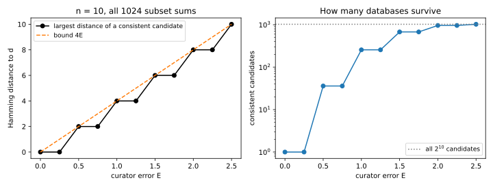
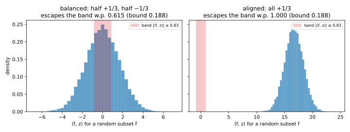
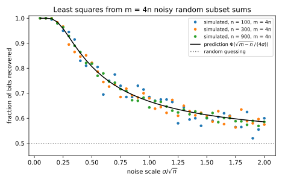
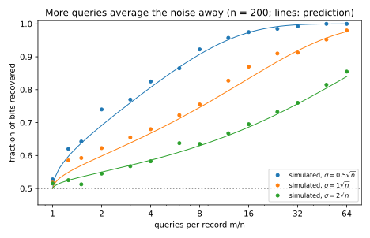
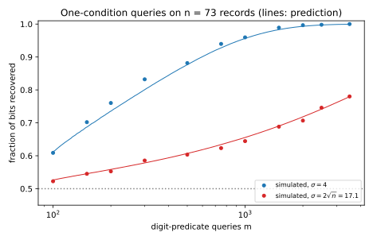
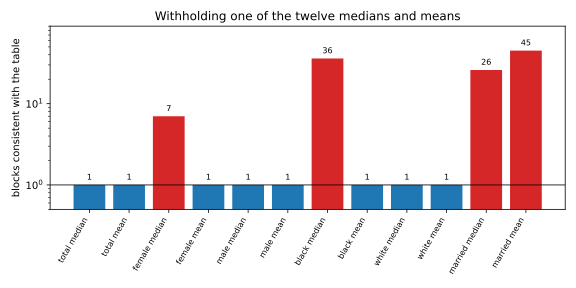

# Reconstruction attacks

A hospital keeps one sensitive bit per patient, whether they tested positive, and never releases the bits. It only answers counting questions, such as "how many of patients 3, 17 and 42 tested positive?", and it adds a little noise to every answer. Is that enough? This is the **reconstruction game** of [Threat models and privacy games](01-threat-models.md), where the adversary is scored by the fraction of the secret bits it recovers. One exact count of all $n$ bits tells the attacker only which value is in the majority, and guessing that value for everyone lifts the score from $\frac12$ to about $\frac12 + 1/\sqrt{2\pi n}$. This chapter asks what many counts do.

The one idea is that every answer is a linear equation in the secret bits, so only the error of the answers stands between the attacker and the solution. A wrong guess survives only if the error is as large as the amount by which the guess changes some answer. For a guess with a constant fraction of its bits wrong, that amount is about $\sqrt n$ for a random question and about $n$ for the question that names exactly the wrong bits. Errors well below these scales reveal the bits (Dinur and Nissim 2003). Errors that are independent from answer to answer fail too, because averaging many answers cancels them. Dwork and Roth call this the **Fundamental Law of Information Recovery**: overly accurate answers to too many questions destroy privacy.

The running example is the hospital with $n = 500$ patients and an attacker who asks $m = 2000$ random counting questions. With independent normal noise of standard deviation $0.25\sqrt n = 5.59$ on each answer, a quarter of the $\sqrt n$ scale, a least-squares fit recovers 0.9655 of the bits, where guessing recovers $\frac12$.

## Subset sums and the exponential attack {#sec-recon-exponential}

Consider first the strongest attacker, who may ask every possible counting question. How large must the error be before even this attacker cannot pin the bits down?

::: {#def-recon-subset-sum name="Subset-sum queries and the curator"}
The secret database is a bit vector $d = (d_1, \dots, d_n) \in \{0, 1\}^n$, one bit per person. A **subset-sum query** is a set $S \subseteq \{1, \dots, n\}$ of people, written as its indicator vector $f$, with $f_i = 1$ when person $i$ is in $S$. Its true answer is
$$\sum_{i \in S}d_i = \langle f, d\rangle.$$
The attacker asks $m$ queries $f_1, \dots, f_m$, the rows of an $m \times n$ matrix $A$. The **curator**, the party that holds $d$, returns $a = Ad + e$, where the error vector $e$ has one entry per query. The error is at most $E$ when $|e_j| \le E$ for every query $j$. Throughout, the subscript $j$ numbers queries and $i$ numbers people.
:::

Take a wrong guess, a bit vector $c$. The published answer to a query $f$ is within $E$ of $\langle f, d\rangle$, and would also have to be within $E$ of $\langle f, c\rangle$ if $c$ were the database. So if these differ by more than $2E$, $c$ is ruled out.

::: {#def-recon-consistent name="Consistent candidates and blatant non-privacy"}
A candidate $c \in \{0, 1\}^n$ is **consistent** with the answers if $|a_j - \langle f_j, c\rangle| \le E$ for every query $j$. Its number of wrong bits is the **Hamming distance** $\mathrm{dist}(c, d)$, the number of people with $c_i \ne d_i$. A curator is **blatantly non-private** if some attacker, even one that runs in exponential time, recovers all but $o(n)$ of the bits.
:::

The true $d$ is always consistent, so an attacker who asks all $2^n$ queries can check every candidate against every answer and output any consistent one. The candidate's wrong bits form two subsets, the ones it missed (true ones set to 0) and the ones it invented (zeros set to 1), and each subset is itself a query the attacker has asked.

::: {#thm-recon-exponential name="The exponential attack"}
Suppose the curator answers all $2^n$ subset-sum queries with error at most $E$. Then every consistent candidate $c$ satisfies
$$\mathrm{dist}(c, d) \le 4E.$$ {#eq-recon-exp}
:::

::: {.proof}
1. *Count the ones that the candidate missed.* Let $S_0$ be the set of people with $d_i = 1$ and $c_i = 0$. On $S_0$, $d$ sums to $|S_0|$ and $c$ sums to 0. Both sums are within $E$ of the one answer to $S_0$, so by the triangle inequality they are within $2E$ of each other, and $|S_0| \le 2E$.
2. *Count the ones that the candidate invented.* On the set $S_1$ of people with $d_i = 0$ and $c_i = 1$, the candidate sums to $|S_1|$ and $d$ sums to 0, and the same argument gives $|S_1| \le 2E$.
3. *Add.* Every disagreement lies in $S_0$ or in $S_1$, so $\mathrm{dist}(c, d) = |S_0| + |S_1| \le 4E$.
:::

The proof never uses that the errors are random, so it holds even against a curator that picks them to make a chosen wrong candidate look consistent, and such a curator attains the bound when $2E$ is a whole number.

::: {#prp-recon-exp-tight name="The bound is attained"}
Let $k = \lfloor 2E\rfloor$, and suppose $d$ has at least $k$ ones and at least $k$ zeros. Then some curator with error at most $E$ on all $2^n$ queries makes a candidate at distance $2k$ from $d$ consistent.
:::

::: {.proof}
1. *Build the decoy.* Let $c$ flip $k$ of the ones of $d$ to 0 and $k$ of the zeros to 1.
2. *Its sums stay close to the true ones.* For any $S$, the sum of $c_i - d_i$ over $S$ is the number of flipped zeros in $S$ minus the number of flipped ones in $S$, so it lies between $-k$ and $k$.
3. *Answer the midpoint.* A curator that answers each query with the midpoint of the two databases' sums is within $k/2 \le E$ of both, so $c$ is consistent.
:::

So a curator whose error on all $2^n$ queries is $o(n)$ is blatantly non-private, because $4E$ is then $o(n)$. A curator can also be weaker than the bound suggests. One that rounds every answer to a multiple of 4 has error at most 2, yet rounding each candidate's answers the same way and keeping exact matches recovers $d$.

::: {#exm-recon-exponential}
For a hospital of ten patients, $d = (1, 1, 1, 0, 0, 0, 0, 0, 0, 1)$, the script (@sec-recon-code) checks all 1024 candidates against all 1024 subsets. Some curator with error at most $E$ makes $c$ consistent exactly when every subset sum of $c - d$ is at most $2E$ in absolute value, by the midpoint construction in one direction and the triangle inequality in the other (@tbl-recon-exp).

| Error $E$ | 0 | 0.5 | 1 | 1.5 | 2 |
| --- | --- | --- | --- | --- | --- |
| Candidates that survive | 1 | 35 | 242 | 630 | 912 |
| Largest distance to $d$ | 0 | 2 | 4 | 6 | 8 |
| Bound $4E$ | 0 | 2 | 4 | 6 | 8 |

: The exponential attack on $n = 10$ bits. Every surviving candidate is within $4E$ of $d$, and the bound is attained. {#tbl-recon-exp}

The bound is attained at every $E$, as @prp-recon-exp-tight predicts. At $E = 2$, 912 candidates survive, which says almost nothing. @fig-recon-exponential draws both rows over a finer grid of $E$, for a random database of ten bits.
:::

{#fig-recon-exponential}

## The linear-programming decoder {#sec-recon-lp}

Asking $2^n$ questions is not realistic, but Dinur and Nissim showed that about $n\ln n$ random subsets suffice, with an efficient decoder, as long as the error is $o(\sqrt n)$. The threshold drops because a random subset cannot aim at the wrong bits. If a candidate differs from $d$ in $k$ places, a random subset picks up each with probability $\frac12$, so the change in its answer is a sum of about $k$ random terms, which fluctuates by about $\sqrt k$, not $k$. A candidate with a constant fraction of wrong bits has $k$ of order $n$, hence the scale $\sqrt n$.

Searching all $2^n$ candidates is too slow, so the decoder relaxes each bit to the interval $[0, 1]$. That turns the search for a consistent candidate into a **linear program**, a search for a point that satisfies a list of linear inequalities, which linear programming (LP) solves in polynomial time.

::: {#def-recon-lp name="Linear-programming decoder"}
Given the answers $a$ to $m$ queries $f_1, \dots, f_m$ and the error bound $E$, the **linear-programming decoder** finds some $c$ with
$$c \in [0, 1]^n \quad\text{and}\quad \big|\langle f_j, c\rangle - a_j\big| \le E \text{ for } j = 1, \dots, m,$$
and rounds each $c_i$ to the nearest bit.
:::

The true $d$ is a solution, and @thm-recon-lp, after two lemmas, shows that no solution has many wrong bits. Its key step needs one random query to catch any difference vector with many coordinates of size at least $\frac13$, by moving its answer far from 0 with constant probability. That is an **anti-concentration** statement, a lower bound on how often a variable is not close to zero. The tool is the Paley–Zygmund inequality, @lem-recon-pz below, applied to the squared answer. It needs the answer's fourth moment to be at most a constant times its squared second moment.

A random subset is a constant plus half a sum of random signs (proof of @lem-recon-anti), so the fourth moment comes from one fact about such sums. Take independent fair signs $s_i$, each $+1$ or $-1$ with probability $\frac12$, and fixed weights $w_i$. The sum $X = \sum_is_iw_i$ has odd moments 0, because flipping every sign leaves its distribution unchanged. Its fourth moment is at most 3 times its squared second moment, as for a normal variable:
$$\mathbb E[X^2] = \sum_iw_i^2, \qquad \mathbb E[X^4] \le 3\,\mathbb E[X^2]^2.$$ {#eq-recon-fourth}
Expanding $X^4$, a product of four signs has mean 1 when its indices pair up and 0 otherwise, which gives exactly $3(\sum_iw_i^2)^2 - 2\sum_iw_i^4$, so dropping the negative term gives the inequality.

Markov's inequality (@thm-conc-markov) says that a variable that cannot be negative is rarely far *above* its mean, while the attack needs it to be rarely far *below*. The next lemma gives that whenever the second moment is not much larger than the squared mean.

::: {#lem-recon-pz name="Paley–Zygmund inequality"}
Let $W \ge 0$ be a random variable with finite second moment, and let $0 \le \lambda < 1$. Then
$$\Pr\big[W > \lambda\,\mathbb E[W]\big] \ge (1 - \lambda)^2\frac{\mathbb E[W]^2}{\mathbb E[W^2]}.$$ {#eq-recon-pz}
:::

::: {.proof}
The plan is to split the mean of $W$ between the event and its complement, and to bound the part on the event with Cauchy–Schwarz.

1. *Split the mean.* Write $B$ for the event $W > \lambda\,\mathbb E[W]$. Then $\mathbb E[W]$ is the sum of $\mathbb E\big[W\mathbf 1[B^c]\big]$ and $\mathbb E\big[W\mathbf 1[B]\big]$.
2. *Bound the complement.* On the complement $W \le \lambda\,\mathbb E[W]$, so the first part is at most $\lambda\,\mathbb E[W]$.
3. *Bound the event.* The Cauchy–Schwarz inequality $\mathbb E[UV] \le \sqrt{\mathbb E[U^2]\,\mathbb E[V^2]}$, with $U = W$ and $V = \mathbf 1[B]$, for which $\mathbb E[V^2] = \Pr[B]$, gives
$$\mathbb E\big[W\mathbf 1[B]\big] \le \sqrt{\mathbb E[W^2]\Pr[B]}.$$
4. *Solve for the probability.* Steps 1 to 3 give $(1 - \lambda)\mathbb E[W] \le \sqrt{\mathbb E[W^2]\Pr[B]}$. Squaring and dividing by $\mathbb E[W^2]$, which is positive unless $W$ is always 0, gives @eq-recon-pz.
:::

Think of $z$ as the difference between $d$ and a candidate with many wrong bits. A wrong bit makes a coordinate of size at least $\frac12$, and the theorem's proof snaps candidates to a grid, which can shrink that size to $\frac13$.

::: {#lem-recon-anti name="One random query catches a bad difference"}
Let $z \in \mathbb R^n$ have at least $\gamma n$ coordinates with $|z_i| \ge \frac13$, for a fraction $\gamma$, and let $f$ be a uniformly random subset, which includes each person independently with probability $\frac12$. Then
$$\Pr\left[|\langle f, z\rangle| > \frac{\sqrt{\gamma n}}{12}\right] \ge \frac{3}{16}.$$ {#eq-recon-anti}
:::

::: {.proof}
The plan is to apply @lem-recon-pz to the squared answer, with @eq-recon-fourth supplying its moments, and then to let the large coordinates set the scale. Write $Y = \langle f, z\rangle$ for the answer, and write the random subset as $f_i = (1 + s_i)/2$ with independent fair signs $s_i$.

1. *Split the sum into a constant and a random-sign part.* $Y = \mu + X$, with the constant $\mu = \frac12\sum_iz_i$ and the random-sign sum $X = \sum_is_iz_i/2$, whose weights are $w_i = z_i/2$.
2. *Compute the second moment.* $X$ has mean 0, and by @eq-recon-fourth its variance, written $\tau^2$, is $\frac14\sum_iz_i^2$. The cross term $2\mu X$ has mean 0, so $\mathbb E[Y^2] = \mu^2 + \tau^2$.
3. *Bound the fourth moment.* Expanding $(\mu + X)^4$, the terms with the odd moments of $X$ vanish, the cross term has mean $6\mu^2\tau^2$, and @eq-recon-fourth gives $\mathbb E[X^4] \le 3\tau^4$. Raising $\mu^4$ to $3\mu^4$ only increases the total and completes the square, so
$$\mathbb E[Y^4] \le 3(\mu^2 + \tau^2)^2.$$
4. *Apply Paley–Zygmund.* Step 3 makes the ratio $\mathbb E[Y^2]^2/\mathbb E[Y^4]$ at least $\frac13$, so @eq-recon-pz with $W = Y^2$ gives
$$\Pr\big[Y^2 > \lambda(\mu^2 + \tau^2)\big] \ge \frac{(1 - \lambda)^2}{3}.$$
5. *Drop the mean.* Since $\mu^2 + \tau^2 \ge \tau^2$, the event of step 4 implies $|Y| > \sqrt\lambda\,\tau$, which therefore has the same lower bound. A non-zero mean only helps, because it pushes $Y$ away from 0.
6. *Use the large coordinates.* At least $\gamma n$ coordinates have $z_i^2 \ge \frac19$, so $\tau^2 \ge \gamma n/36$ and $\tau \ge \sqrt{\gamma n}/6$.
7. *Choose $\lambda = \frac14$.* Then $\sqrt\lambda\,\tau \ge \sqrt{\gamma n}/12$, and the probability is at least $(3/4)^2/3 = 3/16$, which is @eq-recon-anti.
:::

A candidate with more than $\gamma n$ wrong bits solves the linear program only if no query moves its answer past $\sqrt{\gamma n}/12$, which has probability at most $(13/16)^m$. Candidates are infinitely many, so the proof snaps them to a finite grid, which costs the $\frac12$ and the $n\ln(n + 1)$ in the theorem.

::: {#thm-recon-lp name="Dinur–Nissim, in the form proved here"}
Fix $d$, a fraction $\gamma$ and a failure probability $\beta$, let $n \ge 3$, and let the $m$ queries be independent uniformly random subsets. Suppose the curator's error is at most $E$, with $2E + \frac12 \le \sqrt{\gamma n}/12$, and
$$m \ge \frac{n\ln(n + 1) + \ln(1/\beta)}{\ln(16/13)}.$$ {#eq-recon-lp}
Then with probability at least $1 - \beta$ over the queries, every solution of the linear program rounds to a vector with at most $\gamma n$ wrong bits, whatever errors the curator chose, even after seeing the queries.
:::

::: {.proof}
The plan is the one just sketched: snap to a grid, catch each bad grid point, then take a union bound.

1. *Consistent candidates differ from $d$ by little on every query.* Both $c$ and $d$ are within $E$ of every answer, so by the triangle inequality $|\langle f_j, c - d\rangle| \le 2E$ for every query $j$.
2. *A wrong bit is a large coordinate.* Rounding $c_i$ gives the wrong bit only if $|c_i - d_i| \ge \frac12$. So more than $\gamma n$ wrong bits means more than $\gamma n$ coordinates of $c - d$ of size at least $\frac12$.
3. *Move to a finite set.* Snap each $c_i$ to the nearest multiple of $1/n$, a finer step than rounding to bits, giving a grid point $c'$. A subset sum adds at most $n$ coordinates, each moved by at most $\frac1{2n}$, so it moves by at most $\frac12$, and $z' = c' - d$ has $|\langle f_j, z'\rangle| \le 2E + \frac12$ for every $j$. It still has more than $\gamma n$ coordinates of size at least $\frac12 - \frac1{2n}$, which is at least $\frac13$ because $n \ge 3$.
4. *One grid point passes all queries only with small probability.* Fix a grid point whose $z'$ has more than $\gamma n$ large coordinates. By @lem-recon-anti, each query has $|\langle f_j, z'\rangle| > \sqrt{\gamma n}/12$ with probability at least $\frac3{16}$, and by the assumption on $E$ such a query violates step 3. The queries are independent, so $z'$ passes all $m$ of them with probability at most $(13/16)^m$.
5. *Union bound over the grid.* There are at most $(n + 1)^n$ grid points, since each coordinate takes one of $n + 1$ values. By the union bound (@lem-conc-union), the chance that one of several events happens is at most the sum of their chances, so some bad grid point passes every query with probability at most $(n + 1)^n(13/16)^m$, and taking logarithms shows that this is at most $\beta$ exactly when @eq-recon-lp holds.
6. *Conclude.* Outside that event no bad grid point passes, so by step 3 no solution with more than $\gamma n$ wrong bits exists. The event depends only on the queries, so the guarantee holds for every curator at once.
:::

Letting $\gamma$ shrink slowly to 0 as $n$ grows, error $o(\sqrt n)$ on $O(n\log n)$ random subset sums lets the attacker recover all but $o(n)$ bits in polynomial time. Step 5 of @lem-recon-anti relies on the fluctuation alone, so it also covers the hard case of a balanced difference, whose positive and negative entries cancel in the mean (@fig-recon-anticoncentration).

The constants are poor, but the scaling in $n$ is right, and sharper analyses need only $O(n)$ queries. A variant that minimizes the total absolute error $\|Ac - a\|_1$ tolerates a constant fraction of arbitrarily wrong answers (Dwork, McSherry and Talwar 2007).

{#fig-recon-anticoncentration}

::: {#exm-recon-lp}
Take a hospital of $n = 1000$ patients and target $\gamma = 0.1$, at most 100 wrong bits. The lemma's threshold is $\sqrt{100}/12 = 0.8333$. Over 100 000 random subsets, more than @fig-recon-anticoncentration draws, the answer leaves that band with probability 0.6161 for the balanced vector and 1.0000 for the one with all entries positive, against the guaranteed 0.1875.

The theorem's condition allows $E \le \sqrt{\gamma n}/24 - \frac14 = 0.1667$. With $\beta = 0.01$, @eq-recon-lp asks for
$$m \ge \frac{1000\ln1001 + \ln100}{\ln(16/13)} = 33\,295.04,$$
so at least 33 296 queries, about $33n$, while the least-squares decoder of the next section works with $4n$.
:::

## Least squares under worst-case and random error {#sec-recon-ls}

The linear program needs a solver and a value of $E$. Least squares needs neither, and its estimate is linear in the answers, so its error is linear in the curator's and can be analysed exactly against both adversarial and random errors.

::: {#def-recon-ls name="Least-squares decoder"}
Let $m \ge n$ and let $A$ have full column rank. The **least-squares decoder** picks the vector whose answers come closest to the published ones in squared distance,
$$\hat x = \arg\min_x\|Ax - a\|^2 = (A^\top A)^{-1}A^\top a,$$
then clips each coordinate to $[0, 1]$ and rounds it to the nearest bit.
:::

How much the decoder amplifies the curator's error depends on how much $A$ can shrink a vector. The **smallest singular value** $s_{\min}(A)$ is the smallest length $\|Ax\|$ over unit vectors $x$. Undoing $A$, as the decoder does, stretches a vector by at most $1/s_{\min}(A)$. Each wrong bit is a coordinate off by at least $\frac12$, so it adds at least $\frac14$ to the squared length of the decoder's error.

::: {#prp-recon-ls-worst name="Least squares under worst-case error"}
If the curator's error is at most $E$ on each of the $m$ queries, the least-squares decoder gets at most
$$\frac{4\|e\|^2}{s_{\min}(A)^2} \le \frac{4mE^2}{s_{\min}(A)^2}$$ {#eq-recon-ls-worst}
bits wrong.
:::

::: {.proof}
Bound the length of the decoder's error, then count how many coordinates it can push past $\frac12$.

1. *The decoder's error is linear in the curator's.* Substituting $a = Ad + e$ gives $\hat x = d + A^+e$, with the pseudo-inverse $A^+ = (A^\top A)^{-1}A^\top$.
2. *Bound its size.* In the singular value decomposition $A = U\,\mathrm{diag}(s_1, \dots, s_n)\,V^\top$, with orthonormal columns in $U$ and $V$, the pseudo-inverse is $V\,\mathrm{diag}(1/s_1, \dots, 1/s_n)\,U^\top$. Its largest singular value is $1/s_{\min}(A)$, so $\|\hat x - d\| \le \|e\|/s_{\min}(A)$.
3. *Clipping only helps.* Each $d_i$ lies in $[0, 1]$, so moving $\hat x_i$ to the nearest point of $[0, 1]$ cannot move it away from $d_i$.
4. *Count the wrong bits.* A wrong bit has $|\hat x_i - d_i| \ge \frac12$, so it contributes at least $\frac14$ to $\|\hat x - d\|^2$. There are therefore at most $4\|e\|^2/s_{\min}(A)^2$ of them, and $\|e\|^2 \le mE^2$.
:::

The bound is useful only if $s_{\min}(A)$ is of order $\sqrt m$, so that $m$ cancels. For rows of independent entries with mean 0 and variance 1, $s_{\min}$ concentrates near $\sqrt m - \sqrt n$ (Vershynin 2018, ch. 4). An entry of a random subset is $\frac12$ plus a random sign times $\frac12$, and its common mean affects only one direction, which suggests $s_{\min}(A) \approx \frac12(\sqrt m - \sqrt n)$. Appendix @sec-apx-mat-smin proves $s_{\min}(A) \ge \sqrt m/14$ once $m$ is of order $n\ln n$, which gives at most $4 \times 14^2E^2 = 784E^2$ wrong bits, so error $o(\sqrt n)$ leaves $o(n)$ wrong bits.

Now let the errors be independent $\mathcal N(0, \sigma^2)$ instead. The decoder's error is then normal. Its variance per coordinate is about $\sigma^2$ divided by the number $m - n$ of equations beyond the $n$ needed, because extra equations average the noise. It is multiplied by 4, because one person's membership in a random query, 0 or 1 with equal chance, has variance only $\frac14$. The exact constant needs the average inverse of $A^\top A$. For $m$ independent normal rows with mean 0 and second-moment matrix $\Sigma = \mathbb E[ff^\top]$, the sum $A^\top A$ is a **Wishart matrix**, and its inverse has mean $\Sigma^{-1}/(m - n - 1)$ (Muirhead 1982, ch. 3). Appendix @sec-apx-mat-wishart derives this and finds 0/1 rows within about 3% of it, so the next result assumes it.

::: {#prp-recon-ls-random name="Least squares under random noise"}
Let the $m$ queries be uniformly random subsets and the errors independent $\mathcal N(0, \sigma^2)$. Suppose that $(A^\top A)^{-1}$ has the mean it would have for normal rows with mean 0 and the same $\Sigma = \mathbb E[ff^\top]$. Then each coordinate of $\hat x - d$ is approximately $\mathcal N\big(0, \frac{4\sigma^2}{m - n}\big)$, and with $\Phi$ the standard normal cumulative distribution function, the expected fraction of bits recovered is approximately
$$\Phi\left(\frac{\sqrt{m - n}}{4\sigma}\right).$$ {#eq-recon-ls-random}
:::

::: {.proof}
First find the variance of each coordinate of $\hat x - d$, then ask how often that normal error crosses $\frac12$.

1. *The error is normal.* Given $A$, the error $A^+e$ is a linear map of a normal vector, so it is normal. A linear map $G$ turns covariance $\sigma^2I$ into $\sigma^2GG^\top$, so the covariance is $\sigma^2A^+(A^+)^\top = \sigma^2(A^\top A)^{-1}$.
2. *Compute the average Gram matrix.* $A^\top A$ is the sum of $f_jf_j^\top$ over the queries. For a random subset, $f_i^2 = f_i$ has mean $\frac12$, and two different memberships are independent, so $\mathbb E[f_if_k] = \frac14$ for $i \ne k$. Hence
$$\mathbb E[A^\top A] = \frac m4(I + \mathbf 1\mathbf 1^\top).$$
3. *Invert it.* Multiplying out shows that $(I + \mathbf 1\mathbf 1^\top)^{-1} = I - \frac{1}{n + 1}\mathbf 1\mathbf 1^\top$. Its diagonal is $\frac{n}{n + 1} \approx 1$, so inverting the mean of $A^\top A$ would give a variance of about $4\sigma^2/m$, which step 4 corrects.
4. *Correct for finite $m$.* The inverse of a fluctuating matrix is on average larger than the inverse of its mean, as $\mathbb E[1/Z] \ge 1/\mathbb E[Z]$ for a positive number $Z$. The hypothesis says that the mean of $(A^\top A)^{-1}$ is $\Sigma^{-1}/(m - n - 1)$, while step 2 gave $\mathbb E[A^\top A] = m\Sigma$, so $m$ is replaced by $m - n - 1$ and the variance is
$$4\sigma^2\cdot\frac{n}{n + 1}\cdot\frac{1}{m - n - 1} \approx \frac{4\sigma^2}{m - n}.$$
5. *Find when a bit goes wrong.* Clipping to $[0, 1]$ never moves a coordinate across $\frac12$, so it can be ignored. A 0 rounds to 1 when its error exceeds $\frac12$, and a 1 rounds to 0 when its error is below $-\frac12$, so only one tail counts. The error has standard deviation $2\sigma/\sqrt{m - n}$, so a bit goes wrong with probability $\Phi\big(-\sqrt{m - n}/(4\sigma)\big)$. The symmetry $1 - \Phi(-t) = \Phi(t)$ gives @eq-recon-ls-random.
:::

With $m$ a fixed multiple of $n$, the prediction depends only on $\sigma/\sqrt n$ (@fig-recon-ls-noise). Noise of order $\sqrt n$, the threshold of @thm-recon-lp, does not stop least squares either (@exm-recon-ls). At a fixed $\sigma$, more queries average the noise away, so to hold the attack at a fixed accuracy the noise must grow like $\sqrt m$ (@fig-recon-ls-queries).

Worst-case errors hurt more than random ones of the same size, because a curator can push every answer along the direction that least squares amplifies most. The bound @eq-recon-ls-worst is loose by more than a factor of 10 in @exm-recon-ls below, but it is the only statement that holds for every curator.

{#fig-recon-ls-noise}

{#fig-recon-ls-queries}

::: {#exm-recon-ls}
In the running example, $n = 500$ and $m = 2000$, so $\sqrt n = 22.36$, and the script averages over four random databases and query matrices (@tbl-recon-ls).

| $\sigma/\sqrt n$ | 0.1 | 0.25 | 0.5 | 1 | 2 |
| --- | --- | --- | --- | --- | --- |
| $\sigma$ | 2.24 | 5.59 | 11.18 | 22.36 | 44.72 |
| Recovered, simulated | 1.0000 | 0.9655 | 0.8130 | 0.6550 | 0.5875 |
| Recovered, @eq-recon-ls-random | 1.0000 | 0.9585 | 0.8069 | 0.6676 | 0.5858 |

: Least-squares reconstruction of $n = 500$ bits from $m = 2000$ random subset sums with Gaussian noise. {#tbl-recon-ls}

The prediction is within 0.013 of every simulated value. For worst-case errors, the script measures $s_{\min}(A) = 11.43$, against the approximation $\frac12(\sqrt{2000} - \sqrt{500}) = \frac12(44.72 - 22.36) = 11.18$. The script's worst-case curator adds to each answer $E$ times the sign of the matching entry of $Av$, where $v$ is the direction that $A$ shrinks most. At $E = 1$, 2 and 5.59 the bound @eq-recon-ls-worst allows 61.2, 245.0 and 1914.0 wrong bits, and the curator causes 0, 20 and 143. Gaussian noise with $\sigma = 5.59$ causes only about 17.
:::

## The Fundamental Law of Information Recovery {#sec-recon-law}

Two questions remain before the attacks add up to a law. Is error of order $\sqrt n$ enough to stop reconstruction, or is it just where the proofs stop? And how many queries does any attack need?

::: {#def-recon-sampling name="Sampling curator"}
The **sampling curator** fixes a sampling rate $q$ and draws a secret set $T$ of people, keeping each person independently with probability $q$. It answers the query that names the set $S_j$ with
$$a_j = \frac1q\sum_{i \in S_j \cap T}d_i.$$
:::

Dividing by $q$ makes each answer correct on average, and its error, a sum of up to $n$ independent terms, is of order $\sqrt n$. Yet the people left out of $T$ are hidden completely.

::: {#prp-recon-sampling name="What the sampling curator hides"}
With probability at least $1 - \beta$, all $m$ answers of the sampling curator have error at most
$$\max_j|a_j - \langle f_j, d\rangle| \le \sqrt{\frac{n\ln(2m/\beta)}{2q^2}}.$$ {#eq-recon-hoeffding}
If $d$ is uniform on $\{0, 1\}^n$, no attacker recovers an expected fraction of more than $q + \frac{1 - q}{2}$ of the bits.
:::

::: {.proof}
Hoeffding's inequality bounds one answer's error and the union bound all of them, and then a person outside $T$ turns out to be a fair coin to the attacker.

1. *Write the error as a sum.* With $t_i = \mathbf 1[i \in T]$, the error of query $j$ is the sum of $d_i(t_i/q - 1)$ over $i \in S_j$. Only the $k \le n$ people with $d_i = 1$ in $S_j$ contribute, with independent terms that have mean 0 and lie in an interval of length $\frac1q$.
2. *Bound one error.* Hoeffding's inequality (@thm-conc-hoeffding) says that the mean of such terms exceeds its expectation by $t$ with probability at most $\exp(-2kt^2q^2)$. The sum deviates by $u$ exactly when the mean deviates by $u/k$, which gives $\exp(-2q^2u^2/k)$. Since $k \le n$ this is at most $\exp(-2q^2u^2/n)$, and the lower tail doubles it:
$$\Pr\big[|\text{error}| \ge u\big] \le 2\exp(-2q^2u^2/n).$$
3. *Bound all errors.* By the union bound (@lem-conc-union), some answer has error at least $u$ with probability at most $2m\exp(-2q^2u^2/n)$. Setting this equal to $\beta$ and solving for $u$ gives @eq-recon-hoeffding.
4. *The answers ignore the people outside $T$.* They depend only on $T$ and on the bits of the people in it, so for $i \notin T$ any guess of the fair bit $d_i$ is right with probability $\frac12$.
5. *Average over $T$.* Each person is in $T$ with probability $q$, where at best the attacker is always right, and outside with probability $1 - q$, where it is right half the time, so the expected fraction is at most $q + \frac{1 - q}{2}$.
:::

At $q = \frac12$ the ceiling is three quarters, with error of order $\sqrt{n\ln m}$, only a logarithmic factor above the $o(\sqrt n)$ the attacks need. But this is not privacy, because the people in $T$ enter every answer without noise, so for them the answers are exact linear equations, which least squares with enough queries solves.

To bound the number of queries any attack needs, count bits. The secret is $n$ uniform bits, and an answer with at most $V$ possible values carries at most $\log_2V$ bits. By Fano's inequality, a guess that is wrong on a fraction $\gamma$ of the bits leaves at most the uncertainty of a coin that lands heads with probability $\gamma$, its **binary entropy** $h(\gamma) = -\gamma\log_2\gamma - (1 - \gamma)\log_2(1 - \gamma)$ per bit. So the answers must carry at least $n(1 - h(\gamma))$ bits.

::: {#thm-recon-info name="The information bound"}
Let $d$ be uniform on $\{0, 1\}^n$, fix the $m$ queries in advance, and let each answer take at most $V$ values. If an attacker's guess $\hat d$, computed from the answers, has an expected fraction $\gamma \le \frac12$ of wrong bits (where $h$ still increases), then
$$m \ge \frac{n\,(1 - h(\gamma))}{\log_2V}.$$ {#eq-recon-info}
:::

::: {.proof}
The plan is the count of bits above, made exact. Write $Y$ for the answers and use the entropy $H$ and mutual information $I$ of [Information theory](../part01-prerequisites/05-information-theory.md).

1. *Bound what the answers can carry.* Mutual information is at most the entropy of the output, a tuple's entropy is at most the sum of its entries' entropies, and a variable with $V$ values has entropy at most $\log_2V$ (@thm-min-entropy-bounds). So
$$I(d; Y) \le H(Y) \le m\log_2V.$$
2. *Processing cannot add information.* The guess is computed from $Y$, so $I(d; \hat d) \le I(d; Y)$ by the data-processing inequality (@thm-min-dpi).
3. *Write what a good guess requires.* Since $d$ has entropy $n$, $I(d; \hat d) = n - H(d \mid \hat d)$. The chain rule (@thm-min-chain-rule) splits $H(d \mid \hat d)$ into the terms $H(d_i \mid \hat d, d_1, \dots, d_{i - 1})$, one per bit. Conditioning on less cannot reduce entropy (@cor-min-conditioning), so each term is at most $H(d_i \mid \hat d_i)$, and
$$H(d \mid \hat d) \le \sum_iH(d_i \mid \hat d_i).$$
4. *Apply Fano's inequality to each bit.* With two values, Fano's inequality (@thm-min-fano) reads $H(d_i \mid \hat d_i) \le h(P_i)$, where $P_i$ is the probability that the guess of bit $i$ is wrong.
5. *Average with concavity.* The binary entropy is concave, so by Jensen's inequality the average of the $h(P_i)$ is at most $h(\gamma)$, where $\gamma$ is the average of the $P_i$.
6. *Combine.* Steps 3 to 5 give $I(d; \hat d) \ge n(1 - h(\gamma))$, and steps 1 and 2 give $I(d; \hat d) \le m\log_2V$.
:::

The attacks use about as few queries as possible, since exact counts take $V = n + 1$ values, so any attack needs of order $n/\ln n$ of them, and least squares with exact answers needs only $n$ queries whose matrix has full rank. The law has two halves, then, and a defence must control both. "Overly accurate" means error below $\sqrt n$ for random queries, or $n$ for all queries, and "too many" means enough queries to average independent noise away.

::: {#exm-recon-law}
In the running example the sampling curator with $q = \frac12$ keeps 250 of the 500 people. Its largest error over the 2000 queries is 28.00, or $1.25\sqrt n$, well under the Hoeffding bound of 106.25 at $\beta = 0.05$. Least squares on these answers recovers 0.7560 of the bits, within sampling error of the ceiling $\frac34$ on the expected fraction.

For the information bound, take $n = 1000$ and at most 5% wrong bits. Then $h(0.05) = 0.2864$, so the answers must carry $1 - 0.2864 = 0.7136$ bits per person. An exact answer carries at most $\log_21001 \approx 9.97$ bits, so any attack needs at least 72 queries, from the bound 71.6. Rounding every count to a multiple of 10 leaves at most 102 values and raises the bound to 106.9, and multiples of 32 give 141.5.

A curator with $\sigma = 2\sqrt n$ lets least squares recover only 0.5875 of the bits at $m = 4n$ (@tbl-recon-ls), but by @eq-recon-ls-random $106.1n$ queries recover 90%.
:::

## Attacking a deployed query system {#sec-recon-diffix}

Do the attacks survive a system built to resist them? In 2017 Aircloak offered a bounty for re-identifying data behind Diffix, its commercial query system, which answered unlimited counting queries in a restricted form of SQL. Each condition in a query, such as "status is C", added its own layer of Gaussian noise with standard deviation 1. The noise was **sticky**, computed from the query itself, so asking a query twice returned the same answer. And the language forbade OR, so a random subset of people, which only a long list of identifiers joined by OR describes, could not be asked. Cohen and Nissim (2020) instead drew random short descriptions and took whatever sets they selected.

::: {#def-recon-digit name="Digit-predicate query"}
Each record has a public identifier $i$, a whole number. A **digit-predicate query** is fixed by a prime $p$, a digit position, a fractional exponent $x$ and a modulus $r$. It selects record $i$ when the digit at that position after the decimal point of $(p\,i)^x$ is divisible by $r$.
:::

Diffix counted the whole digit test as one condition, so it added one layer of noise. The first 25 primes, the digit positions 1 to 5, the 14 exponents $0.5, 0.6, \dots, 1.9$ other than 1, and the moduli 2 and 5 make 3500 queries. A digit is divisible by 2 for five of its ten values and by 5 for two, so the fraction $\rho$ of records that a query includes is about $\frac12$ or $\frac15$. If the selections behave like coin flips, least squares works as before, with $\rho(1 - \rho)$ in place of $\frac14$.

::: {#prp-recon-diffix name="Least squares with inclusion rates"}
Let query $j$ include each record independently with probability $\rho_j$, write $v$ for the average of $\rho_j(1 - \rho_j)$ over the $m$ queries, and let each answer carry independent noise of standard deviation $\sigma$. Suppose, as in @prp-recon-ls-random, that $(A^\top A)^{-1}$ has the mean it would have for normal rows. Then each coordinate of the least-squares error has standard deviation about $\sigma/\sqrt{v(m - n - 1)}$, keeping the $m - n - 1$ that @prp-recon-ls-random rounded to $m - n$, and the expected fraction of bits recovered is about
$$\Phi\left(\frac{\sqrt{v\,(m - n - 1)}}{2\sigma}\right).$$ {#eq-recon-diffix}
:::

::: {.proof}
The proof of @prp-recon-ls-random used the inclusion probability $\frac12$ only in the average Gram matrix, so only that part changes.

1. *The average Gram matrix of one query.* A query with rate $\rho$ has $\mathbb E[f_i^2] = \rho$ and $\mathbb E[f_if_k] = \rho^2$ for $i \ne k$, so $\mathbb E[ff^\top] = \rho(1 - \rho)I + \rho^2\mathbf 1\mathbf 1^\top$.
2. *Add up the queries.* Summing gives $\mathbb E[A^\top A] = m\big(vI + \overline{\rho^2}\,\mathbf 1\mathbf 1^\top\big)$, where $\overline{\rho^2}$ is the average of $\rho_j^2$.
3. *Invert it.* As in step 3 of @prp-recon-ls-random, the all-ones part changes each diagonal entry of the inverse by a fraction below $\frac1n$, as the factor $\frac{n}{n + 1}$ did there, so each is about $1/(mv)$.
4. *Correct for finite $m$ and finish.* As in steps 4 and 5 of @prp-recon-ls-random, the inverse-Wishart mean replaces $m$ by $m - n - 1$, which gives the variance $\sigma^2/\big(v(m - n - 1)\big)$, and a bit goes wrong when its error passes $\frac12$.
:::

Digits are a fixed function of $i$, not coins, so independence is an assumption that the example checks. Diffix's noise was not small by this chapter's standard, because each attack query also had conditions on a range of identifiers and on the secret loan status, and Cohen and Nissim report a total standard deviation of 4. For a range of $n = 73$ records that is $0.47\sqrt n$, and what defeated it was the number of queries. The noise did not grow with $m$, so 3,500 distinct queries averaged it away, and sticky noise did not help because the attack never repeats a query.

Restricting the query language did not help either, because any short formula that splits the records independently of their secrets serves as a random query. Keeping least squares down to 75% of the 73 bits with 3,500 queries takes a standard deviation of about 19.5, 4.9 times what Diffix added, and the noise must keep growing like $\sqrt m$. The privacy definition of [Part 3](../part03-dp-foundations/01-definition.md) makes that growth automatic, because it charges every answer against a fixed total allowance of privacy loss.

::: {#exm-recon-diffix}
Cohen and Nissim asked the 3,500 queries about the loans of a public banking dataset in each of four ranges of identifiers, holding between 73 and 142 loans, and the absolute-error linear program reconstructed all four ranges perfectly. The script repeats it with least squares on 73 synthetic identifiers, each with a fair secret bit, answering all 3,500 queries with Gaussian noise of standard deviation 4. Averaging $\rho(1 - \rho)$ over the queries gives $v = 0.2016$. Over 50 runs the attack recovered every bit in 49, an average of 0.02 wrong bits per run, while @eq-recon-diffix predicts 0.036. With 142 records it was perfect in 45 of 50 runs, with 0.10 wrong bits per run against 0.077 predicted. So the digit predicates are close enough to coin flips, and even with noise of $2\sqrt n = 17.1$ the prediction for 3,500 queries is 0.779 of the bits (@fig-recon-diffix).
:::

{#fig-recon-diffix}

## Reconstructing a census block {#sec-recon-census}

National statistical offices publish many tables of counts, medians and means for every block, all computed from the same confidential records. Each cell is a query, so do the tables determine the records? Garfinkel, Abowd and Martindale (2019) showed with a toy block of seven people that they can, and this section repeats the experiment on a block of its own.

The fictional block has seven people, each with an age from 0 to 99, a sex, a race (Black or White) and a marital status, and nobody under 18 is married. @tbl-recon-census-published is everything the agency publishes. Means are given to two decimals, which recovers each sum of ages exactly because the sum is a whole number. For example $34.29 \times 7 = 240.03$, so the total is 240.

| Group | Count | Median age | Mean age |
| --- | --- | --- | --- |
| Total | 7 | 33 | 34.29 |
| Female | 4 | 31 | 30.25 |
| Male | 3 | 33 | 39.67 |
| Black | 4 | 33.5 | 36.25 |
| White | 3 | 33 | 31.67 |
| Married | 4 | 43.5 | 47.75 |

: The published statistics for a fictional census block of seven people. A median over an even count is the average of the two middle ages. {#tbl-recon-census-published}

::: {#prp-recon-census name="The block is determined"}
Exactly one block of seven people is consistent with @tbl-recon-census-published, and it is the true block. Its women are aged 7, 27, 35 and 52 and its men 15, 33 and 71, the people aged 7, 15, 52 and 71 are Black, and those aged 33, 35, 52 and 71 are married.
:::

::: {.proof}
Enumerate the age lists that fit the sex statistics, then discard those with no race split or no marital split that fits the table. Steps 4 to 7 are done by the script's exhaustive search.

1. *Turn means into sums.* Mean times count gives the sums of ages: total 240, female 121, male 119, Black 145, White 95, married 191.
2. *Enumerate the women's ages.* With four women the two middle ages sum to $2 \times 31 = 62$, so the youngest and oldest sum to 59. The order of the ages requires the second youngest $b$ to be at most 31. The oldest, 59 minus the youngest, must be at least the third age $62 - b$, so the youngest is at most $b - 3$. For each $b$ from 3 to 31 that leaves $b - 2$ choices, so there are $1 + 2 + \dots + 29 = 435$ age lists.
3. *Enumerate the men's ages.* Three ages with median 33 and sum 119 have the other two summing to 86. Every youngest age from 0 to 33 gives an oldest between 53 and 86, so there are 34 lists.
4. *Combine and check the total median.* The $435 \times 34 = 14\,790$ combined age vectors include 12 906 that have overall median 33.
5. *Check the race split.* For each age vector, try the $\binom74 = 35$ ways of choosing 4 of the 7 people as Black. Only 387 age vectors admit a choice with the published Black and White medians and sums.
6. *Check the marital split* in the same way, with married median 43.5, married sum 191 and every married person at least 18. Only 33 age vectors admit one.
7. *Require all three at once.* Exactly one age vector admits a valid sex split, race split and marital split, and its splits are unique, which gives the block of the statement.
:::

No single statistic determines the block, only their intersection, and real tables cross-classify many variables, so the same people appear in thousands of cells. The Census Bureau's own reconstruction of the 2010 Census rebuilt a record for each of the 308,745,538 people counted, and about 46% matched a real person exactly on block, sex, age, race and ethnicity (Abowd 2021). The Bureau then based its method for the 2020 Census on the privacy definition of [Part 3](../part03-dp-foundations/01-definition.md).

::: {#exm-recon-census}
To test whether withholding one number helps, @fig-recon-census repeats the search with each of the twelve medians and means withheld in turn. Eight leave the block uniquely determined, because the rest of the table pins it down, and @tbl-recon-census-withheld lists the other four.

| Withheld | Consistent blocks | Distinct sex/race/marital patterns | Share with the true pattern |
| --- | --- | --- | --- |
| Female median | 7 | 6 | 0.14 |
| Black median | 36 | 3 | 0.64 |
| Married median | 26 | 4 | 0.46 |
| Married mean | 45 | 7 | 0.51 |
| Any of the other eight | 1 | 1 | 1.00 |

: Blocks consistent with the published table when one statistic is withheld, and the share of them whose sex, race and marital labels are the true ones. {#tbl-recon-census-withheld}

Withholding the married mean, the only statistic that splits the total age between married and single people, leaves the most consistent blocks, and still only 45 remain.
:::

{#fig-recon-census}

## Code {#sec-recon-code}

The script [code/reconstruction.py](../../code/part02-attacks/reconstruction.py) computes every number in this chapter and draws every figure. It checks the attacks and the census block by exhaustive search, and the lemma and the predictions by simulation. From the repository root:

```bash
uv run python code/part02-attacks/reconstruction.py
```

| Experiment | Result |
| --- | --- |
| Exponential attack, $n = 10$ | @tbl-recon-exp; rounding to multiples of 2 or 4: one survivor |
| @lem-recon-anti, $n = 1000$ | Threshold 0.8333; escape 0.6161, 1.0000; bound 0.1875 |
| @thm-recon-lp, $\beta = 0.01$ | $E \le 0.1667$; $m \ge 33\,296$ ($33.3n$) |
| Least squares, Gaussian noise | @tbl-recon-ls; $m/n$ for 90%: 106.1 at $\sigma = 2\sqrt n$, 657.9 at $5\sqrt n$ |
| Least squares, worst case | $s_{\min} = 11.43$ (11.18); wrong bits 0, 20, 143, bounds 61.2, 245.0, 1914.0 |
| Sampling curator, $q = \frac12$ | Kept 250; max error 28.00; bound 106.25; recovered 0.7560 |
| Information bound, $n = 1000$ | $\gamma = 0.05$: 71.6, 106.9, 141.5; $\gamma = 0.01$: 92.2 |
| Digit predicates, $\sigma = 4$ | $v = 0.2016$; $n = 73$: 49 of 50 perfect, predicted 0.99950; $n = 142$: 45 of 50, predicted 0.99946; 19.5 for 75% |
| Census block | 435 and 34 age lists; 14 790, 12 906, 387, 33, 1; @tbl-recon-census-withheld |

: The script's output with the default seed. {#tbl-recon-code}

[tests/test_reconstruction.py](../../tests/test_reconstruction.py) checks that the output still matches.

## Summary {#sec-recon-summary}

| Result | Statement | Use |
| --- | --- | --- |
| @thm-recon-exponential | All $2^n$ subsets with error $E$: at most $4E$ wrong bits | Against unlimited queries the error must be of order $n$ |
| @prp-recon-exp-tight | Some curator attains distance $2\lfloor 2E\rfloor$ | Tight only against adversarial errors |
| @lem-recon-pz | $\Pr[W > \lambda\,\mathbb E[W]] \ge (1 - \lambda)^2\,\mathbb E[W]^2/\mathbb E[W^2]$ | Anti-concentration; Appendix @sec-apx-mat-smin |
| @lem-recon-anti | $\Pr[\lvert\langle f, z\rangle\rvert > \sqrt{\gamma n}/12] \ge \frac3{16}$ | A random query's threat scale is $\sqrt n$ |
| @thm-recon-lp | Error $o(\sqrt n)$, $O(n\log n)$ random queries: $o(n)$ wrong bits | The Dinur–Nissim attack; [Lower bounds](../part03-dp-foundations/10-lower-bounds.md) |
| @prp-recon-ls-worst | Wrong bits $\le 4mE^2/s_{\min}(A)^2$ | Errors aimed at the weakest direction hurt most |
| @prp-recon-ls-random | Recovered $\approx \Phi(\sqrt{m - n}/(4\sigma))$ | Independent noise must grow like $\sqrt m$ |
| @prp-recon-sampling | Error $\le \sqrt{n\ln(2m/\beta)/(2q^2)}$; recovery $\le q + \frac{1 - q}{2}$ | Stopping reconstruction is not privacy |
| @thm-recon-info | $m \ge n(1 - h(\gamma))/\log_2V$ | Any attack needs of order $n/\ln n$ exact counts |
| @prp-recon-diffix | Recovered $\approx \Phi(\sqrt{v(m - n - 1)}/(2\sigma))$ | Restricting query syntax is no defence |
| @prp-recon-census | One block fits the published table | Overlapping exact tables are a solvable system |

: The results of this chapter, and where each is used. {#tbl-recon-summary}

## References {#sec-recon-references}

- Dinur & Nissim, "Revealing Information while Preserving Privacy" (PODS 2003). The original attacks and the "blatantly non-private" definition.
- Dwork & Roth, *The Algorithmic Foundations of Differential Privacy* (2014), ch. 8. Reconstruction as a lower bound, and the Fundamental Law.
- Dwork, McSherry & Talwar, "The Price of Privacy and the Limits of LP Decoding" (STOC 2007). Decoding with a constant fraction of arbitrarily wrong answers.
- Dwork & Yekhanin, "New Efficient Attacks on Statistical Disclosure Control Mechanisms" (CRYPTO 2008). Structured queries and fast decoders.
- Kasiviswanathan, Rudelson & Smith, "The Power of Linear Reconstruction Attacks" (SODA 2013). Reconstruction from released statistics, and the role of the smallest singular value.
- Dwork, Smith, Steinke & Ullman, "Exposed! A Survey of Attacks on Private Data" (Annual Review of Statistics and Its Application, 2017). A readable survey.
- Cohen & Nissim, "Linear Program Reconstruction in Practice" (Journal of Privacy and Confidentiality, 2020). The Diffix attack of @sec-recon-diffix.
- Homer et al., "Resolving Individuals Contributing Trace Amounts of DNA to Highly Complex Mixtures Using High-Density SNP Genotyping Microarrays" (PLoS Genetics, 2008). The tracing attack of [Lower bounds](../part03-dp-foundations/10-lower-bounds.md).
- Garfinkel, Abowd & Martindale, "Understanding Database Reconstruction Attacks on Public Data" (CACM 2019). The model for @sec-recon-census.
- Abowd, declaration in *State of Alabama v. US Department of Commerce* (2021), Appendix B. The 2010 Census reconstruction experiment.
- Vershynin, *High-Dimensional Probability* (2018), ch. 4, for singular values of random matrices, and Muirhead, *Aspects of Multivariate Statistical Theory* (1982), ch. 3, for the inverse-Wishart mean.
