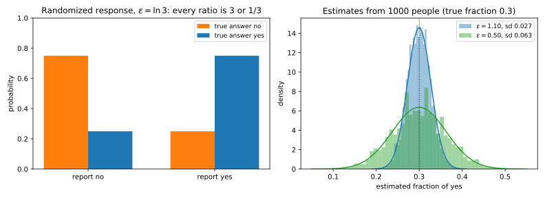
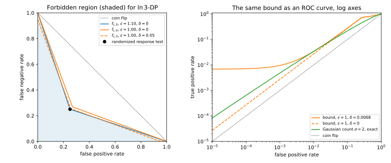
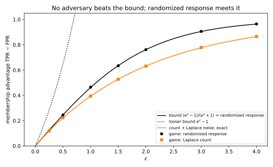
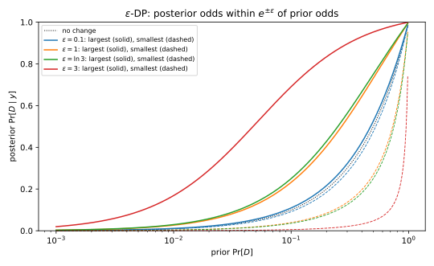
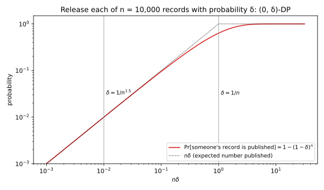

# The definition of differential privacy

Each attack of Part 2 was a game in which the adversary saw an algorithm's output on one of two datasets that differ in one person, and guessed which ([Threat models and privacy games](../part02-attacks/01-threat-models.md)). **Differential privacy (DP)** asks that, for every such pair, the distribution of the output barely changes. Then every attack of Part 2 fails at once, whatever the adversary knows and computes.

The one idea is the **privacy loss**: the logarithm of how much more likely an output was under one dataset than under its neighbour, the log-likelihood ratio of [Divergences](../part01-prerequisites/03-divergences.md). Pure DP bounds it at every output. Approximate DP lets it exceed the bound on outputs of small total probability $\delta$.

The running example is a survey. Alice, Bob and Carol are asked whether they smoke, and each answers with two coins. On heads they tell the truth, and on tails they toss again and say "yes" on heads and "no" on tails. So each person tells the truth with probability $\frac34$, and every "yes" has an excuse. This survey is $\ln 3$-DP, as @sec-dpdef-rr shows. The contrast case is a count released with Gaussian noise of standard deviation 2, whose privacy loss is unbounded, so it needs a $\delta$.

## Neighbouring datasets {#sec-dpdef-neighbours}

Before anything can be proved, "differ in one person" needs a precise meaning. A dataset $D$ is a multiset of **records** from a universe $\mathcal X$ of possible records. The **neighbouring relation** says which pairs of datasets the guarantee protects, and so it fixes the **unit of privacy**, the thing whose presence or value the output must not reveal.

::: {#def-dpdef-neighbours name="Neighbouring datasets"}
Datasets $D$ and $D'$ are **neighbours**, written $D \sim D'$, in one of two senses, which every guarantee must name.

- **Add/remove** (also called unbounded DP): $D'$ is $D$ with one record added or removed. The size $n$ of the dataset is itself private.
- **Replace** (also called bounded DP, or substitution): $|D| = |D'|$, and they differ in the value of one record. The size $n$ is public.

Both relations are symmetric: if $D \sim D'$ then $D' \sim D$.
:::

Add/remove protects participation, which membership inference attacks. Replace protects the value of your record. Separately, you choose what one record is. At **example-level** a record is one row, and at **user-level** it is all the data of one person, so example-level DP on 200 messages from one user protects each message, not the user. Neighbours also include absurd records, such as a person aged 900, so mechanisms clip their inputs to a fixed range before they add noise.

::: {#exm-dpdef-neighbours}
Take $D = (\text{Alice: smoker}, \text{Bob: non-smoker}, \text{Carol: smoker})$. @tbl-dpdef-neighbours checks five candidate datasets against both relations.

| Candidate $D'$ | Add/remove neighbour? | Replace neighbour? |
| --- | --- | --- |
| (Alice: smoker, Bob: non-smoker) | yes: Carol removed | no: size differs |
| (Alice: smoker, Bob: non-smoker, Carol: smoker, Dan: non-smoker) | yes: Dan added | no: size differs |
| (Alice: non-smoker, Bob: non-smoker, Carol: smoker) | no: two steps | yes: Alice's answer changed |
| (Alice: smoker, Bob: non-smoker, Dan: smoker) | no: two steps | yes: Carol replaced by Dan |
| (Alice: non-smoker, Bob: smoker, Carol: smoker) | no | no: two records changed |

: Five candidate datasets, checked against the add/remove and the replace relation. {#tbl-dpdef-neighbours}

:::

## Pure and approximate differential privacy {#sec-dpdef-definition}

"The output distribution barely changes" needs a measure, and the two obvious ones fail. An average such as the Kullback–Leibler divergence can hide one rare output with an enormous loss. A difference such as the total variation (TV) distance fails because any two datasets of $n$ records are $n$ replacements apart. So a tolerance $\tau$ per replacement lets their outputs differ by up to $n\tau$. At $n = 1000$ and $\tau = 10^{-4}$, no test tells any two datasets apart with probability above 0.5500, so the output is useless. But $\tau = 1/n$ already allows the mechanism of @sec-dpdef-small-delta, which here publishes some record in full with probability 0.6323. So DP bounds a ratio, in the worst case over every pair and every event, and allows a small difference only on top. @sec-apx-cal-dp derives the definition's forms from scratch.

Write $M$ for a **mechanism**, a randomized algorithm that maps a dataset to a random output in a set $\mathcal Y$. The probability that the output lands in an event $S \subseteq \mathcal Y$ is taken over the mechanism's own coins.

::: {#def-dpdef-dp name="Differential privacy"}
A mechanism $M$ is **$(\varepsilon, \delta)$-differentially private**, for $\varepsilon \ge 0$ and $\delta \in [0, 1]$, if for every pair of neighbours $D \sim D'$ and every event $S \subseteq \mathcal Y$,
$$\Pr[M(D) \in S] \le e^\varepsilon\,\Pr[M(D') \in S] + \delta.$$ {#eq-dpdef-def}
Because the neighbouring relation is symmetric, the inequality also holds with $D$ and $D'$ swapped. The case $\delta = 0$ is **pure DP**, written **$\varepsilon$-DP**. The case $\delta > 0$ is **approximate DP** (Dwork, Kenthapadi, McSherry, Mironov & Naor, 2006).
:::

The definition bounds events because an adversary's decision rule, "say $D'$ when the output is in $S$", is an event. The randomness is the mechanism's own, so privacy comes only from added noise. Indeed, a deterministic algorithm that is not constant fails the definition for every $\delta < 1$. Somewhere along a chain of neighbours its output changes, and there the event "the output equals its value on $D$" has probability 1 on $D$ and 0 on $D'$. So rounding or suppressing small cells gives no guarantee by itself.

The privacy loss of the opening checks the definition one output at a time.

::: {#def-dpdef-loss name="Privacy loss"}
Write $p_{M(D)}$ for the probability mass function or density of $M(D)$. The **privacy loss** of an output $y$ for the ordered pair $(D, D')$ is
$$L_{D,D'}(y) = \ln\frac{p_{M(D)}(y)}{p_{M(D')}(y)}.$$ {#eq-dpdef-loss}
It is 0 when $y$ is equally likely in both worlds, large when $y$ is strong evidence for $D$, and infinite when $y$ is impossible under $D'$.
:::

Pure DP can be checked one output at a time, because a group of outcomes can only dilute the worst ratio. Approximate DP cannot, because the slack $\delta$ is paid once per event, not once per outcome.

::: {#prp-dpdef-pointwise name="Pure DP is pointwise, approximate DP is not"}
Let $M$ have a discrete output set. Then $M$ is $\varepsilon$-DP if and only if $|L_{D,D'}(y)| \le \varepsilon$ for every neighbouring pair and every output $y$, and for densities the same holds at almost every $y$. For $\delta > 0$, $(\varepsilon, \delta)$-DP implies the pointwise bound
$$p_{M(D)}(y) \le e^\varepsilon p_{M(D')}(y) + \delta \quad\text{for every } y,$$
but the pointwise bound does not imply $(\varepsilon, \delta)$-DP.
:::

::: {.proof}
The plan is to show that events and outcomes say the same thing when $\delta = 0$, then to see the slack add up over the outcomes of an event when $\delta > 0$.

1. *Events imply outcomes.* A single outcome is an event, so $S = \{y\}$ in @eq-dpdef-def gives the pointwise bound. With $\delta = 0$, together with the same bound for the swapped pair, this is $|L_{D,D'}(y)| \le \varepsilon$.
2. *Outcomes imply events when $\delta = 0$.* An event's probability is the sum of the probabilities of its outcomes, so the sum of the pointwise bound over $y \in S$ gives
$$\Pr[M(D) \in S] = \sum_{y \in S}p_{M(D)}(y) \le e^\varepsilon\sum_{y \in S}p_{M(D')}(y) = e^\varepsilon\Pr[M(D') \in S].$$
For densities, a change of the density on a set of probability zero changes no event's probability, so almost every $y$ is enough.
3. *Outcomes do not imply events when $\delta > 0$.* Each of the $|S|$ outcomes of an event brings its own $\delta$, so the sum of the pointwise bound over $S$ gives only
$$\Pr[M(D) \in S] \le e^\varepsilon\Pr[M(D') \in S] + |S|\,\delta.$$
4. *A counterexample.* Let $M(D)$ be uniform on $\{1, \dots, m\}$ and $M(D')$ uniform on $\{m + 1, \dots, 2m\}$. Every outcome has probability at most $1/m$, so the pointwise bound holds with $\delta = 1/m$. But the event $\{1, \dots, m\}$ has probability 1 under $M(D)$ and 0 under $M(D')$, so @eq-dpdef-def needs $\delta = 1$. With $m = 1000$ the chapter's script (@sec-dpdef-code) finds a pointwise $\delta$ of 0.0010 and an event $\delta$ of 1.0000.
:::

For small $\varepsilon$ the factor $e^\varepsilon$ is about $1 + \varepsilon$, so every event changes probability by at most about a fraction $\varepsilon$ of itself. At $\varepsilon = 0.1$, an event of probability 0.5 under $M(D')$ has probability at most $0.5e^{0.1} = 0.553$ under $M(D)$. Along a chain of datasets or releases the factors multiply and the exponents add, which is how group privacy and composition work in [Post-processing, group privacy and composition](02-properties.md).

In @fig-dpdef-ratio-band, Laplace noise on a count keeps the density on $D$ inside the band that pure DP allows, while Gaussian noise leaves the tail outside, where $\delta$ must pay.

{#fig-dpdef-ratio-band}

The chain of factors also converts between the neighbouring relations, because a replace neighbour is two add/remove steps away.

::: {#prp-dpdef-replace name="From add/remove to replace"}
If $M$ is $\varepsilon$-DP under add/remove, then it is $2\varepsilon$-DP under replace:
$$\varepsilon\text{-DP under add/remove} \implies 2\varepsilon\text{-DP under replace}.$$ {#eq-dpdef-replace}
The converse fails: a mechanism can be $0$-DP under replace and not $\varepsilon$-DP under add/remove for any $\varepsilon$.
:::

::: {.proof}
1. *Build the two-step path.* Let $D \sim D'$ under replace, with $D$ holding the record $x$ where $D'$ holds $x'$, and let $D_0 = D \setminus \{x\}$. Then $D$ and $D_0$ differ by one removal, and $D_0$ and $D'$ by one addition.
2. *Chain the ratio bound along the path.* Pure DP bounds each step by a factor $e^\varepsilon$, so its use on $(D, D_0)$ and then on $(D_0, D')$ gives, for every event $S$,
$$\Pr[M(D) \in S] \le e^\varepsilon\Pr[M(D_0) \in S] \le e^{2\varepsilon}\Pr[M(D') \in S].$$
The path from $D'$ back to $D$ gives the other order.
3. *The counterexample for the converse.* Let $M$ output the number of records. It is $0$-DP under replace, because datasets of the same size give the same output. Under add/remove, the event $\{n + 1\}$ has probability 1 on a dataset of $n + 1$ records and 0 on its neighbour, and no finite $e^\varepsilon$ times 0 reaches 1.
:::

The factor 2 is reached when one replacement changes two counts, as a change to Alice's answer does in the survey's histogram (smokers, non-smokers). With Laplace noise of scale $1/\varepsilon$ in each bin, the script finds largest losses of 1.0000 under add/remove and 2.0000 under replace at $\varepsilon = 1$. For approximate DP the same path gives $(2\varepsilon, (1 + e^\varepsilon)\delta)$, because the second step multiplies the first step's $\delta$ by $e^\varepsilon$.

::: {#exm-dpdef-survey-ratio}
In the survey, take the true bits $(1, 0, 1)$ for Alice, Bob and Carol and the replace neighbour $(0, 0, 1)$. The script checks all 256 events of the 8 report vectors. The largest ratio over events is 3.0000, the same as over single outcomes, as @prp-dpdef-pointwise says. Every replace pair gives the same, so the survey is $\ln 3$-DP under replace and no better. @thm-dpdef-rr shows why only Alice's coins matter.
:::

## Randomized response {#sec-dpdef-rr}

Suppose you want the fraction of people who have done something embarrassing. If you ask directly, people lie. Warner (1965) let each respondent tell the truth only with a known probability, so that the randomization averages out over the population. The two coins of the running example are the **forced-response** variant of Boruch (1971). The idea is a probability $t$ of the truth a little above $\frac12$, so that the ratio $t/(1 - t)$ of the chances of a report under the two true bits is $e^\varepsilon$. @sec-apx-cal-rr derives the mechanism from scratch.

::: {#def-dpdef-rr name="Randomized response"}
**Randomized response at level $\varepsilon$** reports a person's bit $x \in \{0, 1\}$ truthfully with probability $t = e^\varepsilon/(1 + e^\varepsilon)$ and flipped with probability $1 - t$. On a dataset of $n$ bits it is applied to each person independently, and the output is the vector of $n$ reports.
:::

With two coins, a respondent tells the truth on heads, or on tails when the second coin gives the true answer. So $t = \frac34$, $t/(1 - t) = 3$, and the survey is randomized response at $\varepsilon = \ln 3 = 1.0986$ (@tbl-dpdef-rr).

| True bit | $\Pr[\text{report } 1]$ | $\Pr[\text{report } 0]$ | At $\varepsilon = \ln 3$ |
| --- | --- | --- | --- |
| 1 | $t = \frac{e^\varepsilon}{1 + e^\varepsilon}$ | $1 - t = \frac{1}{1 + e^\varepsilon}$ | 0.75, 0.25 |
| 0 | $1 - t$ | $t$ | 0.25, 0.75 |
| Ratio, row 1 / row 0 | $e^\varepsilon$ | $e^{-\varepsilon}$ | 3, 1/3 |

: Randomized response as a table of output probabilities. The ratios between the two rows are the privacy loss. {#tbl-dpdef-rr}

Write $\bar x$ for the true fraction of ones and $\bar y$ for the mean of the reports. The coins push $\bar y$ toward $\frac12$ in a known way, and the estimate undoes the push with a division by $2t - 1$, which scales up the noise too.

::: {#thm-dpdef-rr name="Privacy and accuracy of randomized response"}
Randomized response at level $\varepsilon$ on $n$ people is $\varepsilon$-DP under replace. The estimate
$$\hat{\bar x} = \frac{\bar y - (1 - t)}{2t - 1}$$ {#eq-dpdef-rr-estimate}
of the true fraction is unbiased, and its standard deviation is
$$\operatorname{sd}(\hat{\bar x}) = \frac{\sqrt{t(1 - t)}}{(2t - 1)\sqrt n} = \frac{e^{\varepsilon/2}}{(e^\varepsilon - 1)\sqrt n} \approx \frac{1}{\varepsilon\sqrt n}\quad\text{for small }\varepsilon.$$
:::

::: {.proof}
The plan is to read one person's privacy off @tbl-dpdef-rr, to show that the other people cancel out of the likelihood ratio, and then to compute the mean and the variance of the estimate.

1. *One person.* Every ratio between the two rows of @tbl-dpdef-rr is $e^\varepsilon$ or its inverse. So the privacy loss of each report is $\pm\varepsilon$, and one report is $\varepsilon$-DP by @prp-dpdef-pointwise.
2. *The output distribution factors.* People toss their own coins independently, so the probability of a report vector is a product of one factor per person, $\prod_i p_i(y_i \mid x_i)$. Here $p_i(y_i \mid x_i)$ is the chance that person $i$ reports $y_i$ when their true bit is $x_i$.
3. *Neighbours differ in one factor.* Under replace, $D$ and $D'$ differ only in person $j$'s bit, so every other factor cancels in the ratio. The loss is person $j$'s alone, so it is $\pm\varepsilon$, and the vector is $\varepsilon$-DP by @prp-dpdef-pointwise.
4. *The mean of the reports.* A report is 1 with probability $t$ if the true bit is 1 and $1 - t$ if it is 0. The average over a population in which a fraction $\bar x$ have bit 1 is
$$\mathbb E[\bar y] = \bar x\,t + (1 - \bar x)(1 - t) = (1 - t) + \bar x(2t - 1).$$
Solved for $\bar x$, this gives @eq-dpdef-rr-estimate. The estimate is unbiased because it inverts this linear map, and expectations pass through linear maps.
5. *The spread.* Each report is a Bernoulli variable with variance $t(1 - t)$, whatever its true bit, and the reports are independent, so
$$\operatorname{Var}(\bar y) = \frac{t(1 - t)}{n}.$$
Division of $\bar y$ by $2t - 1$ divides the variance by $(2t - 1)^2$, which gives the first form. The substitution $t = e^\varepsilon/(1 + e^\varepsilon)$ gives the closed form, because
$$t(1 - t) = \frac{e^\varepsilon}{(1 + e^\varepsilon)^2}, \qquad 2t - 1 = \frac{e^\varepsilon - 1}{e^\varepsilon + 1}.$$
:::

The noise is added before the data leave each person, which is the **local** model of [Local, shuffle and distributed trust models](09-trust-models.md). Under add/remove the number of reports would reveal whether you took part, so the guarantee holds under replace only.

Privacy costs samples. Halving $\varepsilon$ doubles the error, so you need four times as many people for the same accuracy. Much of that is the price of trusting nobody. A trusted curator can instead add Laplace noise of scale $1/\varepsilon$ to the true count once, which is $\varepsilon$-DP by [the Laplace and Gaussian mechanisms](03-laplace-gaussian.md). Its error on the fraction, $\sqrt2/(\varepsilon n)$, falls like $1/n$ rather than $1/\sqrt n$.

::: {#exm-dpdef-survey}
Of $n = 1000$ respondents, a fraction $\bar x = 0.3$ smoke. So the expected fraction of "yes" reports is $0.3 \times 0.75 + 0.7 \times 0.25 = 0.4$, which @eq-dpdef-rr-estimate turns back into 0.3. The formula gives $\operatorname{sd}(\hat{\bar x}) = \sqrt{0.1875}/(0.5\sqrt{1000}) = 0.0274$, and ten thousand simulated surveys give a mean of 0.2996 and a standard deviation of 0.0278. At $\varepsilon = 0.5$ the formula gives 0.0626 (@fig-dpdef-rr). A trusted curator at $\varepsilon = \ln 3$ would reach $\sqrt2/(1000\ln 3) = 0.00129$, which is 21.3 times smaller.
:::

{#fig-dpdef-rr}

## Divergence forms and the privacy loss {#sec-dpdef-divergences}

@eq-dpdef-def ranges over all events, which you cannot check one by one for continuous outputs. A divergence of [Divergences](../part01-prerequisites/03-divergences.md) turns them into one formula and shows what $\delta$ measures. The **max-divergence** $D_\infty(P\|Q) = \ln\max_y p(y)/q(y)$ is the largest privacy loss (@sec-div-renyi). The **hockey-stick divergence** $E_\gamma(P\|Q) = \sum_y(p(y) - \gamma q(y))_+$ is the mass of $P$ that sticks out above $\gamma$ times $Q$ (@sec-div-hockey), where $(x)_+ = \max\{x, 0\}$.

::: {#thm-dpdef-divergence name="Differential privacy as a divergence bound"}
For every pair of neighbours $D \sim D'$ write $P = M(D)$ and $Q = M(D')$, with probabilities $p(y)$ and $q(y)$ (densities when the output is continuous, with sums read as integrals), and $L = L_{D,D'}$.

1. $M$ is $\varepsilon$-DP if and only if $D_\infty(P\|Q) \le \varepsilon$ for every ordered pair of neighbours.
2. $M$ is $(\varepsilon, \delta)$-DP if and only if, for every ordered pair of neighbours,
$$E_{e^\varepsilon}(P\|Q) = \sum_y\big(p(y) - e^\varepsilon q(y)\big)_+ = \mathbb E_{y \sim P}\Big[\big(1 - e^{\varepsilon - L(y)}\big)_+\Big] \le \delta.$$ {#eq-dpdef-hockey}
3. If $\Pr_{y \sim P}[L(y) > \varepsilon] \le \delta$ for every ordered pair, then $M$ is $(\varepsilon, \delta)$-DP.
:::

::: {.proof}
The plan is to take the worst event for the definition's difference from Part 1, to rewrite the resulting sum as an average under $P$, and to bound that average by a tail probability.

1. *Pure DP.* By @prp-dpdef-pointwise, $\varepsilon$-DP is $|L(y)| \le \varepsilon$ at every output and in both orders of the pair, and the largest value of $L$ is $D_\infty(P\|Q)$ by definition.
2. *The worst event for a difference.* The definition asks $\Pr_P[S] - e^\varepsilon\Pr_Q[S] \le \delta$ for every event. By @lem-div-best-event with $\gamma = e^\varepsilon$, the largest left side is the hockey-stick divergence, reached at the event $\{L > \varepsilon\}$. So the definition holds for every $S$ exactly when
$$\max_S\big[\Pr_P[S] - e^\varepsilon\Pr_Q[S]\big] = \sum_y\big(p(y) - e^\varepsilon q(y)\big)_+ = E_{e^\varepsilon}(P\|Q)$$
is at most $\delta$.
3. *As an average under $P$.* Factor $p(y)$ out of each term and use $q/p = e^{-L}$ from @eq-dpdef-loss, so that each term becomes $p\,(1 - e^{\varepsilon - L})_+$. A sum of $p(y)$ times a function of $y$ is the average of that function under $P$, and outcomes with $p(y) = 0$ contribute nothing.
4. *The sufficient condition.* By the tail form of @prp-div-hockey, the divergence is $\Pr_P[L > \varepsilon] - e^\varepsilon\Pr_Q[L > \varepsilon]$, and the second term is not negative, so
$$E_{e^\varepsilon}(P\|Q) \le \Pr_P[L > \varepsilon] \le \delta.$$
:::

So the smallest valid $\delta$ is not the probability that the loss exceeds $\varepsilon$. It is an average that counts an output with loss just above $\varepsilon$ for almost nothing and an output with infinite loss in full. What $\delta$ bounds exactly is the chance of a total failure: the outputs impossible on $D'$ have infinite loss, and by @eq-dpdef-def their total probability on $D$ is at most $\delta$.

A mechanism has a curve, not a pair: it is $(\varepsilon, \delta(\varepsilon))$-DP for every $\varepsilon$ (@fig-dpdef-delta-curves), and the curve reaches 0 only if the loss is bounded. The distribution of $L$ with $y$ drawn from $M(D)$ is the **privacy loss distribution**, which the accountants of [Numerical accounting](../part04-privacy-accounting/06-numerical-accounting.md) use directly.

![The smallest $\delta$ against $\varepsilon$ for randomized response at $\ln 3$, the Laplace count of scale 1 and the Gaussian count with $\sigma = 2$. Only the Gaussian curve never reaches 0. Dashed: its loose tail $\Pr[L > \varepsilon]$.](figures/dpdef_delta_curves.svg){#fig-dpdef-delta-curves}

::: {#exm-dpdef-curves}
For each mechanism, add up the excess mass where the likelihood ratio exceeds $e^\varepsilon$. For the survey only the report with ratio 3 counts, which gives $\delta(\varepsilon) = (3 - e^\varepsilon)_+/4$, so $\delta(0.5) = 0.3378$ and $\delta(1) = 0.0704$. For the Laplace count of scale 1, the closed form of @sec-div-hockey gives $\delta(0.5) = 0.2212$ and $\delta(1) = 0$.

For the Gaussian count, whose true value moves by 1 between neighbours, write $\mu = 1/\sigma = 0.5$ for that shift in units of the noise. The privacy loss is normal with variance $\mu^2$ and mean $\mu^2/2$ under $M(D)$, $-\mu^2/2$ under $M(D')$ (@sec-div-gauss). By step 2 of the proof, $\delta(\varepsilon)$ is the $P$-probability of $\{L > \varepsilon\}$ minus $e^\varepsilon$ times its $Q$-probability. Standardize the loss with the standard normal distribution function $\Phi$ to get
$$\delta(\varepsilon) = \Phi\Big(\frac\mu2 - \frac\varepsilon\mu\Big) - e^\varepsilon\,\Phi\Big(-\frac\mu2 - \frac\varepsilon\mu\Big).$$
@tbl-dpdef-gauss compares it with the tail, the first term alone.

| $\varepsilon$ | 0.5 | 1 | 2 | 3 |
| --- | --- | --- | --- | --- |
| Exact $\delta(\varepsilon)$, @eq-dpdef-hockey | $5.244\times10^{-2}$ | $6.830\times10^{-3}$ | $9.439\times10^{-6}$ | $3.401\times10^{-10}$ |
| Tail $\Pr[L > \varepsilon]$ | $2.266\times10^{-1}$ | $4.006\times10^{-2}$ | $8.842\times10^{-5}$ | $4.462\times10^{-9}$ |
| Tail / exact | 4.32 | 5.87 | 9.37 | 13.12 |

: The exact $\delta(\varepsilon)$ of a count with Gaussian noise of standard deviation 2, against the sufficient condition $\Pr[L > \varepsilon]$. {#tbl-dpdef-gauss}

The tail is loose by a factor of 4 to 13, because most outputs in it have a loss only a little above $\varepsilon$.
:::

## The hypothesis-testing interpretation {#sec-dpdef-testing}

A membership attacker is a test that sees the output and decides between "the data were $D$" and "the data were $D'$". [Hypothesis testing](../part01-prerequisites/04-hypothesis-testing.md) described the best pairs of error rates a test can reach by the **trade-off function**. DP is exactly a lower bound on that function, the same for all neighbours (Wasserman & Zhou, 2010; Kairouz, Oh & Viswanath, 2015). @sec-apx-conv-testing derives it from scratch.

Let a test say "$D'$" on the event $S$. Its **false positive rate (FPR)** is $\alpha = \Pr[M(D) \in S]$, and its **false negative rate (FNR)** is $\beta = \Pr[M(D') \notin S]$. A randomized test says "$D'$" with probability $\phi(y) \in [0, 1]$ after it sees $y$ (@sec-ht-setup).

::: {#thm-dpdef-testing name="Differential privacy as a bound on every test"}
$M$ is $(\varepsilon, \delta)$-DP if and only if every test, randomized or not, for every pair of neighbours, satisfies
$$\alpha + e^\varepsilon \beta \ge 1 - \delta \qquad\text{and}\qquad e^\varepsilon \alpha + \beta \ge 1 - \delta.$$ {#eq-dpdef-testing}
Equivalently, the trade-off function of every pair of neighbours lies above
$$f_{\varepsilon,\delta}(\alpha) = \max\big\{0,\ 1 - \delta - e^\varepsilon \alpha,\ e^{-\varepsilon}(1 - \delta - \alpha)\big\}.$$ {#eq-dpdef-tradeoff}
In terms of the **true positive rate (TPR)** $1 - \beta$, the second inequality reads $\mathrm{TPR} \le e^\varepsilon \alpha + \delta$.
:::

::: {.proof}
The plan is to apply the definition to the complement of $S$ and to the swapped pair, to extend both bounds to randomized tests, and to read them backwards for the converse.

1. *The first inequality.* Apply @eq-dpdef-def to the pair $(D, D')$ and the complement $S^c$, on which the test says "$D$". The left side is $1 - \alpha$ and the probability on the right is $\beta$, so
$$1 - \alpha \le e^\varepsilon \beta + \delta.$$
2. *The second inequality.* Apply @eq-dpdef-def to the swapped pair $(D', D)$ and the event $S$. The left side is then $1 - \beta$ and the probability on the right is $\alpha$.
3. *Randomized tests.* A test $\phi$ is not an event. But the gap $\mathbb E_{M(D)}[\phi] - e^\varepsilon\mathbb E_{M(D')}[\phi]$ is linear in each $\phi(y)$, with coefficient $p(y) - e^\varepsilon q(y)$. So by the soft-event part of @lem-div-best-event it is largest at the worst event of @thm-dpdef-divergence, where it is at most $\delta$. Steps 1 and 2 then go through with $\phi$ and $1 - \phi$ in place of the events.
4. *The converse.* Every event is a test. So if @eq-dpdef-testing holds for all tests, steps 1 and 2 read backwards give @eq-dpdef-def.
5. *The trade-off form.* Solved for $\beta$, the two inequalities give two lower bounds on $\beta$, and $\beta \ge 0$ is a third. So the smallest $\beta$ at level $\alpha$ is at least the largest of the three.
:::

The result draws a forbidden region: every attack lies on or above the two lines of @eq-dpdef-testing (@fig-dpdef-tradeoff-region). Part 2 judged membership attacks by their TPR at a low FPR, and that is where DP bites hardest. It caps the TPR at $e^\varepsilon \alpha + \delta$, and as $\alpha \to 0$ the $\delta$ term dominates.

Auditing runs this in reverse. Put an attack's measured FPR and TPR into the cap, and you get the smallest $\varepsilon$ that agrees with the measurement. There the neighbouring pair is a training set with and without a **canary**, a record planted to be easy to detect ([Memorization and extraction](../part02-attacks/05-memorization-extraction.md)). The bound is tight for randomized response and loose for most mechanisms, which is why $f$-DP keeps a mechanism's whole trade-off curve ([Gaussian differential privacy](../part04-privacy-accounting/04-gaussian-dp.md)).

{#fig-dpdef-tradeoff-region}

::: {#exm-dpdef-tests}
In the survey, the best test says "$D'$" when Alice reports 0. Its FPR and FNR are both 0.25, so $\alpha + 3\beta = 1$, the corner of the region.

The Gaussian count is $(1, 0.00683)$-DP. So at FPR $10^{-3}$ the bound allows TPR up to $e \times 10^{-3} + 0.00683 = 0.0095$, against 0.002728 under $(1, 10^{-5})$-DP. The best test thresholds $y$ (Neyman–Pearson), and the Gaussian trade-off curve of @sec-ht-gaussian gives its TPR as $1 - \Phi(\Phi^{-1}(0.999) - 0.5) = 0.0048$.
:::

## Bound on the membership advantage {#sec-dpdef-advantage}

Part 2 measured a membership attacker by its **advantage**. In the membership game the challenger flips a fair coin to pick $D$ or $D'$ and runs $M$ on it, and the adversary guesses which. The advantage is $2\Pr[\text{correct}] - 1$, which with a fair coin equals $\mathrm{TPR} - \mathrm{FPR} = 1 - \alpha - \beta$ (@sec-ht-tv).

::: {#cor-dpdef-advantage name="Membership advantage"}
If $M$ is $(\varepsilon, \delta)$-DP, every adversary in the membership game between any two neighbours has
$$\mathrm{Adv} = \mathrm{TPR} - \mathrm{FPR} \le \frac{e^\varepsilon - 1 + 2\delta}{e^\varepsilon + 1}, \qquad \Pr[\text{correct}] \le \frac{e^\varepsilon + \delta}{e^\varepsilon + 1}.$$ {#eq-dpdef-advantage}
For $\delta = 0$ the bound is $\tanh(\varepsilon/2)$, about $\varepsilon/2$ for small $\varepsilon$, and randomized response attains it. The bound also holds when the game draws the dataset at random before the coin flip.
:::

::: {.proof}
The plan is to turn the advantage into a sum of error rates, to find the smallest sum over the region that @thm-dpdef-testing allows, and to check that randomized response sits at the corner.

1. *Turn the advantage into a sum of errors.* The advantage is $1 - (\alpha + \beta)$, so the largest advantage comes from the smallest $\alpha + \beta$ that @eq-dpdef-testing allows with $\alpha, \beta \ge 0$.
2. *Draw the feasible region.* Its lower boundary has corners where the two lines meet the axes, at $(0, 1 - \delta)$ and $(1 - \delta, 0)$, and where they cross, at $\alpha = \beta = (1 - \delta)/(1 + e^\varepsilon)$.
3. *Check the corners.* A linear function such as $\alpha + \beta$ changes at a constant rate along a straight edge, so its smallest value is at a corner. At the first two corners $\alpha + \beta = 1 - \delta$, and the crossing point is smaller because $e^\varepsilon \ge 1$:
$$\alpha + \beta = \frac{2(1 - \delta)}{1 + e^\varepsilon} \le 1 - \delta.$$
4. *Compute the advantage.* One minus the smallest sum is
$$1 - \frac{2(1 - \delta)}{1 + e^\varepsilon} = \frac{e^\varepsilon - 1 + 2\delta}{e^\varepsilon + 1},$$
and $\Pr[\text{correct}] = \frac12 + \frac12\mathrm{Adv}$ gives the second bound. Multiply the top and bottom of the $\delta = 0$ bound by $e^{-\varepsilon/2}$ to get $\tanh(\varepsilon/2)$.
5. *Tightness and random datasets.* Against randomized response, the test "say $D'$ on report 0" has $\alpha = \beta = 1/(1 + e^\varepsilon)$, the crossing point, so it attains the bound. A bound that holds for each fixed pair also holds for an average over random pairs.
:::

So at $\varepsilon = 0.1$ the best attacker is right with probability at most 0.525, while at $\varepsilon = 5$ it may be right 99.3% of the time. The older bound $e^\varepsilon - 1$ (Yeom et al., 2018) is about twice as large and says nothing once $e^\varepsilon \ge 2$. Against a count with Laplace noise of scale $1/\varepsilon$, the best advantage is $1 - e^{-\varepsilon/2}$ (@sec-div-hockey), below $\tanh(\varepsilon/2)$ (@fig-dpdef-advantage).

{#fig-dpdef-advantage}

::: {#exm-dpdef-advantage}
@tbl-dpdef-advantage compares the bound with the best advantage against two mechanisms. The likelihood-ratio adversary guesses $D$ when the privacy loss is positive. In 200,000 games at $\varepsilon = 1$, the script measures its advantage as 0.4624 against randomized response (exact 0.4621) and 0.3953 against the Laplace count (exact 0.3935).

| $\varepsilon$ | 0.1 | 0.5 | 1 | $\ln 3$ | 2 | 5 |
| --- | --- | --- | --- | --- | --- | --- |
| Bound $\tanh(\varepsilon/2)$ | 0.0500 | 0.2449 | 0.4621 | 0.5000 | 0.7616 | 0.9866 |
| Looser bound $e^\varepsilon - 1$ | 0.1052 | 0.6487 | 1.7183 | 2.0000 | 6.3891 | 147.4 |
| Randomized response | 0.0500 | 0.2449 | 0.4621 | 0.5000 | 0.7616 | 0.9866 |
| Laplace count | 0.0488 | 0.2212 | 0.3935 | 0.4226 | 0.6321 | 0.9179 |

: The membership advantage bound for $\varepsilon$-DP and the exact best advantage against two $\varepsilon$-DP mechanisms. {#tbl-dpdef-advantage}

:::

## The Bayesian interpretation {#sec-dpdef-bayes}

People often ask a different question: after someone sees the output, how sure can they be about me? Bayes' rule in odds form (@sec-ht-bayes) says that the posterior odds are the prior odds times the likelihood ratio, which for an output $y$ is $e^{L_{D,D'}(y)}$. So a bound on the privacy loss bounds how far any belief can move, whatever the prior (Kasiviswanathan & Smith, 2014). @sec-apx-conv-bayes derives it with a two-hypothesis table.

Take an adversary who knows that the data are $D$ or $D'$ and gives $D$ the prior probability $\pi$. Under approximate DP, outputs whose loss exceeds a level $\varepsilon' > \varepsilon$ are rare, because each adds a fixed fraction of its probability to the excess that $\delta$ bounds.

::: {#thm-dpdef-posterior name="What one output does to a belief"}
If $M$ is $\varepsilon$-DP, then after any output $y$,
$$e^{-\varepsilon}\frac{\pi}{1 - \pi} \le \frac{\Pr[D \mid y]}{\Pr[D' \mid y]} \le e^\varepsilon\frac{\pi}{1 - \pi}, \qquad \Pr[D \mid y] \le \frac{e^\varepsilon\pi}{e^\varepsilon\pi + 1 - \pi}.$$ {#eq-dpdef-posterior}
If $M$ is $(\varepsilon, \delta)$-DP, then for every $\varepsilon' > \varepsilon$ the upper bounds hold with $\varepsilon'$ in place of $\varepsilon$ for every output except those in the set $B = \{y : L_{D,D'}(y) > \varepsilon'\}$, which has
$$\Pr_{y \sim M(D)}[y \in B] \le \frac{\delta}{1 - e^{\varepsilon - \varepsilon'}}.$$ {#eq-dpdef-bad-set}
:::

::: {.proof}
The plan is to write the posterior odds as prior odds times $e^L$, to bound $e^L$ under pure DP, and then to show that the outputs where $L$ is large are rare under approximate DP.

1. *Odds.* By Bayes' rule, $\Pr[D \mid y]$ is $\pi\,p_{M(D)}(y)$ divided by the overall probability of $y$, and the same holds for $D'$ with the same denominator. The ratio cancels it and leaves the prior odds times $e^{L_{D,D'}(y)}$.
2. *Pure DP.* By @prp-dpdef-pointwise, $e^{L}$ lies between $e^{-\varepsilon}$ and $e^\varepsilon$, and the prior odds times these extremes give the odds bound.
3. *From odds to a probability.* Odds $o$ convert to the probability $o/(1 + o)$, which increases with $o$. Take $o = e^\varepsilon\pi/(1 - \pi)$ and multiply top and bottom by $1 - \pi$ to get the bound on $\Pr[D \mid y]$.
4. *The bad set is rare.* Write $P = M(D)$ and $Q = M(D')$, and apply @eq-dpdef-def to $B$:
$$\Pr_P[B] - e^\varepsilon\Pr_Q[B] \le \delta.$$
On $B$ the loss exceeds $\varepsilon'$, so $q < e^{-\varepsilon'}p$ and $\Pr_Q[B] < e^{-\varepsilon'}\Pr_P[B]$. With this larger quantity in place of $\Pr_Q[B]$ the left side gets smaller, which leaves
$$\Pr_P[B]\big(1 - e^{\varepsilon - \varepsilon'}\big) < \delta,$$
and the factor is positive because $\varepsilon' > \varepsilon$.
5. *Outside the bad set.* There the loss is at most $\varepsilon'$, and steps 1 to 3 with $\varepsilon'$ in place of $\varepsilon$ give the upper bounds.
:::

DP bounds the *change* in belief, not the belief, so an adversary who is already 99% sure stays about that sure. An adversary who does not know every other record gets the same bound, relative to the posterior computed without the person's record (Kasiviswanathan & Smith, 2014).

{#fig-dpdef-posterior}

::: {#exm-dpdef-interviewer}
In the survey, the interviewer knows every answer but Alice's and gives a 50% chance that she smokes. Her "yes" is 3 times as likely from a true "yes", so the posterior odds are at most 3 and the interviewer is at most 75% sure. From a prior of 1%, the posterior is at most 0.0294 (@tbl-dpdef-posterior).

| $\varepsilon$ | Prior 0.01 | Prior 0.1 | Prior 0.5 |
| --- | --- | --- | --- |
| 0.1 | 0.0110 | 0.1094 | 0.5250 |
| 1 | 0.0267 | 0.2320 | 0.7311 |
| $\ln 3$ | 0.0294 | 0.2500 | 0.7500 |
| 3 | 0.1687 | 0.6906 | 0.9526 |

: The largest posterior probability after one output of an $\varepsilon$-DP mechanism, from @eq-dpdef-posterior. {#tbl-dpdef-posterior}

For the $(1, 0.0068)$-DP Gaussian count, @eq-dpdef-bad-set with $\varepsilon' = 2$ bounds the probability of a loss above 2 by $0.0068/(1 - e^{-1}) = 0.0108$. The exact value is $8.842\times10^{-5}$, because the bound uses only the pair $(\varepsilon, \delta)$, not the shape of the tail.
:::

## Why δ must be much smaller than 1/n {#sec-dpdef-small-delta}

How small must $\delta$ be? A deliberately terrible mechanism shows the danger: it is DP with $\varepsilon = 0$ and yet publishes records verbatim, because over a whole dataset its small chances add up.

::: {#prp-dpdef-release name="Release each record with probability δ"}
The mechanism that publishes each record of the dataset, in full, independently with probability $\delta$ is $(0, \delta)$-DP under add/remove. On a dataset of $n$ records it publishes $n\delta$ records on average, and at least one record with probability
$$1 - (1 - \delta)^n \approx 1 - e^{-n\delta},$$
so $\delta = 1/n$ exposes someone with probability about $1 - e^{-1} = 0.632$.
:::

::: {.proof}
The plan is to run the mechanism on $D$ and on $D' = D \cup \{x\}$ with the same coins, so that the outputs differ only through one extra coin, and then to count the exposures.

1. *Couple the two runs.* Run the mechanism on $D'$ as a run on $D$ followed by one more coin for $x$. The two outputs are equal unless that coin publishes $x$, which happens with probability $\delta$.
2. *Bound one direction.* The output on $D'$ lands in an event $S$ either because the output on $D$ did or because the extra coin changed it, so
$$\Pr[M(D') \in S] \le \Pr[M(D) \in S] + \delta.$$
3. *Bound the other direction.* With probability $1 - \delta$ the extra coin does nothing, and a probability is at most 1, so
$$\Pr[M(D') \in S] \ge (1 - \delta)\Pr[M(D) \in S] \ge \Pr[M(D) \in S] - \delta.$$
Both directions match @eq-dpdef-def with factor $e^0 = 1$ and slack $\delta$.
4. *Count the exposures.* The number of records published is $\mathrm{Bin}(n, \delta)$, with mean $n\delta$, and none is published with probability $(1 - \delta)^n$. For small $\delta$, $\ln(1 - \delta) \approx -\delta$, which gives
$$(1 - \delta)^n = e^{n\ln(1 - \delta)} \approx e^{-n\delta}.$$
:::

So $\delta$ is a per-person budget for catastrophe. Pick it well below $1/n$, with $n$ the number of people rather than records, for example $\delta = 1/n^{1.5}$. Check any fixed value against $n$: Abadi et al. (2016) used $\delta = 10^{-5}$ for 60,000 training examples, so $n\delta = 0.6$.

One pair $(\varepsilon, \delta)$ can describe mechanisms that fail in very different ways (@fig-dpdef-delta-shapes). The Gaussian count with $\sigma = 2$ is $(1, 6.830\times10^{-3})$-DP, and its loss exceeds 3 with probability $4.462\times10^{-9}$. Now take a mechanism that publishes a person's bit with probability $6.830\times10^{-3}$ and otherwise runs randomized response at $\varepsilon = 1$. It has the same pair, but its whole $\delta$ is on outputs of infinite loss. From the pair alone, @eq-dpdef-bad-set at level 3 allows
$$\Pr[L > 3] \le \frac{6.830\times10^{-3}}{1 - e^{1 - 3}} = 7.899\times10^{-3},$$
and the catastrophic mechanism comes close to it. So read a quoted pair pessimistically unless you know the whole curve $\delta(\varepsilon)$.

![The tail $\Pr[L > c]$ of two $(1, 0.0068)$-DP mechanisms on a log scale. Blue: the Gaussian count, whose tail falls fast. Red: publish the bit with probability $\delta$, else randomized response; its tail stays at $\delta$. Dotted: the largest tail the pair allows, from @eq-dpdef-bad-set.](figures/dpdef_delta_shapes.svg){#fig-dpdef-delta-shapes}

::: {#exm-dpdef-release}
With $n = 3$ and $\delta = 0.1$ the script enumerates every output on $D$ and on $D \cup \{x\}$. It finds a largest gap over events of 0.1000, so the mechanism is $(0, 0.1)$-DP and no better. @tbl-dpdef-release takes $n = 10{,}000$ records. In 100,000 runs at $\delta = 1/n$ the mechanism published 1.0077 records on average and at least one in a fraction 0.6351 of the runs, against 1 and 0.6321 from the formulas (@fig-dpdef-release).

| $\delta$ | Expected records published, $n\delta$ | $\Pr[\text{at least one}]$ |
| --- | --- | --- |
| $10^{-4} = 1/n$ | 1 | 0.6321 |
| $10^{-6}$ | 0.01 | $9.950\times10^{-3}$ |
| $10^{-8}$ | 0.0001 | $9.999\times10^{-5}$ |

: Exposure under the $(0, \delta)$-DP mechanism that releases each of 10,000 records with probability $\delta$. {#tbl-dpdef-release}

:::

{#fig-dpdef-release}

## What differential privacy does not protect {#sec-dpdef-limits}

The definition compares two worlds that differ in one record, not the world before and after the release. No definition can block every inference without assumptions on how the data were generated (Kifer & Machanavajjhala, 2011). Four limits matter in practice.

**Population inference.** Suppose the cancer rate among smokers is 0.1 or 0.3, equally likely, so your belief that Alice, a smoker, will get cancer is 0.2. A study that excludes her reveals the rate 0.3, and your belief rises to 0.3. Yet nothing happened to her *because she took part*.

**Correlated records.** If $k$ records move together, as in a household, their joint privacy loss can reach $k\varepsilon$, so the unit of privacy must match the unit of correlation.

**Everything outside the mathematical mechanism.** Floating-point leaks ([Discrete and floating-point-safe mechanisms](08-discrete-mechanisms.md)), timing side channels and other releases need separate care.

**Tasks about one person.** Contact tracing must find whom one infected person met, so its output must depend on that person, which DP forbids. DP protects your contribution, not secrets that other people's data reveal.

::: {#exm-dpdef-household}
A count with Laplace noise of scale $1/\varepsilon$ meets a household of $k = 5$ people who always answer alike. At $\varepsilon = 1$ the script finds a largest privacy loss of 5.0000 for the household, so it is protected only as if by a 5-DP mechanism. The exact best advantage against it is $1 - e^{-5/2} = 0.9179$, under the 5-DP bound $\tanh(5/2) = 0.9866$. So an attacker who asks whether the household took part is right with probability up to 0.959, although each record is "protected at $\varepsilon = 1$".
:::

## Is it a privacy violation? {#sec-dpdef-violation}

Some reported privacy failures show that a release reveals something about the people whose data it used. Others show that it reveals something true about the world, which then applies to particular people. DP stops only the first kind, and three questions from Kamath's course on private data analysis sort a claim into one kind or the other.

1. **Does it depend on this person's record?** DP bounds an inference's probability by $e^\varepsilon$ times its probability without the record, plus $\delta$. So it has nothing against an inference that is as likely without the record.
2. **Does the inference succeed exactly when the model is accurate?** Then it comes from patterns shared by many records, and to block it is a decision not to learn.
3. **When, and by whom, was the information given up?** An inference from what the person disclosed elsewhere, such as her purchases, is the same whether or not her record was used.

The first question decides, and the other two explain a no. So to measure a claimed attack, compare its success on members with its success on non-members, because only the excess can be a privacy loss ([Attribute inference](../part02-attacks/03-attribute-inference.md)). An inference that is no violation can still be unacceptable under norms of information flow (Nissenbaum, 2004), which cover far more than DP.

::: {#exm-dpdef-cases}
A regression model trained on points of the line $y = x + 1$, among them $(2.7, 3.7)$, answers 3.7 at $x = 2.7$, which looks like a leak. But without that point the line and the answer stay the same, so the first question says no. @tbl-dpdef-violation applies the test to four well-known cases.

| Case | A violation in the DP sense? | The question that decides it |
| --- | --- | --- |
| Facebook likes predict politics (Kosinski, Stillwell & Graepel, 2013) | No | First: the patterns hold without any one user |
| A retailer infers a shopper's pregnancy from her purchases (Duhigg, 2012; anecdotal) | No | First: a model not trained on her infers the same |
| Netflix Prize data linked to public reviews (Narayanan & Shmatikov, 2008) | Yes | First: without her record there is nothing to find |
| A language model completes one user's identification number (Carlini et al., 2019) | Yes | First: only her messages make it likely |

: Four claimed privacy failures and the three-question test. {#tbl-dpdef-violation}

The last two rows are the contrast that matters for machine learning. A model that generalizes passes the first question, and a model that memorizes a rare string fails it ([Memorization and extraction](../part02-attacks/05-memorization-extraction.md)).
:::

## Code {#sec-dpdef-code}

The script [code/definition.py](../../code/part03-dp-foundations/definition.py) computes every number in this chapter and draws every figure. It checks the definition by brute force over small outcome sets, and the closed forms by simulation. From the repository root:

```bash
uv run python code/part03-dp-foundations/definition.py
```

| Experiment | Result |
| --- | --- |
| Histogram, Laplace noise $1/\varepsilon$ per bin, $\varepsilon = 1$ | Largest loss 1.0000 (add/remove), 2.0000 (replace) |
| Disjoint uniform distributions, $m = 1000$ | Pointwise $\delta$ 0.0010; event $\delta$ 1.0000 |
| Additive-only definition, $n = 1000$ | TV 0.1000, accuracy 0.5500; exposure 0.6323 |
| Randomized response, 3 people, 256 events | Event ratio 3.0000 = outcome ratio; hockey-stick at $\gamma = 2$ 0.2500 |
| Survey, $n = 1000$, $\varepsilon = \ln 3 = 1.0986$ | sd 0.0274, simulated 0.0278 (mean 0.2996); central 0.00129 |
| $\delta(0.5)$, $\delta(1)$ | Randomized response 0.3378, 0.0704; Laplace 0.2212, 0; Gaussian @tbl-dpdef-gauss |
| TPR at FPR $10^{-3}$ | Cap 0.002728 at $(1, 10^{-5})$; Gaussian 0.0048, cap 0.0095 |
| Membership advantage | @tbl-dpdef-advantage; games at $\varepsilon = 1$: 0.4624, 0.3953 |
| Bayesian | @tbl-dpdef-posterior; Gaussian $\Pr[L > 2] = 8.842\times10^{-5}$, bound 0.0108 |
| Release each record | $(0, 0.1)$-DP at $n = 3$; 1.0077 records, $\Pr[\ge 1] = 0.6351$ at $n = 10^4$ |
| $\Pr[L > 3]$ at $(1, 6.830\times10^{-3})$ | Gaussian $4.462\times10^{-9}$, catastrophic $6.830\times10^{-3}$, bound $7.899\times10^{-3}$ |
| Household of 5, $\varepsilon = 1$ | Largest loss 5.0000; bound 0.9866; Laplace 0.9179 |

: The script's output with the default seed. {#tbl-dpdef-code}

[tests/test_definition.py](../../tests/test_definition.py) checks that the output still matches.

## Summary {#sec-dpdef-summary}

| Result | Statement | Use |
| --- | --- | --- |
| @def-dpdef-neighbours | Add/remove ($n$ private) or replace ($n$ public) | Name it with every $\varepsilon$; [subsampling](../part04-privacy-accounting/05-subsampling.md) |
| @def-dpdef-dp | $\Pr[M(D) \in S] \le e^\varepsilon\Pr[M(D') \in S] + \delta$ | Every mechanism of this part |
| @def-dpdef-loss | $L_{D,D'}(y) = \ln\big(p_{M(D)}(y)/p_{M(D')}(y)\big)$ | What every reading of the definition bounds |
| @prp-dpdef-pointwise | $\varepsilon$-DP iff $\lvert L\rvert \le \varepsilon$ everywhere | Prove pure DP output by output, never approximate DP |
| @prp-dpdef-replace | Add/remove $\varepsilon$ gives replace $2\varepsilon$ | With $\delta$: $(2\varepsilon, (1 + e^\varepsilon)\delta)$ |
| @thm-dpdef-rr | Truth with probability $e^\varepsilon/(1 + e^\varepsilon)$; error about $1/(\varepsilon\sqrt n)$ | The [local model](09-trust-models.md); worst case for [composition](04-composition.md) |
| @thm-dpdef-divergence | $(\varepsilon, \delta)$-DP iff $E_{e^\varepsilon}(P\Vert Q) \le \delta$ | Quote the curve $\delta(\varepsilon)$; [numerical accounting](../part04-privacy-accounting/06-numerical-accounting.md) |
| @thm-dpdef-testing | $\mathrm{TPR} \le e^\varepsilon\,\mathrm{FPR} + \delta$ | Auditing; [$f$-DP](../part04-privacy-accounting/04-gaussian-dp.md) |
| @cor-dpdef-advantage | $\mathrm{Adv} \le (e^\varepsilon - 1 + 2\delta)/(e^\varepsilon + 1)$ | $\varepsilon$ below 1 is strong; around 10 it says little |
| @thm-dpdef-posterior | Posterior odds within $e^{\pm\varepsilon}$ of prior odds | Explaining $\varepsilon$ |
| @prp-dpdef-release | $(0, \delta)$-DP, yet exposes someone with probability $1 - (1 - \delta)^n$ | Pick $\delta \ll 1/n$ |
| @exm-dpdef-household | $k$ correlated records cost $k\varepsilon$ | Match the unit of privacy to the unit of correlation |
| @exm-dpdef-cases | Record? Accuracy? Disclosure? | Only the excess over non-members is a privacy loss |

: The results of this chapter, and where each is used. {#tbl-dpdef-summary}

## References {#sec-dpdef-references}

- Dwork, McSherry, Nissim & Smith, "Calibrating Noise to Sensitivity in Private Data Analysis" (TCC 2006; journal version in the Journal of Privacy and Confidentiality, 2016). The original definition of pure DP, with sensitivity and the Laplace mechanism.
- Dwork, Kenthapadi, McSherry, Mironov & Naor, "Our Data, Ourselves: Privacy via Distributed Noise Generation" (EUROCRYPT 2006). Introduces approximate $(\varepsilon, \delta)$-DP.
- Dwork & Roth, *The Algorithmic Foundations of Differential Privacy* (2014), ch. 2. The standard reference for this whole chapter, including what DP does not promise (§2.3) and the "release a random record" argument.
- Warner, "Randomized Response: A Survey Technique for Eliminating Evasive Answer Bias" (Journal of the American Statistical Association, 1965). The original randomized-response design and its estimator.
- Boruch, "Assuring Confidentiality of Responses in Social Research: A Note on Strategies" (The American Sociologist, 1971). The forced-response design behind the two-coin protocol.
- Vadhan, "The Complexity of Differential Privacy" (2017), §1.6. Why a purely additive (total variation) definition cannot be both useful and private.
- Wasserman & Zhou, "A Statistical Framework for Differential Privacy" (Journal of the American Statistical Association, 2010). DP as a bound on the power of tests.
- Kairouz, Oh & Viswanath, "The Composition Theorem for Differential Privacy" (ICML 2015). The testing form @eq-dpdef-testing and its use for optimal composition ([Advanced and optimal composition](04-composition.md)).
- Dong, Roth & Su, "Gaussian Differential Privacy" (JRSS Series B, 2022). Trade-off functions as the definition itself ($f$-DP); @eq-dpdef-tradeoff is their $f_{\varepsilon,\delta}$.
- Kasiviswanathan & Smith, "On the 'Semantics' of Differential Privacy: A Bayesian Formulation" (Journal of Privacy and Confidentiality, 2014). The posterior reading for any prior, and the bad-set argument.
- Yeom, Giacomelli, Fredrikson & Jha, "Privacy Risk in Machine Learning: Analyzing the Connection to Overfitting" (CSF 2018). Membership advantage and the bound $e^\varepsilon - 1$.
- Kifer & Machanavajjhala, "No Free Lunch in Data Privacy" (SIGMOD 2011). Why DP cannot protect correlated data without assumptions on how it was generated.
- Desfontaines & Pejó, "SoK: Differential Privacies" (PETS 2020). A map of the variants of the definition, including the choice of neighbouring relation.
- Abadi et al., "Deep Learning with Differential Privacy" (CCS 2016). Example-level DP for neural networks, with $\delta = 10^{-5}$ for 60,000 examples.
- Kamath, "Algorithms for Private Data Analysis" (University of Waterloo, recorded lectures, 2020). The three-question test for privacy violations.
- Kosinski, Stillwell & Graepel, "Private Traits and Attributes Are Predictable from Digital Records of Human Behavior" (PNAS, 2013); Duhigg, "How Companies Learn Your Secrets" (New York Times Magazine, 2012). Inferences from public or volunteered data, the "not a violation" side of @tbl-dpdef-violation.
- Narayanan & Shmatikov, "Robust De-anonymization of Large Sparse Datasets" (IEEE S&P 2008); Carlini, Liu, Erlingsson, Kos & Song, "The Secret Sharer" (USENIX Security 2019). Two failures that depend on a person's own record.
- Nissenbaum, "Privacy as Contextual Integrity" (Washington Law Review, 2004). Norms of information flow, which cover far more than DP.
