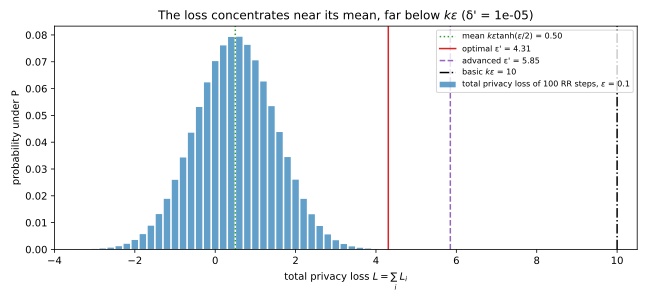
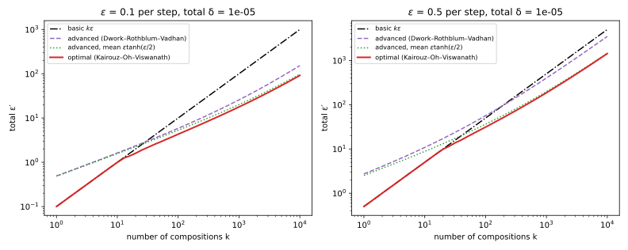

# Advanced and optimal composition

A differentially private system rarely answers one query: a dashboard refreshes a hundred counts, and a training run takes thousands of noisy gradient steps. Each step satisfies $(\varepsilon, \delta)$-differential privacy (DP) on its own, and you need a guarantee for the whole run. [Post-processing, group privacy and composition](02-properties.md#sec-dpprop-comp) gave the first answer, **basic composition**: $k$ mechanisms that are each $\varepsilon$-DP are together $k\varepsilon$-DP. For large $k$ that answer is far too pessimistic. A hundred queries at $\varepsilon = 0.1$ give $k\varepsilon = 10$, which lets an observer multiply its odds between two neighbouring datasets by up to $e^{10} \approx 22{,}000$. Yet at $\delta = 10^{-5}$ the same hundred queries are $(4.31, 10^{-5})$-DP, and no analysis that knows only each query's $\varepsilon$ can say less.

The one idea behind the gap is that the privacy loss of a composition is a sum. Each output is evidence for one dataset or the other, measured by the logarithm of how much likelier the output is under $D$ than under its neighbour $D'$, and the evidence of $k$ outputs adds up. Basic composition charges the largest value that sum can take, as if every step produced its worst output. But a sum of $k$ bounded random terms rarely strays from its mean by more than a multiple of $\sqrt k$. Allowing a small $\delta$ lets you ignore the rare extreme sums and charge for the typical one, and that is **advanced composition**. The best bound of this kind, **optimal composition**, can be computed exactly, because randomized response is the mechanism whose composition is hardest to protect. Both survive an analyst who chooses each query after seeing the earlier answers, which is **adaptive composition**.

The running example is the dashboard: $k = 100$ counts, each released by a mechanism that is $0.1$-DP, under add/remove neighbours. Basic composition charges $\varepsilon = 10$, advanced composition 5.85 at $\delta' = 10^{-5}$, and optimal composition 4.31, and the chapter derives all three from the distribution of the total privacy loss.

## The privacy loss of a composition {#sec-comp-loss}

Every bound in this chapter is a statement about one random variable, the total privacy loss of the run. This section defines it, shows that it is a sum over the steps, and works out its distribution for composed randomized response, which @sec-comp-worst proves is the worst case.

The evidence an output carries is the logarithm of how much likelier it is under $D$ than under $D'$: positive when it favours $D$, negative when it favours $D'$, zero when it says nothing.

::: {#def-comp-loss name="The privacy loss random variable"}
Let $M$ be a mechanism and $D \sim D'$ two neighbouring datasets. Write $P = M(D)$ and $Q = M(D')$ for the two output distributions, with mass functions or densities $p$ and $q$. The **privacy loss** of an output $y$ is the log-ratio $L_{D,D'}(y) = \ln\big(p(y)/q(y)\big)$, which is $+\infty$ where $q(y) = 0 < p(y)$, and the **privacy loss random variable** is the loss of a random output drawn under $D$,
$$L = L_{D,D'}(Y) = \ln\frac{p(Y)}{q(Y)}, \qquad Y \sim P.$$ {#eq-comp-prv}
Its distribution is the **privacy loss distribution** of the pair. Once the pair is fixed, $L(y)$ is short for $L_{D,D'}(y)$.
:::

$(\varepsilon, \delta)$-DP asks that $\Pr_P[S] \le e^\varepsilon\Pr_Q[S] + \delta$ for every set of outputs $S$; with $\delta = 0$ this says $|L| \le \varepsilon$ for every output ([The definition of differential privacy](01-definition.md#sec-dpdef-definition)). For one ordered pair of datasets, the smallest $\delta$ that works at a given $\varepsilon$ is the largest gap $\Pr_P[S] - e^\varepsilon\Pr_Q[S]$, which [Divergences](../part01-prerequisites/03-divergences.md#sec-div-hockey) shows is reached on the outputs with $p(y) > e^\varepsilon q(y)$. That largest gap is the **hockey-stick divergence**,
$$\delta(\varepsilon) = E_{e^\varepsilon}(P\|Q) = \sum_y\big(p(y) - e^\varepsilon q(y)\big)_+, \qquad (x)_+ = \max\{x, 0\},$$
and as a function of $\varepsilon$ it is the **privacy profile** of the pair in one direction. DP asks for it in both directions, for every pair of neighbours.

The smallest case is **randomized response** at level $\varepsilon$ ([The definition of differential privacy](01-definition.md#sec-dpdef-rr)), which reports a person's bit truthfully with probability $t = e^\varepsilon/(1 + e^\varepsilon)$ and flips it otherwise. For a person whose bit is 0 in $D$ and 1 in $D'$, at $\varepsilon = \ln 3$, a report of 0 has probability $\frac34$ under $D$ and $\frac14$ under $D'$, so its loss is $\ln 3$, and a report of 1 has loss $-\ln 3$. The first lemma says that the profile is an average of a function of the loss, so a composition theorem only has to control the distribution of the total loss.

::: {#lem-comp-delta name="The privacy profile is an average of the privacy loss"}
For every pair $(P, Q)$ and every $\varepsilon \ge 0$,
$$\delta(\varepsilon) = E_{e^\varepsilon}(P\|Q) = \sum_y\big(p(y) - e^\varepsilon q(y)\big)_+ = \mathbb E\big[(1 - e^{\varepsilon - L})_+\big] \le \Pr[L > \varepsilon],$$ {#eq-comp-delta}
where the expectation and the probability are over $Y \sim P$. In particular, $\delta(\varepsilon)$ depends on the pair only through the distribution of $L$ under $P$.
:::

::: {.proof}
1. *Factor out $p$.* Each term of the hockey-stick sum is $(p - e^\varepsilon q)_+ = p\,(1 - e^\varepsilon q/p)_+$, and the ratio in the bracket is $e^\varepsilon q/p = e^{\varepsilon - \ln(p/q)} = e^{\varepsilon - L(y)}$. A sum of $p(y)$ times a function of $y$ is the expectation of that function when $Y \sim P$, which gives the equality with the expectation. An output with $q = 0$ has $L = +\infty$ and bracket 1, as it should.
2. *Bound the bracket.* When $L \le \varepsilon$ the exponent $\varepsilon - L$ is non-negative, so $e^{\varepsilon - L} \ge 1$ and the bracket is 0. When $L > \varepsilon$ the bracket is $1 - e^{\varepsilon - L}$, which lies strictly between 0 and 1. So the bracket is at most the indicator $\mathbf 1[L > \varepsilon]$, and its average is at most $\Pr[L > \varepsilon]$.
:::

An output whose loss is at most $\varepsilon$ contributes nothing to $\delta(\varepsilon)$, and an output that is impossible under $D'$ contributes its whole probability. For randomized response at $\ln 3$, the lemma at $\varepsilon = 0$ gives $\delta(0) = \frac34(1 - \frac13) = \frac12$, the total variation distance $\frac34 - \frac14$, as it should. Advanced composition uses the tail bound of the lemma, and optimal composition uses the equality.

Now run $k$ mechanisms. The probability of a whole sequence of outputs is built one step at a time, and the logarithm turns that product into a sum.

::: {#lem-comp-sum name="The privacy loss of a composition is a sum"}
Run $M_1, \dots, M_k$ in sequence, where $M_i$ may depend on the earlier outputs $y_{<i} = (y_1, \dots, y_{i-1})$. Write $p_i(y_i \mid y_{<i})$ for the probability that step $i$ outputs $y_i$ on $D$ after the history $y_{<i}$, and $q_i(y_i \mid y_{<i})$ for the same on $D'$. Then the privacy loss of the whole sequence is the sum of the per-step losses,
$$L(y_1, \dots, y_k) = \sum_{i=1}^k L_i(y_i \mid y_{<i}), \qquad L_i(y_i \mid y_{<i}) = \ln\frac{p_i(y_i \mid y_{<i})}{q_i(y_i \mid y_{<i})},$$ {#eq-comp-sum}
where $L_i$ is the privacy loss of step $i$ alone, for the mechanism that was run after that history. If step $i$ is $\varepsilon$-DP for every history, then $|L_i| \le \varepsilon$, and so $|L| \le k\varepsilon$.
:::

::: {.proof}
1. *Chain rule.* The probability of a sequence of outputs is the probability of $y_1$, times the probability of $y_2$ given $y_1$, and so on. So the joint output has probability $p(y_1, \dots, y_k) = \prod_i p_i(y_i \mid y_{<i})$ on $D$, and likewise with $q_i$ on $D'$.
2. *Log of a ratio of products.* The ratio of the two products is the product of the step-by-step ratios, and the logarithm of a product is the sum of the logarithms, which is @eq-comp-sum.
3. *Basic composition.* If step $i$ is $\varepsilon$-DP whatever the history, each term lies in $[-\varepsilon, \varepsilon]$, and adding $k$ such bounds gives $|L| \le k\varepsilon$.
:::

@tbl-comp-two-rr shows the sum for two independent rounds of randomized response at $\varepsilon = \ln 3$: the output $(0, 1)$ has loss 0 because one report favours $D$ as much as the other favours $D'$.

| Output $(y_1, y_2)$ | $(0, 0)$ | $(0, 1)$ | $(1, 0)$ | $(1, 1)$ |
| --- | --- | --- | --- | --- |
| $p$ (bit 0) | 9/16 | 3/16 | 3/16 | 1/16 |
| $q$ (bit 1) | 1/16 | 3/16 | 3/16 | 9/16 |
| $L = \ln(p/q)$ | $2\ln 3$ | 0 | 0 | $-2\ln 3$ |

: Two rounds of randomized response at $\varepsilon = \ln 3$. The privacy loss of each output is the sum of the two per-round losses. {#tbl-comp-two-rr}

For randomized response the sum is a random walk with steps $\pm\varepsilon$, and its whole distribution can be written down. A report of 0 is the truth under $D$, so it **points to $D$**; under $D$ a report points to $D'$ only when it is a lie.

::: {#prp-comp-rr-loss name="The loss of composed randomized response"}
Compose $k$ independent rounds of randomized response at level $\varepsilon$, on a person whose bit is 0 in $D$ and 1 in $D'$, and let $J$ be the number of rounds whose report points to $D'$. Under $D$,
$$J \sim \mathrm{Bin}(k, 1 - t), \qquad L = (k - 2J)\varepsilon,$$ {#eq-comp-rr-loss}
and the loss has mean, variance and worst-case probability
$$\mathbb E[L] = k\varepsilon\tanh(\varepsilon/2), \qquad \operatorname{Var}(L) = k\varepsilon^2\big(1 - \tanh^2(\varepsilon/2)\big), \qquad \Pr[L = k\varepsilon] = t^k.$$
:::

::: {.proof}
The plan is to find the loss of one round, add $k$ of them, and then compute the mean and variance of one round and multiply by $k$.

1. *One round.* A truthful report has probability $t$ under $D$ and $1 - t$ under $D'$, so its loss is $\ln\frac{t}{1 - t} = \ln e^\varepsilon = \varepsilon$, because $t/(1 - t) = e^\varepsilon$ by the definition of $t$. A lie has the two probabilities swapped and loss $-\varepsilon$.
2. *$k$ rounds.* By @lem-comp-sum the total is the sum of the $k$ per-round losses. The $J$ rounds that point to $D'$ contribute $-\varepsilon$ each and the other $k - J$ contribute $+\varepsilon$, so $L = (k - J)\varepsilon - J\varepsilon = (k - 2J)\varepsilon$. Each round points to $D'$ exactly when it lies, independently with probability $1 - t$, so $J$ counts the successes in $k$ independent trials and is binomial.
3. *Mean.* One round has mean $\varepsilon t - \varepsilon(1 - t) = \varepsilon(2t - 1)$. Substituting $t$ gives $2t - 1 = \frac{e^\varepsilon - 1}{e^\varepsilon + 1}$, and this is $\tanh(\varepsilon/2)$, because $\tanh x = \frac{e^{2x} - 1}{e^{2x} + 1}$. The mean of a sum is the sum of the means, so multiply by $k$.
4. *Variance.* One round takes the two values $\pm\varepsilon$, so its square is always $\varepsilon^2$ and its variance is $\varepsilon^2 - (\text{mean})^2 = \varepsilon^2(1 - \tanh^2(\varepsilon/2))$. Variances of independent terms add, so the total variance is $k$ times this.
5. *The worst case.* The value $L = k\varepsilon$ needs $J = 0$, every report truthful, which has probability $t^k$.
:::

For small $\varepsilon$, $\tanh(\varepsilon/2) \approx \varepsilon/2$, so the mean is about $k\varepsilon^2/2$ and the standard deviation about $\sqrt k\,\varepsilon$, both far below the worst case $k\varepsilon$, which needs all $k$ reports to be truthful. Basic composition guards against an event that will never happen.

By the central limit theorem the total loss is nearly normal (@fig-comp-loss-distribution), the starting point of the Gaussian view of privacy in [Privacy accounting](../part04-privacy-accounting/00-introduction.md). Advanced composition bounds its tail, and optimal composition evaluates @eq-comp-delta on the binomial exactly.

{#fig-comp-loss-distribution}

::: {#exm-comp-hundred-loss}
Release each of the dashboard's $k = 100$ counts by randomized response at $\varepsilon = 0.1$, the worst $0.1$-DP mechanism by @sec-comp-worst. Each round is truthful with probability $t = e^{0.1}/(1 + e^{0.1}) = 0.5250$. By @prp-comp-rr-loss the total loss has mean $100 \times 0.1\tanh(0.05) = 0.4996$ and standard deviation 0.9988. Basic composition's $k\varepsilon = 10$ sits $(10 - 0.50)/1.00 = 9.5$ standard deviations above the mean, and it needs all 100 reports to be truthful, which has probability $t^{100} = 1.0\times10^{-28}$. The loss $(100 - 2J) \times 0.1$ exceeds 4 only when $J < 30$, about 3.5 standard deviations of $J$ (which are 5) below its mean $100(1 - t) = 47.5$. The optimal $\varepsilon'$ at $\delta' = 10^{-5}$ that @sec-comp-optimal computes, 4.3068, sits $(4.3068 - 0.4996)/0.9988 = 3.8$ standard deviations above the mean of the loss.
:::

## Advanced composition {#sec-comp-advanced}

Advanced composition, due to Dwork, Rothblum & Vadhan (2010), charges for the typical value of the sum rather than its largest: it needs only each step's $\varepsilon$, holds for mechanisms chosen in any adaptive way, and grows like $\sqrt k$. Its tool is Azuma's inequality, a version of Hoeffding's inequality for sums whose terms may depend on the earlier terms. Azuma controls how far the sum strays from its mean, so the theorem also needs a bound on the mean of each term, the drift of the sum, and that bound comes first.

The loss can be as large as $\varepsilon$, but on average it is much smaller: when $\varepsilon$ is small, positive and negative losses nearly cancel, and what is left is of order $\varepsilon^2$. The average loss under $P$ is $\sum_y p(y)\ln(p(y)/q(y))$, the Kullback–Leibler (KL) divergence $D_{\mathrm{KL}}(P\|Q)$ of [Divergences](../part01-prerequisites/03-divergences.md#sec-div-kl).

::: {#lem-comp-mean name="The mean privacy loss of an ε-DP pair is second order in ε"}
If $|L| \le \varepsilon$ for every output, then
$$\mathbb E[L] = D_{\mathrm{KL}}(P\|Q) \le \varepsilon(e^\varepsilon - 1).$$ {#eq-comp-drv-mean}
:::

::: {.proof}
1. *Symmetrize.* The KL divergence is never negative ([Divergences](../part01-prerequisites/03-divergences.md#sec-div-kl)): by Jensen's inequality for the concave logarithm, $-D_{\mathrm{KL}}(Q\|P) = \sum_y q\ln(p/q) \le \ln\sum_y q\,(p/q) = \ln 1 = 0$. So adding $D_{\mathrm{KL}}(Q\|P) \ge 0$ to $\mathbb E[L]$ can only increase it, and the two sums combine term by term:
$$\mathbb E[L] \le \sum_y p\ln\frac pq + \sum_y q\ln\frac qp = \sum_y (p - q)\ln\frac pq.$$
2. *Use the bound on the loss.* Each $|\ln(p/q)|$ is at most $\varepsilon$, so the sum is at most $\varepsilon\sum_y|p - q|$, and the total difference $\sum_y|p - q|$ is itself small when $P$ and $Q$ are close.
3. *Bound the total difference.* Write $\sum_y|p - q| = \sum_y q\,|p/q - 1|$. The ratio $p/q$ lies in $[e^{-\varepsilon}, e^\varepsilon]$, and on that interval $|p/q - 1|$ is largest at the upper end, where it is $e^\varepsilon - 1$ (at the lower end it is $1 - e^{-\varepsilon}$, which is smaller). Since the $q(y)$ sum to 1, $\sum_y|p - q| \le e^\varepsilon - 1$, and the bound follows.
:::

So the mean is of order $\varepsilon^2$: at $\varepsilon = 0.1$ the bound is $0.1(e^{0.1} - 1) = 0.0105$, but it is not tight: @thm-comp-tanh-mean in @sec-comp-worst gives the best bound, $\varepsilon\tanh(\varepsilon/2)$, which is 0.0050 at $\varepsilon = 0.1$ and 0.4621 at $\varepsilon = 1$, where the lemma gives 1.7183. @sec-apx-ccomp-advanced in the appendices derives the same bound from scratch for a single count, with every number shown.

::: {#thm-comp-advanced name="Advanced composition (Dwork, Rothblum & Vadhan 2010)"}
Fix $k$ and $\varepsilon > 0$ in advance, and let $M_1, \dots, M_k$ be mechanisms, each chosen after seeing the earlier outputs, such that every $M_i$ is $\varepsilon$-DP for every history. Then for every $\delta' > 0$ the composition is $(\varepsilon', \delta')$-DP with
$$\varepsilon' = \varepsilon\sqrt{2k\ln(1/\delta')} + k\varepsilon(e^\varepsilon - 1).$$ {#eq-comp-advanced}
:::

::: {.proof}
The plan is to write the loss as a sum, centre each term by its conditional mean to get a martingale, bound the fluctuation of the martingale by Azuma's inequality and the drift by @lem-comp-mean, and convert the tail bound into a $\delta$ by @lem-comp-delta.

1. *The loss is a sum.* By @lem-comp-sum, $L = \sum_i L_i$, where $L_i$ is the loss of step $i$ given the history $y_{<i}$.
2. *Each term is bounded, given the past.* For every fixed history, step $i$ is $\varepsilon$-DP, so $L_i \in [-\varepsilon, \varepsilon]$.
3. *Each term has a small conditional mean.* Given the history, the average of $L_i$ over step $i$'s output is $m_i = \mathbb E[L_i \mid y_{<i}] = \sum_{y_i}p_i\ln(p_i/q_i)$, the KL divergence of step $i$'s pair. So $m_i \le \varepsilon(e^\varepsilon - 1)$ by @lem-comp-mean.
4. *Centre the terms to get a martingale.* A **martingale** is a running sum whose next increment has mean zero given everything that happened before. Subtracting each term's conditional mean makes one: $W_k = \sum_i(L_i - m_i)$ has increments with conditional mean zero. Given the past, $L_i - m_i$ lies in $[-\varepsilon - m_i, \varepsilon - m_i]$, an interval of length $c_i = 2\varepsilon$, whose position depends on the past but whose length does not.
5. *Azuma.* The Azuma–Hoeffding inequality of [Concentration inequalities](../part01-prerequisites/02-concentration.md) says that if each increment of a martingale has conditional mean zero and lies, given the past, in an interval of length $c_i$ fixed in advance, then the sum exceeds $s$ with probability at most $\exp(-2s^2/\sum_i c_i^2)$. It holds because Hoeffding's lemma bounds each increment's conditional moment generating function using only its mean and the length of its range, and these bounds multiply one step at a time. With $c_i = 2\varepsilon$, so that $\sum_i c_i^2 = 4k\varepsilon^2$,
$$\Pr[W_k \ge s] \le \exp\left(-\frac{2s^2}{4k\varepsilon^2}\right) = \exp\left(-\frac{s^2}{2k\varepsilon^2}\right).$$
6. *Choose the level.* Setting the right side to $\delta'$ and solving, $s^2 = 2k\varepsilon^2\ln(1/\delta')$, gives $s = \varepsilon\sqrt{2k\ln(1/\delta')}$. The loss is the fluctuation plus the drift, $L = W_k + \sum_i m_i \le W_k + k\varepsilon(e^\varepsilon - 1)$. So if $L$ exceeds $\varepsilon' = s + k\varepsilon(e^\varepsilon - 1)$, then $W_k$ must exceed $s$, and $\Pr[L > \varepsilon'] \le \delta'$.
7. *Convert.* By @lem-comp-delta, $\delta(\varepsilon') \le \Pr[L > \varepsilon'] \le \delta'$. The same argument with $D$ and $D'$ swapped gives the other direction, so the composition is $(\varepsilon', \delta')$-DP.
:::

The gain is $\sqrt k$ instead of $k$. The price is $\delta'$ and the factor $\sqrt{2\ln(1/\delta')}$, which is $\sqrt{2 \times 11.51} = 4.80$ at $\delta' = 10^{-5}$, so the theorem beats basic composition only once $k$ is large. It wins when $\varepsilon\sqrt{2k\ln(1/\delta')} + k\varepsilon(e^\varepsilon - 1) < k\varepsilon$. Dividing by $k\varepsilon$ leaves $\sqrt{2\ln(1/\delta')/k} < 2 - e^\varepsilon$, and squaring, which needs $\varepsilon < \ln 2$ so that $2 - e^\varepsilon > 0$, gives the crossover:
$$k > \frac{2\ln(1/\delta')}{(2 - e^\varepsilon)^2}.$$
Setting the leading term equal to a target $\varepsilon_{\mathrm{total}}$ gives each step $\varepsilon \approx \varepsilon_{\mathrm{total}}/\sqrt{2k\ln(1/\delta')}$, where basic composition would allow only $\varepsilon_{\mathrm{total}}/k$. @cor-comp-advanced-general in @sec-comp-optimal extends the theorem to $(\varepsilon, \delta)$-DP steps at a cost of $k\delta$, with the sharper drift $k\varepsilon\tanh(\varepsilon/2)$.

The bound is loose in three places: Azuma assumes each increment has the largest variance its range allows, the mean bound of @lem-comp-mean is a factor 2 too large for small $\varepsilon$, and the tail bound of @lem-comp-delta counts every output above $\varepsilon'$ in full. At $k = 100$ and $\varepsilon = 0.1$, the exact $\delta$ at the advanced $\varepsilon' = 5.85$ is $1.96\times10^{-9}$, not $10^{-5}$.

::: {#exm-comp-hundred-advanced}
Take the dashboard's $k = 100$ counts at $\varepsilon = 0.1$ and $\delta' = 10^{-5}$. The Azuma term is $0.1\sqrt{200\ln10^5} = 0.1\sqrt{2302.6} = 4.7985$, and the mean term is $100 \times 0.1(e^{0.1} - 1) = 1.0517$, so $\varepsilon' = 5.8502$, against 10 for basic composition. The crossover is $23.03/0.8948^2 = 28.8$, so advanced composition wins from $k = 29$ on (@fig-comp-epsilon-vs-k, and @tbl-comp-vs-k in @sec-comp-optimal). At $k = 10{,}000$ the mean term dominates: it costs 105 of the total 153, against 48 for the Azuma term, and the sharper drift of @cor-comp-advanced-general costs 50 instead.

*Laplace noise in many dimensions.* The same arithmetic explains why the Gaussian mechanism wins in high dimension. Take $d$ dense counts, where one record can move every count by 1, at $\varepsilon = 1$ and $\delta = 10^{-5}$. Laplace noise of scale $b$ has root-mean-square error $\sqrt2\,b$, and on the whole vector it must use the $\ell_1$ sensitivity $d$, so $b = d/\varepsilon$. Composing $d$ separate Laplace mechanisms instead, at the largest $\varepsilon_0$ whose composition stays at 1, gives error $\sqrt2/\varepsilon_0$: for $d = 1000$, $\varepsilon_0 = 0.00645$ by @eq-comp-advanced, or $0.00849$ by the optimal composition of @sec-comp-optimal. @tbl-comp-dense adds the Gaussian mechanism of [the Laplace and Gaussian mechanisms](03-laplace-gaussian.md#sec-lg-high-dim). Composed Laplace noise grows like $\sqrt d$ and stays within a factor of 1.9 of the Gaussian, while pure-DP Laplace noise falls behind by a factor of 38 at $d = 10{,}000$. So the $\sqrt d$ gain comes from allowing $\delta > 0$, not from the Gaussian density.

| $d$ | Laplace, pure DP | Laplace, advanced composition | Laplace, optimal composition | Gaussian |
| --- | --- | --- | --- | --- |
| 100 | 141.4 | 69.3 | 52.3 | 37.3 |
| 1,000 | 1,414.2 | 219.2 | 166.6 | 118.0 |
| 10,000 | 14,142.1 | 693.0 | 527.5 | 373.1 |

: Root-mean-square error per count for $d$ dense counts at $\varepsilon = 1$ and, except in the first column, $\delta = 10^{-5}$. {#tbl-comp-dense}

:::

{#fig-comp-epsilon-vs-k}

## The worst mechanism {#sec-comp-worst}

Advanced composition is one bound among many, and the question is which is best. Kairouz, Oh & Viswanath (2015) answered it with post-processing: every $(\varepsilon, \delta)$-DP mechanism is a post-processing of one version of randomized response, so no composition of such mechanisms can be worse than composed randomized response. This section builds that mechanism and proves the reduction, and @sec-comp-optimal composes it.

A **channel** $K$ is a table of probabilities $K(y \mid z)$: given an input $z$, it draws an output $y$ without looking at the data, and feeding a distribution $P^\star$ through it gives $P^\star K(y) = \sum_z P^\star(z)K(y \mid z)$. The data-processing inequality of [Divergences](../part01-prerequisites/03-divergences.md#sec-div-dpi) says that a channel never increases the hockey-stick divergence or the KL divergence. For the hockey-stick the reason is short: the gap $P^\star K(S) - e^{\varepsilon'}Q^\star K(S)$ on a set $S$ is $\sum_z K(S \mid z)\big(P^\star(z) - e^{\varepsilon'}Q^\star(z)\big)$ with weights in $[0, 1]$, so it is at most the sum of the positive brackets, which is the hockey-stick before the channel.

The worst mechanism must spend both parameters. It spends $\delta$ by announcing, with probability $\delta$, which dataset it ran on, and $\varepsilon$ by otherwise running randomized response at level $\varepsilon$.

::: {#def-comp-four-point name="The four-point randomized response"}
The **four-point pair** $(P^\star, Q^\star)$ at level $(\varepsilon, \delta)$ is the pair of output distributions in @tbl-comp-four-point: with probability $\delta$ the mechanism announces its dataset outright, and otherwise it reports the person's bit through randomized response at level $\varepsilon$, with $t = e^\varepsilon/(1 + e^\varepsilon)$.

| Output | "flag $D$" | 0 | 1 | "flag $D'$" |
| --- | --- | --- | --- | --- |
| $P^\star$ (on $D$) | $\delta$ | $(1 - \delta)t$ | $(1 - \delta)(1 - t)$ | 0 |
| $Q^\star$ (on $D'$) | 0 | $(1 - \delta)(1 - t)$ | $(1 - \delta)t$ | $\delta$ |
| Privacy loss | $+\infty$ | $+\varepsilon$ | $-\varepsilon$ | $-\infty$ |

: The four-point randomized response of Kairouz, Oh & Viswanath at level $(\varepsilon, \delta)$. {#tbl-comp-four-point}

:::

Every $(\varepsilon, \delta)$-DP pair can be produced from the four-point pair by one channel, and for $\delta = 0$ the channel has a closed form.

::: {#thm-comp-worst name="Randomized response is the worst (ε, δ)-DP mechanism"}
Let $(P, Q)$ be a pair of distributions on a common set of outputs that satisfies $(\varepsilon, \delta)$-DP in both directions. Then there is a channel $K$ with $P = P^\star K$ and $Q = Q^\star K$, where $(P^\star, Q^\star)$ is the four-point pair of @def-comp-four-point. For $\delta = 0$ the channel is
$$K(y \mid 0) = \frac{e^\varepsilon p(y) - q(y)}{e^\varepsilon - 1}, \qquad K(y \mid 1) = \frac{e^\varepsilon q(y) - p(y)}{e^\varepsilon - 1}.$$ {#eq-comp-channel}
:::

::: {.proof}
For $\delta = 0$, solve for the channel and check that it reproduces the pair; for $\delta > 0$, the last step says why the channel exists and where it is built.

1. *Solve for the channel.* Plain randomized response outputs 0, the report that points to $D$, with probability $t$ on $D$ and $1 - t$ on $D'$. So the channel must satisfy, for every output $y$ of the target pair, $p(y) = tK(y \mid 0) + (1 - t)K(y \mid 1)$ and $q(y) = (1 - t)K(y \mid 0) + tK(y \mid 1)$. These are two linear equations in the two unknowns $K(y \mid 0)$ and $K(y \mid 1)$, and solving them with $t/(1 - t) = e^\varepsilon$ gives @eq-comp-channel.
2. *The rows are distributions.* A channel's rows must be non-negative and sum to 1. $K(y \mid 0) \ge 0$ exactly when $e^\varepsilon p(y) \ge q(y)$, and $K(y \mid 1) \ge 0$ exactly when $e^\varepsilon q(y) \ge p(y)$. Both hold for every $y$ because the pair is $\varepsilon$-DP. Since $p$ and $q$ each sum to 1, each row sums to $(e^\varepsilon - 1)/(e^\varepsilon - 1) = 1$.
3. *They reproduce $P$.* Mixing the rows with randomized response's probabilities on $D$ gives
$$t\,K(y \mid 0) + (1 - t)K(y \mid 1) = \frac{\big(te^\varepsilon - (1 - t)\big)p(y) + \big((1 - t)e^\varepsilon - t\big)q(y)}{e^\varepsilon - 1}.$$
With $t = e^\varepsilon/(1 + e^\varepsilon)$, $(1 - t)e^\varepsilon = t$, so the coefficient of $q$ is 0. The coefficient of $p$ is $\frac{te^\varepsilon - (1 - t)}{e^\varepsilon - 1} = \frac{(e^{2\varepsilon} - 1)/(1 + e^\varepsilon)}{e^\varepsilon - 1} = 1$, since $e^{2\varepsilon} - 1 = (e^\varepsilon - 1)(e^\varepsilon + 1)$.
4. *They reproduce $Q$.* The same computation with $t$ and $1 - t$ swapped.
5. *The case $\delta > 0$, cited.* The **trade-off function** of a pair gives, for each false positive rate, the smallest false negative rate any test between $P$ and $Q$ can reach. [The definition of differential privacy](01-definition.md#sec-dpdef-testing) shows that a pair is $(\varepsilon, \delta)$-DP exactly when its trade-off function lies above a boundary $f_{\varepsilon,\delta}$ made of two straight lines, on which the four-point pair sits (@fig-comp-tradeoff-region, left). So every $(\varepsilon, \delta)$-DP pair is at least as hard to test as $(P^\star, Q^\star)$, at every level. Blackwell's theorem (1953) says that a pair is at least as hard to test as another at every level exactly when it is a post-processing of the other. Kairouz, Oh & Viswanath (2015) construct the channel, and @sec-apx-mech-fourpoint in the appendices derives it step by step, by splitting each distribution into an $\varepsilon$-DP part of mass $1 - \delta$ and a leftover of mass $\delta$.
:::

{#fig-comp-tradeoff-region}

The same reduction sharpens the drift term of advanced composition, because the KL divergence, like the hockey-stick, can only shrink under a channel.

::: {#thm-comp-tanh-mean name="The sharp mean loss"}
If the pair $(P, Q)$ is $\varepsilon$-DP in both directions, then
$$\mathbb E[L] = D_{\mathrm{KL}}(P\|Q) \le \varepsilon\tanh(\varepsilon/2),$$ {#eq-comp-tanh-mean}
with equality for randomized response at level $\varepsilon$.
:::

::: {.proof}
1. *Reduce to randomized response.* By @thm-comp-worst with $\delta = 0$, the pair is a post-processing of randomized response at level $\varepsilon$ through the channel @eq-comp-channel. Passing two distributions through the same channel can only make them more alike, which is the data-processing inequality for the KL divergence, so $D_{\mathrm{KL}}(P\|Q)$ is at most the KL divergence of randomized response.
2. *The KL divergence of randomized response.* Its mean loss is $\varepsilon t - \varepsilon(1 - t) = \varepsilon\tanh(\varepsilon/2)$, by step 3 of the proof of @prp-comp-rr-loss with $k = 1$, and randomized response itself reaches it.
:::

::: {#exm-comp-channel}
The dashboard's randomized-response steps need no channel, so take another pair: $P = (0.5, 0.3, 0.2)$ and $Q = (0.2, 0.3, 0.5)$ have largest loss $\ln(0.5/0.2) = \ln 2.5 = 0.9163$, below $\ln 3 = 1.0986$, so the pair is $\ln 3$-DP. With $e^\varepsilon = 3$, @eq-comp-channel gives $K(\cdot \mid 0) = (3P - Q)/2 = (0.65, 0.30, 0.05)$ and $K(\cdot \mid 1) = (3Q - P)/2 = (0.05, 0.30, 0.65)$ (@fig-comp-tradeoff-region, right). Randomized response at $\ln 3$ has $t = \frac34$, and the first output comes back as $\frac34 \times 0.65 + \frac14 \times 0.05 = 0.5$. As @thm-comp-tanh-mean requires, the pair's KL divergence, $0.5\ln 2.5 + 0.3\ln 1 + 0.2\ln 0.4 = 0.2749$, is below randomized response's $\ln 3 \times \frac12 = 0.5493$, and its $\delta(0)$, the total variation $0.5 - 0.2 = 0.3$, is below 0.5.
:::

## Optimal composition {#sec-comp-optimal}

With the worst mechanism in hand, the best bound for $k$ mechanisms known only by their $(\varepsilon, \delta)$ is the exact profile of $k$ copies of the four-point pair. Either some step raises a flag, and the output counts in full, or none does, and the loss is binomial by @eq-comp-rr-loss. @lem-comp-delta turns that binomial loss into a $\delta$, written $\delta_{\mathrm{RR}}(\varepsilon')$.

::: {#thm-comp-kov name="Optimal composition (Kairouz, Oh & Viswanath 2015)"}
For every composition of $k$ mechanisms that are each $(\varepsilon, \delta)$-DP, adaptive or not, and every $\varepsilon' \ge 0$,
$$\delta(\varepsilon') \le 1 - (1 - \delta)^k\big(1 - \delta_{\mathrm{RR}}(\varepsilon')\big), \qquad \delta_{\mathrm{RR}}(\varepsilon') = \sum_{j=0}^k\binom kj t^{k-j}(1 - t)^j\big(1 - e^{\varepsilon' - (k - 2j)\varepsilon}\big)_+,$$ {#eq-comp-kov}
with equality for $k$ independent copies of the four-point pair. The binomial weight $\binom kj t^{k-j}(1 - t)^j$ is the probability that exactly $j$ of the $k$ reports point to $D'$. At the points where $\varepsilon'$ equals one of the values the loss can take, $\varepsilon' = (k - 2i)\varepsilon$ for $i = 0, \dots, \lfloor k/2\rfloor$, the positive part can be dropped and the sum becomes a ratio of exponentials,
$$\delta_{\mathrm{RR}}\big((k - 2i)\varepsilon\big) = \frac{\sum_{\ell=0}^{i-1}\binom k\ell\big(e^{(k-\ell)\varepsilon} - e^{(k - 2i + \ell)\varepsilon}\big)}{(1 + e^\varepsilon)^k},$$ {#eq-comp-kov-grid}
which is the formula of Kairouz, Oh & Viswanath's main theorem.
:::

::: {.proof}
The plan is to show that a composition, adaptive or not, is a post-processing of $k$ independent four-point pairs, so that the data-processing inequality reduces the bound to the four-point product, and then to evaluate @lem-comp-delta on that product.

1. *Non-adaptive.* If step $i$ is $P_i = P^\star K_i$ and $Q_i = Q^\star K_i$ by @thm-comp-worst, then the product $P_1 \times \dots \times P_k$ is $(P^\star)^k$ followed by the channel that applies $K_i$ to coordinate $i$, independently. So $\delta(\varepsilon')$ of the composition is at most that of $(P^\star)^k$ against $(Q^\star)^k$, by the data-processing inequality.
2. *Adaptive.* Now the mechanism of step $i$, and so its channel $K_i^{y_{<i}}$, may depend on the earlier outputs. The trick is to draw all the four-point outputs $z_i$ first and apply the channels afterwards. Draw $z_1, \dots, z_k$ from $(P^\star)^k$, then $y_1 \sim K_1(\cdot \mid z_1)$, then $y_2 \sim K_2^{y_1}(\cdot \mid z_2)$, and so on. Given $y_{<i}$, $z_i$ is still a fresh draw from $P^\star$, because it was drawn independently of $z_{<i}$ and $y_{<i}$ depends only on those. So $y_i$ has law $P^\star K_i^{y_{<i}} = P_i(\cdot \mid y_{<i})$, and the sequence has exactly the law of the adaptive run on $D$. The same sampler fed with $(Q^\star)^k$ produces the run on $D'$, so the adaptive run is still one post-processing of $(P^\star)^k$ against $(Q^\star)^k$.
3. *The four-point product.* With probability $1 - (1 - \delta)^k$ some coordinate of $(P^\star)^k$ shows "flag $D$", which $(Q^\star)^k$ never produces, so there $L = +\infty$, the bracket $(1 - e^{\varepsilon' - L})_+$ is 1, and the output contributes its full probability to @eq-comp-delta. Outputs with "flag $D'$" have probability 0 under $(P^\star)^k$. Otherwise, with probability $(1 - \delta)^k$, all coordinates are plain randomized response; the factor $(1 - \delta)$ per coordinate cancels in the ratio, so $L = (k - 2J)\varepsilon$ by @eq-comp-rr-loss, and @lem-comp-delta on this part gives $(1 - \delta)^k\delta_{\mathrm{RR}}(\varepsilon')$. Adding the two parts gives $1 - (1 - \delta)^k + (1 - \delta)^k\delta_{\mathrm{RR}}(\varepsilon')$, which is @eq-comp-kov.
4. *Equality.* The four-point pair is itself a mechanism, on a dataset of one bit, and it is $(\varepsilon, \delta)$-DP. Composing $k$ independent copies of it gives equality, so no better bound can hold for the whole class.
5. *The grid formula.* At $\varepsilon' = (k - 2i)\varepsilon$, the terms of $\delta_{\mathrm{RR}}$ with $j \ge i$ vanish, because their loss $(k - 2j)\varepsilon$ is at most $\varepsilon'$ and the bracket is 0. For $j = \ell < i$ the bracket is positive and the positive part can be dropped. Since $t = e^\varepsilon/(1 + e^\varepsilon)$ and $1 - t = 1/(1 + e^\varepsilon)$, the weight is $\binom k\ell t^{k-\ell}(1-t)^\ell = \binom k\ell e^{(k-\ell)\varepsilon}/(1 + e^\varepsilon)^k$. Multiplying it by $e^{\varepsilon' - (k - 2\ell)\varepsilon} = e^{(2\ell - 2i)\varepsilon}$ turns $e^{(k-\ell)\varepsilon}$ into $e^{(k - 2i + \ell)\varepsilon}$, which is @eq-comp-kov-grid.
:::

"Optimal" means optimal for the class: @eq-comp-kov is the best you can say about $k$ mechanisms *if all you know about each is its $(\varepsilon, \delta)$*. A Laplace mechanism with the same $\varepsilon$ does a little better, because its loss often lies strictly inside $(-\varepsilon, \varepsilon)$: its mean loss at $\varepsilon = 1$ is 0.3679, against 0.4621 for randomized response.

A single $(\varepsilon, \delta)$ also throws information away. The privacy loss of a Gaussian step is normal ([The Laplace and Gaussian mechanisms](03-laplace-gaussian.md)), so $k$ steps with noise $\sigma$ on a sensitivity-1 query have exactly the loss of one step with noise $\sigma/\sqrt k$. @fig-comp-gaussian shows what a point summary costs: with $\sigma = 20$, $k = 1{,}000$ steps are exactly $(7.51, 10^{-5})$-DP, but the best per-step split of $\delta$ followed by optimal composition gives 62.7. Composing the curves themselves is the subject of [Privacy accounting](../part04-privacy-accounting/00-introduction.md).

{#fig-comp-gaussian}

The four-point product also extends advanced composition to steps with $\delta > 0$, and with the sharper drift: the flags cost their probability, and the rest is randomized response.

::: {#cor-comp-advanced-general name="Advanced composition for (ε, δ)-DP steps, with the sharp drift"}
Fix $k$, $\varepsilon > 0$ and $\delta \ge 0$ in advance, and let $M_1, \dots, M_k$ be mechanisms, each chosen after seeing the earlier outputs, such that every $M_i$ is $(\varepsilon, \delta)$-DP for every history. Then for every $\delta' > 0$ the composition is $(\varepsilon', k\delta + \delta')$-DP with $\varepsilon'$ from @eq-comp-advanced, and also with
$$\varepsilon' = \varepsilon\sqrt{2k\ln(1/\delta')} + k\varepsilon\tanh(\varepsilon/2).$$ {#eq-comp-advanced-tanh}
:::

::: {.proof}
1. *Reduce to the four-point product.* By step 2 of the proof of @thm-comp-kov, the adaptive run is a post-processing of $k$ independent copies of the four-point pair, and a channel never increases $\delta(\varepsilon')$, so it suffices to bound the $k$-fold four-point product.
2. *The flags.* Some coordinate shows "flag $D$" with probability $1 - (1 - \delta)^k$, which is at most $k\delta$ because the chance that at least one of $k$ events happens is at most the sum of their chances. Those outputs are impossible under $D'$ and contribute their whole probability to $\delta(\varepsilon')$, so the flags cost at most $k\delta$.
3. *The rest.* Otherwise all $k$ coordinates are plain randomized response at level $\varepsilon$, which are $k$ independent $\varepsilon$-DP steps, so @thm-comp-advanced bounds their contribution at the $\varepsilon'$ of @eq-comp-advanced by $\delta'$. Their drift is exactly $k\varepsilon\tanh(\varepsilon/2)$ by @prp-comp-rr-loss, so step 6 of that proof with this drift in place of $k\varepsilon(e^\varepsilon - 1)$ gives the same $\delta'$ at the $\varepsilon'$ of @eq-comp-advanced-tanh. Adding the two parts gives $k\delta + \delta'$.
:::

::: {#exm-comp-hundred-optimal}
For the dashboard's $k = 100$ steps at $\varepsilon = 0.1$, the optimal $\varepsilon'$ at $\delta' = 10^{-5}$ is 4.3068, and the sharper advanced bound of @eq-comp-advanced-tanh is $4.7985 + 0.4996 = 5.2981$. The optimal value is 19% below it ($4.3068/5.2981 = 0.81$), 26% below the original advanced bound ($4.3068/5.8502 = 0.74$) and 57% below basic composition's 10. @tbl-comp-vs-k compares the four bounds over $k$; at $k = 10$, below the crossover, both advanced bounds are worse than basic composition, while the optimal bound is slightly better, 0.994 against 1. If each step also has $\delta = 5\times10^{-8}$, the flags use up $1 - (1 - \delta)^{100} = 5.0\times10^{-6}$ of a total $\delta = 10^{-5}$, and the optimal $\varepsilon'$ rises to 4.4469; advanced composition with the remaining $\delta' = 5\times10^{-6}$ gives 5.9926.

| $k$ | Basic $k\varepsilon$ | Advanced, @eq-comp-advanced | Advanced, @eq-comp-advanced-tanh | Optimal |
| --- | --- | --- | --- | --- |
| 10 | 1.000 | 1.623 | 1.567 | 0.994 |
| 100 | 10.000 | 5.850 | 5.298 | 4.307 |
| 1,000 | 100.000 | 25.691 | 20.170 | 17.787 |
| 10,000 | 1,000.000 | 153.156 | 97.944 | 91.691 |

: Total $\varepsilon'$ at $\delta' = 10^{-5}$ for $k$ mechanisms that are each $0.1$-DP. {#tbl-comp-vs-k}

*Computing the bound.* @eq-comp-kov-grid as printed divides two numbers that overflow: at $\varepsilon = 1$ and $k = 1{,}000$, $(1 + e)^{1000} \approx 10^{570}$, beyond the largest double. The chapter's script (@sec-comp-code) adds the non-negative terms of @eq-comp-kov in log space with a log-sum-exp, so nothing overflows and nothing cancels. Between two grid points $\delta_{\mathrm{RR}}(\varepsilon') = A - e^{\varepsilon'}B$, where $A$ and $B$ are the masses under $P$ and $Q$ of the outputs with loss above $\varepsilon'$. Both are constant between grid points, so the optimal $\varepsilon'$ for a target $\delta$ is $\ln((A - \delta)/B)$ on the right interval, exactly. With a different $\varepsilon_i$ per step the loss depends on which steps lied, not just how many, and the exact bound is #P-complete to compute (Murtagh & Vadhan, 2016); for a few steps you can still enumerate.
:::

## Adaptive composition {#sec-comp-adaptive}

In practice the next query depends on the last answer: an analyst zooms into the largest bin of a noisy histogram, and a training loop computes each gradient at parameters that came from earlier noisy gradients. The proofs above were written to cover this; this section makes the model explicit, collects the guarantees in one statement, and says where adaptivity does break things.

::: {#def-comp-experiment name="The k-fold adaptive composition experiment"}
An adversary plays $k$ rounds against a hidden bit $b \in \{0, 1\}$, fixed for the whole run (Dwork, Rothblum & Vadhan 2010). In round $i$ it looks at the outputs $y_1, \dots, y_{i-1}$ so far and, as any function of them, chooses a pair of neighbouring datasets $D_i^0 \sim D_i^1$ and a mechanism $M_i$ from a class of $(\varepsilon, \delta)$-DP mechanisms; it then receives $y_i \sim M_i(D_i^b)$. Everything the adversary sees, its **view**, is the sequence $V = (y_1, \dots, y_k)$. A composition theorem holds for the experiment when, for every adversary, the distributions of the view under $b = 0$ and under $b = 1$ satisfy its guarantee in both directions.
:::

The claim is that every bound of this chapter holds in the experiment.

::: {#thm-comp-adaptive name="Every composition bound holds under adaptive choice"}
In the experiment of @def-comp-experiment, with $k$, $\varepsilon$ and $\delta$ fixed before the interaction starts, the views under $b = 0$ and $b = 1$ satisfy basic composition, $(k\varepsilon, k\delta)$-DP; advanced composition, $(\varepsilon', k\delta + \delta')$-DP with $\varepsilon'$ from @eq-comp-advanced or @eq-comp-advanced-tanh; and optimal composition, @eq-comp-kov.
:::

::: {.proof}
Every argument above looked at one step at a time, given the history so far, and once the history is fixed, so is the adversary's choice.

1. *The loss of the view is a sum.* @lem-comp-sum applies with each term $L_i(y_i \mid y_{<i})$ computed for the mechanism and the pair of datasets chosen after $y_{<i}$. Nothing in @lem-comp-delta, @lem-comp-sum or @lem-comp-mean needs the pair to be the same in every round; each step only needs its own pair to be neighbours.
2. *Basic composition.* For $\delta = 0$, $|L_i| \le \varepsilon$ for every history, so $|L| \le k\varepsilon$ by @lem-comp-sum. For $\delta > 0$, step 1 of the proof of @cor-comp-advanced-general reduces the run to $k$ independent four-point pairs: a flag shows with probability at most $k\delta$, and otherwise $|L| \le k\varepsilon$, so $\delta(k\varepsilon) \le k\delta$.
3. *Advanced composition.* Azuma's inequality needs only conditional statements, given the past: a conditional mean of zero and a range of fixed length. That is the setting of steps 2 to 5 of the proof of @thm-comp-advanced, and the $\delta > 0$ extension goes through the same reduction as step 2.
4. *Optimal composition.* Step 2 of the proof of @thm-comp-kov builds the adaptive run from the four-point product with history-dependent channels.
:::

Adaptivity does not allow choosing the privacy parameters on the fly. If the analyst picks $\varepsilon_i$ after seeing earlier outputs, the range length $c_i = 2\varepsilon_i$ in the proof of @thm-comp-advanced depends on the history, and Azuma's inequality needs it fixed in advance. A rule such as "keep querying until the budget is spent" needs its own theorem, a **privacy filter** (Rogers, Roth, Ullman & Vadhan, 2016), and reporting the privacy spent so far at every moment needs a **privacy odometer**; both are treated in [Adaptive composition](../part04-privacy-accounting/08-adaptive-composition.md#sec-adapt-dp-filters). For pure DP with basic composition the naive rule is fine, because $|L| \le \sum_i\varepsilon_i$ holds pointwise whatever order the $\varepsilon_i$ came in.

Nor does adaptivity allow choices that depend on the data rather than the outputs. A system that answers private counts *until the true count of some group crosses a threshold* reveals that count through the number of answers it gives, so every answer can be $\varepsilon$-DP and the whole run still not be DP for any finite $\varepsilon$. A rule that stops early within a fixed $k$, looking only at the noisy answers, is covered, because the stopping time is then a post-processing of the outputs.

::: {#exm-comp-analyst}
The script simulates an analyst who, at each of the dashboard's $k = 100$ steps, chooses the next mechanism from the last output. If the previous output pointed to $D$, meaning its privacy loss was positive, the analyst asks a Laplace query at $\varepsilon = 0.1$; otherwise a randomized-response query at $\varepsilon = 0.1$. Over 100,000 simulated runs on $D$, @tbl-comp-adaptive estimates $\delta(2)$ through @eq-comp-delta, by averaging $(1 - e^{2 - L})_+$ over the simulated total losses $L$. The exact Laplace mean is 100 times the per-step KL divergence of two Laplace densities whose centres are $\varepsilon$ scale units apart, $e^{-\varepsilon} + \varepsilon - 1$.

| Composition of 100 steps at $\varepsilon = 0.1$ | Mean total loss | $\delta(\varepsilon' = 2)$ |
| --- | --- | --- |
| Randomized response, exact (@eq-comp-kov) | 0.4996 | 0.0201 |
| Randomized response, simulated | — | 0.0198 |
| Laplace, simulated | 0.4838 (exact 0.4837) | 0.0189 |
| Adaptive mix, simulated | 0.4971 | 0.0196 |

: The privacy loss of 100 steps of $0.1$-DP mechanisms, composed non-adaptively and by an adaptive analyst. {#tbl-comp-adaptive}

The adaptive analyst's $\delta(2)$ lies between the two non-adaptive compositions, and below the optimal bound, as @thm-comp-adaptive requires. @fig-comp-delta-curves shows the whole curves: the three compositions nearly coincide, and the advanced-composition points lie far to the right of them.
:::

{#fig-comp-delta-curves}

## Code {#sec-comp-code}

The script [code/composition.py](../../code/part03-dp-foundations/composition.py) computes every number in this chapter and draws every figure. It checks the log-space optimal bound against brute-force enumeration, in floating point and in exact fractions, and compares simulated Laplace and adaptive compositions with it. From the repository root:

```bash
uv run python code/part03-dp-foundations/composition.py
```

| Experiment | Result |
| --- | --- |
| One step, $\varepsilon = 0.1$ | $t = 0.5250$; mean loss $\varepsilon\tanh(\varepsilon/2) = 0.004996$; bound $\varepsilon(e^\varepsilon - 1) = 0.010517$ |
| One step, $\varepsilon = 1$ | $\tanh$ form 0.4621; $\varepsilon(e^\varepsilon - 1) = 1.7183$; $\varepsilon^2/2 = 0.5$; Laplace mean loss 0.3679 |
| Three-output pair | Largest loss 0.9163; channel rows $(0.65, 0.3, 0.05)$ and $(0.05, 0.3, 0.65)$; KL 0.2749 against 0.5493; $\delta(0)$ 0.3 against 0.5 |
| 100 rounds of randomized response, $\varepsilon = 0.1$ | Mean 0.4996; standard deviation 0.9988; $k\varepsilon$ is 9.5 standard deviations above the mean; $t^k = 1.033\times10^{-28}$ |
| 100 steps, $\varepsilon = 0.1$, $\delta' = 10^{-5}$ | Basic 10; advanced 5.8502; advanced ($\tanh$) 5.2981; optimal 4.3068 |
| Exact $\delta$ at the advanced $\varepsilon'$ | $1.956\times10^{-9}$ at 5.8502; $6.249\times10^{-8}$ at 5.2981 |
| Crossover | Advanced beats basic from $k = 29$ |
| Brute-force checks of @eq-comp-kov | 4,096 sequences at $\varepsilon = 0.5$, $\delta = 0$, $k = 12$ and at $\varepsilon = 0.3$, $\delta = 10^{-3}$, $k = 6$; 1,024 at $\varepsilon = 1$, $\delta = 0.01$, $k = 5$: largest difference $3.9\times10^{-16}$ |
| Exact fractions, $\varepsilon = \ln 3$, $k = 8$ | $\delta(0) = 1759/2048$, error $2.2\times10^{-16}$ |
| Overflow, $\varepsilon = 1$, $k = 1{,}000$ | The grid formula raises `OverflowError`; log space gives $\delta(550) = 6.094\times10^{-4}$ |
| $\varepsilon = 0.01$, $k = 100{,}000$, $\delta' = 10^{-6}$ | Optimal 19.4228; advanced ($\tanh$) 21.6225, 11% above |
| Gaussian, $\sigma = 5$, $k = 100$, $\delta = 10^{-5}$ | Basic 93.178; advanced 89.843; optimal 76.223; exact 9.997 |
| Gaussian, $\sigma = 20$, $k = 1{,}000$, $\delta = 10^{-5}$ | Basic 238.578; advanced 68.008; optimal 62.720; exact 7.511 |
| Dense counts, $\varepsilon = 1$, $\delta = 10^{-5}$ | @tbl-comp-dense; per-count $\varepsilon_0$ at $d = 1000$: 0.00645 (advanced), 0.00849 (optimal) |

: The script's output with the default seed. {#tbl-comp-code}

[tests/test_composition.py](../../tests/test_composition.py) checks that the output still matches.

## Summary {#sec-comp-summary}

| Result | Statement | Use |
| --- | --- | --- |
| @def-comp-loss | $L = \ln\frac{p(Y)}{q(Y)}$ with $Y \sim P$ | The object every accountant of [Privacy accounting](../part04-privacy-accounting/00-introduction.md) composes |
| @lem-comp-delta | $\delta(\varepsilon) = \mathbb E[(1 - e^{\varepsilon - L})_+] \le \Pr[L > \varepsilon]$ | The exact $\delta$ from the loss distribution; the tail bound is the cheap version |
| @lem-comp-sum | $L = \sum_i L_i(y_i \mid y_{<i})$ | Any sequence, adaptive or not; $\lvert L\rvert \le k\varepsilon$ is basic composition |
| @prp-comp-rr-loss | $L = (k - 2J)\varepsilon$, $J \sim \mathrm{Bin}(k, 1 - t)$ | Mean about $k\varepsilon^2/2$, spread about $\sqrt k\,\varepsilon$; the worst case $k\varepsilon$ has probability $t^k$ |
| @lem-comp-mean | $\mathbb E[L] \le \varepsilon(e^\varepsilon - 1)$ for an $\varepsilon$-DP pair | The drift of advanced composition; a factor 2 loose for small $\varepsilon$ |
| @thm-comp-advanced | $\varepsilon' = \varepsilon\sqrt{2k\ln(1/\delta')} + k\varepsilon(e^\varepsilon - 1)$ at slack $\delta'$ | Beats basic composition from $k = 29$ at $\varepsilon = 0.1$, $\delta' = 10^{-5}$; budget $\varepsilon_{\mathrm{total}}/\sqrt{2k\ln(1/\delta')}$ per step |
| @thm-comp-worst | Every $(\varepsilon, \delta)$-DP pair is a post-processing of the four-point pair of @tbl-comp-four-point | Reduces any question about the class to randomized response |
| @thm-comp-tanh-mean | $\mathbb E[L] \le \varepsilon\tanh(\varepsilon/2) \le \min\{\varepsilon^2/2,\ \varepsilon(e^\varepsilon - 1)\}$ | The sharp drift; the mean loss of [Concentrated DP](../part04-privacy-accounting/03-concentrated-dp.md) |
| @thm-comp-kov | $\delta(\varepsilon') \le 1 - (1 - \delta)^k(1 - \delta_{\mathrm{RR}}(\varepsilon'))$, tight for the class | Knowing only each $(\varepsilon, \delta)$, compute it exactly in log space; knowing the mechanism, compose its whole profile, since the point summary can be off by a factor of 8 (62.7 against 7.51) |
| @cor-comp-advanced-general | $(\varepsilon', k\delta + \delta')$-DP with @eq-comp-advanced or @eq-comp-advanced-tanh | The per-step $\delta$ is spent outright; composed Laplace steps cost like $\sqrt d$, and the $\sqrt d$ comes from $\delta$ |
| @thm-comp-adaptive | Every bound holds when each mechanism is chosen from the earlier outputs, with $k$, $\varepsilon$, $\delta$ fixed in advance | Adaptive privacy parameters, or stopping rules that read the raw data, need the filters of [Adaptive composition](../part04-privacy-accounting/08-adaptive-composition.md) |

: The results of this chapter, and where each is used. {#tbl-comp-summary}

## References {#sec-comp-references}

- Dwork, Rothblum & Vadhan, "Boosting and Differential Privacy" (FOCS 2010). Introduces the adaptive composition experiment and advanced composition, @eq-comp-advanced, with the bound $\varepsilon(e^\varepsilon - 1)$ on the mean loss.
- Dwork & Roth, *The Algorithmic Foundations of Differential Privacy* (2014), §3.5: basic and advanced composition with full proofs (Theorem 3.20), including the $\delta > 0$ case through a decomposition of approximate DP pairs.
- Kairouz, Oh & Viswanath, "The Composition Theorem for Differential Privacy" (ICML 2015; IEEE Transactions on Information Theory, 2017). The hypothesis-testing view, the four-point randomized response, the optimal composition formula @eq-comp-kov-grid, and improved closed-form bounds of the advanced kind.
- Blackwell, "Equivalent Comparisons of Experiments" (Annals of Mathematical Statistics, 1953). The theorem that one experiment is uniformly harder to test than another exactly when it is a post-processing of it.
- Murtagh & Vadhan, "The Complexity of Computing the Optimal Composition of Differential Privacy" (TCC 2016). Optimal composition with different $\varepsilon_i$ is #P-complete, with an efficient approximation.
- Vadhan, "The Complexity of Differential Privacy" (2017): composition theorems in the order used here, with the privacy loss as the central object.
- Rogers, Roth, Ullman & Vadhan, "Privacy Odometers and Filters: Pay-as-you-Go Composition" (NeurIPS 2016). Why adaptively chosen privacy parameters need new theorems, and the first filters and odometers.
- Dong, Roth & Su, "Gaussian Differential Privacy" (JRSS Series B, 2022). Composition of whole trade-off curves, and the central limit theorem for composition that the loss distribution of @sec-comp-loss foreshadows.
