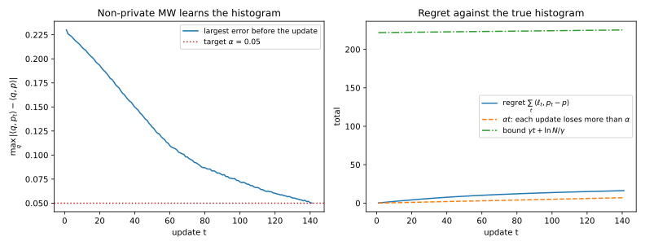
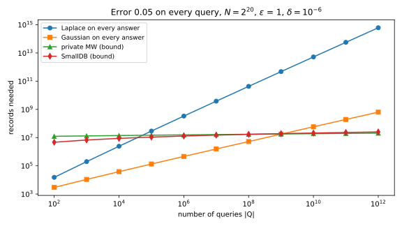

# Query release and private multiplicative weights

Many private releases are a large batch of simple statistics: every cross-tabulation of a census file, or the hundreds of counts on a dashboard. Each is a **linear query**, the average over the records of a function that gives each record a value between 0 and 1. Adding noise to every answer makes the noise grow with the number of queries, in proportion to it under pure differential privacy (DP) and like its square root under approximate DP ([The Laplace and Gaussian mechanisms](03-laplace-gaussian.md)). With millions of queries, either is useless. Yet the [reconstruction attack](../part02-attacks/09-reconstruction.md) breaks privacy only when the answers are within about $1/\sqrt n$ of the truth, for $n$ records. This chapter fills the gap with an error that grows only with the logarithms of the number of queries and of the number of possible records.

The one idea is to learn the data from its mistakes. Keep a public guess of the data, a histogram that starts out uniform, find a query that the guess gets badly wrong, measure that one query privately, and nudge the guess toward the answer. Each nudge is a step of the **multiplicative weights** method from online learning, and its guarantee says that about $\ln N/\alpha^2$ nudges suffice for error $\alpha$ on every query, where $N$ is the number of possible records. The number of queries does not appear, so the privacy budget is spent on corrections instead of on queries, and the final guess can be published as a **synthetic dataset**.

The running example is a table of $n = 10{,}000$ records with eight yes/no attributes, drawn from a mixture of three groups, so there are $N = 2^8 = 256$ possible records. The queries are every cell of every marginal table: for each set of attributes and each combination of their values, the fraction of records with those values. That gives $2^8 - 1 = 255$ tables, and a cell fixes each attribute to 0 or 1 or leaves it out, which gives $3^8 - 1 = 6560$ cells. The uniform histogram, which uses no data, has a largest error of 0.232 over these queries.

## Linear queries as inner products {#sec-qr-inner}

Every algorithm in this chapter treats a dataset as a histogram and a query as a vector, so that answering a query is an inner product. This section fixes that view first, because it lets a guessed histogram answer every query.

::: {#def-qr-linear-query name="Universe, histogram and linear query"}
The **universe** $\mathcal X$ is the set of all possible records, and $N = |\mathcal X|$ is its size. A dataset $D = (x_1, \dots, x_n)$ holds $n$ records from the universe. Its **histogram** $p$ gives, for each element $x$ of the universe, the fraction $p(x)$ of the records that equal $x$. A **linear query** is a function $q\colon \mathcal X \to [0, 1]$, and its answer on $D$ is the average of its values over the records,
$$q(D) = \frac1n\sum_{i=1}^nq(x_i).$$
The set of queries to answer is the **workload** $\mathcal Q$, with $|\mathcal Q|$ queries. Neighbouring datasets $D \sim D'$ differ by replacing one record, so $n$ is public.
:::

The answer depends on the records only through how many of them take each value, which is what the histogram records.

::: {#prp-qr-inner name="A linear query is an inner product with the histogram"}
For every linear query $q$ and dataset $D$ with histogram $p$,
$$q(D) = \sum_{x \in \mathcal X}q(x)\,p(x) = \langle q, p\rangle,$$ {#eq-qr-inner}
the inner product of two vectors indexed by the universe. Replacing one record moves the answer by at most $1/n$, so $q$ has sensitivity $1/n$.
:::

::: {.proof}
1. Group the records by value. Each element $x$ of the universe contributes $q(x)$ once for every record equal to it, and there are $np(x)$ such records, so $\sum_iq(x_i) = \sum_xnp(x)q(x)$. Dividing by $n$ gives @eq-qr-inner.
2. Replacing one record $x_i$ by $x_i'$ changes the sum by $q(x_i') - q(x_i)$, which lies in $[-1, 1]$ because $q$ takes values in $[0, 1]$. Divided by $n$, the answer moves by at most $1/n$.
:::

Two consequences carry the chapter. Any distribution $\hat p$ over the universe, not only the histogram of a real dataset, gives an answer $\langle q, \hat p\rangle$ to every query, so a histogram is a synthetic dataset. And the **error** of $\hat p$ on $q$, the distance between its answer and the true one, is $|\langle q, \hat p - p\rangle|$, which is linear in the difference of the two histograms. The target throughout is an error of at most $\alpha$ on every query of the workload, except with a small failure probability $\beta$, and all logarithms are natural.

::: {#exm-qr-inner}
Take two yes/no attributes, so the universe is $\{00, 01, 10, 11\}$, and four records $01, 11, 11, 10$. @tbl-qr-inner lists the histogram and the query "the first attribute is 1". The inner product is $0 + 0 + \frac14 + \frac12 = \frac34$, and indeed three of the four records have a first attribute of 1. The running example is the same picture with 256 elements, where each marginal cell is a query with a 1 on the elements that match it, so the script answers all 6,560 queries at once with one matrix product.

| Element $x$ | 00 | 01 | 10 | 11 |
| --- | --- | --- | --- | --- |
| Records equal to $x$ | 0 | 1 | 1 | 2 |
| $p(x)$ | 0 | 1/4 | 1/4 | 1/2 |
| $q(x)$: first attribute is 1 | 0 | 0 | 1 | 1 |

: A four-record dataset as a histogram, and one query. {#tbl-qr-inner}

:::

## Noise on every answer {#sec-qr-baseline}

The direct way to release a workload is to add noise to each answer. Before improving on it, it helps to know what it costs, because the two sample sizes of this section are the targets that the rest of the chapter beats.

Write $f(D)$ for the vector of the $|\mathcal Q|$ answers. By @prp-qr-inner, replacing one record moves each coordinate by at most $1/n$, so the $\ell_1$ sensitivity of $f$ is at most $|\mathcal Q|/n$ and its $\ell_2$ sensitivity at most $\sqrt{|\mathcal Q|}/n$. The square root comes from the norm: the $\ell_1$ norm adds the moves, while the $\ell_2$ norm adds their squares and takes a square root. The Laplace mechanism adds noise of scale $b = \Delta_1f/\varepsilon$ to every coordinate, and each noise exceeds $t$ in absolute value with probability $e^{-t/b}$ (@thm-lg-laplace). The Gaussian mechanism is calibrated through $\mu = \mu(\varepsilon, \delta)$, the largest ratio of sensitivity to noise standard deviation that the exact calibration allows (@cor-lg-calibration).

::: {#prp-qr-baseline name="Records needed with noise on every answer"}
Let the workload have $|\mathcal Q|$ queries, and let $z$ be the number that a standard normal variable exceeds with probability $\beta/(2|\mathcal Q|)$. The Laplace mechanism on the answer vector, with scale $|\mathcal Q|/(n\varepsilon)$, is $\varepsilon$-DP, and with probability at least $1 - \beta$ its largest error is at most $\alpha$ once
$$n \ge \frac{|\mathcal Q|\ln(|\mathcal Q|/\beta)}{\alpha\varepsilon}.$$ {#eq-qr-laplace-n}
The Gaussian mechanism with standard deviation $\sqrt{|\mathcal Q|}/(n\mu)$ on every answer is $(\varepsilon, \delta)$-DP, and with probability at least $1 - \beta$ its largest error is at most $\alpha$ once
$$n \ge \frac{\sqrt{|\mathcal Q|}\,z}{\mu\alpha}.$$ {#eq-qr-gauss-n}
:::

::: {.proof}
1. *Laplace.* Each answer gets noise of scale $b = |\mathcal Q|/(n\varepsilon)$, which exceeds $b\ln(|\mathcal Q|/\beta)$ in absolute value with probability $\beta/|\mathcal Q|$. The union bound, which says that the probability that at least one of several events happens is at most the sum of their probabilities, gives probability at most $\beta$ that some answer's noise exceeds that level. Setting $b\ln(|\mathcal Q|/\beta) = \alpha$ and solving for $n$ gives @eq-qr-laplace-n.
2. *Gaussian.* A normal variable exceeds $z$ standard deviations in absolute value with probability $2\Phi(-z)$, where $\Phi$ is the standard normal cumulative distribution function, and the one-sided tail $\beta/(2|\mathcal Q|)$ that defines $z$ makes this $\beta/|\mathcal Q|$. By the union bound, some answer's noise exceeds $\sigma z$ with probability at most $\beta$, where $\sigma = \sqrt{|\mathcal Q|}/(n\mu)$ is the standard deviation. Setting $\sigma z = \alpha$ and solving for $n$ gives @eq-qr-gauss-n.
:::

The records needed grow like $|\mathcal Q|$ under pure DP and like $\sqrt{|\mathcal Q|}$, times a slowly growing $z$, under approximate DP. For a few hundred queries on a large dataset that is fine, and nothing in this chapter beats it there. But a table with 30 yes/no attributes has $3^{30} - 1 \approx 2\times10^{14}$ marginal cells, too many for independent noise.

A workload with structure does better. Replacing one record lowers one cell of a marginal table by $1/n$ and raises another by $1/n$, so each table contributes only $2/n$ to the $\ell_1$ sensitivity, whatever its number of cells, and $2/n^2$ to the squared $\ell_2$ sensitivity.

::: {#exm-qr-baseline}
With $n = 10{,}000$ and $\varepsilon = 1$, the 255 marginal tables give an $\ell_1$ sensitivity of $2 \times 255/n = 0.0510$, so the Laplace mechanism adds noise of scale 0.0510 to each of the 6,560 cells. Its largest error, averaged over 20 runs, is 0.497, worse than the 0.232 of the uniform histogram, which uses no data. The Gaussian mechanism at $\delta = 10^{-6}$ has $\ell_2$ sensitivity $\sqrt{2 \times 255}/n = 0.00226$. With $\mu = 0.2367$ its noise has standard deviation 0.0095, and its average largest error is 0.037. Both use the structure of the marginals: treated as 6,560 unrelated queries, the $\ell_1$ sensitivity would be $|\mathcal Q|/n = 0.656$, about 13 times larger.
:::

## Multiplicative weights and its regret bound {#sec-qr-mw}

Forget privacy for two sections. The method behind this chapter comes from a prediction game, and the question is how well a learner can do against any sequence of outcomes when all it may do is reweight a fixed set of advisers. The answer is a regret bound that depends on the number of advisers only through a logarithm, and it drives every algorithm that follows.

Each day, $N$ **experts** predict a yes/no outcome, and you must decide whom to follow before you see it. If one expert is always right, the **halving algorithm** follows the majority of the experts who have never erred and drops each one that errs. Each of your mistakes drops at least half of them, so you err at most $\log_2N$ times. In 20 simulated runs with 1,024 experts it never made more than 6 mistakes, against the bound $\log_2 1024 = 10$. Real experts are never perfect, so multiplicative weights keeps every expert but shrinks its weight each time it does badly.

::: {#def-qr-mw name="The experts game and multiplicative weights"}
The game has $T$ rounds. In round $t$ the learner chooses a probability distribution $p_t$ over the $N$ experts. Then a **loss vector** $\ell_t$ is revealed, which gives each expert $x$ a loss $\ell_t(x)$ in $[-1, 1]$, and the learner pays the average loss under its distribution, $\langle\ell_t, p_t\rangle$. The losses may be chosen by an adversary who knows the learner's rule. **Multiplicative weights** keeps a positive weight $w_t(x)$ on each expert, starting from $w_1(x) = 1$, and has a **learning rate** (step size) $\eta \le \frac12$. In round $t$ it plays $p_t(x) = w_t(x)/W_t$, where $W_t = \sum_xw_t(x)$ is the total weight, and after the losses are revealed it updates each weight by
$$w_{t+1}(x) = w_t(x)\big(1 - \eta\ell_t(x)\big).$$ {#eq-qr-mw}
The learner's **regret** against a distribution $\pi$ over the experts, fixed in hindsight, is its total loss minus the total loss of $\pi$, that is $\sum_t\langle\ell_t, p_t\rangle - \sum_t\langle\ell_t, \pi\rangle$.
:::

An expert with a positive loss loses weight, and one with a negative loss gains it. The proof of the regret bound takes the logarithm of factors $1 - x$ twice: from above, when it turns the total weight into the learner's loss, and from below, when it turns one expert's weight into that expert's loss. The next lemma supplies both bounds, and its range $|x| \le \frac12$ is why the learning rate is at most $\frac12$.

::: {#lem-qr-log name="Two bounds on the logarithm"}
For every $x < 1$, $\ln(1 - x) \le -x$. For $|x| \le \frac12$,
$$\ln(1 - x) \ge -x - x^2.$$ {#eq-qr-log-lower}
:::

::: {.proof}
1. *Upper bound.* The logarithm is concave, so it lies below its tangent line at any point. The tangent of $\ln(1 - x)$ at $x = 0$ is $-x$, which gives $\ln(1 - x) \le -x$.
2. *Lower bound.* Let $g(x) = \ln(1 - x) + x + x^2$, so that $g(0) = 0$ and the claim is that $g$ is never negative on the range. Its derivative is
$$g'(x) = -\frac1{1 - x} + 1 + 2x = \frac{x(1 - 2x)}{1 - x}.$$
On $[0, \frac12]$ every factor is non-negative, so $g$ rises from 0 and stays non-negative. On $[-\frac12, 0]$ the numerator is at most 0 and the denominator positive, so $g$ falls toward $g(0) = 0$ and is non-negative there too.
:::

At the end of the range the bound is close, since $\ln\frac12 = -0.6931$ lies just above $-0.75$. Outside the range it can fail, and at $x = 0.9$ it does, because $\ln 0.1 = -2.30$ lies below $-1.71$. A loss outside $[-1, 1]$ pushes $\eta\ell_t(x)$ out of the range in the same way, and at $\eta\ell_t(x) \ge 1$ a weight can even become zero or negative, so losses are rescaled into $[-1, 1]$ first.

::: {#thm-qr-regret name="The regret bound of multiplicative weights"}
Run multiplicative weights with learning rate $\eta \le \frac12$ for $T$ rounds against any sequence of loss vectors with entries in $[-1, 1]$. Then for every distribution $\pi$ over the experts,
$$\sum_{t=1}^T\langle\ell_t, p_t\rangle - \sum_{t=1}^T\langle\ell_t, \pi\rangle \le \eta T + \frac{\ln N}{\eta}.$$ {#eq-qr-regret}
When $T \ge 4\ln N$, the learning rate $\eta = \sqrt{\ln N/T}$ is allowed and gives regret at most $2\sqrt{T\ln N}$.
:::

::: {.proof}
The plan is to bound $\ln W_{T+1}$ from above by the learner's total loss and from below by any one expert's total loss, to compare the two bounds, and then to average the comparison over the experts.

1. *The total weight shrinks with the learner's loss.* Summing @eq-qr-mw over the experts gives $W_{t+1} = \sum_xw_t(x) - \eta\sum_xw_t(x)\ell_t(x)$. Factoring out $W_t$ turns each weight into $p_t(x)$, so
$$W_{t+1} = W_t\big(1 - \eta\langle\ell_t, p_t\rangle\big).$$
2. *Upper bound.* Unrolling step 1 from $W_1 = N$ makes $W_{T+1}$ equal to $N$ times the product of the factors. Each $\eta\langle\ell_t, p_t\rangle$ is below 1, so the upper bound of @lem-qr-log applies to every factor:
$$\ln W_{T+1} = \ln N + \sum_{t=1}^T\ln\big(1 - \eta\langle\ell_t, p_t\rangle\big) \le \ln N - \eta\sum_{t=1}^T\langle\ell_t, p_t\rangle.$$
3. *Lower bound from one expert.* The total weight is at least the weight of any single expert $x$, and that weight is the product of its own factors. Each $\eta\ell_t(x)$ lies in $[-\frac12, \frac12]$, so the lower bound of @lem-qr-log applies, and $\ell_t(x)^2 \le 1$ bounds each squared term:
$$\ln W_{T+1} \ge \ln w_{T+1}(x) = \sum_{t=1}^T\ln\big(1 - \eta\ell_t(x)\big) \ge -\eta\sum_{t=1}^T\ell_t(x) - \eta^2T.$$
4. *Compare.* The upper bound of step 2 is at least the lower bound of step 3, so $\eta\sum_t\langle\ell_t, p_t\rangle \le \ln N + \eta\sum_t\ell_t(x) + \eta^2T$. Dividing by $\eta$ gives @eq-qr-regret for the comparison with the single expert $x$.
5. *Any distribution.* The inequality of step 4 holds for every expert $x$, and its left side does not depend on $x$. Multiply it by $\pi(x)$ and add over the experts. The $\pi(x)$ sum to 1, so the left side and the constant terms are unchanged, and $\sum_x\pi(x)\ell_t(x) = \langle\ell_t, \pi\rangle$, which is @eq-qr-regret.
6. *Choose the learning rate.* A larger $\eta$ raises $\eta T$ and lowers $\ln N/\eta$, so the bound is smallest where the two terms are equal, at $\eta = \sqrt{\ln N/T}$, where it equals $2\sqrt{T\ln N}$. The lemma needs $\eta \le \frac12$, that is $T \ge 4\ln N$.
:::

The average regret per round, $2\sqrt{\ln N/T}$, goes to zero, so over many rounds the learner does as well as the best fixed distribution. Nothing in the proof assumed that the losses were random or independent of the weights, so an adversary who knows the rule gains nothing, and the number of experts enters only through $\ln N$. The sequences met in practice are rarely as hostile as the worst case, as @sec-qr-mistakes shows.

The weights also look familiar. Each factor $1 - \eta\ell$ is close to $e^{-\eta\ell}$ when $\eta$ is small, so the distribution is close to a softmax of minus the cumulative losses, the shape of the exponential mechanism. The version with the factor $e^{-\eta\ell}$ exactly is called Hedge, and online learning also views it as follow the regularized leader (FTRL) with an entropy penalty; [DP-FTRL](../part05-dp-ml/04-matrix-mechanisms.md) uses a squared-norm penalty to train models privately.

::: {#exm-qr-mw-hand}
The smallest case shows the mechanics. Take $N = 2$ experts and $\eta = \frac12$ over $T = 3$ rounds, with losses $\ell_1 = (1, 0)$, $\ell_2 = (0, 1)$ and $\ell_3 = (1, 0)$. @tbl-qr-mw-hand follows the weights. The learner pays $\frac12 + \frac23 + \frac12 = \frac53$ in total. Expert 2 lost only 1, so the regret against it is $\frac23$, and the bound @eq-qr-regret is $\frac12 \times 3 + \ln 2/\frac12 = 1.5 + 1.386 = 2.886$. The running example enters in the next section, where the experts are the 256 elements of the universe.

| Round $t$ | Weights $w_t$ | Distribution $p_t$ | Loss $\ell_t$ | Learner pays $\langle\ell_t, p_t\rangle$ |
| --- | --- | --- | --- | --- |
| 1 | $(1, 1)$ | $(1/2, 1/2)$ | $(1, 0)$ | $1/2$ |
| 2 | $(1/2, 1)$ | $(1/3, 2/3)$ | $(0, 1)$ | $2/3$ |
| 3 | $(1/2, 1/2)$ | $(1/2, 1/2)$ | $(1, 0)$ | $1/2$ |

: Multiplicative weights on two experts with learning rate 1/2. {#tbl-qr-mw-hand}

:::

## From regret to a mistake bound {#sec-qr-mistakes}

Now turn the game into an algorithm for releasing answers, still without privacy. The question is how many corrections a guessed histogram needs before it answers every query to within $\alpha$, and the answer must not depend on the number of queries. Let the experts be the elements of the universe, so that $p_t$ is a guessed histogram, and compare it with the true histogram $p$, one particular distribution $\pi$. If each round's regret against $p$ is the guess's error on one query, the regret bound limits the number of large errors.

::: {#thm-qr-mistakes name="The mistake bound"}
Run multiplicative weights over the universe, starting from the uniform histogram, with learning rate $\eta = \alpha/2$. In each round, look for a query $q_t \in \mathcal Q$ on which the current guess has error more than $\alpha$. If there is none, stop: the guess is within $\alpha$ on every query. Otherwise let $s_t$ be $+1$ if the guess's answer is too high and $-1$ if it is too low, and use the loss $\ell_t = s_tq_t$. The number $U$ of rounds before the algorithm stops satisfies
$$U < \frac{4\ln N}{\alpha^2},$$ {#eq-qr-mistakes}
whatever the workload and however the queries are chosen.
:::

::: {.proof}
The plan is to show that the regret against the true histogram grows by more than $\alpha$ in every round, to bound the same regret by @eq-qr-regret, and to compare the two.

1. *Each round's regret is the error.* The regret bound holds for every distribution $\pi$, and the loss of $p$ is the true answer times $s_t$, so by @eq-qr-inner $\langle\ell_t, p_t - p\rangle = s_t\big(\langle q_t, p_t\rangle - \langle q_t, p\rangle\big)$. The sign $s_t$ makes the bracket positive, so this is the error of $p_t$ on $q_t$, more than $\alpha$.
2. *Total regret is large.* Adding over the $U$ rounds, the regret against $p$ is more than $\alpha U$.
3. *Total regret is small.* The losses $s_tq_t$ have entries in $[-1, 1]$, and $\eta = \alpha/2 \le \frac12$, so @thm-qr-regret with $\pi = p$ and $T = U$ bounds the same regret by $\eta U + \ln N/\eta = \alpha U/2 + 2\ln N/\alpha$.
4. *Combine.* The regret is more than $\alpha U$ by step 2 and at most $\alpha U/2 + 2\ln N/\alpha$ by step 3, so
$$\alpha U < \frac{\alpha U}{2} + \frac{2\ln N}{\alpha}.$$
Subtracting $\alpha U/2$ from both sides and dividing by $\alpha/2$ gives @eq-qr-mistakes.
:::

If the guess's answer is too high, the loss is $+q_t$, and the weights of the records that the query counts shrink, which lowers the answer. A few such corrections fix every query at once because each one moves the guess closer to the true histogram in relative entropy, a distance that starts at no more than $\ln N$. The algorithm never looks at the queries it gets right, so their number never enters, and doubling the universe adds only $4\ln2/\alpha^2$ corrections.

The choice of query and its sign are the only places where the algorithm touches the data, and both use only answers of sensitivity $1/n$, which makes it easy to privatize. The bound is very loose, because in practice the first corrections fix errors several times larger than $\alpha$, and many queries at once.

{#fig-qr-mw}

::: {#exm-qr-mistakes}
With $\alpha = 0.05$ the bound @eq-qr-mistakes allows $4\ln 256/0.05^2 = 8872$ corrections. The algorithm needs 148 (@fig-qr-mw). The first three queries it corrects have errors 0.232, 0.228 and 0.226, more than four times $\alpha$. After 148 rounds the regret is 16.70, against a bound of 225.5.
:::

## Private multiplicative weights {#sec-qr-pmw}

The algorithm of @sec-qr-mistakes touches the data in two places, the choice of a badly answered query and the sign of its error. This section makes both private, which gives an error that grows only with the logarithms of $|\mathcal Q|$ and $N$. The exponential mechanism picks a query whose error is close to the largest, and the Laplace mechanism measures its answer, which gives the sign. Both can miss, so the algorithm cannot tell when to stop. Instead it runs a fixed number of rounds $T$ and releases the average of its guesses. This is the **multiplicative weights exponential mechanism (MWEM)** of Hardt, Ligett & McSherry (2012), the practical form of private multiplicative weights (Hardt & Rothblum 2010).

::: {#def-qr-pmw name="Private multiplicative weights, offline"}
Input: the dataset $D$, the workload $\mathcal Q$, a number of rounds $T \ge 4\ln N$ and a per-step budget $\varepsilon_0$. Start from the uniform histogram $p_1$ and set $\eta = \sqrt{\ln N/T}$. For $t = 1, \dots, T$:

1. *Select.* Run the exponential mechanism over $\mathcal Q$ with budget $\varepsilon_0$ and score $|\langle q, p_t\rangle - q(D)|$, the error of the current guess on $q$. Call the chosen query $q_t$.
2. *Measure.* Release $m_t = q_t(D) + \mathrm{Lap}\big(1/(n\varepsilon_0)\big)$.
3. *Update.* Let $s_t = +1$ if $\langle q_t, p_t\rangle > m_t$ and $-1$ otherwise, and apply @eq-qr-mw with the loss $s_tq_t$ to get $p_{t+1}$.

Output the average histogram $\bar p = \frac1T\sum_{t=1}^Tp_t$.
:::

The measurement needs its own budget, because the exponential mechanism releases only the index of the chosen query, never its exact score.

Three earlier results do the private work. The exponential mechanism over the $|\mathcal Q|$ queries, with a score of sensitivity $1/n$, is $\varepsilon_0$-DP, and except with probability $\beta'$ the chosen score is within $\frac{2}{n\varepsilon_0}\big(\ln|\mathcal Q| + \ln(1/\beta')\big)$ of the best ([Selection](05-selection.md#sec-sel-utility)). The Laplace mechanism with scale $b = 1/(n\varepsilon_0)$ is $\varepsilon_0$-DP, and its noise exceeds $b\ln(1/\beta')$ in absolute value with probability $\beta'$ (@thm-lg-laplace). **Advanced composition** ([Advanced and optimal composition](04-composition.md#sec-comp-advanced)) makes $k$ adaptive $\varepsilon_0$-DP steps $(\varepsilon', \delta)$-DP with $\varepsilon' = \varepsilon_0\sqrt{2k\ln(1/\delta)} + k\varepsilon_0\tanh(\varepsilon_0/2)$. The privacy step below needs a closed-form per-step budget from it.

::: {#lem-qr-step-eps name="A closed-form per-step budget"}
Let $\varepsilon > 0$ and $\delta \in (0, 1)$ satisfy $\varepsilon \le 8\ln(1/\delta)$. If each of $k$ adaptively chosen steps is $\varepsilon_0$-DP with
$$\varepsilon_0 = \frac{\varepsilon}{2\sqrt{2k\ln(1/\delta)}},$$ {#eq-qr-step-eps}
then the whole is $(\varepsilon, \delta)$-DP.
:::

::: {.proof}
1. Substitute $\varepsilon_0$ into the advanced composition bound. The first term, $\varepsilon_0\sqrt{2k\ln(1/\delta)}$, is exactly $\varepsilon/2$.
2. The second term, $k\varepsilon_0\tanh(\varepsilon_0/2)$, is at most $k\varepsilon_0^2/2$, because $\tanh$ never exceeds its argument. Substituting $\varepsilon_0$ turns $k\varepsilon_0^2/2$ into $\varepsilon^2/(16\ln(1/\delta))$, and the condition $\varepsilon \le 8\ln(1/\delta)$ makes this at most $\varepsilon/2$.
3. The two terms add to at most $\varepsilon$, so the composition is $(\varepsilon, \delta)$-DP.
:::

The condition is mild, since at $\delta = 10^{-6}$ it allows any $\varepsilon$ up to 110. When $\varepsilon_0$ is small the second term is far below $\varepsilon/2$, so the closed form leaves up to half the budget unspent (@exm-qr-pmw).

::: {#thm-qr-pmw name="Privacy and accuracy of private multiplicative weights"}
The algorithm of @def-qr-pmw is $2T\varepsilon_0$-DP. So $\varepsilon_0 = \varepsilon/(2T)$ makes it $\varepsilon$-DP, and $\varepsilon_0$ from @eq-qr-step-eps with $k = 2T$ makes it $(\varepsilon, \delta)$-DP when $\varepsilon \le 8\ln(1/\delta)$. With probability at least $1 - \beta$, the largest error of the average histogram over the workload is at most
$$\max_{q \in \mathcal Q}\big|\langle q, \bar p\rangle - q(D)\big| \le 2\sqrt{\frac{\ln N}{T}} + \frac{2}{n\varepsilon_0}\Big(\ln|\mathcal Q| + 2\ln\frac{2T}\beta\Big).$$ {#eq-qr-pmw}
:::

::: {.proof}
The plan is to check that each private step is $\varepsilon_0$-DP, to define the event on which every selection and every measurement works as intended, and on that event to run the regret argument of @thm-qr-mistakes with a deficit per round for the two private steps.

1. *Privacy.* Given the history, the guess $p_t$ is a fixed histogram, so the score moves by at most $1/n$ between neighbours (@prp-qr-inner) and the selection is $\varepsilon_0$-DP. The measurement is a Laplace mechanism of scale $1/(n\varepsilon_0)$ on an answer of sensitivity $1/n$, so it is $\varepsilon_0$-DP too. The update and the average are post-processing, and composition allows the $2T$ steps to be adaptive ([Advanced and optimal composition](04-composition.md#sec-comp-adaptive)).
2. *The good event.* Write $\mathrm{err}_t(q) = |\langle q, p_t\rangle - q(D)|$ for the error of round $t$'s guess on query $q$. Give each of the $2T$ private steps the failure probability $\beta' = \beta/(2T)$. The utility bound of the exponential mechanism then says that the selection picks a query whose error is within
$$c_E = \frac{2}{n\varepsilon_0}\Big(\ln|\mathcal Q| + \ln\frac{2T}\beta\Big)$$
of the largest, except with probability $\beta/(2T)$. The Laplace tail says that the measurement's noise is below
$$c_L = \frac{1}{n\varepsilon_0}\ln\frac{2T}\beta,$$
also except with probability $\beta/(2T)$. The union bound over the $2T$ steps makes all of this hold at once except with probability $\beta$.
3. *Each round's regret is nearly the largest error.* If the sign $s_t$ is right, then the round's regret $\langle s_tq_t, p_t - p\rangle$ is $\mathrm{err}_t(q_t)$, as in step 1 of @thm-qr-mistakes. If it is wrong, the guess's answer lies between the measured and the true answers, which are at most $c_L$ apart, so $\mathrm{err}_t(q_t) \le c_L$, and the regret $-\mathrm{err}_t(q_t)$ falls short of $\mathrm{err}_t(q_t)$ by at most $2c_L$. Either way the round's regret is at least $\mathrm{err}_t(q_t) - 2c_L$, and by step 2 the chosen query's error is within $c_E$ of the largest, so
$$\langle s_tq_t, p_t - p\rangle \ge \max_q\mathrm{err}_t(q) - c_E - 2c_L.$$
4. *Sum and use the regret bound.* Adding over the $T$ rounds, the regret against the true histogram is at least $\sum_t\max_q\mathrm{err}_t(q) - T(c_E + 2c_L)$. By @thm-qr-regret with $\eta = \sqrt{\ln N/T}$ it is at most $2\sqrt{T\ln N}$. Comparing the two and dividing by $T$,
$$\frac1T\sum_{t=1}^T\max_q\mathrm{err}_t(q) \le 2\sqrt{\frac{\ln N}{T}} + c_E + 2c_L.$$
5. *The average histogram.* For any query $q$, the error of the average is the average of the errors by @eq-qr-inner, $\langle q, \bar p\rangle - q(D) = \frac1T\sum_t\langle q, p_t - p\rangle$. Its absolute value is at most $\frac1T\sum_t\mathrm{err}_t(q)$, which is at most the left side of step 4. Finally $c_E + 2c_L = \frac{2}{n\varepsilon_0}\big(\ln|\mathcal Q| + 2\ln\frac{2T}\beta\big)$, which gives @eq-qr-pmw.
:::

The algorithm releases the average guess because the regret bound controls the sum of the rounds' largest errors, and says nothing about any single round. The constants are poor: on the running example the bound is above 1, while the real error is far smaller (@exm-qr-pmw).

The first term of @eq-qr-pmw falls with more rounds, and the second grows, because each round gets less budget. Balancing the two turns the bound into a sample size.

::: {#cor-qr-pmw-n name="Records needed by private multiplicative weights"}
Write $L = \ln|\mathcal Q| + 2\ln(2T/\beta)$ for the logarithmic term of @eq-qr-pmw, treated as a constant because it depends on $T$ only through a logarithm. Under $(\varepsilon, \delta)$-DP with the budget of @eq-qr-step-eps for $2T$ steps, there is a number of rounds $T$ at which the error bound is at most $\alpha$ once
$$n \ge \frac{64\sqrt{\ln N\,\ln(1/\delta)}\,L}{\alpha^2\varepsilon}.$$ {#eq-qr-pmw-n}
:::

::: {.proof}
1. *The shape of the bound.* With $k = 2T$ steps, @eq-qr-step-eps gives $\varepsilon_0 = \varepsilon/(4\sqrt{T\ln(1/\delta)})$, so the second term of @eq-qr-pmw is $8\sqrt{\ln(1/\delta)}\,L\sqrt T/(n\varepsilon)$. The bound therefore has the shape $A/\sqrt T + B\sqrt T$, with $A = 2\sqrt{\ln N}$ from the regret and $B = 8\sqrt{\ln(1/\delta)}\,L/(n\varepsilon)$ from the noise.
2. *Balance.* A sum of this shape is smallest where its two terms are equal, at $T = A/B$, and there it equals $2\sqrt{AB}$. Substituting $A$ and $B$,
$$2\sqrt{AB} = 8\big(\ln N\ln(1/\delta)\big)^{1/4}\sqrt{\frac{L}{n\varepsilon}}.$$
3. *Solve for $n$.* Setting this to $\alpha$ and squaring gives $64\sqrt{\ln N\ln(1/\delta)}\,L/(n\varepsilon) = \alpha^2$, which rearranges to @eq-qr-pmw-n.
:::

Under pure DP, $\varepsilon_0 = \varepsilon/(2T)$ makes the second term $4LT/(n\varepsilon)$, linear in $T$. Minimizing $2\sqrt{\ln N/T} + 4LT/(n\varepsilon)$ over $T$ and setting the minimum to $\alpha$ gives $n \ge 108\,L\ln N/(\alpha^3\varepsilon)$. The queries enter only through $L$, which grows like $\ln|\mathcal Q|$, where the baseline paid $|\mathcal Q|$ or $\sqrt{|\mathcal Q|}$. The price is accuracy, because at a fixed $n$ the error falls like $n^{-1/2}$, or $n^{-1/3}$ under pure DP, against $1/n$ for independent noise, so the method wins only when the queries far outnumber the records. No method can do much better on every workload, since errors below about $1/\sqrt n$ on many queries let the reconstruction attack recover the data. Up to constants it is close to optimal, by the packing and fingerprinting arguments of [Lower bounds](10-lower-bounds.md#sec-lower-sample) (Bun, Ullman & Vadhan 2014).

The running time is proportional to $N$, which is $2^{50}$ for 50 attributes. Some such cost is unavoidable, since Ullman & Vadhan (2011) used probabilistically checkable proof (PCP) techniques to show that, under standard cryptographic assumptions, no efficient algorithm releases private synthetic data accurate for every two-way marginal. Practical methods keep the select–measure–update loop with a compact model in place of the histogram (McKenna, Mullins, Sheldon & Miklau 2022).

{#fig-qr-error-vs-n}

::: {#exm-qr-pmw}
With $n = 10{,}000$, $\varepsilon = 1$ and pure DP, the number of rounds that minimizes @eq-qr-pmw is $T = 38$, so each step gets $\varepsilon_0 = 1/76 = 0.0132$. @tbl-qr-pmw compares three choices of $T$, averaged over 20 runs.

| Rounds $T$ | Budget per step $\varepsilon_0$ | Largest error | Bound @eq-qr-pmw |
| --- | --- | --- | --- |
| 10 | 0.0500 | 0.098 | 1.572 |
| 38 | 0.0132 | 0.078 | 1.120 |
| 100 | 0.0050 | 0.123 | 1.486 |

: Private multiplicative weights on the running example, $n = 10{,}000$, $\varepsilon = 1$. {#tbl-qr-pmw}

The bound picks a good $T$, although its values are useless as numbers. With 38 rounds the largest error is 0.078, against 0.497 for Laplace noise and 0.037 for Gaussian noise, so here the Gaussian mechanism wins. @fig-qr-error-vs-n shows that Gaussian noise wins above a few thousand records, because 6,560 queries are not many enough.

With $\delta > 0$, advanced composition gives each step more budget once $T$ is large. At $T = 100$ and $\delta = 10^{-6}$, pure DP gives each step $\varepsilon_0 = 0.00500$. The closed form @eq-qr-step-eps gives 0.00673, although in total that budget spends only $0.505\varepsilon$, while solving the advanced composition bound exactly for $\varepsilon_0$ gives 0.01322. At $T = 1000$ the same three budgets are 0.00050, 0.00213 and 0.00418.

The guarantees separate only at a much larger scale. @tbl-qr-records gives the records needed for error 0.05 on every query with probability 0.95, over a universe of $N = 2^{20}$ and a workload with no structure. The Laplace and SmallDB columns are pure DP, and the other two are $(\varepsilon, \delta)$-DP. For private multiplicative weights the table solves @eq-qr-pmw for $n$ after a search over $T$. At $10^6$ queries the search finds $T = 81{,}552$ and $L = 43.81$, and needs $1.56\times10^7$ records, while the closed form @eq-qr-pmw-n gives $1.55\times10^7$. That bound hardly moves as the queries grow a millionfold, and it crosses the Gaussian column near $10^9$ queries (@fig-qr-sample-complexity).

| Queries $\lvert \mathcal Q\rvert$ | Laplace | Gaussian | Private multiplicative weights (bound) | SmallDB (bound) |
| --- | --- | --- | --- | --- |
| $10^3$ | $1.98\times10^5$ | $1.08\times10^4$ | $1.31\times10^7$ | $6.74\times10^6$ |
| $10^6$ | $3.36\times10^8$ | $4.61\times10^5$ | $1.56\times10^7$ | $1.29\times10^7$ |
| $10^9$ | $4.74\times10^{11}$ | $1.76\times10^7$ | $1.81\times10^7$ | $1.90\times10^7$ |

: Records needed for error 0.05 on every query with probability 0.95, $\varepsilon = 1$, $\delta = 10^{-6}$, $N = 2^{20}$. {#tbl-qr-records}

:::

{#fig-qr-sample-complexity}

## Online private multiplicative weights {#sec-qr-online}

The offline algorithm needs the whole workload in advance, but an interactive query server receives queries one at a time, each perhaps chosen after the earlier answers. The question is how to pay only for the queries the guess gets wrong without searching for them. The sparse vector technique of [Selection](05-selection.md#sec-sel-svt) waits for a bad query to arrive instead, which is the original form of private multiplicative weights (Hardt & Rothblum 2010).

Its basic form, AboveThreshold, compares each query's noisy value with a noisy threshold, answers $\bot$ ("below") or $\top$ ("above"), and halts at the first $\top$, while the $\bot$ answers cost nothing. With probability $1 - \beta$, every $\bot$ lies below the threshold plus a **margin** and every $\top$ above it minus the margin, which for $K$ queries of sensitivity $\Delta$ at budget $\varepsilon$ is $8\Delta(\ln K + \ln(2/\beta))/\varepsilon$ (@eq-sel-svt-alpha). The variant Sparse restarts it after each $\top$. Here the question asked is whether the guess's error is large, so only the few queries it gets wrong cost privacy.

::: {#def-qr-online name="Online private multiplicative weights"}
Input: the dataset, a target error $\alpha$, privacy parameters $(\varepsilon, \delta)$, and a stream of at most $K$ queries, with $K$ fixed in advance. Set the budget of updates to $c = \lceil16\ln N/\alpha^2\rceil$, the learning rate to $\eta = \alpha/4$, and the guess $\hat p$ to the uniform histogram. Give each of the at most $c$ runs of AboveThreshold inside Sparse, and each of the at most $c$ measurements, the budget $\varepsilon_0$ of @eq-qr-step-eps with $k = 2c$ steps. For each incoming query $f_i$ (the letter $f$ marks queries of the stream), the score is the current guess's error on it, $g_i = |\langle f_i, \hat p\rangle - f_i(D)|$. Run Sparse on these scores with threshold $3\alpha/4$, allowing up to $c$ answers $\top$, and act on its answer:

- If Sparse answers $\bot$, answer $\langle f_i, \hat p\rangle$ from the guess.
- If it answers $\top$, measure $m_i = f_i(D) + \mathrm{Lap}(1/(n\varepsilon_0))$, answer $m_i$, and update $\hat p$ by @eq-qr-mw with the loss $s_if_i$, where $s_i$ is the sign of $\langle f_i, \hat p\rangle - m_i$.
- After the $c$-th $\top$, halt.
:::

The threshold sits at $3\alpha/4$ because a $\top$ must certify an error of at least $\alpha/2$, twice the learning rate, so that each update gains more regret than the $\eta = \alpha/4$ per round that @thm-qr-regret allows, while a $\bot$ must certify an error below $\alpha$. A margin of $\alpha/4$ gives both, so accuracy needs enough records to keep every margin and every measurement's noise at most $\alpha/4$.

::: {#thm-qr-online name="Privacy and accuracy of the online algorithm"}
The algorithm of @def-qr-online is $(\varepsilon, \delta)$-DP when $\varepsilon \le 8\ln(1/\delta)$. If
$$n \ge \frac{32\big(\ln K + \ln(4c/\beta)\big)}{\alpha\varepsilon_0}, \qquad \varepsilon_0 = \frac{\varepsilon}{2\sqrt{4c\ln(1/\delta)}},$$ {#eq-qr-online-n}
then with probability at least $1 - \beta$ every answer is within $\alpha$ of the truth, and the algorithm answers the whole stream without using up its $c$ answers $\top$.
:::

::: {.proof}
The plan is to check the scores' sensitivity, compose the steps, and, on the event where every margin and noise is at most $\alpha/4$, show that every answer is accurate and every update is a real correction, so that the mistake bound limits their number.

1. *Sensitivity.* Between two updates the guess $\hat p$ is fixed, because it changes only after a measurement, which is a released output. Given the history, each score $g_i$ is the distance between a fixed number and an answer of sensitivity $1/n$, so it has sensitivity $1/n$.
2. *Privacy.* The runs of AboveThreshold and the measurements alternate: a run ends with its $\top$, that query is measured, then the next run starts with the updated guess. So the algorithm is a sequence of at most $2c$ steps, each $\varepsilon_0$-DP and each chosen as a function of the earlier outputs, and by @lem-qr-step-eps with $k = 2c$ it is $(\varepsilon, \delta)$-DP.
3. *The good event.* Half of the failure probability goes to the $c$ runs, $\beta/(2c)$ each, and half to the $c$ measurements. With budget $\varepsilon_0$, sensitivity $1/n$ and failure probability $\beta/(2c)$, the margin of one run is $8(\ln K + \ln(4c/\beta))/(n\varepsilon_0)$ by @eq-sel-svt-alpha, and @eq-qr-online-n says exactly that this is at most $\alpha/4$. A measurement's noise exceeds $\ln(2c/\beta)/(n\varepsilon_0)$ with probability $\beta/(2c)$ by the Laplace tail, and that level is below the margin of a run, so it is at most $\alpha/4$ too. The union bound over the $c$ runs and the $c$ measurements gives total failure probability $\beta$.
4. *Answers.* On the good event, a $\bot$ means $g_i < 3\alpha/4 + \alpha/4 = \alpha$, so the guess's answer is within $\alpha$. A $\top$ is answered by the measurement, which is within $\alpha/4$.
5. *Updates are real corrections.* A $\top$ means $g_i \ge 3\alpha/4 - \alpha/4 = \alpha/2$. The measurement's noise is at most $\alpha/4$, less than the error, so the measured answer lies on the same side of the guess's answer as the true one, and the sign $s_i$ is right. As in step 1 of @thm-qr-mistakes, the update's regret against the true histogram is $g_i \ge \alpha/2$.
6. *Few updates.* After $U$ updates the regret is at least $\alpha U/2$, and by @eq-qr-regret with $\eta = \alpha/4$ it is at most $\alpha U/4 + 4\ln N/\alpha$. So $\alpha U/4 \le 4\ln N/\alpha$, which is $U \le 16\ln N/\alpha^2 \le c$, and the budget of $c$ answers $\top$ is never used up.
:::

Because $\sqrt c$ is about $4\sqrt{\ln N}/\alpha$, the records needed grow like $\sqrt{\ln N\ln(1/\delta)}/(\alpha^2\varepsilon)$ times a logarithm, as offline, but the logarithm is of the stream length $K$ instead of $|\mathcal Q|$. A $\top$ query must be measured, because the guess is off by at least $\alpha/2$ there and the measurement gives the sign.

The guarantee holds even when the analyst chooses each query after the earlier answers, because every step of the proof conditions on the history, which is the setting of [Adaptive data analysis](../part05-dp-ml/11-adaptive-data-analysis.md). The budget $c$ is set by the worst case, so it is far larger than a real stream needs.

::: {#exm-qr-online}
On the running example, with $\alpha = 0.05$, the budget is $c = 35{,}490$ corrections, against the 148 of @exm-qr-mistakes. For a query server over a universe of $N = 2^{20}$ records, the budget is $c = 88{,}723$. A stream of $K = 10^6$ queries at $\varepsilon = 1$ and $\delta = 10^{-6}$, with probability 0.95, needs $8.39\times10^7$ records by @eq-qr-online-n. That is about five times the offline bound in @tbl-qr-records, the price of the worst-case budget and the wider margin.
:::

## SmallDB: the exponential mechanism over small datasets {#sec-qr-smalldb}

Blum, Ligett & Roth (2008) were the first to answer many linear queries with error that grows only with $\ln|\mathcal Q|$, and their algorithm answers a different question: what can the exponential mechanism achieve in a single choice, when running time is ignored? **SmallDB** makes that choice among whole small datasets, like the classifier selection of [Selection](05-selection.md#sec-sel-apps) with datasets in place of classifiers.

The proof first needs some small dataset that answers every query well, so that the exponential mechanism has a good candidate. The next lemma shows that a random sample of the data is one with positive probability.

::: {#lem-qr-small-exists name="A small dataset with small error exists"}
Let $m > 2\ln(2|\mathcal Q|)/\alpha^2$. Then some dataset of $m$ records from the universe has error at most $\alpha/2$ on every query of $\mathcal Q$.
:::

::: {.proof}
1. Draw $m$ records independently from the true histogram $p$ and call the result $\hat D$. For one query $q$, the answer $q(\hat D)$ is an average of $m$ independent values in $[0, 1]$ with mean $q(D)$.
2. Hoeffding's inequality ([Concentration inequalities](../part01-prerequisites/02-concentration.md)) says that such an average is more than $s$ away from its mean with probability at most $2e^{-2ms^2}$, which at $s = \alpha/2$ is $2e^{-m\alpha^2/2}$.
3. By the union bound, some query is more than $\alpha/2$ off with probability at most $2|\mathcal Q|e^{-m\alpha^2/2}$, and with $m > 2\ln(2|\mathcal Q|)/\alpha^2$ this is below 1. So with positive probability no query is off by more than $\alpha/2$, and a dataset with that property exists.
:::

::: {#thm-qr-smalldb name="SmallDB"}
Let $m = \lceil2\ln(2|\mathcal Q|)/\alpha^2\rceil$ (or $2\ln(2|\mathcal Q|)/\alpha^2 + 1$ if that ratio is an integer), and run the exponential mechanism with budget $\varepsilon$ over every dataset $\hat D$ of $m$ records from the universe, with the score $-\max_{q \in \mathcal Q}|q(\hat D) - q(D)|$, minus the candidate's largest error. The mechanism is $\varepsilon$-DP, and the chosen dataset has error at most $\alpha$ on every query with probability at least $1 - \beta$ once
$$n \ge \frac{4\big(m\ln N + \ln(1/\beta)\big)}{\alpha\varepsilon} \approx \frac{8\ln(2|\mathcal Q|)\ln N}{\alpha^3\varepsilon}.$$ {#eq-qr-smalldb}
:::

::: {.proof}
The plan is to show that the best candidate scores at least $-\alpha/2$, to count the candidates, and to apply the utility bound of the exponential mechanism.

1. *Privacy.* Each $q(D)$ has sensitivity $1/n$ by @prp-qr-inner, so a candidate's largest error moves by at most $1/n$ between neighbours, the score has sensitivity $1/n$, and the exponential mechanism is $\varepsilon$-DP.
2. *A good candidate exists.* By @lem-qr-small-exists, some candidate has error at most $\alpha/2$ on every query, so the best score is at least $-\alpha/2$.
3. *Count the candidates.* A dataset of $m$ records is a list of $m$ elements of the universe, so there are at most $N^m$ candidates, and $\ln N^m = m\ln N$.
4. *The selection is nearly the best.* The utility bound of the exponential mechanism, with $N^m$ candidates, sensitivity $1/n$ and failure probability $\beta$, says that the chosen dataset's score is within $\frac{2}{n\varepsilon}\big(m\ln N + \ln(1/\beta)\big)$ of the best, except with probability $\beta$. Its error is therefore at most $\alpha/2$ plus that amount.
5. *Records.* Asking that the amount be at most $\alpha/2$ gives the first form of @eq-qr-smalldb. Substituting $m \approx 2\ln(2|\mathcal Q|)/\alpha^2$ and dropping the smaller term $\ln(1/\beta)$ gives the approximate form.
:::

SmallDB has the same logarithm of $|\mathcal Q|$ as private multiplicative weights, and under pure DP the same $\alpha^{-3}$, which comes from $m$, growing like $1/\alpha^2$, times the $1/(\alpha\varepsilon)$ of the exponential mechanism's error. It is simpler to analyse, because it makes one choice instead of $T$, but hopeless to run, because the exponential mechanism must weigh $N^m$ candidates.

::: {#exm-qr-smalldb}
For the 6,560 marginal queries at $\alpha = 0.1$, a dataset of $m = 1897$ records suffices, and there are $256^{1897} \approx 10^{4568}$ candidates. @eq-qr-smalldb asks for $4.21\times10^5$ records at $\varepsilon = 1$. For a universe of $2^{20}$ and $\alpha = 0.05$, the last column of @tbl-qr-records shows that SmallDB's bound is close to that of private multiplicative weights.
:::

## Code {#sec-qr-code}

The script [code/query_release.py](../../code/part03-dp-foundations/query_release.py) computes every number in this chapter and draws every figure: it runs the baselines and every algorithm on the running example and evaluates every bound. From the repository root:

```bash
uv run python code/part03-dp-foundations/query_release.py
```

| Experiment | Result |
| --- | --- |
| Running example | $N = 256$, $\lvert \mathcal Q\rvert = 6560$ cells in 255 tables; uniform histogram error 0.232 |
| Baselines, $n = 10{,}000$ | Laplace scale 0.0510, largest error 0.497; Gaussian $\mu = 0.2367$, standard deviation 0.0095, largest error 0.037 |
| Halving, 1,024 experts | At most 6 mistakes in 20 runs; bound 10 |
| Non-private multiplicative weights, $\alpha = 0.05$ | 148 corrections against the bound 8,872; regret 16.70 against 225.5 |
| Private multiplicative weights, $\varepsilon = 1$ | @tbl-qr-pmw; best $T = 38$ |
| Budget per step at $\delta = 10^{-6}$ | $T = 100$: 0.00500, 0.00673, 0.01322; $T = 1000$: 0.00050, 0.00213, 0.00418 |
| Records needed | @tbl-qr-records; closed form $1.55\times10^7$ at $10^6$ queries |
| SmallDB, $\alpha = 0.1$ | $m = 1897$; $10^{4568}$ candidates; $4.21\times10^5$ records |
| Online private multiplicative weights, $\alpha = 0.05$ | $c = 88{,}723$ for $N = 2^{20}$, $8.39\times10^7$ records for $K = 10^6$; $c = 35{,}490$ for $N = 256$ |

: The script's output with the default seed. {#tbl-qr-code}

[tests/test_query_release.py](../../tests/test_query_release.py) checks that the output still matches.

## Summary {#sec-qr-summary}

| Result | Statement | Use |
| --- | --- | --- |
| @prp-qr-inner | $q(D) = \langle q, p\rangle$, with sensitivity $1/n$ | A histogram is a synthetic dataset |
| @prp-qr-baseline | Laplace: $n \ge \lvert \mathcal Q\rvert\ln(\lvert \mathcal Q\rvert/\beta)/(\alpha\varepsilon)$; Gaussian: $n \ge \sqrt{\lvert \mathcal Q\rvert}\,z/(\mu\alpha)$ | For up to thousands of queries, Gaussian noise scaled to the workload's structure |
| @lem-qr-log | $-x - x^2 \le \ln(1 - x) \le -x$ for $\lvert x\rvert \le \frac12$ | Keep $\eta \le \frac12$ and losses in $[-1, 1]$ |
| @thm-qr-regret | Regret $\le \eta T + \ln N/\eta$, and $\le 2\sqrt{T\ln N}$ at $\eta = \sqrt{\ln N/T}$ | Learning with exponentially many experts; [DP-FTRL](../part05-dp-ml/04-matrix-mechanisms.md) |
| @thm-qr-mistakes | $U < 4\ln N/\alpha^2$ corrections at $\eta = \alpha/2$ | Spend the budget on corrections, not on queries |
| @lem-qr-step-eps | $\varepsilon_0 = \varepsilon/(2\sqrt{2k\ln(1/\delta)})$ gives $(\varepsilon, \delta)$-DP for $\varepsilon \le 8\ln(1/\delta)$ | A closed-form per-step budget; the exact one is up to twice as large |
| @thm-qr-pmw | Error $\le 2\sqrt{\ln N/T} + \frac{2}{n\varepsilon_0}(\ln\lvert \mathcal Q\rvert + 2\ln\frac{2T}\beta)$ | Synthetic data for a fixed workload; release the average and choose $T$ by the bound |
| @cor-qr-pmw-n | $n \ge 64\sqrt{\ln N\ln(1/\delta)}\,L/(\alpha^2\varepsilon)$; $108L\ln N/(\alpha^3\varepsilon)$ under pure DP | When the queries far outnumber the records; time proportional to $N$ |
| @thm-qr-online | $c = \lceil16\ln N/\alpha^2\rceil$ corrections; $n \ge 32(\ln K + \ln(4c/\beta))/(\alpha\varepsilon_0)$ | Interactive query servers with adaptive queries |
| @thm-qr-smalldb | $n \ge 4(m\ln N + \ln(1/\beta))/(\alpha\varepsilon)$ with $m = \lceil2\ln(2\lvert \mathcal Q\rvert)/\alpha^2\rceil$; time $N^m$ | What the exponential mechanism can do when running time is ignored |

: The results of this chapter, and where each is used. {#tbl-qr-summary}

## References {#sec-qr-references}

- Hardt & Rothblum, "A Multiplicative Weights Mechanism for Privacy-Preserving Data Analysis" (FOCS 2010). Private multiplicative weights in its online form, with the sparse vector technique, and the $\sqrt{\ln N}\ln|\mathcal Q|/\alpha^2$ sample complexity.
- Hardt, Ligett & McSherry, "A Simple and Practical Algorithm for Differentially Private Data Release" (NeurIPS 2012). MWEM, the offline form with the exponential mechanism and an averaged output, and its experiments on real tables.
- Blum, Ligett & Roth, "A Learning Theory Approach to Non-Interactive Database Privacy" (STOC 2008; Journal of the ACM 2013). SmallDB, the first release with error logarithmic in the number of queries.
- Arora, Hazan & Kale, "The Multiplicative Weights Update Method: a Meta-Algorithm and Applications" (Theory of Computing, 2012). The regret bound of @eq-qr-regret and the many uses of the method.
- Littlestone & Warmuth, "The Weighted Majority Algorithm" (Information and Computation, 1994). The halving and weighted majority algorithms.
- Dwork & Roth, *The Algorithmic Foundations of Differential Privacy* (2014), Chapter 4. SmallDB and online private multiplicative weights, with full proofs.
- Gupta, Roth & Ullman, "Iterative Constructions and Private Data Release" (TCC 2012). The general select–measure–update framework behind both algorithms.
- Bun, Ullman & Vadhan, "Fingerprinting Codes and the Price of Approximate Differential Privacy" (STOC 2014). Lower bounds showing that private multiplicative weights is close to optimal for some query families.
- Ullman & Vadhan, "PCPs and the Hardness of Generating Private Synthetic Data" (TCC 2011). Why efficient private synthetic data for all two-way marginals is impossible in general.
- McKenna, Mullins, Sheldon & Miklau, "AIM: An Adaptive and Iterative Mechanism for Differentially Private Synthetic Data" (VLDB 2022). The select–measure–update loop with graphical models and Gaussian measurements, as used in practice.
