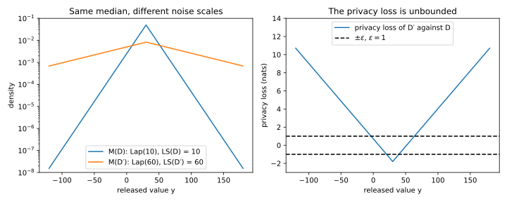
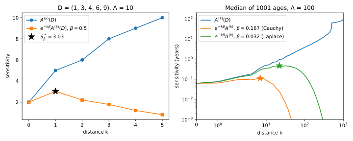
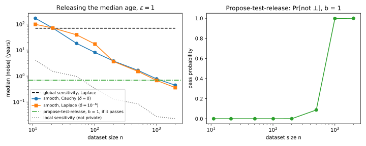
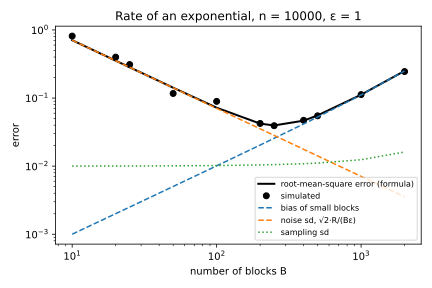
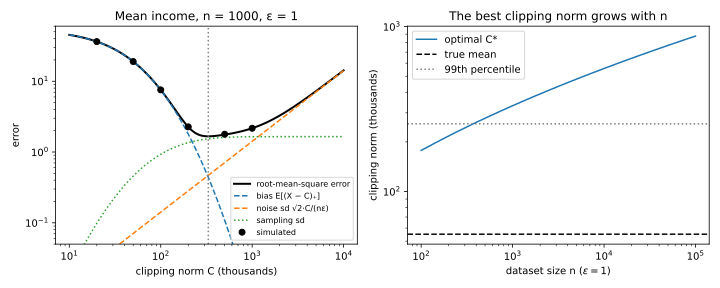

# Beyond global sensitivity

The [Laplace and Gaussian mechanisms](03-laplace-gaussian.md) add noise scaled to the **global sensitivity** of a query $f$. That is the most that one changed record can move $f$, over every pair of neighbouring datasets (@def-lg-sensitivity). For counts that is the right scale. But the median of ages in $[0, 100]$ has global sensitivity 100. On a dataset with half its people at 0 and half at 100, one person moves the median from one end to the other. On the dataset you actually hold, the median of 1,001 ages moves by about a tenth of a year when one person changes. Can you add noise on the scale of the data you have and still satisfy differential privacy (DP)?

You can, if you remember that the noise scale is then itself a function of the data, so it must be private too. Smooth sensitivity, propose-test-release and inverse sensitivity do this for a statistic like the median. Stability-based release handles discrete answers, subsample-and-aggregate handles black-box estimators, and clipping handles unbounded data, at the price of a bias.

The running example is the median of $n = 1{,}001$ synthetic ages, drawn from a normal distribution with mean 38 and standard deviation 14 and clipped to $[0, 100]$. The release uses $\varepsilon = 1$ and, where needed, $\delta = 10^{-6}$. Its median is 36.96, and one changed age moves it by at most 0.1386 years. Values lie in a range $[0, \Lambda]$, with $\Lambda = 100$ for the ages, and are sorted as $x_1 \le \dots \le x_n$. Datasets have a fixed size $n$, and neighbours $D \sim D'$ differ by one replaced record ([The definition of differential privacy](01-definition.md)). The **Hamming distance** $d(D, D'')$ between two datasets counts the records in which they differ. Every proof bounds the privacy loss of an output $y$, the log of how much more likely $y$ is under $D$ than under $D'$,
$$L_{D,D'}(y) = \ln\frac{p_{M(D)}(y)}{p_{M(D')}(y)},$$
and pure $\varepsilon$-DP holds exactly when it never exceeds $\varepsilon$ for any neighbours in either order.

## Local sensitivity, and why it leaks {#sec-sens-local}

Global sensitivity takes a maximum over all pairs of neighbours, including pathological ones. The natural fix is a maximum only over the neighbours of the dataset you hold. This section computes it for the median and shows why noise in proportion to it is not private.

::: {#def-sens-local name="Local sensitivity"}
The **local sensitivity** of a real-valued query $f$ at a dataset $D$ is the most that one record can move $f$ starting from $D$ itself,
$$\mathrm{LS}_f(D) = \max_{D' \sim D}|f(D) - f(D')|.$$
The global sensitivity is its worst case over all datasets, $\Delta f = \max_D\mathrm{LS}_f(D)$, so $\mathrm{LS}_f(D) \le \Delta f$ always.
:::

For the median, and for its smooth sensitivity in @sec-sens-smooth, you need to know how far an order statistic can travel when $k$ records change.

::: {#lem-sens-order name="Changing k records moves each order statistic by at most k places"}
Sort the values of $D$ as $x_1 \le \dots \le x_n$, all in $[0, \Lambda]$, and pad with $x_i = 0$ for $i \le 0$ and $x_i = \Lambda$ for $i > n$. If $D''$ differs from $D$ in at most $k$ records and has sorted values $x''_1 \le \dots \le x''_n$, then for every rank $j$,
$$x_{j-k} \le x''_j \le x_{j+k}.$$
:::

::: {.proof}
1. *Upper bound.* At least $j + k$ values of $D$ are at most $x_{j+k}$, and the padding makes this true when $j + k > n$. Changing $k$ records removes at most $k$ of them, so at least $j$ values of $D''$ are still at most $x_{j+k}$, which says that $x''_j \le x_{j+k}$.
2. *Lower bound.* At least $n - j + k + 1$ values of $D$ are at least $x_{j-k}$, and at least $n - j + 1$ of them survive $k$ changes, so $x''_j \ge x_{j-k}$.
:::

::: {#prp-sens-median-ls name="Local and global sensitivity of the median"}
Let $n$ be odd and $m = (n + 1)/2$, so that the median of $D$ is $x_m$. Then
$$\mathrm{LS}_{\mathrm{med}}(D) = \max\big(x_m - x_{m-1},\ x_{m+1} - x_m\big), \qquad \Delta\,\mathrm{med} = \Lambda.$$ {#eq-sens-median-ls}
:::

::: {.proof}
1. *The median of a neighbour lies between $x_{m-1}$ and $x_{m+1}$.* This is @lem-sens-order with $k = 1$ and $j = m$.
2. *Both ends are reached.* Replacing $x_m$ by $\Lambda$ makes $x_{m+1}$ the $m$-th smallest value. Replacing it by 0 puts the new 0 first, and $x_{m-1}$ becomes the $m$-th smallest.
3. *The global sensitivity.* With $m$ values at 0 and $m - 1$ at $\Lambda$, the gap above the median is $\Lambda$, and no gap can exceed $\Lambda$.
:::

Now add Laplace noise scaled to the local sensitivity, $M_{\mathrm{LS}}(D) = f(D) + \mathrm{Lap}(\mathrm{LS}_f(D)/\varepsilon)$. The proof of @thm-lg-laplace needs the same scale on both datasets of the pair. But by @eq-sens-median-ls one record can change this scale from 0 to $\Lambda$, and then no $(\varepsilon, \delta)$ guarantee survives.

::: {#prp-sens-leak name="Noise scaled to the local sensitivity is not private"}
For the median with $n = 5$ and $\Lambda = 100$, there is a neighbouring pair on which $M_{\mathrm{LS}}$ is not $(\varepsilon, \delta)$-DP for any finite $\varepsilon$ and any $\delta < 1$ (Nissim, Raskhodnikova & Smith 2007, Example 1).
:::

::: {.proof}
1. *A dataset that gets no noise.* $D = (0, 0, 0, 0, 100)$ has median 0 and both gaps next to it are 0, so $\mathrm{LS}_{\mathrm{med}}(D) = 0$, the noise has scale 0, and $M_{\mathrm{LS}}(D) = 0$ exactly.
2. *Its neighbour gets wide noise.* $D' = (0, 0, 0, 100, 100)$ also has median 0, but the gap above it is 100. So $M_{\mathrm{LS}}(D')$ has a continuous distribution, which equals 0 with probability 0.
3. *The inequality fails.* The output 0 has probability 1 under $D$ and 0 under $D'$, so DP would need $1 \le e^\varepsilon\cdot 0 + \delta$, which no $\delta < 1$ satisfies.
:::

::: {#exm-sens-leak}
The leak needs neither a degenerate dataset nor different answers. Take $\Lambda = 100$, $\varepsilon = 1$ and the neighbours of @tbl-sens-leak, which have the same median but local sensitivities six times apart.

| Dataset | Values | Median | $\mathrm{LS}$ |
| --- | --- | --- | --- |
| $D$ | 10, 20, 30, 31, 90 | 30 | $\max(30 - 20, 31 - 30) = 10$ |
| $D'$ (31 replaced by 90) | 10, 20, 30, 90, 90 | 30 | $\max(30 - 20, 90 - 30) = 60$ |

: Two neighbouring datasets with the same median and very different local sensitivities. {#tbl-sens-leak}

The releases are $30 + \mathrm{Lap}(10)$ and $30 + \mathrm{Lap}(60)$. The narrow density decays six times faster, so the log-ratio of the two Laplace densities grows with the distance from the centre:
$$L_{D',D}(y) = \ln\frac{20}{120} + |y - 30|\Big(\frac1{10} - \frac1{60}\Big) = -1.792 + \frac{|y - 30|}{12}.$$
So no pure $\varepsilon$ holds (@fig-sens-local-leak). The loss exceeds 1 once $|y - 30| > 33.50$, which happens with probability 0.572 under $D'$ and 0.0351 under $D$. So even $(1, \delta)$-DP needs $\delta \ge 0.572 - e\times0.0351 = 0.477$ on this pair, by the privacy profile of [Divergences](../part01-prerequisites/03-divergences.md). An adversary tells the two datasets apart by the width of the noise, not its centre.
:::

{#fig-sens-local-leak}

## Smooth sensitivity {#sec-sens-smooth}

The leak came from a noise scale that jumps between neighbours. So use a scale that cannot jump: an upper bound on the local sensitivity that changes by at most a factor $e^\beta$ between neighbours, because noise stretched by $e^\beta$ moves its log-density by about $\beta$. This section finds the smallest such bound (Nissim, Raskhodnikova & Smith 2007) and computes it for the median. @sec-sens-noise says which noise to use with it.

::: {#def-sens-smooth name="Smooth upper bound and smooth sensitivity"}
Let $\beta > 0$. A function $S$ of the dataset is a **$\beta$-smooth upper bound** on $\mathrm{LS}_f$ if
$$S(D) \ge \mathrm{LS}_f(D) \quad\text{and}\quad S(D) \le e^\beta S(D') \quad\text{for all } D \sim D'.$$
A dataset $D''$ at distance $k$ with a large local sensitivity forces such a bound up at $D$ too, discounted by a factor $e^{-\beta}$ per step. So the **$\beta$-smooth sensitivity** of $f$ takes the maximum over every dataset $D''$ of size $n$,
$$S^*_{f,\beta}(D) = \max_{D''}\ \mathrm{LS}_f(D'')\,e^{-\beta\,d(D, D'')}.$$ {#eq-sens-smooth}
:::

::: {#prp-sens-smooth-bound name="The smooth sensitivity is the smallest smooth upper bound"}
$S^*_{f,\beta}$ is a $\beta$-smooth upper bound on $\mathrm{LS}_f$, and every $\beta$-smooth upper bound $S$ satisfies $S(D) \ge S^*_{f,\beta}(D)$ for every $D$.
:::

::: {.proof}
1. *Upper bound.* The term $D'' = D$ of @eq-sens-smooth, at distance 0, contributes $\mathrm{LS}_f(D)$, and a maximum is at least each of its terms.
2. *Smooth.* A path from $D'$ to $D''$ can go through $D$ first, so $d(D', D'') \le 1 + d(D, D'')$. Each term of $S^*_{f,\beta}(D')$ is then at least $e^{-\beta}$ times the term for the same $D''$ in $S^*_{f,\beta}(D)$. Maximizing over $D''$ gives $S^*_{f,\beta}(D') \ge e^{-\beta}S^*_{f,\beta}(D)$, and exchanging the two neighbours gives the other direction.
3. *Smallest.* Let $S$ be any $\beta$-smooth upper bound and $D''$ a dataset at distance $k$ from $D$. Walking from $D''$ to $D$ in $k$ steps, $S$ falls by at most a factor $e^{-\beta}$ per step, so $S(D) \ge e^{-\beta k}S(D'') \ge e^{-\beta k}\mathrm{LS}_f(D'')$. Maximizing over $D''$ gives $S(D) \ge S^*_{f,\beta}(D)$.
:::

The smooth sensitivity is positive even where the local sensitivity is 0. On the degenerate pair of @prp-sens-leak it is already $100e^{-\beta}$ at $D$, the discounted local sensitivity of its neighbour $D'$.

You cannot enumerate all datasets, but all those at distance $k$ get the same discount. So you need only the largest local sensitivity within each distance. A dataset closer than $k$ also enters $A^{(k)}$ with too small a weight, but the term for its own distance counts it at full weight:
$$S^*_{f,\beta}(D) = \max_{k = 0, \dots, n} e^{-k\beta}A^{(k)}(D), \qquad A^{(k)}(D) = \max_{D'':\ d(D, D'') \le k}\mathrm{LS}_f(D'').$$ {#eq-sens-smooth-by-k}
For the median, $A^{(k)}$ is the widest gap that $k$ changes can open next to the median. You open one by moving the $k$ values between two order statistics $k + 1$ ranks apart out to 0 or $\Lambda$, so that the emptied window ends up next to the median.

::: {#prp-sens-median-ak name="The smooth sensitivity of the median"}
For the median, with the sorting and padding of @lem-sens-order, the largest local sensitivity within $k$ changes is the widest of $k + 2$ windows of the sorted data,
$$A^{(k)}(D) = \max_{0 \le t \le k+1}\big(x_{m+t} - x_{m+t-k-1}\big), \qquad k = 0, \dots, n,$$ {#eq-sens-median-ak}
where the window with index $t$ runs from rank $m + t - k - 1$ to rank $m + t$ (Nissim, Raskhodnikova & Smith 2007, Proposition 3.4). Since $A^{(n)} = \Lambda$ and each $A^{(k)}$ costs one subtraction per window, $S^*_{\mathrm{med},\beta}$ takes $O(n^2)$ operations.
:::

::: {.proof}
Steps 1 to 4 show that no dataset within distance $k$ has a gap next to its median wider than the widest window, and step 5 shows that every window is reached.

1. *What the gap looks like.* Let $D''$ be within distance $k$ of $D$, with sorted values $x''_1 \le \dots \le x''_n$. By @eq-sens-median-ls its local sensitivity is one of its two gaps next to the median. Take the upper one, $(x''_m, x''_{m+1})$, since the reflection $x \mapsto \Lambda - x$ turns lower gaps into upper ones and maps the windows of @eq-sens-median-ak to themselves.
2. *The gap contains at most $k$ original values.* Assume the gap is positive, and let $x_\ell$ be the largest value of $D$ at or below $x''_m$. No value of $D''$ lies strictly inside the gap, so the values of $D$ inside it, say $x_{\ell+1}, \dots, x_{\ell+j}$, were all changed, and $j \le k$. The next value $x_{\ell+j+1}$ is then at or above $x''_{m+1}$, so the gap is at most $x_{\ell+j+1} - x_\ell$.
3. *The gap sits near rank $m$.* Exactly $m$ values of $D''$ are at or below $x''_m$. Each is an unchanged value among $x_1, \dots, x_\ell$ or one of at most $k$ new values, so $m \le \ell + k$. And at least $\ell - (k - j)$ of $x_1, \dots, x_\ell$ are unchanged, because $j$ of the $k$ changes were used inside the gap, and these unchanged values are among the $m$, so $\ell - (k - j) \le m$.
4. *Fit it in a window.* If $\ell \le m$, the window from rank $\ell$ to rank $\ell + k + 1$ has $t = \ell + k + 1 - m$ in $[0, k + 1]$ by step 3, and it contains the span of step 2 because $j \le k$. If $\ell > m$, the window with $t = k + 1$ runs from rank $m$ to rank $m + k + 1$, which is at least $\ell + j + 1$ by the second inequality of step 3, and contains it.
5. *Every window is reached.* The window with index $t$ has $k$ values strictly between its ends, at ranks $\ell = m + t - k - 1$ and $u = m + t$. Moving $k + 1 - t$ of them to 0 and the rest to $\Lambda$ gives $x_\ell$ rank $m$ (or $m - 1$ when $t = 0$), so the median sits at one end of an empty interval of length $x_u - x_\ell$. With $k = n$ and $t = m$ the window runs from the padded $x_0 = 0$ to $x_{n+1} = \Lambda$, so $A^{(n)} = \Lambda$ and no larger $k$ is needed.
:::

::: {#exm-sens-walk}
Take $D = (1, 3, 4, 6, 9)$ on $[0, 10]$, with median 4. @tbl-sens-walk evaluates @eq-sens-median-ak with $\beta = 0.5$ and checks it against brute force over all $11^5 = 161{,}051$ datasets with values in $\{0, \dots, 10\}$.

| $k$ | Windows $x_{m+t} - x_{m+t-k-1}$, $t = 0, \dots, k+1$ | $A^{(k)}$ | Brute force | $e^{-0.5k}A^{(k)}$ |
| --- | --- | --- | --- | --- |
| 0 | $4 - 3,\ 6 - 4$ | 2 | 2 | 2.00 |
| 1 | $4 - 1,\ 6 - 3,\ 9 - 4$ | 5 | 5 | **3.03** |
| 2 | $4 - 0,\ 6 - 1,\ 9 - 3,\ 10 - 4$ | 6 | 6 | 2.21 |
| 3 | $4 - 0,\ 6 - 0,\ 9 - 1,\ 10 - 3,\ 10 - 4$ | 8 | 8 | 1.79 |
| 4 | $\dots,\ 9 - 0,\ 10 - 1,\ \dots$ | 9 | 9 | 1.22 |
| 5 | $\dots,\ 10 - 0,\ \dots$ | 10 | 10 | 0.82 |

: The smooth sensitivity of the median of $D = (1, 3, 4, 6, 9)$ on $[0, 10]$ with $\beta = 0.5$: the formula for $A^{(k)}$ against brute force over all datasets, and the discounted values whose maximum is $S^*_{0.5}$. {#tbl-sens-walk}

The local sensitivity is 2, the gap from 4 up to 6. But a move of the 6 up to 10 opens a gap of $9 - 4 = 5$, and even after the discount $e^{-0.5} = 0.6065$ that beats 2, so $S^*_{0.5}(D) = 3.03$ at $k = 1$ (@fig-sens-smooth-profile, left). For the 1,001 ages the formula gives $S^*_{\mathrm{med},1/6} = 0.1632$ at $k = 7$ and $S^*_{\mathrm{med},0.0322} = 0.5144$ at $k = 21$, because a smaller $\beta$ discounts distant datasets less. @sec-sens-noise gives the source of these two values of $\beta$.
:::

{#fig-sens-smooth-profile}

## Admissible noise for smooth sensitivity {#sec-sens-noise}

A smooth bound still changes by up to a factor $e^\beta$ between neighbours. This section asks which noise tolerates that, in the mechanism
$$M(D) = f(D) + \frac{S(D)}{\alpha}\,Z,$$ {#eq-sens-smooth-mech}
where $Z$ has a fixed density $h$ and the constant $\alpha > 0$ sets how many noise scales one record's shift of $f$ is worth. The answer depends on the tail of $h$, because a light-tailed density and a stretched copy of it have a log-ratio that grows without bound, as in @exm-sens-leak.

::: {#thm-sens-cauchy name="Pure DP with Cauchy-like noise"}
Let $h_\gamma(z) \propto 1/(1 + |z|^\gamma)$ with $\gamma > 1$, a density whose tails decay like $|z|^{-\gamma}$; $\gamma = 2$ is the standard Cauchy. Let $S$ be a $\beta$-smooth upper bound on $\mathrm{LS}_f$, and let
$$\gamma\alpha + (\gamma + 1)\beta \le \varepsilon.$$ {#eq-sens-cauchy-cond}
Then @eq-sens-smooth-mech with $Z \sim h_\gamma$ is $\varepsilon$-DP.
:::

::: {.proof}
The plan is to split the privacy loss at an output $y$ into three pieces, for the scales, the centres and the stretch of the noise draw, and to bound each.

1. *Write out the privacy loss.* The density of $M(D)$ at $y$ is $\frac{\alpha}{S(D)}h(z)$, where $z = \alpha\frac{y - f(D)}{S(D)}$ is the draw that produces $y$ from $D$, and likewise for $D'$ with $z'$. Substituting $y$ in terms of $z$ shows that $z'$ is $z$ shifted, then stretched:
$$z' = e^{\kappa}(z + v), \qquad e^\kappa = \frac{S(D)}{S(D')},\quad v = \alpha\,\frac{f(D) - f(D')}{S(D)}.$$
Inserting $h(z + v)$ in the middle of the ratio splits the log-ratio of the densities into three terms:
$$L_{D,D'}(y) = \underbrace{\ln\frac{S(D')}{S(D)}}_{\text{scale}} + \underbrace{\ln\frac{h(z)}{h(z + v)}}_{\text{sliding}} + \underbrace{\ln\frac{h(z + v)}{h(e^\kappa(z + v))}}_{\text{dilation}}.$$
2. *Size of the shift and the stretch.* Smoothness gives $|\kappa| \le \beta$. One record moves $f$ by at most $\mathrm{LS}_f(D) \le S(D)$, so $|v| \le \alpha$, the only use of the upper-bound property.
3. *Scale term.* It is at most $\beta$, by smoothness.
4. *Sliding term.* Write $\psi(u) = \ln(1 + u^\gamma)$, so that $-\ln h_\gamma(z) = \psi(|z|)$ plus a constant. Its slope $\gamma u^{\gamma-1}/(1 + u^\gamma)$ is at most $\gamma$, because $u^{\gamma-1} \le 1 + u^\gamma$ both for $u \le 1$ and for $u > 1$. The arguments $|z|$ and $|z + v|$ differ by at most $|v|$, so by the mean value theorem the term is at most $\gamma|v| \le \gamma\alpha$.
5. *Dilation term.* With $w = |z + v|$ and $\kappa \ge 0$, the inequality $(1 + ca)/(1 + a) \le c$ for $c \ge 1$ gives
$$\frac{h(w)}{h(e^\kappa w)} = \frac{1 + e^{\kappa\gamma}w^\gamma}{1 + w^\gamma} \le e^{\kappa\gamma}$$
for every $w$, however far in the tail; that is what the power-law tail buys. For $\kappa < 0$ the argument moves towards 0, where $h$ is larger, and the ratio is at most 1. So the term is at most $\gamma\beta$.
6. *Add up.* The loss is at most $\beta + \gamma\alpha + \gamma\beta \le \varepsilon$ at every $y$, which is pure $\varepsilon$-DP.
:::

Nissim, Raskhodnikova & Smith (2007, Lemma 2.7) take $\alpha = \beta = \varepsilon/(2(\gamma + 1))$. For the Cauchy, $\gamma = 2$, that gives the release $f(D) + \frac{6}{\varepsilon}S^*_{f,\varepsilon/6}(D)\,Z$, and the left side of @eq-sens-cauchy-cond is $2\alpha + 3\beta = 5\varepsilon/6 = 0.8333\,\varepsilon$. For Laplace noise the dilation term grows with the draw, so the condition gains a term that charges for draws above $\ln(1/\delta)$.

::: {#thm-sens-laplace name="Approximate DP with Laplace noise"}
Let $Z \sim \mathrm{Lap}(1)$, with density $\frac12e^{-|z|}$, let $S$ be a $\beta$-smooth upper bound on $\mathrm{LS}_f$, let $\delta \in (0, 1)$, and let
$$\beta + e^\beta\alpha + (e^\beta - 1)\ln(1/\delta) \le \varepsilon.$$ {#eq-sens-laplace-cond}
Then @eq-sens-smooth-mech is $(\varepsilon, \delta)$-DP.
:::

::: {.proof}
1. *Reuse the split.* Steps 1 to 3 of the proof of @thm-sens-cauchy did not use the shape of $h$. So the loss is the scale term, at most $\beta$, plus $\ln(h(z)/h(z'))$ with $z' = e^\kappa(z + v)$, $|\kappa| \le \beta$ and $|v| \le \alpha$.
2. *Bound the shape term by the draw.* For the Laplace density that log-ratio is $|z'| - |z|$. The triangle inequality and the bounds on $\kappa$ and $v$ give
$$\ln\frac{h(z)}{h(z')} \le e^\beta(|z| + \alpha) - |z| = (e^\beta - 1)|z| + e^\beta\alpha.$$
3. *The rare draws pay $\delta$.* A $\mathrm{Lap}(1)$ variable exceeds $\ln(1/\delta)$ in absolute value with probability exactly $\delta$. Outside that event the loss is at most the left side of @eq-sens-laplace-cond, hence at most $\varepsilon$. By @lem-lg-bad-event the smallest $\delta$ that works for a pair is at most the probability that the loss exceeds $\varepsilon$, so the mechanism is $(\varepsilon, \delta)$-DP.
:::

Nissim, Raskhodnikova & Smith (2007, Lemma 2.9) split the budget as $\alpha = \varepsilon/2$ and $\beta = \varepsilon/(2\ln(2/\delta))$. With either split $\beta$ must shrink like $1/\ln(1/\delta)$, because the term $(e^\beta - 1)\ln(1/\delta)$ of @eq-sens-laplace-cond must stay below $\varepsilon$. That term is there because Laplace noise cannot give pure DP. Pure DP needs the ratio of $h$ at a point and at a stretched point to stay bounded however far out the point is, so $h$ can decay at most like a power. A density that tolerates the shift and the stretch is called **admissible**.

Heavy tails have a price. A standard Cauchy variable has $\Pr[|Z| \le t] = \frac2\pi\arctan t$, so $|Z|$ has median 1. But about one release in 16 is off by more than ten times that: $\Pr[|Z| > 10] = 0.0635$, against $e^{-10} \approx 4.5\times10^{-5}$ for Laplace noise.

::: {#exm-sens-ages}
Release the median of the 1,001 ages with $\varepsilon = 1$, and compare the options by their median absolute error, which for noise $bZ$ is $b$ for the Cauchy and $b\ln 2$ for the Laplace. With global sensitivity it is $100\ln 2 = 69.31$ years. Cauchy noise with $\alpha = \beta = 1/6$ uses $S^*_{\mathrm{med},1/6} = 0.1632$, barely above the local sensitivity, so its error is $6\times0.1632 = 0.979$. Laplace noise with $\delta = 10^{-6}$ and $\alpha = 1/2$ allows $\beta = 0.0322$ by @eq-sens-laplace-cond. Then $S^*_{\mathrm{med},0.0322} = 0.5144$, the noise scale is 1.029 and the error is 0.713.

Both smooth releases are 70 to 100 times more accurate than the global one, and the gain grows with $n$ (@fig-sens-methods-vs-n). Below about 20 points the smooth noise is worse, because a few changes can then open a gap of nearly the whole range.
:::

## Propose-test-release {#sec-sens-ptr}

Smooth sensitivity needs a formula like @eq-sens-median-ak, and such formulas are known for only a few functions. Dwork & Lei (2009) take a cruder route. You propose a bound $b$ on the local sensitivity, check privately that the data are far from any dataset where it fails, and only then release with noise of scale $b/\varepsilon$. The check counts how many changes it takes before the bound fails, and the proof needs such a count to have sensitivity 1.

::: {#lem-sens-distance name="Distances to a set have sensitivity 1"}
For any set $\mathcal B$ of datasets, let $\operatorname{dist}(D, \mathcal B) = \min_{D'' \in \mathcal B}d(D, D'')$ be the number of changes needed to reach the nearest of them. Then $|\operatorname{dist}(D, \mathcal B) - \operatorname{dist}(D', \mathcal B)| \le 1$ for all $D \sim D'$.
:::

::: {.proof}
1. *One direction.* A path from $D'$ into $\mathcal B$ can go through $D$ first, so $d(D', D'') \le 1 + d(D, D'')$ for every $D''$. Minimizing over $D'' \in \mathcal B$ gives $\operatorname{dist}(D', \mathcal B) \le 1 + \operatorname{dist}(D, \mathcal B)$.
2. *The other.* Exchange $D$ and $D'$.
:::

So a distance to a set can be released with $\mathrm{Lap}(1/\varepsilon)$ noise, and propose-test-release compares it with a threshold that noise alone lifts a distance of 0 above only with probability $\delta/2$.

::: {#thm-sens-ptr name="Propose-test-release"}
Fix a proposed bound $b > 0$, $\varepsilon > 0$ and $\delta \in (0, 1)$. Let $\operatorname{dist}_b(D) = \min\{d(D, D'') : \mathrm{LS}_f(D'') > b\}$ be the number of records that must change before the local sensitivity can exceed $b$. **Propose-test-release** outputs

- $\bot$ if $\operatorname{dist}_b(D) + \mathrm{Lap}(1/\varepsilon) \le \ln(1/\delta)/\varepsilon$;
- $f(D) + \mathrm{Lap}(b/\varepsilon)$ otherwise.

It is $(2\varepsilon, \delta/2)$-DP. For the median, $\operatorname{dist}_b(D) = \min\{k : A^{(k)}(D) > b\}$ with $A^{(k)}$ from @eq-sens-median-ak.
:::

::: {.proof}
The plan is to split neighbouring pairs into two cases. If the proposal is right for the pair, the release is an ordinary Laplace mechanism. If it is wrong, both datasets sit at an unstable point and the test almost always refuses.

1. *The test is $\varepsilon$-DP.* $\operatorname{dist}_b$ is a distance to a set, so it has sensitivity 1 by @lem-sens-distance, and adding $\mathrm{Lap}(1/\varepsilon)$ is the Laplace mechanism. Whether the test passes is [post-processing](02-properties.md#sec-dpprop-post) of that noisy value.
2. *Case 1: $|f(D) - f(D')| \le b$.* The release $f(D) + \mathrm{Lap}(b/\varepsilon)$ has privacy loss at most $\varepsilon$ by @thm-lg-laplace. The output is a function of two independent draws, each with loss at most $\varepsilon$, so by [basic composition](02-properties.md#sec-dpprop-comp) the mechanism is $2\varepsilon$-DP on this pair.
3. *Case 2: $|f(D) - f(D')| > b$.* Then both local sensitivities exceed $b$, because each neighbour is in the other's maximum, so $\operatorname{dist}_b(D) = 0$. The test passes only if $\mathrm{Lap}(1/\varepsilon)$ exceeds $\ln(1/\delta)/\varepsilon$, which has probability $\frac12e^{-\ln(1/\delta)} = \delta/2$.
4. *Bound case 2.* For any set $S$ of outputs, $M(D)$ lands in $S$ by refusing, if $\bot \in S$, or by releasing, with probability at most $\delta/2$. The refusal is post-processing of the $\varepsilon$-DP test, so its probability is at most $e^\varepsilon \le e^{2\varepsilon}$ times that under $D'$, and
$$\Pr[M(D) \in S] \le e^{2\varepsilon}\Pr[M(D') \in S] + \delta/2.$$
5. *Combine.* Case 1 satisfies the same inequality, so every pair does.
:::

When the data are stable, the proposal sets the noise scale, so the scale reveals nothing. Otherwise $\bot$ says only that the data were probably near an unstable dataset. The threshold is large, $\ln(10^6) = 13.82$ at $\varepsilon = 1$ and $\delta = 10^{-6}$, so the data must be stable against more than a dozen changes. The method needs only the distance to instability, which is often easier to bound than $S^*_{f,\beta}$, but it pays $2\varepsilon$ and can refuse. Fix the proposal before you look at the data: a $b$ of twice the observed local sensitivity makes the noise scale a function of the data again, and the leak of @sec-sens-local returns.

::: {#exm-sens-ptr}
On the 1,001 ages, propose $b = 1$ year. The first $k$ with $A^{(k)} > 1$ is 21, so $\operatorname{dist}_1(D) = 21$, and the test passes with probability $1 - \frac12e^{-(21 - 13.82)} = 0.999621$. The release then has median absolute error $\ln 2 = 0.693$ years, at a total budget of 2. On 101 ages $\operatorname{dist}_1 = 1$, and the pass probability is only $\frac12e^{-(13.82 - 1)} = 1.36\times10^{-6}$ (@fig-sens-methods-vs-n, right).
:::

{#fig-sens-methods-vs-n}

## Inverse sensitivity {#sec-sens-inverse}

Smooth sensitivity and propose-test-release work hard for a safe noise scale. Inverse sensitivity (Asi & Duchi 2020) has no noise scale. It samples each candidate output with a probability that falls exponentially in the number of records you would have to change to make it the true answer. That count is a distance to a set, which has sensitivity 1 by @lem-sens-distance, so no smooth bound, test or refusal is needed.

::: {#def-sens-inverse name="Inverse sensitivity and its mechanism"}
The **inverse sensitivity** of $f$ at $D$ toward an output $y$ is the number of records you must change to make $f$ equal to $y$,
$$\mathrm{len}_f(D, y) = \min\{d(D, D'') : f(D'') = y\}.$$
The **inverse-sensitivity mechanism** samples $y$ from $[0, \Lambda]$ with the density
$$p_D(y) = \frac{e^{-\varepsilon\,\mathrm{len}_f(D, y)/2}}{\int_0^\Lambda e^{-\varepsilon\,\mathrm{len}_f(D, y')/2}\,\mathrm dy'}.$$ {#eq-sens-inverse}
:::

This is the [exponential mechanism](05-selection.md#sec-sel-exp) with the score $-\mathrm{len}_f(D, y)$, and its proof is the exponential mechanism's.

::: {#thm-sens-inverse name="The inverse-sensitivity mechanism is pure DP"}
If every output in $[0, \Lambda]$ is the value of $f$ on some dataset of size $n$, so that every count $\mathrm{len}_f(D, y)$ is finite, then the mechanism of @eq-sens-inverse is $\varepsilon$-DP.
:::

::: {.proof}
1. *The penalty has sensitivity 1.* For each $y$, $\mathrm{len}_f(D, y)$ is the distance from $D$ to the non-empty set of datasets on which $f$ equals $y$, so by @lem-sens-distance it changes by at most 1 between neighbours.
2. *Each weight moves by at most $e^{\varepsilon/2}$.* So the weight of each output changes by a factor between $e^{-\varepsilon/2}$ and $e^{\varepsilon/2}$, and so does the normalizer, an integral of such weights.
3. *Pointwise, hence pure DP.* The density is a weight over the normalizer, so $p_D(y)/p_{D'}(y) \le e^{\varepsilon/2}\cdot e^{\varepsilon/2} = e^\varepsilon$ at every $y$.
:::

The factor 2 is needed because a weight and the normalizer can move in opposite directions. For the median the count has a closed form, and the density is a staircase, flat on each gap between sorted values.

::: {#prp-sens-inverse-median name="The count for the median"}
Let $n$ be odd, so that the median has rank $m = (n + 1)/2$, with the sorting and padding of @lem-sens-order. For a candidate $y$ in the open gap $(x_i, x_{i+1})$,
$$\mathrm{len}_{\mathrm{med}}(D, y) = \begin{cases} m - i & \text{if } i < m,\\ i - m + 1 & \text{if } i \ge m.\end{cases}$$ {#eq-sens-inverse-median}
:::

::: {.proof}
1. *Above the median.* Take $i \ge m$, so $i$ values of $D$ lie below $y$. A dataset with median $y$ has at most $m - 1$ values below $y$, and each change removes at most one, so at least $i - m + 1$ changes are needed. That many suffice: move one value from below $y$ to $y$ and $i - m$ others to $\Lambda$.
2. *Below the median.* The reflection $x \mapsto \Lambda - x$ turns the gap with index $i < m$ into the gap with index $n - i \ge m$, and step 1 gives $(n - i) - m + 1 = m - i$, since $n + 1 = 2m$.
:::

There is no noise scale to leak. Where the data are dense, the outputs a few steps from the median are also close to it in value, so the error is a few gaps times a factor that grows with $1/\varepsilon$. Asi & Duchi (2020) show that, up to logarithmic factors, no $\varepsilon$-DP mechanism does much better on a dataset and its close neighbours. So the method is near-optimal dataset by dataset.

It has two limits. The outer gaps $(0, x_1)$ and $(x_n, \Lambda)$ can be long and are $m$ steps away, which matters for eleven points but not for a thousand. And you must compute the count, which has a closed form like @eq-sens-inverse-median only for medians, quantiles and a few other statistics.

::: {#exm-sens-inverse}
Take the walkthrough dataset $D = (1, 3, 4, 6, 9)$ on $[0, 10]$ with $\varepsilon = 1$. @tbl-sens-inverse lists its six gaps, their counts from @eq-sens-inverse-median, and their probabilities, each its length times $e^{-\mathrm{len}/2}$ over the total. The two gaps next to the median are one change away and together get probability $0.1477 + 0.2955 = 0.4432$.

| Gap | $(0, 1)$ | $(1, 3)$ | $(3, 4)$ | $(4, 6)$ | $(6, 9)$ | $(9, 10)$ |
| --- | --- | --- | --- | --- | --- | --- |
| Length | 1 | 2 | 1 | 2 | 3 | 1 |
| $\mathrm{len}_{\mathrm{med}}(D, y)$ | 3 | 2 | 1 | 1 | 2 | 3 |
| Probability | 0.0544 | 0.1792 | 0.1477 | 0.2955 | 0.2688 | 0.0544 |

: The inverse-sensitivity release of the median of $D = (1, 3, 4, 6, 9)$ on $[0, 10]$ with $\varepsilon = 1$: each gap between sorted values, the number of changes that make a point of it the median, and its probability. {#tbl-sens-inverse}

On the 1,001 ages the median absolute error, computed exactly from the density, is 0.0783 years. That is pure DP with no refusals, twelve times more accurate than smooth sensitivity with Cauchy noise (0.979). It is even below the local sensitivity 0.1386, because a typical release lands only a few short gaps from the median. On 101 ages the error grows to 0.696 years, because the gaps are ten times wider.
:::

## Stability-based release {#sec-sens-stable}

Some statistics take discrete values, such as the most common diagnosis or the model that a selection procedure picks. On most datasets one record cannot change them, so their local sensitivity is 0. Propose-test-release with $b = 0$ then gives the **stability-based release**. It tests privately that the data are far from any dataset where one change flips the answer, and if so it releases the answer exactly (Dwork & Roth 2014, ch. 7; Thakurta & Smith 2013).

::: {#thm-sens-stable name="Stability-based release"}
Let $f$ be a discrete statistic, and let $s$ be a **stability score**: a function of the data with sensitivity 1 that equals 0 on every dataset that has a neighbour where $f$ gives a different answer. The stability-based release outputs
$$M(D) = \begin{cases}\bot & \text{if } s(D) + \mathrm{Lap}(1/\varepsilon) \le \ln(1/\delta)/\varepsilon,\\ f(D) & \text{otherwise,}\end{cases}$$ {#eq-sens-stable}
and it is $(\varepsilon, \delta/2)$-DP. By @lem-sens-distance, the distance to the set of datasets that have a neighbour with a different answer is one such score.
:::

::: {.proof}
The proof is that of @thm-sens-ptr, except that nothing but the test depends on the data when the answers agree.

1. *The test is $\varepsilon$-DP*, as in step 1 of the proof of @thm-sens-ptr.
2. *Neighbours with the same answer.* The release is the same function of the test's outcome on both, so it is post-processing of an $\varepsilon$-DP output. The second $\varepsilon$ that propose-test-release paid for its noisy answer is not needed.
3. *Neighbours with different answers.* Then $s(D) = s(D') = 0$, and the test passes with probability $\delta/2$. Step 4 of the proof of @thm-sens-ptr, with $e^\varepsilon$ in place of $e^{2\varepsilon}$, gives $\Pr[M(D) \in S] \le e^\varepsilon\Pr[M(D') \in S] + \delta/2$ for every set $S$.
:::

For the **mode** of a categorical dataset, the most frequent value with ties broken by a fixed order, a score can be read off the lead of the winner.

::: {#prp-sens-mode name="A stability score for the mode"}
Let the lead $g$ be the top count minus the second-highest count. Under replacement,
$$s(D) = \max\big(0,\ \lceil g/2\rceil - 1\big)$$ {#eq-sens-stable-mode}
is a stability score for the mode.
:::

::: {.proof}
1. *Sensitivity 1.* One replacement lowers one count by at most 1 and raises another by at most 1, so the lead moves by at most 2. Halving and rounding up turns that into a move of at most 1, since $\lceil (g + 2)/2\rceil = \lceil g/2\rceil + 1$.
2. *Zero where the answer can flip.* If $g \ge 3$, after one change the mode keeps at least $c_1 - 1$ records, where $c_1$ is its count, and every other value has at most $c_2 + 1 \le c_1 - 2$, where $c_2$ is the second-highest count. So a dataset whose neighbour has a different mode has $g \le 2$, and then $s = 0$.
:::

The release is exact, and the cost of privacy is the chance of a refusal, which depends on the lead and not on the number of possible values. The mode must lead by about $2\ln(1/\delta)/\varepsilon$ records, whether there are ten categories or a billion. Under pure DP, the packing lower bound of [Lower bounds](10-lower-bounds.md) needs a lead of about $\ln N/\varepsilon$ to choose among $N$ values. Approximate DP gets around it because $\delta/2$ pays for the rare exact release next to a flip.

::: {#exm-sens-mode}
The median is not discrete, so take a mode, with $\varepsilon = 1$ and $\delta = 10^{-6}$ (threshold 13.82). Leads of 10, 30 and 40 records give scores 4, 14 and 19, and the release answers with probability $2.73\times10^{-5}$, 0.5842 and 0.9972. So for probability 0.95 you need a lead of 35, whatever the number of categories.
:::

## Subsample-and-aggregate {#sec-sens-saa}

Sometimes you cannot analyse $f$ at all, because it is a trained model or a pipeline you did not write. Subsample-and-aggregate (Nissim, Raskhodnikova & Smith 2007; Smith 2011) runs $f$ as a black box on disjoint pieces of the data and privately combines the answers. One record can change only one answer, so the combination needs to hide only one changed input.

::: {#thm-sens-saa name="Subsample-and-aggregate"}
Split the $n$ records into $B$ disjoint blocks of $n/B$ records by a partition fixed in advance. Compute the block answers $a_j = f(\text{block } j)$, clamp each to $[0, R]$, and release
$$M(D) = \frac1B\sum_{j=1}^B \operatorname{clip}_{[0,R]}(a_j) + \mathrm{Lap}\Big(\frac{R}{B\varepsilon}\Big).$$
This is $\varepsilon$-DP for any $f$. When the clipping is inactive and the blocks are independent samples, its mean squared error as an estimate of a target $\theta$ is, with $a$ the output of $f$ on one block,
$$\underbrace{\big(\mathbb E[a] - \theta\big)^2}_{\text{bias of } f \text{ on } n/B \text{ records}} + \underbrace{\frac{\operatorname{Var}(a)}{B}}_{\text{sampling}} + \underbrace{2\Big(\frac{R}{B\varepsilon}\Big)^2}_{\text{noise}}.$$ {#eq-sens-saa-error}
:::

::: {.proof}
The privacy part bounds the sensitivity of the average, and the error comes from the square of a sum of three independent pieces.

1. *One record touches one block.* The partition does not depend on the values, so replacing a record changes at most one block answer.
2. *The aggregate has sensitivity $R/B$.* After clamping, that answer moves by at most $R$, and the average divides by $B$.
3. *Privacy.* Laplace noise of scale $R/(B\varepsilon)$ on a quantity of sensitivity $R/B$ is $\varepsilon$-DP by @thm-lg-laplace.
4. *Error.* The released value minus $\theta$ is the bias $\mathbb E[a] - \theta$, plus the mean-zero average of the $a_j - \mathbb E[a]$, with variance $\operatorname{Var}(a)/B$, plus the Laplace noise, with variance $2(R/(B\varepsilon))^2$. The cross terms of the square each contain an independent mean-zero factor and average to zero, which leaves @eq-sens-saa-error.
:::

The noise falls like $1/B$, while the sampling term hardly moves, because a block estimate has about $B$ times the variance of $f$ on all records and the average divides by $B$ again. The bias of $f$ on small blocks grows with $B$, so the best $B$ balances bias and noise. The partition must not depend on the values, or one record could move many records between blocks.

The proof never looks inside $f$, so the method suits trained models, as in private aggregation of teacher ensembles (Papernot et al. 2017). But the range $R$ is still a global bound, and a loose $R$ means large noise.

::: {#exm-sens-saa}
The running example has no black-box statistic, so estimate the rate $\lambda = 1$ of $n = 10{,}000$ independent exponential inter-arrival times with $\varepsilon = 1$. The estimate $1/\bar x$, one over the sample mean, has infinite global sensitivity, because tiny times make it huge.

On a block of $n_b = n/B$ records the block sum $G$ is gamma with shape $n_b$ and rate $\lambda$, and the block estimate is $a = n_b/G$. Integrating $1/g$ and $1/g^2$ against the gamma density leaves gamma densities with shapes $n_b - 1$ and $n_b - 2$, which gives
$$\mathbb E[a] = \frac{n_b\lambda}{n_b - 1}, \qquad \text{bias } \frac{\lambda}{n_b - 1}, \qquad \operatorname{Var}(a) = \frac{n_b^2\lambda^2}{(n_b - 1)^2(n_b - 2)}.$$
With $R = 5$, @tbl-sens-saa and @fig-sens-saa-blocks show the trade-off; at $B = 10$ the noise standard deviation is $\sqrt2\times0.5 = 0.7071$.

| Blocks $B$ | Block size | Bias | Sampling sd | Noise sd | Root-mean-square error | Simulated |
| --- | --- | --- | --- | --- | --- | --- |
| 10 | 1,000 | 0.0010 | 0.0100 | 0.7071 | 0.7072 | 0.7205 |
| 100 | 100 | 0.0101 | 0.0102 | 0.0707 | 0.0722 | 0.0733 |
| 250 | 40 | 0.0256 | 0.0105 | 0.0283 | 0.0396 | 0.0401 |
| 1,000 | 10 | 0.1111 | 0.0124 | 0.0071 | 0.1120 | 0.1114 |

: Error of subsample-and-aggregate for the rate of an exponential distribution, $n = 10{,}000$, $\lambda = 1$, $R = 5$, $\varepsilon = 1$: the three terms of @eq-sens-saa-error, their combination, and a simulation with 1,000 repetitions. {#tbl-sens-saa}

Of the block counts shown, the best is $B = 250$, with error $0.0396$, where bias and noise are of similar size. A non-private estimate has standard deviation about $\lambda/\sqrt n = 0.0100$. So privacy at $\varepsilon = 1$ costs a factor of four, for an estimator whose sensitivity you never had to bound.
:::

{#fig-sens-saa-blocks}

## Clipping {#sec-sens-clip}

The mean is the most common statistic of all, and on unbounded data its global sensitivity is infinite. **Clipping** replaces each value $x$ by $\min(x, C)$ before the average, so the sensitivity becomes $C/n$. But clipping changes the quantity you estimate, and the choice of $C$ trades that bias against the noise. Private model training in later parts clips per-example gradients in the same way.

::: {#thm-sens-clip name="The clipped mean and its best clipping norm"}
Take non-negative data $X_1, \dots, X_n$ drawn independently from a distribution with mean $\mu$, and write $(x - C)_+ = \max(x - C, 0)$ for the part of a value above $C$. The clipped mean
$$M(D) = \frac1n\sum_{i=1}^n\min(X_i, C) + \mathrm{Lap}\Big(\frac{C}{n\varepsilon}\Big)$$
is $\varepsilon$-DP, and its mean squared error as an estimate of $\mu$ is
$$\operatorname{err}(C)^2 = \underbrace{\mathbb E[(X - C)_+]^2}_{\text{bias}^2} + \underbrace{\frac{\operatorname{Var}(\min(X, C))}{n}}_{\text{sampling}} + \underbrace{\frac{2C^2}{n^2\varepsilon^2}}_{\text{noise}}.$$ {#eq-sens-clip-error}
The clipping norm that minimizes it solves
$$\Pr[X > C]\Big(\mathbb E[(X - C)_+] - \frac{C - \mathbb E[\min(X, C)]}{n}\Big) = \frac{2C}{n^2\varepsilon^2}.$$ {#eq-sens-clip-opt}
:::

::: {.proof}
The privacy part is one line, the error splits as in @eq-sens-saa-error, and the best $C$ is where the derivative of the error vanishes.

1. *Sensitivity.* Each clipped value lies in $[0, C]$, so one replacement moves the mean by at most $C/n$, and the noise makes it $\varepsilon$-DP by @thm-lg-laplace.
2. *The bias.* Clipping removes exactly the excess, $x - \min(x, C) = (x - C)_+$, so $\mu - \mathbb E[\min(X, C)] = \mathbb E[(X - C)_+]$.
3. *Error decomposition.* As in step 4 of the proof of @thm-sens-saa, the error is the bias, a mean-zero sampling term with variance $\operatorname{Var}(\min(X, C))/n$ and independent noise with variance $2(C/(n\varepsilon))^2$, which gives @eq-sens-clip-error.
4. *Derivatives in $C$.* Raising $C$ slightly raises $\min(X, C)$ by that amount exactly when $X > C$, so $\mathbb E[\min(X, C)]$ has derivative $\Pr[X > C]$ and $\mathbb E[\min(X, C)^2]$ has derivative $2C\Pr[X > C]$. By the chain rule the three terms have derivatives $-2\,\mathbb E[(X - C)_+]\Pr[X > C]$, then $\frac2n\Pr[X > C]\big(C - \mathbb E[\min(X, C)]\big)$, then $4C/(n^2\varepsilon^2)$.
5. *Set the sum to zero* and divide by 2, which is @eq-sens-clip-opt.
:::

The bias does not shrink with $n$, but the noise does, so the best $C$ grows with $n$ and moves into the tail. A clip from above always underestimates. A clip to an interval around a centre cuts both sides, and the two cuts cancel for a symmetric distribution, which is why [Private mean estimation](11-mean-estimation.md) first estimates the centre privately.

Do not choose $C$ from the raw data. The observed maximum or the empirical 99th percentile as $C$ brings back the leak of @sec-sens-local. Choose $C$ from domain knowledge, or spend part of the budget on a private quantile by inverse sensitivity (@sec-sens-inverse).

::: {#exm-sens-clip}
The ages are already bounded, so take incomes, in thousands, with $\ln X \sim \mathcal N(\ln 40, 0.8^2)$. The median is 40 and the mean is $e^{\ln 40 + 0.64/2} = 55.085$, pulled up by the heavy right tail. The averages of $X$ and $X^2$ below $C$ that @eq-sens-clip-error needs have a closed form in the normal distribution function ([Probability distributions](../part01-prerequisites/01-distributions.md)), and @tbl-sens-clip uses it with $n = 1000$ and $\varepsilon = 1$.

| Clipping norm $C$ | $\Pr[X > C]$ | Bias | Sampling sd | Noise sd | Root-mean-square error | Simulated |
| --- | --- | --- | --- | --- | --- | --- |
| 40 (the median) | 0.5000 | 23.415 | 0.335 | 0.057 | 23.417 | 23.411 |
| 257.23 (99th percentile) | 0.0100 | 0.924 | 1.462 | 0.364 | 1.767 | 1.747 |
| 331.34 (optimal) | 0.0041 | 0.438 | 1.538 | 0.469 | 1.666 | 1.649 |
| 1000 | 0.0000 | 0.006 | 1.645 | 1.414 | 2.169 | 2.134 |

: Error of the clipped private mean of log-normal incomes, $n = 1000$, $\varepsilon = 1$, for four clipping norms: the three terms of @eq-sens-clip-error, their combination, and a simulation with 5,000 repetitions. {#tbl-sens-clip}

Clipping at the median cuts back half the incomes, and the bias of 23 dwarfs everything. The optimum, $C^* = 331.34$, cuts off 0.4% of the population and has error $1.666$, only 1% above the standard deviation $1.649$ of the unclipped, non-private mean. Above the optimum the noise takes over (@fig-sens-clip-tradeoff, left). The optimum grows with $n$: $177.5$ at $n = 100$, $557.3$ at $n = 10{,}000$ and $876.3$ at $n = 100{,}000$ (@fig-sens-clip-tradeoff, right).
:::

{#fig-sens-clip-tradeoff}

## Code {#sec-sens-code}

The script [code/sensitivity.py](../../code/part03-dp-foundations/sensitivity.py) computes every number in this chapter and draws its figures. From the repository root:

```bash
uv run python code/part03-dp-foundations/sensitivity.py
```

| Experiment | Result |
| --- | --- |
| Local-sensitivity noise, @tbl-sens-leak | smallest $\delta$ at $\varepsilon = 1$: 0.477 and 0.215 |
| $A^{(k)}$, @tbl-sens-walk | Formula equals brute force; $S^*_{0.5} = 3.03$ |
| Noise parameters | Cauchy loss bound 0.8333; Laplace $\beta = 0.0322$ |
| Median of the ages, median error | Cauchy 0.979 (simulated 0.980); Laplace 0.713; global 69.31 |
| Propose-test-release, $b = 1$, pass probability | 0.999621 at $n = 1001$; $1.36\times10^{-6}$ at $n = 101$ |
| Subsample-and-aggregate | Best $B = 250$, error 0.0396 |
| Inverse sensitivity, median error | 0.0783 (simulated 0.0784); 0.696 on 101 ages |
| Stable mode, pass probability | 0.5842 at a lead of 30; lead 35 for 0.95 |
| Clipped mean of incomes | $C^* = 331.34$, error 1.666 (simulated 1.649) |

: The script's output with seed 0. {#tbl-sens-code}

[tests/test_sensitivity.py](../../tests/test_sensitivity.py) checks that the output still matches this table.

## Summary {#sec-sens-summary}

| Result | Statement | Use |
| --- | --- | --- |
| @def-sens-local | The most one record can move $f$ from $D$ | Never a noise scale on its own |
| @prp-sens-median-ls | The larger gap next to the median; globally $\Lambda$ | Medians and quantiles |
| @prp-sens-leak | Noise scaled to $\mathrm{LS}_f$ is not private | Ask what a data-dependent scale reveals |
| @prp-sens-smooth-bound | $S^*_{f,\beta}$ is the smallest $\beta$-smooth upper bound | Data-dependent noise with a proof |
| @prp-sens-median-ak | $A^{(k)}$ is the widest of $k + 2$ windows | Pays off once $n$ is in the hundreds |
| @thm-sens-cauchy | Cauchy-like noise is $\varepsilon$-DP under @eq-sens-cauchy-cond | Pure DP needs polynomial tails |
| @thm-sens-laplace | Laplace noise is $(\varepsilon, \delta)$-DP under @eq-sens-laplace-cond | Light tails need $\delta$ and $\beta \approx \varepsilon/(2\ln(1/\delta))$ |
| @lem-sens-distance | A distance to a set of datasets has sensitivity 1 | Any "how many changes until something bad" count |
| @thm-sens-ptr | Test the distance to instability, then add $\mathrm{Lap}(b/\varepsilon)$ | Statistics with no formula for $S^*$; fix $b$ before looking |
| @thm-sens-inverse | Exponential mechanism on the number of changes | Medians, quantiles, clipping norms |
| @thm-sens-stable | Test a stability score, then release $f(D)$ exactly | The mode once its lead exceeds about $2\ln(1/\delta)/\varepsilon$ |
| @thm-sens-saa | Clamped average of block answers plus Laplace noise | Black-box estimators; teacher ensembles in [Part 5](../part05-dp-ml/00-introduction.md) |
| @thm-sens-clip | Clipped mean plus Laplace noise; best $C$ from @eq-sens-clip-opt | Means and gradient clipping; never choose $C$ from the raw data |

: The results of this chapter, and where each is used. {#tbl-sens-summary}

## References {#sec-sens-references}

- Nissim, Raskhodnikova & Smith, "Smooth Sensitivity and Sampling in Private Data Analysis" (STOC 2007; full version on the authors' pages): local and smooth sensitivity, admissible noise (Lemmas 2.6–2.9), the median (Proposition 3.4) and the original sample-and-aggregate framework
- Dwork & Lei, "Differential Privacy and Robust Statistics" (STOC 2009): propose-test-release, and private robust estimators of scale, location and regression built on it
- Dwork & Roth, *The Algorithmic Foundations of Differential Privacy* (2014), ch. 7: propose-test-release, stability-based release and subsample-and-aggregate in textbook form
- Near & Abuah, *Programming Differential Privacy*, chapter on local sensitivity: the same ideas with short code
- Asi & Duchi, "Instance-optimality in Differential Privacy via Approximate Inverse Sensitivity Mechanisms" (NeurIPS 2020): the inverse-sensitivity mechanism and its near-optimality on every dataset
- Thakurta & Smith, "Differentially Private Feature Selection via Stability Arguments, and the Robustness of the Lasso" (COLT 2013): stability-based release, used for model selection
- Smith, "Privacy-Preserving Statistical Estimation with Optimal Convergence Rates" (STOC 2011): subsample-and-aggregate for asymptotically normal estimators
- Bun & Steinke, "Average-Case Averages: Private Algorithms for Smooth Sensitivity and Mean Estimation" (NeurIPS 2019): better noise distributions for smooth sensitivity, under concentrated DP
- Amin, Kulesza, Muñoz Medina & Vassilvitskii, "Bounding User Contributions: A Bias-Variance Trade-off in Differential Privacy" (ICML 2019): the clipping trade-off when users contribute many records
- Papernot, Abadi, Erlingsson, Goodfellow & Talwar, "Semi-supervised Knowledge Transfer for Deep Learning from Private Training Data" (ICLR 2017): subsample-and-aggregate for model training
