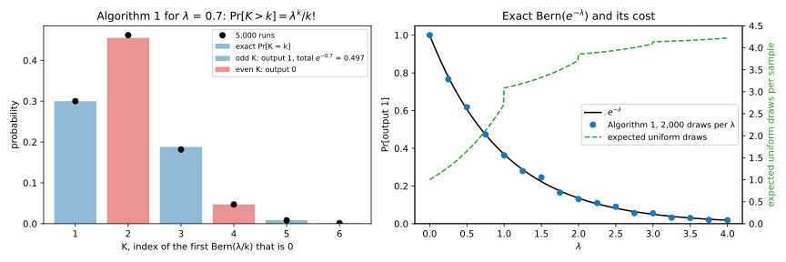
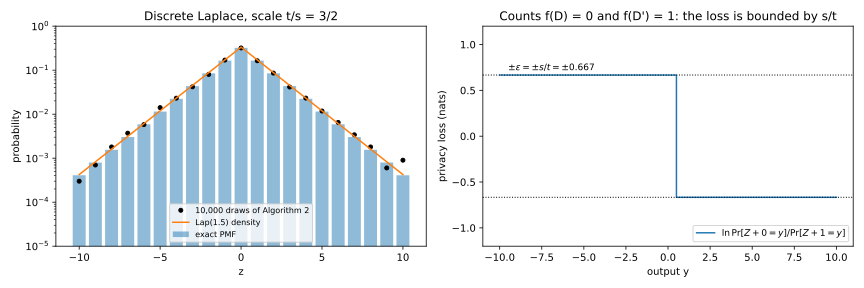
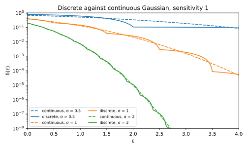
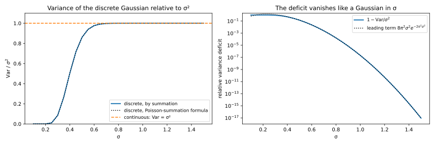
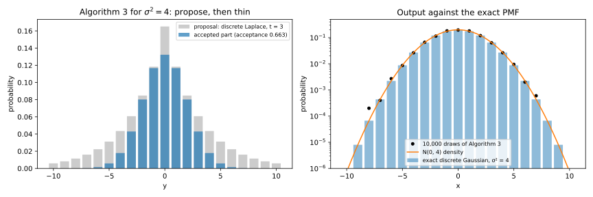

# Discrete and floating-point-safe mechanisms

Every privacy proof so far was a statement about real numbers, such as the proof in [the Laplace and Gaussian mechanisms](03-laplace-gaussian.md) that compares two densities on the real line. A computer has only floating-point numbers, a finite set with uneven gaps, and random bits, so the program that "samples $\mathrm{Lap}(b)$" produces a distribution that the proof says nothing about. Mironov (2012) showed that the gap matters: the textbook Laplace sampler has outputs that only one of two neighbouring datasets can produce, and an observer who sees one knows which dataset was used.

The one idea of this chapter is that **differential privacy (DP) is a property of the output distribution the code actually produces**, so the code must produce exactly the distribution the proof is about. One way there keeps floating point and rounds the output to a coarse grid, so that every output is reachable from every input. The other way samples integer noise for integer-valued queries exactly, from uniform random integers, which gives the discrete Laplace and the discrete Gaussian mechanisms.

The running example is a hospital's count of patients with a rare diagnosis, with sensitivity $\Delta_1 f = 1$ under add/remove neighbours, released at $\varepsilon = 1$. In a toy floating-point model of the Laplace mechanism, almost half of the outputs name the true count with certainty. The discrete Laplace releases the exact count with probability 0.4621, yet no output identifies the count, and the discrete Gaussian at $\sigma = 1$ has $\delta = 0.1414$ at $\varepsilon = 1$, close to the continuous Gaussian's 0.1269.

## Floating-point Laplace breaks differential privacy {#sec-discrete-float}

The textbook way to sample $\mathrm{Lap}(b)$ is inverse cumulative distribution function (CDF) sampling. Draw $U$ uniform on $(0, 1)$ and a fair sign $\xi \in \{-1, +1\}$, and output $\xi\cdot b\ln(1/U)$. The magnitude exceeds a level $z$ exactly when $U < e^{-z/b}$, so it is exponential with mean $b$ ([Probability distributions](../part01-prerequisites/01-distributions.md)), and the sign mirrors it into $\mathrm{Lap}(b)$. In floating point, $U$, the logarithm and the sum with $f(D)$ are each rounded. This section asks whether the rounded mechanism is still DP, and the answer is no, for every $\varepsilon$.

The tool that shows it also audits any implementation. If some outputs can only come from $D$, seeing one of them reveals $D$ with certainty, and since no factor $e^\varepsilon$ can pay for that, $\delta$ has to.

::: {#prp-discrete-support name="The support argument"}
Let $M$ be $(\varepsilon, \delta)$-DP, let $D \sim D'$ be neighbouring datasets, and write $\mathcal Y_D$ for the set of outputs that $M(D)$ can produce. Let $S = \mathcal Y_D \setminus \mathcal Y_{D'}$ be the outputs reachable from $D$ but not from $D'$. Then, whatever $\varepsilon$ is,
$$\delta \ge \Pr[M(D) \in S].$$ {#eq-discrete-support-delta}
In particular, if $\Pr[M(D) \in S] > 0$, then $M$ is not $\varepsilon$-DP for any finite $\varepsilon$.
:::

::: {.proof}
1. *Apply the definition to the event $S$.* The definition of $(\varepsilon, \delta)$-DP in [the definition of differential privacy](01-definition.md), applied to the set $S$, says that
$$\Pr[M(D) \in S] \le e^\varepsilon\Pr[M(D') \in S] + \delta.$$
By the choice of $S$ the multiplicative term is 0 however large $e^\varepsilon$ is, which leaves @eq-discrete-support-delta.
2. *Pure DP.* Pure $\varepsilon$-DP is the case $\delta = 0$, where @eq-discrete-support-delta forces $\Pr[M(D) \in S] = 0$. So a positive probability rules out every finite $\varepsilon$.
:::

The floating-point sampler has such outputs because of how floats are spaced. A float with a $p$-bit significand (IEEE 754 doubles have $p = 53$) is $m\cdot2^e$ for an integer $m < 2^p$, so floats are dense near 0 and sparse far from it. With $f(D) = 0$, the outputs near 0 are the fine-grained noise values themselves. With $f(D') = 1$, an output near 0 needs a noise value near $-1$, where floats are about $2^{-p}$ apart, and adding 1 keeps that coarse spacing. So many outputs of $M(D)$ near 0 are impossible under $M(D')$, and the mismatch of grids elsewhere works in both directions. In the narrow window of @fig-discrete-float-support (left), 3 of the 9 outputs of $M(D)$ cannot come from $M(D')$, and 4 of the 10 outputs of $M(D')$ cannot come from $M(D)$.

Doubles have too many values to enumerate, so the chapter's script (@sec-discrete-code) uses $p$-bit floats with $p$ from 6 to 14. Its $U$ is a real uniform rounded down to a $p$-bit float, the logarithm and the sum are each rounded to $p$ bits, and every output's probability is computed exactly (@tbl-discrete-float).

| Significand bits $p$ | Outputs of $M(D)$ | Outputs of $M(D')$ | $\Pr[M(D) \in S]$ | $\Pr[M(D') \in S']$ |
| --- | --- | --- | --- | --- |
| 8 | 1,604 | 1,409 | 0.4795 | 0.2070 |
| 12 | 25,646 | 22,477 | 0.4791 | 0.2033 |
| 14 | 102,586 | 89,859 | 0.4826 | 0.2053 |

: The toy floating-point Laplace sampler with $b = 1$, $f(D) = 0$ and $f(D') = 1$. $S$ is the set of outputs of $M(D)$ that $M(D')$ cannot produce, and $S'$ the reverse. {#tbl-discrete-float}

![The toy floating-point Laplace sampler with $b = 1$. Left: at 12 bits, the outputs of $f(D) = 0$ (top) and $f(D') = 1$ (bottom) in a narrow window, coloured by whether the other input can produce them. Right: $\Pr[M(D) \in S]$ against $p$, textbook and snapped (@sec-discrete-snapping).](figures/discrete_float_support.svg){#fig-discrete-float-support}

More precision does not help. The right panel of @fig-discrete-float-support stays at about 48% from 6 to 14 bits, because adding bits refines both grids together. Mironov (2012) found the same effect at $p = 53$ in several DP libraries of the time. The leak is not in where the output lands on the real line but in which float it is, so printing the output to a few decimals would hide it. That is the idea behind snapping.

A second, smaller leak comes from the tails, which are cut off. A uniform made of 53 random bits, a positive multiple of $2^{-53}$, is never below $2^{-53}$, so the noise magnitude never exceeds $b\ln(2^{53}) \approx 36.74\,b$, and outputs between $f(D) + 36.74b$ and $f(D') + 36.74b$ are reachable from one input only. By @eq-discrete-support-delta, their probability of about $2^{-53}$ is a floor on $\delta$ that rules out pure DP. Jin et al. (2022) found such leaks in libraries released after Mironov's paper.

::: {#exm-discrete-float-count}
The hospital releases its count with the textbook sampler and $b = 1$, so the exact mechanism would be $\varepsilon$-DP with $\varepsilon = \Delta_1 f/b = 1$. An analyst who knows that the count is 0 or 1, say whether one particular patient is in the data, checks whether the released float can be produced from 1. In the 12-bit toy the check identifies the count 0 with certainty 47.91% of the time, since $\Pr[M(D) \in S] = 0.4791$ in @tbl-discrete-float. By @prp-discrete-support, no $\varepsilon$ with a $\delta$ below 0.4791 describes the release, although the proof promised that one output moves the analyst's odds by at most a factor $e$.
:::

## The snapping mechanism {#sec-discrete-snapping}

If the output must be a float, its low-order bits have to go. This section states the snapping mechanism of Mironov (2012), which removes them, gives its guarantee, whose proof is Mironov's, and checks it on the toy of @sec-discrete-float.

In words, the mechanism clamps the true answer into a range $[-B, B]$, adds Laplace noise computed in floating point, rounds to the nearest multiple of a power of 2 at least as large as the noise scale, and clamps again. The clamps keep rounding errors small next to the grid.

::: {#def-discrete-snapping name="The snapping mechanism"}
Let $f$ have sensitivity 1 and let $b$ be the noise scale. Let $\Lambda$ be the smallest power of 2 with $\Lambda \ge b$, and let $[-B, B]$ be the clamping range. Write $\oplus$, $\otimes$ and $\mathrm{LN}$ for floating-point addition, multiplication and logarithm. Write $\lfloor\cdot\rceil_\Lambda$ for rounding to the nearest multiple of $\Lambda$, and $\mathrm{clamp}_B$ for the map onto $[-B, B]$. With a fair sign $\xi$ and an ideal uniform double $U^*$, the **snapping mechanism** outputs
$$M(D) = \mathrm{clamp}_B\Big(\big\lfloor \mathrm{clamp}_B(f(D)) \oplus \xi\otimes b\otimes\mathrm{LN}(U^*)\big\rceil_\Lambda\Big).$$
:::

The guarantee is the exact Laplace mechanism's $\varepsilon = 1/b$ plus two small terms that pay for floating-point error. One floating-point operation errs by at most a fixed fraction of the number it produces, the **unit roundoff** of doubles, written $\omega = 2^{-53}$. Clamping keeps every number below $B$ in size, so the terms grow with $B\omega$.

::: {#thm-discrete-snapping name="Privacy of the snapping mechanism"}
If $b < B < 2^{46}b$, the snapping mechanism is $\varepsilon$-DP with
$$\varepsilon = \frac{1 + 12B\omega}{b} + \frac{2^{-49}B}{b}, \qquad \omega = 2^{-53}.$$
:::
<!-- proof: cited -->

The proof is Mironov's (2012, Theorem 1 and §5). Clamping the input keeps every sum where floats are at most about $B\omega$ apart. Rounding makes the output one of the multiples of $\Lambda$ in $[-B, B]$, the same set for every input, so @prp-discrete-support has nothing to bite on. In exact arithmetic, each grid point collects an interval of noise values. The two inputs give it the probabilities of two intervals shifted by at most 1, whose ratio is at most $e^{1/b}$, as post-processing of the Laplace mechanism ([Post-processing, group privacy and composition](02-properties.md)). Floating-point error moves each interval's endpoints by a relative amount of order $\omega$, which gives the extra terms.

The price is accuracy. Rounding to $\Lambda$, which is below $2b$, adds up to $\Lambda/2 \le b$ of error, and clamping biases answers near $\pm B$. The extra terms in $\varepsilon$ are tiny, about $3.1\times10^{-14}$ with $b = 1$ and $B = 10$. The guarantee assumes a correctly behaved logarithm and an ideal uniform $U^*$, which a library has to supply.

The snapped toy is measured by the **privacy loss** of [the definition of differential privacy](01-definition.md), the log of the ratio of an output's probabilities under the two inputs:
$$L_{D,D'}(y) = \ln\frac{\Pr[M(D) = y]}{\Pr[M(D') = y]}.$$
That chapter showed that for discrete outputs, pure $\varepsilon$-DP is the same as $|L_{D,D'}(y)| \le \varepsilon$ at every output $y$.

::: {#exm-discrete-snapped}
Snap the toy sampler of the running example to integers, $\Lambda = 1$ for $b = 1$, and clamp to $[-10, 10]$. Both inputs now reach the same 21 outputs, the integers from $-10$ to 10, so $\Pr[M(D) \in S] = 0$ at every precision (@fig-discrete-float-support, right). The largest privacy loss over those outputs is 1.0010 at $p = 12$ and 1.0002 at $p = 14$, against $\varepsilon = 1$ for the exact mechanism, and the excess shrinks with precision as the $\omega$ terms predict, with $\omega = 2^{-p}$ in the toy.
:::

## An exact coin with an exponential bias {#sec-discrete-bernoulli-exp}

Both exact samplers below need a coin that comes up 1 with probability $e^{-\lambda}$ for a rational $\lambda \ge 0$. The obvious code, `random() < exp(-lam)`, is inexact twice over, because `exp` rounds and `random()` has only 53 bits. The exact samplers use one primitive instead, a uniform integer in $\{0, 1, \dots, d - 1\}$, which Python's `random.Random.randrange(d)` and `secrets.SystemRandom().randrange(d)` provide exactly, by drawing random bits and redrawing when the result is $d$ or more. Algorithm 1 of Canonne, Kamath and Steinke (2020), after von Neumann (1951), builds the $e^{-\lambda}$ coin from these integers.

Its first step flips coins whose bias is a fraction, and the lemma says that such coins are exact.

::: {#lem-discrete-coin name="An exact coin with rational bias"}
For integers $0 \le m \le d$, let $W$ be uniform on $\{0, \dots, d - 1\}$. Then $\Pr[W < m] = m/d$, so the indicator $\mathbf 1[W < m]$, which is 1 when $W < m$ and 0 otherwise, is an exact $\mathrm{Bern}(m/d)$ draw.
:::

::: {.proof}
1. There are $m$ favourable values, $0$ to $m - 1$, among $d$ equally likely ones, so $\Pr[W < m] = m/d$. No step rounds, because comparing two integers is exact.
:::

No fraction equals $e^{-1}$, so the lemma alone cannot make the coin. The way around is the power series $e^{-\lambda} = 1 - \lambda + \frac{\lambda^2}{2!} - \frac{\lambda^3}{3!} + \cdots$. Flip coins with success probabilities $\lambda, \lambda/2, \lambda/3, \dots$ until one fails, so that the chance of surviving $k$ flips is $\lambda^k/k!$, the $k$-th term of the series. The parity of the stopping index then supplies the alternating signs.

::: {#thm-discrete-bern-exp name="Algorithm 1: an exact coin with an exponential bias"}
Let $\lambda$ be rational with $0 \le \lambda \le 1$. Draw independent coins $I_k \sim \mathrm{Bern}(\lambda/k)$ for $k = 1, 2, \dots$ and stop at the first $I_K = 0$, so that $K$ is the index of the first failure. Output 1 if $K$ is odd and 0 if $K$ is even. Then the survival probabilities, the output probability and the mean number of flips are
$$\Pr[K > k] = \frac{\lambda^k}{k!}, \qquad \Pr[K\ \text{odd}] = e^{-\lambda}, \qquad \mathbb E[K] = e^\lambda.$$ {#eq-discrete-bern-exp}
For rational $\lambda > 1$, draw $\lfloor\lambda\rfloor$ coins with probability $e^{-1}$ this way, stopping at the first 0, then one coin with probability $e^{-(\lambda - \lfloor\lambda\rfloor)}$. The output, which is 1 only if every coin is 1, is an exact $\mathrm{Bern}(e^{-\lambda})$ draw.
:::

::: {.proof}
The plan is to compute the survival probabilities, turn them into point probabilities, add the odd ones, read the mean off the survival probabilities, and reduce a large exponent to several small ones.

1. *The survival probabilities.* The event $K > k$ means that the first $k$ coins all came up 1. They are independent with probabilities $\lambda/1, \lambda/2, \dots, \lambda/k$, so $\Pr[K > k]$ is their product, $\lambda^k/k!$. For $\lambda = m/d$, each $\lambda/j = m/(dj)$ is a ratio of integers, at most 1 since $\lambda \le 1$, so each coin is exact by @lem-discrete-coin.
2. *The point probabilities.* The event $K = k$ means that the coins survived $k - 1$ flips but not $k$, so
$$\Pr[K = k] = \Pr[K > k - 1] - \Pr[K > k] = \frac{\lambda^{k-1}}{(k-1)!} - \frac{\lambda^k}{k!}.$$
3. *Add over odd $k$.* Over $k = 1, 3, 5, \dots$, every power $\lambda^j$ appears exactly once, with a plus sign when $j = k - 1$ is even and a minus sign when $j = k$ is odd. So the sum is the series
$$\sum_{k\ \text{odd}}\Pr[K = k] = \sum_{j \ge 0}\frac{(-\lambda)^j}{j!} = e^{-\lambda}.$$
4. *The mean.* A variable $K$ on $\{1, 2, \dots\}$ is a count of survivals, $K = \sum_{k \ge 0}\mathbf 1[K > k]$, since exactly $K$ of the indicators $\mathbf 1[K > 0], \mathbf 1[K > 1], \dots$ are 1. Taking expectations and using step 1,
$$\mathbb E[K] = \sum_{k \ge 0}\Pr[K > k] = \sum_{k \ge 0}\frac{\lambda^k}{k!} = e^\lambda.$$
Each flip uses one uniform integer, so a coin costs $e^\lambda \le e$ uniform draws on average.
5. *Large $\lambda$.* A product of probabilities is the probability that independent coins all come up 1, and $e^{-\lambda} = (e^{-1})^{\lfloor\lambda\rfloor}\,e^{-(\lambda - \lfloor\lambda\rfloor)}$, so the output is $\mathrm{Bern}(e^{-\lambda})$. Each coin has an exponent of at most 1, so steps 1 to 3 cover it. Stopping at the first 0 does not change the output, which is 0 as soon as one coin is 0.
:::

The coin is exact, because no step rounds and the only randomness is uniform integers. It costs at most $e$ draws for $\lambda \le 1$ and below $\frac{e}{1 - e^{-1}} + 1 \approx 5.3$ for any $\lambda$. The whole-unit coins stop at the first 0, so on average fewer than $1/(1 - e^{-1})$ of them are flipped, at most $e$ draws each, and the last coin, reached with probability at most $e^{-1}$, costs at most $e$. The cost jumps at each integer (@fig-discrete-bernoulli-exp), from $e = 2.7183$ just below 1 to $e + e^{-1} = 3.0862$ at 1, because there the final coin for the fractional part 0 still costs a draw.

{#fig-discrete-bernoulli-exp}

::: {#exm-discrete-coin}
To see the parity trick outcome by outcome, take $\lambda = 0.7$ (@tbl-discrete-bern-k). Each row is the chance of surviving $k - 1$ flips minus the chance of surviving $k$, and the odd rows add up to $0.3000 + 0.1878 + 0.0086 + \cdots = 0.4966 = e^{-0.7}$. Over 10,000 runs the script sees $K = 1$ in a fraction 0.2987 of them, against 0.3000, and outputs 1 with frequency 0.4897.

| $K$ | Coins seen | $\Pr[K = k]$ | Output |
| --- | --- | --- | --- |
| 1 | $I_1 = 0$ | $1 - 0.7 = 0.3000$ | 1 |
| 2 | $I_1 = 1$, $I_2 = 0$ | $0.7 - 0.7^2/2 = 0.4550$ | 0 |
| 3 | $I_1 = I_2 = 1$, $I_3 = 0$ | $0.245 - 0.0572 = 0.1878$ | 1 |
| 4 | three 1s, then 0 | $0.0472$ | 0 |
| 5 | four 1s, then 0 | $0.0086$ | 1 |

: Algorithm 1 for $\lambda = 0.7$, outcome by outcome. The output is the parity of the index of the first 0. {#tbl-discrete-bern-k}

The running count's sampler in @sec-discrete-laplace needs only the coin with $\lambda = 1$. Over 10,000 draws it comes up 1 with frequency 0.3709, against $e^{-1} = 0.3679$, at 3.096 uniform draws each, against the expected 3.086.
:::

## The discrete Laplace mechanism {#sec-discrete-laplace}

Most queries in DP are counts or histograms, like the running example. For them the natural noise is integer-valued too, so that the output has no low-order bits to leak and the noise can be sampled exactly. This section defines the discrete Laplace distribution, proves that adding it, the **geometric mechanism** of Ghosh, Roughgarden and Sundararajan (2009), has the continuous guarantee, and samples it exactly.

Keep the Laplace density $e^{-|z|/b}$ only at the integers, and divide by the sum of those values. Each step away from 0 then multiplies the probability by the same factor $r = e^{-1/b}$.

::: {#def-discrete-laplace name="The discrete Laplace distribution"}
The **discrete Laplace** distribution with scale $b > 0$, written $\mathrm{Lap}_{\mathbb Z}(b)$, has the probability mass function (PMF)
$$\Pr[Z = z] = \frac{1 - r}{1 + r}\,r^{|z|}, \qquad z \in \mathbb Z, \qquad r = e^{-1/b}.$$ {#eq-discrete-dlap-pmf}
:::

The constant in front and the variance both come from sums of geometric series.

::: {#prp-discrete-dlap-moments name="Normalization and variance of the discrete Laplace"}
The probabilities in @eq-discrete-dlap-pmf add up to 1, the mean of $Z$ is 0, and
$$\operatorname{Var}(Z) = \frac{2r}{(1 - r)^2}.$$
:::

::: {.proof}
1. *Normalize.* The weights $r^{|z|}$ are 1 at $z = 0$ and appear twice, at $\pm z$, for each $z \ge 1$. Summing the geometric series gives
$$\sum_{z \in \mathbb Z}r^{|z|} = 1 + \frac{2r}{1 - r} = \frac{1 + r}{1 - r},$$
and dividing by it gives the constant in @eq-discrete-dlap-pmf.
2. *Mean.* The PMF gives $z$ and $-z$ the same probability, so their contributions to the mean cancel, and the variance is $\mathbb E[Z^2]$.
3. *Variance.* Differentiating the geometric series $\sum_{z \ge 0}r^z = \frac1{1 - r}$ twice in $r$, multiplying by $r$ after each step, gives
$$\sum_{z \ge 1}z^2r^z = \frac{r(1 + r)}{(1 - r)^3}.$$
Counting $\pm z$ twice,
$$\mathbb E[Z^2] = \frac{1 - r}{1 + r}\cdot2\cdot\frac{r(1 + r)}{(1 - r)^3} = \frac{2r}{(1 - r)^2}.$$
:::

Shifting the input by one unit changes each output's probability by at most the factor $e^{1/b}$, so the guarantee is the continuous one.

::: {#thm-discrete-laplace name="The discrete Laplace mechanism"}
Let $f$ be integer-valued, with values in $\mathbb Z^d$ and $\ell_1$ sensitivity $\Delta_1 f$, and let $b > 0$. The mechanism $M(D) = f(D) + Z$, with independent $\mathrm{Lap}_{\mathbb Z}(b)$ noise on each coordinate, is $\varepsilon$-DP with
$$\varepsilon = \frac{\Delta_1 f}{b},$$ {#eq-discrete-dlap-eps}
and for a scalar $f$ whose answers differ by $\Delta_1 f$, the privacy loss reaches $\pm\varepsilon$ at every output above both answers.
:::

::: {.proof}
1. *The privacy loss.* Take $d = 1$ first, and neighbours with true answers $f(D) = a$ and $f(D') = a'$. An output $y$ requires noise $y - a$ under $D$ and $y - a'$ under $D'$. The constant $\frac{1 - r}{1 + r}$ is the same for both, so it cancels in the ratio, and with $\ln r = -1/b$
$$L_{D,D'}(y) = \ln\frac{r^{|y - a|}}{r^{|y - a'|}} = \frac{|y - a'| - |y - a|}{b}.$$
2. *Bound it.* By the triangle inequality, two numbers' distances to $y$ differ by at most their distance to each other, so in both directions
$$\big||y - a'| - |y - a|\big| \le |a - a'| \le \Delta_1 f.$$
So $|L_{D,D'}(y)| \le \Delta_1 f/b$ at every integer $y$, which is pure DP with @eq-discrete-dlap-eps by the pointwise criterion of @sec-discrete-snapping. For $y \ge \max(a, a')$ the difference of distances is exactly $|a - a'|$, so the bound is reached.
3. *Vectors.* With independent noise per coordinate, the privacy loss is a sum of per-coordinate losses. Each is at most $|a_i - a'_i|/b$ by step 2, and these add up to at most $\Delta_1 f/b$.
:::

Step 1 is where integers matter, because a non-integer shift would give different inputs different supports, the floating-point failure again.

For rational $b = t/s$, Algorithm 2 of Canonne, Kamath and Steinke (2020) samples $\mathrm{Lap}_{\mathbb Z}(b)$ exactly. It assembles a one-sided geometric variable from a remainder $W$ below $t$ and a quotient $V$, divides it by $s$, and attaches a random sign. The proof needs two tools. The first, used by the remainder step and the sign step, reshapes one distribution into another by throwing some draws away.

::: {#lem-discrete-rejection name="Rejection sampling"}
Let $q$ be a PMF you can sample from, the **proposal**, and let $h(x) \in [0, 1]$ be an acceptance probability for each value $x$. Repeat: draw $Y \sim q$ and accept it with probability $h(Y)$, until a draw is accepted. Then the output has PMF $q(x)h(x)/A$, where $A = \sum_xq(x)h(x)$ is the probability that one round accepts, and the number of rounds is geometric with mean $1/A$.
:::

::: {.proof}
1. *One round.* A round proposes $x$ with probability $q(x)$ and accepts it with probability $h(x)$, so it outputs $x$ with probability $q(x)h(x)$, and something with probability $A$.
2. *Add up the rounds.* The rounds are independent, so the output is $x$ when the first $j$ rounds output nothing and round $j + 1$ outputs $x$, for some $j \ge 0$. That is a geometric series with ratio $1 - A < 1$:
$$\sum_{j \ge 0}(1 - A)^jq(x)h(x) = \frac{q(x)h(x)}{A}.$$
3. *The cost.* Each round succeeds with probability $A$ independently, so the number of rounds is geometric with mean $1/A$.
:::

So the output is exact as long as each acceptance is an exact coin, and $A$ never has to be computed. The second tool, for the quotient step, says that counting coin flips gives a geometric variable.

::: {#lem-discrete-geometric name="Counting successes gives a geometric variable"}
Flip independent coins with success probability $\kappa$ and let $V$ be the number of successes before the first failure. Then $\Pr[V = v] = \kappa^v(1 - \kappa)$ for $v = 0, 1, 2, \dots$, and $\Pr[V \ge v] = \kappa^v$.
:::

::: {.proof}
1. The event $V = v$ means exactly $v$ successes followed by one failure, and independent flips multiply, which gives $\kappa^v(1 - \kappa)$. The event $V \ge v$ says that the first $v$ flips were successes, which has probability $\kappa^v$. This is the geometric distribution of [Probability distributions](../part01-prerequisites/01-distributions.md), counted from 0.
:::

::: {#thm-discrete-dlap-sampler name="Algorithm 2: exact sampling of the discrete Laplace"}
Input integers $s, t \ge 1$, so that $b = t/s$. Repeat until a value is returned:

1. Draw $W$ uniform on $\{0, \dots, t - 1\}$ and accept it with probability $e^{-W/t}$ (Algorithm 1); on rejection, start over.
2. Count the successes $V$ of independent coins with probability $e^{-1}$ before the first failure (Algorithm 1 with $\lambda = 1$).
3. Set $G = W + tV$ and $Y = \lfloor G/s\rfloor$.
4. Draw a fair bit $J$. If $J = 1$ and $Y = 0$, start over. Otherwise return $(1 - 2J)Y$.

The output is exactly $\mathrm{Lap}_{\mathbb Z}(b)$, and the mean number of passes through the loop is $1/\big(A_W\,(1 - \tfrac12(1 - e^{-s/t}))\big)$, where $A_W = \frac1t\sum_{w < t}e^{-w/t}$ is the acceptance probability of step 1.
:::

::: {.proof}
The plan follows the algorithm's own order: the accepted remainder, the quotient, their combination, the division and the sign, then the cost.

1. *$W$ given acceptance.* By @lem-discrete-rejection with a uniform proposal and acceptance $e^{-w/t}$, the accepted $W$ has $\Pr[W = w] \propto e^{-w/t}$ on $\{0, \dots, t - 1\}$.
2. *$V$ is geometric.* By @lem-discrete-geometric with $\kappa = e^{-1}$, $\Pr[V = v] = (1 - e^{-1})e^{-v}$.
3. *$G = W + tV$ is geometric with ratio $e^{-1/t}$.* Each $g \ge 0$ is $w + tv$ for exactly one pair, $w = g \bmod t$ and $v = \lfloor g/t\rfloor$, and the independent weights multiply to $e^{-w/t}e^{-v} = e^{-g/t}$. So $\Pr[G = g] \propto e^{-g/t}$.
4. *$Y = \lfloor G/s\rfloor$ is geometric with ratio $e^{-s/t} = e^{-1/b}$.* The event $Y = y$ collects $g = sy, \dots, sy + s - 1$, so its weight is a factor that does not depend on $y$ times $e^{-sy/t} = r^y$:
$$\sum_{j = 0}^{s - 1}e^{-(sy + j)/t} = e^{-sy/t}\sum_{j = 0}^{s - 1}e^{-j/t}.$$
5. *The sign.* A fair sign gives $\pm y$ probability $\frac12\Pr[Y = y]$ each, but 0 would get both halves, since $+0$ and $-0$ are the same output. Rejecting the case $J = 1$, $Y = 0$ leaves $\frac12\Pr[Y = y]$ for every $z = \pm y$, including 0, and after renormalizing by @lem-discrete-rejection, $\Pr[Z = z] \propto r^{|z|}$, which is @eq-discrete-dlap-pmf.
6. *The cost.* A pass survives step 1 with probability $A_W$, and step 4 unless $J = 1$ and $Y = 0$, which has probability $\frac12(1 - e^{-s/t})$ by @lem-discrete-geometric. By step 3 of @lem-discrete-rejection, the mean number of passes is one over the product of the two survival probabilities.
:::

To follow steps 3 and 4 by hand, take $t = 3$ and $s = 2$, so $b = 1.5$ (@tbl-discrete-dlap-walk). Then $\Pr[Y = 0] = 0.4866$ and $\Pr[Y = 1] = 0.2498$, and their ratio $0.5134$ is $e^{-2/3}$, as step 4 says.

| $g$ | $w = g \bmod 3$ | $v = \lfloor g/3\rfloor$ | $\Pr[G = g] = (1 - e^{-1/3})e^{-g/3}$ | $y = \lfloor g/2\rfloor$ |
| --- | --- | --- | --- | --- |
| 0 | 0 | 0 | 0.2835 | 0 |
| 1 | 1 | 0 | 0.2031 | 0 |
| 2 | 2 | 0 | 0.1455 | 1 |
| 3 | 0 | 1 | 0.1043 | 1 |

: Algorithm 2 with $t = 3$, $s = 2$. Each $g$ is one pair $(w, v)$; pairs of consecutive $g$ merge into one $y$. {#tbl-discrete-dlap-walk}

{#fig-discrete-laplace}

The discrete Laplace gives the continuous guarantee with slightly less noise. At $b = 1$ its variance is 1.8413 against 2, and the gap tends to $\frac16$ as $b$ grows. Rounding $f(D) + \mathrm{Lap}(b)$ to an integer would also be $\varepsilon$-DP, but it is a different distribution and needs a floating-point sampler.

For a single count, the discrete Laplace is the best possible mechanism. Ghosh, Roughgarden and Sundararajan (2009) show that every user, whatever their loss and prior, can post-process its output to do as well as with any other $\varepsilon$-DP mechanism.

::: {#exm-discrete-dlap-count}
Release the running count at $\varepsilon = 1$, so $b = 1$ and $r = e^{-1} = 0.3679$. The exact count is released when the noise is 0, which happens with probability $\frac{1 - r}{1 + r} = \frac{0.6321}{1.3679} = 0.4621$. The noise has variance $\frac{2r}{(1 - r)^2} = 1.8413$, a standard deviation of 1.357. Algorithm 2 with $s = t = 1$ always accepts in step 1, so a pass is a run of $e^{-1}$ coins and a fair bit, and a sample takes 1.462 passes on average. The script's 10,000 draws have variance 1.8305 and cost 11.49 uniform draws each, and over the scales in @tbl-discrete-code the cost stays between 10 and 12.
:::

## The discrete Gaussian mechanism {#sec-discrete-gaussian}

The Gaussian mechanism is the workhorse of private machine learning, because its noise grows with the $\ell_2$ sensitivity, far smaller than the $\ell_1$ sensitivity in high dimension. Its integer analogue (Canonne, Kamath & Steinke 2020) served the 2020 US Census (Abowd et al., 2022) and suits noise added before secure aggregation, which works with integers (Kairouz, Liu & Steinke, 2021). This section compares it with the continuous Gaussian of [the Laplace and Gaussian mechanisms](03-laplace-gaussian.md) in exact $\delta(\varepsilon)$, Rényi divergence and variance.

As with the discrete Laplace, keep the bell curve at the integers and normalize.

::: {#def-discrete-gaussian name="The discrete Gaussian distribution"}
The **discrete Gaussian** with parameter $\sigma > 0$ and integer location $\mu$, written $\mathcal N_{\mathbb Z}(\mu, \sigma^2)$, gives each integer $x$ the probability
$$\Pr[X = x] = \frac{e^{-(x - \mu)^2/(2\sigma^2)}}{\mathcal Z_\sigma}, \qquad \mathcal Z_\sigma = \sum_{y \in \mathbb Z}e^{-y^2/(2\sigma^2)}.$$
:::

The parameter $\sigma^2$ is the variance of the bell curve, not quite that of $X$ (@prp-discrete-dgauss-variance). An integer shift only relabels the terms of $\mathcal Z_\sigma$, so the normalizer cancels in the privacy loss of $M(D) = f(D) + X$ for integer-valued $f$. Then the smallest $\delta$ at each $\varepsilon$ has the continuous Gaussian's formula, with discrete tails.

::: {#thm-discrete-dgauss-delta name="Privacy loss and exact δ of the discrete Gaussian mechanism"}
Let $f$ be integer-valued with sensitivity $\Delta$, an integer, and let $M(D) = f(D) + X$ with $X \sim \mathcal N_{\mathbb Z}(0, \sigma^2)$. For a neighbouring pair whose answers differ by exactly $\Delta$, the privacy loss at an integer output $y$ is
$$L_{D,D'}(y) = \frac{(y - f(D'))^2 - (y - f(D))^2}{2\sigma^2},$$
and the smallest $\delta$ for which the pair satisfies $(\varepsilon, \delta)$-DP is
$$\delta(\varepsilon) = \Pr\Big[X > \frac{\varepsilon\sigma^2}{\Delta} - \frac\Delta2\Big] - e^\varepsilon\Pr\Big[X > \frac{\varepsilon\sigma^2}{\Delta} + \frac\Delta2\Big].$$ {#eq-discrete-dgauss-delta}
:::

::: {.proof}
The plan is to cancel the normalizer, write the smallest $\delta$ as a sum over the outputs where the loss exceeds $\varepsilon$, and evaluate that sum under each input. Take $f(D) = 0$ and $f(D') = \Delta$, since an integer shift of both changes nothing.

1. *The normalizer cancels.* Under $D$ the output $y$ has probability $e^{-y^2/(2\sigma^2)}/\mathcal Z_\sigma$, and under $D'$ it has $e^{-(y - \Delta)^2/(2\sigma^2)}/\mathcal Z_\sigma$. So the ratio is the ratio of the two exponentials, and
$$L_{D,D'}(y) = \frac{(y - \Delta)^2 - y^2}{2\sigma^2} = \frac{\Delta^2 - 2\Delta y}{2\sigma^2},$$
the formula of the continuous Gaussian, now only at integers $y$.
2. *The smallest $\delta$ as a sum.* The definition asks $\Pr[M(D) \in S] - e^\varepsilon\Pr[M(D') \in S] \le \delta$ for every set $S$. The left side is a sum over $y \in S$ of the terms $\Pr[M(D) = y] - e^\varepsilon\Pr[M(D') = y]$, so it is largest when $S$ holds exactly the outputs with a positive term. The smallest valid $\delta$ is therefore the sum of the positive terms, the hockey-stick divergence of [Divergences](../part01-prerequisites/03-divergences.md). A term is positive exactly when $L_{D,D'}(y) > \varepsilon$, which by step 1 means $y < \frac\Delta2 - \frac{\varepsilon\sigma^2}{\Delta}$.
3. *The sum under $D$.* Under $D$ the output is $X$, so those outputs have the probability of a lower tail of $X$. The PMF gives $x$ and $-x$ the same probability, so the lower tail equals the mirrored upper tail:
$$\Pr\Big[X < \frac\Delta2 - \frac{\varepsilon\sigma^2}{\Delta}\Big] = \Pr\Big[X > \frac{\varepsilon\sigma^2}{\Delta} - \frac\Delta2\Big].$$
4. *The sum under $D'$.* Under $D'$ the output is $X + \Delta$, so the same outputs need $X$ below $-\frac\Delta2 - \frac{\varepsilon\sigma^2}{\Delta}$, and by the same symmetry their probability is the second tail in @eq-discrete-dgauss-delta. Subtracting $e^\varepsilon$ times it from step 3 gives @eq-discrete-dgauss-delta.
:::

Canonne, Kamath and Steinke (2020, Theorem 7) show that a pair with a smaller shift has a smaller $\delta$, so @eq-discrete-dgauss-delta is the privacy profile of the mechanism, its smallest $\delta$ at each $\varepsilon$ over all neighbouring pairs. Because the proof needs integer shifts, a real-valued query is first scaled by $1/h$ for a small step $h$ and randomly rounded to an integer, and the accounting uses the sensitivity of the rounded query.

The curve $\delta(\varepsilon)$ is close to the continuous one but not equal to it. Moving $y$ by one moves the privacy loss by $\Delta/\sigma^2$, so the loss takes values on a lattice. As $\varepsilon$ crosses a lattice value, a whole output enters or leaves the sum in step 2 of the proof, which puts a kink in $\delta(\varepsilon)$ (@fig-discrete-gaussian-delta). At $\varepsilon = 1$ the discrete curve is above the continuous one, 0.6032 against 0.5099 at $\sigma = 0.5$, but just past a kink it can be below, and the gap closes as $\sigma$ grows.

{#fig-discrete-gaussian-delta}

The two remaining comparisons rest on one question: how does the sum of a Gaussian bump over the integers depend on where the bump is centred? The Rényi proof needs it largest at an integer centre, and the variance proof needs it in closed form. The tool is the Poisson summation formula (Stein & Shakarchi 2003, ch. 5), which for a smooth, fast-decaying $g$ with Fourier transform $\hat g(k) = \int g(x)e^{-2\pi ikx}\,\mathrm dx$ says
$$\sum_{x \in \mathbb Z}g(x) = \sum_{k \in \mathbb Z}\hat g(k).$$

::: {#lem-discrete-poisson name="A Gaussian bump summed over the integers"}
For every real centre $c$ and every $\sigma > 0$,
$$\sum_{x \in \mathbb Z}e^{-(x - c)^2/(2\sigma^2)} = \sqrt{2\pi}\,\sigma\sum_{k \in \mathbb Z}e^{-2\pi^2\sigma^2k^2}\cos(2\pi kc).$$ {#eq-discrete-poisson-theta}
The sum is largest when $c$ is an integer, where it equals $\mathcal Z_\sigma$.
:::

::: {.proof}
1. *Transform the bump.* The Fourier transform of $e^{-x^2/(2\sigma^2)}$ is again a Gaussian, $\sqrt{2\pi}\,\sigma e^{-2\pi^2\sigma^2k^2}$, and shifting a function by $c$ multiplies its transform by the phase $e^{-2\pi ikc}$. So for $g(x) = e^{-(x - c)^2/(2\sigma^2)}$,
$$\hat g(k) = \sqrt{2\pi}\,\sigma e^{-2\pi^2\sigma^2k^2}e^{-2\pi ikc}.$$
2. *Pair $k$ with $-k$.* Poisson summation adds $\hat g(k)$ over all integers $k$. The terms for $k$ and $-k$ have the same real coefficient and phases that add to $2\cos(2\pi kc)$, which gives @eq-discrete-poisson-theta.
3. *Where it is largest.* Every coefficient $e^{-2\pi^2\sigma^2k^2}$ is positive and $\cos \le 1$, with $\cos(2\pi kc) = 1$ for all $k$ exactly when $c$ is an integer. So the right side is largest at integer $c$, and there the left side is $\mathcal Z_\sigma$ by relabelling.
:::

So moving the centre off the integers can only lower the sum. At $\sigma = 0.5$ the script finds 1.271342 at $c = 0$ and 1.235287 at $c = 0.5$, while at $\sigma = 1$ both are 2.506628, $\sqrt{2\pi}$ to six decimals.

The second comparison is in Rényi divergence. For two distributions $P$ and $Q$ on the integers, the **Rényi divergence** of order $\alpha > 1$ is
$$D_\alpha(P\|Q) = \frac{1}{\alpha - 1}\ln\sum_xP(x)^\alpha Q(x)^{1 - \alpha},$$
an average of the privacy loss that weights large losses more as $\alpha$ grows ([Divergences](../part01-prerequisites/03-divergences.md)). For continuous Gaussians with variance $\sigma^2$ and means $\mu$ and $\nu$ it is $\alpha(\mu - \nu)^2/(2\sigma^2)$ (@eq-div-gauss-renyi). For discrete ones, completing a square turns the sum into a bump summed over the integers, which the lemma bounds.

::: {#thm-discrete-dgauss-renyi name="Rényi divergence of two discrete Gaussians"}
For integers $\mu$ and $\nu$ and every $\alpha > 1$,
$$D_\alpha\big(\mathcal N_{\mathbb Z}(\mu, \sigma^2)\,\|\,\mathcal N_{\mathbb Z}(\nu, \sigma^2)\big) \le \frac{\alpha(\mu - \nu)^2}{2\sigma^2},$$ {#eq-discrete-dgauss-renyi}
with equality when $\alpha$ is an integer.
:::

::: {.proof}
The plan is to write out the sum, complete the square in its exponent, and apply @lem-discrete-poisson to what is left. Write $p_\mu(x) = e^{-(x - \mu)^2/(2\sigma^2)}/\mathcal Z_\sigma$, with the same normalizer for every integer $\mu$.

1. *Write out the summand.* In $\sum_xp_\mu(x)^\alpha p_\nu(x)^{1 - \alpha}$ the powers of the normalizer combine to $1/\mathcal Z_\sigma$, and the exponents add up to
$$-\frac{\alpha(x - \mu)^2 + (1 - \alpha)(x - \nu)^2}{2\sigma^2}.$$
2. *Complete the square.* With $c = \alpha\mu + (1 - \alpha)\nu$ the $x^2$ and $x$ terms match, and the constant is what is left over:
$$\alpha(x - \mu)^2 + (1 - \alpha)(x - \nu)^2 = (x - c)^2 - \alpha(\alpha - 1)(\mu - \nu)^2.$$
3. *Factor the sum.* Substituting step 2 into step 1 gives
$$\sum_xp_\mu(x)^\alpha p_\nu(x)^{1 - \alpha} = e^{\alpha(\alpha - 1)(\mu - \nu)^2/(2\sigma^2)}\cdot\frac{1}{\mathcal Z_\sigma}\sum_xe^{-(x - c)^2/(2\sigma^2)}.$$
4. *Apply the lemma.* The last factor is the bump sum centred at $c$ divided by the bump sum centred at an integer, which by @lem-discrete-poisson is at most 1, with equality when $c$ is an integer. For integer $\alpha$ the centre $c$ is an integer, because $\mu$ and $\nu$ are. Taking $\frac{1}{\alpha - 1}\ln$ of step 3 gives @eq-discrete-dgauss-renyi.
:::

So the discrete Gaussian is never worse than the continuous one in Rényi divergence. It satisfies the same zero-concentrated DP (Canonne, Kamath & Steinke 2020, Theorem 4), the guarantee of [Part 4](../part04-privacy-accounting/00-introduction.md) that bounds every $D_\alpha$ by a constant times $\alpha$.

The third comparison is the variance. Restricting the bell curve to integers pulls a little mass towards 0, and the proof reads the variance off the derivative of the normalizer, which the lemma gives in closed form.

::: {#prp-discrete-dgauss-variance name="Variance of the discrete Gaussian"}
For $X \sim \mathcal N_{\mathbb Z}(0, \sigma^2)$,
$$\operatorname{Var}(X) = \sigma^2 - \frac{\sum_{k \ne 0}4\pi^2\sigma^4k^2e^{-2\pi^2\sigma^2k^2}}{1 + \sum_{k \ne 0}e^{-2\pi^2\sigma^2k^2}} < \sigma^2.$$ {#eq-discrete-dgauss-var}
:::

::: {.proof}
The plan is to express the variance through the derivative of the normalizer, evaluate the normalizer by @lem-discrete-poisson, and differentiate. Let $\tau = 1/(2\sigma^2)$ and $\mathcal Z(\tau) = \sum_xe^{-\tau x^2}$.

1. *Variance from the normalizer.* The mean is 0 because $x$ and $-x$ have the same probability, so $\operatorname{Var}(X) = \mathbb E[X^2] = \sum_xx^2e^{-\tau x^2}/\mathcal Z(\tau)$. Differentiating $e^{-\tau x^2}$ in $\tau$ brings down a factor $-x^2$, so
$$\mathbb E[X^2] = -\frac{\mathrm d}{\mathrm d\tau}\ln\mathcal Z(\tau).$$
2. *Poisson summation at $c = 0$.* With $\sigma = 1/\sqrt{2\tau}$, @eq-discrete-poisson-theta gives
$$\mathcal Z(\tau) = \sqrt{\pi/\tau}\,\big(1 + \theta(\tau)\big), \qquad \theta(\tau) = \sum_{k \ne 0}e^{-\pi^2k^2/\tau}.$$
3. *Differentiate.* The log splits into $\frac12\ln\pi - \frac12\ln\tau + \ln(1 + \theta(\tau))$, so
$$-\frac{\mathrm d}{\mathrm d\tau}\ln\mathcal Z = \frac{1}{2\tau} - \frac{\theta'(\tau)}{1 + \theta(\tau)}, \qquad \theta'(\tau) = \sum_{k \ne 0}\frac{\pi^2k^2}{\tau^2}e^{-\pi^2k^2/\tau} > 0.$$
4. *Substitute $\tau = 1/(2\sigma^2)$.* Then $1/(2\tau) = \sigma^2$ and $\pi^2k^2/\tau = 2\pi^2\sigma^2k^2$, which turns step 3 into @eq-discrete-dgauss-var. The correction is positive, so $\operatorname{Var}(X) < \sigma^2$.
:::

The deficit is invisible in practice. Its leading term comes from $k = \pm1$, so the relative deficit $1 - \operatorname{Var}(X)/\sigma^2$ is about $8\pi^2\sigma^2e^{-2\pi^2\sigma^2}$, which is $2.11\times10^{-7}$ at $\sigma = 1$. Only below $\sigma \approx 0.6$ does it show, as $\operatorname{Var}(X) = 0.8601\,\sigma^2$ at $\sigma = 0.5$ (@fig-discrete-gaussian-variance).

One property does not carry over: the sum of two independent discrete Gaussians is not exactly a discrete Gaussian. For $\sigma \ge 1$ it is very close, and distributed noise addition, where each client adds a share, relies on that.

{#fig-discrete-gaussian-variance}

::: {#exm-discrete-dgauss-count}
Release the running count with $\mathcal N_{\mathbb Z}(0, 1)$ noise, so $\sigma = 1$ and $\Delta = 1$. The privacy loss at an integer output $y$ is $(1 - 2y)/2$, so the kinks are at $\varepsilon = 0.5, 1.5, \dots$ (@fig-discrete-gaussian-delta). At $\varepsilon = 1$ the outputs with loss above $\varepsilon$ are $y \le -1$, and @eq-discrete-dgauss-delta gives $\delta(1) = 0.1414$, against 0.1269 for continuous $\mathcal N(0, 1)$ noise. In @tbl-discrete-renyi, integer orders match $\alpha/(2\sigma^2)$ exactly, because their centre $c$ is an integer, while the order 2.5 has $c = (1 - \alpha)\cdot1 = -1.5$ and at $\sigma = 0.5$ falls below the continuous value. At $\sigma \ge 1$ the lemma's slack is below the four decimals shown.

| $\sigma$ | $D_2$ (continuous) | $D_{2.5}$ (continuous) | $D_5$ (continuous) |
| --- | --- | --- | --- |
| 0.5 | 4.0000 (4.0000) | 4.9808 (5.0000) | 10.0000 (10.0000) |
| 1 | 1.0000 (1.0000) | 1.2500 (1.2500) | 2.5000 (2.5000) |
| 2 | 0.2500 (0.2500) | 0.3125 (0.3125) | 0.6250 (0.6250) |

: Rényi divergences between discrete Gaussians shifted by 1, by direct summation, with the continuous value $\alpha/(2\sigma^2)$ in parentheses. {#tbl-discrete-renyi}

:::

## Sampling the discrete Gaussian exactly {#sec-discrete-gaussian-sampler}

The privacy analysis is only as good as the sampler, and inverse-CDF sampling of $\mathcal N_{\mathbb Z}(0, \sigma^2)$ would need the irrational normalizer and a floating-point uniform. Algorithm 3 of Canonne, Kamath and Steinke (2020) instead proposes from the discrete Laplace, whose tails are heavier, and thins the proposals with exact $e^{-\lambda}$ coins. By @lem-discrete-rejection, proposal times acceptance only has to be proportional to $e^{-y^2/(2\sigma^2)}$, so the acceptance probability is a Gaussian factor shifted to cancel the Laplace factor.

::: {#thm-discrete-dgauss-sampler name="Algorithm 3: exact sampling of the discrete Gaussian"}
Input a rational $\sigma^2 > 0$ and let $t = \lfloor\sigma\rfloor + 1$. Repeat: draw $Z \sim \mathrm{Lap}_{\mathbb Z}(t)$ with Algorithm 2 ($s = 1$), and accept it with probability
$$\exp\Big(-\frac{(|Z| - \sigma^2/t)^2}{2\sigma^2}\Big)$$
using Algorithm 1. Output the first accepted $Z$. The output is exactly $\mathcal N_{\mathbb Z}(0, \sigma^2)$, and the acceptance probability per proposal is
$$A = \frac{1 - r}{1 + r}\,e^{-\sigma^2/(2t^2)}\,\mathcal Z_\sigma, \qquad r = e^{-1/t},$$ {#eq-discrete-dgauss-accept}
which tends to $\sqrt{\pi/2}\,e^{-1/2} = 0.7602$ as $\sigma$ grows.
:::

::: {.proof}
The plan is to check the shape of proposal times acceptance, that the acceptance is a probability and that every quantity is rational, and then to average the acceptance over proposals.

1. *Proposal times acceptance.* The proposal has $\Pr[Z = y] \propto e^{-|y|/t}$, and multiplying by the acceptance probability adds the exponents. Expanding the square gives
$$-\frac{|y|}{t} - \frac{(|y| - \sigma^2/t)^2}{2\sigma^2} = -\frac{|y|}{t} - \frac{y^2}{2\sigma^2} + \frac{|y|}{t} - \frac{\sigma^2}{2t^2} = -\frac{y^2}{2\sigma^2} - \frac{\sigma^2}{2t^2}.$$
The $|y|/t$ terms cancel, leaving $e^{-y^2/(2\sigma^2)}$ times a constant, so by @lem-discrete-rejection the output is $\mathcal N_{\mathbb Z}(0, \sigma^2)$.
2. *The acceptance is a probability.* Its exponent is minus a square, so it is at most 1.
3. *Everything is rational.* The integer $t$ is computed as $\lfloor\sqrt{\lfloor\sigma^2\rfloor}\rfloor + 1$ with an integer square root. An integer $n$ has $n^2 \le \sigma^2$ exactly when $n^2 \le \lfloor\sigma^2\rfloor$, so this equals $\lfloor\sigma\rfloor + 1$ without computing $\sigma$. So $\lambda = (|y| - \sigma^2/t)^2/(2\sigma^2)$ is a ratio of integers, and Algorithm 1 applies.
4. *The acceptance rate.* By @lem-discrete-rejection, $A$ is the average acceptance over proposals. With $\Pr[Z = y] = \frac{1 - r}{1 + r}r^{|y|}$, step 1 turns each term of that average into $\frac{1 - r}{1 + r}e^{-\sigma^2/(2t^2)}e^{-y^2/(2\sigma^2)}$, and the sum over $y$ is @eq-discrete-dgauss-accept.
:::

To follow the algorithm by hand, take $\sigma^2 = 4$, so $t = 3$ and $\frac{1 - r}{1 + r} = 0.1651$ (@tbl-discrete-dgauss-walk). Dividing each product by the first gives $e^{-y^2/8}$, for instance $0.1167/0.1322 = 0.883 = e^{-1/8}$.

| $y$ | Proposal $0.1651\,r^{\lvert y\rvert}$ | $\lambda = (\lvert y\rvert - 4/3)^2/8$ | Acceptance $e^{-\lambda}$ | Product |
| --- | --- | --- | --- | --- |
| 0 | 0.1651 | 2/9 | 0.8007 | 0.1322 |
| 1 | 0.1183 | 1/72 | 0.9862 | 0.1167 |
| 2 | 0.0848 | 1/18 | 0.9460 | 0.0802 |
| 4 | 0.0435 | 8/9 | 0.4111 | 0.0179 |
| 6 | 0.0223 | 49/18 | 0.0657 | 0.0015 |

: Algorithm 3 for $\sigma^2 = 4$, by hand. Each acceptance is one coin of Algorithm 1, with $\lambda$ kept as a fraction. {#tbl-discrete-dgauss-walk}

{#fig-discrete-gaussian-sampler}

The sampler is exact and cheap. The acceptance rate runs from 0.5185 at $\sigma^2 = \frac14$ to 0.7532 at $\sigma^2 = 100$, so a draw takes fewer than two proposals and 15 to 27 uniform integers (@tbl-discrete-code). The choice of $t$ affects only the cost, because step 1 of the proof works for every integer $t \ge 1$. For large $\sigma$, $\frac{1 - r}{1 + r} \approx \frac{1}{2t}$ and $\mathcal Z_\sigma \approx \sqrt{2\pi}\sigma$, so $A$ is about $\frac{\sqrt{2\pi}\sigma}{2t}e^{-\sigma^2/(2t^2)}$. The derivative of its logarithm in $t$ is $-\frac1t + \frac{\sigma^2}{t^3}$, which vanishes at $t = \sigma$, and $\lfloor\sigma\rfloor + 1$ is an integer next to it.

Exactness is not timing safety. The number of rounds depends on the output, so the running time leaks information about the noise, and Jin et al. (2022) show that such leaks are exploitable. A deployment pads the running time or runs a fixed number of rounds.

::: {#exm-discrete-dgauss-sampler}
Release the running count with $\mathcal N_{\mathbb Z}(0, 1)$ noise, as in @exm-discrete-dgauss-count. The proposal scale is $t = 2$ and the acceptance rate 0.5418, so a draw takes 1.85 proposals on average, and the script's 10,000 draws have variance 0.9977 and cost 24.8 uniform integers each. For a histogram of 1,000 such counts, where one record changes one bin by 1, add $\mathcal N_{\mathbb Z}(0, 100)$ to each bin. The 999 unchanged bins add nothing to the privacy loss, so @eq-discrete-dgauss-delta with $\Delta = 1$ and $\sigma = 10$ gives the release's $\delta(\varepsilon)$. At 15.6 uniform integers per bin, the histogram needs about 15,600 of them and no floating-point operation.
:::

## Code {#sec-discrete-code}

The script [code/discrete_mechanisms.py](../../code/part03-dp-foundations/discrete_mechanisms.py) implements Algorithms 1 to 3 with `fractions.Fraction` and integers, drawing uniform integers from a seeded `random.Random`. It also enumerates the toy floating-point sampler exactly and computes the discrete Gaussian's quantities by summation. Each sampler is compared with its exact distribution by the total variation (TV) distance, half the sum of the absolute differences between exact probabilities and observed frequencies. The "noise floor" is that distance for 10,000 draws from the exact PMF drawn with NumPy. From the repository root:

```bash
uv run python code/part03-dp-foundations/discrete_mechanisms.py
```

| Experiment | Result |
| --- | --- |
| Float Laplace, $p = 12$ | $\Pr[M(D) \in S] = 0.4791$; snapped to integers: 0, with $\max\lvert L\rvert = 1.0010$ |
| Algorithm 1, $\lambda = \frac12, 1, \frac52, 4$ | Frequencies 0.6024, 0.3709, 0.0869, 0.0168 against 0.6065, 0.3679, 0.0821, 0.0183; draws per coin 1.662, 3.096, 3.976, 4.218 against 1.649, 3.086, 3.941, 4.240 |
| Algorithm 2, $b = 1$ | Variance 1.8305 (exact 1.8413); TV to exact 0.0114 (noise floor 0.0074); 11.49 draws per sample |
| Algorithm 2, $b = 3/2$ | Variance 4.3834 (exact 4.3370); TV 0.0119 (noise floor 0.0243); 12.08 draws per sample |
| Algorithm 2, $b = 10$ | Variance 195.2985 (exact 199.8334); TV 0.0339 (noise floor 0.0331); 10.25 draws per sample |
| Algorithm 3, $\sigma^2 = \frac14$ | Variance 0.2189 (exact 0.2150); TV 0.0028 (noise floor 0.0045); acceptance 0.5185; 26.6 draws |
| Algorithm 3, $\sigma^2 = 1$ | Variance 0.9977 (exact 1.0000); TV 0.0076 (noise floor 0.0042); acceptance 0.5418; 24.8 draws |
| Algorithm 3, $\sigma^2 = 4$ | Variance 4.0826 (exact 4.0000); TV 0.0154 (noise floor 0.0142); acceptance 0.6629; 18.9 draws |
| Algorithm 3, $\sigma^2 = 100$ | Variance 99.4386 (exact 100.0000); TV 0.0243 (noise floor 0.0325); acceptance 0.7532; 15.6 draws |
| Discrete Gaussian variance | $\operatorname{Var}/\sigma^2$ = 0.010728, 0.860051, 1.000000 at $\sigma = 0.25, 0.5, 1$, by summation and by @eq-discrete-dgauss-var alike |

: The script's output with the default seed. {#tbl-discrete-code}

[tests/test_discrete_mechanisms.py](../../tests/test_discrete_mechanisms.py) checks that the output still matches.

## Summary {#sec-discrete-summary}

| Result | Statement | Use |
| --- | --- | --- |
| @prp-discrete-support | $\delta \ge \Pr[M(D) \in \mathcal Y_D \setminus \mathcal Y_{D'}]$ for every $\varepsilon$ | Auditing an implementation with one event |
| @exm-discrete-float-count | The textbook floating-point sampler leaks about 48% of its mass | Never ship `f(D) + laplace(b)` in floating point |
| @thm-discrete-snapping | Rounding to $\Lambda \ge b$ and clamping gives $\varepsilon = \frac{1 + 12B\omega}{b} + \frac{2^{-49}B}{b}$ | Laplace noise when the output must be a float |
| @thm-discrete-bern-exp | The parity of the first 0 among $\mathrm{Bern}(\lambda/k)$ coins is $\mathrm{Bern}(e^{-\lambda})$ | The coin both samplers need; `exp` or `random()` in a sampler breaks exactness |
| @thm-discrete-laplace | $f(D) + \mathrm{Lap}_{\mathbb Z}(b)$ is $\varepsilon$-DP with $\varepsilon = \Delta_1 f/b$ | Counts and histograms, with variance about $2b^2 - \frac16$ |
| @thm-discrete-dlap-sampler | Remainder, quotient and sign give $\mathrm{Lap}_{\mathbb Z}(t/s)$ exactly | 10 to 12 uniform draws per sample |
| @thm-discrete-dgauss-delta | The continuous $\delta(\varepsilon)$ with discrete tails | Census releases and secure aggregation |
| @thm-discrete-dgauss-renyi | $D_\alpha \le \frac{\alpha(\mu - \nu)^2}{2\sigma^2}$, with equality at integer $\alpha$ | The same zero-concentrated DP as the continuous Gaussian ([Part 4](../part04-privacy-accounting/00-introduction.md)) |
| @prp-discrete-dgauss-variance | $\operatorname{Var}(X) < \sigma^2$, by $O(\sigma^4e^{-2\pi^2\sigma^2})$ | Invisible for $\sigma \ge 1$; sums are only nearly discrete Gaussian |
| @thm-discrete-dgauss-sampler | Propose $\mathrm{Lap}_{\mathbb Z}(\lfloor\sigma\rfloor + 1)$ and thin with exact coins | Fewer than two proposals per draw; the running time is a separate side channel |

: The results of this chapter, and where each is used. {#tbl-discrete-summary}

## References {#sec-discrete-references}

- Mironov, "On Significance of the Least Significant Bits for Differential Privacy" (CCS 2012). The floating-point attack on the textbook Laplace sampler, the snapping mechanism and its proof (Theorem 1 and §5).
- Canonne, Kamath & Steinke, "The Discrete Gaussian for Differential Privacy" (NeurIPS 2020; journal version in the Journal of Privacy and Confidentiality, 2022). Algorithms 1–3, the exact $\delta(\varepsilon)$ (Theorem 7), the Rényi and concentrated-DP guarantee (Theorem 4), the variance and tail bounds via Poisson summation. Read §5 alongside the code here.
- Ghosh, Roughgarden & Sundararajan, "Universally Utility-Maximizing Privacy Mechanisms" (STOC 2009; SIAM Journal on Computing, 2012). The geometric mechanism and its optimality for a single count.
- von Neumann, "Various Techniques Used in Connection with Random Digits" (1951). The original trick behind Algorithm 1: exponential probabilities from comparisons of uniform variables.
- Jin, McMurtry, Rubinstein & Ohrimenko, "Are We There Yet? Timing and Floating-Point Attacks on Differential Privacy Systems" (IEEE S&P 2022). Floating-point and timing attacks on DP libraries released after Mironov's paper, including attacks on samplers whose running time depends on the output.
- Kairouz, Liu & Steinke, "The Distributed Discrete Gaussian Mechanism for Federated Learning with Secure Aggregation" (ICML 2021). The discrete Gaussian when each client adds its own noise, and how close sums of discrete Gaussians are to a discrete Gaussian.
- Abowd et al., "The 2020 Census Disclosure Avoidance System TopDown Algorithm" (Harvard Data Science Review, 2022). The largest deployment of the discrete Gaussian.
- Stein & Shakarchi, *Fourier Analysis: An Introduction* (2003), ch. 5. The Poisson summation formula and the theta function behind @eq-discrete-poisson-theta.
