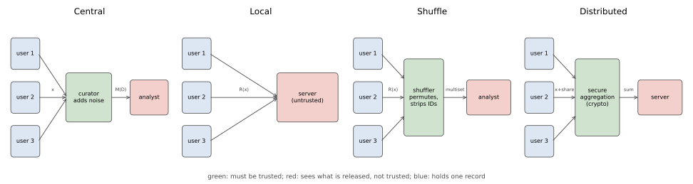

# Local, shuffle and distributed trust models

## Why this matters

Every mechanism so far in this part assumed a **trusted curator**: someone who holds the raw data, runs the mechanism, and releases only its output. The guarantee of differential privacy (DP) is about that output. It says nothing about the curator, the database it keeps, the engineer who can read it, or the court order that can demand it. [Threat models](../part02-attacks/01-threat-models.md) put it in one line: trust decides who the adversary is. In the central model the curator is outside the threat model. In many deployments it cannot be. A browser vendor collecting usage statistics, a keyboard app learning new words, or a phone operating system counting crashes is exactly the party users do not want to see their data.

This chapter answers one question: **how much accuracy does each weaker trust assumption cost, and what do you have to trust instead?** There are four answers, drawn in @fig-trust-models. They are four parallel options, so they are listed:

- **Central.** Trust the curator with everything. The noise is added once, to the answer, and the error does not grow with the number of people $n$.
- **Local.** Trust nobody. Each person randomizes their own record before it leaves their device. The noise is added $n$ times, and for counting the error is a factor of about $\sqrt n$ worse than central. No protocol can avoid this.
- **Shuffle.** Trust a shuffler only to cut the link between reports and senders. Local reports become anonymous, and anonymity amplifies privacy: reports randomized at a weak local level $\varepsilon_0$ give a strong central $\varepsilon$, so the error is close to central again.
- **Distributed.** Trust cryptography. Each person adds a small share of the noise, and a secure aggregation protocol reveals only the sum. The total noise equals the central noise, as long as enough people are honest.

{#fig-trust-models}

### The one idea: where the noise enters

All four models release a noisy statistic. They differ only in where the noise is added and who sees the data before it is. The further upstream the noise enters, the fewer parties you trust, and the more noise reaches the answer.

Here is why. A local report has to hide its owner from everyone, including the analyst, so each report carries noise of the size the central mechanism adds once in total. When you add up $n$ independent noises, their variances add, so the total noise has standard deviation of order $\sqrt n$ times one report's. The signal, the true count, grows like $n$. So the relative error of a local count shrinks only like $\sqrt n/n = 1/\sqrt n$, while a central count with one dose of noise has relative error of order $1/n$. The shuffle and distributed models move the noise back downstream without giving the data back to one party: anonymity hides which report is whose, and cryptography hides everything except the sum.

@tbl-trust-uses lists the results and where each one is used.

| Result | Where it is used |
| --- | --- |
| A local randomizer makes the whole protocol $\varepsilon$-DP | Deciding what a locally private deployment promises, and against whom |
| Unbiased estimation from randomized reports | Every local frequency estimate; debiasing any linear randomizer |
| The local lower bound: error $\gtrsim 1/((e^\varepsilon - 1)\sqrt n)$ | Knowing when local DP is hopeless, and why the other models exist |
| $k$-ary randomized response and unary encoding | Frequency estimation over large domains, as in browser and phone telemetry |
| Local hashing and heavy hitters by growing prefixes | Short reports for huge domains; finding new words or addresses without a dictionary |
| The one-bit mean | Numeric telemetry, such as time spent in an app, from one bit per person |
| Memoization and $\alpha$-point rounding | Collecting the same statistic every day without paying the budget again each day |
| Amplification by shuffling (Feldman, McMillan & Talwar 2021) | Choosing the local $\varepsilon_0$ that a shuffler turns into a target central $\varepsilon$ |
| Distributed noise with secure aggregation | Central accuracy without a trusted curator, in federated settings; how collusion erodes it |

: The results of this chapter and where each one is used. {#tbl-trust-uses}

The middle three rows are what deployments need beyond one report about a small domain. A browser or a phone must handle domains too large to list, numbers as well as categories, and the same question asked every day, and three sections after frequency estimation take these up in turn.

The chapter uses the definition, the hockey-stick form and randomized response from [The definition of differential privacy](01-definition.md), post-processing from [Post-processing, group privacy and composition](02-properties.md), and the [Laplace and Gaussian mechanisms](03-laplace-gaussian.md). From Part 1 it uses concentration ([Concentration inequalities](../part01-prerequisites/02-concentration.md)), Pinsker's inequality ([Divergences](../part01-prerequisites/03-divergences.md)) and additive secret sharing ([Cryptography basics](../part01-prerequisites/08-crypto-basics.md)). Each of them is restated where it is used. The derivation of amplification by shuffling belongs to [Privacy accounting](../part04-privacy-accounting/00-introduction.md); here it is a cited result that you compute with.

**The guarantee, restated.** A randomized mechanism $M$ is **$(\varepsilon, \delta)$-DP** if, for every pair of neighbouring datasets $D, D'$ and every set $S$ of possible outputs, $\Pr[M(D) \in S] \le e^\varepsilon\Pr[M(D') \in S] + \delta$. In words: changing one person's record changes the probability of any outcome by at most a factor $e^\varepsilon$, up to a small slack $\delta$. With $\delta = 0$ this is **pure** $\varepsilon$-DP.

**Notation.** $n$ people hold records $x_1, \dots, x_n$ from a domain $\mathcal X$. A **local randomizer** $R$ maps one record to a random report, and $p_R(y \mid x)$ is the probability that it outputs report $y$ when the record is $x$. When local and central guarantees appear together, $\varepsilon_0$ is the local level of one report and $(\varepsilon, \delta)$ the central guarantee of everything released. Neighbouring datasets differ by **replacing** one record, in every model of this chapter. The reason is that a report has to hide its owner's value, while the number of reports already reveals who took part, so no randomizer of the value could hide participation; [The definition of differential privacy](01-definition.md) makes the same point for randomized response. Frequencies are fractions in $[0, 1]$; an error on a fraction becomes $n$ times larger on a count.

## Toolkit: three facts every derivation uses

### Fact 1 — Debiasing a linear randomizer

A randomizer shrinks the signal: the mean of a report moves less with the true value than the true value itself does. If you know by how much it shrinks, you can undo it. Precisely, suppose a report $Y$ has mean $\mathbb E[Y] = a + b\,\theta$ for an unknown quantity $\theta$ and known numbers $a$ and $b \ne 0$. Then subtracting the offset and dividing by the slope,
$$\hat\theta = \frac{Y - a}{b},$$
is unbiased for $\theta$, with $\operatorname{Var}\hat\theta = \operatorname{Var}(Y)/b^2$.

The proof is two lines. Linearity of expectation gives $\mathbb E\hat\theta = (a + b\theta - a)/b = \theta$. Subtracting a constant does not change a variance, and scaling by $1/b$ multiplies it by $1/b^2$.

Every local estimator in this chapter is of this form. The slope $b$ is the gap between "report 1 when the true value is $v$" and "report 1 when it is not". A strongly private randomizer makes that gap small, and the estimator then has to scale the report up by $1/b$, which multiplies the noise variance by $1/b^2$. That is where the cost of local privacy comes from.

### Fact 2 — Variances of independent reports add

For independent reports $Y_1, \dots, Y_n$, the variance of a sum is the sum of the variances, and dividing by $n$ divides the variance by $n^2$:
$$\operatorname{Var}\Big(\frac1n\sum_iY_i\Big) = \frac{1}{n^2}\sum_i\operatorname{Var}Y_i.$$
A Bernoulli report, which is 1 with probability $\pi_i$ and 0 otherwise, has variance $\pi_i(1 - \pi_i)$. Together with Fact 1, this gives the exact variance of every frequency estimate below, with no approximation.

### Fact 3 — A test built from an estimator

A good estimator can tell two hypotheses apart, so if two hypotheses are hard to tell apart, no estimator can be good. This fact turns that into a number, and it is how the chapter proves lower bounds on error.

It uses the **total variation (TV) distance** between two distributions $P$ and $Q$ of the data: half the total absolute difference between their probability tables, $\mathrm{TV}(P, Q) = \frac12\sum_z|P(z) - Q(z)|$. From [Hypothesis testing](../part01-prerequisites/04-hypothesis-testing.md), every test has false positive rate plus false negative rate at least $1 - \mathrm{TV}$. The reason is short: a test that decides "$Q$" on a set $A$ of data has false positive rate $P(A)$ and false negative rate $1 - Q(A)$, so their sum is $1 - (Q(A) - P(A))$, and $Q(A) - P(A)$ can never exceed TV, which is the largest such difference.

Now the fact. Suppose an estimator $\hat\theta$ is within $\alpha/2$ of the truth with probability at least $1 - \beta$, both when the truth is $\theta_0$ and when it is $\theta_1 = \theta_0 + \alpha$. Use it to test: decide $\theta_1$ if $\hat\theta > \theta_0 + \alpha/2$, the midpoint between the two values. When the truth is $\theta_0$, the test is wrong only if the estimate lands more than $\alpha/2$ above the truth, which happens with probability at most $\beta$. When the truth is $\theta_1$, the test is wrong only if the estimate lands at least $\alpha/2$ below it, again with probability at most $\beta$ (an estimate exactly at the midpoint can be sent either way; with continuous estimates it has probability 0). So both error rates are at most $\beta$, their sum is at most $2\beta$, and the bound $1 - \mathrm{TV} \le 2\beta$ gives that the TV distance between the two distributions of the data is at least $1 - 2\beta$.

Read the other way round, this turns an upper bound on how much $n$ reports can reveal (a small TV) into a lower bound on any estimator's error.

## Central and local differential privacy

### Context

In the central model a curator holds $D = (x_1, \dots, x_n)$ and releases $M(D)$. In the **local model** there is no curator. Each person runs a randomizer on their own record and sends only the result. The question of this section: what does a local randomizer promise, to whom, and what does the change cost on the simplest task, counting?

### Statement

A local randomizer has to make each person's report look about the same whatever their record is, because whoever receives it may know whose it is. So the requirement is the DP definition applied to a dataset of one record, with every pair of records as neighbours. A randomizer $R: \mathcal X \to \mathcal Y$ is an **$\varepsilon_0$-DP local randomizer** if for every pair of records $x, x' \in \mathcal X$ and every event $S \subseteq \mathcal Y$,
$$\Pr[R(x) \in S] \le e^{\varepsilon_0}\Pr[R(x') \in S].$$ {#eq-trust-ldp}
This is the [definition of differential privacy](01-definition.md) for one record. The **local protocol** releases the transcript $(R(x_1), \dots, R(x_n))$, with independent randomness for each person. Then:

1. The transcript is $\varepsilon_0$-DP in the central sense, under replace.
2. Each report on its own is $\varepsilon_0$-DP against anyone who sees it, including the party that collects it.

### Derivation

The idea is that replacing one person's record changes only that person's report, so the privacy of the whole transcript is the privacy of one report.

1. **The transcript factorizes.** People use independent randomness, and the probability of independent events is the product of their probabilities: $p(y_1, \dots, y_n \mid D) = \prod_i p_R(y_i \mid x_i)$.
2. **Neighbours differ in one factor.** If $D$ and $D'$ differ only in record $j$, every factor with $i \ne j$ is the same under both and cancels in the ratio of the two probabilities. What remains, the **privacy loss** of the transcript, is $\ln\frac{p_R(y_j \mid x_j)}{p_R(y_j \mid x_j')}$. Applying @eq-trust-ldp to the single outcome $S = \{y_j\}$, in both directions, bounds it by $\varepsilon_0$ in absolute value. A bound on every single outcome's ratio extends to every event by adding the outcomes in the event. This is the argument [The definition of differential privacy](01-definition.md) made for randomized response, for any $R$.
3. **Who sees the report does not matter.** @eq-trust-ldp involves only the distribution of one report. It holds for the network, the collector, the analyst and anyone they hand the data to. Any later processing of the reports, including the curator's estimate, is covered by **post-processing** ([Post-processing, group privacy and composition](02-properties.md)): a function applied to a DP output, without access to the data, is DP with the same parameters, because it can only blur the output's dependence on the data, never sharpen it.

### Interpretation

The guarantee no longer depends on the curator. A breach of the collector's database, a malicious insider or a subpoena reveals reports, and reports are already private. That is why the large deployments of the 2010s used local DP: Google's RAPPOR in Chrome, Apple's telemetry in iOS and macOS, and Microsoft's telemetry in Windows.

But every person pays separately. Each report must hide its owner from everyone, so each carries noise of the size the central mechanism adds once in total. @tbl-trust-who sets out what you trust in each model and what it costs. The error column is derived in the sections below; the local entry follows from the example right after the table, where the standard deviation of a count is $n$ times that of a fraction, $n \cdot 1/(\varepsilon\sqrt n) = \sqrt n/\varepsilon$.

| Model | Who must be trusted | What the untrusted party sees | Error of a count, $\varepsilon$ fixed |
| --- | --- | --- | --- |
| Central | The curator, with all raw records | $M(D)$ | Order $1/\varepsilon$, independent of $n$ |
| Local | Nobody | Every report $R(x_i)$ | Order $\sqrt n/\varepsilon$ |
| Shuffle | The shuffler, to unlink reports from senders | The multiset of reports | Order $\sqrt{\ln(1/\delta)}/\varepsilon$ |
| Distributed | The cryptography, and enough honest clients | The noisy sum | Order $\sqrt{\ln(1/\delta)}/\varepsilon$ |

: The four trust models: who is trusted, what the untrusted party sees, and the order of the error of a count. {#tbl-trust-who}

### Example: one survey, two trust models

Of $n = 10{,}000$ people, 3,000 hold a 1. Each person uses **randomized response** at $\varepsilon = \ln 3$: report the true bit with the keep probability $t = e^\varepsilon/(1 + e^\varepsilon) = 3/4 = 0.75$, and the flipped bit otherwise. The mean $\bar y$ of the reports has expectation $(1 - t) + \pi(2t - 1)$, where $\pi$ is the true fraction of ones, so by Fact 1 the estimate $\hat\pi = (\bar y - (1 - t))/(2t - 1)$ is unbiased. Every report is a Bernoulli variable with variance $t(1 - t)$, whatever its true bit, so by Fact 2 and Fact 1 its standard deviation is $\sqrt{t(1-t)}/((2t - 1)\sqrt n)$, which [The definition of differential privacy](01-definition.md) rewrites as $\sqrt{e^\varepsilon/(n(e^\varepsilon - 1)^2)}$. With $e^\varepsilon = 3$ and $(e^\varepsilon - 1)^2 = 4$ this is $\sqrt{0.75/10{,}000} = 0.00866$. In 20,000 simulated surveys the mean estimate is 0.3000 and the standard deviation 0.00861. On the count, that is a standard deviation of $10{,}000 \times 0.00866 = 86.6$ people.

A trusted curator would instead release the true count plus Laplace noise $\mathrm{Lap}(1/\varepsilon)$. The **Laplace mechanism** adds noise of scale $b = \Delta_1/\varepsilon$, where the sensitivity $\Delta_1$ is the most one person can move the answer; under replace, changing one bit moves the count by at most 1, so $b = 1/\varepsilon$. A $\mathrm{Lap}(b)$ variable has variance $2b^2$, so the standard deviation is $\sqrt2/\varepsilon = 1.4142/1.0986 = 1.287$. The local survey is $86.6/1.287 = 67.3$ times noisier, at the same $\varepsilon$, on the same people.

### Check yourself

- A company runs randomized response at $\varepsilon_0 = 1$ on each user's device, and then also stores each user's network address with the report. Is the report still $1$-DP? *(As a function of the sensitive bit, yes: @eq-trust-ldp is about the bit. But the stored address links the report to the person, so anything else learned about them later can be combined with it. The guarantee covers the randomized value, not the metadata.)*
- Why does local DP use the replace relation and not add/remove? *(Each report is sent by a known device. Whether a report exists reveals participation, which no randomizer of the value can hide.)*

## The price of local privacy: a $\sqrt n$ gap

### Context

The example showed a factor of 67 at $n = 10{,}000$. Is that a weakness of randomized response, or of the local model? This section shows it is the model: no locally private protocol can estimate a fraction with error below order $1/((e^{\varepsilon_0} - 1)\sqrt n)$, while the central Laplace mechanism reaches order $1/(n\varepsilon)$. The ratio grows like $\sqrt n$.

### Statement

**Randomized response (upper bound).** The calculation of the previous example, at a general level $\varepsilon_0$, gives a standard deviation that does not depend on the data, because every report has the same variance $t(1-t)$ whatever its true bit. For every dataset, the unbiased estimate of a fraction has
$$\operatorname{sd}(\hat\pi) = \frac{e^{\varepsilon_0/2}}{(e^{\varepsilon_0} - 1)\sqrt n}.$$

**Any local protocol (lower bound).** The lower bound needs a way to measure how much a set of reports reveals. It uses the **Kullback–Leibler (KL) divergence**, $D_{\mathrm{KL}}(M_0\|M_1) = \sum_y m_0(y)\ln\frac{m_0(y)}{m_1(y)}$: the expected log-likelihood ratio in favour of $M_0$ when the data come from $M_0$, which is 0 when the two distributions are equal and grows as they separate. KL is convenient because it adds over independent observations.

The key step is that a local randomizer contracts this information. Let each person's record be drawn independently from a population $P_0$ or $P_1$, and let each person apply any $\varepsilon_0$-DP local randomizer (possibly a different one per person). Because the randomizer can change each report's probability by at most a factor $e^{\varepsilon_0}$, the report distributions $M_0, M_1$ under the two populations can differ only a little, however different the populations are:
$$D_{\mathrm{KL}}(M_0\|M_1) \le (e^{\varepsilon_0} - 1)^2\,\mathrm{TV}(P_0, P_1)^2.$$ {#eq-trust-kl-contraction}
As a consequence, $n$ reports cannot tell apart two populations whose fractions are close. Take $\mathrm{Bern}(\tfrac12)$ and $\mathrm{Bern}(\tfrac12 + \alpha)$, populations in which a fraction $\frac12$ or $\frac12 + \alpha$ hold a 1. No estimator built from $n$ reports is within $\alpha/2$ of the true fraction with probability $1 - \beta$ under both, unless
$$\frac\alpha2 \ge \frac{1 - 2\beta}{(e^{\varepsilon_0} - 1)\sqrt{2n}}.$$ {#eq-trust-lower}

### Derivation

The upper bound is the randomized-response calculation of the previous example, which used Facts 1 and 2. The lower bound has two halves. Steps 1 to 4 show that one report carries little information about the population (@eq-trust-kl-contraction). Steps 5 to 7 add up $n$ reports and turn "little information" into "large error" with Fact 3. Write $m_j(y) = \sum_xP_j(x)\,p_R(y \mid x)$ for the probability of report $y$ under population $j$: draw a record from $P_j$, then randomize it. Assume a finite domain for simplicity.

1. **Pin the report probabilities in a band.** Fix a report $y$ and let $r(y) = \min_xp_R(y \mid x)$ be its smallest probability over all records. By @eq-trust-ldp, no record makes $y$ more than $e^{\varepsilon_0}$ times as likely as any other, so every $p_R(y \mid x)$ lies in $[r(y), e^{\varepsilon_0}r(y)]$. Subtracting the floor, $g(x) = p_R(y \mid x) - r(y)$ lies in $[0, (e^{\varepsilon_0} - 1)r(y)]$.
2. **Only the difference of the populations matters.** Both populations are probability distributions, so $\sum_x(P_0(x) - P_1(x)) = 1 - 1 = 0$. Subtracting the constant $r(y)$ from $p_R(y \mid x)$ therefore changes nothing: $m_0(y) - m_1(y) = \sum_x(P_0(x) - P_1(x))\,p_R(y \mid x) = \sum_x(P_0(x) - P_1(x))\,g(x)$.
3. **Bound the sum.** Since the differences $P_0(x) - P_1(x)$ add to 0, their positive parts and their negative parts have the same total size, and each total is half the sum of absolute values, which is $\mathrm{TV}(P_0, P_1)$. With $g$ between 0 and $G = (e^{\varepsilon_0} - 1)r(y)$, the sum is largest when $g = G$ on the positive parts and $g = 0$ on the negative ones, giving $\mathrm{TV}\cdot G$, and smallest the other way round, giving $-\mathrm{TV}\cdot G$. Finally, $r(y) \le m_1(y)$, because $m_1(y)$ is an average of the numbers $p_R(y \mid x)$, each at least $r(y)$. So
$$|m_0(y) - m_1(y)| \le (e^{\varepsilon_0} - 1)\,\mathrm{TV}(P_0, P_1)\,m_1(y).$$
4. **From the pointwise bound to KL.** The tool is the inequality $\ln u \le u - 1$, which holds because the line $u - 1$ is tangent to the concave curve $\ln u$ at $u = 1$ and a concave curve lies below its tangents. Applied to $u = m_0/m_1$:
$$D_{\mathrm{KL}}(M_0\|M_1) = \sum_ym_0\ln\frac{m_0}{m_1} \le \sum_ym_0\Big(\frac{m_0}{m_1} - 1\Big) = \sum_y\frac{(m_0 - m_1)^2}{m_1} \le (e^{\varepsilon_0} - 1)^2\,\mathrm{TV}^2\sum_ym_1.$$
The middle equality holds because both sides equal $\sum_ym_0^2/m_1 - 1$: the left is $\sum m_0^2/m_1 - \sum m_0$, and expanding the square on the right gives $\sum m_0^2/m_1 - 2\sum m_0 + \sum m_1$, with $\sum m_0 = \sum m_1 = 1$. The last inequality squares step 3. The last sum is 1, which is @eq-trust-kl-contraction.
5. **Add over people.** Records and randomness are independent across people, so the reports are independent. For independent observations the log of the joint likelihood ratio is the sum of the individual log ratios, so the KL divergence, its expectation, adds ([Divergences](../part01-prerequisites/03-divergences.md)). The two Bernoulli populations differ by $\alpha$ in the probability of a 1 and by $\alpha$ in the probability of a 0, so $\mathrm{TV}(\mathrm{Bern}(\frac12), \mathrm{Bern}(\frac12 + \alpha)) = \frac12(\alpha + \alpha) = \alpha$. So $n$ reports have KL at most $n(e^{\varepsilon_0} - 1)^2\alpha^2$.
6. **Pinsker.** Fact 3 needs TV, not KL. **Pinsker's inequality** ([Divergences](../part01-prerequisites/03-divergences.md)) converts one into the other: $\mathrm{TV} \le \sqrt{\mathrm{KL}/2}$ for any two distributions. TV does not add over independent samples, which is why the derivation goes through KL. Here $\mathrm{TV}(M_0^n, M_1^n) \le \sqrt{\mathrm{KL}/2} \le \alpha(e^{\varepsilon_0} - 1)\sqrt{n/2}$, where $M_j^n$ is the distribution of all $n$ reports.
7. **Fact 3.** An estimator within $\alpha/2$ with probability $1 - \beta$ under both populations forces $\mathrm{TV} \ge 1 - 2\beta$. Combining with step 6, $1 - 2\beta \le \alpha(e^{\varepsilon_0} - 1)\sqrt{n/2}$, so $\alpha \ge (1 - 2\beta)\sqrt2/((e^{\varepsilon_0} - 1)\sqrt n)$. Halving both sides, and using $\sqrt2/2 = 1/\sqrt2$, gives @eq-trust-lower.

### Interpretation

Randomized response is optimal up to a constant. Divide its standard deviation by the lower bound: the factor $(e^{\varepsilon_0} - 1)\sqrt n$ cancels, and what is left is $e^{\varepsilon_0/2}\sqrt2/(1 - 2\beta)$. At $\varepsilon_0 = 1$ and $\beta = 0.1$ this is $1.6487 \times 1.4142/0.8 = 2.91$, the same as the ratio $3.03\times10^{-2}/1.04\times10^{-2}$ of the two values in @tbl-trust-results. No local protocol can do more than a constant factor better.

Local noise is a contraction. @eq-trust-kl-contraction says a local randomizer shrinks the information about the population by a factor $(e^{\varepsilon_0} - 1)^2 \approx \varepsilon_0^2$ for small $\varepsilon_0$. Since KL adds over people, you need about $1/\varepsilon_0^2$ times as many people to learn the same thing. Centrally, privacy costs an additive $1/(n\varepsilon)$ in the error of a fraction, which vanishes faster than the sampling error $1/\sqrt n$ that any survey has anyway.

The bound is loose by a constant. For one randomized-response report at $\varepsilon_0 = 1$, comparing $\mathrm{Bern}(0.5)$ with $\mathrm{Bern}(0.6)$, the exact KL is 0.00429, and @eq-trust-kl-contraction gives $(e - 1)^2 \times 0.1^2 = 2.952 \times 0.01 = 0.02952$, about seven times more. The slack comes from step 1: it allows every report probability to sit anywhere in the band $[r(y), e^{\varepsilon_0}r(y)]$, and randomized response does not use all of it. Duchi, Jordan & Wainwright (2018) prove the same contraction with a factor 4 and use it for minimax rates (the best worst-case error any estimator can reach) of many local estimation problems; Chan, Shi & Song (2012) prove the matching $\Omega(\sqrt n)$ lower bound for counting.

Interaction does not help much here. A local protocol is **non-interactive** when everyone sends one report at once. It is **sequentially interactive** when each person still speaks once, but their randomizer may be chosen after seeing the earlier reports. It is **fully interactive** when the analyst may come back to the same person many times. The derivation allowed each person a different randomizer, and lower bounds of the same order also hold for sequentially interactive protocols (Duchi, Jordan & Wainwright 2018). Interaction does matter for some harder tasks, because Kasiviswanathan et al. (2008) give a learning problem that interactive local protocols solve with far fewer people than any non-interactive one.

A $\delta$ helps little in the local model, unlike in the central one. Bun, Nelson & Stemmer (2019) turn any non-interactive local protocol that satisfies $(\varepsilon_0, \delta)$-DP into one that satisfies pure DP with similar accuracy. That is one reason why the local randomizers of this chapter are all pure.

### Example: how the gap grows

@fig-trust-rr-gap plots the three curves at $\varepsilon = 1$: randomized response, the lower bound, and the central Laplace mechanism, whose error on a fraction is the count's $\sqrt2/\varepsilon$ divided by $n$. At $n = 1{,}000$, randomized response has standard deviation $3.03\times10^{-2}$, the central Laplace mechanism $\sqrt2/1000 = 1.41\times10^{-3}$, a ratio of 21. Dividing the two formulas, the ratio is $e^{1/2}\sqrt n/(\sqrt2(e - 1)) = 0.678\sqrt n$, so it grows like $\sqrt n$: at $n = 100{,}000$ the ratio is 215, and at $n = 10^7$ it is 2146. Each factor of 100 in $n$ multiplies it by $\sqrt{100} = 10$. For a standard deviation of 0.001 at $\varepsilon = 1$, randomized response needs $(e^{1/2}/((e - 1) \times 0.001))^2$, that is 920,674 people, and the central Laplace mechanism needs $\sqrt2/n \le 0.001$, that is 1,415 ([Exercise 3](../../book-exercises/part03-dp-foundations/09-trust-models.md#sec-sol-trust-3)). This is why local DP is used for the most frequent items of very large populations, and almost never for anything finer.

{#fig-trust-rr-gap}

### Check yourself

- In steps 2 and 3, why may $g$ be shifted by $r(y)$, a quantity that depends on $y$? *(For fixed $y$ it is a constant in $x$, and $\sum_x(P_0 - P_1)(x)\cdot c = 0$ for any constant $c$.)*
- The central Laplace mechanism at $\varepsilon = 1$ has fraction error $\sqrt2/n$. At what $n$ does the sampling error $\sqrt{\pi(1-\pi)/n}$ of a fraction near $\frac12$ exceed it, and what does that say about the cost of central privacy? *(Near $\frac12$ the sampling error is $\sqrt{0.25/n} = 0.5/\sqrt n$. It exceeds $\sqrt2/n$ when $0.5/\sqrt n > \sqrt2/n$, that is $\sqrt n > 2\sqrt2$, or $n > 8$. Beyond a handful of people, central privacy costs less than sampling already does.)*

## Frequency estimation: $k$-ary randomized response and unary encoding

### Context

Counting one bit is the simplest task. The workhorse of deployed local DP is **frequency estimation**: each person holds one of $k$ values (a home page, an emoji, a crashing app), and the analyst wants the fraction $f_v$ of people holding each value $v$. Two natural generalizations of randomized response behave very differently as $k$ grows.

### Statement

Both schemes fit one template, and analysing the template once gives both. The idea is that each report either "supports" value $v$ or not, and supports it more often when the person really holds $v$. Then the number of supporting reports is a shrunken version of the true count, and Fact 1 unshrinks it.

**A pure frequency oracle.** Suppose that for each value $v$ there is a 0/1 "support" event in the report that has probability $p$ when the person holds $v$ and $q < p$ otherwise, independently across people. Let $C_v$ be the number of reports that support $v$. Then the debiased estimate and its exact variance are
$$\hat f_v = \frac{C_v/n - q}{p - q}, \qquad \operatorname{Var}\hat f_v = \frac{f_vp(1-p) + (1 - f_v)q(1-q)}{n(p - q)^2}.$$ {#eq-trust-oracle}

**$k$-ary randomized response.** Report the true value with probability $p = \frac{e^{\varepsilon_0}}{e^{\varepsilon_0} + k - 1}$, and each of the other $k - 1$ values with probability $q = \frac{1}{e^{\varepsilon_0} + k - 1}$. The two probabilities are chosen so that $p/q = e^{\varepsilon_0}$ and $p + (k - 1)q = 1$. The report supports $v$ if it equals $v$. It is an $\varepsilon_0$-DP local randomizer.

**Unary encoding.** Encode the value as a one-hot vector of $k$ bits (bit $v$ is 1 and all others are 0), and send each bit independently through its own randomized response: a 1 is sent as 1 with probability $p$, a 0 is sent as 1 with probability $q$. The report supports $v$ if bit $v$ is 1. Changing the record changes two bits of the vector, so the privacy level is the product of the two bits' worst ratios:
$$\varepsilon_0 = \ln\frac{p(1 - q)}{q(1 - p)}.$$
Two choices of $(p, q)$ are used. The **symmetric** one sets $p = e^{\varepsilon_0/2}/(e^{\varepsilon_0/2} + 1)$ and $q = 1 - p$, which is basic one-shot RAPPOR. The **optimized** one sets $p = \frac12$ and $q = 1/(e^{\varepsilon_0} + 1)$ (Wang et al. 2017).

**Variances for a rare value.** The regime that decides utility is $f_v \to 0$. Most values of a large domain are rare, and the variance at $f_v = 0$ is the noise floor: a value whose frequency is below a few standard deviations of it cannot be told apart from 0. Setting $f_v = 0$ in @eq-trust-oracle gives
$$k\text{-ary: } \frac{e^{\varepsilon_0} + k - 2}{n(e^{\varepsilon_0} - 1)^2}, \qquad \text{symmetric unary: } \frac{e^{\varepsilon_0/2}}{n(e^{\varepsilon_0/2} - 1)^2}, \qquad \text{optimized unary: } \frac{4e^{\varepsilon_0}}{n(e^{\varepsilon_0} - 1)^2}.$$
$k$-ary randomized response beats optimized unary encoding exactly when $k < 3e^{\varepsilon_0} + 2$.

### Derivation

1. **The oracle is unbiased (Fact 1).** $C_v$ is a sum of $n$ independent Bernoulli variables, one per person: $nf_v$ of them, the holders of $v$, have mean $p$, and the rest have mean $q$. So $\mathbb E[C_v/n] = f_vp + (1 - f_v)q = q + f_v(p - q)$, which is linear in $f_v$ with offset $a = q$ and slope $b = p - q$. Fact 1 gives the estimate in @eq-trust-oracle.
2. **Its variance (Fact 2).** The Bernoulli variances are $p(1-p)$ for the $nf_v$ holders and $q(1-q)$ for the others. Their sum is $n\big(f_vp(1-p) + (1 - f_v)q(1-q)\big)$. Dividing by $n^2$ (Fact 2, for the mean $C_v/n$) and by $(p - q)^2$ (Fact 1, for the debiasing) gives @eq-trust-oracle.
3. **$k$-ary randomized response is $\varepsilon_0$-DP.** Any single report $y$ has probability $p$ (if $y$ is the record) or $q$ (if not) under any record, so the ratio between two records is at most $p/q = e^{\varepsilon_0}$, which is @eq-trust-ldp for single outcomes.
4. **Unary encoding is private at the stated level.** Changing the record from $x$ to $x'$ changes the one-hot vector in two bits, $x$ and $x'$. All other bits have the same distribution under both records and cancel in the ratio. Bit $x$ goes from "a 1" to "a 0", so its contribution to the ratio is $p/q$ if it is sent as 1 and $(1-p)/(1-q)$ if sent as 0. Bit $x'$ goes the other way: $q/p$ or $(1-q)/(1-p)$. Since $p > q$, the largest product is $\frac pq\cdot\frac{1-q}{1-p}$, when bit $x$ is sent as 1 and bit $x'$ as 0. Plugging in the two choices gives exactly $e^{\varepsilon_0}$. For the symmetric one, $q = 1 - p$ makes both factors equal to $p/(1 - p) = e^{\varepsilon_0/2}$, and their product is $e^{\varepsilon_0}$. For the optimized one, $p = \frac12$ makes $p/(1 - p) = 1$, and $(1 - q)/q = e^{\varepsilon_0}$. The script checks both at $\varepsilon_0 = 1$.
5. **Rare-value variances.** At $f_v = 0$, @eq-trust-oracle is $q(1-q)/(n(p - q)^2)$. For $k$-ary: $q(1-q) = \frac{e^{\varepsilon_0} + k - 2}{(e^{\varepsilon_0} + k - 1)^2}$ and $p - q = \frac{e^{\varepsilon_0} - 1}{e^{\varepsilon_0} + k - 1}$; the factors $(e^{\varepsilon_0} + k - 1)^2$ cancel. For optimized unary: $q(1-q) = \frac{e^{\varepsilon_0}}{(e^{\varepsilon_0} + 1)^2}$ and $p - q = \frac12 - \frac{1}{e^{\varepsilon_0} + 1} = \frac{e^{\varepsilon_0} - 1}{2(e^{\varepsilon_0} + 1)}$; the factors $(e^{\varepsilon_0} + 1)^2$ cancel and the 2 squared leaves the 4. The symmetric case is binary randomized response at level $\varepsilon_0/2$, whose rare-value variance is the $k = 2$ case of the $k$-ary formula with $\varepsilon_0/2$ in place of $\varepsilon_0$.
6. **Crossover.** The $k$-ary and optimized unary variances have the same denominator, so the first is smaller exactly when $e^{\varepsilon_0} + k - 2 < 4e^{\varepsilon_0}$, that is when $k < 3e^{\varepsilon_0} + 2$.

### Interpretation

$k$-ary randomized response spreads its noise over the domain. With many values the true one is reported with probability $\approx e^{\varepsilon_0}/k$, so the report is almost uniform and carries little signal. Its rare-value variance has $k$ in the numerator, so it grows linearly in $k$ (@fig-trust-frequency-oracles).

Unary encoding avoids this by paying $\varepsilon_0$ for two bits, once, whatever $k$ is. Its variance does not depend on $k$, at the price of a $k$-bit report. Optimized unary encoding spends the budget asymmetrically: it keeps a 1 only half the time but almost never invents one. That helps because almost all bits of a one-hot vector are 0, so the noise that matters most is the false 1s, and those are the ones it suppresses. For large $k$, hashing reaches the same variance with much shorter reports: local hashing matches optimized unary encoding exactly, and Hadamard response matches it up to a constant factor (@sec-trust-heavy).

Unary encoding is also the core of RAPPOR, which Google deployed in Chrome (Erlingsson, Pihur & Korolova 2014). A system that collects every day needs more than a frequency oracle, and @sec-trust-repeated shows what RAPPOR adds.

The variance still hides a $\sqrt n$. Every row of @tbl-trust-oracles must be divided by $n$, and the square root is again of order $1/\sqrt n$: these oracles are optimal local protocols, still with the gap of the previous section.

| $k$ | $k$-ary randomized response | Symmetric unary | Optimized unary |
| --- | --- | --- | --- |
| 2 | 0.921 | 3.918 | 3.683 |
| 8 | 2.953 | 3.918 | 3.683 |
| 32 | 11.082 | 3.918 | 3.683 |
| 128 | 43.596 | 3.918 | 3.683 |

: $n$ times the variance of the estimated frequency of a rare value, at $\varepsilon_0 = 1$. $k$-ary randomized response wins below $k = 3e + 2 = 10.15$. {#tbl-trust-oracles}

{#fig-trust-frequency-oracles}

### Example: an emoji survey

A keyboard app wants the frequency of each of $k = 128$ emoji at $\varepsilon_0 = 1$ from $n = 10^6$ users. The standard deviation of a rare emoji's estimate is the square root of the table entry divided by $n$. $k$-ary randomized response gives $\sqrt{43.596/10^6} = 0.0066$ per emoji; optimized unary encoding gives $\sqrt{3.683/10^6} = 0.0019$. An estimate has to stand about three standard deviations above 0 to be told apart from noise, and $3 \times 0.0019 \approx 0.006$, so emoji used by fewer than about 0.6% of users are lost in the noise either way. With $k = 8$ choices instead, below the crossover, $k$-ary randomized response is better: $\sqrt{2.953/10^6} = 0.0017$.

### Check yourself

- What is $k$-ary randomized response at $k = 2$, and why does @tbl-trust-oracles give 0.921 for it? *(It is binary randomized response. The rare-value formula becomes $e^{\varepsilon_0}/(e^{\varepsilon_0} - 1)^2$, the randomized-response factor, which is $e/(e - 1)^2 = 0.921$ at $\varepsilon_0 = 1$.)*
- In unary encoding, why does flipping the two bits of $x$ and $x'$ not cost $2\varepsilon_0$, given that each bit is a randomized response? *(The level $\varepsilon_0$ is defined as the log of the product of the two worst ratios, so it already accounts for both bits. The symmetric scheme gives each bit $\varepsilon_0/2$.)*

## Large and unknown domains: hashing and heavy hitters {#sec-trust-heavy}

### Context

The frequency oracles of the previous section hit two limits in real telemetry. A unary report carries one bit per possible value, so a domain such as all web addresses would need reports of absurd length. And an oracle answers "how frequent is $v$?" only for a value $v$ that the analyst names in advance. A keyboard app that wants to learn new words, slang or common typos cannot name them beforehand. This section removes both limits. Hashing makes the report short, whatever the size of the domain. Growing the answer one prefix at a time then finds the frequent values without a dictionary, which is the **heavy hitters** problem.

### Statement

**Local hashing.** The idea is to shrink the domain before the randomizer sees it. Each person draws a hash function $h$ at random from a public family of functions that map the domain to $w$ buckets. The family is chosen so that two different values land in the same bucket with probability $1/w$ over the draw. The person sends the index of $h$ in the family, together with a $w$-ary randomized response of their bucket $h(x)$. That randomized response uses the probabilities $p$ and $q$ of $k$-ary randomized response, with $w$ in place of $k$. A report **supports** a value $v$ if the bucket it reports equals $h(v)$, computed with the sender's own hash.

Let $C_v$ be the number of reports that support $v$, and $\hat g_v = (C_v/n - q)/(p - q)$ the oracle estimate of @eq-trust-oracle applied to them. The estimate of $f_v$ removes the collisions from $\hat g_v$, and for a rare value its variance has a closed form:
$$\hat f_v = \frac{w\,\hat g_v - 1}{w - 1}, \qquad \operatorname{Var}\hat f_v\big|_{f_v = 0} = \frac{(e^{\varepsilon_0} + w - 1)^2}{n\,(w - 1)\,(e^{\varepsilon_0} - 1)^2}.$$ {#eq-trust-lh}
The variance is smallest when the number of buckets is $w = e^{\varepsilon_0} + 1$. There it equals $4e^{\varepsilon_0}/(n(e^{\varepsilon_0} - 1)^2)$, the variance of optimized unary encoding, from a report of about $\log_2 w$ bits plus the index of the hash.

**Heavy hitters by growing prefixes.** Write each value as a string of $L$ symbols from an alphabet of $A$ symbols, and split the people at random into $L$ groups of equal size. Group $\ell$ then reports the first $\ell$ symbols of its string, the **prefix** of length $\ell$, through local hashing. The analyst starts from the $A$ prefixes of length 1. At each level the analyst keeps the candidates whose estimate is above a threshold, extends each kept prefix by every symbol, and moves on to the next group. A frequent string has frequent prefixes, so it can survive every level.

The threshold is set to control false alarms. Suppose that $c_\ell$ candidates are tested at level $\ell$, and that $s$ is the standard deviation of the estimate of a value nobody holds. Write $\Phi(z)$ for the probability that a standard normal variable is below $z$. Then the threshold
$$\tau_\ell = z_\ell\,s, \qquad\text{where}\quad c_\ell\,\big(1 - \Phi(z_\ell)\big) = \beta,$$ {#eq-trust-threshold}
admits on average about $\beta$ false candidates at level $\ell$.

### Derivation

The estimator of @eq-trust-lh undoes two shrinkings of the signal, one by the randomized response and one by the collisions, and each is a use of Fact 1. Steps 1 to 5 do this and find the best $w$. Steps 6 and 7 justify the search.

1. **The own bucket.** A person who holds $v$ hashes it to $h(v)$ for sure. A person who holds another value lands in the bucket $h(v)$ with probability $1/w$ over the draw of $h$, by the collision property of the family. So the probability that a person's own bucket is $h(v)$ is
$$g_v = f_v + \frac{1 - f_v}{w} = \frac1w + f_v\,\frac{w - 1}{w}.$$
2. **The randomized response (Fact 1).** A report equals $h(v)$ with probability $p$ when the own bucket is $h(v)$, and with probability $q$ otherwise, because the randomized response sends every other bucket with probability $q$. So the expected share of supporting reports is
$$\mathbb E[C_v/n] = q + g_v(p - q),$$
and by Fact 1 the oracle estimate $\hat g_v$ is unbiased for $g_v$.
3. **The collisions (Fact 1 again).** Step 1 says $g_v$ is linear in $f_v$, with offset $1/w$ and slope $(w - 1)/w$. Subtracting the offset and dividing by the slope gives $\hat f_v = (w\hat g_v - 1)/(w - 1)$, unbiased, with $(w/(w-1))^2$ times the variance of $\hat g_v$.
4. **The variance of a rare value.** At $f_v = 0$, step 1 gives $g_v = 1/w$. With $p - q = (e^{\varepsilon_0} - 1)/(e^{\varepsilon_0} + w - 1)$ and $q = 1/(e^{\varepsilon_0} + w - 1)$, a report then supports $v$ with probability $q + (p - q)/w$, which simplifies to exactly $1/w$. Each support indicator is therefore a Bernoulli variable with variance $(w - 1)/w^2$. Three scalings turn this into the variance of $\hat f_v$. Fact 2 divides it by $n$, step 2 divides it by $(p - q)^2$, and step 3 multiplies it by $w^2/(w - 1)^2$, which leaves $1/(n(w - 1)(p - q)^2)$. Substituting $p - q$ then gives @eq-trust-lh.
5. **The best width.** Write $u = w - 1$. Divided by $u$, the numerator of @eq-trust-lh is $(e^{\varepsilon_0} + u)^2/u = e^{2\varepsilon_0}/u + 2e^{\varepsilon_0} + u$. The two terms $e^{2\varepsilon_0}/u$ and $u$ have the fixed product $e^{2\varepsilon_0}$. A sum of two positive numbers with a fixed product is smallest when they are equal, here at $u = e^{\varepsilon_0}$, where the whole expression is $4e^{\varepsilon_0}$.
6. **The threshold.** The estimate of a value nobody holds has mean 0 and standard deviation $s$. It is an average over many independent reports, so by the central limit theorem it is close to normal, and it exceeds $z\,s$ with probability about $1 - \Phi(z)$. By linearity of expectation, the expected number of false alarms among $c_\ell$ such candidates is $c_\ell(1 - \Phi(z))$, and @eq-trust-threshold sets it to $\beta$.
7. **Why prefixes work.** Each person who holds a string also holds each of its prefixes. So the frequency of a prefix is the sum of the frequencies of all strings that start with it, which is at least the frequency of each of them. A string whose frequency is clearly above every level's threshold therefore has every prefix above its level's threshold too. Each level tests $A$ extensions of each kept prefix, so the number of candidates stays near $A$ times the number of frequent prefixes, instead of the $A^L$ strings of the whole domain.

### Interpretation

Hashing separates the size of the report from the size of the domain. @fig-trust-local-hashing plots @eq-trust-lh against $w$. Too few buckets waste the signal on collisions, and too many spread the randomized response thin, as $k$-ary randomized response does for large $k$. At $w = e^{\varepsilon_0} + 1$ local hashing matches optimized unary encoding exactly, and at the nearest integer almost exactly. At $\varepsilon_0 = 4$, with $w = 56$ buckets, a report needs $\log_2 56 \approx 6$ bits instead of a bit for every value. The price of hashing is the server's work, because it must evaluate each report's hash at every candidate. Hadamard response (Acharya, Sun & Zhang 2019) replaces the random hash by the rows of a Hadamard matrix, which makes that work fast at the cost of a constant factor in variance.

{#fig-trust-local-hashing}

The prefix search needs no list of candidates, which is the point of the TreeHist protocol of Bassily et al. (2017). Testing every string directly would need a threshold that grows with the size of the domain, because @eq-trust-threshold must keep the false alarms of all $A^L$ strings below $\beta$. Splitting the people into $L$ groups has a cost too, because each level sees only $n/L$ people, so its standard deviation is $\sqrt L$ times larger. The estimates also depend on the hash family being large enough. When the family is small, a particular heavy value collides with a particular candidate more or less often than $1/w$ by chance, which biases that candidate's estimate. The example below uses 16,384 hash functions for that reason.

There is a floor that no protocol avoids. Bassily & Smith (2015) show that over a domain of $k$ values, the largest error over all frequencies can be made of order $\sqrt{\ln k / n}/\varepsilon_0$ with short reports, and that no local protocol does better. No local protocol can reliably tell values rarer than that from absent ones, which is the $\sqrt n$ gap again, now with a factor $\sqrt{\ln k}$ for searching a large domain.

Deployed systems use these pieces. RAPPOR's analysis tests a list of candidate strings that the analyst supplies (Erlingsson, Pihur & Korolova 2014), so it cannot discover new values. Apple's Differential Privacy Team (2017) describes a **count-mean sketch**. It hashes each value with one of several hash functions and sends a unary encoding of the bucket, and its Hadamard variant sends a single bit. To discover new words, Apple's **sequence fragment puzzle** has each device send its word through the sketch, together with a privatized fragment of the word and the fragment's position. The fragment carries an 8-bit hash of the whole word, the "puzzle piece", so the server can join frequent fragments with the same hash into candidate words. It is the same idea as growing prefixes, which never searches the whole domain at once.

### Example: words nobody listed

A million people each type one of 200 six-letter words over a 26-letter alphabet, with Zipf frequencies, and report at $\varepsilon_0 = 4$. The domain has $26^6 = 308{,}915{,}776$ strings, far too many to test one by one. Local hashing uses $w = 56$ buckets, the integer nearest $e^4 + 1 = 55.60$. Each of the six levels sees about 166,666 people, so the estimate of an absent prefix has standard deviation $6.75\times10^{-4}$. The first level tests the 26 one-letter prefixes, and no later level tests more than 2,054 candidates. At the last level the threshold of @eq-trust-threshold with $\beta = 0.1$ is $3.80$ standard deviations, a frequency of 0.0026.

The search returns 50 strings, and all 50 are real words. The rarest word found has frequency 0.0033. The most frequent word missed has frequency 0.0035, just above the threshold, lost to noise at one of the six levels (@fig-trust-heavy-hitters). Testing all $26^6$ strings directly would need a threshold of 6.18 standard deviations to keep $\beta = 0.1$. At the prefix search's 3.80 standard deviations, it would raise about 22,418 false alarms.

{#fig-trust-heavy-hitters}

### Check yourself

- Why must each person draw their own hash function, rather than everyone using one fixed hash? *(With one fixed hash, every value that collides with $v$ adds its whole frequency to $v$'s estimate, and no debiasing can remove a bias that depends on unknown frequencies. With a fresh hash per person, a collision happens with probability $1/w$ per person, which averages to the known offset of step 1.)*
- The frequency of a prefix is at least that of every string that starts with it. What can still make the search miss a frequent string? *(Noise. The string is lost if its prefix's estimate falls below the threshold at any one of the $L$ levels, which is what happened to the word of frequency 0.0035.)*

## Numbers in one bit: local mean estimation {#sec-trust-mean}

### Context

Telemetry also collects numbers, such as the minutes spent in an app or the battery a process drains. Each person holds a number $x_i$ between 0 and a known bound $m$, and the analyst wants their mean, written $\mu = \frac1n\sum_ix_i$. This section asks two questions. How accurate can a locally private mean be? And how many bits must each person send? The second question matters on a phone, where every upload costs battery and data.

### Statement

**Laplace reports.** Each person sends $Y_i = x_i + \mathrm{Lap}(m/\varepsilon_0)$, and the analyst averages the reports. This is an $\varepsilon_0$-DP local randomizer, and the average is unbiased with
$$\operatorname{sd}(\hat\mu) = \frac{\sqrt2\,m}{\varepsilon_0\sqrt n}.$$

**One bit.** Ding, Kulkarni & Yekhanin (2017) send a single bit instead. Its probability of being 1 rises in a straight line with $x_i$, from the lie probability of randomized response at $x_i = 0$ to its truth probability at $x_i = m$:
$$\Pr[Y_i = 1] = \frac{1}{e^{\varepsilon_0} + 1} + \frac{x_i}{m}\cdot\frac{e^{\varepsilon_0} - 1}{e^{\varepsilon_0} + 1}.$$ {#eq-trust-onebit}
This is an $\varepsilon_0$-DP local randomizer. The estimate
$$\hat\mu = \frac mn\sum_{i=1}^n\frac{(e^{\varepsilon_0} + 1)Y_i - 1}{e^{\varepsilon_0} - 1}$$
is unbiased, and whatever the data,
$$\operatorname{sd}(\hat\mu) \le \frac{m}{2\sqrt n}\cdot\frac{e^{\varepsilon_0} + 1}{e^{\varepsilon_0} - 1}.$$ {#eq-trust-onebit-sd}

### Derivation

1. **The Laplace reports.** One person's value can change by at most $m$, so the sensitivity of a single record is $m$, and the Laplace mechanism with scale $m/\varepsilon_0$ is $\varepsilon_0$-DP. Each report has mean $x_i$ and variance $2m^2/\varepsilon_0^2$, the variance of $\mathrm{Lap}(m/\varepsilon_0)$. By Fact 2 the average has variance $2m^2/(n\varepsilon_0^2)$.
2. **The bit is private.** By @eq-trust-onebit, the probability of a 1 lies between $1/(e^{\varepsilon_0} + 1)$ and $e^{\varepsilon_0}/(e^{\varepsilon_0} + 1)$ for every value. So for any two values, the ratio of the two probabilities of a 1 is at most $e^{\varepsilon_0}$. The probability of a 0 is one minus the probability of a 1, so it lies in the same interval and obeys the same bound. That is @eq-trust-ldp for both outcomes.
3. **The estimate is unbiased (Fact 1).** The mean of $Y_i$ is $a + b\,x_i$ with offset $a = 1/(e^{\varepsilon_0} + 1)$ and slope $b = (e^{\varepsilon_0} - 1)/(m(e^{\varepsilon_0} + 1))$. So Fact 1 says that $(Y_i - a)/b$ is unbiased for $x_i$, and multiplying it out gives the summand of $\hat\mu$. Averaging these unbiased estimates of the $x_i$ then gives an unbiased estimate of their mean.
4. **Its variance (Fact 2).** Each $Y_i$ is a Bernoulli variable with some probability $\pi_i$, so its variance $\pi_i(1 - \pi_i)$ is at most $1/4$. The summand scales $Y_i$ by $m(e^{\varepsilon_0} + 1)/(e^{\varepsilon_0} - 1)$, which multiplies that variance by the square of the factor. The average then divides the sum of $n$ such variances by $n^2$, and taking the square root gives @eq-trust-onebit-sd.

### Interpretation

Both estimates have error of order $m/(\varepsilon_0\sqrt n)$ for small $\varepsilon_0$. That is the same $\sqrt n$ gap between local and central error that counting showed, since a central mean has error of order $m/(\varepsilon_0 n)$. Duchi, Jordan & Wainwright (2018) show that no local protocol does better than this order. So the choice between the two is about constants and communication.

On communication the bit wins outright. A Laplace report has to carry the value plus its noise, at least about $\log_2 m$ bits at the precision of the data, while the one-bit report carries one bit. On accuracy, the worst case of @eq-trust-onebit-sd is 0.765 times the Laplace standard deviation at $\varepsilon_0 = 1$, and the ratio tends to $1/\sqrt2 = 0.707$ as $\varepsilon_0$ shrinks. The two are equal at $\varepsilon_0 = 2.324$, and above that the Laplace reports are more accurate, because as $\varepsilon_0$ grows the bit's error levels off at $m/(2\sqrt n)$, while the Laplace error keeps falling like $1/\varepsilon_0$.

Both estimates need the bound $m$ to hold. A device whose value exceeds $m$ must clip it to $m$ before randomizing, which biases the mean downward when many people exceed the bound. So $m$ is a design choice, fixed before collection, and a bound set too low trades privacy noise for bias.

The bit is also the building block of Microsoft's telemetry, which @sec-trust-repeated turns into a protocol that reports every six hours.

### Example: minutes in an app

A million people use an app for between 0 and $m = 1{,}440$ minutes a day, the minutes in a day, with a mean of 82.74 minutes. At $\varepsilon_0 = 1$, the exact standard deviation of the one-bit estimate is 1.420 minutes, and @eq-trust-onebit-sd bounds it by 1.558. In 200 simulated collections the estimates average 82.61 minutes with a standard deviation of 1.415. Laplace reports at the same $\varepsilon_0$ would give a standard deviation of 2.036 minutes, and each would need about 11 bits for the value alone, since $2^{11} = 2{,}048$.

### Check yourself

- What does a person who never uses the app send? *(A 1 with probability $1/(e^{\varepsilon_0} + 1)$, which is exactly the lie probability of randomized response for a bit that is 0. At $\varepsilon_0 = 1$ that is $1/(e + 1) = 0.27$.)*
- Why must the bound $m$ be fixed before collection, and not taken as the largest value in the data? *(The randomizer of every person uses $m$. If $m$ were the largest value, one person's record would change the probabilities of everyone's reports, and the guarantee of @eq-trust-ldp, which is about one report and one record, would no longer hold.)*

## Collecting every day: memoization {#sec-trust-repeated}

### Context

Telemetry asks the same question every day, for example which home page is set, how long the app was used or which emoji was typed. The guarantee of @eq-trust-ldp is about one report, and basic composition ([Post-processing, group privacy and composition](02-properties.md)) says how the cost of many reports adds up. If a person sends $T$ reports about the same record, each $\varepsilon_0$-DP, the reports together are $T\varepsilon_0$-DP, because the privacy losses of independent releases add. This section shows that this is not just a loose bound but a real leak, and then shows the two fixes that deployments use. The first is **memoization**, which reuses one randomized answer. The second is **$\alpha$-point rounding**, which makes memoization work for values that drift.

### Statement

**Fresh reports leak.** Suppose a person reports the same bit every day by randomized response at level $\varepsilon_0$, with fresh randomness each time. After $T$ days, of which $k$ reported a 1, the likelihood ratio between "the bit is 1" and "the bit is 0" is
$$\frac{\Pr[\text{reports} \mid 1]}{\Pr[\text{reports} \mid 0]} = e^{\varepsilon_0(2k - T)}.$$
The majority of the $T$ reports is then wrong with a probability that falls exponentially in $T$.

**Memoization.** The person draws one **permanent** randomized response for each value, once, and sends it, possibly through a second randomizer with fresh randomness each day. Then all the reports of a value that does not change are together $\varepsilon_\infty$-DP, where $\varepsilon_\infty$ is the level of the permanent response. In RAPPOR, the value is a Bloom filter (a bit vector in which $h$ hash functions each set one bit), and the permanent response replaces each bit by a fair coin with probability $f$. Its level is
$$\varepsilon_\infty = 2h\ln\frac{1 - f/2}{f/2}.$$ {#eq-trust-rappor}

**Rounding with a secret offset.** For values in $[0, m]$, each person draws two bits once and keeps them: $b_0$ by @eq-trust-onebit at $x = 0$ and $b_m$ by @eq-trust-onebit at $x = m$. The person also draws a secret offset $\alpha$, uniform on $[0, m)$, once. In each round $t$ they send $b_m$ if $x_t + \alpha \ge m$ and $b_0$ otherwise. Ding, Kulkarni & Yekhanin (2017) call this **$\alpha$-point rounding**, and three things hold:

1. Every single report has exactly the distribution of @eq-trust-onebit, so each round's estimate $\hat\mu$ is unbiased with the variance of @eq-trust-onebit-sd.
2. The reports depend on the data only through the pattern of days on which $x_t + \alpha \ge m$. With probability
$$\Pr[b_0 = b_m] = \frac{2e^{\varepsilon_0}}{(e^{\varepsilon_0} + 1)^2}$$
the two kept bits agree, and then every report is the same bit, whatever the data.
3. A person whose value stays within a band of width $d$ can change their report only when the threshold $m - \alpha$ falls inside the band. That happens with probability $d/m$, and even then the report changes only if the two bits differ.

**Output perturbation.** Flipping each sent bit with a small probability $\gamma$ hides when a report changes. One round then has level
$$\varepsilon_0' = \ln\frac{(1 - 2\gamma)\frac{e^{\varepsilon_0}}{e^{\varepsilon_0} + 1} + \gamma}{(1 - 2\gamma)\frac{1}{e^{\varepsilon_0} + 1} + \gamma},$$ {#eq-trust-op}
and two sequences of values that, for every offset, select different kept bits on at most $D$ days give transcripts whose likelihood ratio is at most $((1 - \gamma)/\gamma)^D$.

### Derivation

1. **Fresh reports.** Each report equals the bit with probability $t = e^{\varepsilon_0}/(1 + e^{\varepsilon_0})$, independently. If the bit is 1, a particular sequence with $k$ ones has probability $t^k(1 - t)^{T - k}$, and if it is 0, the probability is $(1 - t)^kt^{T - k}$. The ratio is $(t/(1 - t))^{2k - T}$, and $t/(1 - t) = e^{\varepsilon_0}$. The majority is wrong when more than half the reports are flipped, a binomial tail with flip probability $1 - t < \frac12$, which falls exponentially in $T$ by the Chernoff bound ([Concentration inequalities](../part01-prerequisites/02-concentration.md)).
2. **Memoization is post-processing.** All the reports of an unchanged value are a function of the permanent response and of fresh randomness that does not depend on the data. By post-processing, they are as private as the permanent response alone.
3. **RAPPOR's level.** The permanent response keeps each bit of the Bloom filter with probability $1 - f$ and otherwise replaces it by a fair coin. So a bit that is 1 is reported as 1 with probability $1 - f/2$, and a bit that is 0 with probability $f/2$. Each bit's ratio is therefore at most $(1 - f/2)/(f/2)$. Two values set at most $h$ bits each, so their filters differ in at most $2h$ bits. The other bits have the same distribution under both values and cancel, as in unary encoding, which leaves a product of at most $2h$ ratios. Taking the logarithm gives @eq-trust-rappor.
4. **The rounding is unbiased.** For a fixed value $x$, the offset $\alpha$ is uniform on $[0, m)$, so the bit for $m$ is chosen with probability
$$\Pr[x + \alpha \ge m] = \Pr[\alpha \ge m - x] = \frac xm.$$
The person therefore sends $b_m$ with probability $x/m$ and $b_0$ otherwise, and the kept bits do not depend on $\alpha$. So the report is 1 with probability $(1 - x/m)/(e^{\varepsilon_0} + 1) + (x/m)\,e^{\varepsilon_0}/(e^{\varepsilon_0} + 1)$, which is @eq-trust-onebit. That proves item 1.
5. **What the reports depend on.** The bits $b_0$, $b_m$ and the offset $\alpha$ are drawn without looking at the data. Each report is then $b_0$ or $b_m$, chosen by whether $x_t + \alpha \ge m$. That proves the first half of item 2. Both kept bits are 1 with probability $e^{\varepsilon_0}/(e^{\varepsilon_0} + 1)^2$, the product of their two probabilities of a 1. Both are 0 with the same probability, so they agree with probability $2e^{\varepsilon_0}/(e^{\varepsilon_0} + 1)^2$.
6. **Changes.** If every $x_t$ lies in a band $(a, a + d]$, then $x_t + \alpha \ge m$ switches between days only if the threshold $m - \alpha$ lies in the band. Since $m - \alpha$ is uniform on $(0, m]$, that has probability $d/m$. That proves item 3.
7. **Output perturbation.** After the flip, a bit that was 1 with probability $\pi$ is 1 with probability $\gamma + (1 - 2\gamma)\pi$, which still rises in a straight line with $\pi$. The ratio is largest between the two ends of @eq-trust-onebit, which gives @eq-trust-op. For whole transcripts, fix the kept bits and the offset. On a day where the two sequences send the same kept bit, the sent bit has the same distribution under both and the day cancels. On a day where they differ, the sent bit is the kept bit with probability $1 - \gamma$ and the other with probability $\gamma$, so the day's ratio is at most $(1 - \gamma)/\gamma$. The flips are independent across days, so the ratios multiply. The bound holds for every value of the kept bits and the offset, because the number of differing days is at most $D$ for every offset, so it also holds for their average.

### Interpretation

Composition is tight here, not just an upper bound. At $\varepsilon_0 = \ln 3$, a single report leaves an observer guessing wrong a quarter of the time. After 100 days with 75 ones, the likelihood ratio is $3^{50}$, about $7.18\times10^{23}$. The bit is then no longer in doubt (@fig-trust-repeated, left), because averaging removes fresh noise.

Memoization caps the cost, but only for a value that never changes. A value that changes gets a new permanent response, which costs another $\varepsilon_\infty$, and a value that drifts every day, such as a person's age in days, gets a new one every day. The same happens when the collector asks the same question in another form, for example a value and that value plus one, because the two answers are different values with their own permanent responses, and together they reveal the value twice. RAPPOR's homepage collection used $h = 2$ and $f = 0.75$, so @eq-trust-rappor gives $\varepsilon_\infty = 4\ln(5/3) = 2.043$.

RAPPOR's second layer protects something that $\varepsilon_\infty$ does not measure. The permanent response is a fixed random bit string, and a fixed string identifies its sender as well as a cookie does, because the collector could link all the reports that carry it. So RAPPOR passes the permanent response through a fresh randomized response, an **instantaneous** one, before each report. Each report then looks different, and one report, with both layers, is $\varepsilon_1$-DP with $\varepsilon_1 = 0.5343$ for the homepage parameters, whose instantaneous layer sends 1 with probability 0.75 for a permanent 1 and 0.5 for a permanent 0. That is the value the RAPPOR paper reports ([Exercise 9](../../book-exercises/part03-dp-foundations/09-trust-models.md#sec-sol-trust-9) derives it). The instantaneous layer makes reports hard to link, which is a different promise from differential privacy.

Drifting values pose a dilemma that $\alpha$-point rounding resolves. Rounding values to coarse bins before memoizing would keep each person's report fixed while the value stays in its bin. But narrow bins change often and cost new permanent responses, while wide bins add rounding error to every report. The $\alpha$-point scheme uses one bin as wide as the whole range and still adds no bias, because the rounding itself is random, with a secret offset per person. What leaks is the days on which a person's value crosses their secret threshold, and only for the people whose two kept bits differ. Output perturbation then blurs those days, at a cost of $\ln((1 - \gamma)/\gamma)$ for each day the kept bit changes.

So the longitudinal guarantee is about patterns of behaviour, not about each round. Ding, Kulkarni & Yekhanin (2017) state it that way: a person whose behaviour stays within a band reveals nothing new as rounds go by, and a person whose behaviour changes reveals roughly when it changed. Microsoft deployed this protocol in Windows 10 to collect the time spent in each app (their §6). It used $\varepsilon_0 = 1$ every six hours and $\gamma = 0.2$. For these values @eq-trust-op gives 0.569 per round. The paper reports 0.686, a larger and so more conservative bound, and does not explain the difference.

![Left: the probability that the majority of $T$ daily reports of a fixed bit is wrong, at $\varepsilon_0 = \ln 3$ per report. With fresh randomness it falls exponentially; with a memoized report it stays at 0.25. Right: the fraction of people whose report ever changes in 30 days when their daily minutes in an app wobble around their own level, at $\varepsilon_0 = 1$. With $\alpha$-point rounding (formula and simulation) almost nobody's report changes; with a fresh one-bit report almost everybody's does.](figures/trust_repeated.svg){#fig-trust-repeated}

### Example: a month of minutes

Return to the app of @sec-trust-mean, with $m = 1{,}440$ minutes and $\varepsilon_0 = 1$. A person's two kept bits agree with probability $2e/(e + 1)^2 = 0.3932$, and for those people nothing in the reports ever depends on their usage. Suppose that each person's daily minutes wobble uniformly by up to 15 minutes either side of their own level for 30 days. By item 3, the fraction of people whose report ever changes is $(1 - 0.3932)$ times the expected range of their 30 daily values, the largest minus the smallest, divided by $m$. That is 0.0118, and a simulation of 100,000 people gives 0.0119, but with a fresh one-bit report every day it is 1.0000. Accuracy is unchanged: on one simulated day with a million people, the $\alpha$-point estimate is 82.17 minutes against that day's true mean of 82.68, a fresh draw of the population, well within the standard deviation of 1.42 minutes from @sec-trust-mean. With output perturbation at $\gamma = 0.2$, each day on which a person's kept bit changes costs $\ln(0.8/0.2) = 1.386$.

### Check yourself

- A RAPPOR user sets a new homepage at the start of each month for a year. What does basic composition give for the year? *(Twelve distinct values, each with its own permanent response at $\varepsilon_\infty = 2.043$, so at most $12 \times 2.043 = 24.5$.)*
- Under $\alpha$-point rounding, why does the collector learn nothing about a person whose two kept bits agree? *(Every report is then that one bit, whatever the values $x_t$ and the offset are, so the reports have the same distribution under every sequence of values.)*

## The shuffle model and amplification by shuffling

### Context

The local model loses a factor $\sqrt n$ because each report must hide its owner from an analyst who knows whose report it is. Remove that knowledge, and the reports hide each other. In the **shuffle model** (Bittau et al. 2017, the encode–shuffle–analyze architecture of Prochlo; Cheu et al. 2019), each person sends a locally randomized report to a **shuffler**, which strips identifiers and timing and forwards a uniformly random permutation of the reports. The analyst sees the multiset: which reports were sent, but not by whom. The shuffler can be a separate organization, a mix network, or a trusted execution environment. It must be trusted only to unlink, not to keep data secret: it sees reports, which are already $\varepsilon_0$-DP.

### Statement

The claim is that anonymity amplifies privacy: the more people's reports the target's report is mixed with, the less the multiset reveals about the target, so the central $\varepsilon$ falls as $n$ grows. Erlingsson et al. (2019) showed that shuffling $\varepsilon_0$-DP reports gives central $(\varepsilon, \delta)$-DP with $\varepsilon = O(\varepsilon_0\sqrt{\ln(1/\delta)/n})$ when $\varepsilon_0 < \frac12$ (their Theorem 7). That condition excludes the regime that matters most in practice, a large $\varepsilon_0$ that makes each report nearly the truth, and the later theorem below covers it. The bound to compute with is Theorem 3.1 of Feldman, McMillan & Talwar (2021), quoted here with the range spaces of the randomizers left out. In it, $[n] = \{1, \dots, n\}$ and $z_{1:i-1}$ is the list of the first $i - 1$ outputs:

> For any domain $\mathcal D$, let $\mathcal R^{(i)}$ for $i \in [n]$ be a sequence of algorithms such that $\mathcal R^{(i)}(z_{1:i-1}, \cdot)$ is an $\varepsilon_0$-DP local randomizer for all values of auxiliary inputs $z_{1:i-1}$. Let $\mathcal A_s$ be the algorithm that, given a dataset $x_{1:n}$, samples a uniform random permutation $\pi$ over $[n]$, then sequentially computes $z_i = \mathcal R^{(i)}(z_{1:i-1}, x_{\pi(i)})$ for $i \in [n]$ and outputs $z_{1:n}$. Then for any $\delta \in [0, 1]$ such that $\varepsilon_0 \le \log\big(\frac{n}{16\log(2/\delta)}\big)$, $\mathcal A_s$ is $(\varepsilon, \delta)$-DP, where

$$\varepsilon \le \ln\left(1 + \frac{e^{\varepsilon_0} - 1}{e^{\varepsilon_0} + 1}\left(\frac{8\sqrt{e^{\varepsilon_0}\ln(4/\delta)}}{\sqrt n} + \frac{8e^{\varepsilon_0}}{n}\right)\right).$$ {#eq-trust-fmt}

The theorem is stated for replace neighbours, with $\log$ the natural logarithm. Shuffling the outputs of a fixed randomizer is the special case in which every $\mathcal R^{(i)}$ ignores its auxiliary input. Read the formula from the inside out: the bracket falls like $1/\sqrt n$, it is multiplied by a factor below 1 that depends only on $\varepsilon_0$, and $\ln(1 + u) \approx u$ when $u$ is small, so for large $n$ the central $\varepsilon$ is about that product.

### Why it works, in outline

The full derivation is in [Amplification by shuffling and by iteration](../part04-privacy-accounting/07-shuffling-iteration.md). Its first step is elementary and carries the intuition: every other person's report has some chance of looking exactly like a report the target might have sent, and after shuffling those look-alikes hide the target's report.

Fix the two values $x^0, x^1$ that the target person might hold. For any other person's value $x$ and any report $y$, @eq-trust-ldp says $y$ is at most $e^{\varepsilon_0}$ times less likely under $x$ than under any other value, so $p_R(y \mid x) \ge e^{-\varepsilon_0}p_R(y \mid x^0)$ and $p_R(y \mid x) \ge e^{-\varepsilon_0}p_R(y \mid x^1)$. A number at least as large as two others is at least as large as their average, so $p_R(y \mid x) \ge \frac{e^{-\varepsilon_0}}{2}\big(p_R(y \mid x^0) + p_R(y \mid x^1)\big)$. That lets you split the report distribution of $x$ into three pieces:
$$R(x) = \frac{e^{-\varepsilon_0}}{2}R(x^0) + \frac{e^{-\varepsilon_0}}{2}R(x^1) + (1 - e^{-\varepsilon_0})\,\mathrm{LO}(x),$$
where the leftover distribution $\mathrm{LO}(x)$ is whatever remains after removing the first two pieces, rescaled to total mass 1. It is non-negative by the inequality, and its weight $1 - e^{-\varepsilon_0}$ is what the first two pieces leave of the total mass 1.

Read the split as a recipe for drawing the report: with probability $e^{-\varepsilon_0}/2$ report as if holding $x^0$, with the same probability as if holding $x^1$, and otherwise draw from the leftover. So every other person, with probability $e^{-\varepsilon_0}$, sends a report that looks exactly like a report of $x^0$ or of $x^1$: a **clone** of the target. The number of clones is a binomial count with mean about $(n-1)e^{-\varepsilon_0}$, split evenly between the two hypotheses at random. After shuffling, the analyst sees the target's report among those clones and cannot tell which one is the target's.

To turn this into $(\varepsilon, \delta)$, the proof uses the **hockey-stick divergence** of [The definition of differential privacy](01-definition.md), $E_\gamma(P\|Q) = \sum_y\max\big(P(y) - \gamma Q(y), 0\big)$, the total by which $P$ exceeds $\gamma$ times $Q$. A mechanism is $(\varepsilon, \delta)$-DP exactly when $E_{e^\varepsilon} \le \delta$ for the output distributions of every pair of neighbours, because the worst event $S$ in the definition is the set of outputs where $P > e^\varepsilon Q$. The rest of the proof bounds the hockey-stick divergence of the resulting clone counts with binomial concentration ([Concentration inequalities](../part01-prerequisites/02-concentration.md)): a binomial count rarely strays from its mean by more than a few standard deviations, so the even split between $x^0$ and $x^1$ clones is rarely lopsided enough to expose the target. It gains the extra factor $\frac{e^{\varepsilon_0} - 1}{e^{\varepsilon_0} + 1}$ from writing the target's own report as a randomized response.

@fig-trust-clones does the split for $4$-ary randomized response at $\varepsilon_0 = \ln 3$, where $p = 3/(3 + 3) = \frac12$ and $q = 1/6$. A person holding value 3 reports $(\frac16, \frac16, \frac12, \frac16)$. The clone weight is $e^{-\varepsilon_0}/2 = \frac16$, so the clone part is $\frac16\big(R(1) + R(2)\big) = \frac16(\frac23, \frac23, \frac13, \frac13) = (0.1111, 0.1111, 0.0556, 0.0556)$. Subtracting it from the person's own distribution leaves $(0.0556, 0.0556, 0.4444, 0.1111)$, of total mass $0.6667 = 1 - e^{-\varepsilon_0}$.

{#fig-trust-clones}

### Interpretation

**The scaling.** The factor in front of the bracket is a hyperbolic tangent: dividing top and bottom by $e^{\varepsilon_0/2}$ gives $\frac{e^{\varepsilon_0} - 1}{e^{\varepsilon_0} + 1} = \frac{e^{\varepsilon_0/2} - e^{-\varepsilon_0/2}}{e^{\varepsilon_0/2} + e^{-\varepsilon_0/2}} = \tanh(\varepsilon_0/2)$. For large $n$ the second term of the bracket, of order $1/n$, is negligible next to the first, and $\ln(1 + u) \approx u$, so @eq-trust-fmt is about $\tanh(\varepsilon_0/2)\cdot 8\sqrt{e^{\varepsilon_0}\ln(4/\delta)/n}$. It falls like $1/\sqrt n$ (@fig-trust-shuffle-bound). For small $\varepsilon_0$, $\tanh(\varepsilon_0/2) \approx \varepsilon_0/2$ and $e^{\varepsilon_0} \approx 1$, so it is of order $\varepsilon_0\sqrt{\ln(1/\delta)/n}$; for large $\varepsilon_0$, $\tanh \approx 1$, so it is of order $\sqrt{e^{\varepsilon_0}\ln(1/\delta)/n}$.

**Large local $\varepsilon_0$ becomes affordable.** Invert the large-$\varepsilon_0$ form: a target central $\varepsilon$ allows $e^{\varepsilon_0}$ of order $\varepsilon^2n/\ln(1/\delta)$. Randomized response at that level has error $e^{\varepsilon_0/2}/((e^{\varepsilon_0} - 1)\sqrt n) \approx 1/\sqrt{ne^{\varepsilon_0}}$ on a fraction, since $e^{\varepsilon_0} - 1 \approx e^{\varepsilon_0}$ when $\varepsilon_0$ is large. Substituting $e^{\varepsilon_0} \approx \varepsilon^2n/\ln(1/\delta)$ gives $1/\sqrt{\varepsilon^2n^2/\ln(1/\delta)} = \sqrt{\ln(1/\delta)}/(\varepsilon n)$: the central rate $1/(\varepsilon n)$, up to $\sqrt{\ln(1/\delta)}$. Multiplied by $n$, this is the shuffle row of @tbl-trust-who.

**The condition matters.** $\varepsilon_0 \le \ln(n/(16\ln(2/\delta)))$ is the same as $e^{\varepsilon_0} \le n/(16\ln(2/\delta))$, or $ne^{-\varepsilon_0} \ge 16\ln(2/\delta)$: there must be enough expected clones. Below that, the target may have too few clones to hide among, and the theorem says nothing.

**The constants are loose.** @tbl-trust-shuffle compares @eq-trust-fmt with two computed values at $n = 10^4$ and $\delta = 10^{-6}$. The **numeric** column computes the exact hockey-stick divergence of the pair of clone counts that Theorem 3.2 of the same paper reduces the problem to: the clone argument above turns any $\varepsilon_0$-DP randomizer into a comparison of two distributions of counts, and that comparison can be computed exactly. So the numeric column is still a valid bound for every $\varepsilon_0$-DP randomizer. The **exact** column is the true $\varepsilon$ of shuffled binary randomized response on five dataset pairs (the other $n - 1$ people hold 0, 2500, 5000, 7499 or 9999 ones), maximized. Since binary randomized response is one of the randomizers the theorem covers, no valid general bound can be below it. Dividing the columns, the closed form is 2.6 to 4.6 times the numeric bound (for example $0.2140/0.0530 = 4.0$ at $\varepsilon_0 = 1$), and the numeric bound is at most 1.9 times the exact value. Use the closed form to reason, and a numerical accountant to deploy.

| $\varepsilon_0$ | Closed form, @eq-trust-fmt | Numeric (Theorem 3.2) | Exact, shuffled binary randomized response |
| --- | --- | --- | --- |
| 0.5 | 0.0939 | 0.0204 | 0.0162 |
| 1 | 0.2140 | 0.0530 | 0.0357 |
| 2 | 0.5009 | 0.1550 | 0.0870 |
| 3 | 0.8241 | 0.3207 | 0.1692 |

: Central $\varepsilon$ after shuffling the reports of $n = 10^4$ people, each $\varepsilon_0$-DP, at $\delta = 10^{-6}$. The condition of the theorem requires $\varepsilon_0 \le 3.763$ here. {#tbl-trust-shuffle}

{#fig-trust-shuffle-bound}

### Example: choosing the local level

You want central $\varepsilon = 1$ at $\delta = 10^{-6}$. The right-hand side of @eq-trust-fmt increases with $\varepsilon_0$, so the largest allowed $\varepsilon_0$ is where it equals 1, and bisection finds it: halve an interval of $\varepsilon_0$ values, keeping the half where the bound crosses 1. Each person may randomize at $\varepsilon_0 = 3.504$ when $n = 10^4$, at $5.701$ when $n = 10^5$, and at $7.992$ when $n = 10^6$. At $\varepsilon_0 = 7.992$, a single report is almost the true value: $k$-ary randomized response over 8 values keeps the truth with probability $e^{7.992}/(e^{7.992} + 7) = 0.998$. Yet the shuffled collection is $(1, 10^{-6})$-DP. @sec-trust-code shows what this buys in accuracy.

The same numbers describe the protocol of Cheu et al. (2019) for adding up bits. Randomized response at level $\varepsilon_0$ is the same as sending a uniformly random bit with probability $2/(e^{\varepsilon_0} + 1)$ and the true bit otherwise, because a random bit equals the truth half the time. At $\varepsilon_0 = 7.992$ that probability is $6.76\times10^{-4}$. So among a million people only about 676 send a random bit, and everyone else tells the truth. The debiased count has a standard deviation of 18.4 people, against 960 for local randomized response at $\varepsilon_0 = 1$. The shuffle supplies the deniability that the individual reports no longer have, and Cheu et al. show that this approach has error of order $\sqrt{\ln(1/\delta)}/\varepsilon$ on the count, close to the central $1/\varepsilon$.

### Trust and its limits

The amplification holds only as long as the shuffler does its one job, and three things can undo it.

The first is collusion. If the shuffler colludes with the analyst, the analyst sees who sent what, and the guarantee falls back to the local $\varepsilon_0$ of each report, which may be large. Shuffling is a defence in depth, not a replacement for a reasonable $\varepsilon_0$.

The second is fake senders. If the adversary controls $m$ of the senders, it knows their reports and can remove them from the multiset. Only the $n - m$ honest reports provide clones, so use $n - m$ in place of $n$ in @eq-trust-fmt ([Exercise 5](../../book-exercises/part03-dp-foundations/09-trust-models.md#sec-sol-trust-5)).

The third is side channels. The theorem covers only the multiset. Timing, message sizes and the number of messages per person must not reveal anything either, which is why real shufflers batch and pad.

### Check yourself

- Why does the theorem allow each randomizer to depend on the earlier outputs $z_{1:i-1}$? *(So that adaptive protocols, such as a server that updates the query after each batch, are covered. The clone argument needs only that each step is $\varepsilon_0$-DP in its record, whatever the auxiliary input.)*
- At $n = 10^4$ and $\delta = 10^{-6}$, the theorem's condition allows $\varepsilon_0 \le 3.763$. How many clones does the target expect at that limit? *(At the limit the condition holds with equality, so $ne^{-\varepsilon_0} = 16\ln(2/\delta) = 16\times14.5 = 232$, since $\ln(2\times10^6) = 14.5$.)*

## Distributed DP: splitting the noise

### Context

The shuffle model still adds noise to every report. The **distributed model** adds the central amount of noise once, in pieces. Each client adds a small share of noise to its own value, and a **secure aggregation** protocol reveals only the sum of the noisy values to the server. In federated settings this is how a server can learn a noisy model update without seeing any client's update.

Treat secure aggregation as a black box here. It is a cryptographic protocol built from the additive secret sharing of [Cryptography basics](../part01-prerequisites/08-crypto-basics.md): each value is split into random shares that add up to it, so that any incomplete set of shares looks uniformly random and reveals nothing. The property used below is **simulation**: everything the server sees during the protocol could be generated from the sum alone, plus randomness of its own, so it learns nothing beyond the sum. Practical versions (Bonawitz et al. 2017) use pairwise masks that cancel in the sum and tolerate clients that drop out.

### Statement

The idea is that independent Gaussian noises add up to a Gaussian whose variance is the sum of theirs. So $n$ small Gaussians of variance $\sigma^2/n$ add up to exactly the one Gaussian of variance $\sigma^2$ that the central mechanism would have added.

Recall the **Gaussian mechanism**: release $f(D) + \mathcal N(0, \sigma^2I)$, where the **$\ell_2$ sensitivity** $\Delta_2$ is the largest Euclidean distance $\|f(D) - f(D')\|_2$ between neighbours. Its privacy depends only on the ratio $\Delta_2/\sigma$, and a larger $\sigma$ gives a smaller $\varepsilon$ at each $\delta$. Let $n$ clients hold vectors $x_i$ with a sum $f(D) = \sum_ix_i$ of $\ell_2$ sensitivity $\Delta_2$. Each client sends $x_i + Z_i$ with $Z_i \sim \mathcal N(0, \frac{\sigma^2}{n}I)$ independent, through secure aggregation. Then:

1. The server's view is $(\varepsilon, \delta)$-DP whenever the Gaussian mechanism with noise $\sigma$ on $f$ is.
2. If an adversary knows the noise of $t$ clients (they collude with it, or they dropped out after their noise was planned for), the guarantee is that of the Gaussian mechanism with noise $\sigma\sqrt{(n - t)/n}$.

### Derivation

1. **The noise adds up to the central noise.** Independent normals add their means and their variances, and their sum is again normal: $\sum_iZ_i \sim \mathcal N(0, n\cdot\frac{\sigma^2}{n}I) = \mathcal N(0, \sigma^2I)$. So the sum of the noisy values, $f(D) + \sum_iZ_i$, is exactly the output of the central Gaussian mechanism on $f(D)$.
2. **The protocol reveals only the sum.** By the simulation property, the server's view is a function (a simulator) of the sum and independent randomness. A function of a DP output is DP with the same parameters (post-processing, [Post-processing, group privacy and composition](02-properties.md)), so the view is as private as the sum.
3. **Colluders subtract what they know.** $t$ colluding clients know their own $x_i$ and $Z_i$ and can remove them from the sum. What remains is $\sum_{\text{honest}}x_i$ plus $\sum_{\text{honest}}Z_i$, a sum of $n - t$ normals of variance $\sigma^2/n$ each, which by step 1 is $\mathcal N(0, \frac{n - t}{n}\sigma^2I)$. That is a Gaussian mechanism with the smaller noise $\sigma\sqrt{(n - t)/n}$. The privacy of a Gaussian at a given $\sigma$ is the exact $(\varepsilon, \delta)$ curve of [The Laplace and Gaussian mechanisms](03-laplace-gaussian.md).

### From real noise to integers: Skellam and the distributed discrete Gaussian

Secure aggregation adds integers modulo $q$, because only in a finite set like that can shares be uniformly random. Adding a fixed number modulo $q$ is a bijection, a one-to-one shuffle of the set, and a bijection maps the uniform distribution to itself ([Cryptography basics](../part01-prerequisites/08-crypto-basics.md)); there is no uniform distribution on the real numbers or on all integers for this to work with. Real-valued Gaussian noise cannot be sent. So the clients scale and round their vectors to integers, add integer noise, and the modulus is chosen large enough that the true sum never wraps around.

The integer noise must keep the property that made step 1 work: the sum of the shares must have a known distribution with the central privacy. Two answers are used.

The first is **Skellam noise** (Agarwal, Kairouz & Liu 2021). $\mathrm{Sk}(\mu)$ is the difference $N_1 - N_2$ of two independent $\mathrm{Poisson}(\mu)$ variables. Each Poisson has mean and variance $\mu$, so the difference has mean 0 and variance $\mu + \mu = 2\mu$. Sums of independent Poissons are Poisson with the summed mean. The reason is the **moment generating function** (MGF), $\mathbb E[e^{\lambda N}]$, which determines a distribution: for $\mathrm{Poisson}(\mu)$ it is $e^{\mu(e^\lambda - 1)}$, the MGF of a sum of independent variables is the product of their MGFs, and multiplying these exponentials adds the $\mu$s. So if each of $n$ clients adds $\mathrm{Sk}(\mu/n) = N_{1i} - N_{2i}$, the total is $\sum_iN_{1i} - \sum_iN_{2i}$, a difference of two independent $\mathrm{Poisson}(\mu)$ variables, which is exactly $\mathrm{Sk}(\mu)$. Agarwal, Kairouz & Liu show that its privacy is close to that of a Gaussian with the same variance $2\mu$, with a correction that vanishes as $\mu$ grows. This section uses the Gaussian calibration as that approximation and does not derive the correction.

The second is **the distributed discrete Gaussian** (Kairouz, Liu & Steinke 2021). A discrete Gaussian puts probability proportional to $e^{-z^2/(2\sigma^2)}$ on each integer $z$, and each client adds one. Unlike Skellam, the sum of discrete Gaussians is not a discrete Gaussian, but it is close to one when each share's variance is not too small, and the paper bounds the gap.

### Interpretation

Distributed noise gives central accuracy, with a $\delta$. The distributed sum has the error of the central Gaussian mechanism. Against the central Laplace mechanism on a low-dimensional histogram it still loses a constant factor (see @sec-trust-code), because the Gaussian has to pay for its $\delta$ with a wider spread. Its advantage is in high dimension. The Laplace mechanism is calibrated to the $\ell_1$ sensitivity, the sum of absolute changes, and the Gaussian to the $\ell_2$ sensitivity. For a $d$-dimensional change spread evenly over all coordinates, the $\ell_1$ norm is $\sqrt d$ times the $\ell_2$ norm, so in the worst case the $\ell_2$ sensitivity of a $d$-dimensional model update is $\sqrt d$ times smaller.

The guarantee depends on how many are honest. @fig-trust-collusion shows how fast it erodes. Deployments over-provision the noise: if at most a fraction $\rho$ of clients may collude or drop out, each adds $\frac{\sigma^2}{n(1-\rho)}$. Then the $n(1 - \rho)$ honest clients alone contribute $n(1-\rho)\cdot\frac{\sigma^2}{n(1-\rho)} = \sigma^2$, enough for the target, and when everyone is honest the server gets $\frac{1}{1-\rho}$ times the variance it needs.

Malicious clients are a different problem. A client can send any vector it likes, including one without noise or with an enormous value. Secure aggregation hides the inputs but does not check them; bounding them needs zero-knowledge proofs or verifiable aggregation, outside this chapter.

### Example: 100 clients

A server aggregates a histogram from users through 100 clients and wants $(\varepsilon, \delta) = (1, 10^{-6})$. Under replace, a user who changes value moves one count down by 1 and another up by 1, so $\Delta_2 = \sqrt{1^2 + 1^2} = \sqrt2$. The **analytic Gaussian calibration** of [The Laplace and Gaussian mechanisms](03-laplace-gaussian.md) computes the exact $\delta$ of the Gaussian mechanism at a given $\sigma$ and picks the smallest $\sigma$ that meets the target. It gives total noise $\sigma = 5.975$, so each client adds noise of standard deviation $5.975/\sqrt{100} = 0.597$, because 100 variances of $\sigma^2/100$ add to $\sigma^2$. If 20% of the clients collude with the server, the remaining noise is $5.975\sqrt{0.8}$ and gives $\varepsilon = 1.128$; at 50%, $\varepsilon = 1.455$; if only 10% are honest, $\varepsilon = 3.525$. The script also checks the two pieces of the pipeline: 100 Skellam shares with total variance 25 sum to a variable with empirical mean 0.004 and variance 25.15, and the two-server additive sharing of the vectors $(3, -2)$, $(5, 7)$, $(0, 1)$ modulo $2^{20}$ reveals the sum $(8, 6)$.

{#fig-trust-collusion}

### Check yourself

- Why can't each client simply add $\mathcal N(0, \sigma^2)$, the full central noise? *(It would work for privacy, but the sum would carry $n\sigma^2$ of variance, $n$ times too much: that is the local model again, with its $\sqrt n$ loss.)*
- Is the sum of $n$ independent $\mathrm{Lap}(b/n)$ variables a $\mathrm{Lap}(b)$ variable? *(No. Each has variance $2(b/n)^2$, so the sum has variance $n \cdot 2b^2/n^2 = 2b^2/n$, not $2b^2$, and by the central limit theorem it is close to normal for large $n$. Splitting Laplace noise needs a different decomposition, as a difference of Gamma variables ([Exercise 6](../../book-exercises/part03-dp-foundations/09-trust-models.md#sec-sol-trust-6)).)*

## Code: frequency estimation in four trust models {#sec-trust-code}

The script [code/trust_models.py](../../code/part03-dp-foundations/trust_models.py) computes every number in this chapter and draws its figures. Besides the comparison below, it runs the prefix search of @sec-trust-heavy on a million simulated people, the one-bit mean of @sec-trust-mean, and $\alpha$-point rounding over 30 simulated days. Each estimator, bound and accountant is a small typed function. The central comparison estimates a histogram over $k = 8$ values with Zipf frequencies ($f_v \propto 1/(v + 1)$) at the same central guarantee $(\varepsilon, \delta) = (1, 10^{-6})$ under replace in all four models. The four set-ups are:

- **Central:** the Laplace mechanism on the counts, $\mathrm{Lap}(2/\varepsilon)$ per count (the histogram has $\ell_1$ sensitivity 2 under replace, since one count goes down by 1 and another up by 1). It is pure $\varepsilon$-DP, which is stronger than required.
- **Distributed:** one-hot vectors plus Skellam shares through secure aggregation, with total variance from the Gaussian calibration at $\Delta_2 = \sqrt2$. The simulation draws the aggregated Skellam noise directly, which Poisson additivity makes exact.
- **Shuffle:** the better local oracle at the largest $\varepsilon_0$ that @eq-trust-fmt allows, capped by its condition.
- **Local:** the better local oracle at $\varepsilon_0 = \varepsilon = 1$.

The error is the expected squared $\ell_2$ distance between the estimated and the true histogram of fractions, computed exactly from @eq-trust-oracle and the noise variances, and checked against 200 simulated runs. For instance, the central Laplace noise has variance $2 \times 2^2 = 8$ per count, so 8 counts give $64$ on the counts and $64/n^2$ on the fractions, which is $6.40\times10^{-5}$ at $n = 10^3$. The distributed noise has variance $5.975^2 = 35.7$ per count, and $8 \times 35.7/10^6 = 2.86\times10^{-4}$. From the repository root:

```bash
uv run python code/part03-dp-foundations/trust_models.py
```

@tbl-trust-results shows the output (seed 0).

| Experiment | Result |
| --- | --- |
| Randomized response, $\varepsilon = \ln 3$, $n = 10^4$, 3,000 ones | sd 0.00866 (simulated: mean 0.3000, sd 0.00861). Count sd: local 86.6, central 1.287, ratio 67.3 |
| Fraction sd at $\varepsilon = 1$ | $n = 10^3$: local $3.03\times10^{-2}$, central $1.41\times10^{-3}$, ratio 21, lower bound $1.04\times10^{-2}$. $n = 10^5$: ratio 215. $n = 10^7$: ratio 2146 |
| One report, $\mathrm{Bern}(0.5)$ against $\mathrm{Bern}(0.6)$, $\varepsilon_0 = 1$ | KL 0.00429; bound @eq-trust-kl-contraction 0.02952 |
| Frequency oracles, $\varepsilon_0 = 1$ | See @tbl-trust-oracles; both unary encodings have $\varepsilon_0 = 1.0000$ |
| Clones, 4-ary, $\varepsilon_0 = \ln 3$ | Leftover mass 0.6667 |
| Shuffling, $n = 10^4$, $\delta = 10^{-6}$ | See @tbl-trust-shuffle. Largest $\varepsilon_0$ for $\varepsilon = 1$: 1.460 ($n = 10^3$, the condition's cap), 3.504 ($10^4$), 5.701 ($10^5$), 7.992 ($10^6$) |
| Distributed Gaussian, $(1, 10^{-6})$, 100 clients | $\sigma = 5.975$ total, 0.597 per client. $\varepsilon$ with 80%, 50%, 10% honest: 1.128, 1.455, 3.525 |
| Matched $(1, 10^{-6})$, $k = 8$, $n = 10^3$ | Central $6.40\times10^{-5}$; distributed $2.86\times10^{-4}$; shuffle $9.35\times10^{-3}$; local $2.71\times10^{-2}$ |
| Matched, $n = 10^4$ | Central $6.40\times10^{-7}$; distributed $2.86\times10^{-6}$; shuffle $4.88\times10^{-5}$; local $2.71\times10^{-3}$ |
| Local hashing, rare value | $n\cdot\mathrm{Var}$ at the best $w$: 3.6917 ($\varepsilon_0 = 1$, $w = 4$) and 0.0760 ($\varepsilon_0 = 4$, $w = 56$); optimized unary 3.6827 and 0.0760 |
| Heavy hitters, $n = 10^6$, $\varepsilon_0 = 4$, $26^6$ strings | 50 strings found, all real; rarest found 0.0033; threshold 0.0026; testing every string would raise 22,418 false alarms |
| One-bit mean, $m = 1{,}440$, $n = 10^6$, $\varepsilon_0 = 1$ | sd 1.420 (bound 1.558; simulated 1.415); Laplace reports 2.036; equal accuracy at $\varepsilon_0 = 2.324$ |
| Repeated collection | Fresh randomized response at $\ln 3$: 75 ones in 100 days give ratio $7.18\times10^{23}$; RAPPOR $\varepsilon_\infty = 2.043$, $\varepsilon_1 = 0.5343$; $\alpha$-point reports that ever change in 30 days at $\pm15$ minutes: 0.0119 (formula 0.0118) |
| Matched, $n = 10^5$ | Central $6.40\times10^{-9}$; distributed $2.86\times10^{-8}$; shuffle $4.76\times10^{-7}$; local $2.71\times10^{-4}$ |

: Output of the chapter's script (seed 0). The matched rows give the expected squared $\ell_2$ error of the histogram; the script also prints the simulated values, which agree within the Monte Carlo error of 200 runs. {#tbl-trust-results}

[tests/test_trust_models.py](../../tests/test_trust_models.py) checks that the output still matches.

{#fig-trust-matched-error}

**What to take from it**

Local is a different regime. At $n = 10^5$ the local error is $2.71\times10^{-4}/6.40\times10^{-9} \approx 42{,}000$ times the central error. Squared errors scale like $1/n$ locally and like $1/n^2$ centrally, so the gap grows linearly in $n$ (@fig-trust-matched-error).

Shuffling recovers most of it. At $n = 10^4$ the shuffle error is $2.71\times10^{-3}/4.88\times10^{-5} \approx 56$ times smaller than local, and from $n = 10^4$ on it falls like $1/n^2$, parallel to central, because the allowed $\varepsilon_0$ keeps growing with $n$. At $n = 10^3$ the theorem's condition caps $\varepsilon_0$ at 1.460, and shuffle helps only by a factor of 3 ($2.71\times10^{-2}/9.35\times10^{-3}$). Its remaining distance from central is the loose constant of @eq-trust-fmt and the $\sqrt{\ln(1/\delta)}$; a numerical bound narrows it.

Distributed is central Gaussian. It is $2.86\times10^{-4}/6.40\times10^{-5} \approx 4.5$ times the central Laplace error for this 8-value histogram, because Gaussian noise for $\delta = 10^{-6}$ is wider than Laplace noise in low dimension. It needs no trusted party, only honest-majority cryptography.

Every model's guarantee is the same $(\varepsilon, \delta)$, against a different adversary. The local model protects against the collector; the others protect only against parties that do not see what the trusted component sees. Report both.

## References

- Warner, "Randomized Response: A Survey Technique for Eliminating Evasive Answer Bias" (*Journal of the American Statistical Association* 1965): the original local randomizer.
- Kasiviswanathan, Lee, Nissim, Raskhodnikova & Smith, "What Can We Learn Privately?" (FOCS 2008): defines the local model and relates it to statistical-query learning.
- Duchi, Jordan & Wainwright, "Minimax Optimal Procedures for Locally Private Estimation" (*Journal of the American Statistical Association* 2018; conference version 2013): the KL contraction behind the local lower bound, and optimal local estimators.
- Chan, Shi & Song, "Optimal Lower Bound for Differentially Private Multi-Party Aggregation" (2012): the $\Omega(\sqrt n)$ lower bound for counting without a trusted party.
- Erlingsson, Pihur & Korolova, "RAPPOR: Randomized Aggregatable Privacy-Preserving Ordinal Response" (CCS 2014): the first large deployment, with memoization.
- Wang, Blocki, Li & Jha, "Locally Differentially Private Protocols for Frequency Estimation" (USENIX Security 2017): the frequency-oracle framework, optimized unary encoding and local hashing.
- Bassily & Smith, "Local, Private, Efficient Protocols for Succinct Histograms" (STOC 2015): heavy hitters with short reports, and the matching lower bound on the error.
- Bassily, Nissim, Stemmer & Thakurta, "Practical Locally Private Heavy Hitters" (NeurIPS 2017), and Bun, Nelson & Stemmer, "Heavy Hitters and the Structure of Local Privacy" (PODS 2018; ACM Transactions on Algorithms 2019): heavy-hitter protocols built by growing prefixes or hashing, and the conversion of approximate local protocols to pure ones.
- Acharya, Sun & Zhang, "Hadamard Response: Estimating Distributions Privately, Efficiently, and with Little Communication" (AISTATS 2019): frequency estimation with the Hadamard matrix.
- Apple Differential Privacy Team, "Learning with Privacy at Scale" (Apple Machine Learning Journal, 2017): the count-mean sketch, its Hadamard variant and the sequence fragment puzzle, as deployed in iOS and macOS.
- Ding, Kulkarni & Yekhanin, "Collecting Telemetry Data Privately" (NeurIPS 2017): the one-bit mean, $\alpha$-point rounding with memoization, output perturbation, and Microsoft's deployment in Windows 10.
- Bittau et al., "Prochlo: Strong Privacy for Analytics in the Crowd" (2017): the encode–shuffle–analyze architecture.
- Cheu, Smith, Ullman, Zeber & Zhilyaev, "Distributed Differential Privacy via Shuffling" (EUROCRYPT 2019): the shuffle model as a model of computation, and its separations from local and central.
- Erlingsson, Feldman, Mironov, Raghunathan, Talwar & Thakurta, "Amplification by Shuffling: From Local to Central Differential Privacy via Anonymity" (SODA 2019): the first amplification theorem.
- Balle, Bell, Gascón & Nissim, "The Privacy Blanket of the Shuffle Model" (CRYPTO 2019): a different decomposition of the randomizer, and tight bounds for specific protocols.
- Feldman, McMillan & Talwar, "Hiding Among the Clones: A Simple and Nearly Optimal Analysis of Privacy Amplification by Shuffling" (FOCS 2021): the closed form used here, the clone reduction and its numerical version.
- Bonawitz et al., "Practical Secure Aggregation for Privacy-Preserving Machine Learning" (CCS 2017): the secure aggregation protocol used in federated learning.
- Kairouz, Liu & Steinke, "The Distributed Discrete Gaussian Mechanism for Federated Learning with Secure Aggregation" (ICML 2021) and Agarwal, Kairouz & Liu, "The Skellam Mechanism for Differentially Private Federated Learning" (NeurIPS 2021): integer noise that survives secure aggregation.

## Cheat sheet

@tbl-trust-cheat-sheet collects the results. $\varepsilon_0$ is the local level of one report, and errors are on fractions.

| Result | Statement | Note |
| --- | --- | --- |
| Local randomizer | $\Pr[R(x) \in S] \le e^{\varepsilon_0}\Pr[R(x') \in S]$ for all $x, x'$ | The transcript is $\varepsilon_0$-DP under replace, against everyone |
| Randomized response | $\operatorname{sd} = e^{\varepsilon_0/2}/((e^{\varepsilon_0} - 1)\sqrt n)$ | Data-independent; $\approx 1/(\varepsilon_0\sqrt n)$ for small $\varepsilon_0$ |
| KL contraction | $D_{\mathrm{KL}}(M_0\|M_1) \le (e^{\varepsilon_0} - 1)^2\mathrm{TV}(P_0, P_1)^2$ | Holds for any local randomizer |
| Local lower bound | error $\ge (1 - 2\beta)/((e^{\varepsilon_0} - 1)\sqrt{2n})$ | Central Laplace: $\sqrt2/(n\varepsilon)$; the gap is $\sqrt n$ |
| Frequency oracle | $\hat f_v = (C_v/n - q)/(p - q)$, variance @eq-trust-oracle | Unbiased; exact variance |
| $k$-ary randomized response | $p = e^{\varepsilon_0}/(e^{\varepsilon_0} + k - 1)$; rare variance $(e^{\varepsilon_0} + k - 2)/(n(e^{\varepsilon_0} - 1)^2)$ | Best for $k < 3e^{\varepsilon_0} + 2$ |
| Optimized unary encoding | $p = \frac12$, $q = 1/(e^{\varepsilon_0} + 1)$; rare variance $4e^{\varepsilon_0}/(n(e^{\varepsilon_0} - 1)^2)$ | Independent of $k$; $k$-bit reports |
| Local hashing | Estimate @eq-trust-lh; rare variance $(e^{\varepsilon_0} + w - 1)^2/(n(w - 1)(e^{\varepsilon_0} - 1)^2)$ | Best at $w = e^{\varepsilon_0} + 1$, where it equals optimized unary encoding |
| Heavy hitters | Grow prefixes level by level; threshold $z\,s$ with $c\,(1 - \Phi(z)) = \beta$ | No dictionary needed; each level sees $n/L$ people |
| One-bit mean | $\Pr[Y = 1]$ rises linearly in $x$ (@eq-trust-onebit); sd $\le \frac{m}{2\sqrt n}\frac{e^{\varepsilon_0} + 1}{e^{\varepsilon_0} - 1}$ | One bit per person; beats Laplace reports below $\varepsilon_0 = 2.324$ |
| Fresh reports of one bit | Likelihood ratio $e^{\varepsilon_0(2k - T)}$ after $T$ days | Composition is tight: averaging reveals the bit |
| Memoization (RAPPOR) | $\varepsilon_\infty = 2h\ln\frac{1 - f/2}{f/2}$ for all reports of one value | Every new value costs another $\varepsilon_\infty$ |
| $\alpha$-point rounding | Send $b_m$ if $x_t + \alpha \ge m$, else $b_0$ | Unbiased; reports change only when the value crosses a secret threshold |
| Clones | $R(x) = \frac{e^{-\varepsilon_0}}{2}R(x^0) + \frac{e^{-\varepsilon_0}}{2}R(x^1) + (1 - e^{-\varepsilon_0})\mathrm{LO}(x)$ | The intuition behind amplification |
| Shuffling (Feldman, McMillan & Talwar 2021) | @eq-trust-fmt, for $\varepsilon_0 \le \ln(n/(16\ln(2/\delta)))$ | $\varepsilon \approx 8\tanh(\varepsilon_0/2)\sqrt{e^{\varepsilon_0}\ln(4/\delta)/n}$; 2.6–4.6 times loose at $n = 10^4$ |
| Distributed Gaussian | $n$ shares $\mathcal N(0, \sigma^2/n)$ sum to $\mathcal N(0, \sigma^2)$ | $t$ colluders leave $\sigma\sqrt{(n - t)/n}$ |
| Skellam | $n$ shares $\mathrm{Sk}(\mu/n)$ sum to $\mathrm{Sk}(\mu)$, variance $2\mu$ | Integer noise for secure aggregation |

: Summary of the results of this chapter. {#tbl-trust-cheat-sheet}

**Rules of thumb**

- Local DP costs a factor of about $\sqrt n$ in error over central DP. Use it only for frequent items in very large populations.
- For frequency estimation, use $k$-ary randomized response when $k < 3e^{\varepsilon_0} + 2$ and optimized unary encoding (or a hashing variant) otherwise. Memoize reports of values that do not change.
- A shuffler lets each report use a large $\varepsilon_0$, roughly up to $\ln(\varepsilon^2n/\ln(1/\delta))$. Compute the central $\varepsilon$ numerically before deploying; the closed form is several times loose.
- With distributed noise, decide how many clients may collude or drop out, and over-provision the noise for it.
- For large or unknown domains, hash the value into about $e^{\varepsilon_0} + 1$ buckets, and find frequent values by growing prefixes rather than by testing a dictionary.
- When you collect every day, memoize. Fresh noise on an unchanged value is averaged away, and a value that drifts needs $\alpha$-point rounding rather than a new permanent response each day.
- Always state the trust model next to $(\varepsilon, \delta)$: the same numbers protect against different adversaries.

**Practice.** Exercises for this chapter, each with a worked solution, are in [the exercise book](../../book-exercises/part03-dp-foundations/09-trust-models.md).
