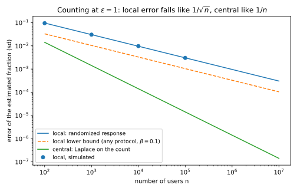
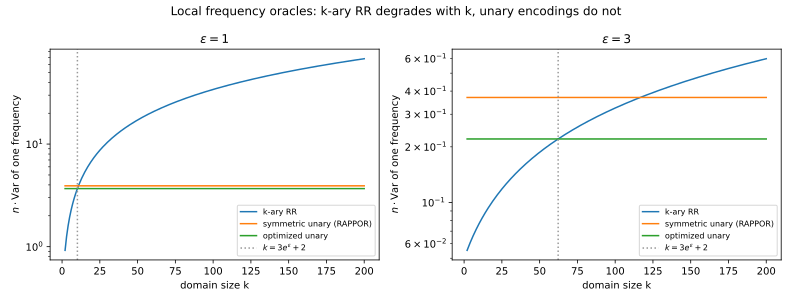
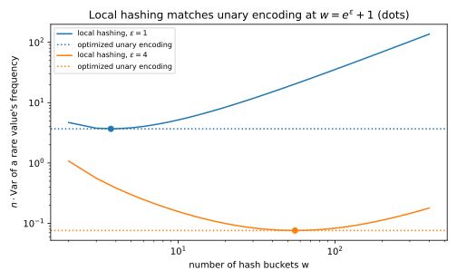
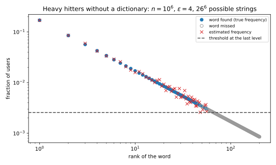
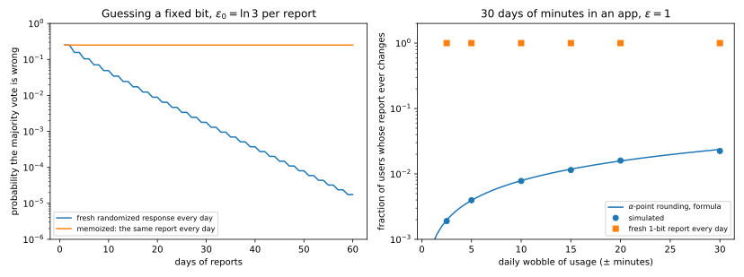
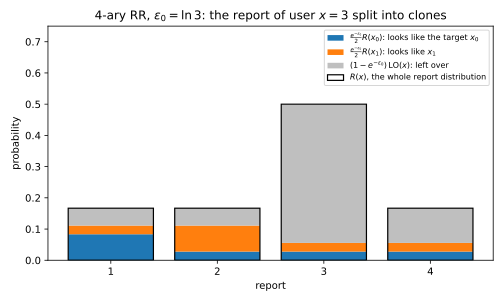
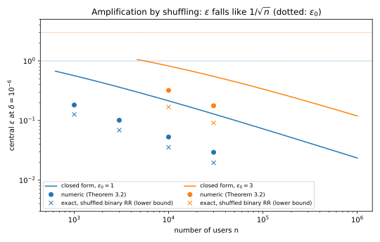
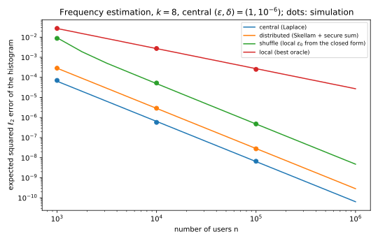

# Local, shuffle and distributed trust models

Every mechanism so far in this part assumed a **trusted curator**, who holds the raw data, runs the mechanism and releases only its output. The guarantee of differential privacy (DP) is about that output. It says nothing about the curator's database, the engineer who can read it or the court order that can demand it. As [Threat models](../part02-attacks/01-threat-models.md) put it, trust decides who the adversary is. A browser vendor collecting usage statistics is exactly the party its users do not want to see their data.

This chapter asks how much accuracy each weaker trust assumption costs, and what you trust instead. There are four answers (@fig-trust-models). In the **central** model the curator is trusted, and the noise is added once, to the answer. In the **local** model nobody is trusted, and each person randomizes their own record before it leaves their device. In the **shuffle** model a shuffler is trusted only to unlink reports from senders. In the **distributed** model cryptography is trusted, and each person adds a share of the noise to a sum that a protocol reveals only in total.

What separates the models is where the noise enters. The further upstream it enters, the fewer parties you trust and the more noise reaches the answer, because $n$ independent noises of one size add up to about $\sqrt n$ times that size. The running example is the telemetry of an app, starting with one yes/no question put to $n = 10{,}000$ users, of whom 3,000 hold a 1. At $\varepsilon = \ln 3$, a trusted curator answers with standard deviation 1.287 on the count, while randomized response on every device has 86.6. The chapter proves that no local protocol avoids that factor of 67.3, and shows how shuffling and distributed noise win the accuracy back.

| Symbol | Meaning |
| --- | --- |
| $\varepsilon_0$; $(\varepsilon, \delta)$ | the local level of one report; the central guarantee |
| $R$, $p_R(y \mid x)$ | a local randomizer, and the probability that it reports $y$ on the record $x$ |
| $p$, $q$ | the probabilities that a report supports a value its sender holds, or does not hold ($q$ is not a sampling rate here) |
| $k$, $f_v$, $C_v$ | the domain size, the frequency of value $v$, the number of reports that support $v$ |
| $w$, $m$ | the number of hash buckets; the bound on a numeric value |
| $T$, $b_0$, $b_m$, $\alpha$ | the number of rounds; the kept bits and secret offset of α-point rounding |

: The symbols of this chapter. {#tbl-trust-symbols}

{#fig-trust-models}

## Central and local differential privacy {#sec-trust-local}

In the **local model** there is no curator, and each person sends only a randomized version of their own record. This section asks what such a randomizer promises, to whom, and what it costs on the simplest task, counting one bit.

A report must look about the same whatever its owner's record is, because whoever receives it may know whose it is. So the requirement is the DP definition applied to a dataset of one record. In every model of this chapter, $D \sim D'$ means that the datasets differ by **replacing** one record. Each report arrives from a known device, so whether a person took part is visible anyway, and only their value can be hidden.

::: {#def-trust-local name="Local randomizer"}
Let $\mathcal X$ be the domain of one record and $\mathcal Y$ a set of reports. A randomizer $R\colon \mathcal X \to \mathcal Y$ is an **$\varepsilon_0$-DP local randomizer** if for every pair of records $x, x' \in \mathcal X$ and every event $S \subseteq \mathcal Y$,
$$\Pr[R(x) \in S] \le e^{\varepsilon_0}\Pr[R(x') \in S].$$ {#eq-trust-ldp}
Write $p_R(y \mid x)$ for the probability that $R$ reports $y$ on $x$. The **local protocol** releases $(R(x_1), \dots, R(x_n))$, with independent randomness for each person.
:::

Replacing one record changes only one report, so the transcript should be exactly as private as one report.

::: {#prp-trust-protocol name="What a local protocol promises"}
If $R$ is an $\varepsilon_0$-DP local randomizer, the transcript of the local protocol is $\varepsilon_0$-DP under replace neighbours, and each report is $\varepsilon_0$-DP against anyone who sees it, including its collector.
:::

::: {.proof}
1. *The transcript factorizes.* The randomness is independent, so a transcript has probability $\prod_i p_R(y_i \mid x_i)$.
2. *Neighbours differ in one factor.* If $D$ and $D'$ differ in record $j$, the other factors cancel in the ratio, which leaves $p_R(y_j \mid x_j)/p_R(y_j \mid x'_j) \le e^{\varepsilon_0}$ by @eq-trust-ldp. Single outcomes extend to events by addition, as for [randomized response](01-definition.md#sec-dpdef-rr).
3. *Who sees it does not matter.* @eq-trust-ldp is about the distribution of one report, so it holds for every observer, and any estimate computed from the reports is covered by [post-processing](02-properties.md#sec-dpprop-post).
:::

So a breach of the collector, an insider or a subpoena reveals only reports that are already private. That is why Google's RAPPOR in Chrome, Apple's telemetry and Microsoft's telemetry in Windows used local DP. But each report must hide its owner from everyone, so each carries the noise that the central mechanism adds once in total. @tbl-trust-who compares the four models, and the sections below derive its last column.

| Model | Who must be trusted | What the untrusted party sees | Error of a count, $\varepsilon$ fixed |
| --- | --- | --- | --- |
| Central | The curator, with all raw records | $M(D)$ | Order $1/\varepsilon$ |
| Local | Nobody | Every report $R(x_i)$ | Order $\sqrt n/\varepsilon$ |
| Shuffle | The shuffler, to unlink reports | The multiset of reports | Order $\sqrt{\ln(1/\delta)}/\varepsilon$ |
| Distributed | Cryptography, and enough honest clients | The noisy sum | Order $\sqrt{\ln(1/\delta)}/\varepsilon$ |

: The four trust models and the order of the error of a count. {#tbl-trust-who}

Every local estimator in this chapter is built the same way. A randomizer shrinks the signal, so the mean of a report moves less than the true value does, and the next lemma undoes the shrinking and says what that costs.

::: {#lem-trust-debias name="Debiasing a linear randomizer"}
Suppose a report $Y$ has mean $\mathbb E[Y] = c_0 + c_1\vartheta$ for an unknown quantity $\vartheta$, a known offset $c_0$ and a known slope $c_1 \ne 0$. Then
$$\hat\vartheta = \frac{Y - c_0}{c_1}$$
is unbiased for $\vartheta$, with $\operatorname{Var}(\hat\vartheta) = \operatorname{Var}(Y)/c_1^2$.
:::

::: {.proof}
1. Linearity of expectation gives $\mathbb E[\hat\vartheta] = (c_0 + c_1\vartheta - c_0)/c_1 = \vartheta$.
2. Subtracting a constant leaves a variance unchanged, and scaling by $1/c_1$ multiplies it by $1/c_1^2$.
:::

A strongly private randomizer has a small slope, so the estimator multiplies the noise variance by a large $1/c_1^2$. That is where the cost of local privacy comes from. The variances below also use the fact from [Distributions](../part01-prerequisites/01-distributions.md#sec-dist-moments) that variances of independent reports add. A 0/1 report has variance equal to its probability of a 1 times its probability of a 0.

The simplest local randomizer is **randomized response** from [the definition of differential privacy](01-definition.md#sec-dpdef-rr). It reports the true bit with probability $t = e^{\varepsilon_0}/(1 + e^{\varepsilon_0})$ and the flipped bit otherwise, so its two rows differ by the factor $t/(1 - t) = e^{\varepsilon_0}$.

::: {#prp-trust-rr name="Randomized response on a fraction"}
Let a fraction $\pi$ of $n$ people hold a 1, and let each report their bit by randomized response at level $\varepsilon_0$. With $\bar y$ the mean of the reports, the estimate
$$\hat\pi = \frac{\bar y - (1 - t)}{2t - 1}$$
is unbiased for $\pi$, and for every dataset
$$\operatorname{sd}(\hat\pi) = \frac{e^{\varepsilon_0/2}}{(e^{\varepsilon_0} - 1)\sqrt n}.$$ {#eq-trust-rr-sd}
:::

::: {.proof}
1. *The mean.* A holder of a 1 reports a 1 with probability $t$, and a holder of a 0 with probability $1 - t$. So the reports have mean $(1 - t) + \pi(2t - 1)$, and @lem-trust-debias gives the estimate.
2. *The variance.* Every report has variance $t(1 - t)$ whatever its bit, so the mean of $n$ reports has variance $t(1 - t)/n$, and the debiasing divides it by $(2t - 1)^2$.
3. *In terms of $\varepsilon_0$.* Substituting $t$ gives $t(1 - t) = e^{\varepsilon_0}/(1 + e^{\varepsilon_0})^2$ and $2t - 1 = (e^{\varepsilon_0} - 1)/(e^{\varepsilon_0} + 1)$, and the factors $(1 + e^{\varepsilon_0})^2$ cancel.
:::

::: {#exm-trust-survey}
Of the app's $n = 10{,}000$ users, 3,000 hold a 1, and each uses randomized response at $\varepsilon_0 = \ln 3$, so $t = 0.75$. There $e^{\varepsilon_0}/(e^{\varepsilon_0} - 1)^2 = 3/4$, so @eq-trust-rr-sd gives a standard deviation of $\sqrt{0.75/10{,}000} = 0.00866$, and 20,000 simulated surveys give a mean of 0.3000 and a standard deviation of 0.00861. On the count, that is $10{,}000 \times 0.00866 = 86.6$ people.

A trusted curator would add Laplace noise to the count instead. One person moves the count by at most 1, so by @thm-lg-laplace the noise at the same level $\varepsilon = \ln 3 = 1.0986$ has standard deviation $\sqrt2/\varepsilon = 1.287$. The local survey is $86.6/1.287 = 67.3$ times noisier.
:::

## The price of local privacy {#sec-trust-gap}

Is the factor 67 a weakness of randomized response, or of the local model? This section shows that it is the model. No local protocol estimates a fraction with error below order $1/((e^{\varepsilon_0} - 1)\sqrt n)$, while the central Laplace mechanism reaches order $1/(n\varepsilon)$. The shuffle and distributed models exist to escape this gap.

The proof measures what the reports reveal with the **Kullback–Leibler (KL) divergence** of [Divergences](../part01-prerequisites/03-divergences.md#sec-div-kl), $D_{\mathrm{KL}}(Q_0\|Q_1) = \sum_y q_0(y)\ln\frac{q_0(y)}{q_1(y)}$, which adds over independent observations. The proof compares two populations by their **total variation (TV) distance** $\mathrm{TV}(P_0, P_1) = \frac12\sum_x|P_0(x) - P_1(x)|$. The key step is that a randomizer changes each report's probability by at most a factor $e^{\varepsilon_0}$, so the reports of two populations differ only a little, however different the populations are.

::: {#lem-trust-kl-contraction name="A local randomizer contracts KL divergence"}
Let each record be drawn from $P_0$ or $P_1$ on a finite domain, and let $R$ be an $\varepsilon_0$-DP local randomizer. Write $Q_0$ and $Q_1$ for the distributions of one report, $q_j(y) = \sum_xP_j(x)\,p_R(y \mid x)$. Then
$$D_{\mathrm{KL}}(Q_0\|Q_1) \le (e^{\varepsilon_0} - 1)^2\,\mathrm{TV}(P_0, P_1)^2.$$ {#eq-trust-kl-contraction}
:::

::: {.proof}
The plan is to bound $q_0(y) - q_1(y)$ by a multiple of $q_1(y)$ for each report $y$, then turn that into a bound on KL with $\ln u \le u - 1$.

1. *A band.* Let $\underline p(y) = \min_xp_R(y \mid x)$. By @eq-trust-ldp, $g(x) = p_R(y \mid x) - \underline p(y)$ lies in $[0, G]$ with $G = (e^{\varepsilon_0} - 1)\underline p(y)$.
2. *Only the difference matters.* The differences $P_0(x) - P_1(x)$ sum to 0, so subtracting the floor $\underline p(y)$, which does not depend on $x$, changes nothing:
$$q_0(y) - q_1(y) = \sum_x\big(P_0(x) - P_1(x)\big)\,g(x).$$
3. *Bound the sum.* The differences sum to 0, so the positive ones and the negative ones each total $\mathrm{TV}(P_0, P_1)$. With $g$ between 0 and $G$, the sum lies within $\pm\mathrm{TV}\cdot G$. Also $q_1(y)$ is an average of numbers that are each at least $\underline p(y)$, so $\underline p(y) \le q_1(y)$ and
$$|q_0(y) - q_1(y)| \le (e^{\varepsilon_0} - 1)\,\mathrm{TV}(P_0, P_1)\,q_1(y).$$
4. *To KL.* The concave curve $\ln u$ lies below its tangent $u - 1$ at $u = 1$. Applied to $u = q_0(y)/q_1(y)$,
$$D_{\mathrm{KL}}(Q_0\|Q_1) \le \sum_yq_0\Big(\frac{q_0}{q_1} - 1\Big).$$
5. *Complete the square.* Since $\sum_y q_0 = \sum_y q_1 = 1$, the right side equals $\sum_y(q_0 - q_1)^2/q_1$. Squaring step 3 and summing bounds it by $(e^{\varepsilon_0} - 1)^2\,\mathrm{TV}^2\sum_yq_1$, and the last sum is 1.
:::

The lower bound below turns little information into large error. Its last step needs a second lemma, that a good estimator is a good test. By [Hypothesis testing](../part01-prerequisites/04-hypothesis-testing.md#sec-ht-tv), every test between two distributions has error rates summing to at least $1 - \mathrm{TV}$.

::: {#lem-trust-test name="A test built from an estimator"}
Suppose an estimator $\hat\vartheta$ is within $a/2$ of the truth with probability at least $1 - \beta$, both when the truth is $\vartheta_0$ and when it is $\vartheta_0 + a$. Then the two distributions of the data have TV distance at least $1 - 2\beta$.
:::

::: {.proof}
1. Decide $\vartheta_0 + a$ when $\hat\vartheta > \vartheta_0 + a/2$, the midpoint.
2. The test errs only when the estimate misses the truth by at least $a/2$, which has probability at most $\beta$ under each value.
3. Every test has error rates summing to at least $1 - \mathrm{TV}$, so $1 - \mathrm{TV} \le 2\beta$.
:::

The theorem compares two populations whose fractions differ by a small gap $a$. Their reports are too alike to tell apart, so no estimator is accurate to half the gap under both.

::: {#thm-trust-lower name="The local lower bound for a fraction"}
Let each of $n$ people apply an $\varepsilon_0$-DP local randomizer, possibly different per person, to a bit drawn from $\mathrm{Bern}(\frac12)$ or from $\mathrm{Bern}(\frac12 + a)$. No estimator built from the reports is within $a/2$ of the true fraction with probability at least $1 - \beta$ under both unless
$$\frac a2 \ge \frac{1 - 2\beta}{(e^{\varepsilon_0} - 1)\sqrt{2n}}.$$ {#eq-trust-lower}
:::

::: {.proof}
1. *Add over people.* The reports are independent, so KL adds over people. The two populations have TV distance $a$, so by @lem-trust-kl-contraction the $n$ reports have KL at most $n(e^{\varepsilon_0} - 1)^2a^2$.
2. *Convert to TV.* TV does not add over people, which is why the proof went through KL. **Pinsker's inequality** ([Divergences](../part01-prerequisites/03-divergences.md#sec-div-pinsker)) says $\mathrm{TV} \le \sqrt{D_{\mathrm{KL}}/2}$, so for the distributions $Q_0^n, Q_1^n$ of all $n$ reports
$$\mathrm{TV}(Q_0^n, Q_1^n) \le a(e^{\varepsilon_0} - 1)\sqrt{n/2}.$$
3. *Turn information into error.* @lem-trust-test forces this TV to be at least $1 - 2\beta$, so $a \ge (1 - 2\beta)\sqrt2/((e^{\varepsilon_0} - 1)\sqrt n)$, and halving gives @eq-trust-lower.
:::

Randomized response is optimal up to a constant, since dividing @eq-trust-rr-sd by @eq-trust-lower leaves $\sqrt2\,e^{\varepsilon_0/2}/(1 - 2\beta)$. The contraction is loose by a constant. For one report at $\varepsilon_0 = 1$, comparing $\mathrm{Bern}(0.5)$ with $\mathrm{Bern}(0.6)$, the exact KL is 0.00429 and @eq-trust-kl-contraction gives 0.02952. Duchi, Jordan & Wainwright (2018) apply the contraction to many local problems. Bounds of the same order hold even when each randomizer may depend on earlier reports.

::: {#exm-trust-gap}
At $\varepsilon = 1$ and $n = 1{,}000$ (@fig-trust-rr-gap), randomized response has standard deviation $3.03\times10^{-2}$ and the lower bound at $\beta = 0.1$ is $1.04\times10^{-2}$. Their ratio 2.91 is the constant $\sqrt2\,e^{1/2}/(1 - 2\beta) = 1.4142 \times 1.6487/0.8$. The central Laplace mechanism gives $\sqrt2/1000 = 1.41\times10^{-3}$, 21 times less. That ratio, $e^{1/2}/((e - 1)\sqrt n)$ divided by $\sqrt2/n$, is $0.678\sqrt n$, so it is 215 at $n = 100{,}000$ and 2146 at $n = 10^7$. For a standard deviation of 0.001, randomized response needs 920,674 people and the central mechanism 1,415. So local DP suits only the frequent items of very large populations.
:::

{#fig-trust-rr-gap}

## Frequency estimation {#sec-trust-frequency}

In **frequency estimation** each person holds one of $k$ values, such as an emoji, and the analyst wants the fraction $f_v$ holding each value $v$. It is the workhorse of deployed local DP. This section compares two generalizations of randomized response, which behave very differently as $k$ grows.

Both fit one template. For each value $v$, a report either **supports** $v$ or not, and it supports $v$ more often when its sender holds $v$, so @lem-trust-debias unshrinks the count of supports.

::: {#prp-trust-oracle name="A pure frequency oracle"}
Suppose that for each value $v$ a report supports $v$ with probability $p$ when its sender holds $v$ and $q < p$ otherwise, independently across people. Let $C_v$ count the reports that support $v$. Then the estimate $\hat f_v$ below is unbiased, with the exact variance shown:
$$\hat f_v = \frac{C_v/n - q}{p - q}, \qquad \operatorname{Var}(\hat f_v) = \frac{f_vp(1-p) + (1 - f_v)q(1-q)}{n(p - q)^2}.$$ {#eq-trust-oracle}
:::

::: {.proof}
1. *Unbiased.* The holders support $v$ with probability $p$ and the others with $q$, so $\mathbb E[C_v/n] = q + f_v(p - q)$, and @lem-trust-debias applies.
2. *Variance.* The independent supports have variances $p(1-p)$ and $q(1-q)$, which add. Dividing by $n^2$ for the mean and by $(p - q)^2$ for the debiasing gives @eq-trust-oracle.
:::

What decides utility is the variance at $f_v = 0$. Most values of a large domain are rare, and below this noise floor a value cannot be told from an absent one.

::: {#prp-trust-schemes name="k-ary randomized response and unary encoding"}
**$k$-ary randomized response** reports the true value with probability $p = \frac{e^{\varepsilon_0}}{e^{\varepsilon_0} + k - 1}$ and each other value with probability $q = \frac{1}{e^{\varepsilon_0} + k - 1}$, and a report supports the value it names. It is an $\varepsilon_0$-DP local randomizer, with rare-value variance
$$\frac{e^{\varepsilon_0} + k - 2}{n(e^{\varepsilon_0} - 1)^2}.$$
**Unary encoding** writes the value as $k$ bits with only bit $v$ set, sends each 1 as 1 with probability $p$ and each 0 as 1 with probability $q$, and supports $v$ if bit $v$ is sent as 1. It is an $\varepsilon_0$-DP local randomizer with
$$\varepsilon_0 = \ln\frac{p(1 - q)}{q(1 - p)}.$$
The **symmetric** choice $q = 1 - p$, which is basic one-shot RAPPOR, has rare-value variance $e^{\varepsilon_0/2}/(n(e^{\varepsilon_0/2} - 1)^2)$. The **optimized** choice $p = \frac12$, $q = 1/(e^{\varepsilon_0} + 1)$ (Wang et al. 2017) has $4e^{\varepsilon_0}/(n(e^{\varepsilon_0} - 1)^2)$. $k$-ary randomized response beats optimized unary encoding exactly when $k < 3e^{\varepsilon_0} + 2$.
:::

::: {.proof}
The plan is to check both privacy levels, then put each scheme's $p$ and $q$ into @eq-trust-oracle at $f_v = 0$.

1. *$k$-ary randomized response.* A report has probability $p$ under the record it names and $q$ under any other, so two records differ by at most $p/q = e^{\varepsilon_0}$.
2. *Unary encoding.* Changing $x$ to $x'$ changes two bits, and the others cancel. Bit $x$ contributes $p/q$ or $(1-p)/(1-q)$, and bit $x'$ contributes $q/p$ or $(1-q)/(1-p)$. Since $p > q$, the largest product is $\frac pq\cdot\frac{1-q}{1-p}$, so the two bits together cost $\varepsilon_0$, not $2\varepsilon_0$.
3. *Rare-value variances.* At $f_v = 0$, @eq-trust-oracle is $q(1-q)/(n(p - q)^2)$. For $k$-ary randomized response the factors $(e^{\varepsilon_0} + k - 1)^2$ cancel. For the optimized choice, $p - q = (e^{\varepsilon_0} - 1)/(2(e^{\varepsilon_0} + 1))$, and the squared 2 leaves the 4. The symmetric choice is binary randomized response at $\varepsilon_0/2$ per bit, so @prp-trust-rr gives its variance.
4. *Crossover.* The two variances share a denominator, so compare $e^{\varepsilon_0} + k - 2$ with $4e^{\varepsilon_0}$.
:::

$k$-ary randomized response reports the truth with probability about $e^{\varepsilon_0}/k$, so its variance grows linearly in $k$ (@fig-trust-frequency-oracles). Unary encoding pays $\varepsilon_0$ once for two bits, so its variance does not depend on $k$, at the price of a $k$-bit report. The optimized choice rarely invents a 1, which matters because almost all bits are 0. Every entry of @tbl-trust-oracles is still divided by $n$, so the gap of @thm-trust-lower remains.

| $k$ | $k$-ary randomized response | Symmetric unary | Optimized unary |
| --- | --- | --- | --- |
| 2 | 0.921 | 3.918 | 3.683 |
| 8 | 2.953 | 3.918 | 3.683 |
| 32 | 11.082 | 3.918 | 3.683 |
| 128 | 43.596 | 3.918 | 3.683 |

: $n$ times the rare-value variance at $\varepsilon_0 = 1$. $k$-ary randomized response wins below $k = 3e + 2 = 10.15$. {#tbl-trust-oracles}

{#fig-trust-frequency-oracles}

::: {#exm-trust-emoji}
The app's keyboard wants the frequency of each of $k = 128$ emoji at $\varepsilon_0 = 1$ from $n = 10^6$ users. $k$-ary randomized response gives a rare emoji a standard deviation of $\sqrt{43.596/10^6} = 0.0066$, and optimized unary encoding gives $\sqrt{3.683/10^6} = 0.0019$. An estimate must stand about three standard deviations above 0, so even with optimized unary encoding, emoji used by fewer than about 0.6% of users are lost. With $k = 8$, below the crossover, $k$-ary randomized response is better, at $\sqrt{2.953/10^6} = 0.0017$.
:::

## Large and unknown domains {#sec-trust-heavy}

A unary report carries one bit per possible value, which is absurd for all web addresses. And an oracle answers only for values the analyst names in advance, while a keyboard app wants words nobody listed. This section removes both limits. Hashing makes reports short, and growing prefixes finds the frequent values without a dictionary, the **heavy hitters** problem.

In **local hashing** each person draws a hash function $h$ from a public family that maps the domain to $w$ buckets, so that two values collide with probability $1/w$. They send the index of $h$ and a $w$-ary randomized response of $h(x)$, with the $p$ and $q$ of @prp-trust-schemes at $w$ in place of $k$. A report supports $v$ if its bucket equals $h(v)$.

::: {#prp-trust-lh name="Local hashing"}
Let $\hat g_v$ be the estimate of @eq-trust-oracle applied to the supports of $v$, which estimates the share of people whose own bucket is $h(v)$. Then the estimate below is unbiased for $f_v$, with the stated variance at $f_v = 0$:
$$\hat f_v = \frac{w\,\hat g_v - 1}{w - 1}, \qquad \operatorname{Var}(\hat f_v)\big|_{f_v = 0} = \frac{(e^{\varepsilon_0} + w - 1)^2}{n\,(w - 1)\,(e^{\varepsilon_0} - 1)^2}.$$ {#eq-trust-lh}
It is smallest at $w = e^{\varepsilon_0} + 1$, where it equals optimized unary encoding's $4e^{\varepsilon_0}/(n(e^{\varepsilon_0} - 1)^2)$.
:::

::: {.proof}
The plan is to undo two shrinkings with @lem-trust-debias, the randomized response and then the collisions, and then to minimize the rare-value variance.

1. *The own bucket.* A holder of $v$ lands in $h(v)$, and anyone else does with probability $1/w$. So a person's bucket is $h(v)$ with probability $g_v = \frac1w + f_v\frac{w - 1}{w}$.
2. *The randomized response.* A report equals $h(v)$ with probability $p$ if the bucket is $h(v)$ and $q$ otherwise, so @lem-trust-debias makes $\hat g_v$ unbiased for $g_v$.
3. *The collisions.* Step 1 has offset $1/w$ and slope $(w - 1)/w$, so @lem-trust-debias gives $\hat f_v$, with $(w/(w - 1))^2$ times the variance of $\hat g_v$.
4. *A rare value.* At $f_v = 0$ a report supports $v$ with probability exactly $1/w$, so each support has variance $(w - 1)/w^2$. Dividing by $n$ and $(p - q)^2$ and multiplying by $w^2/(w - 1)^2$ leaves $1/(n(w - 1)(p - q)^2)$, and $p - q = (e^{\varepsilon_0} - 1)/(e^{\varepsilon_0} + w - 1)$.
5. *The best width.* With $u = w - 1$, the part that depends on $w$ is $e^{2\varepsilon_0}/u + 2e^{\varepsilon_0} + u$. Two positive terms with a fixed product have the smallest sum when equal, at $u = e^{\varepsilon_0}$.
:::

Too few buckets waste the signal on collisions, and too many spread it thin (@fig-trust-local-hashing). At $\varepsilon_0 = 4$, with $w = 56$, a report needs about 6 bits. The price is the server's work, which Hadamard response (Acharya, Sun & Zhang 2019) makes fast at a constant factor in variance.

{#fig-trust-local-hashing}

To find unlisted values, write each as a string of $L$ symbols from an alphabet of $A$ symbols, and split the people at random into $L$ groups. Group $\ell$ reports its first $\ell$ symbols, its **prefix**, by local hashing. The analyst keeps the prefixes whose estimate passes a threshold, extends each by every symbol, and moves to the next group. Write $s$ for the standard deviation of an absent value's estimate, and $\Phi$ for the standard normal distribution function.

::: {#prp-trust-prefix name="Heavy hitters by growing prefixes"}
If $c_\ell$ candidates are tested at level $\ell$, then under the normal approximation the threshold
$$\tau_\ell = z_\ell\,s, \qquad\text{where}\quad c_\ell\,\big(1 - \Phi(z_\ell)\big) = \beta,$$ {#eq-trust-threshold}
admits on average $\beta$ false candidates. Every prefix of a string is at least as frequent as the string, and each level tests only $A$ extensions of each kept prefix.
:::

::: {.proof}
1. *The threshold.* An absent value's estimate averages many independent reports, so it is close to normal with mean 0, and exceeds $z\,s$ with probability about $1 - \Phi(z)$. Linearity of expectation sums this over the $c_\ell$ candidates.
2. *Prefixes.* Each holder of a string holds all its prefixes, so a prefix is at least as frequent as every string that starts with it.
:::

The search is the TreeHist protocol of Bassily et al. (2017), and Bassily & Smith (2015) show that no local protocol finds values rarer than order $\sqrt{\ln k/n}/\varepsilon_0$.

::: {#exm-trust-words}
A million users each type one of 200 six-letter words with Zipf frequencies, at $\varepsilon_0 = 4$. The domain has $26^6 = 308{,}915{,}776$ strings. Local hashing uses $w = 56$, the integer nearest $e^4 + 1 = 55.60$, from 16,384 hash functions, so that collisions average out. Each of the six levels sees about 166,666 people, giving $s = 6.75\times10^{-4}$, and no level tests more than 2,054 candidates. At the last level, $\beta = 0.1$ puts the threshold at 3.80 standard deviations, a frequency of 0.0026.

The search returns 50 strings, all real words (@fig-trust-heavy-hitters). The rarest word found has frequency 0.0033, and the most frequent word missed has 0.0035, lost to noise at one level. Testing all $26^6$ strings would need 6.18 standard deviations, and at 3.80 it would raise about 22,418 false alarms.
:::

{#fig-trust-heavy-hitters}

## Estimating a mean {#sec-trust-mean}

Telemetry also collects numbers, such as minutes in the app. Each person holds $x_i$ between 0 and a known bound $m$, and the analyst wants the mean $\mu = \frac1n\sum_ix_i$. The questions are how accurate a local mean can be, and how few bits each phone must send.

Adding Laplace noise to each value is the obvious randomizer. Ding, Kulkarni & Yekhanin (2017) send one bit instead, whose probability of a 1 rises linearly from randomized response's lie probability at $x = 0$ to its truth probability at $x = m$.

::: {#prp-trust-onebit name="Local means"}
Reports $x_i + \mathrm{Lap}(m/\varepsilon_0)$ are $\varepsilon_0$-DP, and their average is unbiased with standard deviation $\sqrt2\,m/(\varepsilon_0\sqrt n)$. A bit $Y_i$ with
$$\Pr[Y_i = 1] = \frac{1}{e^{\varepsilon_0} + 1} + \frac{x_i}{m}\cdot\frac{e^{\varepsilon_0} - 1}{e^{\varepsilon_0} + 1}$$ {#eq-trust-onebit}
is also $\varepsilon_0$-DP, and the estimate below is unbiased with the stated bound for all data:
$$\hat\mu = \frac mn\sum_{i=1}^n\frac{(e^{\varepsilon_0} + 1)Y_i - 1}{e^{\varepsilon_0} - 1}, \qquad \operatorname{sd}(\hat\mu) \le \frac{m}{2\sqrt n}\cdot\frac{e^{\varepsilon_0} + 1}{e^{\varepsilon_0} - 1}.$$ {#eq-trust-onebit-sd}
:::

::: {.proof}
The plan is to handle the Laplace reports in one step, then show that the bit is private, unbiased and of bounded variance.

1. *Laplace reports.* One value moves by at most $m$, so @thm-lg-laplace applies, and the average of $n$ variances $2m^2/\varepsilon_0^2$ has variance $2m^2/(n\varepsilon_0^2)$.
2. *Private.* For every value, both outcome probabilities of the bit lie between $1/(e^{\varepsilon_0} + 1)$ and $e^{\varepsilon_0}/(e^{\varepsilon_0} + 1)$, whose ratio is $e^{\varepsilon_0}$.
3. *Unbiased.* The mean of $Y_i$ is linear in $x_i$, so @lem-trust-debias makes each summand of $\hat\mu$ unbiased for $x_i$.
4. *Variance.* A 0/1 variable has variance at most $1/4$, the summand scales it by $(m(e^{\varepsilon_0} + 1)/(e^{\varepsilon_0} - 1))^2$, and the average divides by $n$.
:::

Both errors are of order $m/(\varepsilon_0\sqrt n)$, against $m/(\varepsilon_0n)$ centrally, and Duchi, Jordan & Wainwright (2018) show that no local protocol beats this order. The bit wins on communication, since a Laplace report needs about $\log_2 m$ bits. Its bound is 0.765 times the Laplace standard deviation at $\varepsilon_0 = 1$, and the two are equal at $\varepsilon_0 = 2.324$.

The bound $m$ must be fixed before collection, because every randomizer uses it. A device whose value exceeds $m$ clips it, which biases the mean down, so a bound set too low trades noise for bias.

::: {#exm-trust-minutes}
A million users spend between 0 and $m = 1{,}440$ minutes a day in the app, with a mean of 82.74. At $\varepsilon_0 = 1$ the one-bit estimate has standard deviation 1.420 minutes, within the bound 1.558 of @eq-trust-onebit-sd. In 200 simulated collections the estimates average 82.61, with standard deviation 1.415. Laplace reports would give 2.036 minutes, at about 11 bits each.
:::

## Collecting every day {#sec-trust-repeated}

Telemetry asks the same question every day, and basic composition ([Post-processing, group privacy and composition](02-properties.md#sec-dpprop-comp)) prices $T$ reports of one record at $T\varepsilon_0$. This section shows that the price is real, then gives the two fixes deployments use, **memoization** and **α-point rounding**.

::: {#prp-trust-fresh name="Fresh reports leak"}
Suppose a person reports the same bit every day by randomized response at level $\varepsilon_0$, with fresh randomness. After $T$ days with $k$ ones, the likelihood ratio between bit 1 and bit 0 is $e^{\varepsilon_0(2k - T)}$, and the majority of the reports is wrong with a probability that falls exponentially in $T$.
:::

::: {.proof}
1. *The ratio.* A sequence with $k$ ones has probability $t^k(1 - t)^{T - k}$ under bit 1 and $(1 - t)^kt^{T - k}$ under bit 0, and $t/(1 - t) = e^{\varepsilon_0}$.
2. *The majority.* It errs when more than half the reports flip, a binomial tail with flip probability below $\frac12$, which falls exponentially by the Chernoff bound of [Concentration inequalities](../part01-prerequisites/02-concentration.md).
:::

The fix is to randomize once. In memoization the person draws one permanent randomized response per value and reuses it. RAPPOR encodes the value as a **Bloom filter**, a bit vector in which $H$ hash functions each set one bit, and the permanent response replaces each bit by a fair coin with probability $\phi$.

::: {#prp-trust-memo name="Memoization"}
All reports of an unchanged value, however many, are together as private as its permanent response. For RAPPOR that level, written $\varepsilon_\infty$ because it covers unboundedly many reports, is
$$\varepsilon_\infty = 2H\ln\frac{1 - \phi/2}{\phi/2}.$$ {#eq-trust-rappor}
:::

::: {.proof}
1. *Post-processing.* The reports are a function of the permanent response and of randomness independent of the data.
2. *RAPPOR.* A 1 is reported as 1 with probability $1 - \phi/2$ and a 0 with probability $\phi/2$. Two values' filters differ in at most $2H$ bits, and the others cancel.
:::

Each new value costs another $\varepsilon_\infty$. RAPPOR's homepage collection used $H = 2$ and $\phi = 0.75$, giving $\varepsilon_\infty = 4\ln(5/3) = 2.043$. A fixed response would let the collector link a sender's reports across days, like a cookie, so RAPPOR re-randomizes it before each report, and with the deployment's re-randomization probabilities one report is then $\varepsilon_1$-DP with $\varepsilon_1 = 0.5343$.

A value that drifts, such as minutes, would need a new response every day. Ding, Kulkarni & Yekhanin (2017) instead draw, once, a bit $b_0$ by @eq-trust-onebit at $x = 0$, a bit $b_m$ at $x = m$ and an offset $\alpha$ uniform on $[0, m)$. In round $t$ the person sends $b_m$ if $x_t + \alpha \ge m$ and $b_0$ otherwise, so that the random offset picks $b_m$ with probability $x_t/m$. **Output perturbation** then flips each sent bit with a small probability $\kappa$, to blur the days on which the sent bit switches.

::: {#prp-trust-alpha name="α-point rounding"}
With values in $[0, m]$, and $b_0$, $b_m$ and $\alpha$ drawn once, independently of the data:

1. Each report has the distribution of @eq-trust-onebit, so each round's $\hat\mu$ satisfies @eq-trust-onebit-sd.
2. The reports depend on the data only through the days with $x_t + \alpha \ge m$, and with probability $2e^{\varepsilon_0}/(e^{\varepsilon_0} + 1)^2$ the kept bits agree, so every report is the same.
3. Values that stay in a band of width $d$ change the report only if $m - \alpha$ falls in the band, which has probability $d/m$.
4. With output perturbation one round is $\varepsilon_0'$-DP, with
$$\varepsilon_0' = \ln\frac{(1 - 2\kappa)\frac{e^{\varepsilon_0}}{e^{\varepsilon_0} + 1} + \kappa}{(1 - 2\kappa)\frac{1}{e^{\varepsilon_0} + 1} + \kappa},$$ {#eq-trust-op}
and if, for every offset, two sequences of values select different kept bits on at most $r$ days, their transcripts have likelihood ratio at most $((1 - \kappa)/\kappa)^r$.
:::

::: {.proof}
The plan is to average over the offset for item 1, read items 2 and 3 off the construction, and multiply daily ratios for item 4.

1. *Unbiased.* For a value $x$, $b_m$ is sent with probability $\Pr[\alpha \ge m - x] = x/m$, so the report is 1 with probability $(1 - x/m)/(e^{\varepsilon_0} + 1) + (x/m)\,e^{\varepsilon_0}/(e^{\varepsilon_0} + 1)$.
2. *Dependence.* Each report is $b_0$ or $b_m$, chosen by $x_t + \alpha \ge m$. Both kept bits are 1 with probability $e^{\varepsilon_0}/(e^{\varepsilon_0} + 1)^2$, and both 0 with the same probability. The choice switches only if $m - \alpha$, uniform on $(0, m]$, lies in the band.
3. *One round.* The flip maps a probability $\pi$ of a 1 to $\kappa + (1 - 2\kappa)\pi$, still linear, so the worst ratio is between the ends of @eq-trust-onebit.
4. *Transcripts.* Fix the kept bits and offset. A day sending the same kept bit under both sequences cancels, and a differing day has ratio at most $(1 - \kappa)/\kappa$. The flips are independent, so the ratios multiply, for every offset.
:::

So the collector learns nothing about people whose kept bits agree, and about the others only when their value crosses a secret threshold, so the guarantee protects steady behaviour, while a person whose behaviour changes reveals roughly when. Microsoft deployed the protocol in Windows 10 at $\varepsilon_0 = 1$ every six hours with $\kappa = 0.2$, where @eq-trust-op gives 0.569 per round, while the paper reports a more conservative 0.686.

::: {#exm-trust-month}
Fresh reports at $\varepsilon_0 = \ln 3$ leak fast. After 100 days with 75 ones the likelihood ratio is $3^{50}$, about $7.18\times10^{23}$, while a memoized report leaves the majority wrong with probability $1 - t = 0.25$ (@fig-trust-repeated).

For the app's minutes, with $m = 1{,}440$ and $\varepsilon_0 = 1$, the kept bits agree with probability $2e/(e + 1)^2 = 0.3932$. Let each person's minutes wobble by up to 15 either side of their level for 30 days. By item 3, the fraction whose report ever changes is $(1 - 0.3932)$ times the expected range of their values over $m$, which is 0.0118. A simulation of 100,000 people gives 0.0119, against 1.0000 with fresh one-bit reports. On one freshly simulated day the α-point estimate is 82.17 minutes against that day's true mean of 82.68, within the standard deviation of 1.42. With $\kappa = 0.2$, each change costs $\ln(0.8/0.2) = 1.386$.
:::

{#fig-trust-repeated}

## The shuffle model {#sec-trust-shuffle}

The local model loses $\sqrt n$ because the analyst knows whose report is whose. In the **shuffle model** (Bittau et al. 2017; Cheu et al. 2019) each person sends a randomized report to a **shuffler**, which strips identifiers and forwards a random permutation. The shuffler is trusted only to unlink, since the reports it sees are $\varepsilon_0$-DP. This section asks how far the central $\varepsilon$ then falls.

Call the person whose privacy is at stake the target. The more reports the target's report is mixed with, the less the multiset reveals. The bound to compute with is Theorem 3.1 of Feldman, McMillan & Talwar (2021), in this book's notation and for replace neighbours. Its randomizers may depend on earlier outputs, which covers adaptive protocols.

::: {#thm-trust-fmt name="Amplification by shuffling"}
Let $R_i(z_{1:i-1}, \cdot)$, for $i = 1, \dots, n$, be an $\varepsilon_0$-DP local randomizer for every value of the earlier outputs $z_{1:i-1}$. Let $M_{\mathrm{sh}}$ draw a uniform random permutation $\Pi$, compute $z_i = R_i(z_{1:i-1}, x_{\Pi(i)})$ in turn and output $z_{1:n}$. For any $\delta \in [0, 1]$ with $\varepsilon_0 \le \ln\big(\frac{n}{16\ln(2/\delta)}\big)$, $M_{\mathrm{sh}}$ is $(\varepsilon, \delta)$-DP with
$$\varepsilon \le \ln\left(1 + \frac{e^{\varepsilon_0} - 1}{e^{\varepsilon_0} + 1}\left(\frac{8\sqrt{e^{\varepsilon_0}\ln(4/\delta)}}{\sqrt n} + \frac{8e^{\varepsilon_0}}{n}\right)\right).$$ {#eq-trust-fmt}
:::
<!-- proof: cited -->

The proof is in [Amplification by shuffling and by iteration](../part04-privacy-accounting/07-shuffling-iteration.md#sec-shuf-clones), which reduces the shuffled output to two binomial counts, and @sec-apx-amp-clones bounds their hockey-stick divergence. Its first step, the lemma below, carries the intuition that other people's reports can look exactly like the target's.

::: {#lem-trust-clones name="Clones"}
Let $R$ be an $\varepsilon_0$-DP local randomizer and $x^0, x^1$ the two values the target might hold. Then for every other value $x$ there is a distribution $\mathrm{LO}(x)$, the leftover, with
$$R(x) = \frac{e^{-\varepsilon_0}}{2}R(x^0) + \frac{e^{-\varepsilon_0}}{2}R(x^1) + (1 - e^{-\varepsilon_0})\,\mathrm{LO}(x).$$
:::

::: {.proof}
1. *A floor.* By @eq-trust-ldp, $p_R(y \mid x)$ is at least $e^{-\varepsilon_0}p_R(y \mid x^0)$ and at least $e^{-\varepsilon_0}p_R(y \mid x^1)$, so it is at least half their sum.
2. *The leftover.* Subtracting the two pieces leaves a non-negative mass of total $1 - e^{-\varepsilon_0}$, which rescales to $\mathrm{LO}(x)$.
:::

So with probability $e^{-\varepsilon_0}$ each other person sends a **clone**, a report distributed like one of $x^0$ or $x^1$. About $(n - 1)e^{-\varepsilon_0}$ clones, split at random between the two values, hide the target after shuffling. The theorem's condition, $ne^{-\varepsilon_0} \ge 16\ln(2/\delta)$, asks for enough expected clones.

::: {#exm-trust-clones}
For 4-ary randomized response at $\varepsilon_0 = \ln 3$ (@fig-trust-clones), $p = \frac12$ and $q = \frac16$. Take a target with $x^0 = 1$ or $x^1 = 2$. Another person with value 3 reports $(\frac16, \frac16, \frac12, \frac16)$, the clone part is $\frac16\big(R(1) + R(2)\big) = (0.1111, 0.1111, 0.0556, 0.0556)$, and the leftover has mass $0.6667 = 1 - e^{-\varepsilon_0}$.

For central $(1, 10^{-6})$, bisection on @eq-trust-fmt allows each user $\varepsilon_0 = 3.504$ at $n = 10^4$, $5.701$ at $10^5$ and $7.992$ at $10^6$. At 7.992, 8-ary randomized response keeps the truth with probability 0.998. For adding up bits as in Cheu et al. (2019), only about 676 of a million people then send a random bit, since binary randomized response at that level sends one with probability $2/(e^{\varepsilon_0} + 1)$, and the count has standard deviation 18.4, against 960 for local randomized response at $\varepsilon_0 = 1$.
:::

{#fig-trust-clones}

The factor before the bracket of @eq-trust-fmt is $\tanh(\varepsilon_0/2)$. For large $n$ the $1/n$ term is negligible and $\ln(1 + u) \approx u$, so the bound is about $8\tanh(\varepsilon_0/2)\sqrt{e^{\varepsilon_0}\ln(4/\delta)/n}$ (@fig-trust-shuffle-bound). So a target $\varepsilon$ allows $e^{\varepsilon_0}$ of order $\varepsilon^2n/\ln(1/\delta)$, and binary randomized response at that level has error about $1/\sqrt{ne^{\varepsilon_0}} = \sqrt{\ln(1/\delta)}/(\varepsilon n)$ on a fraction. Times $n$, that is the shuffle row of @tbl-trust-who. The constants are loose (@tbl-trust-shuffle). The numeric column computes the paper's clone-count comparison exactly, and the exact column is shuffled binary randomized response, below which no general bound can go. Reason with the closed form, but deploy with a numerical accountant.

| $\varepsilon_0$ | Closed form, @eq-trust-fmt | Numeric (Theorem 3.2) | Exact, shuffled binary randomized response |
| --- | --- | --- | --- |
| 0.5 | 0.0939 | 0.0204 | 0.0162 |
| 1 | 0.2140 | 0.0530 | 0.0357 |
| 2 | 0.5009 | 0.1550 | 0.0870 |
| 3 | 0.8241 | 0.3207 | 0.1692 |

: Central $\varepsilon$ after shuffling $n = 10^4$ reports at $\delta = 10^{-6}$; the condition requires $\varepsilon_0 \le 3.763$. {#tbl-trust-shuffle}

{#fig-trust-shuffle-bound}

The amplification lasts only while the shuffler does its job, because a shuffler that colludes with the analyst leaves only $\varepsilon_0$. Fake senders hide nobody, so only honest senders count in $n$.

## Distributed noise {#sec-trust-distributed}

The shuffle model still adds noise to every report. In the **distributed model** each client adds a small share of the central noise, and a **secure aggregation** protocol reveals only the sum. The question is what that costs, and what dishonest clients do to it.

Secure aggregation is built from the additive secret sharing of [Cryptography basics](../part01-prerequisites/08-crypto-basics.md), with a practical version by Bonawitz et al. (2017). The one property used is **simulation**: everything the server sees could be generated from the sum alone. The noise works because independent Gaussian shares add to a Gaussian whose variance is the sum of theirs.

::: {#prp-trust-distributed name="Distributed Gaussian noise"}
Let $n$ clients hold vectors $x_i$ whose sum $f(D)$ has $\ell_2$ sensitivity $\Delta_2 f$, and let each send $x_i + Z_i$ through secure aggregation, with independent $Z_i \sim \mathcal N(0, \frac{\sigma^2}{n}I)$. The server's view is $(\varepsilon, \delta)$-DP whenever the Gaussian mechanism with noise $\sigma$ on $f$ is. If an adversary knows the noise of $t$ clients, the guarantee is that of noise $\sigma\sqrt{(n - t)/n}$.
:::

::: {.proof}
1. *The shares add up.* Independent normals add their variances, so $\sum_iZ_i \sim \mathcal N(0, \sigma^2I)$.
2. *Only the sum is revealed.* By simulation the view is a function of the sum and independent randomness, so post-processing applies.
3. *Colluders.* Removing what they know leaves $n - t$ shares of variance $\sigma^2/n$, whose privacy is the exact curve of @thm-lg-analytic.
:::

Secure aggregation adds integers modulo a large number, because only on a finite set can shares be uniformly random. **Skellam noise** (Agarwal, Kairouz & Liu 2021) fits. $\mathrm{Sk}(\mu)$ is the difference of two independent $\mathrm{Poisson}(\mu)$ variables, with variance $2\mu$. Sums of independent Poisson variables are Poisson, because their moment generating functions multiply ([Distributions](../part01-prerequisites/01-distributions.md#sec-dist-mgf)), so $n$ shares $\mathrm{Sk}(\mu/n)$ add to exactly $\mathrm{Sk}(\mu)$. Its privacy is close to a Gaussian's of the same variance, which this chapter uses as the approximation. The distributed discrete Gaussian (Kairouz, Liu & Steinke 2021) is the alternative.

Distributed noise gives central Gaussian accuracy without a curator, as long as enough clients are honest (@fig-trust-collusion). If at most a fraction $\rho$ may collude or drop out, each client adds variance $\sigma^2/(n(1 - \rho))$, so the honest ones alone supply $\sigma^2$. Malicious inputs are another problem, since secure aggregation does not check them.

::: {#exm-trust-clients}
A server aggregates the app's histogram through 100 clients at $(\varepsilon, \delta) = (1, 10^{-6})$. A user who changes value moves one count down and another up, so $\Delta_2 f = \sqrt2$. The analytic calibration of @cor-lg-calibration gives total noise $\sigma = 5.975$, so each client adds standard deviation $5.975/\sqrt{100} = 0.597$. With 80%, 50% or 10% of the clients honest, $\varepsilon$ rises to 1.128, 1.455 or 3.525. The script also checks that 100 Skellam shares of total variance 25 sum to mean 0.004 and variance 25.15, and that sharing $(3, -2)$, $(5, 7)$ and $(0, 1)$ modulo $2^{20}$ reveals $(8, 6)$.
:::

{#fig-trust-collusion}

## Code {#sec-trust-code}

The script [code/trust_models.py](../../code/part03-dp-foundations/trust_models.py) computes every number in this chapter and draws its figures. Its central comparison estimates an 8-value histogram at $(1, 10^{-6})$ in all four models, exactly and in 200 simulated runs (@fig-trust-matched-error). From the repository root:

```bash
uv run python code/part03-dp-foundations/trust_models.py
```

| Experiment | Result |
| --- | --- |
| Randomized response, $\varepsilon = \ln 3$, $n = 10^4$ | sd 0.00866 (simulated mean 0.3000, sd 0.00861); count sd local 86.6, central 1.287, ratio 67.3 |
| Fraction sd at $\varepsilon = 1$ | $n = 10^3$: local $3.03\times10^{-2}$, central $1.41\times10^{-3}$, ratio 21, lower bound $1.04\times10^{-2}$; ratio 215 at $10^5$, 2146 at $10^7$ |
| One report, $\mathrm{Bern}(0.5)$ against $\mathrm{Bern}(0.6)$ | KL 0.00429; bound 0.02952 |
| Frequency oracles, $\varepsilon_0 = 1$ | @tbl-trust-oracles; both unary encodings have $\varepsilon_0 = 1.0000$ |
| Local hashing, best $w$ | $n\cdot\operatorname{Var}$ 3.6917 ($w = 4$) and 0.0760 ($w = 56$); optimized unary 3.6827 and 0.0760 |
| Heavy hitters, $\varepsilon_0 = 4$ | 50 found, all real; rarest 0.0033; threshold 0.0026; 22,418 false alarms if every string were tested |
| One-bit mean, $\varepsilon_0 = 1$ | sd 1.420 (bound 1.558, simulated 1.415); Laplace 2.036; equal at $\varepsilon_0 = 2.324$ |
| Repeated collection | Ratio $7.18\times10^{23}$; $\varepsilon_\infty = 2.043$, $\varepsilon_1 = 0.5343$; α-point changes 0.0119 (formula 0.0118) |
| Clones and shuffling | Leftover 0.6667; @tbl-trust-shuffle; largest $\varepsilon_0$ for $\varepsilon = 1$: 1.460 ($10^3$, the cap), 3.504, 5.701, 7.992 |
| Distributed, 100 clients | $\sigma = 5.975$, 0.597 per client; $\varepsilon$ at 80%, 50%, 10% honest: 1.128, 1.455, 3.525 |
| Matched, $n = 10^3$ | Central $6.40\times10^{-5}$; distributed $2.86\times10^{-4}$; shuffle $9.35\times10^{-3}$; local $2.71\times10^{-2}$ |
| Matched, $n = 10^4$ | Central $6.40\times10^{-7}$; distributed $2.86\times10^{-6}$; shuffle $4.88\times10^{-5}$; local $2.71\times10^{-3}$ |
| Matched, $n = 10^5$ | Central $6.40\times10^{-9}$; distributed $2.86\times10^{-8}$; shuffle $4.76\times10^{-7}$; local $2.71\times10^{-4}$ |

: Output of the chapter's script (seed 0). The matched rows are the exact expected squared $\ell_2$ errors; the simulated ones agree within Monte Carlo error. {#tbl-trust-code}

{#fig-trust-matched-error}

[tests/test_trust_models.py](../../tests/test_trust_models.py) checks that the output still matches.

## Summary {#sec-trust-summary}

| Result | Statement | Use |
| --- | --- | --- |
| @prp-trust-protocol | Local randomizers make the transcript $\varepsilon_0$-DP against everyone | State the trust model next to $(\varepsilon, \delta)$ |
| @lem-trust-debias | $(Y - c_0)/c_1$ is unbiased, variance $\operatorname{Var}(Y)/c_1^2$ | Every local estimator |
| @prp-trust-rr | $\operatorname{sd} = e^{\varepsilon_0/2}/((e^{\varepsilon_0} - 1)\sqrt n)$ | Counting one bit |
| @thm-trust-lower | Error $\ge (1 - 2\beta)/((e^{\varepsilon_0} - 1)\sqrt{2n})$ | Local DP costs about $\sqrt n$; use it for frequent items of large populations |
| @prp-trust-schemes | Rare variance grows with $k$ for $k$-ary, is flat for unary | $k$-ary when $k < 3e^{\varepsilon_0} + 2$, else optimized unary |
| @prp-trust-lh, @prp-trust-prefix | Best at $w = e^{\varepsilon_0} + 1$; prefixes grown level by level | Huge or unknown domains |
| @prp-trust-onebit | One bit per person, sd at most @eq-trust-onebit-sd | Numeric telemetry; fix $m$ in advance |
| @prp-trust-memo, @prp-trust-alpha | One permanent response per value; α-point rounding for drifting values | Memoize daily collection; fresh noise is averaged away (@prp-trust-fresh) |
| @thm-trust-fmt | @eq-trust-fmt, about $8\tanh(\varepsilon_0/2)\sqrt{e^{\varepsilon_0}\ln(4/\delta)/n}$ | $\varepsilon_0$ up to about $\ln(\varepsilon^2n/\ln(1/\delta))$; deploy with a numerical bound |
| @prp-trust-distributed | Shares $\mathcal N(0, \sigma^2/n)$ sum to $\mathcal N(0, \sigma^2)$ | Over-provision for collusion and dropouts |

: The results of this chapter, and where each is used. {#tbl-trust-summary}

## References {#sec-trust-references}

- Warner, "Randomized Response: A Survey Technique for Eliminating Evasive Answer Bias" (*Journal of the American Statistical Association* 1965): the original local randomizer.
- Kasiviswanathan, Lee, Nissim, Raskhodnikova & Smith, "What Can We Learn Privately?" (FOCS 2008): defines the local model and relates it to statistical-query learning.
- Duchi, Jordan & Wainwright, "Minimax Optimal Procedures for Locally Private Estimation" (*Journal of the American Statistical Association* 2018; conference version 2013): the KL contraction behind the local lower bound, and optimal local estimators.
- Chan, Shi & Song, "Optimal Lower Bound for Differentially Private Multi-Party Aggregation" (2012): the $\Omega(\sqrt n)$ lower bound for counting without a trusted party.
- Erlingsson, Pihur & Korolova, "RAPPOR: Randomized Aggregatable Privacy-Preserving Ordinal Response" (CCS 2014): the first large deployment, with memoization.
- Wang, Blocki, Li & Jha, "Locally Differentially Private Protocols for Frequency Estimation" (USENIX Security 2017): the frequency-oracle framework, optimized unary encoding and local hashing.
- Bassily & Smith, "Local, Private, Efficient Protocols for Succinct Histograms" (STOC 2015): heavy hitters with short reports, and the matching lower bound on the error.
- Bassily, Nissim, Stemmer & Thakurta, "Practical Locally Private Heavy Hitters" (NeurIPS 2017), and Bun, Nelson & Stemmer, "Heavy Hitters and the Structure of Local Privacy" (PODS 2018; ACM Transactions on Algorithms 2019): heavy-hitter protocols built by growing prefixes or hashing, and the conversion of approximate local protocols to pure ones.
- Acharya, Sun & Zhang, "Hadamard Response: Estimating Distributions Privately, Efficiently, and with Little Communication" (AISTATS 2019): frequency estimation with the Hadamard matrix.
- Apple Differential Privacy Team, "Learning with Privacy at Scale" (Apple Machine Learning Journal, 2017): the count-mean sketch, its Hadamard variant and the sequence fragment puzzle, as deployed in iOS and macOS.
- Ding, Kulkarni & Yekhanin, "Collecting Telemetry Data Privately" (NeurIPS 2017): the one-bit mean, α-point rounding with memoization, output perturbation, and Microsoft's deployment in Windows 10.
- Bittau et al., "Prochlo: Strong Privacy for Analytics in the Crowd" (2017): the encode–shuffle–analyze architecture.
- Cheu, Smith, Ullman, Zeber & Zhilyaev, "Distributed Differential Privacy via Shuffling" (EUROCRYPT 2019): the shuffle model as a model of computation, and its separations from local and central.
- Erlingsson, Feldman, Mironov, Raghunathan, Talwar & Thakurta, "Amplification by Shuffling: From Local to Central Differential Privacy via Anonymity" (SODA 2019): the first amplification theorem.
- Balle, Bell, Gascón & Nissim, "The Privacy Blanket of the Shuffle Model" (CRYPTO 2019): a different decomposition of the randomizer, and tight bounds for specific protocols.
- Feldman, McMillan & Talwar, "Hiding Among the Clones: A Simple and Nearly Optimal Analysis of Privacy Amplification by Shuffling" (FOCS 2021): the closed form used here, the clone reduction and its numerical version.
- Bonawitz et al., "Practical Secure Aggregation for Privacy-Preserving Machine Learning" (CCS 2017): the secure aggregation protocol used in federated learning.
- Kairouz, Liu & Steinke, "The Distributed Discrete Gaussian Mechanism for Federated Learning with Secure Aggregation" (ICML 2021) and Agarwal, Kairouz & Liu, "The Skellam Mechanism for Differentially Private Federated Learning" (NeurIPS 2021): integer noise that survives secure aggregation.
