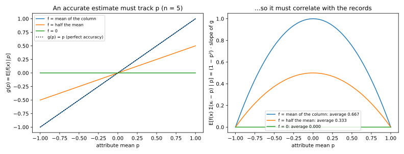
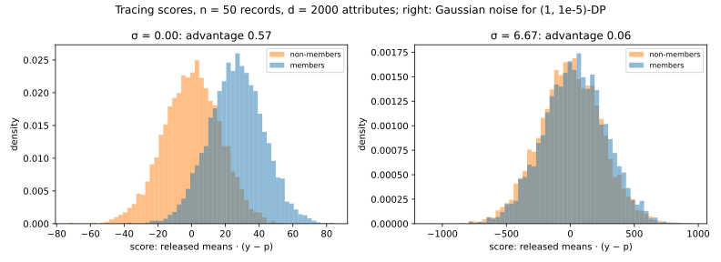
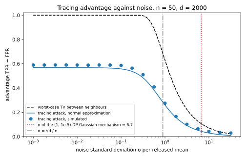

# Lower bounds: what privacy costs

The earlier chapters of this part built mechanisms and measured their error. The Laplace mechanism releases a histogram over $N$ bins with error about $\ln N/\varepsilon$ per bin, and the Gaussian mechanism releases $d$ attribute means with error about $\sqrt{d\ln(1/\delta)}/(n\varepsilon)$ each. These **upper bounds** leave a question open: is that error the price of privacy, or of a clumsy mechanism? A **lower bound** answers it, because it says that *no* mechanism satisfying differential privacy (DP) can be more accurate.

One idea proves every lower bound here: accuracy is an attack. An accurate output tells an attacker which of many datasets was used, whether a person is in it, or what a secret bit was. DP limits every such attack, because no test can tell the outputs on two neighbouring datasets apart much better than chance. So if the attack built from an accurate mechanism would beat that limit, the mechanism cannot be both accurate and private, and solving the inequality for the error or for the number of records $n$ gives the bound.

The running example is a survey in which each of $n$ people answers $d$ yes/no questions, and the release is the vector of the $d$ attribute means, under replace neighbours. One question with $N = 10^6$ possible answers, a ZIP code, gives a histogram under add/remove neighbours. The examples use $\varepsilon = 1$, a failure probability $\beta = 0.05$ and $\delta = 10^{-6}$. Packing shows that under pure DP the histogram's error grows like $\ln N/\varepsilon$. Fingerprinting shows that under approximate DP the $d$ means need $n$ growing like $\sqrt d$, through a membership inference attack that you will run. The Dinur–Nissim attack of [Reconstruction attacks](../part02-attacks/09-reconstruction.md) shows that about $n$ counting queries need error of order $\sqrt n$. @tbl-lower-symbols lists the symbols.

| Symbol | Meaning |
| --- | --- |
| $M$, $M(D)$ | the mechanism and its random output on the dataset $D$ |
| $D \sim D'$ | neighbours: one record added or removed (histograms) or replaced (elsewhere) |
| $\varepsilon$, $\delta$ | the privacy parameters; pure DP is $\delta = 0$ |
| $\alpha$, $\beta$ | the error and failure probability of an accuracy guarantee |
| $n$, $d$, $N$ | the numbers of records, of attributes, and of histogram bins |
| $m$, $k$ | the number of candidates in a packing, and their distance in records from the reference |
| $p_j$, $x_{ij}$, $\bar x$ | the population mean of attribute $j$, person $i$'s answer ($\pm1$), and the sample means |

: The symbols of this chapter. {#tbl-lower-symbols}

## Packing: pure DP pays the logarithm of the number of candidates {#sec-lower-packing}

Suppose the output of a mechanism must point to one of $m$ candidates, such as the most common ZIP code. For each candidate $i$ you can build a dataset $D_i$ on which an accurate mechanism lands in a region $G_i$ of outputs almost always. Run the mechanism on one reference dataset $D_0$ instead, and on average each region gets at most a share $1/m$ of its probability. But DP says the output on $D_0$ cannot look very different from the output on a nearby $D_i$. For large $m$ the two clash, and the clash is **packing**, the private version of Fano's method in [Information theory](../part01-prerequisites/05-information-theory.md).

Every bound in this chapter starts from an accuracy guarantee.

::: {#def-lower-accurate name="(α, β)-accuracy"}
A mechanism $M$ is **$(\alpha, \beta)$-accurate** for a quantity if, on *every* dataset, its output is within the **error** $\alpha$ of that quantity with probability at least $1 - \beta$, where $\beta$ is the **failure probability**. These are not the error rates of a test, which other chapters write $\alpha$ and $\beta$.
:::

The packing lemma compares $D_0$ with datasets $k$ records away, so it uses group privacy, proved in [Post-processing, group privacy and composition](02-properties.md#sec-dpprop-group). Each of the $k$ steps multiplies the bound by $e^\varepsilon$ and adds a slack $\delta$, which later steps multiply again. If $M$ is $(\varepsilon, \delta)$-DP and $D$, $D''$ differ in $k$ records, then for every set of outputs $S$
$$\Pr[M(D) \in S] \le e^{k\varepsilon}\Pr[M(D'') \in S] + \delta_k, \qquad \delta_k = \delta\sum_{j=0}^{k-1}e^{j\varepsilon} \le k\,e^{(k-1)\varepsilon}\delta.$$ {#eq-lower-group}
The slack grows geometrically: at $\varepsilon = 1$ and $\delta = 10^{-6}$, $\delta_5 = 8.6\times10^{-5}$ is small, while $\delta_{20} = 282$ bounds a probability by more than 1. So the lemma is stated for pure DP, where it says that $m$ demands of size $(1 - \beta)e^{-k\varepsilon}$ must fit into a total of 1.

::: {#lem-lower-packing name="Packing lemma"}
Let $D_0, D_1, \dots, D_m$ be datasets with $D_0$ within $k$ records of every $D_i$, and let $G_1, \dots, G_m$ be disjoint sets of outputs. If $M$ is $\varepsilon$-DP and $\Pr[M(D_i) \in G_i] \ge 1 - \beta$ for every $i$, then
$$m(1 - \beta)e^{-k\varepsilon} \le 1, \qquad\text{that is,}\qquad k \ge \frac{\ln\big(m(1 - \beta)\big)}{\varepsilon}.$$ {#eq-lower-packing}
:::

::: {.proof}
1. *Each region gets a share of $M(D_0)$.* Accuracy says that $G_i$ is likely under $D_i$, and group privacy @eq-lower-group with $\delta = 0$ says that it cannot be much less likely under $D_0$:
$$1 - \beta \le \Pr[M(D_i) \in G_i] \le e^{k\varepsilon}\Pr[M(D_0) \in G_i].$$
So $M(D_0)$ puts probability at least $(1 - \beta)e^{-k\varepsilon}$ on each $G_i$.
2. *The shares fit into one distribution.* The regions are disjoint, so no output is counted twice and the $m$ shares add up to at most 1. Overlapping regions would let one output serve several candidates.
3. *Combine.* Adding the $m$ bounds of step 1 and using step 2 gives the first form, and taking logarithms gives the second. @fig-lower-packing-budget draws this step.
:::

{#fig-lower-packing-budget}

Two consequences follow by choosing the datasets. The **mode** is the most frequent element of the data. A **histogram** is the vector of counts of $N$ elements, and its $\ell_\infty$ error is its largest error over the bins. A histogram accurate to within $\alpha$ finds a spike of height above $2\alpha$, so it inherits the mode's bound, halved.

::: {#thm-lower-histogram name="Mode and histogram lower bounds"}
Let $M$ be $\varepsilon$-DP under add/remove neighbours, over a universe of $N$ elements. If $M$ returns the most frequent element with probability at least $1 - \beta$ whenever that element appears $k$ times and every other element appears 0 times, then
$$k \ge \frac{\ln\big(N(1 - \beta)\big)}{\varepsilon}.$$ {#eq-lower-mode}
If $M$ releases a histogram over the $N$ bins that is $(\alpha, \beta)$-accurate in $\ell_\infty$ error, then
$$\alpha \ge \frac12\left(\frac{\ln\big(N(1 - \beta)\big)}{\varepsilon} - 1\right).$$ {#eq-lower-histogram}
:::

::: {.proof}
The plan is to build the candidates once, apply the lemma to the mode, and then show that an accurate histogram separates the same candidates.

1. *The candidates.* Take $D_0 = \emptyset$, the empty dataset, and for each element $x$ let $D_x$ be $k$ copies of $x$. Each $D_x$ is $k$ additions from $D_0$, and there are $m = N$ of them.
2. *The mode.* On $D_x$ a correct answer lands in $G_x = \{x\}$, and these regions are disjoint, so @lem-lower-packing gives @eq-lower-mode.
3. *Disjoint regions for the histogram.* The true histogram of $D_x$ is $k\,e_x$, with $k$ in bin $x$ and 0 elsewhere, and a correct answer lies in the ball $G_x$ of $\ell_\infty$ radius $\alpha$ around it. Two centres differ by $k$. A point in both balls would put the centres within $2\alpha$ of each other, by the triangle inequality, so the balls are disjoint when $k > 2\alpha$.
4. *Pick the smallest such $k$.* The lemma's bound is strongest for the closest datasets, so take $k = \lfloor2\alpha\rfloor + 1 \le 2\alpha + 1$.
5. *Apply the lemma.* With step 4 it gives
$$2\alpha + 1 \ge \frac{\ln(N(1 - \beta))}{\varepsilon},$$
and subtracting 1 and halving gives @eq-lower-histogram.
:::

Both bounds are matched, up to constants, by mechanisms you already have. The Laplace mechanism adds independent $\mathrm{Lap}(1/\varepsilon)$ noise to every count, since one record moves one count by 1. Report-noisy-max adds the same noise and returns the bin with the largest noisy count ([Selection](05-selection.md)).

::: {#prp-lower-matching name="Laplace histograms and report-noisy-max match packing"}
Under $\varepsilon$-DP with add/remove neighbours, the Laplace histogram over $N$ bins has $\ell_\infty$ error, at failure probability $\beta$, of exactly $-\ln\big(1 - (1 - \beta)^{1/N}\big)/\varepsilon$, which is at most $\ln(N/\beta)/\varepsilon$. When one element leads by $k$ records and every other count is 0, report-noisy-max returns the mode except with probability at most $(N - 1)e^{-k\varepsilon}(2 + k\varepsilon)/4$.
:::

::: {.proof}
1. *One Laplace coordinate.* A $\mathrm{Lap}(b)$ variable, with density $\frac1{2b}e^{-|z|/b}$, exceeds $\alpha$ in absolute value with probability $e^{-\alpha/b}$, here $e^{-\alpha\varepsilon}$.
2. *All $N$ bins at once.* The noises are independent, so all stay within $\alpha$ with probability $(1 - e^{-\alpha\varepsilon})^N$, and setting this to $1 - \beta$ gives the exact error. A union bound over the bins puts the failure probability at most $Ne^{-\alpha\varepsilon}$, and setting that to $\beta$ gives $\ln(N/\beta)/\varepsilon$.
3. *Report-noisy-max.* It fails only if some other bin's noise exceeds bin $x$'s noise by $k$ or more. The difference of two independent $\mathrm{Lap}(1/\varepsilon)$ variables has density $\frac\varepsilon4(1 + \varepsilon|z|)e^{-\varepsilon|z|}$, a convolution that @sec-apx-prob-laplace-diff works out. Substituting $u = \varepsilon z$, its tail beyond $k$ is
$$\frac14\int_{k\varepsilon}^\infty(1 + u)e^{-u}\,\mathrm du = \frac{e^{-k\varepsilon}(2 + k\varepsilon)}4.$$
A union bound over the $N - 1$ other bins gives the claim.
:::

Both the lower bound and the Laplace error grow like $\ln N/\varepsilon$ (@fig-lower-histogram), with slopes $1/(2\varepsilon)$ and $1/\varepsilon$, so Laplace is optimal up to a factor of about 2. The lemma loses that factor in step 2, which counts only the mass inside the good regions, while the Laplace output on $\emptyset$ falls almost entirely outside every ball $G_x$. Under replace neighbours the Laplace error doubles while the lower bound barely moves.

{#fig-lower-histogram}

The lemma needs $\delta = 0$, because with slack the share in step 1 turns negative once $e^{-k\varepsilon}$ falls below about $k\delta$. What survives is a capped bound.

::: {#prp-lower-packing-approx name="Packing under approximate DP"}
Let $D_0, \dots, D_m$ and the disjoint sets $G_1, \dots, G_m$ be as in @lem-lower-packing, with $\Pr[M(D_i) \in G_i] \ge 1 - \beta$ for every $i$, but let $M$ be $(\varepsilon, \delta)$-DP. Then at least one of
$$e^{-k\varepsilon}(1 - \beta) \le 2k\delta \qquad\text{or}\qquad m\,e^{-k\varepsilon}(1 - \beta) \le 2$$ {#eq-lower-packing-approx}
holds. In words, the group distance $k$ must be at least about $\min\big(\ln m, \ln(1/\delta)\big)/\varepsilon$.
:::

::: {.proof}
1. *The share with slack.* Group privacy @eq-lower-group applied to $D_i$, $D_0$ and $G_i$ gives
$$\Pr[M(D_0) \in G_i] \ge e^{-k\varepsilon}(1 - \beta) - e^{-k\varepsilon}\delta_k.$$
The subtracted part is a sum of $k$ terms $\delta e^{(j - k)\varepsilon}$, each at most $\delta e^{-\varepsilon} \le \delta$, so the share is at least $e^{-k\varepsilon}(1 - \beta) - k\delta$.
2. *Two cases.* If the first condition fails, $k\delta$ is less than half of $e^{-k\varepsilon}(1 - \beta)$, so each share is more than $\frac12e^{-k\varepsilon}(1 - \beta)$.
3. *Fit into 1.* The $m$ shares add up to at most 1, as in the lemma, which is the second condition.
:::

The cap is real, because a mechanism reaches it. The stability-based histogram (Vadhan 2017) noises only the non-empty bins and releases those above a threshold of order $\ln(1/\delta)/\varepsilon$, so its error does not grow with $N$ (@sec-apx-mech-histogram). On the mode's packing datasets, the [stability-based release](07-sensitivity.md#sec-sens-stable) reports the mode once it leads by about $\ln(1/\delta)/\varepsilon$ replacements, however many values there are.

::: {#exm-lower-zip}
@tbl-lower-histogram compares the bounds at $\varepsilon = 1$ and $\beta = 0.05$. For $N = 10^6$ locations, the most common one must lead by at least $\ln(10^6\times0.95)/1 = 13.76$ records before an $\varepsilon$-DP release can report it reliably, and report-noisy-max needs 18.44. Every $\varepsilon$-DP histogram has, at the 95% level, an error of at least $\frac12(13.76 - 1) = 6.38$ in some bin, and Laplace has 16.79. Simulated at $N = 1000$, the Laplace error is 9.84 against the exact 9.88, and report-noisy-max at the lead 11.09 fails 2.28% of the time against the union bound's 5%.

| $N$ | Mode: lower bound on lead $k$ | Report-noisy-max needs | Histogram: lower bound on error | Laplace error (exact) | Laplace error (union bound) |
| --- | --- | --- | --- | --- | --- |
| $10^3$ | 6.86 | 11.09 | 2.93 | 9.88 | 9.90 |
| $10^6$ | 13.76 | 18.44 | 6.38 | 16.79 | 16.81 |
| $10^9$ | 20.67 | 25.65 | 9.84 | 23.69 | 23.72 |

: Packing lower bounds against the mechanisms that achieve them, $\varepsilon = 1$, $\beta = 0.05$, add/remove neighbours, in records. {#tbl-lower-histogram}

Each factor of 1000 in $N$ adds $\ln 1000 = 6.9$ to every column that grows like $\ln N$, and half that to the histogram lower bound.
:::

## Sample complexity: how many records privacy costs {#sec-lower-sample}

An error of 6 records is large in a dataset of 50 and negligible in one of a million, so a lower bound on error is a lower bound on the number of records. This section translates the packing bounds into records, where privacy can be compared with sampling error, a cost you pay anyway. It is also where pure and approximate DP part ways once the output has many dimensions.

For the histogram, an error of $\alpha$ in each frequency is an error of $\alpha n$ in each count.

::: {#prp-lower-n-histogram name="Records for a private histogram"}
An $\varepsilon$-DP histogram over $N$ bins whose $\ell_\infty$ error is at most $\alpha n$ with probability $1 - \beta$, on every dataset of up to $n$ records, needs
$$n \ge \frac{\ln\big(N(1 - \beta)\big) - \varepsilon}{2\alpha\varepsilon}.$$ {#eq-lower-n-histogram}
Without privacy, estimating all $N$ frequencies to within $\alpha$ with probability $1 - \beta$ takes at most $n = \ln(2N/\beta)/(2\alpha^2)$ samples.
:::

::: {.proof}
1. *The private bound.* The packing datasets have $k \le n$ records, so the guarantee covers them, and @eq-lower-histogram with the error $\alpha n$ gives
$$\alpha n \ge \frac12\left(\frac{\ln(N(1 - \beta))}{\varepsilon} - 1\right).$$
Multiplying by $2\varepsilon$ and dividing by $2\alpha\varepsilon$ gives @eq-lower-n-histogram.
2. *The sampling bound.* By Hoeffding's inequality ([Concentration inequalities](../part01-prerequisites/02-concentration.md)), an average of $n$ independent variables in $[0, 1]$ is more than $\alpha$ from its mean with probability at most $2e^{-2n\alpha^2}$. Each frequency is such an average, so a union bound over the $N$ bins gives a failure probability of at most $2Ne^{-2n\alpha^2}$. Setting this to $\beta$ and solving for $n$ gives the claim.
:::

So privacy adds a term of order $\ln N/(\alpha\varepsilon)$ to a statistical cost of order $\ln N/\alpha^2$, which Fano's method shows is really needed. Their ratio is about $\alpha/\varepsilon$, so privacy dominates only for coarse answers at strong privacy.

The survey's $d$ means make the candidates multiply. Records are $x \in \{-1, +1\}^d$, a person's $d$ yes/no answers, and the release is the vector of means $\bar x \in [-1, 1]^d$. Datasets made of copies of one corner of the cube $\{\pm1\}^d$ give $2^d$ candidates, so packing charges $\ln 2^d = d\ln 2$.

::: {#thm-lower-n-marginals name="Records for d marginals under pure DP"}
Any $\varepsilon$-DP mechanism under replace neighbours that releases the $d$ attribute means with $\ell_\infty$ error at most $\alpha$ with probability $1 - \beta$ needs
$$n \ge \frac1\alpha\left(\frac{\ln\big((2^d - 1)(1 - \beta)\big)}{\varepsilon} - 1\right) \approx \frac{d\ln 2}{\alpha\varepsilon}.$$ {#eq-lower-n-marginals}
The approximation holds for large $d$.
:::

::: {.proof}
This is packing at a fixed size $n$, so the candidates replace records rather than add them.

1. *Candidates.* Fix a corner $u_0 \in \{\pm1\}^d$ and let $D_0$ be $n$ copies of it. For each of the $m = 2^d - 1$ other corners $u$, let $D_u$ be $D_0$ with $k$ records replaced by $u$.
2. *Disjoint regions.* The mean of $D_u$ is $u_0 + \frac kn(u - u_0)$. Two corners differ in some coordinate by 2, so their means differ there by $2k/n$. As in step 3 of the proof of @thm-lower-histogram, the balls of radius $\alpha$ around the means are disjoint when $k > \alpha n$.
3. *Apply the lemma* with $k = \lfloor\alpha n\rfloor + 1 \le \alpha n + 1$:
$$\alpha n + 1 \ge \frac{\ln\big((2^d - 1)(1 - \beta)\big)}{\varepsilon}.$$
Subtracting 1 and dividing by $\alpha$ gives @eq-lower-n-marginals.
:::

Two mechanisms come close. By @thm-lg-analytic of [the Laplace and Gaussian mechanisms](03-laplace-gaussian.md), Gaussian noise of standard deviation $\sigma$ on a query with $\ell_2$ sensitivity $\Delta_2$ is $(\varepsilon, \delta)$-DP exactly when $\Delta_2/\sigma$ is at most the root $\mu(\varepsilon, \delta)$ of @eq-lg-analytic, which is $0.2367$ at $\varepsilon = 1$ and $\delta = 10^{-6}$.

::: {#prp-lower-marginals-upper name="Laplace and Gaussian upper bounds for d marginals"}
Under replace neighbours, the Laplace mechanism releases the $d$ means with $\ell_\infty$ error at most $\alpha$ with probability $1 - \beta$, at $\varepsilon$-DP, once
$$n = \frac{2d\ln(d/\beta)}{\alpha\varepsilon}.$$
The Gaussian mechanism does so at $(\varepsilon, \delta)$-DP once $n = 2\sqrt d\,z/(\mu(\varepsilon, \delta)\,\alpha)$, where $z$ is the number with $\Phi(-z) = \beta/(2d)$ and $\Phi$ is the standard normal cumulative distribution function.
:::

::: {.proof}
1. *Sensitivities.* Replacing one record moves each of the $d$ means by at most $2/n$, so the $\ell_1$ sensitivity is $\Delta_1 = 2d/n$ and the $\ell_2$ sensitivity is $\Delta_2 = 2\sqrt d/n$.
2. *Laplace.* The noise $\xi_j$ in coordinate $j$ is $\mathrm{Lap}(b)$ with $b = \Delta_1/\varepsilon = 2d/(n\varepsilon)$, and it exceeds $\alpha$ with probability $e^{-\alpha/b}$. A union bound over the coordinates gives
$$\Pr\Big[\max_j|\xi_j| > \alpha\Big] \le de^{-\alpha/b}.$$
Setting this to $\beta$ gives $\alpha n\varepsilon/(2d) = \ln(d/\beta)$, and solving for $n$ gives the claim.
3. *Gaussian.* The noise has standard deviation $\sigma = \Delta_2/\mu(\varepsilon, \delta)$. A normal variable exceeds $z$ standard deviations in absolute value with probability $2\Phi(-z)$, so a union bound gives
$$\Pr\Big[\max_j|\xi_j| > \sigma z\Big] \le 2d\,\Phi(-z) = \beta.$$
Setting $\sigma z = \alpha$, that is $2\sqrt d\,z/(n\mu) = \alpha$, and solving for $n$ gives the claim.
:::

Pure DP pays linearly in the dimension, and Laplace matches it up to the factor $2\ln(d/\beta)/\ln 2$. The Gaussian requirement grows only like $\sqrt{d\ln d}$, because its noise follows $\Delta_2$ rather than $\Delta_1$, so for large $d$ it beats *every* pure-DP mechanism. That is no contradiction, because under approximate DP (@prp-lower-packing-approx) the corners force only $k \ge 13$ at $\delta = 10^{-6}$, against $\ln(2^{1000}\times0.95) = 693.10$ for pure DP at $d = 1000$. Approximate DP needs the idea of @sec-lower-fingerprinting.

Packing also prices a question every analyst meets: what does it cost not to know where the data lie? Write the unknown mean as $c$, because $\mu$ is the Gaussian ratio here.

::: {#prp-lower-mean-packing name="A mean known to lie in a range"}
Let the records be drawn from a normal distribution with unknown mean $c$ and variance 1, and let $|c| \le R$ be all that is known. An $\varepsilon$-DP mechanism under replace neighbours that returns an estimate closer than $\alpha$ to $c$, with probability at least $1 - \beta$ whatever $c$ is, needs
$$n \ge \frac{\ln\big(\lfloor R/\alpha\rfloor(1 - \beta)\big)}{\varepsilon},$$ {#eq-lower-mean-packing}
where $\lfloor R/\alpha\rfloor$ is $R/\alpha$ rounded down.
:::

::: {.proof}
This is the packing lemma with random datasets.

1. *Candidates.* Place $m = \lfloor R/\alpha\rfloor$ means $c_1, \dots, c_m$ in $[-R, R]$, spaced at least $2\alpha$ apart, and let $G_j$ be the open interval of radius $\alpha$ around $c_j$. These intervals are disjoint.
2. *Every dataset is close to a reference.* Fix a reference dataset $D_0$ of size $n$. Any dataset $D$ of size $n$ is at most $n$ replacements away, so group privacy with $\delta = 0$ gives
$$\Pr[M(D) \in G_j] \le e^{n\varepsilon}\Pr[M(D_0) \in G_j].$$
3. *Average over the data.* Draw the records of $D$ from the normal distribution with mean $c_j$. Averaged over $D$, the left side is at least $1 - \beta$ by accuracy, while the right side does not depend on $D$. So $\Pr[M(D_0) \in G_j] \ge (1 - \beta)e^{-n\varepsilon}$.
4. *Combine* as in the lemma: the $m$ shares fit into a total of 1, which is @eq-lower-mean-packing.
:::

At $\alpha = 0.1$, $\beta = 0.05$ and $\varepsilon = 1$, the bound is $n \ge 4.55$ for $R = 10$, $9.16$ for $R = 10^3$ and $16.07$ for $R = 10^6$. Clipping to $[-R, R]$ needs records linear in $R$, and [Private mean estimation](11-mean-estimation.md) closes the gap by first locating the data with a histogram. In $d$ dimensions the cost is about $d\ln(R/\alpha)/\varepsilon$.

::: {#exm-lower-survey}
@tbl-lower-sample gives the numbers for the survey at $\varepsilon = 1$ and $\beta = 0.05$. A histogram over $N = 10^6$ cells to within $\alpha = 0.1$ needs at least $(13.76 - 1)/(2\times0.1\times1) = 63.8$, so 64 records under $\varepsilon$-DP, and at most 875 for sampling error. At $\alpha = 0.01$ the numbers are 638 and 87,522, so privacy is the smaller cost in both cases.

| | Pure DP, packing (lower) | Pure DP, Laplace (upper) | Approximate DP, Gaussian (upper) |
| --- | --- | --- | --- |
| $d = 100$ | 683 | 15,202 | 2,941 |
| $d = 1000$ | 6,921 | 198,070 | 10,836 |
| $d = 10{,}000$ | 69,304 | 2,441,215 | 38,570 |
| $d = 100{,}000$ | 693,137 | 29,017,315 | 134,299 |

: Records needed to release $d$ attribute means with $\ell_\infty$ error 0.1 (on the scale $[-1, 1]$) with probability 0.95, at $\varepsilon = 1$ and, for the Gaussian, $\delta = 10^{-6}$. {#tbl-lower-sample}

The packing column grows tenfold with each tenfold increase in $d$, and the Gaussian column only 3.7-, 3.6- and 3.5-fold, close to $\sqrt{10}$. So from $d = 2731$ attributes on, the Gaussian mechanism needs fewer records than any pure-DP mechanism, which is one reason private machine learning uses approximate DP.
:::

## Fingerprinting: the √d lower bound for approximate DP {#sec-lower-fingerprinting}

Packing fails under approximate DP because group privacy breaks down at large distances. Fingerprinting compares only neighbours, so $\delta$ never blows up. It asks whether an accurate release of one random dataset's $d$ means agrees with a member's record more than with a stranger's. The **fingerprinting lemma** shows that accuracy forces agreement of order $d$ in total, and DP caps each record's share, so $n$ must be large. The idea comes from fingerprinting codes in cryptography, which Bun, Ullman & Vadhan (2014) brought to DP; this version follows Steinke & Ullman (2016).

::: {#def-lower-random-dataset name="The random survey"}
Draw attribute means $p_1, \dots, p_d$ independently and uniformly from $[-1, 1]$. Given $p$, draw $n$ records independently, each coordinate $x_{ij} \in \{\pm1\}$ independently with mean $p_j$, that is, $+1$ with probability $(1 + p_j)/2$ and $-1$ otherwise.
:::

The means are random because, for a fixed $p$, a mechanism that ignores the data and outputs $p$ would be accurate up to sampling error yet tell nothing about any record. A mechanism that must be accurate for every $p$ has to learn $p$ from the records, and so must correlate with them.

The lemma is about one attribute, so drop the index $j$ and write $x = (x_1, \dots, x_n)$ for its column. It says that an estimate's correlation with the records' deviations $x_i - p$ cannot be small unless the estimate is inaccurate.

::: {#lem-lower-fp-lemma name="Fingerprinting lemma"}
For the column $x$ of one attribute of @def-lower-random-dataset, with mean $\bar x$, and any estimate $f\colon \{\pm1\}^n \to \mathbb R$ of $p$ computed from it,
$$\mathbb E\Big[f(x)\sum_{i=1}^n(x_i - p)\Big] = 2\,\mathbb E\big[p\,f(x)\big] \ge \frac23 - 2\,\mathbb E[|f(x) - \bar x|],$$ {#eq-lower-fp-lemma}
where the expectations are over $p$ and the column.
:::

::: {.proof}
The plan is to show that the correlation is the slope of the average estimate $g(p) = \mathbb E[f(x) \mid p]$, weighted by $1 - p^2$, and then to average that slope by integrating by parts. An accurate estimate rises from about $-1$ to about $+1$, so its slope cannot be small on average.

1. *How the data respond to $p$.* The column has probability $\prod_i\frac{1 + x_ip}2$. Its log-derivative in $p$, the **score** of statistics, is $\sum_i\frac{x_i}{1 + x_ip}$. Each term equals $\frac{x_i - p}{1 - p^2}$, as you can check for $x_i = 1$ and for $x_i = -1$.
2. *Differentiate the average estimate.* Since $g(p) = \sum_xf(x)\Pr[x \mid p]$ and the derivative of $\Pr[x \mid p]$ is $\Pr[x \mid p]$ times its log-derivative, $g'$ is the average of $f$ times the score. Inserting step 1 and multiplying by $1 - p^2$ gives
$$(1 - p^2)\,g'(p) = \mathbb E\Big[f(x)\sum_i(x_i - p)\ \Big|\ p\Big].$$
3. *Average over $p$ and integrate by parts.* The density of $p$ is $\frac12$ on $[-1, 1]$. Integration by parts moves the derivative from $g$ onto $1 - p^2$, whose derivative is $-2p$:
$$\frac12\int_{-1}^1(1 - p^2)g'(p)\,\mathrm dp = \frac12\Big[(1 - p^2)g(p)\Big]_{-1}^1 + \int_{-1}^1p\,g(p)\,\mathrm dp.$$
The boundary term vanishes because $1 - p^2 = 0$ at $\pm1$ and $g$, a polynomial, is finite there. The remaining integral is $2\,\mathbb E[p\,g(p)]$, which equals $2\,\mathbb E[p\,f(x)]$ because $g$ is the average of $f$ given $p$. This is the equality.
4. *Compare with the sample mean.* The sample mean has average $p$ given $p$, so $\mathbb E[p\,\bar x] = \mathbb E[p^2] = \frac13$. Any other estimate differs from it by $f - \bar x$, and $|p| \le 1$, so
$$\mathbb E[p\,f] = \tfrac13 + \mathbb E[p(f - \bar x)] \ge \tfrac13 - \mathbb E[|f - \bar x|].$$
Multiplying by 2 gives the inequality.
:::

{#fig-lower-fingerprinting}

The lower bound below needs DP to bound the *average* of a score, while the definition bounds the probability of each event. The bridge is that an average is an integral of tail probabilities, and DP bounds each tail.

::: {#lem-lower-expectation name="DP bounds the average of a bounded score"}
If $M$ is $(\varepsilon, \delta)$-DP, $D \sim D'$, and $h$ is a function of the output with $|h| \le B$, then
$$\mathbb E[h(M(D))] \le \mathbb E[h(M(D'))] + (e^\varepsilon - 1)\,\mathbb E[|h(M(D'))|] + 2\delta B.$$ {#eq-lower-expectation}
:::

::: {.proof}
The plan is to write the mean as an integral of tails, bound each tail by the definition, and integrate back.

1. *The mean as an integral of tails.* A variable $Y$ with $0 \le Y \le B$ has $\mathbb E[Y] = \int_0^B\Pr[Y > t]\,\mathrm dt$, because each value $y$ is counted once for every level $t$ below it. For $Y$ equal to 1, 2 or 3 with probability $\frac13$ each, the integral is $1 + \frac23 + \frac13 = 2$. Splitting $h$ into its positive part $h_+$ and negative part $h_-$ gives
$$\mathbb E[h] = \int_0^B\Pr[h > t]\,\mathrm dt - \int_0^B\Pr[h < -t]\,\mathrm dt.$$
2. *Bound the positive part from above.* The definition applied to the event $\{h > t\}$ gives
$$\Pr[h(M(D)) > t] \le e^\varepsilon\Pr[h(M(D')) > t] + \delta.$$
3. *Bound the negative part from below,* since it is subtracted. The definition with $D'$ on the left and the event $\{h < -t\}$, solved for the term on $D$, gives
$$\Pr[h(M(D)) < -t] \ge e^{-\varepsilon}\big(\Pr[h(M(D')) < -t] - \delta\big).$$
4. *Integrate over $t \in [0, B]$.* Write $h' = h(M(D'))$. By step 1 the integrated tails are means again, and each $\delta$ integrates to $\delta B$:
$$\mathbb E[h(M(D))] \le e^\varepsilon\,\mathbb E[h_+'] - e^{-\varepsilon}\,\mathbb E[h_-'] + (1 + e^{-\varepsilon})\delta B.$$
5. *Pull out the mean on $D'$.* Since $\mathbb E[h'] = \mathbb E[h_+'] - \mathbb E[h_-']$, the first two terms equal
$$\mathbb E[h'] + (e^\varepsilon - 1)\mathbb E[h_+'] + (1 - e^{-\varepsilon})\mathbb E[h_-'].$$
The coefficient $1 - e^{-\varepsilon}$ is at most $e^\varepsilon - 1$, because their difference is $e^\varepsilon + e^{-\varepsilon} - 2 \ge 0$, so the middle terms are at most $(e^\varepsilon - 1)\mathbb E[|h'|]$. Finally $1 + e^{-\varepsilon} \le 2$.
:::

So a score centred on $D'$, with mean absolute value 1, has mean at most $e - 1 = 1.72$ on $D$ at $\varepsilon = 1$, plus $2\delta B$. The lower bound plays the two lemmas against each other through an attack that scores each record $x_i$ by its correlation with the release:
$$Z_i = \big\langle M(D),\ x_i - p\big\rangle = \sum_{j=1}^dM(D)_j\,(x_{ij} - p_j).$$
A member should score high, because the release follows the data, and a stranger should score around 0.

::: {#thm-lower-fp name="The fingerprinting lower bound"}
Let $M$ be $(\varepsilon, \delta)$-DP under replace neighbours, with outputs in $[-1, 1]^d$, and let its average error on the random survey of @def-lower-random-dataset be $\mathbb E[\|M(D) - \bar x\|_1] \le \alpha'd$, where $\alpha'$ is the average error per attribute. Then
$$n \ge \frac{(2/3 - 2\alpha')\,d}{(e^\varepsilon - 1)\sqrt d + 4\delta d}.$$ {#eq-lower-fp}
:::

::: {.proof}
The plan is that accuracy makes the members' scores total order $d$, while DP keeps each within a multiple of a stranger's spread $\sqrt d$, so the $n$ members must carry the total.

1. *Accuracy makes the scores large on average.* Fix an attribute $j$ and condition on the other columns, which leaves column $j$ and $p_j$ distributed as in the lemma. Apply @lem-lower-fp-lemma to $f$, the average of $M(D)_j$ over the mechanism's coins. That averaging leaves the correlation unchanged and cannot increase the error. Summing over $j$ and swapping the sums over $j$ and $i$ gives
$$\sum_{i=1}^n\mathbb E[Z_i] \ge \frac23d - 2\,\mathbb E[\|M(D) - \bar x\|_1] \ge \Big(\frac23 - 2\alpha'\Big)d.$$
2. *A stranger's score is small.* Let $D^{(i)}$ be $D$ with record $i$ replaced by a fresh one, and let $Z_i' = \langle M(D^{(i)}), x_i - p\rangle$ score $x_i$ against a release that never saw it. Given $p$, the deviations $x_{ij} - p_j$ are independent of that release, with mean 0 and variance at most 1. So $\mathbb E[Z_i'] = 0$, the cross terms of $Z_i'^2$ average to 0, and $\mathbb E[Z_i'^2] \le d$ because each output coordinate lies in $[-1, 1]$. By the Cauchy–Schwarz inequality, $\mathbb E[|Z_i'|] \le \sqrt d$.
3. *DP keeps a member's score close to a stranger's.* $D$ and $D^{(i)}$ differ only in record $i$, so they are neighbours under replace. The score $h(y) = \langle y, x_i - p\rangle$ has $|h| \le 2d$, so @lem-lower-expectation with $B = 2d$, averaged over the data and combined with step 2, gives
$$\mathbb E[Z_i] \le (e^\varepsilon - 1)\sqrt d + 4\delta d.$$
4. *Combine.* Summing step 3 over the $n$ records bounds the total from above, and step 1 bounds it from below:
$$\Big(\frac23 - 2\alpha'\Big)d \le n\big((e^\varepsilon - 1)\sqrt d + 4\delta d\big),$$
which rearranges to @eq-lower-fp.
:::

An $(\alpha, \beta)$-accurate mechanism in $\ell_\infty$, clipped to $[-1, 1]^d$, has $\alpha' \le \alpha + 2\beta$, since a coordinate off by more than $\alpha$ is off by at most 2. The $\sqrt d$ is the gap between signal and noise: a member scores of order $d/n$, and DP lets that exceed a stranger's spread $\sqrt d$ only by a constant factor. So $\delta$ must stay far below $1/\sqrt d$, which keeps the term $4\delta d$ of @eq-lower-fp below $(e^\varepsilon - 1)\sqrt d$, and the term $4\delta d$ cannot be removed, because a mechanism that publishes each record with probability $\delta$ is $(0, \delta)$-DP ([The definition of differential privacy](01-definition.md)).

The rate matches the Gaussian mechanism, but the constants are poor. At $\alpha = 0.1$, $\beta = 0.05$, $\varepsilon = 1$, $\delta = 10^{-6}$ the bound gives $n \ge 5.0$ for $d = 1000$ and $n \ge 15.8$ for $d = 10{,}000$, against the Gaussian mechanism's 10,836 and 38,570 (@fig-lower-sample-complexity). Published versions of this lower bound gain a factor $1/\alpha$ by padding the dataset with fixed records. Drawing $p$ from a sharper distribution gains a further $\sqrt{\ln(1/\delta)}$ (Steinke & Ullman 2016). The last gap, $\sqrt{\ln d}$, comes from the union bound in the Gaussian upper bound, not from privacy.

{#fig-lower-sample-complexity}

::: {#exm-lower-fp-lemma}
For $n = 5$ the script sums over all $2^5 = 32$ columns and integrates over $p$ exactly, for the three estimates of @fig-lower-fingerprinting. For the sample mean, both sides of @eq-lower-fp-lemma are 0.6667. For half the sample mean, the correlation is 0.3333 and the error is $\frac12\mathbb E[|\bar x|] = 0.3000$, so the bound is $\frac23 - 0.6 = 0.0667$. For $f = 0$ the bound, $\frac23 - 1.2 = -0.5333$, is vacuous. So the lemma is tight for unbiased estimators and loose for shrunk ones.
:::

## Tracing attacks: the lower bound is a membership inference attack {#sec-lower-tracing}

In 2008 Homer et al. showed that the published allele frequencies of a genetic study revealed whether a given person's DNA was in it, and the US National Institutes of Health withdrew such summaries that year. Their test is, up to details, the score $Z_i$ of @thm-lower-fp. This section runs it on the random survey and compares its power with what DP allows. Dwork et al. (2015) proved it **robust**: it works on noisy means and with only a small reference sample.

The attacker sees $\hat p = \bar x + \xi$, the true means with Gaussian noise of standard deviation $\sigma$ per coordinate, a target record $x^*$ and the population means $p$. It scores $Z(x^*) = \langle\hat p, x^* - p\rangle$ and says "member" when the score is large. Each member pulls the release toward its own record by $1/n$ of its deviation, which shifts its score up. The attack's **advantage** is its true positive rate (TPR), how often it says "member" for a member, minus its false positive rate (FPR), how often it does so for a non-member.

::: {#prp-lower-tracing name="Mean gap and spread of the tracing score"}
On the random survey of @def-lower-random-dataset, with the release $\hat p = \bar x + \xi$,
$$\mathbb E[Z \mid \text{member}] - \mathbb E[Z \mid \text{non-member}] = \frac{2d}{3n}, \qquad \operatorname{Var}(Z \mid \text{non-member}) = d\left(\frac2{15} + \frac{8}{15n} + \frac{2\sigma^2}3\right).$$ {#eq-lower-tracing}
If the score is approximately normal with this mean gap $\kappa$ and standard deviation $s$ under both hypotheses, the best threshold has advantage $\mathrm{TPR} - \mathrm{FPR} = 2\Phi\big(\kappa/(2s)\big) - 1$.
:::

::: {.proof}
For $p$ uniform on $[-1, 1]$, $\mathbb E[p^2] = \frac13$, $\mathbb E[p^4] = \frac15$ and $\mathbb E[(1 - p^2)^2] = \frac8{15}$. A $\pm1$ variable with mean $p$ has square 1 and variance $1 - p^2$.

1. *Non-member mean.* A fresh $x^*$ is independent of $\hat p$ given $p$, with deviations of mean 0, so $\mathbb E[Z] = 0$.
2. *Member mean.* For $x^* = x_i$, coordinate $j$ contributes $\mathbb E[\bar x_j(x_{ij} - p_j)]$. In $\bar x_j$, other people's records are independent of $x_{ij}$ and contribute 0. The member's own term contributes $\frac1n\mathbb E[x_{ij}(x_{ij} - p_j)] = \frac1n(1 - p_j^2)$. Averaging over $p_j$ and summing over the $d$ coordinates gives $\frac{2d}{3n}$.
3. *Non-member variance.* The deviations $x^*_j - p_j$ are independent of each other and of $\hat p$, so the cross terms of $Z^2$ vanish and
$$\operatorname{Var}(Z) = \sum_j\mathbb E\big[\hat p_j^2(1 - p_j^2)\big].$$
Given $p$, the mean square of $\hat p_j$ is its squared mean plus the sampling and noise variances, $p_j^2 + \frac{1 - p_j^2}n + \sigma^2$. Multiplying by $1 - p_j^2$ and averaging gives, per coordinate,
$$\mathbb E[p^2 - p^4] + \frac1n\mathbb E[(1 - p^2)^2] + \sigma^2\,\mathbb E[1 - p^2] = \frac2{15} + \frac8{15n} + \frac{2\sigma^2}3.$$
4. *Advantage of a threshold.* For $\mathcal N(0, s^2)$ against $\mathcal N(\kappa, s^2)$, the Neyman–Pearson lemma says that the best test thresholds the density ratio, which grows with the score, at the crossing point $\kappa/2$. A member exceeds it with probability $\Phi(\frac\kappa{2s})$ and a non-member with probability $\Phi(-\frac\kappa{2s}) = 1 - \Phi(\frac\kappa{2s})$, so the advantage is $2\Phi(\frac\kappa{2s}) - 1$. This is the total variation (TV) distance of the two normals, which [Hypothesis testing](../part01-prerequisites/04-hypothesis-testing.md#sec-ht-tv) shows to be the best advantage of any test.
:::

Without noise, the signal-to-noise ratio $\kappa/s \approx \frac{2d}{3n}\big/\sqrt{2d/15}$ is of order $\sqrt d/n$, so tracing reaches advantage 0.5, where $\kappa/(2s) = \Phi^{-1}(0.75) = 0.674$, once $d \approx 0.55\,n^2$. Noise adds $2\sigma^2/3$ per coordinate, so the attack fails when $\sigma \gg \sqrt d/n$, the order of the Gaussian mechanism's $\sigma = 2\sqrt d/(n\mu)$. Aggregates are not safe because they are aggregates; what protects members is the ratio of $n$ to $\sqrt d$, or noise.

DP bounds the attack for each target, because the game is a test between the neighbours $M(D)$ and $M(D^{(i)})$. By @cor-dpdef-advantage of [the definition of differential privacy](01-definition.md#sec-dpdef-advantage), its advantage is at most $(e^\varepsilon - 1 + 2\delta)/(e^\varepsilon + 1)$ (@eq-dpdef-advantage), which is 0.4621 at $\varepsilon = 1$ and $\delta = 0$. For the Gaussian mechanism, step 4 with $\kappa = \Delta_2$ and $s = \sigma$ bounds the TV distance of the two outputs by $2\Phi\big(\Delta_2/(2\sigma)\big) - 1$.

::: {#exm-lower-tracing}
The script draws 200 datasets of $n = 50$ records with $d = 2000$ attributes and scores the 50 members and 50 fresh non-members of each. Without noise, @eq-lower-tracing predicts a mean gap of $2\times2000/(3\times50) = 26.67$ and a spread of $\sqrt{2000(\frac2{15} + \frac8{750})} = 16.97$; the simulation gives 26.70 and 16.92. The normal approximation gives the advantage $2\Phi(0.786) - 1 = 0.568$. @tbl-lower-tracing shows three noise levels, the last being the $\sigma = 6.67$ of the $(1, 10^{-5})$-DP Gaussian mechanism.

| Noise $\sigma$ | Advantage (simulated) | Advantage (normal approximation) | Worst-case TV bound | TPR at 1% FPR |
| --- | --- | --- | --- | --- |
| 0 | 0.578 | 0.568 | 1.000 | 0.242 |
| 1.00 | 0.264 | 0.259 | 0.629 | 0.052 |
| 6.67 (DP, $\varepsilon = 1$) | 0.049 | 0.044 | 0.107 | 0.014 |

: The tracing attack on released attribute means, $n = 50$, $d = 2000$. The advantage is the best $\mathrm{TPR} - \mathrm{FPR}$ over thresholds. {#tbl-lower-tracing}

The worst-case TV column uses $\Delta_2 = 2\sqrt{2000}/50 = 1.79$. Without noise, a quarter of the members are identified at a 1% false-alarm rate from the means of 50 people, a failure in the sense of [Membership inference](../part02-attacks/02-membership-inference.md). With DP noise, at $\delta = 10^{-5}$, the advantage is 0.049, under both the TV bound of 0.107 and the generic bound, still about 0.462. The TPR at 1% FPR is 0.014, under the bound $e^1\times0.01 + 10^{-5} = 0.0272$ that the definition gives for the event "the test fires". @fig-lower-tracing-scores shows the scores and @fig-lower-tracing-advantage the whole curve, which fades out around $\sigma = \sqrt{2000}/50 = 0.89$.
:::

{#fig-lower-tracing-scores}

{#fig-lower-tracing-advantage}

## Dinur–Nissim as a lower bound {#sec-lower-dinur-nissim}

[Reconstruction attacks](../part02-attacks/09-reconstruction.md) showed that $n$ secret bits can be almost entirely reconstructed from about $n$ random subset sums answered with error $o(\sqrt n)$, error that grows more slowly than $\sqrt n$. Each query counts the 1s in a random subset of people, and the attacker fits the bits to the answers by least squares. Combined with DP's limit on guessing any single bit, it becomes a lower bound: a release that reveals most bits cannot be private.

The limit on guessing is @cor-dpdef-advantage of [the definition of differential privacy](01-definition.md#sec-dpdef-advantage). If $D$ and $D'$ differ only in one uniformly random secret bit, every guess of that bit from the output of an $(\varepsilon, \delta)$-DP mechanism is right with probability at most $(e^\varepsilon + \delta)/(e^\varepsilon + 1)$, which is $e/(e + 1) = 0.7311$ at $\varepsilon = 1$ and $\delta = 0$. Read the other way, recovering a fraction $r$ of the bits proves a lower bound on $\varepsilon$.

::: {#thm-lower-dn name="Reconstruction bounds ε from below"}
Let the database be $n$ independent uniform bits, and call two databases neighbours when they differ in one bit. If $M$ is $(\varepsilon, \delta)$-DP, then the expected fraction $r$ of bits that any reconstruction procedure recovers from $M$'s output satisfies
$$r \le \frac{e^\varepsilon + \delta}{e^\varepsilon + 1}, \qquad\text{so}\qquad \varepsilon \ge \ln\frac{r - \delta}{1 - r}.$$ {#eq-lower-dn}
In particular, a mechanism that answers $Q = O(n)$ random subset-sum queries with error $o(\sqrt n)$ is not $(\varepsilon, \delta)$-DP for any fixed $\varepsilon$ and any $\delta < \frac12$. Error $\Omega(\sqrt n)$, at least a constant times $\sqrt n$, is necessary.
:::

::: {.proof}
1. *One bit at a time.* Fix $i$ and every bit but $x_i$, which stays uniform because the bits are independent. Its two values give neighbouring databases, and the guess of $x_i$ is a post-processing of $M$'s output, so it is a test between them, right with probability at most $(e^\varepsilon + \delta)/(e^\varepsilon + 1)$. The uniform prior matters, because with a biased one guessing the likelier value already beats $\frac12$.
2. *Average over the bits.* The expected fraction recovered is the average over $i$ of the probability that bit $i$ is guessed right, so it obeys step 1. Multiplying by $e^\varepsilon + 1$ gives $e^\varepsilon(1 - r) \ge r - \delta$, and dividing by $1 - r$ and taking logarithms gives the second form.
3. *Insert the attack.* By the Dinur–Nissim theorem, in the sharper form of Dwork, McSherry and Talwar (2007) that needs only $O(n)$ queries, errors of $o(\sqrt n)$ let the decoder miss only $o(n)$ bits. So $r \to 1$, and the bound forces $\varepsilon \to \infty$.
:::

The Gaussian mechanism matches it. Changing one bit changes by 1 the answer of every query whose subset contains that person, so the answers move by at most $\sqrt Q$ in $\ell_2$, and $\sigma$ proportional to $\sqrt Q/\mu(\varepsilon, \delta)$ suffices, of order $\sqrt n$ for $Q = 4n$. So independent noise costs error of order $\sqrt Q$ per query under approximate DP, and of order $Q$ under pure DP. For many more than $n$ queries, private multiplicative weights ([Query release](06-query-release.md)) answers every query from a small private synthetic dataset, with error that grows only like a small power of $\ln Q$.

The bound is crude, because least squares is not the best attack, so the $\varepsilon$ it proves is far below the one the Gaussian mechanism guarantees. The true privacy loss lies between them. A lower bound from one attack is never a guarantee, and auditing, in a later part, narrows the gap with stronger attacks.

::: {#exm-lower-dn}
The script answers $Q = 800$ random subset sums of $n = 200$ uniform bits with Gaussian noise of standard deviation $\sigma$, decodes by least squares and rounds at $\frac12$, over 40 databases. @tbl-lower-dn gives the fraction recovered, the $\varepsilon$ it implies by @eq-lower-dn at $\delta = 10^{-6}$, and the $\varepsilon$ the Gaussian mechanism guarantees with $\mu = \sqrt{800}/\sigma$. For instance, recovering 0.9607 of the bits proves $\varepsilon \ge \ln\big((0.9607 - 10^{-6})/(1 - 0.9607)\big) = 3.20$.

| $\sigma/\sqrt n$ | Fraction recovered | $\varepsilon$ at least (attack) | $\varepsilon$ at most (Gaussian mechanism) |
| --- | --- | --- | --- |
| 0.1 | 1.0000 | $\infty$ | 294.17 |
| 0.25 | 0.9607 | 3.20 | 69.24 |
| 0.5 | 0.8058 | 1.42 | 26.36 |
| 1 | 0.6710 | 0.71 | 11.00 |
| 2 | 0.5810 | 0.33 | 4.89 |

: Reconstruction from 800 noisy subset sums of 200 bits, and the privacy loss it proves, at $\delta = 10^{-6}$. {#tbl-lower-dn}

At $\sigma = 0.1\sqrt{200} = 1.4$ every bit is recovered, so the release is not $(\varepsilon, 10^{-6})$-DP for any finite $\varepsilon$. A mechanism with $\varepsilon = 1$ lets an attacker recover at most 73.11% of the bits, which the table places between $0.5\sqrt n$ and $\sqrt n$ of noise per answer. Recovering 67% of the bits at $\sigma = \sqrt n$ proves only $\varepsilon \ge 0.71$, while the guarantee there is $\varepsilon \le 11.00$. @fig-lower-dinur-nissim shows the whole range.
:::

{#fig-lower-dinur-nissim}

## Code {#sec-lower-code}

The script [code/lower_bounds.py](../../code/part03-dp-foundations/lower_bounds.py) computes every number in this chapter and draws every figure. It checks the Laplace histogram, report-noisy-max, the tracing attack and the reconstruction attack against their formulas by simulation, and the fingerprinting lemma by exact summation. From the repository root:

```bash
uv run python code/part03-dp-foundations/lower_bounds.py
```

| Experiment | Result |
| --- | --- |
| What DP allows, $\varepsilon = 1$ | Advantage at most 0.4621; bit guessed at most 0.7311 of the time; group $\delta_5 = 8.6\times10^{-5}$, $\delta_{20} = 282$ at $\delta = 10^{-6}$ |
| Mode and histogram, $N = 10^6$ | Lead $k \ge 13.76$ (noisy-max needs 18.44); error $\ge 6.38$ (Laplace 16.79); full table in @tbl-lower-histogram |
| Simulations at $N = 1000$ | Laplace 95% error 9.84 (exact 9.88); noisy-max failure 0.0228 at lead 11.09 (union bound 0.05) |
| Packing under $\delta = 10^{-6}$, $2^d$ candidates | Forces $k \ge 7$ at $d = 10$ and $k \ge 13$ at $d = 100$ and $1000$ (pure: 6.88, 69.26, 693.10); @eq-lower-packing-approx: 7, 11, 11; $\ln(1/\delta)/\varepsilon = 13.82$ |
| Packing for a mean, $\alpha = 0.1$ | $n \ge 4.55$, 9.16, 16.07 for $R = 10$, $10^3$, $10^6$; under $\delta = 10^{-6}$: 4, 9, 11 |
| Sample complexity, histogram $N = 10^6$ | $\alpha = 0.1$: 64 private, 875 sampling. $\alpha = 0.01$: 638 private, 87,522 sampling |
| Sample complexity, marginals | @tbl-lower-sample; the Gaussian beats the pure-DP lower bound from $d = 2731$; $\mu(1, 10^{-6}) = 0.2367$ |
| Fingerprinting lower bound | $n \ge 1.6$, 5.0, 15.8, 50.1 at $d = 10^2, 10^3, 10^4, 10^5$ |
| Fingerprinting lemma, $n = 5$ | Mean: 0.6667 (bound 0.6667). Half mean: 0.3333 (bound 0.0667). Zero: 0 (bound $-0.5333$) |
| Tracing, $n = 50$, $d = 2000$ | Gap 26.70 (predicted 26.67), spread 16.92 (16.97); @tbl-lower-tracing |
| Dinur–Nissim, $n = 200$, $Q = 800$ | @tbl-lower-dn |

: The script's output with the default seed. {#tbl-lower-code}

[tests/test_lower_bounds.py](../../tests/test_lower_bounds.py) checks that the output still matches.

## Summary {#sec-lower-summary}

| Result | Statement | Use |
| --- | --- | --- |
| @lem-lower-packing | $m$ disjoint good sets within $k$ of $D_0$: $k \ge \ln(m(1 - \beta))/\varepsilon$ | Outputs that single out one of many candidates |
| @thm-lower-histogram | Mode: lead $k \ge \ln(N(1 - \beta))/\varepsilon$; histogram: $\alpha \ge \frac12(\ln(N(1 - \beta))/\varepsilon - 1)$ | Pure DP pays $\ln(\text{candidates})/\varepsilon$ |
| @prp-lower-matching | Laplace: $\alpha \le \ln(N/\beta)/\varepsilon$; noisy-max fails with probability $\le (N - 1)e^{-k\varepsilon}(2 + k\varepsilon)/4$ | Both optimal up to a factor of about 2 |
| @prp-lower-packing-approx | $e^{-k\varepsilon}(1 - \beta) \le 2k\delta$ or $m e^{-k\varepsilon}(1 - \beta) \le 2$ | Packing forces at most about $\ln(1/\delta)/\varepsilon$ |
| @prp-lower-n-histogram | $n \ge (\ln(N(1 - \beta)) - \varepsilon)/(2\alpha\varepsilon)$; sampling $\approx \ln(2N/\beta)/(2\alpha^2)$ | Privacy adds records, mostly for coarse answers |
| @thm-lower-n-marginals | $n \gtrsim d\ln2/(\alpha\varepsilon)$ | Pure DP pays linearly in the dimension |
| @prp-lower-marginals-upper | Laplace: $n = 2d\ln(d/\beta)/(\alpha\varepsilon)$; Gaussian: $n = 2\sqrt d\,z/(\mu\alpha)$ | The Gaussian beats pure DP from $d = 2731$ |
| @prp-lower-mean-packing | $n \ge \ln(\lfloor R/\alpha\rfloor(1 - \beta))/\varepsilon$ | The cost of not knowing where the data lie |
| @lem-lower-fp-lemma | $\mathbb E[f\sum_i(x_i - p)] = 2\mathbb E[pf] \ge \frac23 - 2\mathbb E[\lvert f - \bar x\rvert]$ | Accuracy forces correlation with the records |
| @lem-lower-expectation | $\mathbb E[h(M(D))] \le \mathbb E[h(M(D'))] + (e^\varepsilon - 1)\mathbb E[\lvert h(M(D'))\rvert] + 2\delta B$ | DP for averages, not only events |
| @thm-lower-fp | $n \ge (\frac23 - 2\alpha')d/((e^\varepsilon - 1)\sqrt d + 4\delta d)$ | Approximate DP pays $\sqrt d$; keep $\delta \ll 1/\sqrt d$ |
| @prp-lower-tracing | Gap $2d/(3n)$; variance $d(\frac2{15} + \frac8{15n} + \frac{2\sigma^2}3)$ | Advantage 0.5 once $d \approx 0.56\,n^2$; $\sigma \gg \sqrt d/n$ stops it |
| @thm-lower-dn | Recovering a fraction $r$ proves $\varepsilon \ge \ln\frac{r - \delta}{1 - r}$ | Error $o(\sqrt n)$ on $O(n)$ queries is never private |

: The results of this chapter, and where each is used. {#tbl-lower-summary}

## References {#sec-lower-references}

- Dwork & Roth, *The Algorithmic Foundations of Differential Privacy* (2014), ch. 8: packing lower bounds and reconstruction attacks as lower bounds, at textbook depth.
- Vadhan, "The Complexity of Differential Privacy" (2017), §5: packing, fingerprinting and reconstruction lower bounds side by side; also the stability-based histogram for approximate DP.
- Hardt & Talwar, "On the Geometry of Differential Privacy" (STOC 2010): packing generalized to any set of linear queries through volume arguments, with matching upper bounds for pure DP.
- Beimel, Brenner, Kasiviswanathan & Nissim, "Bounds on the Sample Complexity for Private Learning and Private Data Release" (Machine Learning, 2014): the sample-complexity view of packing.
- Bun, Ullman & Vadhan, "Fingerprinting Codes and the Price of Approximate Differential Privacy" (STOC 2014): the first $\sqrt d$ lower bound for approximate DP, through fingerprinting codes.
- Steinke & Ullman, "Between Pure and Approximate Differential Privacy" (Journal of Privacy and Confidentiality, 2016): the simplified fingerprinting lemma and the tight bound $\Omega(\sqrt{d\ln(1/\delta)}/(\alpha\varepsilon))$ for one-way marginals.
- Dwork, Smith, Steinke, Ullman & Vadhan, "Robust Traceability from Trace Amounts" (FOCS 2015): tracing attacks that tolerate noisy statistics and estimated population means.
- Dwork, Smith, Steinke & Ullman, "Exposed! A Survey of Attacks on Private Data" (Annual Review of Statistics and Its Application, 2017): reconstruction and tracing attacks for a statistics audience.
- Homer et al., "Resolving Individuals Contributing Trace Amounts of DNA to Highly Complex Mixtures Using High-Density SNP Genotyping Microarrays" (PLoS Genetics, 2008): the tracing attack on genomic summary statistics.
- Kamath & Ullman, "A Primer on Private Statistics" (2020, arXiv): fingerprinting lower bounds for private mean estimation, with the score-and-integrate-by-parts proof used here.
- Dinur & Nissim, "Revealing Information while Preserving Privacy" (PODS 2003): the reconstruction attack and the $\sqrt n$ threshold.
- Boneh & Shaw, "Collusion-Secure Fingerprinting for Digital Data" (IEEE Transactions on Information Theory, 1998) and Tardos, "Optimal Probabilistic Fingerprint Codes" (STOC 2003): the cryptographic codes that gave fingerprinting its name.
