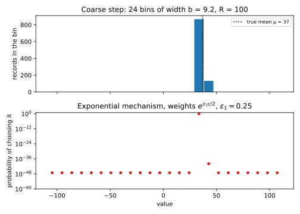
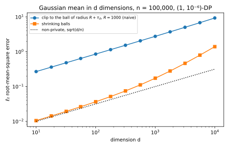

# Private mean estimation

The mean is the statistic that private machine learning computes most often. Every step of private gradient descent clips per-example gradients, averages them and adds noise, and a survey that reports the share of people with some property releases a mean of yes/no answers. Earlier chapters released the mean of the dataset in hand. An analyst usually wants something else: the mean of the **population** the data were drawn from. So this chapter asks how many records a private estimate of a population mean needs, and what each thing you do not know about the data costs.

Two guarantees with different shapes meet here. Privacy must hold for every dataset, including ones that your assumptions say cannot happen, because a guarantee that fails when an assumption fails protects nobody. Accuracy, on the other hand, is a statement about data drawn from a distribution, such as "the records are normal with variance 1". So an assumption about the data may make a mechanism more accurate, but it may never enter the privacy proof. Every mechanism below respects that split: it clips the data to a range, which makes it private whatever the data are, and the assumption only says how often the clipping changes nothing. One idea then organizes the chapter: spend a small part of the budget to learn where the data are, then clip there and spend the rest on the mean. The noise of a clipped mean is proportional to the width of the clipping range, so a range set by your prior ignorance makes the noise pay for that ignorance in full. Finding the data privately first costs a number of records that grows only like the logarithm of the range, and the final step can then clip to a narrow window and add little noise.

The running example is a survey of $n = 1000$ people at $\varepsilon = 1$, and each section changes what is known about the records: yes/no answers first, then normal measurements whose mean could be anywhere up to a bound $R$, then vectors, then incomes with a heavy tail. Throughout, datasets have a fixed size $n$, and two datasets $D \sim D'$ are **neighbours** when they differ in one replaced record, as in [Beyond global sensitivity](07-sensitivity.md). The records $X_1, \dots, X_n$ are drawn independently from a distribution whose mean $\mu$ is the target, and every statement of the form "the data lie in this range" is allowed to fail with probability $\beta = 0.05$. An estimate $\hat\mu$ is judged by its **root-mean-square error** (RMSE), the square root of the average of $(\hat\mu - \mu)^2$ over the data and the mechanism's noise. The guarantees are those of the [definition of differential privacy (DP)](01-definition.md): a mechanism is $(\varepsilon, \delta)$-DP when changing one record changes the probability of any set of outputs by at most a factor $e^\varepsilon$ plus $\delta$, and pure $\varepsilon$-DP when $\delta = 0$. @tbl-mean-symbols lists the symbols the chapter uses.

| Symbol | Meaning |
| --- | --- |
| $n$, $\varepsilon$, $\delta$ | the number of records, fixed and public; the parameters of DP |
| $\mu$, $\sigma^2$ | the mean and the variance of the distribution the records come from |
| $\alpha$, $\beta$ | the target RMSE; the probability that a "the data lie in this range" statement fails |
| $w$, $R$ | the width of a known range; a bound on $\lvert\mu\rvert$, or on the length $\Vert\mu\Vert$ |
| $\tau_1$, $\tau_d$ | how far $n$ normal records can lie from $\mu$, in one and in $d$ dimensions |
| $b$, $m$ | the width and the number of the bins of the coarse step |
| $d$, $r_t$, $c_t$, $s_t$ | the dimension; the radius, the centre and the noise standard deviation of round $t$ of shrinking balls |
| $\kappa(\varepsilon, \delta)$ | the largest ratio of $\ell_2$ sensitivity to noise standard deviation at which Gaussian noise is $(\varepsilon, \delta)$-DP |
| $\tau$, $\tau_b$ | the clipping half-width for heavy-tailed data, and its worst-case choice |

: The symbols of this chapter. {#tbl-mean-symbols}

## Bounded data {#sec-mean-bounded}

Start where nothing is unknown except the mean. The records lie in a known interval, such as yes/no answers coded 0 and 1, so no clipping is needed and no assumption about the data enters at all. The question is how many more records a private estimate needs than a non-private one. The answer is the best case of the chapter, and every later section tries to recover it when the data are not bounded.

Every estimator in this chapter has the same form: clip each record to an interval, average, and add Laplace noise. The lemma below says what such an estimator costs in privacy and in error, and every later proof starts from it. Its privacy part is the Laplace mechanism of [the Laplace and Gaussian mechanisms](03-laplace-gaussian.md) applied to a mean. Its error part is the three-way split of the clipping section of [Beyond global sensitivity](07-sensitivity.md#sec-sens-clip): the clipped average varies from sample to sample, clipping shifts its expected value away from $\mu$, and the noise adds its own spread.

::: {#lem-mean-clipped name="A clipped mean with Laplace noise"}
Let each record $X_i$ be replaced by a clipped value $Y_i$ that depends on $X_i$ alone and lies in an interval of width $w$, and release the average of the clipped values plus Laplace noise $\xi$,
$$\hat\mu = \frac1n\sum_{i=1}^n Y_i + \xi, \qquad \xi \sim \mathrm{Lap}\Big(\frac{w}{n\varepsilon}\Big).$$
The release is $\varepsilon$-DP for every dataset. When the records are independent draws from a distribution with mean $\mu$, the mean squared error of the release splits into three parts,
$$\mathbb E\big[(\hat\mu - \mu)^2\big] = \underbrace{\frac{\operatorname{Var}(Y)}{n}}_{\text{sampling}} + \underbrace{\big(\mathbb E[Y] - \mu\big)^2}_{\text{bias}^2} + \underbrace{\operatorname{Var}(\xi)}_{\text{noise}}, \qquad \operatorname{Var}(\xi) = \frac{2w^2}{n^2\varepsilon^2}.$$ {#eq-mean-split}
:::

::: {.proof}
The plan is to bound the sensitivity of the clipped average, calibrate the Laplace noise to it, then square the error and watch the cross terms vanish.

1. *Sensitivity.* Replacing one record changes one clipped value $Y_i$, by at most $w$ since both values lie in the interval, and the other values stay put because each depends on its own record alone. So the sum moves by at most $w$ and the average by at most $w/n$, which is its sensitivity under replace neighbours, as for the mean with public $n$ in @prp-lg-standard-queries.
2. *Privacy.* By @thm-lg-laplace, Laplace noise with scale equal to the sensitivity divided by $\varepsilon$, here $w/(n\varepsilon)$, makes the release $\varepsilon$-DP. Nothing in steps 1 and 2 assumed anything about the data, because the clipping, not an assumption, keeps every $Y_i$ in the interval.
3. *The three parts.* Write $\hat\mu - \mu$ as a sum of three pieces: the average of $Y_i - \mathbb E[Y]$ over the records, the constant $\mathbb E[Y] - \mu$, and the noise $\xi$. The first and the last have mean 0 and are independent of each other, so when the sum is squared and averaged, every cross term contains a mean-zero factor and vanishes. The average of $n$ independent copies has $1/n$ times the variance of one, which gives the sampling part.
4. *The noise.* By @thm-lg-laplace a Laplace variable with scale $s$ has variance $2s^2$, which with $s = w/(n\varepsilon)$ is $2w^2/(n^2\varepsilon^2)$.
:::

With the lemma in hand, the bounded case is a matter of reading off the error and solving for $n$. Bounded records need no clipping, so the bias is zero, and the only question is how the sampling term and the noise term add up.

::: {#thm-mean-bounded name="Private mean of bounded data"}
Let the records be independent draws from a distribution on an interval of width $w$ with variance $\sigma^2$, and release their average plus $\mathrm{Lap}(w/(n\varepsilon))$ noise. The release is $\varepsilon$-DP, and its RMSE is
$$\mathrm{RMSE} = \sqrt{\frac{\sigma^2}{n} + \frac{2w^2}{n^2\varepsilon^2}}.$$ {#eq-mean-bounded}
The RMSE is at most $\alpha$ once
$$n \ge \frac{\sigma^2 + \sqrt{\sigma^4 + 8w^2\alpha^2/\varepsilon^2}}{2\alpha^2}, \qquad\text{which is at most}\qquad \frac{\sigma^2}{\alpha^2} + \frac{\sqrt2\,w}{\alpha\varepsilon}.$$ {#eq-mean-bounded-n}
:::

::: {.proof}
1. *Privacy and error.* The records already lie in the interval, so @lem-mean-clipped applies with $Y_i = X_i$ and width $w$, and the release is $\varepsilon$-DP. In @eq-mean-split the bias is 0, the sampling term is $\sigma^2/n$ and the noise term is $2w^2/(n\varepsilon)^2$, and their sum is the square of @eq-mean-bounded.
2. *Solve for $n$.* Setting the square of @eq-mean-bounded equal to $\alpha^2$ and multiplying by $n^2$ gives the quadratic $\alpha^2n^2 - \sigma^2n - 2w^2/\varepsilon^2 = 0$, whose positive root is the first form of @eq-mean-bounded-n. The RMSE falls as $n$ grows, so every $n$ above the root reaches $\alpha$.
3. *The simpler bound.* The square root of a sum is at most the sum of the square roots, so $\sqrt{\sigma^4 + 8w^2\alpha^2/\varepsilon^2} \le \sigma^2 + 2\sqrt2\,w\alpha/\varepsilon$. Inserting this and dividing by $2\alpha^2$ gives the second form.
:::

The second form of @eq-mean-bounded-n reads as two costs added together. Sampling needs about $\sigma^2/\alpha^2$ records whatever you do, and privacy adds about $w/(\alpha\varepsilon)$ more. The ratio of the privacy term to the sampling term is $\sqrt2\,w\alpha/(\varepsilon\sigma^2)$, so for a small target error $\alpha$ privacy costs a lower-order number of records. Halving $\varepsilon$ doubles the privacy term and leaves the sampling term alone.

The privacy term grows with the width $w$ and not with the variance $\sigma^2$, because the noise is set by the worst change one record can make, which is the width, whatever the data look like. The variance describes typical data, and typical data enter only the sampling term. That split between worst-case noise and typical-case sampling is the pattern of every section below.

::: {#exm-mean-survey}
Take yes/no answers, so $w = 1$, and the worst case for sampling, a population that is half yes, so $\sigma = 0.5$. At $\varepsilon = 1$ the private RMSE is 0.0520 for 100 people, against 0.0500 without privacy. For 1,000 people it is 0.0159 against 0.0158, and at 10,000 both are 0.0050. To reach $\alpha = 0.05$ you need 108 people instead of 100, and to reach $\alpha = 0.01$ you need 2,508 instead of 2,500. Privacy costs eight people at a sample size where sampling already needs 2,500. [Exercise 1](../../book-exercises/part03-dp-foundations/11-mean-estimation.md#sec-sol-mean-1) redoes the count at $\varepsilon = 0.1$, where the privacy term is no longer small.
:::

## Gaussian data with a known range {#sec-mean-naive}

Now let the records be unbounded, but drawn from a normal distribution with unknown mean $\mu$ and variance 1, and suppose all you know about the mean is that $|\mu| \le R$. The bound $R$ measures your ignorance. A height in centimetres might have $R$ of a few hundred, while a feature of a model you have never looked at might need $R = 10^6$. Unbounded records have no finite sensitivity, so the estimator must clip, and the obvious choice is to clip to the whole range where the data could possibly be. This section works out what that costs, and the answer is the baseline that the next section improves on.

Clipping changes a record only if the record lies outside the range. To show that this is rare, the proof needs to know how far $n$ normal draws can stray from their mean, which is the lemma below.

::: {#lem-mean-spread name="Normal draws stay close to their mean"}
Let $X_1, \dots, X_n$ be independent draws from a normal distribution with mean $\mu$ and variance 1, and let $\beta \in (0, 1)$. With probability at least $1 - \beta$, every draw lies within
$$\tau_1 = \sqrt{2\ln(2n/\beta)}$$ {#eq-mean-spread}
of $\mu$.
:::

::: {.proof}
1. *One draw.* A standard normal variable exceeds a level $t$ in absolute value with probability at most $2e^{-t^2/2}$, which is the Chernoff bound of [Concentration inequalities](../part01-prerequisites/02-concentration.md) applied to each of its two tails. Each $X_i - \mu$ is standard normal.
2. *All draws.* The probability that at least one of the $n$ draws lies further than $t$ from $\mu$ is at most the sum of their $n$ probabilities, by the union bound, which is $2ne^{-t^2/2}$. Setting this equal to $\beta$ and solving for $t$ gives $\tau_1$.
:::

The bound is loose. [Concentration inequalities](../part01-prerequisites/02-concentration.md) proves a tail bound half as large for one draw, but the factor 2 changes $\tau_1$ only slightly, so the chapter keeps the simpler form. For $n = 1000$ and $\beta = 0.05$ it gives $\tau_1 = 4.604$, and in 20,000 simulated datasets the largest distance exceeded $\tau_1$ in a fraction 0.0039 of them, not 0.05.

The naive estimator widens the range $[-R, R]$ by $\tau_1$ on each side and clips there, so that with high probability it clips nothing.

::: {#prp-mean-naive name="The naive estimator"}
Let the records be independent draws from a normal distribution with mean $\mu$, where $|\mu| \le R$, and variance 1, and let $\tau_1$ be as in @eq-mean-spread. Clip every record to $[-R - \tau_1, R + \tau_1]$, average, and add $\mathrm{Lap}\big(2(R + \tau_1)/(n\varepsilon)\big)$ noise. The release is $\varepsilon$-DP for every dataset. With probability at least $1 - \beta$ the clipping changes no record. On that event the estimate is the plain average plus noise, and, ignoring the rare event where it fails, the error has no bias and
$$\mathrm{RMSE} = \sqrt{\frac1n + \frac{8(R + \tau_1)^2}{n^2\varepsilon^2}}.$$ {#eq-mean-naive}
:::

::: {.proof}
1. *Privacy.* The clipping interval has width $w = 2(R + \tau_1)$, so @lem-mean-clipped gives $\varepsilon$-DP for every dataset.
2. *Clipping changes nothing, usually.* By @lem-mean-spread, with probability at least $1 - \beta$ every record lies within $\tau_1$ of $\mu$. Since $|\mu| \le R$, every record then lies in $[-R - \tau_1, R + \tau_1]$, where clipping leaves it alone. This is why the interval is widened by $\tau_1$: a mean near $R$ has half its records above $R$, and clipping them would bias the estimate toward 0.
3. *Error.* On that event the clipped average is the plain average, so @eq-mean-split has no bias, a sampling term $1/n$, and the noise term $2w^2/(n^2\varepsilon^2)$ with $w = 2(R + \tau_1)$, which is $8(R + \tau_1)^2/(n^2\varepsilon^2)$. Their sum is the square of @eq-mean-naive.
:::

The noise grows linearly in $R$, so reaching an error $\alpha$ takes about $1/\alpha^2 + R/(\alpha\varepsilon)$ records. The estimator pays for $R$ in full: doubling your uncertainty about where the data are doubles the noise, even though the data themselves have not changed. Normality entered only in step 2, to show that the clipping usually changes nothing, while the privacy of step 1 holds for every dataset.

The [lower-bounds chapter](10-lower-bounds.md) shows that paying for $R$ in full is not the price of privacy. Its packing argument gives a lower bound of only $\ln(R/\alpha)/\varepsilon$ records, so a cleverer mechanism should pay logarithmically, not linearly, for the range.

::: {#exm-mean-naive}
Take $n = 1000$ records at $\varepsilon = 1$, with $\beta = 0.05$ so that $\tau_1 = 4.604$, and put the true mean at $\mu = R/2$. For $R = 10$, the noise standard deviation is 0.0413 and the RMSE is 0.0520, against 0.0316 without privacy. The error grows with the range, to 2.8416 for $R = 10^3$ and to 2828.44 for $R = 10^6$. That last estimate is useless, although the 1,000 records pin the mean down to within about 0.03. The script also computes the exact error, without conditioning on the event of @lem-mean-spread, from the mean and variance of a clipped normal variable, and the two agree to the digits quoted.
:::

## Coarse then fine {#sec-mean-coarse}

The naive estimator wastes its noise on the empty parts of $[-R, R]$. Karwa & Vadhan (2018) split the work in two. A **coarse step** spends a small part of the budget to find, privately, a short interval that holds the data. A **fine step** then clips to that interval and spends the rest of the budget on the mean. The coarse step is a selection problem among about $R$ candidate intervals, and selection costs only the logarithm of the number of candidates, which is how the range drops out of the noise.

Two earlier results carry the proof. The first is the utility bound of the exponential mechanism ([Selection](05-selection.md#sec-sel-utility)). When the mechanism chooses among $m$ candidates with a score of sensitivity 1 at budget $\varepsilon_1$, it picks a candidate whose score is at least $g$ below the best with probability at most $m\,e^{-\varepsilon_1 g/2}$, which is @eq-sel-em-utility with $t = \varepsilon_1 g/2 - \ln m$. The second is adaptive basic composition ([Post-processing, group privacy and composition](02-properties.md#sec-dpprop-comp)). If a first step is $\varepsilon_1$-DP and a second step, which may use the first step's output, is $\varepsilon_2$-DP for each value of that output, then together they are $(\varepsilon_1 + \varepsilon_2)$-DP. That is what allows the coarse step to choose the clipping window of the fine step.

::: {#thm-mean-coarse name="Coarse then fine"}
Let the records be independent draws from a normal distribution with mean $\mu$, where $|\mu| \le R$, and variance 1, let $\tau_1$ be as in @eq-mean-spread, and split the budget as $\varepsilon = \varepsilon_1 + \varepsilon_2$. Cut $[-R - b, R + b]$ into $m = \lceil 2(R + b)/b\rceil$ bins of width $b = 2\tau_1$, where $\lceil\cdot\rceil$ rounds up.

1. *Coarse step.* Choose a bin $J$ with the exponential mechanism at $\varepsilon_1$, with the number of records in the bin as its score.
2. *Fine step.* Clip every record to the **window** made of bin $J$ and its two neighbours, an interval of width $3b$. Average, and add $\mathrm{Lap}(3b/(n\varepsilon_2))$ noise.

The mechanism is $\varepsilon$-DP for every dataset. With probability at least $1 - \beta - m e^{-\varepsilon_1 n/4}$, no record is clipped. On that event the estimate is the plain average plus noise, and, ignoring the rare event where it fails,
$$\mathrm{RMSE} = \sqrt{\frac1n + \frac{18b^2}{n^2\varepsilon_2^2}},$$ {#eq-mean-coarse}
which does not depend on $R$. The coarse step fails with probability at most $\beta$ once
$$n \ge \frac{4\ln(m/\beta)}{\varepsilon_1}.$$ {#eq-mean-coarse-n}
:::

::: {.proof}
The plan is to show that the two steps are private by composition, that the data fill at most two bins, that the coarse step therefore picks a non-empty bin, that the window around a non-empty bin holds every record, and finally to read the error off @eq-mean-split.

1. *Privacy.* Replacing one record takes it out of one bin and puts it into another, so every count changes by at most 1, and the coarse step is the exponential mechanism with a score of sensitivity 1, which is $\varepsilon_1$-DP. For each value of $J$, the fine step is a clipped mean over a window of width $3b$, which is $\varepsilon_2$-DP by @lem-mean-clipped. By adaptive basic composition the two steps together are $\varepsilon$-DP. The window depends on the data only through $J$, which was chosen privately, so no leak of the kind seen in [Beyond global sensitivity](07-sensitivity.md#sec-sens-local) arises.
2. *The data fill at most two bins.* By @lem-mean-spread, with probability at least $1 - \beta$ every record lies within $\tau_1 = b/2$ of $\mu$. Then the records span an interval of length at most $b$, which meets at most two neighbouring bins. So the fullest bin holds at least $n/2$ records, and every other bin except one is empty.
3. *The coarse step picks a non-empty bin.* An empty bin has score 0, at least $n/2$ below the best. The utility bound with the $m$ bins as candidates and the gap $g = n/2$ bounds the chance of picking one by $m e^{-\varepsilon_1 n/4}$. Setting this equal to $\beta$ and solving for $n$ gives @eq-mean-coarse-n.
4. *The window holds every record.* A non-empty bin $J$ contains a record within $b/2$ of $\mu$, so $\mu$ lies within $b/2$ of the bin. Every record lies within $b/2$ of $\mu$, hence within $b$ of the bin, which is inside the window. Clipping to bin $J$ alone would not do, because the data can straddle two bins and $J$ may be the less full one.
5. *Error.* On the events of steps 2 and 3, the fine step clips nothing, so @eq-mean-split has no bias, a sampling term $1/n$, and the noise term with $w = 3b$ and budget $\varepsilon_2$, which is $18b^2/(n^2\varepsilon_2^2)$. That is @eq-mean-coarse.
:::

The range $R$ now enters only through the number of bins $m$, and only inside a logarithm in @eq-mean-coarse-n. So an error $\alpha$ needs about $1/\alpha^2 + 1/(\alpha\varepsilon) + \ln R/\varepsilon$ records in total, up to factors of $\sqrt{\ln n}$ hidden in $b$. The packing bound @eq-lower-mean-packing of [the lower-bounds chapter](10-lower-bounds.md) says a pure-DP mechanism must pay that logarithm, so the coarse step is optimal up to constants. The fine step pays for a window of width $3b = 6\sqrt{2\ln(2n/\beta)}$, a few standard deviations, which is where the $\ln n$ factors come from. The bins cannot be much narrower, because step 2 needs the data to fill at most two of them, so that the fullest bin leads every empty one by $n/2$.

The split has a cost when you already know a lot. The fine step gets only $\varepsilon_2$ and clips to a window wider than the spread of the data, so for small $R$ the naive estimator wins. With $n = 1000$, $\varepsilon = 1$ and a quarter of the budget for the coarse step, the crossover is at $R = 13.81$ (@fig-mean-range). The quarter is a simple default rather than the best split, and [Exercise 2](../../book-exercises/part03-dp-foundations/11-mean-estimation.md#sec-sol-mean-2) sizes the coarse budget from @eq-mean-coarse-n instead.

::: {#exm-mean-coarse}
Take $n = 1000$, $\varepsilon = 1$ and $\beta = 0.05$ again, with $\varepsilon_1 = 0.25$ and $\varepsilon_2 = 0.75$. The bins have width $b = 9.207$ and the window $27.62$. @tbl-mean-coarse compares the two estimators. The fine step's noise has standard deviation 0.0521 and the RMSE is 0.0609 for every $R$, while the naive estimator's error grows with $R$. The number of records the coarse step needs, by @eq-mean-coarse-n, grows from 74 to 245 as $R$ grows by a factor of $10^5$. The bound on its failure probability is below $10^{-21}$ in all three cases, because 1,000 records is far more than it needs.

| Range $R$ | Bins $m$ | Coarse step needs $n \ge$ | Naive RMSE | Coarse then fine: RMSE | Simulated, naive | Simulated, coarse then fine |
| --- | --- | --- | --- | --- | --- | --- |
| 10 | 5 | 74 | 0.0520 | 0.0609 | 0.0517 | 0.0588 |
| $10^3$ | 220 | 135 | 2.8416 | 0.0609 | 2.7615 | 0.0606 |
| $10^6$ | 217,223 | 245 | 2828.44 | 0.0609 | 2803.08 | 0.0596 |

: The naive and coarse-then-fine estimators of a normal mean, $n = 1000$, $\varepsilon = 1$, $\beta = 0.05$, a quarter of the budget for the coarse step: the formulas @eq-mean-naive and @eq-mean-coarse, and simulations with 4,000 repetitions, whose own error is about 2%. {#tbl-mean-coarse}

@fig-mean-coarse shows the coarse step on one dataset with $R = 100$ and $\mu = 37$, which has 24 bins. On the script's own draw of such a dataset, 876 and 124 records fall into the two non-empty bins. The exponential mechanism picks the fuller one with a probability that prints as 1 to twelve digits, and any given empty bin with probability about $2.8\times10^{-48}$.
:::

{#fig-mean-coarse}

{#fig-mean-range}

Under approximate DP the range can go altogether. The [stability-based release](07-sensitivity.md#sec-sens-stable) reports the fullest bin exactly, with high probability, once it leads the others by about $2\ln(1/\delta)/\varepsilon$ records, whatever the number of bins. Its test is noisy, so a smaller lead gives a refusal rather than a wrong bin. Karwa & Vadhan use a stability-based histogram of this kind, so their $(\varepsilon, \delta)$-DP coarse step needs a number of records of order $\ln(1/\delta)/\varepsilon$ and works even with no bound $R$ at all, which matches the packing bound under approximate DP, @eq-lower-packing-approx. @sec-apx-mech-histogram in the appendices proves the histogram's guarantee for added or removed records; under this chapter's replaced records two bins change, so the histogram is run at $\varepsilon/2$ and $\delta/2$, which changes only the constant.

The same trick handles an unknown variance. Differences of pairs of records, $X_2 - X_1$ and so on, have mean 0 and a spread set by the variance alone. Put the sizes $|X_2 - X_1|, |X_4 - X_3|, \dots$ into bins whose edges double, from $[1, 2)$ to $[2, 4)$ and so on, scaled to the possible range of the standard deviation $\sigma$. Most sizes fall within a factor of a few of $\sigma$, so the fullest bins locate $\sigma$ within a constant factor. With $\sigma$ known to lie between $\sigma_{\min}$ and $\sigma_{\max}$ there are about $\log_2(\sigma_{\max}/\sigma_{\min})$ bins, and choosing a full one with the exponential mechanism costs, by the same utility bound, records of order the logarithm of that number divided by $\varepsilon$ (Karwa & Vadhan 2018 give the details).

## Many dimensions: shrinking balls {#sec-mean-multi}

Now each record is a vector in $d$ dimensions, drawn from a normal distribution with mean $\mu$ and identity covariance, and all you know is that the length of $\mu$, $\|\mu\|$, is at most $R$. Error is measured by the length of $\hat\mu - \mu$. The coarse step of @sec-mean-coarse does not carry over cheaply, because a histogram over cells of a grid would need about $(R/b)^d$ cells, and the logarithm of that is $d\ln(R/b)$, a cost linear in $d$. Biswas, Dong, Kamath & Ullman (2020) shrink a ball instead. Keep a ball that contains $\mu$, clip the data to a slightly larger ball, take a noisy mean, and use it to draw a smaller ball. A few rounds take the ball from radius $R$ down to the spread of the data.

Two tools replace the one-dimensional ones. The noise is Gaussian rather than Laplace, because one record moves a vector average in every coordinate at once, and Gaussian noise is calibrated to the $\ell_2$ sensitivity, the most one record can move the answer in length (@prp-lg-high-dim). Write $\kappa(\varepsilon, \delta)$ for the largest ratio of $\ell_2$ sensitivity to noise standard deviation at which Gaussian noise is $(\varepsilon, \delta)$-DP, the root that @cor-lg-calibration finds by bisection and calls $\mu^*$; this page writes it $\kappa$ because $\mu$ is the mean here. Gaussian noise of standard deviation $\Delta_2/\kappa(\varepsilon, \delta)$ on a query of $\ell_2$ sensitivity $\Delta_2$ is then $(\varepsilon, \delta)$-DP, and so is any larger noise. The second tool is the $d$-dimensional version of @lem-mean-spread, which the proof needs twice: once to say how far records stray from $\mu$, and once to bound the length of a round's noise.

::: {#lem-mean-norm name="Normal vectors stay close to their mean"}
Let $Z$ be a standard normal vector in $d$ dimensions, that is, a vector of $d$ independent standard normal coordinates. For every $t \ge 0$,
$$\Pr\big[\|Z\| > \sqrt d + t\big] \le e^{-t^2/2}.$$
So $k$ independent such vectors all have length at most $\sqrt d + \sqrt{2\ln(k/\beta)}$ with probability at least $1 - \beta$.
:::

::: {.proof}
1. *One vector.* The length $\|Z\|$ changes by at most the length of the move when $Z$ moves, and such functions of a normal vector concentrate around their average. That average is at most $\sqrt d$, because the mean of a length is at most the square root of its mean square, which is $d$. The tail bound is Boucheron, Lugosi & Massart (2013, ch. 5), and @sec-apx-prob-gauss-norm in the appendices proves the same bound with the Chernoff method alone.
2. *Several vectors.* Give each of the $k$ vectors a share $\beta/k$ of the failure probability. Setting $e^{-t^2/2} = \beta/k$ gives $t = \sqrt{2\ln(k/\beta)}$, and the probability that at least one vector is longer is at most the sum of the $k$ shares, by the union bound, which is $\beta$.
:::

The mechanism below keeps two lengths fixed before it sees the data: a radius $\tau_d$ that every record stays within, from the lemma with $k = n$, and a margin $u$ that bounds the sampling error and the noise of each step, from the lemma with $k = 1$.

::: {#thm-mean-multi name="Shrinking balls"}
Let the records be independent draws from a normal distribution in $d$ dimensions with mean $\mu$, where $\|\mu\| \le R$, and identity covariance, and let $T \ge 0$ be a number of rounds. Two lengths set the scale. The first bounds how far records lie from the mean,
$$\tau_d = \sqrt d + \sqrt{2\ln(2n/\beta)},$$
and the second, $u$, is a margin for the $T + 1$ steps of the mechanism, $T$ rounds and a final step:
$$u = \sqrt{2\ln(4(T + 1)/\beta)}.$$
Give each step a budget $(\varepsilon_t, \delta_t)$ such that all the steps add up to $\varepsilon$ and $\delta$. Start from the ball of radius $r_0 = R$ around the centre $c_0 = 0$. In round $t = 0, \dots, T - 1$:

1. Move every record that lies outside the ball of radius $r_t + \tau_d$ around $c_t$ onto its surface.
2. Release the average plus Gaussian noise with standard deviation $s_t = 2(r_t + \tau_d)/(n\,\kappa(\varepsilon_t, \delta_t))$ in each coordinate, and call the result $c_{t+1}$.
3. Set the next radius to
$$r_{t+1} = \frac{\sqrt d + u}{\sqrt n} + s_t\big(\sqrt d + u\big).$$ {#eq-mean-shrink}

A final step does steps 1 and 2 once more, with the rest of the budget and noise $s_T$, and releases the noisy average. The mechanism is $(\varepsilon, \delta)$-DP for every dataset. With probability at least $1 - \beta$, every ball contains $\mu$ and no record is ever moved. On that event the final release is the plain average plus noise, and, ignoring the rare event where it fails,
$$\mathrm{RMSE} = \sqrt{\frac dn + d\,s_T^2}.$$ {#eq-mean-multi}
:::

::: {.proof}
The plan is to show that each step is a Gaussian mechanism and compose them, then that, as long as the current ball holds $\mu$, nothing is clipped and the next ball holds $\mu$ too, and finally to read the error off the last step.

1. *Privacy of one step.* After the move of step 1 every record lies in a ball of radius $r_t + \tau_d$, whose diameter is $2(r_t + \tau_d)$. Replacing one record therefore moves the sum by a vector of length at most $2(r_t + \tau_d)$, and the average by that divided by $n$, which is the $\ell_2$ sensitivity. The noise $s_t$ is this sensitivity divided by $\kappa(\varepsilon_t, \delta_t)$, so the step is $(\varepsilon_t, \delta_t)$-DP for each value of the centre, which was chosen privately. Adaptive basic composition ([Post-processing, group privacy and composition](02-properties.md#sec-dpprop-comp)) adds the budgets of the $T + 1$ steps.
2. *Records stay within $\tau_d$ of the mean.* Each $X_i - \mu$ is a standard normal vector, so @lem-mean-norm with $k = n$ vectors and failure probability $\beta/2$ says that, with probability at least $1 - \beta/2$, every record lies within $\sqrt d + \sqrt{2\ln(2n/\beta)} = \tau_d$ of $\mu$.
3. *The balls keep the mean.* Suppose $\mu$ lies in the ball of round $t$ and the event of step 2 holds. Then every record lies within $\tau_d$ of $\mu$, hence inside the clipping ball, and nothing moves. So $c_{t+1} - \mu$ is the sampling error $\bar X - \mu$ plus the noise. The sampling error is a normal vector with variance $1/n$ in each coordinate, so $\sqrt n$ times it is a standard normal vector, and the noise divided by $s_t$ is one too. By @lem-mean-norm with $k = 1$ and failure probability $\beta/(4(T + 1))$ for each of the two, the sampling error has length at most $(\sqrt d + u)/\sqrt n$ and the noise has length at most $s_t(\sqrt d + u)$, so $\mu$ lies in the next ball, of radius @eq-mean-shrink. The $2(T + 1)$ shares of $\beta/(4(T + 1))$ and the $\beta/2$ of step 2 add up to $\beta$, which is the total failure probability.
4. *Final error.* On that event the final release is $\bar X$ plus independent noise. The expected squared length of $\bar X - \mu$ is $d/n$, the sum of $d$ variances of $1/n$, and that of the noise is $d\,s_T^2$, and the cross term has mean 0 as in @lem-mean-clipped. That gives @eq-mean-multi.
:::

In a round, the radius drops from $r_t$ to about $2(r_t + \tau_d)\sqrt d/(n\,\kappa(\varepsilon_t, \delta_t))$. When $n$ is larger than a constant times $\sqrt d/\kappa(\varepsilon_t, \delta_t)$, which is of order $\sqrt{d\ln(1/\delta)}/\varepsilon_t$, that is a reduction by a constant factor, and about $\ln R$ rounds bring the radius down to the order of $\tau_d \approx \sqrt d$. Below that the ball cannot shrink, because the records themselves are spread about $\sqrt d$ around $\mu$ and the clipping ball must leave them alone; [Exercise 4](../../book-exercises/part03-dp-foundations/11-mean-estimation.md#sec-sol-mean-4) computes the $n$ a round needs to halve the radius. In the final step the sensitivity is then about $2\sqrt d/n$, so $d\,s_T^2$ is about $4d^2/(n\kappa)^2$, and an error $\alpha$ needs $n$ of order $d/(\alpha\kappa)$, that is, $d\sqrt{\ln(1/\delta)}/(\alpha\varepsilon)$. Reaching an error $\alpha$ therefore takes about $d/\alpha^2 + d\sqrt{\ln(1/\delta)}/(\alpha\varepsilon) + \sqrt d\ln R/\varepsilon$ records, up to logarithmic factors.

Without privacy the error is $\sqrt{d/n}$. The privacy noise is about $d/(n\varepsilon)$ up to logarithmic factors, so it grows like $d$ instead of $\sqrt d$, and it is larger than the sampling error unless $n$ is above about $d/\varepsilon^2$. That is not a weakness of the method. The [fingerprinting lower bound](10-lower-bounds.md#sec-lower-fingerprinting) says that releasing $d$ means with an error $\alpha'$ in each coordinate needs about $\sqrt d/(\alpha'\varepsilon)$ records. An $\ell_2$ error $\alpha$ spread over $d$ coordinates is an error of about $\alpha/\sqrt d$ in each, so substituting $\alpha' = \alpha/\sqrt d$ gives $d/(\alpha\varepsilon)$. [Exercise 5](../../book-exercises/part03-dp-foundations/11-mean-estimation.md#sec-sol-mean-5) does the substitution with the constants, and Kamath, Li, Singhal & Ullman (2019) prove the matching lower bound directly for normal data.

The range costs $\sqrt d\ln R/\varepsilon$, which is less than the $d\ln R/\varepsilon$ of a grid histogram, because each round makes progress in all $d$ directions at once. The rounds compose here by basic composition, which adds the budgets; the tighter accountants of Part 4 make several rounds cheaper, and the original method uses one of them. This is the shape of every private average of vectors, including the average of clipped gradients in private training. There the clipping norm is a fixed number rather than a shrinking ball, and choosing it is the clipping trade-off of [Beyond global sensitivity](07-sensitivity.md#sec-sens-clip) in many dimensions.

::: {#exm-mean-multi}
The running example needs more records here, because an error below 1 in $d = 1000$ dimensions is out of reach for 1,000 records even without privacy, where the sampling error alone is $\sqrt{d/n} = 1$. Take $n = 100{,}000$ records with $\|\mu\| \le 1000$, at $\varepsilon = 1$ and $\delta = 10^{-6}$, with $\beta = 0.05$ and a quarter of the budget for the rounds. Here $\kappa(1, 10^{-6}) = 0.2367$. @tbl-mean-multi compares the naive estimator, which clips to the ball of radius $R + \tau_d$, with shrinking balls. The script tries every number of rounds up to 29 and keeps the best, which is two for each $d$. For $d = 100$ the radius falls from 1000 to 8.54 after one round and to 0.243 after the second. The ratio of the privacy noise to $d/(n\varepsilon)$ falls from 32.2 at $d = 10$ to 14.2 at $d = 1000$, as the terms in $\sqrt d$ give way to the term in $d$. A simulation at $d = 100$ with 40 datasets gives an RMSE of 0.0363 against the formula's 0.0366, and every ball contained $\mu$ in all 40.

| $d$ | Non-private $\sqrt{d/n}$ | Naive RMSE | Rounds | Radii | Shrinking balls: RMSE |
| --- | --- | --- | --- | --- | --- |
| 10 | 0.0100 | 0.2697 | 2 | 1000, 4.12, 0.0725 | 0.0105 |
| 100 | 0.0316 | 0.8586 | 2 | 1000, 8.54, 0.243 | 0.0366 |
| 1000 | 0.1000 | 2.7730 | 2 | 1000, 22.9, 1.43 | 0.1736 |

: The mean of $n = 100{,}000$ normal vectors in $d$ dimensions with $\Vert\mu\Vert \le 1000$, at $(1, 10^{-6})$-DP, by the naive estimator and by shrinking balls: the $\ell_2$ RMSE from @eq-mean-multi. {#tbl-mean-multi}

:::

{#fig-mean-dimension}

## Heavy tails: clip into the data {#sec-mean-heavy}

Normal data rarely stray far, so every estimator so far could clip without touching a record. Many real quantities have heavy tails: incomes, session lengths, the norms of per-example gradients. Suppose all you know is that the variance is at most $\sigma^2$. Chebyshev's inequality then only says that a record is more than $\sigma\sqrt{n/\beta}$ from the mean with probability at most $\beta/n$, so a clipping range wide enough to touch no record has half-width $\sigma\sqrt{n/\beta}$, and its noise is enormous. The way out is to clip into the data on purpose and accept a bias, and the question is how wide to clip.

The estimator clips around a centre that a coarse step has placed near the mean; to keep the formulas clean, the theorem takes the centre to be $\mu$ itself, and writes $\tau$ for the clipping half-width. The bias of clipping is the average amount by which records stick out of the window, and a variance bound controls that amount: a record that sticks out contributes to the variance a squared distance at least $\tau$ times its distance, so the excess of all such records together is at most $\sigma^2/\tau$.

::: {#thm-mean-heavy name="Clipping into heavy-tailed data"}
Let the records be independent draws from any distribution with mean $\mu$ and variance at most $\sigma^2$. Clip every record to $[\mu - \tau, \mu + \tau]$ for a half-width $\tau > 0$, average, and add $\mathrm{Lap}(2\tau/(n\varepsilon))$ noise. The release is $\varepsilon$-DP for every $\tau$ and every dataset, and
$$\mathrm{RMSE} \le \frac{\sigma}{\sqrt n} + \frac{\sigma^2}{\tau} + \frac{2\sqrt2\,\tau}{n\varepsilon}.$$ {#eq-mean-heavy}
The right side is smallest at
$$\tau_b = \sigma\sqrt{\frac{n\varepsilon}{2\sqrt2}}, \qquad\text{where it equals}\qquad \frac{\sigma}{\sqrt n} + 2\sigma\sqrt{\frac{2\sqrt2}{n\varepsilon}}.$$ {#eq-mean-heavy-opt}
:::

::: {.proof}
The plan is to bound the three parts of @eq-mean-split one at a time, add them, and minimize over $\tau$.

1. *Privacy.* The clipping interval has width $2\tau$, so @lem-mean-clipped gives $\varepsilon$-DP for every dataset, whatever $\tau$ is.
2. *Bias.* Clipping moves a record $X$ toward $\mu$ by $(|X - \mu| - \tau)_+$, the amount by which its distance from $\mu$ exceeds $\tau$, or 0. So the bias is at most the average of that amount. The amount is positive only where $|X - \mu| > \tau$, and there it is at most $|X - \mu| \le (X - \mu)^2/\tau$, because dividing $|X - \mu|$ by $\tau$ gives a number above 1. Averaging, the bias is at most $\mathbb E[(X - \mu)^2]/\tau \le \sigma^2/\tau$.
3. *Sampling.* A variance is half the average squared difference between two independent copies of a variable. Clipping to an interval never moves two values further apart, so the clipped record varies at most as much as the record itself, and its variance is at most $\sigma^2$. The sampling term of @eq-mean-split is at most $\sigma^2/n$.
4. *Noise.* The clipping interval has width $2\tau$, so by @eq-mean-split the noise standard deviation is $\sqrt2\cdot2\tau/(n\varepsilon)$.
5. *Add.* By @eq-mean-split, the RMSE is the length of a vector with these three components, and a length is at most the sum of its components. That gives @eq-mean-heavy.
6. *Minimize.* The two terms that depend on $\tau$ are $\sigma^2/\tau$, falling, and $2\sqrt2\,\tau/(n\varepsilon)$, rising. The derivative of their sum, $-\sigma^2/\tau^2 + 2\sqrt2/(n\varepsilon)$, is zero at $\tau_b$, and there the two terms are equal, each $\sigma\sqrt{2\sqrt2/(n\varepsilon)}$. That gives @eq-mean-heavy-opt.
:::

Requiring the second term of @eq-mean-heavy-opt to be at most $\alpha$ and squaring shows that an error $\alpha$ needs about $\sigma^2/\alpha^2 + 8\sqrt2\,\sigma^2/(\alpha^2\varepsilon)$ records, of order $1/(\alpha^2\varepsilon)$. Without clipping into the data, at $\tau = \sigma\sqrt{n/\beta}$, it would need of order $1/(\beta\alpha^2\varepsilon^2)$. With heavy tails, then, privacy stops being a lower-order cost. For bounded data the privacy term in @eq-mean-bounded-n had a single $1/\alpha$, while here it has $1/\alpha^2$, the same power as sampling, divided by $\varepsilon$. Kamath, Singhal & Ullman (2020) show that this is unavoidable: no $\varepsilon$-DP mechanism does better for every distribution with bounded variance. @sec-apx-mech-heavy in the appendices derives this lower bound, and its $k$-th moment version, from a two-point distribution and group privacy. They also show what more knowledge buys. If the $k$-th moment $\mathbb E[|X - \mu|^k]$ is bounded for some $k > 2$, the cost falls to about $1/(\varepsilon\,\alpha^{k/(k-1)})$ records, and as $k$ grows it approaches the $1/(\alpha\varepsilon)$ of bounded data.

The bound @eq-mean-heavy is a worst case, and it is tight up to a constant factor. A sharper version of step 2 gives $\sigma^2/(4\tau)$, because $(|y| - \tau)_+ \le y^2/(4\tau)$ for every $y$, and a distribution that puts a little mass at distance $2\tau$ on one side of the mean attains that. So the worst case hides its variance in a few far-out records on one side. For an ordinary heavy-tailed distribution the bias falls faster than $\sigma^2/\tau$, the best $\tau$ is smaller than $\tau_b$, and the error is lower. But $\tau_b$ uses only $n$, $\varepsilon$ and the variance bound, so it can be set without looking at the data; if the variance bound is four times too large, $\tau_b$ doubles, the release stays private and only the accuracy suffers. Setting $\tau$ from the data, such as to the observed maximum, would bring back the leak of [Beyond global sensitivity](07-sensitivity.md#sec-sens-local).

::: {#exm-mean-heavy}
Take a Pareto distribution with shape 3, the law of $x_m U^{-1/3}$ for a uniform $U$ on $(0, 1)$, scaled so that its variance is 1. Its smallest value is $x_m = 1.1547$ and its mean is 1.7321, and its third moment is infinite. With $n = 1000$ and $\varepsilon = 1$, @tbl-mean-heavy compares three choices of $\tau$. Clipping wide enough to touch nothing costs an RMSE of 0.4012. The worst-case choice $\tau_b = 18.80$ gives 0.0607, and the best $\tau$ for this particular distribution, 5.36, gives 0.0329, close to the non-private 0.0316. The bound @eq-mean-heavy-opt promises 0.1380, which is loose for this distribution, as predicted: for this law the average excess beyond a point falls like the inverse square of the point rather than its inverse, and [Exercise 3](../../book-exercises/part03-dp-foundations/11-mean-estimation.md#sec-sol-mean-3) computes the exact bias. At $n = 100{,}000$ the pattern repeats, with RMSE 0.0401, 0.0062 and 0.0032 for the three choices.

| $\tau$ | Bias | Sampling sd | Noise sd | RMSE | Simulated |
| --- | --- | --- | --- | --- | --- |
| 141.42 (no record clipped) | 0.0000 | 0.0313 | 0.4000 | 0.4012 | 0.3997 |
| 18.80 (worst-case best, $\tau_b$) | −0.0018 | 0.0293 | 0.0532 | 0.0607 | 0.0591 |
| 5.36 (best for this distribution) | −0.0153 | 0.0249 | 0.0152 | 0.0329 | 0.0325 |

: Clipped private means of Pareto records with variance 1, $n = 1000$, $\varepsilon = 1$: the exact terms of @eq-mean-split for three clipping half-widths $\tau$ around the mean, and simulations with 4,000 repetitions. {#tbl-mean-heavy}

:::

{#fig-mean-heavy}

## Code {#sec-mean-code}

The script [code/mean_estimation.py](../../code/part03-dp-foundations/mean_estimation.py) computes every number in this chapter and draws its figures. Each estimator and each error formula is a small typed function. The exact errors use the mean and variance of a clipped normal or Pareto variable, and the simulations run the mechanisms on fresh data. From the repository root:

```bash
uv run python code/part03-dp-foundations/mean_estimation.py
```

| Experiment | Result |
| --- | --- |
| Spread of 1,000 normal records, $\beta = 0.05$ | $\tau_1 = 4.604$; exceeded in a fraction 0.0039 of 20,000 simulated datasets |
| Survey proportion, $\varepsilon = 1$ | 108 records for RMSE 0.05 (100 without privacy); 2,508 for 0.01 (2,500) |
| Naive estimator, $n = 1000$ | RMSE 0.0520, 2.8416 and 2828.44 for $R = 10$, $10^3$, $10^6$ |
| Coarse then fine, $n = 1000$ | RMSE 0.0609 for every $R$ (simulated 0.0588, 0.0606, 0.0596); coarse step needs 74, 135, 245 records; beats naive from $R = 13.81$ |
| Shrinking balls, $n = 100{,}000$, $R = 1000$ | RMSE 0.0105, 0.0366, 0.1736 for $d = 10$, 100, 1000, against 0.0100, 0.0316, 0.1000 without privacy; simulated 0.0363 at $d = 100$ |
| Pareto records, $n = 1000$ | RMSE 0.4012 without clipping into the data, 0.0607 at $\tau_b$, 0.0329 at the best $\tau$; bound 0.1380 |

: The script's output with seed 0. {#tbl-mean-code}

[tests/test_mean_estimation.py](../../tests/test_mean_estimation.py) checks that the output still matches this table.

## Summary {#sec-mean-summary}

| Result | Statement | Use |
| --- | --- | --- |
| @lem-mean-clipped | Clip to width $w$, average, add $\mathrm{Lap}(w/(n\varepsilon))$: $\varepsilon$-DP for every dataset; error$^2$ = sampling + bias$^2$ + $2w^2/(n\varepsilon)^2$ | Privacy comes from the clipping alone; let assumptions about the data enter only through how often clipping changes nothing |
| @thm-mean-bounded | $\mathrm{RMSE} = \sqrt{\sigma^2/n + 2w^2/(n\varepsilon)^2}$; error $\alpha$ from $\sigma^2/\alpha^2 + \sqrt2\,w/(\alpha\varepsilon)$ records | Proportions, surveys, clipped sums: privacy is a lower-order cost |
| @lem-mean-spread | $n$ normal draws lie within $\tau_1 = \sqrt{2\ln(2n/\beta)}$ of $\mu$ with probability $1 - \beta$ | Widening a clipping range so that it touches no record |
| @prp-mean-naive | Clip to $[-R - \tau_1, R + \tau_1]$: error $\alpha$ from about $1/\alpha^2 + R/(\alpha\varepsilon)$ records | The baseline; never clip to a range set by your ignorance |
| @thm-mean-coarse | Exponential mechanism on bins of width $2\tau_1$, then clip to 3 bins: $1/\alpha^2 + 1/(\alpha\varepsilon) + \ln R/\varepsilon$ records; the coarse step needs $4\ln(m/\beta)/\varepsilon_1$ | Means with unknown location; choosing a clipping range privately with a quarter of the budget or less; under approximate DP a stability-based histogram replaces $\ln R$ by $\ln(1/\delta)$ |
| @lem-mean-norm | $\Pr[\Vert Z\Vert > \sqrt d + t] \le e^{-t^2/2}$ for a standard normal vector | The radius $\tau_d$ and the margin $u$ of shrinking balls |
| @thm-mean-multi | Shrinking balls with Gaussian noise, radius @eq-mean-shrink: $d/\alpha^2 + d\sqrt{\ln(1/\delta)}/(\alpha\varepsilon) + \sqrt d\ln R/\varepsilon$ records | Private averages of vectors, such as gradients: budget about $d\sqrt{\ln(1/\delta)}/(\alpha\varepsilon)$ records for privacy on top of $d/\alpha^2$ for sampling |
| @thm-mean-heavy | Clip to $\mu \pm \tau_b$ with $\tau_b = \sigma\sqrt{n\varepsilon/(2\sqrt2)}$: $\sigma^2/\alpha^2 + 8\sqrt2\,\sigma^2/(\alpha^2\varepsilon)$ records; with a bounded $k$-th moment, $1/\alpha^2 + 1/(\varepsilon\,\alpha^{k/(k-1)})$ | Incomes, session lengths, gradient norms: clip into the data, with a width set from $n$, $\varepsilon$ and a variance bound, never from the data |

: The results of this chapter, and where each is used. {#tbl-mean-summary}

## References {#sec-mean-references}

- Karwa & Vadhan, "Finite Sample Differentially Private Confidence Intervals" (ITCS 2018): coarse then fine for normal means and variances, under pure and approximate DP
- Biswas, Dong, Kamath & Ullman, "CoinPress: Practical Private Mean and Covariance Estimation" (NeurIPS 2020): shrinking confidence balls for means and covariances, with code
- Kamath, Li, Singhal & Ullman, "Privately Learning High-Dimensional Distributions" (COLT 2019): the $d/(\alpha\varepsilon)$ cost for normal means in $d$ dimensions, with a matching lower bound
- Kamath, Singhal & Ullman, "Private Mean Estimation of Heavy-Tailed Distributions" (COLT 2020): the $1/(\alpha^2\varepsilon)$ rate for bounded variance and its generalization to $k$-th moments, with lower bounds
- Kamath & Ullman, "A Primer on Private Statistics" (arXiv 2020): the univariate and multivariate cases and the lower bounds, at textbook depth
- Kamath, *CS 860: Algorithms for Private Data Analysis* (University of Waterloo, lectures on private mean estimation): the ladder of rates from bounded to heavy-tailed data that organizes this chapter
- Bun & Steinke, "Average-Case Averages: Private Algorithms for Smooth Sensitivity and Mean Estimation" (NeurIPS 2019): mean estimation by smooth sensitivity of a trimmed mean
- Boucheron, Lugosi & Massart, *Concentration Inequalities* (Oxford, 2013), ch. 5: concentration of the length of a normal vector

**Practice.** Exercises for this chapter, each with a worked solution, are in [the exercise book](../../book-exercises/part03-dp-foundations/11-mean-estimation.md).
