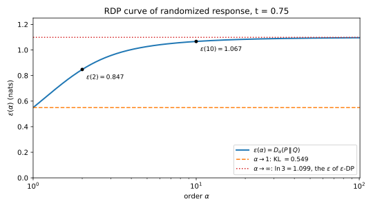

# Rényi differential privacy

You train a model with 1000 steps of full-batch noisy gradient descent. Each step releases a quantity whose **sensitivity** is 1, meaning that changing one person's record moves it by at most 1, and adds Gaussian noise whose standard deviation is $\sigma = 20$ times that sensitivity. The number $\sigma$ is the **noise multiplier**. What is the total $(\varepsilon, \delta)$ differential privacy (DP) guarantee at $\delta = 10^{-5}$? [Advanced and optimal composition](../part03-dp-foundations/04-composition.md) turns each step into a single pair $(\varepsilon_0, \delta_0)$ and composes the steps at a cost that grows like $\sqrt k$ in their number $k$, which here gives $\varepsilon = 68.01$. The true answer is $\varepsilon = 7.51$, because 1000 Gaussian steps behave like one Gaussian step with noise multiplier $\sigma/\sqrt{1000}$.

The overestimate comes from the first move. A Gaussian step has a whole curve of valid pairs $(\varepsilon_0, \delta_0)$, and collapsing it to one point throws away what composition needs. **Rényi differential privacy (RDP)** keeps a curve instead, one that adds. For each **order** $\alpha > 1$ it records the Rényi divergence between the outputs on neighbouring datasets, an exponential moment of the privacy loss. Curves add under composition, because a moment of a product of independent likelihood ratios is a product of moments, and the summed curve converts to $(\varepsilon, \delta)$ once, at the end, by a Chernoff bound. For the 1000 steps this gives $\varepsilon = 8.84$, 18% above the exact 7.51.

Two running examples carry the chapter: randomized response, which reports one person's bit truthfully with probability $t = 0.75$, and the 1000 Gaussian steps. Neighbouring datasets $D \sim D'$ differ by adding or removing one record, and for randomized response they are the two values of one person's bit. @tbl-rdp-symbols lists the symbols.

| Symbol | Meaning |
| --- | --- |
| $M$; $D \sim D'$ | a mechanism; two neighbouring datasets |
| $P$, $Q$; $p$, $q$ | the output distributions $M(D)$ and $M(D')$; their densities or mass functions |
| $r = p/q$; $L = \ln r$ | the likelihood ratio of an output; the privacy loss |
| $\alpha$; $D_\alpha$ | the Rényi order, always above 1; the Rényi divergence of that order |
| $\varepsilon_M(\alpha)$, or $\varepsilon(\alpha)$ | the RDP curve of $M$ |
| $\sigma$; $b$; $t$ | the Gaussian noise multiplier; the Laplace scale; the truth probability of randomized response |
| $k$; $\mu$ | the number of composed mechanisms; the shift of a Gaussian pair in standard deviations |
| $K_M(\lambda)$ | the log-moment of the moments accountant, with $\lambda = \alpha - 1$ |

: The symbols of this chapter. {#tbl-rdp-symbols}

## Rényi differential privacy {#sec-rdp-definition}

Pure $\varepsilon$-DP bounds the privacy loss at every output, and $(\varepsilon, \delta)$-DP lets that bound fail on outputs of total probability $\delta$. Both summarize the distribution of the privacy loss by one point of its upper tail. Before any accounting can start, you need a summary of the whole tail that composition preserves, and this section defines it.

Fix a mechanism $M$ and neighbours $D \sim D'$, and write $P = M(D)$ and $Q = M(D')$ for the two output distributions, with densities or mass functions $p$ and $q$. The **likelihood ratio** $r = p/q$ says how many times likelier an output is under $D$ than under $D'$. Its logarithm $L = \ln r$ is the **privacy loss** of [Advanced and optimal composition](../part03-dp-foundations/04-composition.md) (@def-comp-loss). The Rényi divergence $D_\alpha$ of order $\alpha > 1$ (@def-div-renyi) is the logarithm of a moment of $r$, divided by $\alpha - 1$. By @prp-div-renyi-forms that moment can be taken under either distribution, and under $P$ it is an exponential moment of the loss:
$$e^{(\alpha - 1)D_\alpha(P\|Q)} = \mathbb E_Q\big[r^\alpha\big] = \mathbb E_P\big[e^{(\alpha - 1)L}\big].$$ {#eq-rdp-moment}
The second equality is the change of measure of @lem-div-change-of-measure, which turns an average under $P$ into an average under $Q$ with each output reweighted by $r$. An exponential moment weights large losses more heavily than small ones, and the more so the larger the order. So small orders see the typical loss and large orders the worst case, and a bound at every order describes the whole upper tail.

::: {#def-rdp-rdp name="Rényi differential privacy"}
Let $\alpha > 1$. A mechanism $M$ is **$(\alpha, \varepsilon)$-RDP** if for all neighbouring datasets $D \sim D'$
$$D_\alpha\big(M(D)\,\|\,M(D')\big) \le \varepsilon.$$
The **RDP curve** of $M$ records, at each order, the smallest $\varepsilon$ that works, which is the divergence of the worst pair of neighbours:
$$\varepsilon_M(\alpha) = \sup_{D \sim D'} D_\alpha\big(M(D)\,\|\,M(D')\big).$$
:::

The curve inherits the shape of each pair's divergence. [Divergences](../part01-prerequisites/03-divergences.md) showed that this divergence rises from the Kullback–Leibler (KL) divergence at order 1 to the max-divergence $D_\infty$, the largest privacy loss, as the order grows. The top of that range is pure DP, so pure DP is one point of the curve.

::: {#prp-rdp-ends name="The two ends of the RDP curve"}
Let $M$ be a mechanism, and write $\varepsilon_M(\infty)$ for the supremum over neighbours of $D_\infty\big(M(D)\|M(D')\big)$. Then:

1. $M$ is $\varepsilon$-DP if and only if $\varepsilon_M(\infty) \le \varepsilon$.
2. $\varepsilon_M(\alpha)$ is non-decreasing in $\alpha$, so an $\varepsilon$-DP mechanism is $(\alpha, \varepsilon)$-RDP at every order.
3. At every order, $\varepsilon_M(\alpha)$ is at least the largest KL divergence $D_{\mathrm{KL}}\big(M(D)\|M(D')\big)$ over neighbours, and so the limit of the curve as $\alpha \to 1$ is at least that KL divergence too.
:::

::: {.proof}
1. *Pure DP is the max-divergence.* $\varepsilon$-DP says that $\Pr_P[S] \le e^\varepsilon\Pr_Q[S]$ for every event $S$ and every pair of neighbours. By @thm-div-renyi, the largest log-ratio $\ln(\Pr_P[S]/\Pr_Q[S])$ over events is $D_\infty(P\|Q)$. So the condition holds for all pairs exactly when every $D_\infty$ is at most $\varepsilon$, which is $\varepsilon_M(\infty) \le \varepsilon$.
2. *Monotonicity.* Each pair's $D_\alpha$ is non-decreasing in $\alpha$, by the monotonicity of @thm-div-renyi. If every function of a family is at least as large at each $\alpha' > \alpha$ as at $\alpha$, so is the largest of them. Together with step 1, this gives $\varepsilon_M(\alpha) \le \varepsilon_M(\infty) \le \varepsilon$ for an $\varepsilon$-DP mechanism.
3. *The KL end.* The monotonicity of @thm-div-renyi covers all orders, and KL is the order 1, so it gives $D_\alpha \ge D_{\mathrm{KL}}$ for each pair. Taking the supremum over pairs keeps the inequality, and a limit of numbers that are all at least some value is at least that value.
:::

The limit at order 1 equals the largest KL for every mechanism of this chapter, though in general the limit and the supremum over pairs need not commute. An RDP guarantee is a curve, not a number, and every point of it is a valid guarantee.

A mechanism whose loss is usually small but occasionally large has a small KL divergence but large high-order divergences, so it is caught at large orders. Orders below 1 exist as divergences but are not used for privacy, because the conversion of @sec-rdp-conversion needs the moment of @eq-rdp-moment with a positive exponent $\alpha - 1$.

::: {#exm-rdp-rr name="Randomized response, outcome by outcome"}
Randomized response (@def-dpdef-rr) reports one person's bit truthfully with probability $t = 0.75$ and flips it otherwise. @tbl-rdp-rr lists its outputs when the true bit is 1 ($P$) and 0 ($Q$). The likelihood ratio of each output is 3 or $1/3$, so the mechanism is $\varepsilon$-DP with $\varepsilon = \ln\frac{t}{1-t} = \ln 3$.

| Output $y$ | $p(y)$ (bit is 1) | $q(y)$ (bit is 0) | $r(y)$ | $L(y)$ | $p(y)^2/q(y)$ |
| --- | --- | --- | --- | --- | --- |
| 1 | 0.75 | 0.25 | 3 | 1.0986 | 2.2500 |
| 0 | 0.25 | 0.75 | 1/3 | −1.0986 | 0.0833 |

: Randomized response with truth probability $t = 0.75$. The last column gives the terms of $\mathbb E_Q[r^2]$, the moment of @eq-rdp-moment at order 2. {#tbl-rdp-rr}

At order 2, @eq-rdp-moment says that $e^{D_2}$ is the sum of $p(y)^2/q(y)$ over the outputs, which is the last column:
$$e^{D_2} = 2.2500 + 0.0833 = 2.3333, \qquad \varepsilon(2) = \ln 2.3333 = 0.8473.$$
The same recipe works at any order, and it gives @eq-rdp-rr of the next section. Swapping the two bits turns the terms into $q(y)^2/p(y)$, which are 0.0833 and 2.2500, the same sum, so both directions of the pair have the same curve. @tbl-rdp-rr-orders gives it at a few orders.

| $\alpha$ | 1 (KL) | 1.5 | 2 | 5 | 10 | 64 | $\infty$ |
| --- | --- | --- | --- | --- | --- | --- | --- |
| $\varepsilon(\alpha)$ | 0.5493 | 0.7340 | 0.8473 | 1.0267 | 1.0666 | 1.0940 | 1.0986 |

: The RDP curve of randomized response with $t = 0.75$. {#tbl-rdp-rr-orders}

The curve rises from the KL value to the pure DP level (@fig-rdp-rr-curve). At the bottom is the average loss under $P$, which is $\ln 3$ with probability 0.75 and $-\ln 3$ with probability 0.25, so it is $0.5\ln 3 = 0.5493$. At the top is the largest loss, $\ln 3 = 1.0986$, and the chapter's script (@sec-rdp-code) finds 0.5494 at $\alpha = 1.0001$ and 1.0983 at $\alpha = 1000$. For a pure DP mechanism like this one the curve tells you little beyond $\ln 3$. It matters most when $D_\infty$ is large or infinite.
:::

{#fig-rdp-rr-curve}

## RDP curves of the basic mechanisms {#sec-rdp-curves}

To account for a mechanism you need its curve, and this section computes it for the three mechanisms every accountant starts from. A mechanism that adds noise to a query's answer produces, on two neighbours, the same noise distribution centred at two different answers. So its curve comes from the Rényi divergence between the noise and a shifted copy of itself, which [Divergences](../part01-prerequisites/03-divergences.md) computed for the normal and the Laplace distributions. The only new step is the supremum over neighbours, and for these mechanisms the worst pair is the one whose answers are furthest apart.

The Gaussian mechanism adds $\mathcal N(0, \sigma^2 I_d)$ noise to a query $f$ whose $\ell_2$ sensitivity $\Delta_2 f$, the largest Euclidean distance between its answers on neighbours, is 1. The Laplace mechanism of @thm-lg-laplace adds noise with density $\frac1{2b}e^{-|z|/b}$ to a real-valued query whose sensitivity $\Delta_1 f$, the largest $|f(D) - f(D')|$ over neighbours, is 1. The three formulas are Corollaries 3 and 2 and Table 2 of Mironov (2017), and @sec-apx-ccomp-rdp in the appendices derives the Gaussian curve from scratch by completing the square.

::: {#thm-rdp-curves name="RDP curves of the Gaussian, Laplace and randomized response mechanisms"}
Let $\alpha > 1$. The Gaussian mechanism with noise multiplier $\sigma$, on a query with $\Delta_2 f = 1$, has the curve
$$\varepsilon(\alpha) = \frac{\alpha}{2\sigma^2}.$$ {#eq-rdp-gauss}
The Laplace mechanism with scale $b$, on a real-valued query with $\Delta_1 f = 1$, has the curve
$$\varepsilon(\alpha) = \frac{1}{\alpha - 1}\ln\left(\frac{\alpha}{2\alpha - 1}e^{(\alpha - 1)/b} + \frac{\alpha - 1}{2\alpha - 1}e^{-\alpha/b}\right).$$ {#eq-rdp-laplace}
Randomized response with truth probability $t \in (\frac12, 1)$ has the curve
$$\varepsilon(\alpha) = \frac{1}{\alpha - 1}\ln\Big(t^\alpha(1-t)^{1-\alpha} + (1-t)^\alpha t^{1-\alpha}\Big).$$ {#eq-rdp-rr}
:::

::: {.proof}
The plan is the same for both noise mechanisms: reduce a pair of neighbours to the noise against a shifted copy, read its divergence off [Divergences](../part01-prerequisites/03-divergences.md), and show that the largest shift is the worst. Randomized response needs only the sum.

1. *Gaussian, one pair.* On neighbours the outputs are $\mathcal N(f(D), \sigma^2 I_d)$ and $\mathcal N(f(D'), \sigma^2 I_d)$, whose $d$ coordinates are independent. Coordinate $i$ is a pair of normals whose means are some distance $s_i$ apart, with divergence $\alpha s_i^2/(2\sigma^2)$ by @prp-div-gauss. Rényi divergences add over independent coordinates, by the additivity of @thm-div-renyi, so the pair has
$$D_\alpha = \frac{\alpha\sum_i s_i^2}{2\sigma^2} = \frac{\alpha\,\|f(D) - f(D')\|_2^2}{2\sigma^2}.$$
2. *Gaussian, worst pair.* The divergence grows with the distance between the answers, which is at most $\Delta_2 f = 1$, so the supremum over neighbours is @eq-rdp-gauss.
3. *Laplace, one pair.* Translating the output is a relabelling that changes no divergence, so the pair is $\mathrm{Lap}(0, b)$ against $\mathrm{Lap}(s, b)$, with $s = |f(D) - f(D')| \le 1$. @prp-div-laplace gives its divergence, which is @eq-rdp-laplace with $1/b$ replaced by the shift in scale units, $s/b$. The reverse pair has the same divergence, because the reflection $y \mapsto s - y$ swaps the two distributions.
4. *Laplace, worst pair.* You need the divergence to grow with the shift. Write $x = s/b$ and let $g(x)$ be the argument of the logarithm, $\frac{\alpha}{2\alpha - 1}e^{(\alpha - 1)x} + \frac{\alpha - 1}{2\alpha - 1}e^{-\alpha x}$. Differentiating each exponential gives
$$g'(x) = \frac{\alpha(\alpha - 1)}{2\alpha - 1}\big(e^{(\alpha - 1)x} - e^{-\alpha x}\big),$$
which is positive for $x > 0$, because the first exponent is positive and the second negative. The logarithm and the factor $1/(\alpha - 1)$ keep the divergence increasing, so the worst pair has $s = 1$, and the supremum is @eq-rdp-laplace.
5. *Randomized response.* There is only one pair of inputs, the two values of the bit, so no supremum is needed. In the sum of $p^\alpha q^{1-\alpha}$, output 1 contributes $t^\alpha(1-t)^{1-\alpha}$ and output 0 contributes $(1-t)^\alpha t^{1-\alpha}$. Taking the logarithm and dividing by $\alpha - 1$ gives @eq-rdp-rr.
:::

Two shapes appear in @fig-rdp-curves, and which one you get depends on whether the privacy loss is bounded. A bounded loss makes the curve level off. For randomized response the loss is $\pm\ln 3$, and for Laplace with answers 0 and 1 it is $(|y - 1| - |y|)/b$, which the triangle inequality keeps within $1/b$ of zero. Every $D_\alpha$ is at most the largest loss, so the two curves rise towards $\ln 3$ and $1/b$ and stay below them. The Laplace curve approaches $1/b$ like $\frac1b - \frac{\ln 2}{\alpha - 1}$: the first term of @eq-rdp-laplace dominates and its coefficient tends to $\frac12$, so the logarithm is close to $(\alpha - 1)/b - \ln 2$. At $\alpha = 512$ with $b = 1$, the formula and this approximation both give 0.9986.

An unbounded loss makes the curve grow without bound. The Gaussian privacy loss is a straight line in the output (@lem-lg-gaussian-loss), so it has no maximum, and the Gaussian mechanism is not $\varepsilon$-DP for any $\varepsilon$. It is still RDP at every finite order, which is all that composition and conversion need. A curve that is a straight line through the origin is the mark of a normal privacy loss, and [Concentrated DP](03-concentrated-dp.md) builds a definition on such lines.

{#fig-rdp-curves}

::: {#exm-rdp-curves}
@tbl-rdp-curves gives the three curves at four orders, from the script. The Gaussian row is $\alpha/2$, read off at each order.

| Mechanism | $\varepsilon(1.5)$ | $\varepsilon(2)$ | $\varepsilon(10)$ | $\varepsilon(64)$ | $\varepsilon(\infty)$ |
| --- | --- | --- | --- | --- | --- |
| Gaussian, $\sigma = 1$ | 0.7500 | 1.0000 | 5.0000 | 32.0000 | $\infty$ |
| Laplace, $b = 1$ | 0.5129 | 0.6191 | 0.9287 | 0.9891 | 1 |
| Randomized response, $t = 0.75$ | 0.7340 | 0.8473 | 1.0666 | 1.0940 | 1.0986 |

: RDP curves of the three basic mechanisms with sensitivity 1. {#tbl-rdp-curves}

You can check the Laplace row by hand at order 2. The coefficients in @eq-rdp-laplace are $\frac23$ and $\frac13$, the prefactor $1/(\alpha - 1)$ is 1, and with $b = 1$
$$\varepsilon(2) = \ln\Big(\tfrac23e + \tfrac13e^{-2}\Big) = 0.6191,$$
the same number as in Part 1's Laplace example. As $\alpha \to 1$ the Laplace curve tends to the KL divergence of @prp-div-laplace, $1/b + e^{-1/b} - 1 = 0.3679$. Both noise curves agree with direct numerical integration of $p^\alpha q^{1-\alpha}$ (@tbl-rdp-code).
:::

## Composition {#sec-rdp-composition}

Training a model runs thousands of mechanisms, each chosen after seeing the outputs of the earlier ones, and you need the curve of the whole run. For independent mechanisms the answer is the additivity of @thm-div-renyi: the moment of @eq-rdp-moment splits into a product, and the logarithm turns it into a sum. Adaptive composition is not a product of independent distributions, because the second mechanism depends on the first output. The theorem below shows that the curves still add, as long as each step's curve is bounded whatever the earlier outputs were.

The result is Mironov (2017), Proposition 1. @sec-apx-ccomp-rdp in the appendices derives it from scratch, and @sec-apx-ccomp-compare compares it with the other accountants on one mechanism.

::: {#thm-rdp-composition name="Adaptive composition of RDP curves"}
Let $M_1$ have RDP curve $\varepsilon_1$. Let $M_2(\cdot\,; y_1)$ be a mechanism chosen using the first output $y_1$, and let $\varepsilon_2$ be a curve, fixed in advance, that bounds the RDP curve of $M_2(\cdot\,; y_1)$ for every $y_1$. The **adaptive composition** $M$ releases both outputs, $M(D) = (y_1, y_2)$, with $y_1 \sim M_1(D)$ and $y_2 \sim M_2(D; y_1)$. Then for every $\alpha > 1$
$$\varepsilon_M(\alpha) \le \varepsilon_1(\alpha) + \varepsilon_2(\alpha).$$ {#eq-rdp-compose}
By induction, treating the first $k - 1$ steps as one mechanism, $k$ adaptively chosen mechanisms have a curve of at most $\sum_{i=1}^k \varepsilon_i(\alpha)$.
:::

::: {.proof}
The plan is to factor the joint density, write the moment as a double integral, bound the inner integral uniformly, and recognize the outer one. Fix neighbours $D \sim D'$ and an order $\alpha > 1$. Write $p_1, q_1$ for the densities of $y_1$ under $D$ and $D'$, and $p_2(\cdot \mid y_1), q_2(\cdot \mid y_1)$ for those of $y_2$ given $y_1$.

1. *Factor the joint densities.* By the definition of the composition, $y_1$ is drawn first and $y_2$ is drawn given $y_1$, so $p(y_1, y_2) = p_1(y_1)\,p_2(y_2 \mid y_1)$, and the same holds for $q$.
2. *Write the moment as a double integral.* By @eq-rdp-moment, the moment is the integral of $p^\alpha q^{1-\alpha}$. A power of a product is the product of the powers, so the integrand splits into a factor for $y_1$ and a factor for $y_2$ given $y_1$:
$$e^{(\alpha - 1)D_\alpha(P\|Q)} = \int p_1^\alpha q_1^{1-\alpha}\left(\int p_2(y_2\mid y_1)^\alpha q_2(y_2\mid y_1)^{1-\alpha}\,\mathrm dy_2\right)\mathrm dy_1.$$
3. *Bound the inner integral.* With $y_1$ fixed, the inner integral is $e^{(\alpha - 1)D_\alpha}$ for the two outputs of $M_2(\cdot\,; y_1)$ on $D$ and $D'$, by @eq-rdp-moment again. That divergence is at most $\varepsilon_2(\alpha)$, and the exponential is increasing because $\alpha - 1 > 0$. So, whatever $y_1$ is,
$$\int p_2(y_2\mid y_1)^\alpha q_2(y_2\mid y_1)^{1-\alpha}\,\mathrm dy_2 \le e^{(\alpha - 1)\varepsilon_2(\alpha)}.$$
4. *Recognize the outer integral.* Pull that constant out. What is left is $\int p_1^\alpha q_1^{1-\alpha}\,\mathrm dy_1$, which by @eq-rdp-moment is $e^{(\alpha - 1)D_\alpha(P_1\|Q_1)}$, at most $e^{(\alpha - 1)\varepsilon_1(\alpha)}$. So
$$e^{(\alpha - 1)D_\alpha(P\|Q)} \le e^{(\alpha - 1)\varepsilon_2(\alpha)}\,e^{(\alpha - 1)\varepsilon_1(\alpha)}.$$
5. *Take logarithms.* Dividing by $\alpha - 1$ gives $D_\alpha(P\|Q) \le \varepsilon_1(\alpha) + \varepsilon_2(\alpha)$ for this pair. The right side does not depend on the pair, so the supremum over neighbours satisfies the same bound.
:::

The bound is exact for independent mechanisms, because then the inner divergence in step 3 is the same for every $y_1$ and replacing it by its worst case loses nothing. The factorization of step 2 is why composition works for RDP and not for $(\varepsilon, \delta)$ directly. The smallest $\delta$ at a given $\varepsilon$ is the hockey-stick divergence $\int(p - e^\varepsilon q)_+$, where $(x)_+ = \max(x, 0)$, and a positive part of a difference does not factorize over the steps the way the moment of step 2 does.

One condition remains. The mechanisms can be chosen adaptively, but each step's curve bound $\varepsilon_i$ must be fixed in advance and must not depend on the data. When the budget itself is chosen on the fly, you need the filters and odometers of [Adaptive composition](08-adaptive-composition.md).

::: {#exm-rdp-composition}
To see the steps on numbers, take an adaptive pair of randomized responses. The first step reports the bit with truth probability 0.75. The second reports it again, with truth probability 0.75 if the first output was 1 and 0.6 if it was 0. @tbl-rdp-adaptive lists the four joint outcomes when the true bit is 1 ($P$) and 0 ($Q$). Each joint probability is the first step's probability times the second's, as in step 1.

| $(y_1, y_2)$ | $p(y_1, y_2)$ | $q(y_1, y_2)$ | $p^2/q$ |
| --- | --- | --- | --- |
| (1, 1) | $0.75 \times 0.75 = 0.5625$ | $0.25 \times 0.25 = 0.0625$ | 5.0625 |
| (1, 0) | $0.75 \times 0.25 = 0.1875$ | $0.25 \times 0.75 = 0.1875$ | 0.1875 |
| (0, 1) | $0.25 \times 0.6 = 0.15$ | $0.75 \times 0.4 = 0.3$ | 0.0750 |
| (0, 0) | $0.25 \times 0.4 = 0.1$ | $0.75 \times 0.6 = 0.45$ | 0.0222 |

: Two adaptive randomized responses: the second truth probability depends on the first output. The last column gives the terms of the moment at order 2. {#tbl-rdp-adaptive}

The terms sum to 5.3472, so $D_2 = \ln 5.3472 = 1.6766$. The bound adds the first step's curve to the worst curve the second step can have. At order 2 the second step's curve is 0.8473 on the branch $y_1 = 1$ and 0.1542 on the branch $y_1 = 0$, by @eq-rdp-rr with $t = 0.75$ and $t = 0.6$. So the bound is $0.8473 + \max(0.8473, 0.1542) = 1.6946$. It holds, and it is loose by $1.6946 - 1.6766 = 0.0180$, because step 3 replaced the inner divergence on the branch $y_1 = 0$ by its worst case. When the second step does not adapt, with truth probability 0.75 on both branches, the joint distribution is a product and $D_2 = 1.6946$ exactly.

For the opening's Gaussian steps with $\sigma = 20$, each step has the curve $\alpha/(2 \cdot 20^2) = \alpha/800$, and $k$ steps have $k\alpha/800$. Setting $k\alpha/800 = \alpha/(2\sigma'^2)$ shows that this is the curve of one Gaussian step with noise multiplier $\sigma' = 20/\sqrt k$. At $k = 1000$ the curve is $1.2500\,\alpha$, one Gaussian with $\sigma' = 0.6325$, and the function `compose_rdp`, which adds 1000 copies of the curve on the grid of orders, returns 2.5000 at $\alpha = 2$. Different mechanisms compose just as easily, order by order: a Laplace step with $b = 1$ followed by a Gaussian step with $\sigma = 1$ has $\varepsilon(2) = 0.6191 + 1 = 1.6191$, from @tbl-rdp-curves.
:::

## Post-processing and group privacy {#sec-rdp-properties}

Two properties of DP should carry over to RDP. Post-processing matters because a released model or its predictions must not leak more than the training run that produced them. Group privacy matters because records are correlated: a family shares a household, and one user contributes many rows. For $\varepsilon$-DP, a group of $k$ records gets $k\varepsilon$ (@thm-dpprop-group), because the likelihood ratios along a chain of $k$ neighbours multiply. For RDP the answer is weaker. The Rényi divergence has no plain triangle inequality, only one that bounds each link of the chain at a higher order, so the order of the group guarantee shrinks as the group grows.

Post-processing is the data-processing inequality of @thm-div-dpi, applied to every pair of neighbours: a map that acts on the output alone can only make the two output distributions harder to tell apart.

::: {#thm-rdp-post name="Post-processing"}
Let $M$ be a mechanism and $g$ a randomized map applied to its output that does not read the data. Then $\varepsilon_{g\circ M}(\alpha) \le \varepsilon_M(\alpha)$ for every $\alpha > 1$.
:::

::: {.proof}
1. For each pair of neighbours, $g \circ M(D)$ is $M(D)$ passed through the channel $g$, the same channel whichever dataset was used. So $D_\alpha$ can only decrease, by @thm-div-dpi.
2. The inequality holds for every pair, so it holds for the supremum.
:::

Step 1 is where $g$ must ignore the data: a map that reads the data is not a channel, and it could simply print a record.

Group privacy walks from $D$ to $D'$ through a dataset that differs from each in one record, so it needs a bound on the divergence across two steps. The weak triangle inequality gives one, at the price of higher orders on the two legs. Two exponents $u$ and $v$ choose how the cost is split between the legs, and the proof separates the legs with Hölder's inequality.

::: {#lem-rdp-weak-triangle name="Weak triangle inequality (Mironov 2017, Proposition 11)"}
Let $P$, $R$ and $Q$ be distributions, let $\alpha > 1$, and let $u, v > 1$ with $\frac1u + \frac1v = 1$. Then
$$D_\alpha(P\|Q) \le \frac{\alpha - 1/u}{\alpha - 1}D_{u\alpha}(P\|R) + D_{v(\alpha - 1) + 1}(R\|Q).$$ {#eq-rdp-weak-triangle}
The even split $u = v = 2$ doubles the order on the first leg and nearly doubles it on the second:
$$D_\alpha(P\|Q) \le \frac{\alpha - 1/2}{\alpha - 1}D_{2\alpha}(P\|R) + D_{2\alpha - 1}(R\|Q).$$ {#eq-rdp-weak-triangle-2}
:::

::: {.proof}
The plan is to write the moment for $P$ against $Q$ as an average under $R$ of a product of two likelihood ratios, separate the two factors with Hölder's inequality, and recognize each factor as a Rényi moment. Write $p$, $p_R$ and $q$ for the densities of $P$, $R$ and $Q$.

1. *Insert the middle distribution.* The exponents of $p_R$ in $(p/p_R)^\alpha (p_R/q)^{\alpha-1} p_R$ add to 0, so the product is $p^\alpha q^{1-\alpha}$. With @eq-rdp-moment this gives
$$e^{(\alpha - 1)D_\alpha(P\|Q)} = \mathbb E_R\Big[\Big(\frac{p}{p_R}\Big)^\alpha\Big(\frac{p_R}{q}\Big)^{\alpha - 1}\Big].$$
2. *Separate the two ratios.* Hölder's inequality bounds the average of a product of two non-negative quantities $X$ and $Y$ by a product of their higher moments, $\mathbb E_R[XY] \le \big(\mathbb E_R X^u\big)^{1/u}\big(\mathbb E_R Y^v\big)^{1/v}$, and with $u = v = 2$ it is the Cauchy–Schwarz inequality. Apply it with $X = (p/p_R)^\alpha$ and $Y = (p_R/q)^{\alpha-1}$.
3. *The first factor.* $\mathbb E_R[X^u]$ is the moment of the ratio $p/p_R$ at order $u\alpha$ under $R$. By @eq-rdp-moment at order $u\alpha$, it equals $e^{(u\alpha - 1)D_{u\alpha}(P\|R)}$.
4. *The second factor.* $\mathbb E_R[Y^v]$ is an average under $R$, and the change of measure from $R$ to $Q$ multiplies the integrand by $p_R/q$. So it equals $\mathbb E_Q\big[(p_R/q)^{v(\alpha - 1) + 1}\big]$, which by @eq-rdp-moment is $e^{v(\alpha - 1)D_{v(\alpha-1)+1}(R\|Q)}$.
5. *Combine.* Raising the factors to the powers $1/u$ and $1/v$ and taking logarithms gives
$$(\alpha - 1)D_\alpha(P\|Q) \le \frac{u\alpha - 1}{u}D_{u\alpha}(P\|R) + (\alpha - 1)D_{v(\alpha-1)+1}(R\|Q).$$
Dividing by $\alpha - 1$ gives @eq-rdp-weak-triangle, since $\frac{u\alpha - 1}{u} = \alpha - \frac1u$. With $u = v = 2$ the second order is $2\alpha - 1$, which gives @eq-rdp-weak-triangle-2.
:::

Applied to a group of two records, the lemma halves the order and costs a constant factor in $\varepsilon$. Repeating it handles groups of $2^c$ records, where $c$ is the number of doublings.

::: {#thm-rdp-group name="Group privacy in RDP (Mironov 2017, Proposition 2)"}
Let $M$ be $(\alpha, \varepsilon)$-RDP, let $c \ge 1$ be an integer, and suppose $\alpha \ge 2^{c+1}$. Then for any two datasets that differ in $2^c$ records, $M$ satisfies the RDP bound of order $\alpha/2^c$ with $\varepsilon$ replaced by $3^c\varepsilon$.
:::

::: {.proof}
The plan is to prove the case of two records by walking through an intermediate dataset, and then to repeat it for larger groups.

1. *Two records, the walk.* Let $D$ and $D'$ differ in two records, and let $D_1$ be the dataset in between, a neighbour of both. Put $P = M(D)$, $R = M(D_1)$ and $Q = M(D')$, and let $\beta = \alpha/2 \ge 2$ be the order of the group guarantee. Applying @eq-rdp-weak-triangle-2 at order $\beta$ turns its orders into $2\beta = \alpha$ and $2\beta - 1 = \alpha - 1$:
$$D_\beta(P\|Q) \le \frac{\beta - 1/2}{\beta - 1}D_{\alpha}(P\|R) + D_{\alpha - 1}(R\|Q).$$
2. *Two records, the legs.* Both legs are pairs of neighbours, so $D_\alpha(P\|R) \le \varepsilon$. By the monotonicity of @prp-rdp-ends, $D_{\alpha-1}(R\|Q) \le D_\alpha(R\|Q) \le \varepsilon$.
3. *Two records, the factor.* The factor $\frac{\beta - 1/2}{\beta - 1} = 1 + \frac{1/2}{\beta - 1}$ decreases in $\beta$ and equals $\frac32$ at $\beta = 2$, so it is at most $\frac32$. Hence
$$D_\beta(P\|Q) \le \tfrac32\varepsilon + \varepsilon = \tfrac52\varepsilon \le 3\varepsilon.$$
Mironov states the bound with the constant 3, while the argument gives $\frac52$.
4. *Larger groups.* A group of $2^c$ records is two groups of $2^{c-1}$ records, so each round of steps 1 to 3 halves the order and multiplies $\varepsilon$ by 3. After $c$ rounds the order is $\alpha/2^c$ and the bound is $3^c\varepsilon$, and the condition $\alpha \ge 2^{c+1}$ keeps the order of the last round at least 2.
:::

Each doubling of the group costs half the order as well as a factor in $\varepsilon$. The reason is step 2 of the lemma's proof: the divergence across two steps involves a product of two likelihood ratios, and controlling the average of a product needs higher moments of each factor. On the Gaussian the exact answer is known: a group of $2^c$ records shifts a query of sensitivity 1 by up to $2^c$, so the exact group curve is $\alpha(2^c)^2/(2\sigma^2)$, which @tbl-rdp-group compares with the bounds at $\sigma = 1$. For two records the exact value at order $\beta$ is $4\beta/(2\sigma^2) = 2\varepsilon(2\beta)$ and the theorem gives $3\varepsilon(2\beta)$, a factor 1.5, and the factor compounds to $1.5^c$ for $2^c$ records.

So use the mechanism's own curve when you can: for the Gaussian it is the curve with sensitivity $2^c$. For a mechanism that is already $\varepsilon$-DP, the pure DP group bound $k\varepsilon$ holds at every order by @prp-rdp-ends, and it can beat the RDP route.

| Group size $2^c$, order | Exact | Weak triangle, iterated | Proposition 2: $3^c\varepsilon(2^c\beta)$ | Proposition 2 / exact |
| --- | --- | --- | --- | --- |
| 2, $\beta = 2$ | 4.0000 | 4.5000 | 6.0000 | 1.5000 |
| 2, $\beta = 4$ | 8.0000 | 8.1667 | 12.0000 | 1.5000 |
| 2, $\beta = 10$ | 20.0000 | 20.0556 | 30.0000 | 1.5000 |
| 4, $\beta = 2$ | 16.0000 | 18.5000 | 36.0000 | 2.2500 |
| 8, $\beta = 2$ | 64.0000 | 74.5000 | 216.0000 | 3.3750 |

: Group privacy for the Gaussian mechanism with $\sigma = 1$: the exact curve on inputs $2^c$ records apart against the two bounds. {#tbl-rdp-group}

{#fig-rdp-group}

::: {#exm-rdp-group}
Post-processing first. Pass the output of randomized response with $t = 0.75$ through a channel that flips it with probability 0.2. When the bit is 1, the final output is 1 if the first output was 1 and kept, or 0 and flipped, which has probability $0.75 \times 0.8 + 0.25 \times 0.2 = 0.65$. When the bit is 0, the same event has probability $0.25 \times 0.8 + 0.75 \times 0.2 = 0.35$. So the two output distributions are now closer, and $D_2$ drops from 0.8473 to $\ln\big(0.65^2/0.35 + 0.35^2/0.65\big) = 0.3333$, and $D_\infty$ drops from 1.0986 to $\ln(0.65/0.35) = 0.6190$.

For group privacy, check the first row of @tbl-rdp-group by hand, two records at $\beta = 2$ with $\sigma = 1$. The exact value is $2 \cdot 2^2/2 = 4$. The weak triangle inequality gives $\frac{1.5}{1}\varepsilon(4) + \varepsilon(3) = 1.5 \times 2 + 1.5 = 4.5$, and the theorem gives $3\varepsilon(4) = 3 \times 2 = 6$, which is $6/4 = 1.5$ times the exact value. @fig-rdp-group draws the whole two-record case. The weak-triangle bound hugs the exact line $2\beta$ for $\beta \ge 3$ and blows up near $\beta = 1$, where its factor $\frac{\beta - 1/2}{\beta - 1}$ does. For the Laplace mechanism with $b = 1$ at order 2, two records apart, the exact value is 1.5958, the weak triangle inequality gives 1.9674 and the theorem 2.4411, while the pure DP group bound $2/b = 2$ beats the theorem.
:::

## The moments accountant {#sec-rdp-moments}

Abadi et al. (2016) introduced the **moments accountant** to train neural networks with DP, before RDP existed, and many libraries still describe their accounting in its terms. For each $\lambda > 0$, in practice the integers up to 32, it tracks the logarithm of the moment generating function of the privacy loss, adds these numbers over the training steps, and converts the total to $(\varepsilon, \delta)$ with a tail bound. This section shows that it tracks the same object as the RDP curve, so everything in this chapter applies to it.

::: {#def-rdp-log-moment name="Log-moment of a mechanism"}
For $\lambda > 0$, the **log-moment** of a mechanism $M$ is the cumulant generating function of the privacy loss of the worst pair of neighbours,
$$K_M(\lambda) = \sup_{D \sim D'}\ln\mathbb E_{Y \sim M(D)}\big[e^{\lambda L(Y)}\big].$$
Abadi et al. write it $\alpha_M(\lambda)$, which clashes with the Rényi order.
:::

The moment inside the logarithm is the one in @eq-rdp-moment with $\alpha - 1 = \lambda$. So the log-moment is the RDP curve one order up, multiplied by $\lambda$.

::: {#prp-rdp-moments name="The moments accountant is RDP"}
For every mechanism $M$ and every $\lambda > 0$,
$$K_M(\lambda) = \lambda\,\varepsilon_M(\lambda + 1), \qquad\text{equivalently}\qquad \varepsilon_M(\alpha) = \frac{K_M(\alpha - 1)}{\alpha - 1}.$$ {#eq-rdp-moments}
:::

::: {.proof}
1. *The moment is a Rényi moment.* Fix neighbours. By @eq-rdp-moment at the order $\alpha = \lambda + 1$, $\mathbb E_P[e^{\lambda L}] = e^{\lambda D_\alpha(P\|Q)}$, and its logarithm is $\lambda D_\alpha(P\|Q)$.
2. *Take the supremum.* The factor $\lambda > 0$ does not change which pair of neighbours is worst, so the supremum of the left side is $K_M(\lambda)$ and that of the right side is $\lambda\,\varepsilon_M(\alpha) = \lambda\,\varepsilon_M(\lambda + 1)$.
:::

So the two parts of Abadi et al.'s Theorem 2 are results of this chapter. Composability, $K_M(\lambda) \le \sum_i K_{M_i}(\lambda)$, is @eq-rdp-compose at order $\lambda + 1$ multiplied by $\lambda$. The tail bound says that $M$ is $(\varepsilon, \delta)$-DP with $\delta = \min_\lambda\exp\big(K_M(\lambda) - \lambda\varepsilon\big)$. It is the conversion proved in the next section, @sec-rdp-conversion, read in the other direction, fixing $\varepsilon$ and solving for $\delta$. So the two accountants give the same numbers with different bookkeeping.

The identity itself is simple, so what was new in 2016 was a bound on $K_M(\lambda)$ for the *subsampled* Gaussian step of private stochastic gradient descent (SGD), called DP-SGD, in which each step uses a random fraction of the data. [Amplification by subsampling](05-subsampling.md) derives it in RDP form.

::: {#exm-rdp-moments}
For randomized response with $t = 0.75$ at $\lambda = 1$, the moment $\mathbb E_P[e^L] = 0.75 \times 3 + 0.25 \times \frac13$ has the same two terms, 2.2500 and 0.0833, as the last column of @tbl-rdp-rr, so its logarithm is $1 \cdot \varepsilon(2) = 0.8473$. At $\lambda = 2$, the direct sum and $2\varepsilon(3)$ both give 1.9136.

For the Gaussian pair $P = \mathcal N(0, 1)$ and $Q = \mathcal N(\mu, 1)$, the privacy loss under $P$ is normal with mean $\mu^2/2$ and variance $\mu^2$ (@lem-lg-gaussian-loss). A normal variable with mean $m$ and variance $s^2$ has the cumulant generating function $m\lambda + s^2\lambda^2/2$, so
$$K(\lambda) = \lambda\frac{\mu^2}{2} + \frac{\lambda^2\mu^2}{2} = \lambda\cdot\frac{(\lambda + 1)\mu^2}{2} = \lambda\,\varepsilon(\lambda + 1),$$
with $\varepsilon(\alpha) = \alpha\mu^2/2$, as @eq-rdp-moments says. At $\mu = 1$ the formula gives $K(1) = \frac12 + \frac12 = 1.0000$ and $K(2) = 1 + 2 = 3.0000$. Averaging $e^{\lambda L}$ over a million draws gives 1.0000 and 3.0003.
:::

## From RDP to (ε, δ) {#sec-rdp-conversion}

After composing, you hold a curve, but what you report is an $(\varepsilon, \delta)$ pair, because that guarantee has a direct meaning for every event. The conversion rests on one observation. Outputs whose privacy loss is at most some threshold $c$ already satisfy the $e^c$ bound, so only outputs with a larger loss can break it, and their total probability can be charged to $\delta$. That probability is a tail of the privacy loss. The Chernoff bound controls a tail with an exponential moment, which is exactly what each point of the RDP curve provides.

The tool is the Chernoff bound of @thm-conc-chernoff in [Concentration inequalities](../part01-prerequisites/02-concentration.md). For any random variable $X$, any level $c$ and any $\lambda > 0$, it says that $\Pr[X \ge c]$ is at most $e^{-\lambda c}\,\mathbb E[e^{\lambda X}]$. The converted $\varepsilon$ is then the RDP value plus a tail term, which pays for $\delta$ and shrinks as the order grows. This is Mironov (2017), Proposition 3, and @sec-apx-conv-rdp in the appendices derives it from scratch.

::: {#thm-rdp-conversion name="From RDP to (ε, δ)-DP"}
Let $M$ be $(\alpha, \varepsilon(\alpha))$-RDP for some order $\alpha > 1$. Then for every $0 < \delta < 1$, $M$ is $(\varepsilon_\delta, \delta)$-DP with
$$\varepsilon_\delta = \varepsilon(\alpha) + \frac{\ln(1/\delta)}{\alpha - 1}.$$ {#eq-rdp-mironov}
If you hold the whole curve, the best order gives $\varepsilon_\delta = \min_\alpha\big[\varepsilon(\alpha) + \ln(1/\delta)/(\alpha - 1)\big]$.
:::

::: {.proof}
The plan is to split every event into outputs with small loss, which satisfy the $e^c$ bound, and outputs with large loss, whose probability is a tail, and then to bound the tail with Chernoff. Fix neighbours with privacy loss $L$, and a threshold $c$ to be chosen.

1. *Split the event.* For any event $S$, $\Pr_P[S] = \Pr_P[S \cap \{L \le c\}] + \Pr_P[S \cap \{L > c\}]$.
2. *Small losses.* On $\{L \le c\}$ the definition of $L$ gives $p \le e^c q$. Integrating over $S \cap \{L \le c\}$, the first term is at most $e^c\Pr_Q[S]$.
3. *Large losses.* The set $S \cap \{L > c\}$ lies inside $\{L > c\}$, so the second term is at most $\Pr_P[L > c]$.
4. *Chernoff on the loss.* Apply @thm-conc-chernoff to $L$ under $P$ with $\lambda = \alpha - 1$:
$$\Pr_P[L > c] \le e^{-(\alpha-1)c}\,\mathbb E_P\big[e^{(\alpha - 1)L}\big].$$
By @eq-rdp-moment the average is $e^{(\alpha - 1)D_\alpha(P\|Q)}$, at most $e^{(\alpha - 1)\varepsilon(\alpha)}$, so
$$\Pr_P[L > c] \le e^{(\alpha - 1)(\varepsilon(\alpha) - c)}.$$
5. *Choose the threshold.* Setting $(\alpha - 1)(\varepsilon(\alpha) - c) = \ln\delta$ gives $c = \varepsilon(\alpha) + \ln(1/\delta)/(\alpha - 1)$. Then $\Pr_P[S] \le e^c\Pr_Q[S] + \delta$ for every event and every pair of neighbours, which is $(c, \delta)$-DP.
:::

For the Gaussian curve the best order has a closed form, because the curve grows with $\alpha$ while the tail term falls, and the minimum is where they balance.

::: {#cor-rdp-gauss-opt name="The best order for a Gaussian curve"}
For the Gaussian curve $\alpha/(2\sigma^2)$ and $0 < \delta < 1$, the right side of @eq-rdp-mironov, over all real orders $\alpha > 1$, is smallest at
$$\alpha^* = 1 + \sigma\sqrt{2\ln(1/\delta)}, \qquad \varepsilon_\delta = \frac{1}{2\sigma^2} + \frac{\sqrt{2\ln(1/\delta)}}{\sigma}.$$ {#eq-rdp-gauss-opt}
:::

::: {.proof}
1. *Substitute.* Write $a = \alpha - 1 > 0$ and $\ell = \ln(1/\delta)$. The Gaussian curve is $(a + 1)/(2\sigma^2)$, so @eq-rdp-mironov becomes $\varepsilon_\delta(a) = \frac{a + 1}{2\sigma^2} + \frac{\ell}{a}$.
2. *Set the derivative to zero.* The derivative $\frac{1}{2\sigma^2} - \frac{\ell}{a^2}$ vanishes at $a = \sigma\sqrt{2\ell}$. The function is a line plus $\ell/a$, whose second derivative $2\ell/a^3$ is positive, so this is the minimum.
3. *Evaluate.* At that $a$, both $\frac{a}{2\sigma^2}$ and $\frac{\ell}{a}$ equal $\frac{\sqrt{2\ell}}{2\sigma}$, so they add to $\sqrt{2\ell}/\sigma$. With the constant $\frac{1}{2\sigma^2}$, this is @eq-rdp-gauss-opt.
:::

The conversion gives something away in two places. Step 3 of the conversion's proof charges the whole tail $\Pr_P[L > c]$ to $\delta$. The exact smallest $\delta$ at level $c$ is the average $\mathbb E_P\big[(1 - e^{c - L})_+\big]$ (@lem-comp-delta), which charges an output with loss above $c$ only the fraction $1 - e^{c - L}$ of its probability. Step 4 then bounds the tail with a Chernoff bound, which overestimates it. [From RDP to (ε, δ) and to tests](02-rdp-conversions.md) removes much of both losses with sharper conversions.

The order trades two terms against each other. Small orders make the curve small but the tail term $\ln(1/\delta)/(\alpha - 1)$ large, and large orders do the opposite (@fig-rdp-conversion, left). A steeper composed curve makes large orders more expensive, so at $\delta = 10^{-5}$ one Gaussian step with $\sigma = 20$ wants $\alpha \approx 97$ while 1000 such steps want $\alpha \approx 4$. Because the best order ranges this widely, this part optimizes over one fixed grid that spans the range: 99 orders from 1.1 to 10.9 in steps of 0.1, the 52 integers from 12 to 63, and 128, 256 and 512, which is 154 orders:
```text
ORDERS = [1 + x / 10 for x in range(1, 100)] + list(range(12, 64)) + [128, 256, 512]
```

{#fig-rdp-conversion}

::: {#exm-rdp-conversion}
Take one Gaussian step with $\sigma = 1$ at $\delta = 10^{-5}$. Here $\ln(1/\delta) = 11.5129$ and $\sqrt{2\ln(1/\delta)} = 4.7985$. The curve is $\alpha/2$, and @eq-rdp-mironov adds $11.5129/(\alpha - 1)$. At $\alpha = 2$ the sum is $1.0000 + 11.5129 = 12.5129$, dominated by the tail term, and at $\alpha = 20$ it is $10.0000 + 0.6059 = 10.6059$, dominated by the curve. The grid's best order is 5.8, next to the continuous optimum $\alpha^* = 1 + 4.7985 = 5.7985$, and both give $\varepsilon = 5.2985$. The exact $\varepsilon$ comes from the privacy profile of @thm-lg-analytic with $\mu = 1/\sigma = 1$. Solving $\delta_\mu(\varepsilon) = 10^{-5}$ by bisection gives 4.3772, so the conversion is 21% too large ($5.2985/4.3772 = 1.21$). Read the other way, the mechanism at $\varepsilon = 5.2985$ has $\delta = 1.300 \times 10^{-7}$, which is 76.9 times smaller than the conversion promises.

Now the opening's problem, $k$ Gaussian steps with $\sigma = 20$ at $\delta = 10^{-5}$. @tbl-rdp-compare compares four ways to account for them. The exact value is available because $k$ steps are one Gaussian with $\mu = \sqrt k/\sigma$. The two routes of Part 3 turn each step into one point $(\varepsilon_0, \delta_0)$ of its exact curve and compose the points. Basic composition (@thm-dpprop-basic) spends $\delta/k$ per step and reports $k\varepsilon_0$. Advanced composition in its sharp form (@eq-comp-advanced-tanh) spends a fraction $s$ of $\delta$ on the $k$ per-step slacks and the rest on the tail of the summed loss. The script picks the best $s$ on the grid Part 3 uses, and at every $k$ it lands on $s = 10^{-1/4} \approx 0.56$.

| $k$ | Basic | Advanced | RDP + Mironov (best order) | Exact | RDP / exact | Advanced / exact |
| --- | --- | --- | --- | --- | --- | --- |
| 1 | 0.160 | 0.847 | 0.251 (128) | 0.160 | 1.566 | 5.29 |
| 10 | 1.892 | 3.270 | 0.771 (31) | 0.561 | 1.374 | 5.83 |
| 100 | 21.510 | 13.423 | 2.524 (10.6) | 1.993 | 1.267 | 6.73 |
| 1000 | 238.578 | 68.008 | 8.838 (4) | 7.511 | 1.177 | 9.05 |

: Total $\varepsilon$ at $\delta = 10^{-5}$ for $k$ Gaussian steps with $\sigma = 20$, four ways. {#tbl-rdp-compare}

Advanced composition is 5 to 9 times the exact value, and it gets looser as $k$ grows, because each step's curve was collapsed to one point before composing. At $k = 1$ it is even worse than basic composition, because it pays for the tail of a sum that has only one term. RDP is 18% to 57% above exact, and it gets tighter as $k$ grows. Only at $k = 1$ does the grid cost anything, 0.251 against 0.241 at the continuous optimum 97.0, because the grid jumps from 63 to 128. The remaining gap is the conversion's slack, which depends on the composed $\mu = \sqrt k/\sigma$. At the continuous optimum, Mironov's conversion is 1.07 times exact at $\mu = 10$, 1.21 at $\mu = 1$, 1.42 at $\mu = 0.1$ and 1.76 at $\mu = 0.01$, so the most private composed mechanisms, with small $\mu$, pay the most.

The running example of Part 4's later chapters runs 10,000 steps of DP-SGD with $\sigma = 1$. If each step used the whole dataset, even the exact guarantee at $\delta = 10^{-5}$ would be $\varepsilon = 5425.5$, no guarantee at all, and RDP on `ORDERS` gives 5615.1 at the lowest order 1.1. DP-SGD is private only because each step touches a random 1% of the data, and [Amplification by subsampling](05-subsampling.md) computes the curve of such a step.
:::

## Code {#sec-rdp-code}

The script [code/renyi_dp.py](../../code/part04-privacy-accounting/renyi_dp.py) computes every number in this chapter and draws every figure. It checks the curves against numerical integration, composes them with `compose_rdp` on the grid `ORDERS`, converts with `rdp_to_dp_mironov`, and compares with the exact Gaussian privacy curve, inverted by bisection. Later chapters import these functions. From the repository root:

```bash
uv run python code/part04-privacy-accounting/renyi_dp.py
```

| Experiment | Result |
| --- | --- |
| Randomized response, $t = 0.75$ | $\varepsilon(2) = 0.8473$; KL 0.5493; $\varepsilon(\infty) = 1.0986$; curve in @tbl-rdp-rr-orders |
| Laplace curve against numerical integration | Largest difference $1.3 \times 10^{-8}$ over $b \in \{0.5, 1, 4\}$ and four orders |
| Gaussian curve against numerical integration, $\sigma = 1$ | 1.0000 at $\alpha = 2$; 5.0000 at $\alpha = 10$ |
| Adaptive randomized response, order 2 | Exact 1.6766; bound 1.6946 |
| Group privacy, Gaussian, two records, order 2 | Exact 4.0000; weak triangle 4.5000; Proposition 2: 6.0000 |
| Moments accountant, Gaussian $\mu = 1$ | $K(1) = 1.0000$, $K(2) = 3.0000$; Monte Carlo 1.0000 and 3.0003 |
| One Gaussian, $\sigma = 1$, $\delta = 10^{-5}$ | RDP 5.2985 at $\alpha = 5.8$; exact 4.3772 |
| 1000 Gaussians, $\sigma = 20$, $\delta = 10^{-5}$ | Advanced 68.01; RDP 8.84 at $\alpha = 4$; exact 7.51 |

: The script's output with the default seed. {#tbl-rdp-code}

[tests/test_renyi_dp.py](../../tests/test_renyi_dp.py) checks that the output still matches.

## Summary {#sec-rdp-summary}

| Result | Statement | Use |
| --- | --- | --- |
| @def-rdp-rdp | $(\alpha, \varepsilon)$-RDP: $D_\alpha(M(D)\Vert M(D')) \le \varepsilon$ for all $D \sim D'$; the curve $\varepsilon_M(\alpha)$ is the worst pair's divergence | Every accountant in this part stores the curve on the grid `ORDERS`, from 1.1 to 512 |
| @prp-rdp-ends | $\varepsilon$-DP iff $\varepsilon_M(\infty) \le \varepsilon$; the curve is non-decreasing; it is at least the largest KL | Pure DP is the point $\alpha = \infty$, so an $\varepsilon$-DP mechanism is RDP at every order |
| @thm-rdp-curves | Gaussian $\alpha/(2\sigma^2)$; Laplace @eq-rdp-laplace; randomized response @eq-rdp-rr; all exact | The inputs to every accountant; the Gaussian curve is the base of DP-SGD accounting |
| @thm-rdp-composition | $\varepsilon_M(\alpha) \le \sum_i\varepsilon_i(\alpha)$, adaptively, with equality for products | Compose in RDP and convert once at the end; $k$ Gaussian steps with noise multiplier $\sigma$ are one with $\sigma/\sqrt k$ |
| @thm-rdp-post | $\varepsilon_{g\circ M}(\alpha) \le \varepsilon_M(\alpha)$ for $g$ that ignores the data | Releasing models and predictions |
| @lem-rdp-weak-triangle | $D_\alpha(P\Vert Q) \le \frac{\alpha - 1/u}{\alpha - 1}D_{u\alpha}(P\Vert R) + D_{v(\alpha - 1) + 1}(R\Vert Q)$ | Equality for Gaussians at the best $u$ |
| @thm-rdp-group | $2^c$ records: order $\alpha/2^c$ with $3^c\varepsilon$, if $\alpha \ge 2^{c+1}$ | Loose by 1.5 per doubling on the Gaussian; for the Gaussian, use the curve with the group's sensitivity |
| @prp-rdp-moments | $K_M(\lambda) = \lambda\,\varepsilon_M(\lambda + 1)$ (@def-rdp-log-moment) | Reading Abadi et al. (2016) and the libraries built on the moments accountant |
| @thm-rdp-conversion | $(\varepsilon(\alpha) + \ln(1/\delta)/(\alpha - 1), \delta)$-DP, at the best order | 18–57% above exact in @tbl-rdp-compare and 1.76 times exact at composed $\mu = 0.01$; for reporting, use [the next chapter](02-rdp-conversions.md) or a numerical accountant |
| @cor-rdp-gauss-opt | $\alpha^* = 1 + \sigma\sqrt{2\ln(1/\delta)}$, $\varepsilon_\delta = \frac{1}{2\sigma^2} + \frac{\sqrt{2\ln(1/\delta)}}{\sigma}$ | The best order shrinks as the composed curve grows; keep a grid from just above 1 to a few hundred |

: The results of this chapter, and where each is used. {#tbl-rdp-summary}

## References {#sec-rdp-references}

- Mironov, "Rényi Differential Privacy" (IEEE Computer Security Foundations Symposium, CSF 2017; arXiv:1702.07476). The source of this chapter: the definition (Definition 4), adaptive composition (Proposition 1), weak group privacy (Proposition 2), the conversion (Proposition 3), the curves of randomized response, Laplace and Gaussian (Table 2, Corollaries 2 and 3) and the weak triangle inequality (Proposition 11, Corollary 4). Short and readable.
- Abadi, Chu, Goodfellow, McMahan, Mironov, Talwar & Zhang, "Deep Learning with Differential Privacy" (CCS 2016). DP-SGD and the moments accountant; Theorem 2 is composability and the tail bound. Read it for the subsampled Gaussian bound and the experiments.
- van Erven & Harremoës, "Rényi Divergence and Kullback–Leibler Divergence" (IEEE Transactions on Information Theory, 2014). The properties of $D_\alpha$ that RDP inherits, proved for general measures.
- Balle & Wang, "Improving the Gaussian Mechanism for Differential Privacy: Analytical Calibration and Optimal Denoising" (ICML 2018). The exact privacy curve of the Gaussian mechanism used here as the ground truth (Theorem 8).
- Dwork & Roth, *The Algorithmic Foundations of Differential Privacy* (2014), ch. 3. Basic composition (Theorem 3.16) and advanced composition (Theorem 3.20), the baseline that RDP improves.
- Mironov, Talwar & Zhang, "Rényi Differential Privacy of the Sampled Gaussian Mechanism" (arXiv 2019). The curves that make DP-SGD accounting work, and the reference implementation behind most RDP accountants; used in [Amplification by subsampling](05-subsampling.md).
