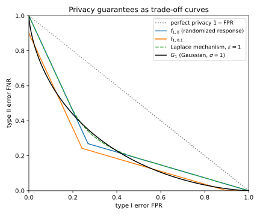
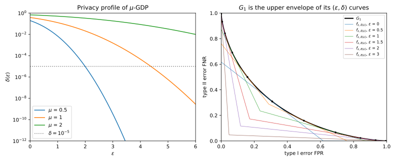
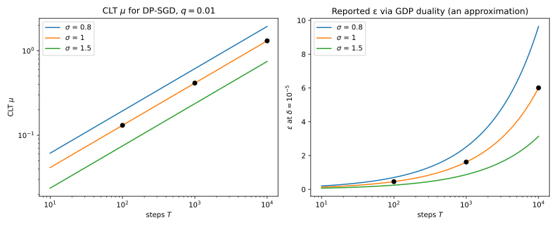
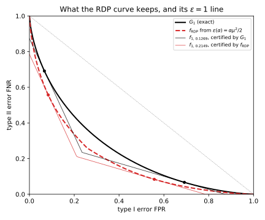

# f-DP and Gaussian differential privacy

Every privacy definition in this part answers one question. How well can an adversary who sees the output of a mechanism $M$ tell whether it ran on a dataset $D$ or on a neighbour $D'$ with one record added or removed? Differential privacy (DP) in its $(\varepsilon, \delta)$ form answers with two numbers, Rényi differential privacy (RDP) with a curve over orders $\alpha$ ([Rényi DP](01-renyi-dp.md)), and concentrated DP with one number $\rho$ ([concentrated DP](03-concentrated-dp.md)). But Part 1 already gave the complete answer. It is the **trade-off function**, which gives for each rate of false alarms the smallest rate of misses any test can reach ([Hypothesis testing](../part01-prerequisites/04-hypothesis-testing.md)). This chapter makes that curve the privacy guarantee itself.

The one idea is that the whole trade-off curve between $M(D)$ and $M(D')$ is the most informative description of a mechanism's privacy, and every other notion is a lossy summary of it. Two facts make the curve practical. Gaussian noise gives a one-parameter family of curves $G_\mu$ that is closed under composition, and a central limit theorem (CLT) says that composing many mechanisms that each leak little gives a curve close to some $G_\mu$.

Throughout, $P = M(D)$ and $Q = M(D')$ are the two output distributions. Their densities, or probabilities for discrete outputs, are written $P(y)$ and $Q(y)$, since the letter $q$ is kept for the sampling rate. The **privacy loss** of an output $y$ is $L(y) = \ln\frac{P(y)}{Q(y)}$. The Rényi order needs the letter $\alpha$, so this chapter writes the type I and type II errors of a test as its **false positive rate** $\mathrm{FPR}$ and **false negative rate** $\mathrm{FNR}$.

The running example is a count released with Gaussian noise of standard deviation 1, so one record moves the centre of the output by one standard deviation. An attacker who accepts 5% false positives then misses the record with probability 0.7405, and the release is $(4.3772, 10^{-5})$-DP (@sec-gdp-duality derives both numbers). The last sections carry the same reasoning to private training, with sampling rate $q = 0.01$, noise multiplier $\sigma = 1$ and up to 10,000 steps.

## f-DP {#sec-gdp-fdp}

A definition of privacy should say what an adversary cannot do. The strongest such statement bounds the adversary's type II error at every type I error from below: however it tunes its test, it must miss at least this often. That bound is a curve, so the definition takes a curve as its parameter.

A test $\phi$ looks at the output $y$ and fires, deciding that the data was $D'$, with probability $\phi(y)$. So $\mathrm{FPR} = \mathbb E_P[\phi]$ and $\mathrm{FNR} = 1 - \mathbb E_Q[\phi]$. The trade-off function $T(P, Q)$ gives the smallest $\mathrm{FNR}$ at each $\mathrm{FPR}$ (@def-ht-tradeoff). Part 1 proved that it is non-increasing, convex, continuous and at most $1 - \mathrm{FPR}$ (@thm-ht-tradeoff). Every function with these properties is the curve of some pair (@sec-apx-comp-canonical in the appendices), and is called a trade-off function.

::: {#def-gdp-fdp name="f-DP"}
Let $f$ be a trade-off function. A mechanism $M$ is **$f$-differentially private ($f$-DP)** if no neighbouring pair is easier to tell apart than $f$ allows,
$$T\big(M(D), M(D')\big) \ge f \quad\text{for all neighbours } D \sim D'.$$
:::

The definition is Dong, Roth & Su's (2022, Definition 2.3), cited as Dong et al. from here on, and the curve inequality holds at every $\mathrm{FPR}$. The old definition is a special case of it, because Part 3 proved that $M$ is $(\varepsilon, \delta)$-DP exactly when the curve of every neighbouring pair lies above two straight lines (@thm-dpdef-testing),
$$f_{\varepsilon,\delta}(\mathrm{FPR}) = \max\big(0,\; 1 - \delta - e^\varepsilon \mathrm{FPR},\; e^{-\varepsilon}(1 - \delta - \mathrm{FPR})\big).$$ {#eq-gdp-feps}
So $(\varepsilon, \delta)$-DP is $f_{\varepsilon,\delta}$-DP (Wasserman & Zhou 2010; Dong et al., Proposition 2.5). The second line is the first reflected across the diagonal $\mathrm{FPR} = \mathrm{FNR}$, and setting $\mathrm{FPR} = 1 - \delta - e^\varepsilon \mathrm{FPR}$ shows that they meet there at $\mathrm{FPR} = \frac{1 - \delta}{1 + e^\varepsilon}$. The curve starts at $1 - \delta$ on the $\mathrm{FNR}$-axis, not at 1, and that gap is what $\delta$ means: a test may catch $D'$ with probability $\delta$ at no cost in false alarms.

Because the neighbouring relation is symmetric, a guarantee for $(D, D')$ also holds for $(D', D)$, and the next result turns that into a guarantee with the reflected curve. The **inverse** $f^{-1}(\mathrm{FPR}) = \inf\{t \in [0, 1] : f(t) \le \mathrm{FPR}\}$ has the graph of $f$ reflected across the diagonal. A curve with $f = f^{-1}$ is **symmetric**, as $f_{\varepsilon,\delta}$ is.

::: {#prp-gdp-symmetric name="Symmetry and post-processing"}
If $M$ is $f$-DP, then $M$ is $\max(f, f^{-1})$-DP. If $K$ is a randomized map that does not look at the data, the mechanism that outputs $K(M(D))$ is also $f$-DP.
:::

::: {.proof}
1. *Swap the roles.* Since $D' \sim D$ is also a neighbouring pair, $T(Q, P) \ge f$. A test $\phi$ of $P$ against $Q$ with errors $(\mathrm{FPR}, \mathrm{FNR})$ gives the opposite test $1 - \phi$ of $Q$ against $P$, whose errors are $(\mathrm{FNR}, \mathrm{FPR})$. So $T(Q, P)$ is the inverse of $T(P, Q)$.
2. *Reflect.* A curve lies above $f$ when its achievable error pairs sit inside the region above $f$, and reflecting both regions across the diagonal keeps that inclusion. So $T(Q, P) \ge f$ turns into $T(P, Q) \ge f^{-1}$, and with $T(P, Q) \ge f$ this gives $\max(f, f^{-1})$. That maximum keeps all four properties of a trade-off function.
3. *Post-processing.* A test $\phi$ on the processed output is the test $y \mapsto \mathbb E[\phi(K(y))]$ on the raw output, with the same two errors. So the curve after processing is no lower than before (Dong et al., Lemma 2.9).
:::

Post-processing can only raise the curve, and Blackwell's theorem (Dong et al., Theorem 2.10) gives the converse: $T(P, Q) \le T(P', Q')$ exactly when some randomized map sends $P$ to $P'$ and $Q$ to $Q'$ at once. A divergence can only shrink under such maps, so it can only coarsen the curve.

::: {#exm-gdp-three}
Three mechanisms carry the label "$\varepsilon = 1$". Binary randomized response with $\varepsilon = 1$ reports the true bit with probability $e/(1 + e) = 0.7311$ ([randomized response](../part03-dp-foundations/01-definition.md#sec-dpdef-rr)). With bit 0 under $D$ and 1 under $D'$, the only useful test fires on output 1, with $\mathrm{FPR} = \mathrm{FNR} = 0.2689$. Mixing it with "never fire" and "always fire" gives a curve with one corner at $(0.2689, 0.2689)$, exactly the corner $1/(1 + e)$ of $f_{1,0}$. The Laplace mechanism with sensitivity 1 and scale 1 is also $(1, 0)$-DP, and the running example, Gaussian noise with $\sigma = 1$, is shown for comparison.

| Type I error $\mathrm{FPR}$ | $f_{1,0}$ (randomized response) | Laplace, $\varepsilon = 1$ | Gaussian, $\sigma = 1$ ($G_1$) |
| --- | --- | --- | --- |
| 0.01 | 0.9728 | 0.9728 | 0.9076 |
| 0.1 | 0.7282 | 0.7282 | 0.6109 |
| 0.25 | 0.3204 | 0.3679 | 0.3724 |

: Smallest type II error at three type I errors for three mechanisms. The Laplace curve is Part 1's @eq-ht-laplace-tradeoff for a unit shift at scale 1. {#tbl-gdp-curves}

The $f_{1,0}$ column is the line $1 - e\,\mathrm{FPR}$, so at $\mathrm{FPR} = 0.1$ it is $1 - 0.2718 = 0.7282$. Randomized response sits exactly on $f_{1,0}$: it is the worst $(1, 0)$-DP mechanism. The Laplace mechanism matches it at small $\mathrm{FPR}$, where both have slope $-e$, but is more private in the middle (0.3679 against 0.3204 at $\mathrm{FPR} = 0.25$). The label "$(1, 0)$-DP" cannot tell the two apart, but their curves can (@fig-gdp-eps-delta). The Gaussian curve crosses the others: it allows more power at small $\mathrm{FPR}$ and less at 0.25, which no single $\varepsilon$ can express.
:::

{#fig-gdp-eps-delta}

## Gaussian differential privacy {#sec-gdp-gdp}

The Gaussian mechanism is the workhorse of private machine learning, so its curve deserves a name. This section shows that Gaussian noise always produces one of Part 1's Gaussian curves, a family with one parameter. Using that family as the yardstick gives Gaussian differential privacy (GDP), a one-number definition that is exact for the Gaussian mechanism.

Part 1 found the curve of two shifted normals (@thm-ht-gaussian). The best test of $\mathcal N(0, 1)$ against $\mathcal N(\mu, 1)$ fires when the output exceeds a threshold, and it misses when a draw from the shifted normal stays below it. Write $\Phi$ for the standard normal distribution function and $\Phi^{-1}$ for its inverse.

::: {#def-gdp-gdp name="Gaussian differential privacy"}
For $\mu \ge 0$, the **Gaussian trade-off function** is
$$G_\mu(\mathrm{FPR}) = T\big(\mathcal N(0, 1), \mathcal N(\mu, 1)\big)(\mathrm{FPR}) = \Phi\big(\Phi^{-1}(1 - \mathrm{FPR}) - \mu\big).$$ {#eq-gdp-gmu}
A mechanism is **$\mu$-GDP** if it is $G_\mu$-DP (Dong et al., Definition 2.6).
:::

The Gaussian mechanism releases a vector, while Part 1's curve is for one number. The proof that the mechanism is GDP needs a step that reduces the vector to one number, and the next lemma provides it. With independent noise of equal variance in every coordinate, only the direction of the shift carries evidence.

::: {#lem-gdp-projection name="A Gaussian shift in d dimensions is a shift in one"}
Let $I_d$ be the $d \times d$ identity matrix. For every $m \in \mathbb R^d$,
$$T\big(\mathcal N(0, I_d), \mathcal N(m, I_d)\big) = G_{\|m\|_2}.$$
:::

::: {.proof}
The plan is to show that the likelihood ratio depends on one number, find that number's law, and read off Part 1's curve.

1. *Write the likelihood ratio.* Expanding $\|y - m\|^2 = \|y\|^2 - 2\langle m, y\rangle + \|m\|^2$ in the two normal densities cancels $\|y\|^2$, which leaves
$$\frac{Q(y)}{P(y)} = \exp\Big(\langle m, y\rangle - \frac12\|m\|^2\Big).$$
2. *One number decides.* The ratio depends on $y$ only through $s = \langle m, y\rangle/\|m\|$, the projection of $y$ on the direction of the shift. By the Neyman–Pearson lemma (@thm-ht-np) the best tests are thresholds on $s$.
3. *Find the law of $s$.* The inner product of a unit vector with a standard normal vector is standard normal, since its variance is the squared length of the unit vector. So $s \sim \mathcal N(0, 1)$ under the first hypothesis, and the mean $m$ adds $\langle m, m\rangle/\|m\| = \|m\|$ under the second.
4. *Read off the curve.* Every best test is a threshold test of $\mathcal N(0, 1)$ against $\mathcal N(\|m\|, 1)$, whose curve is $G_{\|m\|}$ by @thm-ht-gaussian.
:::

In two dimensions the best boundary is perpendicular to the shift (@fig-gdp-composition, left). The Gaussian mechanism adds noise to a query, written $g$ because $f$ already names a trade-off function. Write $\Delta_2 g$ for its $\ell_2$ sensitivity, the largest $\|g(D) - g(D')\|_2$ over neighbours, and $\sigma$ for the **noise multiplier**, the noise standard deviation in units of $\Delta_2 g$.

::: {#thm-gdp-gaussian name="The Gaussian mechanism is GDP"}
The mechanism $M(D) = g(D) + \mathcal N\big(0, \sigma^2(\Delta_2 g)^2 I\big)$ is $1/\sigma$-GDP. This is tight: a neighbouring pair with $\|g(D) - g(D')\|_2 = \Delta_2 g$ has trade-off function exactly $G_{1/\sigma}$.
:::

::: {.proof}
The plan is to turn the two outputs into the pair of @lem-gdp-projection by invertible maps, which cannot change any test's errors, and read off the shift.

1. *Standardize and centre.* Divide the output by $\sigma\Delta_2 g$ and subtract $g(D)/(\sigma\Delta_2 g)$. Both maps can be undone, so no test's errors change. Now $P = \mathcal N(0, I)$, and @lem-gdp-projection gives $T(P, Q) = G_\nu$ with $\nu = \|g(D) - g(D')\|_2/(\sigma\Delta_2 g)$.
2. *Bound the shift.* By the definition of sensitivity, $\nu \le 1/\sigma$.
3. *Compare curves.* $G_\mu$ decreases as $\mu$ grows, because $\Phi$ is increasing, so $G_\nu \ge G_{1/\sigma}$ for every neighbouring pair.
4. *Tightness.* A pair at full sensitivity has $\nu = 1/\sigma$ and gives equality.
:::

For the Gaussian mechanism, $\mu$-GDP is not a bound with slack; it is the curve, and every $(\varepsilon, \delta)$ pair follows from it (@sec-gdp-duality). The parameter $\mu$ is the distance between the two output means in units of the noise standard deviation, set by the worst pair. Doubling it to $\mu = 2$ cuts the miss rate of the best test at a 5% false-alarm rate from 0.7405 to 0.3612. Dong et al. suggest that $\mu \le 0.5$ is a reasonable guarantee and $\mu \ge 6$ promises almost nothing (their discussion after Definition 2.6).

::: {#exm-gdp-count}
A count query has $\Delta_2 g = 1$, since adding or removing one record changes the count by 1. Released with $\sigma = 1$ it is 1-GDP, and with $\sigma = 4$ it is 0.25-GDP. For $\sigma = 1$, @tbl-gdp-g1 evaluates $G_1$. At $\mathrm{FPR} = 0.01$, for example, the threshold is $\Phi^{-1}(0.99) = 2.3263$, and subtracting the shift gives $G_1(0.01) = \Phi(1.3263) = 0.9076$.

| Type I error $\mathrm{FPR}$ | Smallest type II error $G_1(\mathrm{FPR})$ | Best power $1 - G_1(\mathrm{FPR})$ |
| --- | --- | --- |
| 0.01 | 0.9076 | 0.0924 |
| 0.05 | 0.7405 | 0.2595 |
| 0.1 | 0.6109 | 0.3891 |

: The 1-GDP guarantee of the Gaussian mechanism with $\sigma = 1$, read as attack errors. {#tbl-gdp-g1}

A simulation of the threshold test at $\mathrm{FPR} = 0.05$ with 1,000,000 draws per hypothesis gives $\widehat{\mathrm{FPR}} = 0.0502$ and $\widehat{\mathrm{FNR}} = 0.7408$, against the exact 0.7405. Read as a membership attack, the first row says that whatever the attacker knows about the rest of the data, at a 1% false-positive rate it detects a record at most 9.24% of the time.
:::

## Duality with (ε, δ) {#sec-gdp-duality}

Regulators, papers and libraries report $(\varepsilon, \delta)$. So you need to turn a curve into $(\varepsilon, \delta)$ pairs without losing anything, and you need the profile of $\mu$-GDP in closed form. This section does both.

The idea is geometric. An $(\varepsilon, \delta)$ guarantee is the line $\mathrm{FNR} = 1 - \delta - e^\varepsilon \mathrm{FPR}$ and its mirror image, and a curve satisfies it when it lies above the line. For a slope $-e^\varepsilon$, the smallest $\delta$ that works is the one where the line just touches the curve. The line of slope $u$ through the point $(\mathrm{FPR}, f(\mathrm{FPR}))$ meets the $\mathrm{FNR}$-axis at $f(\mathrm{FPR}) - u\,\mathrm{FPR}$, and the touching line has the lowest of these intercepts. Minus that intercept is the **convex conjugate**
$$f^*(u) = \sup_{\mathrm{FPR} \in [0, 1]}\big(u\,\mathrm{FPR} - f(\mathrm{FPR})\big).$$

::: {#thm-gdp-duality name="Duality between f-DP and (ε, δ)-DP"}
Let $f$ be a symmetric trade-off function. A mechanism is $f$-DP if and only if it is $(\varepsilon, \delta(\varepsilon))$-DP for every $\varepsilon \ge 0$, where
$$\delta(\varepsilon) = 1 + f^*(-e^\varepsilon).$$ {#eq-gdp-conjugate}
For any pair $P, Q$, symmetric or not, $1 + T(P, Q)^*(-e^\varepsilon)$ is the hockey-stick divergence $E_{e^\varepsilon}(Q\|P)$, the largest amount by which an event's probability under $Q$ exceeds $e^\varepsilon$ times its probability under $P$.
:::

::: {.proof}
The plan is to find the smallest $\delta$ for one line, show that the lines rebuild the curve, and identify the conjugate as a divergence (Dong et al., Propositions 2.11 and 2.12).

1. *One pair is one line.* By @eq-gdp-feps, $f \ge f_{\varepsilon,\delta}$ requires $\delta \ge 1 - f(\mathrm{FPR}) - e^\varepsilon \mathrm{FPR}$ for every $\mathrm{FPR}$. The smallest such $\delta$ is the supremum of the right side, which is $1 + f^*(-e^\varepsilon)$. The mirror line gives the same condition, because $f$ is symmetric.
2. *$f$-DP implies every $(\varepsilon, \delta(\varepsilon))$.* If $T(M(D), M(D')) \ge f$ and $f \ge f_{\varepsilon,\delta(\varepsilon)}$, then $T(M(D), M(D')) \ge f_{\varepsilon,\delta(\varepsilon)}$.
3. *The lines rebuild the curve.* The line for $\varepsilon$ touches $f$ where its slope is $-e^\varepsilon$, and as $\varepsilon$ runs over $[0, \infty)$ these slopes cover every value from $-1$ down. A symmetric curve crosses the diagonal with slope $-1$, or at a corner whose slopes include $-1$, and is steeper to its left, so the lines and their mirror images touch every point. A convex function is the supremum of its touching lines, so $\sup_{\varepsilon} f_{\varepsilon,\delta(\varepsilon)} = f$, and a mechanism with every $(\varepsilon, \delta(\varepsilon))$ has $T \ge f$.
4. *The conjugate is a hockey-stick divergence.* If each detection of $D'$ earns one unit and each false alarm costs $\gamma \ge 1$, a test's gain is $1 - \mathrm{FNR} - \gamma\,\mathrm{FPR} = \int\phi\,(Q - \gamma P)$. The best test fires exactly where $Q > \gamma P$ and gains $E_\gamma(Q\|P)$, by Part 1's best event (@lem-div-best-event) with $Q$ in the place of $P$. The same maximum can be taken in two stages: at each $\mathrm{FPR}$ the largest power is $1 - T(P, Q)(\mathrm{FPR})$, and then the best $\mathrm{FPR}$ is chosen, so
$$\max_{\mathrm{FPR} \in [0, 1]}\big(1 - T(P, Q)(\mathrm{FPR}) - \gamma\,\mathrm{FPR}\big) = E_\gamma(Q\|P).$$ {#eq-gdp-gain}
With $\gamma = e^\varepsilon$ the left side is $1 + f^*(-e^\varepsilon)$.
:::

The whole **privacy profile** $\varepsilon \mapsto \delta(\varepsilon)$ loses nothing, because its lines rebuild the curve, while one point keeps only one touching line (@fig-gdp-duality, right). So "1-GDP" is stronger than "$(4.3772, 10^{-5})$-DP", the point the example below computes: at $\mathrm{FPR} = 0.1$ the single point allows $\mathrm{FNR} = e^{-4.3772}(1 - 10^{-5} - 0.1) = 0.0113$, while $G_1(0.1) = 0.6109$.

For $G_\mu$ the touching point has a closed form, found with Part 1's slope rule: the slope of a curve at a test's threshold $\tau$ is minus the likelihood ratio there (@prp-ht-slope). The result is the exact Gaussian profile that Part 3 derived as a hockey-stick divergence (@thm-lg-analytic), and @sec-apx-conv-gdp in the appendices derives it from the threshold test in plain steps.

::: {#cor-gdp-profile name="The privacy profile of μ-GDP"}
A mechanism is $\mu$-GDP if and only if it is $(\varepsilon, \delta(\varepsilon))$-DP for every $\varepsilon \ge 0$, with
$$\delta(\varepsilon) = \Phi\Big(-\frac{\varepsilon}{\mu} + \frac{\mu}{2}\Big) - e^\varepsilon\,\Phi\Big(-\frac{\varepsilon}{\mu} - \frac{\mu}{2}\Big).$$ {#eq-gdp-delta}
:::

::: {.proof}
The plan is to check that @thm-gdp-duality applies, find the test where $G_\mu$ has slope $-e^\varepsilon$, and read off its errors (Dong et al., Corollary 2.13).

1. *The curve is symmetric.* The reflection $y \mapsto \mu - y$ swaps $\mathcal N(0, 1)$ and $\mathcal N(\mu, 1)$, and swapping the pair inverts the curve (@prp-gdp-symmetric, step 1), so $G_\mu = G_\mu^{-1}$ and $\delta(\varepsilon)$ is the maximum of $1 - G_\mu(\mathrm{FPR}) - e^\varepsilon \mathrm{FPR}$.
2. *Find the touching point.* That expression is concave, so its maximum is where $G_\mu' = -e^\varepsilon$. By @prp-ht-slope this happens where the likelihood ratio $Q/P$ at the threshold, $e^{\mu\tau - \mu^2/2}$ by step 1 of the proof of @lem-gdp-projection, equals $e^\varepsilon$, so
$$\tau = \frac{\varepsilon}{\mu} + \frac{\mu}{2}.$$
3. *Read off the errors.* The test fires when $y > \tau$, so $\mathrm{FPR}^* = \Phi(-\tau)$, and its power is $1 - \mathrm{FNR}^* = \Phi(\mu - \tau)$.
4. *Substitute.* Putting these into $\delta = 1 - \mathrm{FNR}^* - e^\varepsilon \mathrm{FPR}^*$ gives @eq-gdp-delta.
:::

At $\varepsilon = 0$ the profile is $2\Phi(\mu/2) - 1$, the total variation (TV) distance, which is the best $1 - \mathrm{FPR} - \mathrm{FNR}$ of any test (@thm-ht-tv). For small $\delta$, the first term of @eq-gdp-delta must be a small normal tail, which needs $\frac{\varepsilon}{\mu} - \frac{\mu}{2}$ of about $\sqrt{2\ln(1/\delta)}$. So the $\varepsilon$ you pay grows roughly like $\mu\sqrt{2\ln(1/\delta)}$. At $\mu = 1$, the targets $10^{-4}$, $10^{-5}$ and $10^{-6}$ give $\varepsilon$ = 3.8044, 4.3772 and 4.8866, and at $\mu = 2$ the increments are about twice as large.

::: {#exm-gdp-profile}
For the running example, $\mu = 1$ and $\varepsilon = 1$ put the touching threshold at $\tau = 1.5000$. The best test there has type I error $\Phi(-1.5) = 0.066807$ and power $\Phi(-0.5) = 0.308538$, so $\delta(1) = 0.308538 - e \times 0.066807 = 0.308538 - 0.181601 = 0.126937$. Part 3's @tbl-lg-bad-event has the same two numbers as the probability under $P$ that the loss exceeds 1 and $e$ times that probability under $Q$; here they are the best test's power and the price of its false alarms. Maximizing $1 - G_1(\mathrm{FPR}) - e\,\mathrm{FPR}$ over a grid of 20,001 values gives the same 0.126937, at $\mathrm{FPR} = 0.0668$.

Going from a target $\delta$ to $\varepsilon$ has no closed form. But $\delta(\varepsilon)$ decreases in $\varepsilon$, so the chapter's script (@sec-gdp-code) solves for it by bisection (@tbl-gdp-eps).

| $\mu$ | 0.5 | 1 | 2 |
| --- | --- | --- | --- |
| $\varepsilon$ at $\delta = 10^{-5}$ | 1.9931 | 4.3772 | 9.9973 |

: The $\varepsilon$ of $\mu$-GDP at $\delta = 10^{-5}$. {#tbl-gdp-eps}

As a check on step 3 of the duality, the supremum of 1001 lines $f_{\varepsilon,\delta(\varepsilon)}$ is within $4.9\times10^{-6}$ of $G_1$ (@tbl-gdp-code).
:::

{#fig-gdp-duality}

## Composition {#sec-gdp-composition}

Training runs a mechanism thousands of times on the same data. Composing $(\varepsilon, \delta)$ guarantees directly is lossy ([composition](../part03-dp-foundations/04-composition.md)). This section shows that composing curves is exact, and that for Gaussian curves it is a one-line formula.

An adversary who sees two outputs, drawn with independent randomness, faces a pair of joint distributions: $P_1 \times P_2$, both drawn on $D$, against $Q_1 \times Q_2$, both drawn on $D'$. The curve of that pair defines the composition of curves.

::: {#def-gdp-tensor name="Tensor product"}
The **tensor product** of trade-off functions $f_1 = T(P_1, Q_1)$ and $f_2 = T(P_2, Q_2)$ is $f_1 \otimes f_2 = T(P_1 \times P_2, Q_1 \times Q_2)$.
:::

It does not depend on which pairs represent $f_1$ and $f_2$ (Dong et al., Definition 3.1; @sec-apx-comp-fdp in the appendices proves it). The theorem below says that this product is the exact guarantee of a composition. Its Gaussian case follows from @lem-gdp-projection, because independent Gaussian coordinates form a Gaussian vector.

::: {#thm-gdp-composition name="Composition of f-DP"}
If each mechanism $M_i$ is $f_i$-DP, even when it is chosen adaptively from the earlier outputs, then $(M_1, \dots, M_k)$ is $f_1 \otimes \dots \otimes f_k$-DP, and no better bound holds in general. For Gaussian curves the shifts add like the sides of a right-angled triangle:
$$G_{\mu_1} \otimes \dots \otimes G_{\mu_k} = G_\mu, \qquad \mu = \sqrt{\mu_1^2 + \dots + \mu_k^2}.$$ {#eq-gdp-compose}
:::

::: {.proof}
The plan is to prove the non-adaptive case through Blackwell's theorem, cite the adaptive case, show tightness, and compute the Gaussian product (Dong et al., Theorem 3.2 and Corollary 3.3).

1. *Non-adaptive composition.* Let $(\tilde P_i, \tilde Q_i)$ be a pair whose curve is exactly $f_i$. Since $f_i \le T(P_i, Q_i)$, the pair with the lower curve can be processed into the other: by Blackwell's theorem some randomized map $K_i$ sends $\tilde P_i$ to $P_i$ and $\tilde Q_i$ to $Q_i$. Applied to the coordinates independently, the maps send the product pair $(\prod\tilde P_i, \prod\tilde Q_i)$ to $(\prod P_i, \prod Q_i)$. Post-processing cannot help a test (@prp-gdp-symmetric), so $T(\prod P_i, \prod Q_i) \ge \bigotimes f_i$.
2. *Adaptive composition.* When $M_2$ depends on the output of $M_1$, step 1 does not apply. Instead, fix the first output and look at the attacker's test on the second. Replacing it by the best test of a fixed pair with curve $f_2$, at the same type I error, keeps that error and does not raise the type II error, because $M_2$ is $f_2$-DP on every branch. So the attacker does no better than on the product pair. @sec-apx-comp-fdp in the appendices derives this step by step, as Dong et al. do in their Appendix C.
3. *Tightness.* If the mechanisms ignore each other and some neighbouring pair attains each $f_i$, the composed pair is the product pair.
4. *Gaussian curves.* $\bigotimes G_{\mu_i}$ is the curve of $\mathcal N(0, I_k)$ against $\mathcal N(m, I_k)$ with $m = (\mu_1, \dots, \mu_k)$. By @lem-gdp-projection this is $G_{\|m\|_2}$.
:::

Under composition $\mu^2$ adds, just as variances of independent noises add. Full-batch noisy gradient descent with noise multiplier $\sigma$ composes $T$ mechanisms that are each $1/\sigma$-GDP, so it is $\sqrt T/\sigma$-GDP, and by step 3 no accountant can improve on that. Zero-concentrated DP is the same arithmetic with $\rho = \mu^2/2$ ([concentrated DP](03-concentrated-dp.md)), but $\mu$ gives the exact curve and $\rho$ only an RDP bound on it (@sec-gdp-rdp).

For other curves the tensor product is hard. For $f_{\varepsilon,\delta}$ curves it is the optimal composition theorem (@thm-comp-kov). When the $(\varepsilon_i, \delta_i)$ differ, computing it exactly is #P-complete (Murtagh & Vadhan 2016), a class of counting problems believed to have no efficient algorithm. So numerical accountants compute $\bigotimes f_i$ another way. The composed privacy loss is the sum of the per-step losses (@lem-comp-sum), so the privacy loss distribution (PLD) accountants of [numerical accounting](06-numerical-accounting.md) discretize its law and convolve.

::: {#exm-gdp-compose}
By @eq-gdp-compose, two releases of the running example compose to $G_{\sqrt 2} = G_{1.4142}$, and four to $G_2$. A hundred releases with $\sigma = 10$ give $G_{\sqrt{100 \times 0.01}} = G_1$. A simulation of the threshold test on the projection, with $\mu = (1, 1)$ at $\mathrm{FPR} = 0.05$ gives $\widehat{\mathrm{FPR}} = 0.0497$ and $\widehat{\mathrm{FNR}} = 0.5913$, against $G_{\sqrt2}(0.05) = 0.5912$. That sits between one release, $G_1(0.05) = 0.7405$, and one release with twice the shift, $G_2(0.05) = 0.3612$ (@fig-gdp-composition).

Curves of the $(\varepsilon, \delta)$ family, by contrast, leave that family under composition. Run randomized response with $\varepsilon = 1$ on the same bit twice, the product Part 3 read as a sum of privacy losses (@tbl-comp-two-rr). The output 00 has probability $e^2/(1 + e)^2 = 0.5344$ under $P$ (bit 0) and $1/(1 + e)^2 = 0.0723$ under $Q$ (bit 1), and @tbl-gdp-rr2 lists all four outputs.

| Outputs | $P$ | $Q$ | $Q/P$ |
| --- | --- | --- | --- |
| 00 | 0.5344 | 0.0723 | 0.1353 |
| 01 | 0.1966 | 0.1966 | 1.0000 |
| 10 | 0.1966 | 0.1966 | 1.0000 |
| 11 | 0.0723 | 0.5344 | 7.3891 |

: Two independent runs of randomized response with $\varepsilon = 1$. {#tbl-gdp-rr2}

The best tests add outcomes in decreasing order of $Q/P$, each raising $\mathrm{FPR}$ by its $P$ and lowering $\mathrm{FNR}$ by its $Q$. So $f_{1,0}\otimes f_{1,0}$ is the polygon through $(0, 1)$, $(0.0723, 0.4656)$, $(0.2689, 0.2689)$, $(0.4656, 0.0723)$ and $(1, 0)$, with three slopes, $-e^2$, $-1$ and $-e^{-2}$. An $f_{\varepsilon,\delta}$ curve has only two, so no single pair describes it. Each segment lies on a line of one such curve: the two outer ones on $f_{2,0}$, and the middle one on the line $1 - 0.4621 - \mathrm{FPR}$ of $f_{0,0.4621}$. So the polygon is the supremum of these two curves, with $0.4621 = \tanh(1/2)$.

Composing points instead of curves loses. Four 1-GDP releases are 2-GDP, $\varepsilon = 9.9973$ at $\delta = 10^{-5}$. Giving each release a quarter of the $\delta$ budget turns it into the point $(4.6902, 2.5\times10^{-6})$ of 1-GDP, and adding the points gives $\varepsilon = 18.7607$ at the same total $\delta$, almost twice as large; Part 3's @fig-comp-gaussian shows the loss for many steps.
:::

{#fig-gdp-composition}

## The central limit theorem for composition {#sec-gdp-clt}

Most mechanisms are not Gaussian, so @eq-gdp-compose does not apply to them. But the loss of a composition is a sum of independent per-step losses, and such sums are nearly normal. This section turns that into a statement about curves, which is what lets one $\mu$ summarize a long training run.

A CLT needs the mean, the variance and a third moment of the loss. Dong et al. write them as integrals of the log-slope of the curve, because the slope encodes the privacy loss.

::: {#def-gdp-functionals name="Moment functionals of a curve"}
For a trade-off function $f$ define (Dong et al., §3.2)
$$\mathrm{kl}(f) = -\int_0^1\ln|f'(t)|\,\mathrm dt, \qquad \kappa_2(f) = \int_0^1\ln^2|f'(t)|\,\mathrm dt,$$
$$\kappa_3(f) = \int_0^1\big|\ln|f'(t)|\big|^3\,\mathrm dt, \qquad \bar\kappa_3(f) = \int_0^1\big|\ln|f'(t)| + \mathrm{kl}(f)\big|^3\,\mathrm dt.$$
:::

The proof of the CLT starts by reading these as moments of the **privacy loss random variable (PRV)**, the loss of an output drawn from $P$ (@def-comp-loss), using Part 1's slope rule (@prp-ht-slope).

::: {#lem-gdp-moments name="The functionals are moments of the privacy loss"}
For $f = T(P, Q)$, with $L$ the privacy loss of an output drawn from $P$,
$$\mathrm{kl}(f) = \mathbb E_P[L] = D_{\mathrm{KL}}(P\|Q), \quad \kappa_2(f) = \mathbb E_P[L^2], \quad \kappa_3(f) = \mathbb E_P|L|^3, \quad \bar\kappa_3(f) = \mathbb E_P\big|L - \mathbb E_PL\big|^3.$$
:::

::: {.proof}
1. *The slope is the threshold loss.* A small loss means a large ratio $Q/P$, so the best test with $\mathrm{FPR} = t$ fires when $L$ is below its $t$-quantile $l(t)$ under $P$. By @prp-ht-slope the slope there is minus the likelihood ratio $Q/P = e^{-L}$, so $|f'(t)| = e^{-l(t)}$ and $-\ln|f'(t)| = l(t)$.
2. *Integrate over quantiles.* If $U$ is uniform on $[0, 1]$, then $l(U)$ has the law of $L$, as when uniform numbers fed into an inverse distribution function produce samples. So $\int_0^1 h(l(t))\,\mathrm dt = \mathbb E_P[h(L)]$ for any function $h$.
3. *Take moments.* The choices $h(x) = x$, $x^2$, $|x|^3$ and $|x - \mathbb E_PL|^3$ give the four identities; the first is the Kullback–Leibler (KL) divergence.
:::

The theorem matches the composition to the Gaussian curve whose loss has the same ratio of mean to standard deviation. For $k$ curves, collect each functional into a vector, $\mathrm{kl} = (\mathrm{kl}(f_1), \dots, \mathrm{kl}(f_k))$ and so on, and write $\|\cdot\|_1$ for the sum of the entries and $\|\cdot\|_2^2$ for the sum of their squares.

::: {#thm-gdp-clt name="Central limit theorem for composition"}
Let $f_1, \dots, f_k$ be symmetric trade-off functions with $\kappa_3(f_i) < \infty$, and put
$$\mu = \frac{2\|\mathrm{kl}\|_1}{\sqrt{\|\kappa_2\|_1 - \|\mathrm{kl}\|_2^2}}, \qquad \xi = \frac{0.56\,\|\bar\kappa_3\|_1}{\big(\|\kappa_2\|_1 - \|\mathrm{kl}\|_2^2\big)^{3/2}}.$$ {#eq-gdp-clt-mu}
If $\xi < \frac12$, then for all $\mathrm{FPR} \in [\xi, 1 - \xi]$ the composed curve lies in a band around $G_\mu$, shifted by $\xi$ both across and up or down:
$$G_\mu(\mathrm{FPR} + \xi) - \xi \le f_1 \otimes \dots \otimes f_k(\mathrm{FPR}) \le G_\mu(\mathrm{FPR} - \xi) + \xi.$$
:::

::: {.proof}
The plan is to find the mean and variance of the composed loss, approximate it by a normal with an explicit error, and match a Gaussian pair (Dong et al., Theorem 3.4 and Appendix D).

1. *Add the losses.* For product distributions the densities multiply, so the composed loss is a sum of independent per-step losses. By @lem-gdp-moments it has mean $K = \|\mathrm{kl}\|_1$ under $P$ and variance $V = \|\kappa_2\|_1 - \|\mathrm{kl}\|_2^2$.
2. *Approximate by a normal.* The Berry–Esseen theorem bounds the gap between the distribution function of a sum and the matching normal by a constant times the summed third central moments over $V^{3/2}$. With the constant 0.56 that is $\xi$.
3. *Match a Gaussian pair.* Swapping $P$ and $Q$ negates the loss, and a symmetric curve is unchanged by the swap, so by @lem-gdp-moments, step 2, the loss under $Q$ has the law of minus the loss under $P$, with mean $-K$. The best tests therefore compare two nearly normal laws $2K/\sqrt V$ standard deviations apart. The pair behind $G_\mu$ has loss $\mathcal N(\mu^2/2, \mu^2)$ under $P$ (@lem-lg-gaussian-loss), whose two laws are $\mu$ standard deviations apart, so the match is $\mu = 2K/\sqrt V$.
4. *From the loss to the curve.* A best test's two errors are values of the two distribution functions of the loss, each within $\xi$ of a normal value by step 2. Eliminating the threshold gives the band, as steps 3 to 6 of @sec-apx-comp-clt in the appendices show.
:::

As the number of curves grows, each leaking less, the band closes and the composition converges to some $G_\mu$ (Dong et al., Theorem 3.5). For $k$ pieces that are $(\varepsilon_i, 0)$-DP, with $\sum_i\varepsilon_i^2 \to \mu^2$ and $\max_i\varepsilon_i \to 0$, the limit is $G_\mu$ (their Theorem 3.6), the $\sqrt k$ behaviour of advanced composition with the exact constant. That is why GDP is the natural family, while two runs of randomized response already leave the $(\varepsilon, \delta)$ family (@tbl-gdp-rr2).

The band $\xi$ is a bound but a wide one, so in practice $G_\mu$ itself is used as the estimate, and that is an approximation, not a bound. It can lie above or below the true curve, and its error is largest in the tails, where small $\delta$ lives.

::: {#exm-gdp-clt}
Take $k$ mechanisms, each $\varepsilon_0$-DP with $\varepsilon_0 = 1/\sqrt k$, so that the limit is the running example's $G_1$. For randomized response the summed loss is $\varepsilon_0$ times the number of truthful runs minus the number of flipped ones, so the exact profile is a finite binomial sum (@tbl-gdp-clt).

| $k$ | $\varepsilon_0$ | Exact $\delta(1)$ | $\mu$, $\xi$ of @eq-gdp-clt-mu | GDP $\delta(1)$ |
| --- | --- | --- | --- | --- |
| 1 | 1.0000 | 0.0000 | 1.0422, 0.7663 | 0.1420 |
| 10 | 0.3162 | 0.1323 | 1.0042, 0.1837 | 0.1284 |
| 100 | 0.1000 | 0.1257 | 1.0004, 0.0562 | 0.1271 |
| 1000 | 0.0316 | 0.1269 | 1.0000, 0.0177 | 0.1270 |

: $\delta(1)$ for $k$-fold randomized response with $\varepsilon_0 = 1/\sqrt k$, exactly and from the CLT. The limit $G_1$ has $\delta(1) = 0.1269$. {#tbl-gdp-clt}

At $k = 1$ the theorem says nothing, since $\xi = 0.7663 > \frac12$. At $k = 10$ the true 0.1323 lies *above* the CLT's 0.1284, so the CLT under-reports $\delta$ there, and from $k = 100$ on it is accurate at this moderate $\varepsilon$, 0.1271 against 0.1257. At the small $\delta$ of a reported guarantee the picture changes (@tbl-gdp-clt-eps).

| $k$ | Randomized response, exact $\varepsilon$ | GDP with the $\mu$ of @eq-gdp-clt-mu | GDP with $\mu = 1$ | Basic composition $k\varepsilon_0$ |
| --- | --- | --- | --- | --- |
| 10 | 3.1599 | 4.3983 | 4.3772 | 3.1623 |
| 100 | 4.3068 | 4.3793 | 4.3772 | 10.0000 |
| 1000 | 4.3683 | 4.3774 | 4.3772 | 31.6228 |

: $\varepsilon$ at $\delta = 10^{-5}$ for $k$-fold randomized response with $\varepsilon_0 = 1/\sqrt k$. {#tbl-gdp-clt-eps}

At $k = 10$ the true loss never exceeds 3.1623, so the exact $\varepsilon$ is far below the Gaussian's 4.3983, whose tail ignores that bound. By $k = 1000$ the exact value and the two GDP values agree to within 0.01. In the tail the CLT over-reported $\varepsilon$ at every $k$ (@fig-gdp-clt).
:::

{#fig-gdp-clt}

## The subsampled Gaussian and DP-SGD {#sec-gdp-sgd}

Private training runs stochastic gradient descent (SGD) with differential privacy, DP-SGD for short ([subsampling](05-subsampling.md)). Each of its $T$ steps puts each record in the batch independently with probability $q$, clips the gradients and adds Gaussian noise with noise multiplier $\sigma$. A step leaks little when $q$ is small, so the CLT should apply, and this section finds the $\mu$ it gives.

Under add/remove neighbours, one step reduces to a Gaussian against a mixture, because the added record shifts the sum by at most one sensitivity with probability $q$ ([subsampling](05-subsampling.md) derives it). In units of the sensitivity the pair is $P = \mathcal N(0, \sigma^2)$, the record absent, and $Q = (1 - q)\mathcal N(0, \sigma^2) + q\,\mathcal N(1, \sigma^2)$, the record present.

::: {#thm-gdp-sgd name="The subsampled Gaussian CLT"}
Under add/remove neighbours, let $T \to \infty$ and $q\sqrt T \to c$ with $\sigma$ fixed. Then the trade-off curve of $T$ steps of this subsampled Gaussian mechanism converges to $G_\mu$ with
$$\mu = q\sqrt{T\big(e^{1/\sigma^2} - 1\big)}.$$ {#eq-gdp-sgd-mu}
:::

::: {.proof}
The plan is to compute the mean and variance of one step's loss for small $q$, add them over $T$ steps, and use $\mu = 2K/\sqrt V$ from @thm-gdp-clt (Bu, Dong, Long & Su 2020, Theorem 5).

1. *Write the likelihood ratio.* The ratio of the $\mathcal N(1, \sigma^2)$ density to the $\mathcal N(0, \sigma^2)$ density is $e^{(y - 1/2)/\sigma^2}$, by the cancellation of squares in @lem-gdp-projection. So
$$\frac{Q(y)}{P(y)} = 1 + qW(y), \qquad W(y) = e^{(y - 1/2)/\sigma^2} - 1,$$
where $W$ measures how much the output favours "the record was in the batch".
2. *Find the moments of $W$ under $P$.* The mean is 0, because averaging a density ratio under its denominator gives 1. The moment generating function $\mathbb E[e^{\lambda Y}] = e^{\lambda^2\sigma^2/2}$ of $Y \sim \mathcal N(0, \sigma^2)$, at $\lambda = 2/\sigma^2$, gives $\mathbb E_P[(W + 1)^2] = \mathbb E_P[e^{2Y/\sigma^2}]\,e^{-1/\sigma^2} = e^{2/\sigma^2}e^{-1/\sigma^2} = e^{1/\sigma^2}$. Expanding the square,
$$\mathbb E_P[W^2] = \mathbb E_P[(W + 1)^2] - 2\,\mathbb E_P[W + 1] + 1 = e^{1/\sigma^2} - 1.$$
3. *Expand the loss.* For small $q$, $L = -\ln(1 + qW) = -qW + \frac{q^2W^2}{2} + O(q^3W^3)$. The first term has mean 0, so $\mathbb E_P[L] \approx \frac{q^2}{2}(e^{1/\sigma^2} - 1)$, and to leading order $\operatorname{Var}_P(L) \approx q^2(e^{1/\sigma^2} - 1)$.
4. *Sum over $T$ steps.* Means and variances of independent losses add, so $K \approx \frac{Tq^2}{2}(e^{1/\sigma^2} - 1)$ and $V \approx Tq^2(e^{1/\sigma^2} - 1)$. Then
$$\mu = \frac{2K}{\sqrt V} = \frac{Tq^2(e^{1/\sigma^2} - 1)}{q\sqrt{T(e^{1/\sigma^2} - 1)}} = q\sqrt{T(e^{1/\sigma^2} - 1)}.$$
5. *Justify the limit.* With $q\sqrt T \to c$, each step's moments are $O(1/T)$ and $\sum\kappa_3 = O(Tq^3) \to 0$, the conditions of the limit form of the CLT. That form assumes symmetric curves, and this pair is not symmetric, so @sec-apx-comp-sgd-clt in the appendices treats $P$ and $Q$ separately, bounds the remainders by $O(q^3)$ and proves the limit.
:::

Subsampling buys a factor of about $q$: full batches give $\sqrt T/\sigma$-GDP, and @eq-gdp-sgd-mu multiplies this by $q\sigma\sqrt{e^{1/\sigma^2} - 1}$, which is $q \times 1.3108$ at $\sigma = 1$. The neighbouring relation matters here: Dong et al. (Corollary 5.4) analyse fixed-size batches under replace-one neighbours, where a neighbour swaps one record for another, and get a different constant, $\mu = 1.7101$ at $T = 10{,}000$ in the running example ([subsampling](05-subsampling.md) explains why not to mix them).

The result is a limit, used as an approximation at finite $T$, and it is not a bound. The errors of the CLT and of the expansion in step 3 add up, and neither is controlled in the tail where $\delta = 10^{-5}$ lives. Gopi, Lee & Wutschitz (2021) showed that the CLT value can lie below the true $\varepsilon$, and the example confirms it. [Numerical accounting](06-numerical-accounting.md) computes certified values, and [choosing an accountant](09-choosing-an-accountant.md) compares the accountants on this example.

::: {#exm-gdp-sgd}
The running DP-SGD example has $q = 0.01$, $\sigma = 1$ and $\delta = 10^{-5}$. Then $\sqrt{e - 1} = \sqrt{1.7183} = 1.3108$, so $\mu = 0.01 \times 1.3108\sqrt T$, which is 0.1311 at $T = 100$. @tbl-gdp-sgd turns each $\mu$ into $\varepsilon$ with @eq-gdp-delta and compares it with a numerical accountant.

| Steps $T$ | $q\sqrt T$ | CLT $\mu$ | CLT $\varepsilon$ at $10^{-5}$ | Numerical accountant $\varepsilon$ | Full batch, $\mu = \sqrt T$ |
| --- | --- | --- | --- | --- | --- |
| 100 | 0.10 | 0.1311 | 0.4575 | [0.7175, 0.7185] | 10.0 |
| 1,000 | 0.32 | 0.4145 | 1.6177 | [1.8232, 1.8332] | 31.6 |
| 10,000 | 1.00 | 1.3108 | 6.0071 | [6.1377, 6.2377] | 100.0 |

: The running DP-SGD example: the CLT's $\mu$ and $\varepsilon$, and a numerical bracket for the true $\varepsilon$. {#tbl-gdp-sgd}

The bracket rounds each step's loss down or up to a lattice of spacing $h = 10^{-5}$, so its width is $Th$ by construction. The informative number is its lower end, because the true $\varepsilon$ is at least that. In all three rows the CLT value lies below it, by a ratio of 0.638 at $T = 100$, 0.887 at $T = 1{,}000$ and 0.979 at $T = 10{,}000$, where $q\sqrt T$ is largest.

The exact per-step moments, computed by quadrature, are smaller than the leading terms, and they give $\varepsilon = 5.9184$ at $T = 10{,}000$, or 5.8379 with the roles of $D$ and $D'$ swapped. Both lie below the CLT's 6.0071, so a "more exact" $\mu$ is not more conservative; only a certified accountant is.
:::

{#fig-gdp-subsampled}

@fig-gdp-subsampled shows how strongly $\varepsilon$ depends on $\sigma$: $e^{1/\sigma^2} - 1$ is 3.7707 at $\sigma = 0.8$ and 0.5596 at $\sigma = 1.5$.

## RDP as a lossy summary of the curve {#sec-gdp-rdp}

[Rényi DP](01-renyi-dp.md) tracks $\varepsilon(\alpha) = D_\alpha(P\|Q)$ over orders $\alpha > 1$, and [Conversions](02-rdp-conversions.md) (@sec-conv-tests) turned it into the region of test errors it allows. This section reads that region as $f$-DP, to see why RDP accounting leaves slack.

The construction rests on one observation. A test maps $P$ to a coin $\mathrm{Bern}(\mathrm{FPR})$ that lands 1 with probability $\mathrm{FPR}$, and $Q$ to the coin $\mathrm{Bern}(1 - \mathrm{FNR})$. Processing cannot increase a Rényi divergence (@thm-div-dpi), so the two coins must stay within the RDP budget at every order. The lowest $\mathrm{FNR}$ that passes this check is the curve that RDP certifies.

::: {#thm-gdp-rdp name="What an RDP curve certifies"}
Let $\varepsilon(\alpha)$ be an RDP curve, known at the orders of the part's grid (the fixed list of orders its accountants evaluate), for both $(D, D')$ and $(D', D)$. Let $f_{\mathrm{RDP}}(\mathrm{FPR})$ be the smallest $\mathrm{FNR}$ with
$$D_\alpha\big(\mathrm{Bern}(\mathrm{FPR})\,\big\|\,\mathrm{Bern}(1 - \mathrm{FNR})\big) \le \varepsilon(\alpha) \quad\text{and}\quad D_\alpha\big(\mathrm{Bern}(1 - \mathrm{FNR})\,\big\|\,\mathrm{Bern}(\mathrm{FPR})\big) \le \varepsilon(\alpha)$$
at every order $\alpha$ of the grid (@eq-conv-region). Then:

1. The trade-off curve of a pair determines its RDP curve.
2. $f_{\mathrm{RDP}}$ is a symmetric trade-off function, and a mechanism with this RDP curve is $f_{\mathrm{RDP}}$-DP. At each $\mathrm{FPR}$, no higher value follows from the RDP values alone.
3. The optimal conversion @eq-conv-opt of [Conversions](02-rdp-conversions.md) is the privacy profile $1 + f_{\mathrm{RDP}}^*(-e^\varepsilon)$ of $f_{\mathrm{RDP}}$.
:::

::: {.proof}
The plan is to read the RDP curve off the law of the loss, push each test through the data-processing inequality, check the shape of $f_{\mathrm{RDP}}$, exhibit a pair at each point, and match the conversion with the duality.

1. *The curve determines the divergence.* By @lem-gdp-moments, step 2, the curve fixes the law of $L$ under $P$, and $D_\alpha(P\|Q) = \frac{1}{\alpha - 1}\ln\mathbb E_P[e^{(\alpha - 1)L}]$ is a functional of that law.
2. *RDP implies $f_{\mathrm{RDP}}$-DP.* By the data-processing inequality the two coins of any test satisfy the constraints, so every point of the true curve is feasible and $T(P, Q) \ge f_{\mathrm{RDP}}$.
3. *Shape.* Each constraint bounds the logarithm of a sum of terms $x^\alpha y^{1 - \alpha}$, so it bounds the sum itself, and each term is jointly convex for $\alpha > 1$ (the paragraph after @thm-conv-tests; @sec-apx-tail-perspective). So the feasible set and its lower boundary are convex. Two equal coins have divergence 0, so $f_{\mathrm{RDP}}(\mathrm{FPR}) \le 1 - \mathrm{FPR}$ and $f_{\mathrm{RDP}}(1) = 0$, and a convex function with its minimum at 1 is non-increasing. Relabelling the coins' outcomes swaps the two constraints, so the feasible set is symmetric about the diagonal.
4. *No higher value.* For each feasible point, the pair of coins $(\mathrm{Bern}(\mathrm{FPR}), \mathrm{Bern}(1 - \mathrm{FNR}))$ is itself a mechanism with these RDP values, and its test "fire on 1" has errors $(\mathrm{FPR}, \mathrm{FNR})$ (step 5 of the proof of @thm-conv-tests). Different values of $\mathrm{FPR}$ need different pairs.
5. *The conversion is the conjugate.* @eq-conv-opt maximizes $1 - \mathrm{FPR} - e^\varepsilon f_{\mathrm{RDP}}(\mathrm{FPR})$, with the roles of the two errors swapped from @thm-gdp-duality. Since $f_{\mathrm{RDP}}$ is symmetric the swap changes nothing, and the maximum is @eq-gdp-conjugate applied to $f_{\mathrm{RDP}}$.
:::

The results form a ladder. For the Gaussian mechanism, $G_\mu$ is the exact curve, $f_{\mathrm{RDP}}$ is what its RDP curve keeps, and an $(\varepsilon, \delta)$ pair is one touching line of $f_{\mathrm{RDP}}$. The optimal conversion removes the gap between the line and $f_{\mathrm{RDP}}$, but no conversion removes the gap between $f_{\mathrm{RDP}}$ and the true curve (@sec-conv-slack). RDP loses because different laws of the loss share the same exponential moments at the grid's orders, and $f_{\mathrm{RDP}}$ must allow the worst of them. [Conversions](02-rdp-conversions.md) shows that the extra power it grants an attacker persists down to $\mathrm{FPR} = 10^{-6}$ (@tbl-conv-power). So GDP accounting for full-batch noisy gradient descent beats RDP accounting, although both compose exactly.

::: {#exm-gdp-rdp}
For the running example, $\mu = 1$, the RDP curve is $\varepsilon(\alpha) = \alpha/2$ (@prp-div-gauss). The Gaussian pair has these RDP values, so claim 2 gives $G_1 \ge f_{\mathrm{RDP}}$, and the script, computing $f_{\mathrm{RDP}}$ by bisection on $\mathrm{FNR}$, finds it strictly below $G_1$ everywhere it looked. In @tbl-gdp-rdp the best advantage of a symmetric curve is $1 - 2\mathrm{FPR}$ at its diagonal point, which for $G_1$ is $1 - 2 \times 0.3085 = 0.3829$.

| Quantity | Exact curve $G_1$ | $f_{\mathrm{RDP}}$ from $\varepsilon(\alpha) = \alpha/2$ |
| --- | --- | --- |
| $\mathrm{FNR}$ at $G_1$'s diagonal point, $\mathrm{FPR} = \Phi(-1/2) = 0.3085$ | 0.3085 | 0.2201 |
| Diagonal point, $\mathrm{FPR} = \mathrm{FNR}$ | 0.3085 | 0.2585 |
| Best advantage $\delta(0) = 1 - 2\mathrm{FPR}$ at the diagonal point | 0.3829 | 0.4830 |
| $\delta(1)$ | 0.1269 | 0.2149 |

: The trade-off curve of 1-GDP against the best curve its RDP curve implies over the part's grid of orders, read at the diagonal and through the duality. {#tbl-gdp-rdp}

The RDP summary allows an attacker an advantage of 0.4830 where the best possible is 0.3829, and the best $\delta(1)$ it certifies is 0.2149, 1.69 times the exact 0.1269. More orders can only raise $f_{\mathrm{RDP}}$, but not by much: at $\mathrm{FPR} = 0.3085$, a dense set of orders in $[1.01, 3000]$ raises it from 0.2201 to 0.2219, still far below 0.3085 (@fig-gdp-rdp-lossy).
:::

{#fig-gdp-rdp-lossy}

## Code {#sec-gdp-code}

The script [code/gaussian_dp.py](../../code/part04-privacy-accounting/gaussian_dp.py) computes every number in this chapter and draws every figure, and later chapters import its functions, such as `gdp_delta` and `gdp_eps`. From the repository root:

```bash
uv run python code/part04-privacy-accounting/gaussian_dp.py
```

| Experiment | Result |
| --- | --- |
| Simulated threshold test on $G_1$ at $\mathrm{FPR} = 0.05$ | $\widehat{\mathrm{FPR}} = 0.0502$, $\widehat{\mathrm{FNR}} = 0.7408$; exact 0.7405 |
| $\delta(1)$ of 1-GDP: formula, hockey-stick integral, conjugate on a grid | 0.126937 each |
| $\varepsilon$ at $\delta = 10^{-5}$ for $\mu = 0.5, 1, 2$ | 1.9931, 4.3772, 9.9973 |
| Envelope of 1001 $(\varepsilon, \delta)$ lines against $G_1$ | max gap $4.9\times10^{-6}$ |
| Simulated 2-D test, $\mu = (1, 1)$, $\mathrm{FPR} = 0.05$ | $\widehat{\mathrm{FNR}} = 0.5913$; $G_{\sqrt2}(0.05) = 0.5912$ |
| Four 1-GDP releases at $\delta = 10^{-5}$ | exact 9.9973; composing points 18.7607 |
| DP-SGD, $T = 10{,}000$ | CLT $\mu = 1.3108$, $\varepsilon = 6.0071$; numerical $[6.1377, 6.2377]$ |
| 1-GDP vs its RDP curve: best advantage; $\delta(1)$ | 0.3829 vs 0.4830; 0.1269 vs 0.2149 |

: Results printed by the script with seed 0. {#tbl-gdp-code}

[tests/test_gaussian_dp.py](../../tests/test_gaussian_dp.py) checks that the output still matches @tbl-gdp-code and every other number in the text.

## Summary {#sec-gdp-summary}

| Result | Statement | Use |
| --- | --- | --- |
| @def-gdp-fdp | $T(M(D), M(D')) \ge f$ for all neighbours; $(\varepsilon, \delta)$-DP is $f_{\varepsilon,\delta}$-DP | Every guarantee as a bound on every attacker's errors; summarize the curve as late as possible |
| @prp-gdp-symmetric | $f$-DP implies $\max(f, f^{-1})$-DP and survives post-processing | Working with symmetric curves |
| @def-gdp-gdp | $G_\mu(\mathrm{FPR}) = \Phi(\Phi^{-1}(1 - \mathrm{FPR}) - \mu)$ | One number; $\mu \le 0.5$ is reasonable, $\mu \ge 6$ promises almost nothing |
| @thm-gdp-gaussian | Noise multiplier $\sigma$ gives exactly $1/\sigma$-GDP | Every Gaussian release, with no slack |
| @thm-gdp-duality | $f$-DP $\iff$ $(\varepsilon, 1 + f^*(-e^\varepsilon))$-DP for all $\varepsilon \ge 0$ | Reporting a curve as $(\varepsilon, \delta)$; quote the profile, not one point |
| @cor-gdp-profile | $\delta(\varepsilon) = \Phi(-\frac\varepsilon\mu + \frac\mu2) - e^\varepsilon\Phi(-\frac\varepsilon\mu - \frac\mu2)$ | $\mu = 1$ is $\varepsilon \approx 4.4$ at $\delta = 10^{-5}$, $\mu = 0.5$ about 2 |
| @thm-gdp-composition | $\bigotimes f_i$, tight; $\bigotimes G_{\mu_i} = G_{\sqrt{\sum\mu_i^2}}$ | Gaussian noise without subsampling: account in GDP, $\mu^2$ adds, the profile is exact |
| @thm-gdp-clt | $\bigotimes f_i \approx G_\mu$ with $\mu = 2K/\sqrt V$, band $\xi$ | Quick estimates; good in the bulk, unreliable in the tails |
| @thm-gdp-sgd | $\mu \approx q\sqrt{T(e^{1/\sigma^2} - 1)}$ | A quick DP-SGD estimate, never the reported $\varepsilon$; it under-reports |
| @thm-gdp-rdp | RDP gives $f_{\mathrm{RDP}}$-DP, below the true curve; the optimal conversion is its conjugate | Why RDP accounting leaves slack no conversion removes |

: The results of this chapter, and where each is used. {#tbl-gdp-summary}

## References {#sec-gdp-references}

- Dong, Roth & Su, "Gaussian Differential Privacy" (Journal of the Royal Statistical Society Series B, 2022; arXiv:1905.02383): the source of $f$-DP and GDP, their duality, composition and CLTs.
- Bu, Dong, Long & Su, "Deep Learning with Gaussian Differential Privacy" (Harvard Data Science Review, 2020): the Poisson-subsampling CLT of @eq-gdp-sgd-mu (Theorem 5) and its use for DP-SGD.
- Wasserman & Zhou, "A Statistical Framework for Differential Privacy" (Journal of the American Statistical Association, 2010): the hypothesis-testing reading of $(\varepsilon, \delta)$-DP.
- Kairouz, Oh & Viswanath, "The Composition Theorem for Differential Privacy" (ICML 2015): optimal composition through testing regions and Blackwell's theorem.
- Balle & Wang, "Improving the Gaussian Mechanism for Differential Privacy" (ICML 2018): Theorem 8 is the exact profile @eq-gdp-delta of the Gaussian mechanism.
- Gopi, Lee & Wutschitz, "Numerical Composition of Differential Privacy" (NeurIPS 2021): the PRV accountant, and examples where the GDP CLT under-reports $\varepsilon$.
- Murtagh & Vadhan, "The Complexity of Computing the Optimal Composition of Differential Privacy" (TCC 2016): why accountants discretize.
