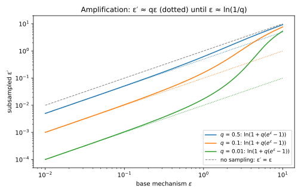
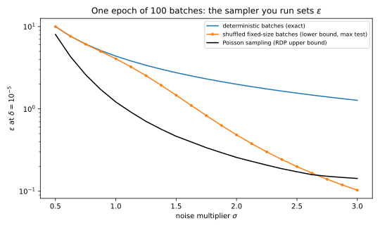
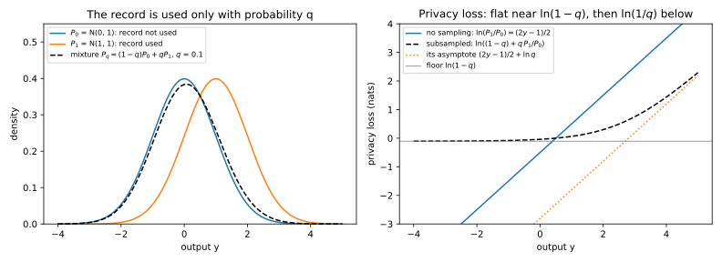
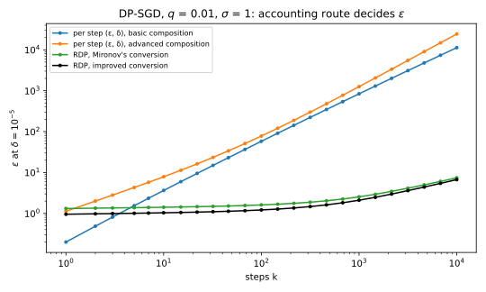

# Amplification by subsampling

Training a neural network with differential privacy (DP) runs stochastic gradient descent (SGD) for ten thousand steps or more, with per-example clipping and Gaussian noise, a method called DP-SGD. Each step clips every example's gradient to norm $C$, sums the clipped gradients and adds Gaussian noise whose standard deviation is the **noise multiplier** $\sigma$ times $C$. If every record were in every batch, ten thousand steps with $\sigma = 1$ would cost $\varepsilon = 5425.5$ at $\delta = 10^{-5}$ ([Rényi DP](01-renyi-dp.md)), a guarantee nobody would report. This chapter asks how much cheaper a step becomes when it looks only at a small random batch, and for which ways of drawing the batch the answer holds.

The one idea is that the output becomes a mixture. Neighbours differ by adding or removing one record, unless a section says otherwise. Write $P_0$ for a step's output distribution without the record and $P_1$ for it with the record. If the batch contains the record only with probability $q$, the **sampling rate**, the step on the dataset with the record draws from $P_1$ with probability $q$ and from $P_0$ otherwise. So every likelihood ratio between the two runs is pulled toward 1:
$$\frac{(1 - q)P_0 + qP_1}{P_0} = (1 - q) + q\,\frac{P_1}{P_0},$$
a weighted average of 1 and the old ratio, once the rest of the batch is fixed.

The running example is DP-SGD with $q = 0.01$, $\sigma = 1$, $\delta = 10^{-5}$ and up to $T = 10{,}000$ steps. Sampling turns a step that costs $\varepsilon = 1$ into one that costs 0.0170, and with Rényi differential privacy (RDP) the whole run costs $\varepsilon = 6.71$ instead of 5425.5.

## Amplification for (ε, δ)-DP under Poisson sampling {#sec-sub-eps-delta}

You have a mechanism $M$ that is $(\varepsilon, \delta)$-DP for add/remove neighbours, and you run it on a random sample of the data. What are the privacy parameters of the combined mechanism? This question comes first because every later answer reuses its argument: fix everything except whether the record was drawn, compare a mixture with its parts, and average the rest back in. The tight answer below is due to Li, Qardaji & Su (2012) and Balle, Barthe & Gaboardi (2018).

::: {#def-sub-poisson name="Poisson subsampling"}
Let $q \in [0, 1]$. **Poisson sampling** with rate $q$ keeps each record of a dataset $D$ independently with probability $q$ and returns the kept records, $S_q(D)$. For a mechanism $M$, the **subsampled mechanism** $M \circ S_q$ runs $M$ on $S_q(D)$.
:::

The argument rests on one inequality about mixtures. Write $P(A)$ for the probability that $P$ gives to an event $A$, and say that $P$ is **$(\varepsilon, \delta)$-close** to $Q$ when $P(A) \le e^\varepsilon Q(A) + \delta$ for every event $A$. Picture two runs that both draw from a common distribution $R$ with probability $1 - q$, while with probability $q$ the first draws from $P$ and the second from $P'$. In the opening's picture, $R$ and $P'$ are both $P_0$ and $P$ is $P_1$. Where the runs agree the likelihood ratio is 1, and where they differ it is at most $e^\varepsilon$, up to the slack $\delta$. So the mixture's ratio should be at most the weighted average $1 + q(e^\varepsilon - 1)$, and the slack should shrink to $q\delta$. The one subtlety is that $P$ must be close to $R$ as well as to $P'$, or a likely event of $P$ could be one that $R$ never produces.

::: {#lem-sub-mixture name="The mixture lemma"}
Let $R$, $P$ and $P'$ be distributions on the same outputs, and let $\varepsilon \ge 0$, $\delta \in [0, 1]$ and $q \in [0, 1]$. Suppose that for every event $A$,
$$P(A) \le e^\varepsilon P'(A) + \delta \qquad\text{and}\qquad P(A) \le e^\varepsilon R(A) + \delta.$$
Then for every event $A$,
$$(1 - q)R(A) + qP(A) \le e^{\varepsilon'}\big[(1 - q)R(A) + qP'(A)\big] + q\delta, \qquad e^{\varepsilon'} = 1 + q(e^\varepsilon - 1).$$ {#eq-sub-mixture-lemma}
:::

::: {.proof}
The plan is to treat the three probabilities of $A$ as unknowns. Making $P'(A)$ and $R(A)$ smaller makes the inequality harder to satisfy, so it is enough to check it at the smallest values the assumptions allow. Fix $A$ and write $a = P(A)$, $b = P'(A)$ and $c = R(A)$. Write $F$ for the gap, the left side of @eq-sub-mixture-lemma minus the bracketed term times $e^{\varepsilon'}$. The claim is that $F$ is at most $q\delta$.

1. *Expand $F$.* The two terms in $c$ combine to $(1 - q)c(1 - e^{\varepsilon'})$, and $1 - e^{\varepsilon'} = -q(e^\varepsilon - 1)$ by the definition of $\varepsilon'$. The term in $b$ is $-e^{\varepsilon'}qb$. So
$$F = qa - q(1 - q)(e^\varepsilon - 1)\,c - q\big(1 + q(e^\varepsilon - 1)\big)\,b.$$
2. *Find the worst $b$ and $c$.* Both coefficients are negative, so $F$ is largest when $b$ and $c$ are as small as allowed. Solving each assumption for $b$ or $c$ gives the lower bound $e^{-\varepsilon}(a - \delta)$ for both, and both are also at least 0, being probabilities.
3. *Case $a \le \delta$.* Dropping the two negative terms leaves $F \le qa \le q\delta$.
4. *Case $a > \delta$.* Put $b = c = e^{-\varepsilon}(a - \delta)$ into step 1. With the common factor $q$ taken out, the two coefficients add up to $(1 - q)(e^\varepsilon - 1) + 1 + q(e^\varepsilon - 1) = e^\varepsilon$, so
$$F \le qa - q\,e^{-\varepsilon}(a - \delta)\,e^\varepsilon = q\delta.$$
:::

Balle, Barthe & Gaboardi (2018, Theorem 2) call this **advanced joint convexity**. On 20,000 random triples $(R, P, P')$ on four outcomes, the chapter's script finds some that meet it with equality to four digits. In the theorem, $R$, $P$ and $P'$ will be outputs for one fixed choice of the other records, and the next lemma averages that choice back in.

::: {#lem-sub-averaging name="Averaging over a shared choice"}
Let $P = \sum_tw_tP_t$ and $Q = \sum_tw_tQ_t$ be averages of distributions with the same non-negative weights $w_t$ summing to 1, and let $\gamma > 0$. If $P_t(A) \le \gamma Q_t(A) + \delta$ for every $t$ and every event $A$, then
$$P(A) \le \gamma Q(A) + \delta \quad\text{for every event } A.$$
:::

::: {.proof}
1. *Write the excess as an average.* For a fixed event $A$, both averages use the same weights, so the excess of the averages is the average of the excesses:
$$P(A) - \gamma Q(A) = \sum_tw_t\big[P_t(A) - \gamma Q_t(A)\big].$$
2. *Bound the average.* Each bracket is at most $\delta$, and so is any weighted average of them.
:::

This is **joint convexity** of the hockey-stick divergence of @def-div-hockey, the largest excess $P(A) - \gamma Q(A)$ over events, for a mixing choice that both runs share. With both lemmas the theorem follows, and it says that $\delta$ is paid only when the record is drawn.

::: {#thm-sub-poisson name="Amplification by Poisson subsampling"}
Let $M$ be $(\varepsilon, \delta)$-DP for add/remove neighbours, and let $q \in [0, 1]$. Then $M \circ S_q$ is $(\varepsilon', \delta')$-DP for add/remove neighbours with
$$\varepsilon' = \ln\big(1 + q(e^\varepsilon - 1)\big), \qquad \delta' = q\delta.$$ {#eq-sub-amplify}
For every $\varepsilon$ and $q$, some $\varepsilon$-DP mechanism attains this $\varepsilon'$.
:::

::: {.proof}
The plan is to fix every random choice except whether the added record $x$ is drawn, apply @lem-sub-mixture once for each order of the pair, average with @lem-sub-averaging, and finally exhibit a mechanism that attains the bound. Let $D' = D \cup \{x\}$.

1. *Condition on the rest of the sample.* Let $\tilde D$ be the Poisson sample of $D$. Each record has its own coin, so the sample of $D'$ is $\tilde D \cup \{x\}$ with probability $q$ and $\tilde D$ otherwise, independently of $\tilde D$. Given $\tilde D$, write $P_0 = M(\tilde D)$ and $P_1 = M(\tilde D \cup \{x\})$, so that the output on $D'$ is the mixture $(1 - q)P_0 + qP_1$.
2. *Bound the direction with the mixture first.* Apply @lem-sub-mixture with $R = P' = P_0$ and $P = P_1$. Both of its assumptions then hold because $\tilde D$ and $\tilde D \cup \{x\}$ are neighbours, and its right side becomes $e^{\varepsilon'}P_0(A) + q\delta$. Here the dataset with the record comes first and its neighbour removes it, which [Numerical accounting](06-numerical-accounting.md) calls the **remove** direction.
3. *Bound the direction with the mixture second.* Apply the lemma with $R = P = P_0$ and $P' = P_1$. Its first assumption is DP of $M$ again, and its second, $P_0(A) \le e^\varepsilon P_0(A) + \delta$, always holds. Its left side becomes $P_0(A)$, so $P_0(A) \le e^{\varepsilon'}[(1 - q)P_0(A) + qP_1(A)] + q\delta$.
4. *Average over $\tilde D$.* Both bounds hold for every $\tilde D$, so @lem-sub-averaging carries them to the subsampled mechanism.
5. *Attain the bound.* Randomized response reports a bit truthfully with probability $e^\varepsilon/(1 + e^\varepsilon)$ and flipped otherwise (@thm-dpdef-rr). Let $M$ apply it to the bit "the sample contains a flagged record", take $D$ with no flagged record, and let $x$ be flagged. Then $P_1$ gives the output 1 exactly $e^\varepsilon$ times the probability that $P_0$ gives it, for every $\tilde D$. At the output 1 the likelihood ratio of the mixture to $P_0$ is therefore
$$\frac{(1 - q)P_0(1) + qP_1(1)}{P_0(1)} = 1 + q(e^\varepsilon - 1).$$
With $\delta = 0$, the event that the output is 1 forces $e^{\varepsilon'}$ to be at least this ratio.
:::

The formula has two regimes (@fig-sub-amp). For small $\varepsilon$, $e^\varepsilon - 1 \approx \varepsilon$ and the logarithm is close to its argument minus 1, so $\varepsilon' \approx q\varepsilon$. For large $\varepsilon$ the 1 inside the logarithm stops mattering, so $\varepsilon' \approx \varepsilon - \ln(1/q)$, because in the worst case the record was drawn. At $q = 0.01$ the switch comes near $\varepsilon = \ln(1/q) = 4.6$, so @tbl-sub-amp gives 0.9059 at $\varepsilon = 5$, not the 0.05 of a factor of 100.

The $\delta$ always shrinks by the factor $q$, because the failure event of $M$ only matters when the record was drawn. The bound is tight for one step, but composing per-step pairs is not, as @sec-sub-dpsgd shows.

{#fig-sub-amp}

| $q$ | $\varepsilon = 0.1$ | $\varepsilon = 1$ | $\varepsilon = 5$ | $\varepsilon = 10$ |
| --- | --- | --- | --- | --- |
| 0.01 | 0.0011 | 0.0170 | 0.9059 | 5.3993 |
| 0.1 | 0.0105 | 0.1586 | 2.7563 | 7.6978 |
| 0.5 | 0.0512 | 0.6201 | 4.3136 | 9.3069 |

: The amplified $\varepsilon' = \ln(1 + q(e^\varepsilon - 1))$ for three sampling rates. {#tbl-sub-amp}

::: {#exm-sub-rr}
Take the randomized response of step 5 of the proof of @thm-sub-poisson, with $\varepsilon = 1$ and $q = 0.1$. When the record is not drawn the true bit is 0, which is reported as 0 with probability $e/(1 + e) = 0.7311$ and as 1 with probability 0.2689. When it is drawn the two probabilities swap. The mixture weights the two cases by 0.9 and 0.1, so it reports 1 with probability $0.9 \times 0.2689 + 0.1 \times 0.7311 = 0.3152$ and 0 with probability 0.6848.

Without sampling the likelihood ratios are $e$ and $1/e$. With sampling the largest ratio of the mixture to $P_0$ is $0.3152/0.2689 = 1.1718 = 1 + 0.1(e - 1)$, so $\varepsilon' = \ln 1.1718 = 0.1586$, as @eq-sub-amplify says, against $q\varepsilon = 0.1$. The largest ratio the other way, $0.7311/0.6848 = 1.0675$, is smaller. The mixture never puts less than 0.9 times $P_0$'s probability on any output, so this ratio can never exceed $1/0.9$.
:::

## Sampling schemes and neighbouring relations {#sec-sub-schemes}

Poisson sampling gives batches of random size, but most training code draws batches of a fixed size. Does @thm-sub-poisson still apply to them? This section says which pair of outputs to account for under each scheme, because accounting for one scheme while running another can multiply $\varepsilon$ several times over. A fixed batch size pairs naturally with **replace-one** neighbours, datasets of the same size that differ in one record's value, because adding a record would change the size.

::: {#def-sub-fixed name="Fixed-size batches"}
**Sampling without replacement** draws a batch of $m$ of the $n$ records of a dataset uniformly at random. **Shuffle and partition** puts the records in a uniformly random order once per epoch and uses consecutive blocks of $m$ records as the epoch's batches.
:::

A uniformly random batch contains a given record with probability $m/n$, which plays the role of $q$. There is no independent coin for the differing record, though, so the proof uses a **coupling**: it builds the batch in a way that has such a coin, and shares the coin and the other records between the two datasets (Balle, Barthe & Gaboardi 2018, Theorem 9).

::: {#thm-sub-wor name="Amplification by sampling without replacement"}
Let $M$ be $(\varepsilon, \delta)$-DP for replace-one neighbours on datasets of size $m$, and let $q = m/n$. Running $M$ on a batch of $m$ records drawn without replacement from $n$ is $(\varepsilon', \delta')$-DP for replace-one neighbours on datasets of size $n$, with
$$\varepsilon' = \ln\big(1 + q(e^\varepsilon - 1)\big), \qquad \delta' = q\delta.$$ {#eq-sub-wor}
:::

::: {.proof}
The plan is to draw the batch in two stages that expose a coin for the differing record, write both outputs as the mixtures of @lem-sub-mixture, check its assumptions, and average. Let $D$ and $D'$ differ in record $i$, which is $x$ in $D$ and $x'$ in $D'$.

1. *Build a batch that avoids $i$.* Draw $B$, a uniform set of $m - 1$ of the other $n - 1$ records, then $z$, a uniform record among the $n - m$ others not in $B$. Each set of $m$ records that avoids $i$ arises from $m$ choices of $z$, equally often, so $B \cup \{z\}$ is a uniform such set.
2. *Write both outputs as mixtures.* A uniform batch contains $i$ with probability $q$. Given that it does, the rest of it is distributed as $B$, and otherwise the batch is distributed as $B \cup \{z\}$. So flip a coin with probability $q$, and use $B \cup \{x\}$ in $D$ and $B \cup \{x'\}$ in $D'$ on heads, and $B \cup \{z\}$ in both on tails. Given $(B, z)$, the outputs are $(1 - q)R + qP$ and $(1 - q)R + qP'$, with $R = M(B\cup\{z\})$, $P = M(B\cup\{x\})$ and $P' = M(B\cup\{x'\})$.
3. *Check the assumptions.* The three batches have size $m$ and differ pairwise in one element, so each of $P$ and $P'$ is $(\varepsilon, \delta)$-close to the other two.
4. *Apply the lemma and average.* @lem-sub-mixture gives the bound in each direction, and @lem-sub-averaging averages over $(B, z)$.
:::

Each combination of sampling scheme and neighbouring relation needs its own base guarantee (@tbl-sub-matching), and the **zero-out** relation of its last row sets the target's gradient to 0. The last column applies them to DP-SGD's sum of gradients clipped to norm $C$, with noise $\sigma C$. Replacing a record moves the sum by up to $2C$, twice what adding one does, since the new gradient may point the opposite way. A Gaussian mechanism's privacy depends only on the shift in units of the noise, so this is the same as a shift of $C$ with noise multiplier $\sigma/2$. Lebeda, Regehr, Kamath & Steinke (2024, Proposition 9) show that for fixed-size batches this shift is the worst case under add and under remove too.

| Sampling | Neighbours | Pair to account for | Base guarantee needed | Gaussian sum, clipping norm $C$ |
| --- | --- | --- | --- | --- |
| Poisson, rate $q$ | add/remove | $(1 - q)P_0 + qP_1$ against $P_0$ | add/remove | means differ by $C$: noise multiplier $\sigma$ |
| Fixed size $m$ of $n$ | replace-one | $(1 - q)R + qP$ against $(1 - q)R + qP'$, $q = m/n$ | replace-one | means differ by $2C$: noise multiplier $\sigma/2$ |
| Fixed size $m$ of $n$ | add/remove | dominated by the Poisson pair at $\sigma/2$ | replace-one | $\sigma/2$ |
| Poisson, rate $q$ | replace-one | both sides mixtures | $(2\varepsilon, (1 + e^\varepsilon)\delta)$ by group privacy | means differ by up to $2C$ |
| Shuffle and partition | zero-out | one batch per epoch | no simple formula (@prp-sub-shuffle) | measured, not derived |

: What to account for under each combination of sampling scheme and neighbouring relation. {#tbl-sub-matching}

Poisson sampling under replace-one neighbours is the row where both outputs are mixtures, $(1 - q)R + qP$ and $(1 - q)R + qP'$, given the rest of the sample $\tilde D$. Here $R = M(\tilde D)$, and $P$ and $P'$ add $x$ or $x'$, so each is one step from $R$ but two from the other. @lem-sub-mixture needs one guarantee for all these pairs, so it must use the weaker one. Group privacy (@thm-dpprop-group) gives $(2\varepsilon, (1 + e^\varepsilon)\delta)$ for datasets two steps apart, and the lemma with @lem-sub-averaging then gives
$$\varepsilon' = \ln\big(1 + q(e^{2\varepsilon} - 1)\big), \qquad \delta' = q(1 + e^\varepsilon)\delta.$$
For small $q$ this is about $e^\varepsilon + 1$ times the add/remove value, since $e^{2\varepsilon} - 1 = (e^\varepsilon - 1)(e^\varepsilon + 1)$. It is loose, because it charges the pairs one step apart the two-step price. For pure DP, bounding the ratio of the two mixtures at each output gives the exact value
$$\varepsilon' = \ln\big(1 + q(e^\varepsilon - 1)\big) - \ln\big(1 - q(1 - e^{-\varepsilon})\big),$$ {#eq-sub-replace-pure}
which the Laplace mechanism on a sum attains. [Exercise 3](../../book-exercises/part04-privacy-accounting/05-subsampling.md#sec-sol-sub-3) derives the exact value and the event that attains it. For small $\varepsilon$ the exact value is about twice the add/remove value. At $\varepsilon = 1$ and $q = 0.01$ it is 0.02338, against 0.06193 for the group-privacy bound and 0.01704 for add/remove: a ratio of 1.37, not 3.64.

Shuffle and partition is worse, because in one epoch the record is in exactly one batch, so no step's output is a mixture with "not used". The only uncertainty is which batch held the record, and the other records can give that away. Chua et al. (2024) build a bad case under zero-out, with scalar gradients: every other record has gradient $-1$ and the target has $+1$. Adding the batch size to each batch sum cancels the other records, so batches without the target output $\mathcal N(0, \sigma^2)$, while the target's batch outputs $\mathcal N(2, \sigma^2)$, or $\mathcal N(1, \sigma^2)$ when the target is zeroed out. A natural test says "target present" when the largest batch output exceeds a threshold $\tau$.

::: {#prp-sub-shuffle name="A lower bound for shuffle and partition"}
In the epoch above, with $b$ batches and noise multiplier $\sigma$, let $\Phi$ be the standard normal distribution function. For every threshold $\tau$ and every $\varepsilon$, the smallest $\delta(\varepsilon)$ for which the epoch is $(\varepsilon, \delta(\varepsilon))$-DP satisfies
$$\delta(\varepsilon) \ge \Big[1 - \Phi\Big(\frac{\tau-2}\sigma\Big)\Phi\Big(\frac\tau\sigma\Big)^{b-1}\Big] - e^\varepsilon\Big[1 - \Phi\Big(\frac{\tau-1}\sigma\Big)\Phi\Big(\frac\tau\sigma\Big)^{b-1}\Big].$$
:::

::: {.proof}
1. *Compute the event's probability.* The largest output stays below $\tau$ only if every batch output does, and the batches' noises are independent. With the target present, its batch stays below $\tau$ with probability $\Phi(\frac{\tau-2}\sigma)$, and each of the $b - 1$ others with probability $\Phi(\frac\tau\sigma)$. With the target zeroed out, the first factor becomes $\Phi(\frac{\tau-1}\sigma)$.
2. *Remove the batch index.* Neither product depends on which batch holds the target, so averaging over the random order changes nothing.
3. *Bound $\delta(\varepsilon)$.* The smallest $\delta(\varepsilon)$ is the largest value of $P(A) - e^\varepsilon Q(A)$ over events $A$, the hockey-stick divergence of @def-div-hockey. One particular event gives a value no larger.
:::

Maximizing over $\tau$ gives the best such bound, and so a lower bound on $\varepsilon$ at a given $\delta$. Under zero-out a Poisson step's sum also moves by at most $C$, so the Poisson accountant applies to the same relation. With $\sigma = 0.4$ and $b = 10{,}000$ batches, the script reproduces Chua et al.'s check, $\delta(4) \ge 0.226$ for shuffling against 0.244 for a fixed batch order, where a Poisson accountant gives $\delta(4) \le 1.18 \times 10^{-5}$.

::: {#exm-sub-epoch}
In the running example one epoch is $b = 100$ batches, and @tbl-sub-shuffle compares three batch samplers over it. Deterministic batches use the record once, in a known batch, so the epoch is a plain Gaussian mechanism with an exact $\varepsilon$. Shuffling gets the lower bound of @prp-sub-shuffle, and Poisson sampling the RDP upper bound.

| $\sigma$ | Deterministic batches (exact) | Shuffled batches (lower bound) | Poisson sampling (upper bound) |
| --- | --- | --- | --- |
| 0.5 | 10.00 | 10.00 | 8.03 |
| 1 | 4.38 | 4.06 | 1.21 |
| 1.5 | 2.75 | 1.46 | 0.47 |
| 2 | 1.99 | 0.48 | 0.26 |
| 2.5 | 1.55 | 0.20 | 0.17 |
| 3 | 1.27 | 0.10 | 0.14 |

: The $\varepsilon$ at $\delta = 10^{-5}$ of one epoch of 100 batches under three batch samplers. Shuffling is a lower bound and Poisson an upper bound, so wherever the shuffled column exceeds the Poisson column, the Poisson number is provably wrong for shuffled training. {#tbl-sub-shuffle}

At $\sigma = 1$, shuffled training has $\varepsilon \ge 4.06$ after one epoch, close to the 4.38 of a fixed order, while the Poisson accountant reports at most 1.21. The gap closes as $\sigma$ grows (@fig-sub-schemes), and at $\sigma = 3$ this test is too weak to show one. Over 10,000 steps, fixed-size sampled batches give $\varepsilon = 47.42$ by RDP, with noise multiplier $\sigma/2 = 0.5$, against 6.71 for Poisson sampling.
:::

{#fig-sub-schemes}

## RDP of the Poisson-subsampled Gaussian {#sec-sub-rdp-gaussian}

Per-step $(\varepsilon, \delta)$ amplification composes badly, as @sec-sub-dpsgd will show, while RDP composes well. A mechanism is $(\alpha, \varepsilon(\alpha))$-RDP when the Rényi divergence of order $\alpha > 1$ between its outputs on any two neighbouring datasets is at most $\varepsilon(\alpha)$, and these curves add under composition ([Rényi DP](01-renyi-dp.md)). So DP-SGD's accountant needs the curve of one subsampled Gaussian step, a Rényi divergence between a Gaussian mixture and a Gaussian, which has an exact finite sum at integer orders. @fig-sub-mixture shows the pair and its **privacy loss**, the logarithm of the likelihood ratio at each output.

{#fig-sub-mixture}

The Rényi divergence of @def-div-renyi is a log-average of a power of the likelihood ratio, in which a larger order weights large ratios more heavily. For $\alpha > 1$,
$$D_\alpha(P\|Q) = \frac{1}{\alpha - 1}\ln\mathbb E_{y\sim Q}\Big[\Big(\frac{P(y)}{Q(y)}\Big)^\alpha\Big].$$
The proof below starts, like that of @thm-sub-poisson, by fixing the rest of the sample, so its first step needs the Rényi counterpart of @lem-sub-averaging.

::: {#lem-sub-renyi-averaging name="Averaging cannot increase a Rényi divergence"}
Let $P = \sum_tw_tP_t$ and $Q = \sum_tw_tQ_t$ be averages with the same weights $w_t$, and let $\alpha > 1$. Then
$$D_\alpha(P\|Q) \le \max_tD_\alpha(P_t\|Q_t).$$
:::

::: {.proof}
1. *Write the divergence as an integral.* By the definition, $e^{(\alpha-1)D_\alpha(P\|Q)}$ is the integral of $Q\,g(P/Q)$ with the convex function $g(r) = r^\alpha$.
2. *Use joint convexity.* A function of the form $Q\,g(P/Q)$ with $g$ convex, called the **perspective** of $g$, is jointly convex in the pair $(P, Q)$, as @sec-apx-tail-perspective in the appendices derives. So the integral at the averaged pair is at most the average of the integrals:
$$\int Q\,g(P/Q)\,\mathrm d y \le \sum_tw_t\int Q_t\,g(P_t/Q_t)\,\mathrm d y.$$
3. *Take the largest term.* An average is at most its largest term, and the logarithm and division by $\alpha - 1 > 0$ keep the order.
:::

This is the **quasi-convexity** of the Rényi divergence (van Erven & Harremoës 2014, Theorem 13). The theorem and its proof are due to Mironov, Talwar & Zhang (2019).

::: {#thm-sub-rdp-gaussian name="RDP of the subsampled Gaussian"}
Let $P_0 = \mathcal N(0, \sigma^2)$, $P_1 = \mathcal N(1, \sigma^2)$ and $P_q = (1 - q)P_0 + qP_1$. The Poisson-subsampled Gaussian mechanism with $\ell_2$ sensitivity 1 and noise multiplier $\sigma$ is $(\alpha, \varepsilon(\alpha))$-RDP for add/remove neighbours, for every $\alpha > 1$, with
$$\varepsilon(\alpha) = \max\big\{D_\alpha(P_q\|P_0),\ D_\alpha(P_0\|P_q)\big\} = D_\alpha(P_q\|P_0) = \frac{\ln A_\alpha}{\alpha - 1},$$ {#eq-sub-rdp}
where
$$A_\alpha = \mathbb E_{y\sim P_0}\Big[\Big((1 - q) + q\frac{P_1(y)}{P_0(y)}\Big)^\alpha\Big], \qquad \frac{P_1(y)}{P_0(y)} = e^{(2y - 1)/(2\sigma^2)}.$$ {#eq-sub-a-alpha}
For integer $\alpha$,
$$A_\alpha = \sum_{j=0}^\alpha\binom\alpha j(1 - q)^{\alpha - j}q^j\exp\Big(\frac{j^2 - j}{2\sigma^2}\Big).$$ {#eq-sub-binomial}
:::

::: {.proof}
The plan is to remove every coordinate except the one along which the record moves the output, compare the two directions of the remaining pair, and evaluate the larger one.

1. *Condition on the rest of the sample.* Let $f$ be the clipped gradient sum divided by $C$, so that its sensitivity is 1, and let $\tilde D$ be the rest of the sample. Given $\tilde D$, one output is $\mathcal N(f(\tilde D), \sigma^2I)$ and the other mixes it, with weight $1 - q$, with $\mathcal N(f(\tilde D\cup\{x\}), \sigma^2I)$. By @lem-sub-renyi-averaging it suffices to bound one $\tilde D$.
2. *Reduce to one dimension.* Shifting or rotating both distributions changes no likelihood ratio, so rotate the difference of the means onto the first axis. The other coordinates are identical in both runs and independent of the first, and Rényi divergences of independent coordinates add (@thm-div-renyi), so they contribute 0.
3. *Reduce to length 1.* A difference of length $c < 1$, rescaled by $1/c$, is the length-1 pair with extra independent noise added, which cannot increase a divergence (@thm-div-dpi). What is left is the pair $(P_q, P_0)$ in both orders.
4. *Compare the two directions.* Mironov, Talwar & Zhang (2019, Theorem 5) prove that the order with the mixture first is the larger, for every $\alpha \ge 1$, using the reflection $y \mapsto 1 - y$, which swaps $P_0$ and $P_1$. This step is cited, and @sec-apx-amp-direction in the appendices derives it.
5. *Write the first direction as an expectation.* The definition with $Q = P_0$ makes $(\alpha - 1)D_\alpha(P_q\|P_0)$ the logarithm of the average of $(P_q/P_0)^\alpha$ under $P_0$. Dividing the mixture by $P_0$ gives $(1 - q) + q\,P_1/P_0$, which is @eq-sub-a-alpha. In the Gaussian ratio the normalizing constants cancel, leaving
$$\frac{P_1(y)}{P_0(y)} = \exp\Big(\frac{y^2 - (y-1)^2}{2\sigma^2}\Big) = e^{(2y-1)/(2\sigma^2)}.$$
6. *Expand for integer $\alpha$.* Write $r$ for the ratio $P_1/P_0$. The binomial theorem expands $(1 - q + qr)^\alpha$ into the sum of $\binom\alpha j(1 - q)^{\alpha-j}q^jr^j$ over $j$, and the average of a sum is the sum of the averages.
7. *Compute each moment.* By the definition of $D_j$, the average of $r^j$ under $P_0$ is $e^{(j-1)D_j(P_1\|P_0)}$. Two normals one unit apart have $D_j(P_1\|P_0) = j/(2\sigma^2)$, by @eq-div-gauss-renyi. So the $j$-th moment is $e^{(j^2 - j)/(2\sigma^2)}$, which gives @eq-sub-binomial.
:::

For fractional $\alpha$ the sum does not terminate, so the script integrates @eq-sub-a-alpha numerically, and the reverse direction too. The dominance of step 4 holds for Rényi divergences only, and for $\delta(\varepsilon)$ [Numerical accounting](06-numerical-accounting.md#sec-num-subsampled) computes both directions.

The curve has two regimes (@fig-sub-rdp). Low orders average the privacy loss over the bulk of the outputs, where sampling flattens it, so the curve stays close to the $j = 2$ term of @sec-sub-small-q. High orders look at the far tail, where sampling saves only $\ln(1/q)$. Every term of @eq-sub-binomial is positive, so $A_\alpha$ is at least its last term, and taking logarithms makes this precise:
$$\varepsilon(\alpha) \ge \frac{\alpha\ln q}{\alpha - 1} + \frac{\alpha}{2\sigma^2},$$
the unsubsampled curve minus about $\ln(1/q)$, a bound [Concentrated DP](03-concentrated-dp.md) also uses.

{#fig-sub-rdp}

::: {#exm-sub-alpha2}
Take $q = 0.01$ and $\sigma = 1$. At $\alpha = 2$, @eq-sub-binomial has three terms, one for each number $j$ of factors $r$. Their coefficients are $(0.99)^2 = 0.9801$, $2 \times 0.99 \times 0.01 = 0.0198$ and $(0.01)^2 = 0.0001$, which add up to $(1 - q + q)^2 = 1$. The exponential factors are 1, 1 and $e$, so they change only the last term, which becomes 0.000272. So $A_2 = 1 + 0.0001 \times 1.71828 = 1.00017183$ and $\varepsilon(2) = \ln A_2 = 1.7181 \times 10^{-4}$, against 1 without sampling. The terms $j = 0$ and 1 cost nothing, because they have the factor 1 that a mixture of identical distributions would have.

The binomial sum is exact but exists only at integer orders, while the integral covers every order but could be wrong if its grid were too coarse. @tbl-sub-check compares them, and gives the reverse direction $D_\alpha(P_0\|P_q)$ beside them.

| $\alpha$ | Binomial sum | Integral | Reverse direction |
| --- | --- | --- | --- |
| 2 | $1.718134 \times 10^{-4}$ | $1.718134 \times 10^{-4}$ | $1.6022 \times 10^{-4}$ |
| 8 | — | $8.9364 \times 10^{-4}$ | $5.7239 \times 10^{-4}$ |
| 10 | $3.827042 \times 10^{-2}$ | $3.827042 \times 10^{-2}$ | — |
| 32 | $1.124628 \times 10^{1}$ | $1.124628 \times 10^{1}$ | $1.6923 \times 10^{-3}$ |

: The two ways of computing $D_\alpha(P_q\|P_0)$, and the reverse direction, at $q = 0.01$, $\sigma = 1$. A dash marks a value the script does not print, and the sum exists only at integer orders. {#tbl-sub-check}

The two computations agree to all printed digits. The curve stays near the $j = 2$ term up to $\varepsilon(8) = 8.9364 \times 10^{-4}$, against 4 without sampling, then climbs to $\varepsilon(16) = 3.0879$ and $\varepsilon(32) = 11.246$, against 8 and 16. The reverse direction is smaller at every order, because it looks at the left tail, where $P_0/P_q$ is at most $1/(1 - q)$. At every order the accountant uses, it stays smaller for $\sigma = 0.5$ and $\sigma = 2$ too, by a margin of at least $5.09 \times 10^{-4}$ and $5.67 \times 10^{-8}$.
:::

## Small q and the moments accountant {#sec-sub-small-q}

Abadi et al. (2016) introduced DP-SGD together with the **moments accountant**, which tracks the cumulant generating function $K_M(\lambda) = \ln\mathbb E[e^{\lambda L}]$ of the privacy loss $L$, the log-likelihood ratio of an output. [Rényi DP](01-renyi-dp.md) shows that this is the RDP curve in disguise, $K_M(\lambda) = \lambda\,\varepsilon(\lambda + 1)$. Abadi et al. bounded $K_M$ for small $q$, and this section derives the leading term and where it stops holding. The idea is that of @exm-sub-alpha2: the terms $j = 0$ and 1 cost nothing, and every term from $j = 3$ on carries $q^3$ or a higher power.

::: {#prp-sub-small-q name="The subsampled Gaussian for small q"}
For $q \to 0$ at fixed $\alpha$ and $\sigma$, the RDP curve of @thm-sub-rdp-gaussian is
$$\varepsilon(\alpha) = \frac{\alpha q^2\big(e^{1/\sigma^2} - 1\big)}{2} + O(q^3) \approx \frac{\alpha q^2}{2\sigma^2}\quad\text{for large }\sigma.$$ {#eq-sub-small-q}
:::

::: {.proof}
The plan is to subtract the part of the sum that costs nothing, keep the lowest power of $q$, and expand the logarithm.

1. *Subtract what costs nothing.* Without the exponential factors, @eq-sub-binomial is $(1 - q + q)^\alpha = 1$. Subtracting this 1 leaves each term multiplied by its factor minus 1, and the terms $j = 0$ and 1 vanish because their factor is $e^0 = 1$:
$$A_\alpha = 1 + \sum_{j=2}^\alpha\binom\alpha j(1 - q)^{\alpha - j}q^j\big(e^{(j^2 - j)/(2\sigma^2)} - 1\big).$$
2. *Keep the lowest power of $q$.* The $j = 2$ term is $\binom\alpha2q^2(1 - q)^{\alpha-2}(e^{1/\sigma^2} - 1)$, and every other term carries $q^3$ or more.
3. *Take the logarithm.* For small $y$, $\ln(1 + y) = y + O(y^2)$, and $(1 - q)^{\alpha - 2} = 1 + O(q)$, so
$$\ln A_\alpha = \frac{\alpha(\alpha-1)}{2}q^2\big(e^{1/\sigma^2} - 1\big) + O(q^3).$$
4. *Divide by $\alpha - 1$.* This gives @eq-sub-small-q by @eq-sub-rdp. For large $\sigma$, $e^{1/\sigma^2} - 1 \approx 1/\sigma^2$.
:::

The cost per step is quadratic in $q$, not linear as in @thm-sub-poisson, so the total over $E$ epochs of $E/q$ steps is about $E\,q\,\alpha/(2\sigma^2)$, which shrinks as batches get smaller. Abadi et al. (2016, Lemma 3) prove a bound of the same shape for $\sigma \ge 1$, $q < 1/(16\sigma)$ and integer $\lambda \le \sigma^2\ln\frac{1}{q\sigma}$. Divided by $\lambda$, with $\alpha = \lambda + 1$, its leading term reads
$$\varepsilon(\alpha) \lesssim \frac{q^2\alpha}{(1 - q)\sigma^2}\quad\text{for }\ \alpha \le 1 + \sigma^2\ln\frac{1}{q\sigma}.$$ {#eq-sub-abadi}
For large $\sigma$ this is about twice @eq-sub-small-q, a valid but loose bound, and the source of the "$\varepsilon(\alpha) \approx q^2\alpha/\sigma^2$" you will see quoted.

The real limit of the expansion is its range of orders. Each next term multiplies the power of $q$ by $q$ and the exponential by $e^{j/\sigma^2}$, so the terms first fall and later grow. The expansion fails when the last term, $q^\alpha e^{\alpha(\alpha-1)/(2\sigma^2)}$, overtakes the $j = 2$ term, about $q^2e^{1/\sigma^2}$. Ignoring the binomial coefficients, the difference of their logarithms factors as $(\alpha - 2)\big(\frac{\alpha + 1}{2\sigma^2} - \ln\frac1q\big)$, which turns positive at $\alpha = 2\sigma^2\ln(1/q) - 1$. So the expansion holds up to about
$$\alpha \approx 2\sigma^2\ln(1/q),$$ {#eq-sub-breakdown}
and the curve leaves the quadratic regime abruptly there. Abadi et al.'s range has the same form with about half the constant, so it is conservative.

::: {#exm-sub-small-q}
At $q = 0.01$, $\ln(1/q) = 4.605$, so @eq-sub-breakdown puts the breakdown at 9.2 for $\sigma = 1$ and 147.4 for $\sigma = 4$. @tbl-sub-small-q compares the exact curve with @eq-sub-small-q and @eq-sub-abadi. For instance, at $\alpha = 2$ and $\sigma = 1$ the Abadi column is $0.0002/0.99 = 2.0202 \times 10^{-4}$.

| $\alpha$ | Exact | Leading term | Abadi | Exact / leading | Exact / leading, $\sigma = 4$ |
| --- | --- | --- | --- | --- | --- |
| 2 | $1.7181 \times 10^{-4}$ | $1.7183 \times 10^{-4}$ | $2.0202 \times 10^{-4}$ | 1.00 | 1.00 |
| 4 | $3.6315 \times 10^{-4}$ | $3.4366 \times 10^{-4}$ | $4.0404 \times 10^{-4}$ | 1.06 | 1.00 |
| 6 | $5.8350 \times 10^{-4}$ | $5.1548 \times 10^{-4}$ | $6.0606 \times 10^{-4}$ | 1.13 | 1.00 |
| 8 | $8.9364 \times 10^{-4}$ | $6.8731 \times 10^{-4}$ | $8.0808 \times 10^{-4}$ | 1.30 | 1.00 |
| 10 | $3.8270 \times 10^{-2}$ | $8.5914 \times 10^{-4}$ | $1.0101 \times 10^{-3}$ | 44.54 | 1.01 |
| 32 | $1.1246 \times 10^{1}$ | $2.7493 \times 10^{-3}$ | $3.2323 \times 10^{-3}$ | 4090.67 | 1.02 |

: The exact RDP of the subsampled Gaussian against its small-$q$ expansion and Abadi et al.'s leading term, $q = 0.01$, $\sigma = 1$ unless marked. {#tbl-sub-small-q}

At $\sigma = 1$ the exact curve first exceeds twice the leading term at $\alpha = 8.9$, just below 9.2, and at $\sigma = 4$ at 147.4. Up to $\alpha = \sigma^2\ln(1/q)$ the leading term is within 8% (1.08 at $\alpha = 4.6$ for $\sigma = 1$, 1.05 at $\alpha = 73.7$ for $\sigma = 4$). Beyond the breakdown it is 2246 times too small at $\alpha = 16$ for $\sigma = 1$, so an accountant that used it there would under-report $\varepsilon$. Abadi et al.'s range ends at $\alpha = 5.6$ for $\sigma = 1$, and at $\alpha = 8$ their value is already too small.

Abadi et al.'s headline $\varepsilon \approx 1.26$, for $\sigma = 4$ and 10,000 steps, matches the exact curve converted as in @sec-sub-dpsgd: 1.2586, or 1.0355 with the improved conversion.
:::

## Accounting for DP-SGD {#sec-sub-dpsgd}

Everything is now in place to account for the running example. How large is its $\varepsilon$, and how much does the accounting route matter? The RDP accountant adds the per-step curve over the $T$ steps and converts the total to $(\varepsilon, \delta)$ once. Mironov's conversion adds $\ln(1/\delta)/(\alpha - 1)$ to the RDP value, and the improved conversion of [From RDP to (ε, δ)](02-rdp-conversions.md) subtracts two small corrections. @sec-apx-sgd-rdp and @sec-apx-sgd-accounting in the appendices derive the result from scratch.

::: {#thm-sub-dpsgd name="The RDP accountant for DP-SGD"}
Let DP-SGD run $T$ steps that may each depend on the earlier outputs. Each step draws a Poisson sample with rate $q$, clips every per-example gradient to norm $C$ and adds $\mathcal N(0, \sigma^2C^2I)$ to the sum. With $\varepsilon(\alpha)$ from @eq-sub-rdp, DP-SGD is $(\varepsilon, \delta)$-DP for add/remove neighbours with
$$\varepsilon = \min_{\alpha}\Big[T\,\varepsilon(\alpha) + \frac{\ln(1/\delta)}{\alpha - 1}\Big] \quad\text{(Mironov)}, \qquad \varepsilon = \min_\alpha\Big[T\,\varepsilon(\alpha) + \ln\frac{\alpha - 1}{\alpha} - \frac{\ln\delta + \ln\alpha}{\alpha - 1}\Big] \quad\text{(improved)},$$ {#eq-sub-dpsgd}
with the minimum over the grid of orders shared by this part.
:::

::: {.proof}
1. *Identify one step.* Dividing the noisy sum by $C$ makes one step the mechanism of @thm-sub-rdp-gaussian, whose curve is $\varepsilon(\alpha)$.
2. *Compose.* RDP curves add under adaptive composition ([Rényi DP](01-renyi-dp.md)), so the $T$ steps have the curve $T\,\varepsilon(\alpha)$.
3. *Convert.* Mironov's conversion is Markov's inequality applied to $e^{\lambda L}$ and solved for $\varepsilon$, and the improved one is Balle et al. (2020, Theorem 21). Each holds at every order, so the smallest value over the grid holds too.
:::

The naive routes amplify each step in $(\varepsilon, \delta)$ form and then compose. Each step gets a share $\delta_0$ of $\delta$, and is $(\varepsilon_0, \delta_0)$-DP for the $\varepsilon_0$ that solves the exact Gaussian profile of @thm-lg-analytic. Then @eq-sub-amplify turns this into $(\varepsilon_1, q\delta_0)$. Basic composition (@thm-dpprop-basic) adds the parameters to $(T\varepsilon_1, Tq\delta_0)$, which fixes $\delta_0 = \delta/(Tq)$. Advanced composition (@cor-comp-advanced-general) grows like $\sqrt T$ at the price of an extra slack $\delta'$, whose share of $\delta$ the script optimizes.

For one step RDP loses, 0.96 against 0.20, because the conversion costs $\ln(1/\delta)/(\alpha - 1)$ however small the curve is. RDP pays that cost once, so it wins from $T = 4$ on (@fig-sub-dpsgd). The best order falls from 9.9 to 4.1 as $T$ grows, because the growing term $T\,\varepsilon(\alpha)$ pulls the minimum toward the low orders, where the exact curve is 1.06 times the quadratic term at $T = 10{,}000$, against 30.61 at $T = 1$.

The improved conversion saves from 27.5% at $T = 1$ to 9.6% at $T = 10{,}000$, where it gives 6.71 against 7.43, still an upper bound. [Numerical accounting](06-numerical-accounting.md) computes the tight value, and [Choosing an accountant](09-choosing-an-accountant.md) compares all the accountants of this part.

::: {#exm-sub-dpsgd}
@tbl-sub-dpsgd and @fig-sub-dpsgd give $\varepsilon$ for the running example under the four routes.

| Steps $T$ | RDP, Mironov | RDP, improved | Best order (improved) | Per step, basic | Per step, advanced |
| --- | --- | --- | --- | --- | --- |
| 1 | 1.32 | 0.96 | 9.9 | 0.20 | 1.13 |
| 10 | 1.41 | 1.04 | 9.4 | 3.64 | 7.88 |
| 100 | 1.61 | 1.21 | 8.8 | 58.01 | 78.10 |
| 1,000 | 2.54 | 2.10 | 7.8 | 839.39 | 1258.64 |
| 10,000 | 7.43 | 6.71 | 4.1 | 11296.93 | 24379.55 |

: The $\varepsilon$ at $\delta = 10^{-5}$ of DP-SGD with $q = 0.01$, $\sigma = 1$ under four accounting routes. {#tbl-sub-dpsgd}

Follow the per-step route at $T = 10{,}000$ to see where it loses. With basic composition it must spend $\delta_0 = 10^{-5}/100 = 10^{-7}$ per step, which forces $\varepsilon_0 = 5.35$. That is in the regime where amplification only subtracts (@fig-sub-amp), so the amplified $\varepsilon_1 = 1.130$ is only about five times smaller, and basic composition then multiplies it by 10,000. Advanced composition is worse at every $T$ here, because the second term of its bound (@thm-comp-advanced), $T\varepsilon_1(e^{\varepsilon_1} - 1)$, alone exceeds $T\varepsilon_1$ once $\varepsilon_1 > \ln 2$. Its sharper form, with $\tanh(\varepsilon_1/2)$ in place of $e^{\varepsilon_1} - 1$, gives 6433, still useless.
:::

{#fig-sub-dpsgd}

## Amplification for a general mechanism {#sec-sub-generic}

For $(\varepsilon, \delta)$-DP, @eq-sub-amplify is one formula, tight over the whole class of $(\varepsilon, \delta)$-DP mechanisms. Is there an RDP analogue, a map from any mechanism's RDP curve and $q$ to the subsampled curve that is tight? No, and the reason is also why accountants treat the Gaussian as a special case. The expansion of @thm-sub-rdp-gaussian still works for one direction of any mechanism.

::: {#prp-sub-first-direction name="The first direction for any mechanism"}
Let $M$ be $(\alpha, \varepsilon(\alpha))$-RDP for add/remove neighbours at every order, let $P_0$ and $P_1$ be its outputs on a neighbouring pair, and let $\alpha \ge 2$ be an integer. Then
$$D_\alpha\big((1 - q)P_0 + qP_1\big\|P_0\big) \le \frac{1}{\alpha - 1}\ln\Big[(1 - q)^{\alpha-1}(\alpha q - q + 1) + \sum_{j=2}^\alpha\binom\alpha j(1 - q)^{\alpha-j}q^je^{(j-1)\varepsilon(j)}\Big].$$
:::

::: {.proof}
1. *Expand.* Steps 5 and 6 of the proof of @thm-sub-rdp-gaussian never used the Gaussian, so they expand the divergence into the moments of $r = P_1/P_0$ under $P_0$.
2. *Bound each moment.* By the definition of $D_j$, the $j$-th moment is $e^{(j-1)D_j(P_1\|P_0)}$, which RDP of $M$ bounds by $e^{(j-1)\varepsilon(j)}$ for $j \ge 2$.
3. *Collect the first two terms.* The moments for $j = 0$ and 1 are 1, and their terms add to $(1 - q)^\alpha + \alpha q(1 - q)^{\alpha - 1} = (1 - q)^{\alpha - 1}(\alpha q - q + 1)$.
:::

This is not a tight general answer, for two reasons. Each $\varepsilon(j)$ is a maximum over pairs, taken separately for each $j$, so the bound is attained only if one pair is the worst at every order at once, as for the Gaussian. And the other direction has no finite expansion and can be the larger one.

::: {#thm-sub-zhu-wang name="General RDP amplification (Zhu & Wang 2019)"}
Let $M$ be $(\alpha, \varepsilon(\alpha))$-RDP for add/remove neighbours at every order, and let $q$ be the Poisson rate. For every integer $\alpha \ge 2$, $M \circ S_q$ is RDP at order $\alpha$ with at most
$$\frac{1}{\alpha - 1}\ln\Big[(1 - q)^{\alpha-1}(\alpha q - q + 1) + \binom\alpha2q^2(1 - q)^{\alpha-2}e^{\varepsilon(2)} + 3\sum_{j=3}^\alpha\binom\alpha j(1 - q)^{\alpha-j}q^je^{(j-1)\varepsilon(j)}\Big].$$ {#eq-sub-zhu-wang}
:::
<!-- proof: cited -->

The proof is Zhu & Wang's (2019, Theorem 5). It bounds the first direction as @prp-sub-first-direction does and covers the second with the factor 3. Without that factor the expression is a lower bound for some mechanisms (their Theorem 6), and exact for the Gaussian and Laplace mechanisms (their Theorem 8 and Proposition 10). Wang, Balle & Kasiviswanathan (2019) give a bound of the same form for fixed-size batches.

::: {#exm-sub-generic}
@tbl-sub-generic evaluates @eq-sub-zhu-wang on the running example's step, with the Gaussian's curve $\varepsilon(j) = j/(2\sigma^2)$, against the exact curve of @eq-sub-rdp.

| $\alpha$ | 2 | 4 | 8 | 16 | 32 |
| --- | --- | --- | --- | --- | --- |
| General bound @eq-sub-zhu-wang | $1.7181 \times 10^{-4}$ | $4.1880 \times 10^{-4}$ | $1.4036 \times 10^{-3}$ | 3.1611 | 11.282 |
| Exact @eq-sub-rdp | $1.7181 \times 10^{-4}$ | $3.6315 \times 10^{-4}$ | $8.9364 \times 10^{-4}$ | 3.0879 | 11.246 |
| Ratio | 1.00 | 1.15 | 1.57 | 1.02 | 1.00 |

: Zhu & Wang's general bound applied to the Gaussian against the exact RDP, $q = 0.01$, $\sigma = 1$. {#tbl-sub-generic}

The factor 3 costs nothing at $\alpha = 2$, where there are no terms with $j \ge 3$, and adds only about $\ln 3/(\alpha - 1)$ at high orders, where the last term dominates. It costs most in between, a factor 1.57 at $\alpha = 8$, near DP-SGD's best orders for 100 to 1000 steps (@tbl-sub-dpsgd). So accountants use @eq-sub-binomial for the Gaussian.
:::

## Code {#sec-sub-code}

The script [code/subsampling.py](../../code/part04-privacy-accounting/subsampling.py) computes every number in this chapter and draws every figure. It computes the subsampled Gaussian's RDP both by the binomial sum and by integration, and reproduces checks from Chua et al. (2024) and Lebeda et al. (2024). From the repository root:

```bash
uv run python code/part04-privacy-accounting/subsampling.py
```

| Experiment | Result |
| --- | --- |
| Mixture lemma, 20,000 random triples | Largest ratio of the left side's excess to $q\delta$: 1.0000 |
| Replace-one under Poisson, $\varepsilon = 1$, $q = 0.01$ | Group-privacy bound 0.06193 (ratio 3.64 to add/remove's 0.01704); exact pure-DP value 0.02338 (ratio 1.37) |
| One epoch, 100 batches, $\sigma = 1$ | Poisson $\le 1.21$; shuffled $\ge 4.06$; deterministic 4.38 |
| Chua et al. check, $\sigma = 0.4$, 10,000 batches | Shuffled $\delta(4) \ge 0.226$; deterministic 0.244 |
| Lebeda et al.'s setting, $q = 0.001$, $\sigma = 0.8$, 10,000 steps | RDP: Poisson 1.38, fixed-size 15.30 |
| Subsampled Gaussian RDP, $q = 0.01$, $\sigma = 1$ | Sum and integral agree to seven digits (@tbl-sub-check) |
| Small-$q$ breakdown, $q = 0.01$ | Exact reaches twice the leading term at $\alpha = 8.9$ ($\sigma = 1$) and 147.4 ($\sigma = 4$) |
| Abadi et al. example, $\sigma = 4$ | Mironov 1.2586 at $\alpha = 20$; improved 1.0355 at $\alpha = 17$ |
| Running example, $T = 10{,}000$ | RDP improved 6.71 at $\alpha = 4.1$; Mironov 7.43; fixed-size batches 47.42; RDP beats per-step basic composition from $T = 4$ |

: The script's output with the default seed. {#tbl-sub-code}

[tests/test_subsampling.py](../../tests/test_subsampling.py) checks that the output still matches.

## Summary {#sec-sub-summary}

| Result | Statement | Use |
| --- | --- | --- |
| @lem-sub-mixture | A shared part of weight $1 - q$ turns $(\varepsilon, \delta)$ into $(\varepsilon', q\delta)$ | Every amplification result |
| @lem-sub-averaging | A bound for each shared choice holds for the average | Fixing the rest of the sample |
| @thm-sub-poisson | Poisson, add/remove: $\varepsilon' = \ln(1 + q(e^\varepsilon - 1))$, $\delta' = q\delta$, tight per step | A small $\varepsilon$ is multiplied by $q$, a large one loses at most $\ln(1/q)$; replace-one costs about twice as much for small $\varepsilon$ (@eq-sub-replace-pure) |
| @thm-sub-wor | Fixed size $m$ of $n$, replace-one: the same with $q = m/n$ | Fixed-size batches: account at $\sigma/2$ |
| @prp-sub-shuffle | A largest-batch-output test bounds $\delta(\varepsilon)$ from below | No amplification theorem for shuffling; account for the sampler you run |
| @lem-sub-renyi-averaging | The same for $D_\alpha$ | Reducing a step to one pair |
| @thm-sub-rdp-gaussian | $\varepsilon(\alpha) = \ln A_\alpha/(\alpha - 1)$, a binomial sum at integer orders; exact | The RDP accountant for DP-SGD |
| @prp-sub-small-q | $\varepsilon(\alpha) \approx \alpha q^2(e^{1/\sigma^2} - 1)/2$ | Quick estimates up to $\alpha \approx 2\sigma^2\ln(1/q)$, where it breaks abruptly |
| @thm-sub-dpsgd | Compose $T\,\varepsilon(\alpha)$, convert once at the best order | Never compose per-step $(\varepsilon, \delta)$; 6.71 on the running example |
| @prp-sub-first-direction | Any mechanism's first direction, by moments | Exact when one pair is worst at every order |
| @thm-sub-zhu-wang | Any mechanism, Poisson: a factor 3 on the terms $j \ge 3$ | Other mechanisms; up to 1.57 times exact here |

: The results of this chapter, and where each is used. {#tbl-sub-summary}

## References {#sec-sub-references}

- Kasiviswanathan, Lee, Nissim, Raskhodnikova & Smith, "What Can We Learn Privately?" (FOCS 2008; SIAM Journal on Computing 2011). The first use of sampling to amplify privacy, in private learning. Read it for the origin of the idea; the bound there is not tight.
- Li, Qardaji & Su, "On Sampling, Anonymization, and Differential Privacy: Or, k-Anonymization Meets Differential Privacy" (ACM Symposium on Information, Computer and Communications Security, ASIACCS 2012). The first proof of the tight $(\varepsilon, \delta)$ amplification for Poisson sampling.
- Balle, Barthe & Gaboardi, "Privacy Amplification by Subsampling: Tight Analyses via Couplings and Divergences" (NeurIPS 2018). Advanced joint convexity (Theorem 2), the tight $(\varepsilon, \delta)$ amplification for Poisson sampling (Theorem 8), fixed-size sampling with replace-one neighbours (Theorem 9) and sampling with replacement, and tightness via randomized response (Theorem 13). The reference for @sec-sub-eps-delta and @sec-sub-schemes.
- Abadi, Chu, Goodfellow, McMahan, Mironov, Talwar & Zhang, "Deep Learning with Differential Privacy" (CCS 2016). DP-SGD and the moments accountant; Lemma 3 is the small-$q$ bound of @sec-sub-small-q. Read it to see where the practice started and which assumptions it made, including Poisson sampling.
- van Erven & Harremoës, "Rényi Divergence and Kullback-Leibler Divergence" (IEEE Transactions on Information Theory, 2014). The properties of the Rényi divergence, including joint quasi-convexity (Theorem 13), used in @lem-sub-renyi-averaging.
- Mironov, Talwar & Zhang, "Rényi Differential Privacy of the Sampled Gaussian Mechanism" (arXiv 2019). The reduction to one dimension (Theorem 4), the dominance of the first direction (Theorem 5 and Corollary 7), and the numerically stable computation of $A_\alpha$ (Section 3.3). The reference for @sec-sub-rdp-gaussian and the basis of most RDP accountants.
- Wang, Balle & Kasiviswanathan, "Subsampled Rényi Differential Privacy and Analytical Moments Accountant" (AISTATS 2019). General RDP amplification for sampling without replacement (Theorem 9) and a lower bound (Proposition 11).
- Zhu & Wang, "Poisson Subsampled Rényi Differential Privacy" (ICML 2019). General RDP amplification for Poisson sampling (Theorem 5), the matching lower bound (Theorem 6), and exactness under a condition that the Gaussian and Laplace mechanisms satisfy (Theorem 8 and Proposition 10).
- Steinke, "Composition of Differential Privacy & Privacy Amplification by Subsampling" (arXiv 2022). A self-contained survey chapter with clean proofs of composition and of subsampling; the best second reading after this chapter.
- Chua, Ghazi, Kamath, Kumar, Manurangsi, Sinha & Zhang, "How Private are DP-SGD Implementations?" (ICML 2024). Shows that shuffle-and-partition batching can be much less private than the Poisson accountant reports, with the largest-batch-output test of @prp-sub-shuffle.
- Lebeda, Regehr, Kamath & Steinke, "Avoiding Pitfalls for Privacy Accounting of Subsampled Mechanisms under Composition" (arXiv:2405.20769, 2024; IEEE SaTML 2025). Fixed-size against Poisson sampling (the factor two in the shift, and $\varepsilon \approx 1$ against $\varepsilon > 10$), and worst-case datasets that fail under composition.
- Zhu, Dong & Wang, "Optimal Accounting of Differential Privacy via Characteristic Function" (AISTATS 2022). Dominating pairs for subsampled mechanisms (Theorem 11), used by Lebeda et al. and by [Numerical accounting](06-numerical-accounting.md).
- Balle, Barthe, Gaboardi, Hsu & Sato, "Hypothesis Testing Interpretations and Rényi Differential Privacy" (AISTATS 2020). The improved conversion used in @eq-sub-dpsgd (Theorem 21).

**Practice.** Exercises for this chapter, each with a worked solution, are in [the exercise book](../../book-exercises/part04-privacy-accounting/05-subsampling.md).
