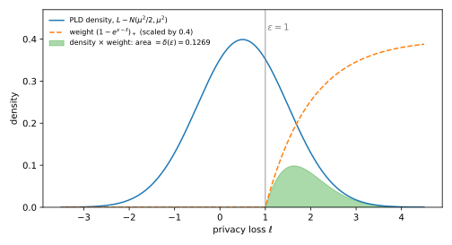

# Numerical accounting with privacy loss distributions

## Why this matters

You trained a model with differential privacy (DP): 10,000 steps of stochastic gradient descent (SGD), each on a Poisson sample of the data with rate $q = 0.01$, each with clipped gradients and Gaussian noise of multiplier $\sigma = 1$. This is DP-SGD. You need one number: the smallest $\varepsilon$ such that the whole run is $(\varepsilon, 10^{-5})$-DP, which means that for any two datasets that differ in one person's record, the probability of any set of outcomes of the run changes by at most a factor $e^\varepsilon$, plus a slack of $10^{-5}$. Rényi differential privacy (RDP), from [Rényi DP](01-renyi-dp.md), gives an upper bound: it tracks one Rényi divergence per order and adds them up over the steps, but converting that Rényi curve to $(\varepsilon, \delta)$ loses something you cannot see. The Gaussian central limit theorem (CLT) of [f-DP and Gaussian DP](04-gaussian-dp.md) says that many composed steps look like one Gaussian mechanism, which gives an approximation, but not a bound. Neither tells you how far it is from the truth. This chapter computes the truth itself, to any precision you are willing to pay for, together with a lower and an upper bound that bracket it.

### The one idea: δ is an average over the privacy loss, and composition adds losses

Let $P$ be the distribution of the output when the run uses your dataset $D$, and $Q$ the distribution when it uses the neighbour $D'$. [Composition](../part03-dp-foundations/04-composition.md) measured how much one output $y$ gives the two datasets away by the log of the ratio of its two probabilities, the **privacy loss** $L(y) = \ln\frac{P(y)}{Q(y)}$. It is positive when $y$ is more likely under $D$, negative when it is more likely under $D'$, and zero when $y$ says nothing. With the output drawn as $Y \sim P$, the loss $L(Y)$ is a random variable, the privacy loss random variable (PRV). Two facts make it the right object to track.

The first is that the guarantee $\delta(\varepsilon)$, the smallest $\delta$ that works for a given $\varepsilon$, depends on the pair $(P, Q)$ only through the distribution of $L(Y)$. Each output contributes to $\delta(\varepsilon)$ an amount that depends only on its own loss: nothing if its loss is at most $\varepsilon$, a fraction $(1 - e^{\varepsilon - \ell})_+$ of its probability if its loss $\ell$ is larger. So $\delta(\varepsilon)$ is the average of that fixed function of the loss. We call the distribution of $L(Y)$ the **privacy loss distribution (PLD)**.

The second is that the privacy loss of a composition is the sum of the per-step losses, because the probability of a sequence of independent outputs is a product and the logarithm turns the product into a sum. For independently run steps the terms are independent, and the distribution of a sum of independent variables is the convolution of their distributions. So the PLD of $k$ steps is the $k$-fold convolution of the per-step PLDs (@sec-num-convolution handles steps chosen adaptively).

Everything in this chapter follows from these two facts. Discretize the per-step loss on a grid of width $h$, convolve with a fast Fourier transform (FFT), and read $\delta(\varepsilon)$ off the result. Since a larger loss never contributes less to δ, rounding moves δ in a known direction. If you **round each loss up** to the grid, the δ you compute is an upper bound on the true δ for every composition. If you **round down**, it is a lower bound. The true value is sandwiched, and the width of the sandwich is known in advance: each step's two roundings are at most $h$ apart, so after $k$ steps the two totals are at most $kh$ apart, which makes the sandwich at most $kh$ wide in $\varepsilon$, and exactly $kh$ for a continuous PLD without truncation.

@tbl-num-overview lists the results and where each is used.

| Result | Where it is used |
| --- | --- |
| $\delta(\varepsilon) = \mathbb E_{Y\sim P}[(1 - e^{\varepsilon - L(Y)})_+]$ (@eq-num-delta) | Every accountant in this chapter; reading $(\varepsilon, \delta)$ off any PLD |
| The Gaussian PLD $\mathcal N(\mu^2/2, \mu^2)$ | Checking the code; the Gaussian mechanism; Gaussian DP |
| Composition is convolution (@eq-num-conv), dominating pairs | Accounting for $k$ steps, adaptive or not |
| Pessimistic and optimistic rounding (@eq-num-sandwich) | Turning a numerical answer into a certified upper bound and a lower bound |
| FFT convolution, padding, repeated squaring | Fast accountants: the PLD accountant, the PRV accountant |
| PLD of the Poisson-subsampled Gaussian, two directions | DP-SGD accounting |
| The running example | Comparing PLD against RDP and the CLT in [Choosing an accountant](09-choosing-an-accountant.md) |

: The results of this chapter and where each is used. {#tbl-num-overview}

**Conventions.** In this chapter $q$ is the sampling rate. Since the lowercase letter is taken, the densities of the two output distributions are written with the same letter as the distribution, $P(y)$ and $Q(y)$. $\sigma$ is the noise multiplier and the sensitivity is 1: one record moves the quantity being noised by at most 1. A **PLD** $\omega$ is the law of $L(Y)$ under $Y \sim P$. It may have an atom at $+\infty$, which is the $P$-mass of the outputs where $Q(y) = 0$: those outputs are impossible under $D'$, so seeing one proves the dataset was $D$. $\Phi$ is the standard normal distribution function, $\Phi(x) = \Pr[Z \le x]$ for $Z \sim \mathcal N(0, 1)$. Logs are natural. The running example is DP-SGD with $q = 0.01$, $\sigma = 1$, $\delta = 10^{-5}$ and up to $k = 10{,}000$ steps. The RDP accountant of [Amplification by subsampling](05-subsampling.md) and the CLT approximation of Gaussian differential privacy (GDP) serve as comparisons.

## Toolkit: three facts the derivations reuse

### Fact 1 — Change of measure: $Q(y) = e^{-L(y)}P(y)$

You often need a probability under $Q$ but only know the distribution of the loss under $P$. The way across is to reweight: an output's $Q$-probability is its $P$-probability times the ratio $Q(y)/P(y)$, and that ratio is $e^{-L(y)}$ by the definition of the loss. Wherever $P(y) > 0$ and $Q(y) > 0$, $Q(y) = P(y)\,\frac{Q(y)}{P(y)} = e^{-L(y)}P(y)$. Summing any function $f$ of the loss against both sides gives, for any $f$,
$$\mathbb E_Q[f(L)\,\mathbf 1\{P > 0\}] = \mathbb E_P\big[f(L)\,e^{-L}\big].$$
The indicator $\mathbf 1\{P > 0\}$ is there because the reweighting only reaches outputs that $P$ can produce; the outputs with $P(y) = 0$ are invisible from the $P$ side. With $f = 1$ the left side is the total $Q$-mass on outputs that $P$ can produce: $\mathbb E_P[e^{-L}] = Q(P > 0) \le 1$, with equality when $Q$ puts no mass where $P$ puts none. This is Fact 1 of [Divergences](../part01-prerequisites/03-divergences.md), read with the likelihood ratio $r = e^{L}$.

Two things follow that the chapter uses. The law of $L$ under $Q$ is determined by the PLD, because every $Q$-probability of a loss event is a reweighted $P$-probability. And a distribution $\omega$ can only be a PLD if $\mathbb E_\omega[e^{-L}] \le 1$.

### Fact 2 — Monotone coupling

If you move every value of a random variable up, any non-decreasing function of it can only go up too, and so can its average. Formally, let $g$ be non-decreasing. If two random variables, built on the same random draw, satisfy $X \le X'$ for every outcome, then $\mathbb E[g(X)] \le \mathbb E[g(X')]$. This is just $g(X) \le g(X')$ outcome by outcome, averaged. Building two variables from one draw like this, so that they can be compared outcome by outcome, is called a **coupling**. The chapter uses it to show that moving privacy loss upward can only increase δ (@sec-num-discretize).

### Fact 3 — The discrete convolution theorem

Convolving two sequences directly means summing $a_ib_j$ over every pair $(i, j)$ with the same $i + j$, which costs a number of operations proportional to the product of their lengths. The Fourier transform turns this into a pointwise product. The reason is that the transform attaches to index $i$ the power $\zeta^{i}$ of a fixed complex number, and powers multiply by adding exponents, $\zeta^i\zeta^j = \zeta^{i+j}$: indices add exactly the way losses add. For sequences $a_0, \dots, a_{N-1}$, the discrete Fourier transform of length $N$ is $\hat a_m = \sum_{i=0}^{N-1}a_i\,\zeta^{im}$ with $\zeta = e^{-2\pi\mathrm i/N}$, an $N$-th root of unity. Multiplying two transforms and grouping the terms by $i + j$ gives, since $\zeta^N = 1$ means exponents only matter modulo $N$,
$$\hat a_m\,\hat b_m = \sum_{i,j}a_ib_j\,\zeta^{(i+j)m} = \sum_{n=0}^{N-1}\Big(\sum_{i + j \equiv n \bmod N}a_ib_j\Big)\zeta^{nm}.$$
The bracket is the coefficient at index $n$, so the inverse transform of $\hat a\hat b$ is the **circular** convolution: index sums are taken modulo $N$, and a sum that reaches $N$ or more folds back to the start. To get the ordinary convolution you make the window long enough that nothing folds back. If $a$ has $n_a$ nonzero entries at the start, $b$ has $n_b$, and $N \ge n_a + n_b - 1$, then $i + j \le n_a + n_b - 2 < N$ always, no index wraps around, and the circular convolution equals the ordinary one. The FFT computes such a transform in $O(N\log N)$ operations instead of $O(N^2)$. The chapter uses it to convolve PLDs (@sec-num-fft).

## The privacy loss distribution {#sec-num-pld}

### Context

The guarantee you report is $\delta(\varepsilon) = E_{e^\varepsilon}(P\|Q)$, the **hockey-stick divergence** between the output distributions on two neighbouring datasets (see [Divergences](../part01-prerequisites/03-divergences.md) and [Definition](../part03-dp-foundations/01-definition.md)). It is the smallest $\delta$ for which $P(S) \le e^\varepsilon Q(S) + \delta$ holds for every set $S$ of outputs. The largest gap $P(S) - e^\varepsilon Q(S)$ comes from the set that holds exactly the outputs with $P(y) > e^\varepsilon Q(y)$, since each of them adds a positive amount and any other output would subtract, so the divergence is the sum $\sum_y\big(P(y) - e^\varepsilon Q(y)\big)_+$, where $(x)_+ = \max\{x, 0\}$. That is a sum over outputs, and the output space of a training run is enormous. This section shows that you never need the output space: the one-dimensional distribution of the privacy loss carries all of $\delta(\varepsilon)$.

### Statement

Each output adds to δ only if its loss exceeds $\varepsilon$, and then it adds the fraction $1 - e^{\varepsilon - \ell}$ of its probability, which grows from 0 at $\ell = \varepsilon$ towards 1 for a very large loss. So δ is an average of that weight over the PLD. Equivalently, it is the chance under $P$ that the loss exceeds $\varepsilon$, minus $e^\varepsilon$ times the same chance under $Q$: the second form is the hockey-stick gap of the best set $S = \{L > \varepsilon\}$. Let $\omega$ be the PLD of $(P, Q)$, the law of $L(Y)$ with $Y \sim P$, including its atom $\omega(\{+\infty\})$. Then for every $\varepsilon$,
$$\delta(\varepsilon) = \mathbb E_{L\sim\omega}\big[(1 - e^{\varepsilon - L})_+\big] = P[L > \varepsilon] - e^{\varepsilon}\,Q[L > \varepsilon],$$ {#eq-num-delta}
with the convention $(1 - e^{\varepsilon - \infty})_+ = 1$: an output impossible under $D'$ counts fully. The right side also needs the law of $L$ under $Q$, but that is no extra information. By Fact 1 it is the PLD reweighted by $e^{-\ell}$, namely $e^{-\ell}\,\omega(d\ell)$ on finite $\ell$, plus an atom at $-\infty$ of size $1 - \mathbb E_\omega[e^{-L}]$ for the $Q$-mass that sits where $P$ is zero. So $\omega$ alone determines both sides.

For the **Gaussian pair** $P = \mathcal N(0, \sigma^2)$, $Q = \mathcal N(s, \sigma^2)$, the two outputs of a Gaussian mechanism whose query moves by $s$, write $\mu = s/\sigma$ for the shift measured in noise standard deviations. The privacy loss turns out to be a linear function of the output, so it is itself Gaussian, with mean $\mu^2/2$ and variance $\mu^2$. Plugging its two tails into @eq-num-delta gives δ in closed form:
$$L \sim \mathcal N\big(\tfrac{\mu^2}2, \mu^2\big)\ \text{under } P, \qquad \delta(\varepsilon) = \Phi\Big(\frac\mu2 - \frac\varepsilon\mu\Big) - e^{\varepsilon}\,\Phi\Big(-\frac\mu2 - \frac\varepsilon\mu\Big).$$ {#eq-num-gauss}

### Derivation

**δ as an average over the PLD.** The plan is to start from the hockey-stick sum, factor each output's probability out of its term so that what remains depends only on its loss, and then recognize an average.

1. **Write the hockey-stick divergence as a sum over outputs.** As the Context explains (Fact 3 of [Divergences](../part01-prerequisites/03-divergences.md)), the best set of outputs is the one where $P > e^\varepsilon Q$, so $\delta(\varepsilon) = \sum_y\big(P(y) - e^\varepsilon Q(y)\big)_+$.
2. **Sort the outputs into three kinds, because the loss behaves differently on each.** Where $P(y) = 0$ the term is $(-e^\varepsilon Q(y))_+ = 0$, so these outputs drop out. Where $Q(y) = 0 < P(y)$ the term is $P(y)$, and $L(y) = +\infty$. Elsewhere both are positive and the loss is finite.
3. **Factor out $P(y)$ on the third kind,** using $Q(y)/P(y) = e^{-L(y)}$: $P(y)\big(1 - e^\varepsilon\frac{Q(y)}{P(y)}\big)_+ = P(y)\big(1 - e^{\varepsilon - L(y)}\big)_+$.
4. **Recognize an expectation under $P$.** A sum of $P(y)$ times something is the average of that something with $Y \sim P$. Adding up the second and third kinds gives $\mathbb E_P[(1 - e^{\varepsilon - L(Y)})_+]$, where an infinite loss gets the value 1, as step 2 requires. The thing being averaged depends on $y$ only through $L(y)$, so the expectation is an average over $\omega$. This is the first form of @eq-num-delta.
5. **Split the positive part into two terms.** When $L > \varepsilon$ the bracket $1 - e^{\varepsilon - L}$ is positive and the positive part keeps it; when $L \le \varepsilon$ it is zero. So $(1 - e^{\varepsilon - L})_+ = \mathbf 1\{L > \varepsilon\} - e^\varepsilon e^{-L}\mathbf 1\{L > \varepsilon\}$. The first term averages to $P[L > \varepsilon]$.
6. **Change measure in the second term.** Fact 1 with $f = \mathbf 1\{\cdot > \varepsilon\}$ turns the $P$-average reweighted by $e^{-L}$ into a $Q$-probability: $\mathbb E_P[e^{-L}\mathbf 1\{L > \varepsilon\}] = Q[L > \varepsilon]$. The outputs where $P = 0$, which Fact 1 cannot reach, have $L = -\infty$ and are not in the event anyway. This gives the second form of @eq-num-delta.
7. **Find the law of $L$ under $Q$ the same way.** Fact 1 with $f = \mathbf 1\{L \in A\}$ gives $Q[L \in A] = \int_A e^{-\ell}\omega(d\ell)$ for sets $A$ of finite losses. The remaining $Q$-mass sits where $P = 0$, at $L = -\infty$.

**The Gaussian PLD.** The point is that for two Gaussians with the same variance the log-ratio of the densities is linear in the output, because the quadratic terms cancel.

1. **The loss is linear in $y$.** The normalizing constants are the same and cancel: $L(y) = \ln\frac{e^{-y^2/2\sigma^2}}{e^{-(y - s)^2/2\sigma^2}} = \frac{(y - s)^2 - y^2}{2\sigma^2} = \frac{s^2 - 2sy}{2\sigma^2}$.
2. **A linear function of a Gaussian is Gaussian.** With $Y \sim \mathcal N(0, \sigma^2)$, the mean of $L$ is the constant term $\frac{s^2}{2\sigma^2} = \frac{\mu^2}2$, and the variance is the squared slope times the variance of $Y$, $\frac{4s^2}{4\sigma^4}\sigma^2 = \mu^2$.
3. **Under $Q$**, $Y \sim \mathcal N(s, \sigma^2)$ has mean $s$ instead of 0, which moves the mean of $L$ by the slope times $s$, $-\frac{2s\cdot s}{2\sigma^2} = -\mu^2$, so $L \sim \mathcal N(-\frac{\mu^2}2, \mu^2)$. Step 7 above predicts the same. Multiplying the density of $\mathcal N(m, v)$ by $e^{-\ell}$ and completing the square, $-\frac{(\ell - m)^2}{2v} - \ell = -\frac{(\ell - (m - v))^2}{2v} + \text{const}$, gives $\mathcal N(m - v, v)$; here $\frac{\mu^2}2 - \mu^2 = -\frac{\mu^2}2$.
4. **Read off the tails.** For $L \sim \mathcal N(m, \mu^2)$, standardizing gives $\Pr[L > \varepsilon] = \Pr\big[Z > \frac{\varepsilon - m}{\mu}\big] = \Phi\big(\frac{m - \varepsilon}{\mu}\big)$, because the standard normal is symmetric about 0. So $P[L > \varepsilon] = \Phi\big(\frac{\mu^2/2 - \varepsilon}{\mu}\big) = \Phi(\frac\mu2 - \frac\varepsilon\mu)$, and $Q[L > \varepsilon] = \Phi\big(\frac{-\mu^2/2 - \varepsilon}{\mu}\big) = \Phi(-\frac\mu2 - \frac\varepsilon\mu)$. Insert them in @eq-num-delta. This is the exact $\delta(\varepsilon)$ of the [Gaussian mechanism](../part03-dp-foundations/03-laplace-gaussian.md), and the $(\varepsilon, \delta)$ curve of $\mu$-GDP in [f-DP and Gaussian DP](04-gaussian-dp.md), where a mechanism is $\mu$-GDP if telling its two outputs apart is never easier than telling $\mathcal N(0, 1)$ from $\mathcal N(\mu, 1)$.

### Interpretation

The PLD is a complete summary for $(\varepsilon, \delta)$. Two pairs with the same PLD have the same $\delta(\varepsilon)$ at every $\varepsilon$, whatever their output spaces, because @eq-num-delta reads δ off the PLD and nothing else. A DP-SGD run with millions of parameters and a one-dimensional Gaussian pair can have the same PLD.

Not every distribution is a PLD, though. Fact 1 requires $\mathbb E_\omega[e^{-L}] \le 1$, since that average is the $Q$-mass where $P$ is positive. The converse holds too: any $\omega$ with $\mathbb E_\omega[e^{-L}] \le 1$ is the PLD of some pair, and you can build the pair directly. Take $P = \omega$ on the real line, except that its atom at $+\infty$, if any, goes on an extra point $y_+$ where $Q$ is zero. Take $Q(d\ell) = e^{-\ell}\omega(d\ell)$ on the finite losses, which has total mass at most 1 by assumption, and put the missing $Q$-mass $1 - \mathbb E_\omega[e^{-L}]$ on a second extra point $y_-$ where $P$ is zero. Then $\ln\frac{P}{Q}$ is $\ell$ at each finite $\ell$ and $+\infty$ at $y_+$, so the PLD is $\omega$. @sec-num-discretize uses this to show that a rounded PLD still belongs to a real pair of distributions.

The weight $(1 - e^{\varepsilon - \ell})_+$ is non-decreasing in $\ell$: it is 0 up to $\ell = \varepsilon$ and rises to 1. So $\delta(\varepsilon)$ is the PLD's upper tail beyond $\varepsilon$, down-weighted near $\varepsilon$ (@fig-num-pld-weight). Because the weight is at most 1, $\delta(\varepsilon) \le P[L > \varepsilon]$, and because losses just above $\varepsilon$ get a weight close to 0, that tail bound is loose ([Exercise 2](../../book-exercises/part04-privacy-accounting/06-numerical-accounting.md#sec-sol-num-2)).

{#fig-num-pld-weight}

### Example: the Gaussian mechanism with $\sigma = 1$

With sensitivity 1 and $\sigma = 1$, the shift is one noise standard deviation, $\mu = 1/1 = 1$, and the PLD is $\mathcal N(\frac12, 1) = \mathcal N(0.5, 1)$. From a million samples of $Y$, the script finds a mean loss of 0.4990, a variance of 1.0013 and $\mathbb E[e^{-L}] = 1.0015$, against the exact 0.5, 1 and 1. The green area of @fig-num-pld-weight comes from @eq-num-gauss at $\varepsilon = 1$: $\Phi(\frac12 - 1) - e\,\Phi(-\frac12 - 1) = \Phi(-0.5) - e\,\Phi(-1.5) = 0.3085 - 2.7183 \times 0.0668 = 0.3085 - 0.1816 = 0.1269$. At $\varepsilon = 0$ the second term has no factor $e^\varepsilon$ and the formula is $\Phi(0.5) - \Phi(-0.5) = 0.6915 - 0.3085 = 0.3829$. @tbl-num-gauss-delta checks @eq-num-gauss against numerical integration of $(1 - e^{\varepsilon - \ell})_+$ over the PLD density and against Monte Carlo.

| $\varepsilon$ | Closed form @eq-num-gauss | Quadrature over the PLD | Monte Carlo ($10^6$ draws) |
| --- | --- | --- | --- |
| 0 | 0.382925 | 0.382925 | 0.382644 |
| 0.5 | 0.238422 | 0.238422 | 0.238748 |
| 1 | 0.126937 | 0.126937 | 0.126967 |
| 2 | 0.020924 | 0.020924 | 0.020922 |

: δ(ε) of the Gaussian pair with $\mu = 1$, computed three ways. {#tbl-num-gauss-delta}

The quadrature agrees to all six digits and Monte Carlo to within its sampling error. Since δ falls as $\varepsilon$ grows, you can also go the other way and solve $\delta(\varepsilon) = 10^{-5}$ for $\varepsilon$: the mechanism is $(4.3772, 10^{-5})$-DP.

For a finite pair the two forms of @eq-num-delta can be checked by hand. Take $P = (0.1, 0.2, 0.3, 0.4)$ and $Q = (0.4, 0.3, 0.2, 0.1)$ at $\varepsilon = 0.5$, where $e^{0.5} = 1.6487$. Only the last output has $P > e^{0.5}Q$, so the sum is $\sum(P - e^{0.5}Q)_+ = 0.4 - 1.6487 \times 0.1 = 0.2351$. The losses are $\ln\frac{0.1}{0.4}$, $\ln\frac{0.2}{0.3}$, $\ln\frac{0.3}{0.2} = 0.405$ and $\ln\frac{0.4}{0.1} = 1.386$, so only the last exceeds 0.5, and $P[L > 0.5] - e^{0.5}Q[L > 0.5] = 0.4 - 1.6487 \times 0.1 = 0.2351$ as well.

### Check yourself

- Why does an output with $Q(y) = 0$ count fully in δ, whatever $\varepsilon$ is? *(Seeing it proves the dataset was $D$, not $D'$. No $e^\varepsilon$ factor can cover a ratio of $P(y)/0$, so its whole probability goes into δ.)*
- A Gaussian mechanism with noise standard deviation 2 on a count (sensitivity 1), and a 1000-dimensional Gaussian mechanism with noise standard deviation 4 on a query of $\ell_2$ sensitivity 2: do they have the same $(\varepsilon, \delta)$ curve? *(Yes. Both shift by half a noise standard deviation, $\mu = 1/2 = 2/4 = 0.5$, so both have PLD $\mathcal N(\frac{0.25}2, 0.25) = \mathcal N(0.125, 0.25)$, and by @eq-num-delta δ depends only on the PLD.)*

## Composition is convolution {#sec-num-convolution}

### Context

DP-SGD releases $k$ noisy gradients. The output is the tuple $(y_1, \dots, y_k)$, and you want its $\delta(\varepsilon)$. The bounds of [Composition](../part03-dp-foundations/04-composition.md) (basic, advanced, and the optimal composition theorem of Kairouz, Oh and Viswanath, which is the best bound possible for steps known only by their $(\varepsilon_i, \delta_i)$) start from per-step $(\varepsilon_i, \delta_i)$ pairs, and so throw away the shape of each step's PLD. With PLDs, composition is exact.

### Statement

Run $k$ steps independently. The probability of the whole tuple of outputs is the product of the per-step probabilities, so the log-ratio of the whole tuple is the sum of the per-step log-ratios: the total privacy loss is the sum of the step losses. Those step losses are independent, and the distribution of a sum of independent variables is the **convolution** of their distributions. For independent steps with pairs $(P_i, Q_i)$ and PLDs $\omega_i$, the product pair $(P_1 \times \dots \times P_k,\ Q_1 \times \dots \times Q_k)$ therefore has PLD
$$\omega_{1..k} = \omega_1 * \omega_2 * \dots * \omega_k, \qquad \omega^{*k} \text{ for } k \text{ identical steps},$$ {#eq-num-conv}
where $*$ is convolution of distributions (the law of a sum of independent variables), and the atom at $+\infty$ absorbs any sum that contains $+\infty$: once one step gives the dataset away completely, the whole run does. For $k$ Gaussian steps, means and variances add, so $\mathcal N(\frac{\mu^2}2, \mu^2)^{*k} = \mathcal N(\frac{k\mu^2}2, k\mu^2)$, which is the PLD of a single Gaussian with $\mu_k = \sqrt k\,\mu$.

**Adaptive composition.** In DP-SGD each step's gradient depends on the model, which depends on the earlier outputs, so the steps are not independent. The way around this is to replace each step by a fixed pair that is at least as easy to tell apart, whatever happened before. To compare pairs at every level of strictness, use the hockey-stick divergence with a general weight $\gamma$ in place of $e^\varepsilon$, $E_\gamma(P\|Q) = \sum_y\big(P(y) - \gamma Q(y)\big)_+$. A pair $(P, Q)$ **dominates** a mechanism $M$ if $E_\gamma(M(D)\|M(D')) \le E_\gamma(P\|Q)$ for all neighbours $D \simeq D'$ and all $\gamma \ge 0$ (Zhu, Dong & Wang 2022, Definition 7). If $(P_i, Q_i)$ dominates step $i$ for every value of the earlier outputs, then $(P_1 \times \dots \times P_k, Q_1 \times \dots \times Q_k)$ dominates the adaptive composition (their Theorem 10; @sec-apx-comp-dominating in the appendices derives it). So the convolution of the dominating PLDs gives a valid $\delta(\varepsilon)$ for the adaptive run.

### Derivation

The derivation follows the probability of the tuple from a product, to a sum of losses, to a convolution.

1. **Densities multiply.** For independent steps the probability of a tuple is the product of the probabilities of its entries: $P(y_1, \dots, y_k) = \prod_iP_i(y_i)$, and likewise for $Q$.
2. **Losses add.** The ratio of two products is the product of the ratios, and the logarithm of a product is the sum of logarithms: $L(y_1, \dots, y_k) = \sum_iL_i(y_i)$, with $L_i = \ln(P_i/Q_i)$.
3. **The terms are independent.** Under $P$, the $Y_i$ are independent with $Y_i \sim P_i$. Each $L_i(Y_i)$ is a function of its own $Y_i$ only, so the $L_i(Y_i)$ are independent too, with laws $\omega_i$.
4. **The law of a sum of independent variables is the convolution of their laws.** For two discrete variables, the chance that the sum is $\ell$ adds up, over all ways of splitting $\ell = a + b$, the chance of $a$ times the chance of $b$, and that is what convolution computes. This is @eq-num-conv.
5. **Gaussian check.** A sum of independent Gaussians is Gaussian, and means and variances add: $k\frac{\mu^2}2$ and $k\mu^2$. This is $\mathcal N(\frac{\mu_k^2}2, \mu_k^2)$ with $\mu_k^2 = k\mu^2$.
6. **Adaptivity breaks step 3, and domination repairs it.** If the second mechanism is chosen after seeing $y_1$, its pair depends on $y_1$, so its loss depends on the first output and the losses are no longer independent. The dominating-pair theorem bounds every pair the second mechanism could have by one fixed pair, and shows that the hockey-stick curves of the product of the fixed pairs still lie above those of the adaptive run. Its proof is in Zhu, Dong & Wang (2022, Theorem 10), and @sec-apx-comp-dominating in the appendices derives it step by step. Domination at every $\gamma \ge 0$ lets each branch's test be swapped for one on the fixed pair that fires at least as often under $P$ and at most as often under $Q$, so the test's chance of firing under $P$, minus $\gamma$ times its chance under $Q$, never goes down. It uses $E_\gamma$ for all $\gamma \ge 0$, not only $\gamma \ge 1$ (which corresponds to $\varepsilon \ge 0$), which is why Definition 7 asks for all $\gamma \ge 0$.

### Interpretation

@eq-num-conv has no slack at all. It is exact, so the only errors in a PLD accountant are the ones you introduce to compute the convolution: discretization (@sec-num-discretize) and floating point (@sec-num-fft).

It also shows why the CLT is plausible. A $k$-fold convolution is the law of a sum of $k$ independent terms, and the ordinary central limit theorem says that such a sum of anything with finite variance looks Gaussian for large $k$. That is the GDP central limit theorem of [f-DP and Gaussian DP](04-gaussian-dp.md). The PLD accountant does not need that approximation; it computes the convolution.

The dominating pair is a choice, and the bound is only as tight as that choice. For the Gaussian mechanism with $\ell_2$ sensitivity 1, the pair $\mathcal N(0, \sigma^2)$, $\mathcal N(1, \sigma^2)$ dominates and is attained by some neighbouring datasets, so the result is tight. For subsampled mechanisms you need one pair per direction (@sec-num-subsampled).

### Example: ten Gaussian steps

One Gaussian step with $\sigma = 1$ has $\mu = 1$ and PLD $\mathcal N(0.5, 1)$. Ten steps add ten means and ten variances, so their PLD is $\mathcal N(5, 10)$, which is a single Gaussian with $\mu = \sqrt{10}$. Solving @eq-num-gauss with that $\mu$ for $\delta = 10^{-5}$, the composition is $(17.8566, 10^{-5})$-DP. For 100 steps, $\mu = \sqrt{100} = 10$ and $\varepsilon = 91.8173$. @sec-num-fft recovers both numbers from a discretized PLD.

### Check yourself

- You compose a Gaussian step with $\mu = 1$ and one with $\mu = 2$. What is the PLD? *(Means $\frac{\mu^2}2$ and variances $\mu^2$ add: $\mathcal N(\frac12 + 2, 1 + 4) = \mathcal N(2.5, 5)$, a single Gaussian with $\mu = \sqrt5$.)*
- Why is the convolution of PLDs exact while advanced composition is not? *(Advanced composition, and even optimal composition, see each step only through $(\varepsilon_i, \delta_i)$, so they must cover the worst PLD with those values. Convolution uses the actual PLDs.)*

## Discretization: pessimistic and optimistic {#sec-num-discretize}

### Context

A computer cannot convolve continuous distributions. You must put the loss on a finite grid $\{ih : i \in \mathbb Z\}$ of spacing $h$. Any rounding changes $\delta$. The question is whether you can round so that the error has a known sign, for every number of compositions, so that the answer is still a guarantee.

### Statement

The weight $(1 - e^{\varepsilon - \ell})_+$ that turns a loss into δ never decreases as the loss grows. So if you move every loss up, δ can only grow, and if you move every loss down, it can only shrink. That gives two ways to round, one for each direction. Given a PLD $\omega$ and a grid width $h$, define two discretizations.

- **Pessimistic** $\omega^\uparrow$: move every loss $\ell \in ((i-1)h, ih]$ up to $ih$. Truncate the top tail by moving its mass (at most a tiny $\tau$) to $+\infty$, and the bottom tail by moving it up to the lowest kept grid point. Every move is upward.
- **Optimistic** $\omega^\downarrow$: move every loss $\ell \in [ih, (i+1)h)$ down to $ih$. Truncate the top tail by moving it down to the highest kept grid point, and drop the bottom tail. Every move is downward or removes mass.

Write $\delta_\omega(\varepsilon)$ for @eq-num-delta evaluated on $\omega$. Rounding each step before convolving keeps the direction of every move in the total, so for every $k$ and every $\varepsilon$,
$$\delta_{(\omega^\downarrow)^{*k}}(\varepsilon) \;\le\; \delta_{\omega^{*k}}(\varepsilon) \;\le\; \delta_{(\omega^\uparrow)^{*k}}(\varepsilon),$$ {#eq-num-sandwich}
and the same holds for convolutions of different PLDs, each rounded the same way.

Two more things hold. First, the upper bound is not just a number but a real guarantee: $\omega^\uparrow$ is a valid PLD, $\mathbb E_{\omega^\uparrow}[e^{-L}] \le 1$, of a pair that dominates $(P, Q)$, so the upper bound also holds for adaptive composition. Second, the sandwich is narrow. Write $\varepsilon^\uparrow(\delta)$ and $\varepsilon^\downarrow(\delta)$ for the values of $\varepsilon$ at which the pessimistic and optimistic curves reach $\delta$. Without truncation the two are at most $kh$ apart, because each step's two roundings differ by at most $h$: $\varepsilon^\uparrow(\delta) \le \varepsilon^\downarrow(\delta) + kh$.

### Derivation

1. **Build both roundings of one step from the same draw.** Draw $L \sim \omega$ and set $L^\uparrow = h\lceil L/h\rceil$ (round up) and $L^\downarrow = h\lfloor L/h\rfloor$ (round down). Then $L^\uparrow$ has law $\omega^\uparrow$, $L^\downarrow$ has law $\omega^\downarrow$, and, since a number lies between its two roundings and they are at most one grid step apart, $L^\downarrow \le L \le L^\uparrow \le L^\downarrow + h$ for every outcome. This is a coupling in the sense of Fact 2.
2. **Add up $k$ steps.** Draw the $k$ steps independently and apply step 1 to each. Adding the $k$ inequalities gives $\sum L_i^\downarrow \le \sum L_i \le \sum L_i^\uparrow \le \sum L_i^\downarrow + kh$, and each sum has the convolved law of its rounded PLDs (@eq-num-conv).
3. **Use that δ grows with the loss.** By @eq-num-delta, $\delta(\varepsilon) = \mathbb E[g_\varepsilon(\text{total loss})]$ with $g_\varepsilon(\ell) = (1 - e^{\varepsilon - \ell})_+$, a non-decreasing function. Fact 2 applied to the inequalities of step 2 gives @eq-num-sandwich.
4. **Truncation keeps the sign.** The pessimistic truncation moves mass up (to a higher grid point, or to $+\infty$ where $g_\varepsilon = 1$), so Fact 2 still applies. The optimistic truncation moves mass down, which Fact 2 covers in the other direction, or deletes it, which removes a non-negative term from δ. Both can be repeated after every convolution without breaking the inequality.
5. **The pessimistic PLD belongs to a real pair.** Rounding up raises every loss, so it lowers $e^{-L}$: $\mathbb E_{\omega^\uparrow}[e^{-L}] \le \mathbb E_\omega[e^{-L}] \le 1$ (mass moved to $+\infty$ contributes $e^{-\infty} = 0$). The Interpretation in @sec-num-pld showed that any distribution with $\mathbb E[e^{-L}] \le 1$ is the PLD of some pair, by building the pair from it. So there is a pair $(P^\uparrow, Q^\uparrow)$ with PLD $\omega^\uparrow$ (Doroshenko et al. 2022, Lemma 4.2, prove it for this rounding).
6. **That pair dominates the original.** Step 3 with $k = 1$ says $E_{e^\varepsilon}(P\|Q) \le E_{e^\varepsilon}(P^\uparrow\|Q^\uparrow)$ for every real $\varepsilon$, that is, for every $\gamma = e^\varepsilon > 0$. At $\gamma = 0$ the divergence is $\sum_y P(y) = 1$ for both pairs. So $(P^\uparrow, Q^\uparrow)$ dominates $(P, Q)$ at every $\gamma \ge 0$, and by the dominating-pair theorem of @sec-num-convolution (derived in @sec-apx-comp-dominating) the convolution of rounded-up PLDs bounds adaptive compositions too.
7. **The width.** By step 2, the pessimistic total is the optimistic total plus at most $kh$. Adding a constant $c$ to the loss shifts its δ curve by $c$ to the right, because $g_\varepsilon$ only sees the difference $\varepsilon - \ell$: $\mathbb E[g_\varepsilon(X + c)] = \mathbb E[g_{\varepsilon - c}(X)]$. With Fact 2 this gives $\delta^\uparrow(\varepsilon) \le \delta^\downarrow(\varepsilon - kh)$. So wherever the optimistic curve has dropped to a given $\delta$, the pessimistic curve has dropped to it at most $kh$ further right, and the $\varepsilon$ at which each crosses $\delta$ differ by at most $kh$.

### Interpretation

The lower bound needs care about what it bounds. Rounding down lowers losses, which raises $e^{-L}$, so it can push $\mathbb E[e^{-L}]$ above 1, and then $\omega^\downarrow$ is not the PLD of any pair. That does not matter for a lower bound: $\delta^\downarrow$ is still below the δ of $k$ non-adaptive copies of $(P, Q)$, by the sandwich. It bounds the mechanism's δ from below only if some neighbouring datasets actually produce $(P, Q)$. That holds for the Gaussian and the subsampled Gaussian.

The width is almost exactly $kh$, not just at most. A loss that is not on the grid is moved by exactly $h$ between its two roundings, and a continuous PLD puts no mass on the grid points, so $L^\uparrow = L^\downarrow + h$ almost surely and the totals differ by exactly $kh$. The error therefore grows linearly in $k$. To keep the sandwich width fixed at $10^4$ steps, you need a grid $10^4$ times finer than for one step.

The midpoint of the two sides is a good estimate, but not a bound. A loss spread evenly inside a grid cell is moved up by about $h/2$ on average when rounded up, and down by the same amount when rounded down. So the pessimistic total is biased up by about $h/2$ per step and the optimistic one down by the same amount, and their midpoint is nearly unbiased. Only the two sides are guarantees.

Mass at $+\infty$ is cheap but not free. Each truncation of $\tau$ moves at most $\tau$ of mass to a place where its weight is 1, so it adds at most $\tau$ to δ. With $\tau = 10^{-15}$ and a few dozen truncations, this is far below any δ you would report.

### Example: randomized response composed three times

Randomized response with $\varepsilon_0 = \ln 3$ reports the true bit with probability $\frac34$ and the flipped bit with probability $\frac14$ (see [Randomized response](../part03-dp-foundations/01-definition.md#sec-dpdef-rr)). The true report is $\frac{3/4}{1/4} = 3$ times likelier under $D$ than under $D'$, so its loss is $\ln 3$, and the flipped one has loss $-\ln 3$. Its PLD therefore has two points: loss $+1.0986$ with probability 0.7500 and $-1.0986$ with probability 0.2500. On the grid $h = 0.5$, the loss 1.0986 lies between 1 and 1.5 and $-1.0986$ between $-1.5$ and $-1$, so rounding up gives $\{-1, 1.5\}$ and rounding down gives $\{-1.5, 1\}$, with the same probabilities. The rounded-up PLD has $\mathbb E[e^{-L}] = 0.75\,e^{-1.5} + 0.25\,e^{1} = 0.1673 + 0.6796 = 0.8469 \le 1$, a valid PLD. The rounded-down PLD has $\mathbb E[e^{-L}] = 0.75\,e^{-1} + 0.25\,e^{1.5} = 0.2759 + 1.1204 = 1.3963 > 1$, which no pair of distributions can have.

@tbl-num-rr follows the four outcomes of three steps, indexed by the number $j$ of steps with a positive loss. The probability of $j$ is binomial, for instance $(\frac14)^3 = 0.0156$ for $j = 0$ and $3 \times \frac34 \times (\frac14)^2 = 0.1406$ for $j = 1$. The exact total is $j\ln 3 - (3 - j)\ln 3 = (2j - 3)\ln 3$, the rounded-up total is $1.5j - (3 - j)$, and the rounded-down total is $j - 1.5(3 - j)$.

| $j$ | Probability | Exact total loss | Rounded up | Rounded down |
| --- | --- | --- | --- | --- |
| 0 | 0.0156 | −3.2958 | −3 | −4.5 |
| 1 | 0.1406 | −1.0986 | −0.5 | −2 |
| 2 | 0.4219 | 1.0986 | 2 | 0.5 |
| 3 | 0.4219 | 3.2958 | 4.5 | 3 |

: Three-fold randomized response with $\varepsilon_0 = \ln 3$. Each outcome's total loss, exactly and after rounding each step's loss to the grid $h = 0.5$. {#tbl-num-rr}

Every rounded-up total sits above the exact total, and every rounded-down total below it. The gap between the two is $3 \times 0.5 = 1.5$ in every row, as derivation step 7 predicts. Feeding each column into @eq-num-delta gives the three δ curves. At $\varepsilon = 0$, for instance, only the two positive exact totals count, with weights $1 - e^{-3.2958} = 1 - \frac1{27}$ and $1 - e^{-1.0986} = 1 - \frac13$, and each of them has probability $\frac{27}{64} = 0.4219$, so the exact $\delta(0) = \frac{27}{64} \times \frac{26}{27} + \frac{27}{64} \times \frac23 = \frac{26}{64} + \frac{18}{64} = \frac{44}{64} = 0.6875$. The resulting values of δ are bracketed accordingly (@tbl-num-rr-delta and @fig-num-rounding).

| $\varepsilon$ | Exact δ | Pessimistic | Optimistic |
| --- | --- | --- | --- |
| 0 | 0.6875 | 0.7820 | 0.5669 |
| 1 | 0.4190 | 0.6758 | 0.3648 |
| 2 | 0.3064 | 0.3872 | 0.2667 |

: δ(ε) of three-fold randomized response, exact and from the rounded PLDs on the grid $h = 0.5$. {#tbl-num-rr-delta}

{#fig-num-rounding}

### Check yourself

- Would it be safe to round each loss to the *nearest* grid point? *(Not as a guarantee. Some losses move down, so neither side of @eq-num-sandwich holds in general. Nearest rounding is a good estimate. The PRV accountant starts from it and then shifts the whole grid so that the mean loss is preserved (@sec-num-fft).)*
- If the grid happens to contain every possible loss, how wide is the sandwich? *(Zero. With $h = \ln 3/2$ every loss of randomized response, $\pm\ln 3 = \pm 2h$, is on the grid, and both roundings return the exact PLD; [Exercise 3](../../book-exercises/part04-privacy-accounting/06-numerical-accounting.md#sec-sol-num-3) checks it.)*

## Composition by FFT {#sec-num-fft}

### Context

A discretized PLD is a vector of masses $m_0, \dots, m_{n-1}$ at losses $(o + i)h$, where the integer offset $o$ says where the vector starts on the grid, plus an atom at $+\infty$. Convolving two of them directly costs $O(n_an_b)$ operations for vectors of lengths $n_a$ and $n_b$. With a grid of $h = 10^{-5}$, a single DP-SGD step of the running example already has hundreds of thousands of bins (329590, @sec-num-subsampled), and after 10,000 steps the composed PLD has 2103251, a count the script prints along with the bins at every $k$ it composes. The FFT makes this cheap. Koskela, Jälkö and Honkela (2020) introduced FFT-based PLD accounting.

### Statement

On a common grid, adding two losses adds their grid indices, so the masses of the sum are the discrete convolution of the two mass vectors, and Fact 3 computes that convolution as a product of transforms, provided the window is long enough not to wrap. Let $a$ and $b$ be the mass vectors of two discretized PLDs with offsets $o_a$, $o_b$ and atoms $a_\infty$, $b_\infty$ at $+\infty$, on the same grid. Their convolution has offset $o_a + o_b$, atom $a_\infty + b_\infty - a_\infty b_\infty$, and masses
$$c = \mathrm{IDFT}_N\big(\mathrm{DFT}_N(a)\cdot\mathrm{DFT}_N(b)\big), \qquad N \ge n_a + n_b - 1,$$
where $\mathrm{DFT}_N$ is the discrete Fourier transform of length $N$, $\mathrm{IDFT}_N$ its inverse, and the transforms are of the zero-padded vectors. For $k$ identical steps, the transform of $\omega^{*k}$ is the $k$-th power of the transform, since each convolution multiplies by one more copy. The composed vector reaches index $k(n - 1)$, so with $N \ge k(n - 1) + 1$,
$$\omega^{*k} = \mathrm{IDFT}_N\big(\mathrm{DFT}_N(m)^k\big).$$
If $N$ is smaller, the result is the PLD of the total loss **modulo $Nh$**: mass that falls beyond the window wraps around to the other end.

### Derivation

1. **Grid losses add as indices.** A loss $(o_a + i)h$ plus a loss $(o_b + j)h$ is $(o_a + o_b + i + j)h$. So the mass at index $n$ of the sum collects every pair with $i + j = n$, $c_n = \sum_{i + j = n}a_ib_j$, which is the discrete convolution.
2. **The atom at $+\infty$.** The sum is finite only when both terms are finite, which has probability $(1 - a_\infty)(1 - b_\infty)$. The sum is $+\infty$ otherwise, with probability $1 - (1 - a_\infty)(1 - b_\infty) = a_\infty + b_\infty - a_\infty b_\infty$.
3. **Padding removes wraparound.** Pad $a$ and $b$ with zeros to length $N \ge n_a + n_b - 1$ and apply Fact 3. Since $i + j \le n_a + n_b - 2 < N$, no index wraps, and the circular convolution is $c$.
4. **Powers.** Applying step 3 $k - 1$ times multiplies the transform by itself each time and gives $\mathrm{DFT}(m)^k$. The composed vector has $k(n - 1) + 1$ entries, because its largest index is $k$ times the largest index $n - 1$, so that is the padding needed.
5. **Wraparound.** With $N$ too small, Fact 3 still holds but indices add modulo $N$. Mass at total index $n \ge N$ lands at $n - N$: the total loss is reduced modulo $Nh$.

**Repeated squaring.** Taking the $k$-th power in one shot needs the full padded window, which is $k$ times wider than one step. The script instead builds the power by squaring. It forms $\omega^{*2}, \omega^{*4}, \omega^{*8}, \dots$ by convolving each with itself, and multiplies together the powers in the binary expansion of $k$; for $k = 10 = 8 + 2$, $\omega^{*10} = \omega^{*8} * \omega^{*2}$. After every convolution it truncates both tails at mass $\tau = 10^{-15}$, moving the mass in the safe direction of @sec-num-discretize. The vector then grows like the spread of the composed PLD, not like the worst-case range $k(n-1)$. The spread is the standard deviation of a sum of $k$ independent losses, which grows like $\sqrt k$, and truncation at a fixed $\tau$ keeps a window of a roughly fixed number of standard deviations. Each convolution is padded to its two inputs, so nothing can wrap. In the example below, ten Gaussian steps take the vector from 15884 to 50257 bins, a ratio of $50257/15884 = 3.16$, which is $\sqrt{10}$. The script also cuts every loss below $-100$ or above $200$ in the same safe direction, whatever its mass, because of floating-point noise (next paragraph): for a sharply peaked PLD, the noise in millions of bins can add up to more than $\tau$, and then truncation by mass alone never trims the ends.

### Interpretation

One FFT convolution of vectors of length $N$ costs $O(N\log N)$. Repeated squaring needs at most $2\log_2k$ of them: about $\log_2 k$ squarings, and at most one multiplication for each binary digit of $k$.

The FFT is not exact in floating point. It computes each mass with an absolute error of order $10^{-16}$ times the largest mass, so tiny masses far in the tails come out as noise, sometimes negative. The script sets negative masses to zero. Summed over the two million bins of the 10,000-step PLD, this noise is many orders of magnitude below a δ of $10^{-5}$, but it is not part of the certified bound. The PRV accountant of Gopi, Lee and Wutschitz (2021) also leaves it out of its error analysis, arguing that it is negligible for δ above $10^{-10}$, the smallest δ its implementation accepts (their Section 6 and Appendix A).

To choose the grid, pick $h$ from the sandwich width you can accept, which is $kh$ (@sec-num-discretize). Pick the range from the tails. The composed PLD has mean and variance $k$ times those of one step, so a window of many standard deviations around the mean holds all but $\tau$ of the mass. Chebyshev's inequality, which says that a variable lands at least $t$ away from its mean with probability at most its variance divided by $t^2$, bounds the mass outside a window from the variance alone. It is loose but needs nothing else ([Exercise 4](../../book-exercises/part04-privacy-accounting/06-numerical-accounting.md#sec-sol-num-4)).

Three variants of the same idea are in use. The **PRV accountant** (Gopi, Lee & Wutschitz 2021) also discretizes the privacy loss random variable and convolves with the FFT. It truncates the loss to a window chosen with tail bounds, rounds each loss to the nearest grid point, and then shifts the whole grid by one constant so that the discretized loss has the same mean as the truncated one. Rounding to the nearest point moves some losses up and some down; once the means match, the per-step errors have mean zero, so over $k$ steps they partly cancel and their sum grows like $\sqrt k\,h$ instead of $kh$ (their Lemma 5.3). That is why a mesh $h \approx 1/\sqrt k$ suffices instead of $h \approx 1/k$. It proves explicit error bounds on $\varepsilon$, and for $k$ identical steps its running time is of order $\sqrt k$ up to logarithmic factors, against $k^{1.5}$ for the earlier FFT accountant of Koskela et al.

**Connect the dots** (Doroshenko, Ghazi, Kamath, Kumar & Manurangsi 2022) builds the pessimistic PLD on a given grid differently: from the values of $\delta(\varepsilon)$ at the grid points, interpolating the hockey-stick curve between them, instead of rounding each loss. They prove it is the best pessimistic PLD supported on that grid, and it allows much coarser grids than rounding up.

**Characteristic-function accounting** (Zhu, Dong & Wang 2022) skips the grid of masses and works with the Fourier transform of the PLD directly. The characteristic function $\mathbb E[e^{\mathrm itL}]$ of a sum of independent losses is the product of the per-step ones, for the same reason as in Fact 3, and δ is recovered by numerical integration in the frequency domain. Google's `dp_accounting` library implements PLD accounting with pessimistic and optimistic rounding and connect-the-dots.

### Example: Gaussian steps on a grid

Discretize the Gaussian PLD of $\mu = 1$, which is $\mathcal N(0.5, 1)$, on the grid $h = 10^{-3}$, truncated at $\tau = 10^{-15}$ per tail. It has 15884 bins. After ten steps by repeated squaring, the truncated vector has 50257 bins, while the one-shot $k$-th power needs a padded window of $10 \times (15884 - 1) + 1 = 158831$. Both give the same pessimistic $\delta(1) = 0.81891018$, against the exact 0.81851782 from @eq-num-gauss with $\mu = \sqrt{10}$. Turning this into $\varepsilon$ at $\delta = 10^{-5}$, @tbl-num-gauss-grid compares with the exact values from @sec-num-convolution.

| $k$ | Exact $\varepsilon$ | Pessimistic | Optimistic | Mean of the pessimistic PLD |
| --- | --- | --- | --- | --- |
| 10 | 17.8566 | 17.8616 | 17.8516 | 5.0050 (exact 5) |
| 100 | 91.8173 | 91.8673 | 91.7673 | 50.0500 (exact 50) |

: Composed Gaussian steps with $\mu = 1$ on the grid $h = 10^{-3}$: $\varepsilon$ at $\delta = 10^{-5}$ from the pessimistic and optimistic PLDs against the exact value. {#tbl-num-gauss-grid}

The sandwich width is $kh$: $10 \times 10^{-3} = 0.01$ at $k = 10$ and $100 \times 10^{-3} = 0.1$ at $k = 100$. The exact value sits in the middle, $17.8616 - 17.8566 = 0.005 = kh/2$ at $k = 10$, because rounding up moves each step's loss up by $h/2$ on average and rounding down moves it down by as much. The pessimistic means show the shift: $5 + 10 \times 0.0005$ and $50 + 100 \times 0.0005$.

Without padding, wraparound appears. Compute the tenth power on a circular window centred at the mean 5. A window of width 10, from loss 0 to 10, gives $\delta(1) = 0.83478562$, wrong in the second decimal, because losses below 0 wrap to the top of the window and losses above 10 wrap to the bottom. Width 20 gives 0.81890091, and width 40 gives 0.81891018, the padded value.

### Check yourself

- Why does the circular window of width 10 *overestimate* δ(1)? *(The two tails hold the same mass, 0.0569 each, because the window is centred on the mean: the composed PLD has standard deviation $\sqrt{10}$, so each tail beyond 5 from the mean has mass $\Phi(-5/\sqrt{10}) = \Phi(-1.581) = 0.0569$. Negative totals, which count nothing towards δ(1), wrap to just below 10, where they count almost fully. Totals above 10 wrap to between 0 and 10. Those that land below $\varepsilon = 1$ lose their weight, but about half of them (a share of 0.51) land above 1 and keep part of it. So the window gains more than it loses. In general the sign of the wraparound error is unknown, so it cannot be part of a certified bound.)*
- You double $k$. How much longer does one squaring step take, roughly? *(The composed PLD's spread grows like $\sqrt k$, so the vectors grow by about $\sqrt2$ and the FFT cost by a bit more than that, because of the $\log N$ factor.)*

## The subsampled Gaussian {#sec-num-subsampled}

### Context

One DP-SGD step with Poisson sampling at rate $q$ and noise multiplier $\sigma$ includes each record independently with probability $q$, sums the clipped gradients of the sampled records, and adds Gaussian noise. Look at it from the point of view of one record, the one that may or may not be in the dataset. Without it, the noisy sum (in the worst-case direction, scaled by the clipping norm) is a Gaussian centred at 0. With it, the record is sampled with probability $q$ and then shifts the centre by 1, the sensitivity; otherwise it changes nothing. So the output is a mixture: centred at 1 with probability $q$, at 0 with probability $1 - q$. [Amplification by subsampling](05-subsampling.md) derives this reduction and computes its RDP. Here you need its PLD, in closed form, so that the discretization can be exact up to rounding.

### Statement

Under the add/remove relation, neighbouring datasets differ by removing one record or by adding one, and each direction gives its own pair. Write $D' = D \cup \{x\}$ for the dataset that holds the record, as in the rest of the part; a guarantee must cover both orders of the pair. The **remove** direction puts the dataset with the record first, $P = M(D')$ and $Q = M(D)$, so $P$ is the mixture and $Q$ the plain Gaussian; its neighbour is obtained by removing $x$. The **add** direction is the order $P = M(D)$, $Q = M(D')$, and the roles swap. The two pairs that matter are (Zhu, Dong & Wang 2022, Theorem 11 and the paragraph after it; @sec-apx-amp-poisson in the appendices derives both)
$$\text{remove: } P = (1 - q)\,\mathcal N(0, \sigma^2) + q\,\mathcal N(1, \sigma^2),\ \ Q = \mathcal N(0, \sigma^2); \qquad \text{add: } P = \mathcal N(0, \sigma^2),\ \ Q = (1 - q)\,\mathcal N(0, \sigma^2) + q\,\mathcal N(1, \sigma^2).$$
Each dominates one direction of neighbouring datasets (Theorem 11 states the remove pair with the mixture component at 0 and the base at 1; the reflection $y \mapsto 1 - y$ turns it into the form above and changes no divergence), and the $k$-step guarantee is the larger of the two δ curves, each composed $k$ times.

The privacy loss of the remove pair is the log of the mixture density over the base density. The mixture over the base is $(1 - q)$ plus $q$ times the ratio of the shifted Gaussian to the base, and that ratio is an exponential in $y$, as in the Gaussian PLD of @sec-num-pld. The add pair is the remove pair with $P$ and $Q$ swapped, which flips the sign of the log-ratio. So
$$L_{\mathrm{rem}}(y) = \ln\Big((1 - q) + q\,e^{(2y - 1)/(2\sigma^2)}\Big), \qquad L_{\mathrm{add}}(y) = -L_{\mathrm{rem}}(y),$$
with $Y \sim P$ of the respective pair. $L_{\mathrm{rem}}$ is increasing in $y$, ranges over $(\ln(1 - q), \infty)$, and so can be inverted: the output that produces loss $\ell$ is
$$y(\ell) = \sigma^2\ln\frac{e^\ell - 1 + q}{q} + \frac12.$$
Because the loss is increasing in the output, a bin of losses is an interval of outputs, and its mass is the probability of that interval under the mixture, a weighted difference of normal distribution functions:
$$P\big[L_{\mathrm{rem}} \in (a, b]\big] = (1 - q)\Big[\Phi\Big(\tfrac{y(b)}\sigma\Big) - \Phi\Big(\tfrac{y(a)}\sigma\Big)\Big] + q\Big[\Phi\Big(\tfrac{y(b) - 1}\sigma\Big) - \Phi\Big(\tfrac{y(a) - 1}\sigma\Big)\Big],$$
and $P[L_{\mathrm{add}} \in (a, b]] = \Phi(y(-a)/\sigma) - \Phi(y(-b)/\sigma)$ with $Y \sim \mathcal N(0, \sigma^2)$.

### Derivation

1. **Divide the mixture by the base.** Write $\varphi$ for the standard normal density, so that $\mathcal N(c, \sigma^2)$ has density proportional to $\varphi((y - c)/\sigma)$ with the same constant for both centres. Dividing each part of the mixture by the base gives $\frac{(1-q)\varphi(y/\sigma) + q\varphi((y-1)/\sigma)}{\varphi(y/\sigma)} = (1 - q) + q\,\frac{\varphi((y-1)/\sigma)}{\varphi(y/\sigma)}$.
2. **Compute the ratio of two Gaussians.** The densities are exponentials of minus a square, so their ratio is the exponential of the difference of the squares: $\frac{\varphi((y-1)/\sigma)}{\varphi(y/\sigma)} = \exp\big(\frac{y^2 - (y - 1)^2}{2\sigma^2}\big) = e^{(2y - 1)/(2\sigma^2)}$. Taking logs of step 1 gives $L_{\mathrm{rem}}$. Swapping $P$ and $Q$ flips the sign of the log-ratio, which gives $L_{\mathrm{add}}$.
3. **The loss is increasing.** $e^{(2y-1)/(2\sigma^2)}$ is increasing in $y$ and positive, so $L_{\mathrm{rem}}$ is increasing. As $y \to -\infty$ the exponential vanishes and the loss tends to $\ln(1 - q)$; as $y \to \infty$ it tends to $\infty$.
4. **Invert it.** Solve $e^\ell = (1 - q) + q\,e^{(2y - 1)/(2\sigma^2)}$ for $y$: subtract $1 - q$, divide by $q$, take logs, multiply by $\sigma^2$ and add $\frac12$.
5. **Turn loss bins into output intervals.** Because the map is increasing, $\{L_{\mathrm{rem}} \in (a, b]\} = \{Y \in (y(a), y(b)]\}$. Its probability under the mixture is $1 - q$ times the probability under $\mathcal N(0, \sigma^2)$ plus $q$ times that under $\mathcal N(1, \sigma^2)$, which is the stated sum. For the add pair, $L_{\mathrm{add}} \in (a, b]$ exactly when $L_{\mathrm{rem}} \in [-b, -a)$, that is, exactly when $Y \in [y(-b), y(-a))$, with $Y \sim \mathcal N(0, \sigma^2)$. Where $-b \le \ln(1 - q)$, no output has that loss, and $y(-b) = -\infty$.
6. **Single-step δ in closed form, as a check.** For the remove pair, $L > \varepsilon$ exactly when $Y > y(\varepsilon)$, so by @eq-num-delta, $\delta(\varepsilon) = P[Y > y(\varepsilon)] - e^\varepsilon\,Q[Y > y(\varepsilon)]$, two normal tail probabilities. The add pair is the same with $Y < y(-\varepsilon)$.
7. **Why two directions.** Under add/remove, the neighbour of a dataset can be that dataset with one record removed or with one added, so both orders of the pair, $(M(D'), M(D))$ and $(M(D), M(D'))$, must be covered. The two cases give different pairs, and neither one's PLD is a rounding of the other, so bounding one does not bound the other. Zhu, Dong & Wang (2022) prove each pair dominates its case, and @sec-apx-amp-poisson in the appendices derives it step by step from two exact hockey-stick identities. A $k$-step run's guarantee is $\max\{\delta_{\mathrm{rem}, k}(\varepsilon), \delta_{\mathrm{add}, k}(\varepsilon)\}$, and the corresponding $\varepsilon$ is the larger of the two values of $\varepsilon$.

The script computes the bin masses in step 5 from whichever of $\Phi$ and $1 - \Phi$ is smaller, so masses deep in either tail keep their relative precision.

### Interpretation

The two directions have very different losses (@fig-num-subsampled-loss). The remove loss is bounded below by $\ln(1 - q)$ and has an unbounded upper tail: a rare large output betrays that the record was used. The add loss is its mirror image, bounded above by $-\ln(1 - q)$. Since δ only counts losses above $\varepsilon$, a single add step has $\delta(\varepsilon) = 0$ once $\varepsilon \ge -\ln(1 - q)$.

Which direction dominates? In the running example the remove direction gives the larger $\varepsilon$ at every $k$ in @tbl-num-dpsgd: the add direction's upper bound is only 0.0091 at $k = 1$ and 5.6615 at $k = 10{,}000$. That is an observation, not a theorem; the accountant computes both and takes the larger, as `pld_epsilon_subsampled_gaussian` does. The remove pair alone is not enough in general: Zhu, Dong & Wang (2022) point out that PLD accountants that use only the remove pair cover only the "remove" half of the add/remove relation.

{#fig-num-subsampled-loss}

### Example: one DP-SGD step

For $q = 0.01$ and $\sigma = 1$, the lowest possible remove loss is $\ln(0.99) = -0.0101$. The remove loss is in $[-0.0101, 3.2858]$ except for $10^{-15}$ of mass, and the add loss is in $[-2.8926, 0.0101]$. On the grid $h = 10^{-5}$, that is 329590 and 290268 bins; for the remove direction, $3.2858 - (-0.0101) = 3.2959$ divided by $10^{-5}$. The rounded-up remove PLD has $\mathbb E[e^{-L}] = 0.999995$, below 1 and so a valid PLD, as derivation step 5 of @sec-num-discretize requires. @tbl-num-onestep compares the pessimistic PLD's δ with the closed form of step 6.

| $\varepsilon$ | Remove: exact δ | Remove: pessimistic | Add: exact δ | Add: pessimistic |
| --- | --- | --- | --- | --- |
| 0 | 3.829249e-03 | 3.830792e-03 | 3.829249e-03 | 3.832688e-03 |
| 0.5 | 2.214519e-07 | 2.214633e-07 | 0 | 0 |
| 1 | 2.732009e-09 | 2.732117e-09 | 0 | 0 |

: One subsampled-Gaussian step ($q = 0.01$, $\sigma = 1$): δ(ε) in closed form and from the pessimistic PLD on the grid $h = 10^{-5}$. {#tbl-num-onestep}

The pessimistic values are slightly above the exact ones, as they must be. At $\varepsilon = 0$ both directions have the same δ, and the reason is a symmetry. At $\varepsilon = 0$, δ is $\sum_y(P(y) - Q(y))_+$, the total variation distance. Since $P$ and $Q$ both sum to 1, the total amount by which $P$ exceeds $Q$ equals the total amount by which $Q$ exceeds $P$, so the value does not change when the two are swapped, and the add pair is the remove pair swapped. Beyond $\varepsilon = 0.0101$ the add direction's δ is 0, as the Interpretation explains. At $\delta = 10^{-5}$, one step has $\varepsilon = 0.1995$ in the remove direction and 0.0091 in the add direction (exact, by bisection on the closed form).

### Check yourself

- What is $\delta(\varepsilon)$ of one add step at $\varepsilon = 0.02$? *(Zero, since the add loss never exceeds $-\ln(0.99) = 0.0101$, and δ only counts losses above $\varepsilon$.)*
- Why is the closed-form δ of one step not enough for $k$ steps? *(The composed PLD is a $k$-fold convolution of a non-Gaussian distribution, which has no closed form. Only the per-step PLD is explicit.)*

## The running example: DP-SGD {#sec-num-dpsgd}

### Context

The question from the start of the chapter: DP-SGD with $q = 0.01$, $\sigma = 1$, at $\delta = 10^{-5}$, after $k$ steps. Every other chapter of this part gives its own number for the same run. This section gives the PLD bounds and compares them with two accountants from earlier chapters.

### Statement

Putting the pieces together, discretize each direction's subsampled-Gaussian PLD up and down, compose it $k$ times by FFT, and read off $\varepsilon$; the true value lies between the optimistic and the pessimistic answer. On the grid $h = 10^{-5}$ with tails truncated at $10^{-15}$, @tbl-num-dpsgd gives $\varepsilon$ from the pessimistic PLD (an upper bound, valid for adaptive composition) and the optimistic PLD (a lower bound for the non-adaptive run), each the larger over the two directions. It compares them with the RDP accountant with the improved conversion and with the GDP central-limit approximation.

| $k$ | PLD upper | PLD lower | Width | Add direction, upper | RDP | GDP CLT |
| --- | --- | --- | --- | --- | --- | --- |
| 1 | 0.1995 | 0.1994 | 1.0e-05 | 0.0091 | 0.9555 | 0.0368 |
| 10 | 0.3800 | 0.3799 | 1.0e-04 | 0.0655 | 1.0353 | 0.1304 |
| 100 | 0.7185 | 0.7175 | 1.0e-03 | 0.3387 | 1.2141 | 0.4575 |
| 1000 | 1.8332 | 1.8232 | 1.0e-02 | 1.4217 | 2.1014 | 1.6177 |
| 10000 | 6.2377 | 6.1377 | 1.0e-01 | 5.6615 | 6.7127 | 6.0071 |

: DP-SGD with $q = 0.01$, $\sigma = 1$: $\varepsilon$ at $\delta = 10^{-5}$ after $k$ steps, from the pessimistic and optimistic PLDs on the grid $h = 10^{-5}$ (the larger of the two directions; the width is their difference, $kh$), the pessimistic PLD of the add direction alone, the RDP accountant, and the GDP central-limit approximation. {#tbl-num-dpsgd}

### Derivation

1. **PLD columns.** Discretize each direction's PLD (@sec-num-subsampled) up and down, compose $k$ times by FFT (@sec-num-fft), and solve $\delta(\varepsilon) = 10^{-5}$ on each result. The solve can be exact. For $\varepsilon$ between two grid points, the set of grid losses above $\varepsilon$ does not change, so by @eq-num-delta $\delta(\varepsilon) = m_\infty + A - e^\varepsilon B$, where $m_\infty$ is the atom at $+\infty$, $A$ the total mass of the grid points above $\varepsilon$, and $B$ the sum of those masses times $e^{-\ell}$. Setting this equal to $10^{-5}$ and solving for $e^\varepsilon$ gives the root directly. Take the larger $\varepsilon$ of the two directions.
2. **RDP column.** RDP tracks, for each order $\alpha > 1$, the Rényi divergence $\frac1{\alpha - 1}\ln\mathbb E_Q\big[(P/Q)^\alpha\big]$, a log-moment of the likelihood ratio; these divergences add up over composed steps, and a conversion turns the total into $(\varepsilon, \delta)$. As in [Amplification by subsampling](05-subsampling.md), for the remove pair the moment is $A_\alpha = \mathbb E_{y\sim\mathcal N(0,\sigma^2)}\big[\big((1 - q) + q\,e^{(2y-1)/(2\sigma^2)}\big)^\alpha\big]$, the likelihood ratio of step 1 of @sec-num-subsampled raised to the power $\alpha$ and averaged under the base $Q = \mathcal N(0, \sigma^2)$. The RDP of one step at order $\alpha$ is $\frac1{\alpha - 1}\ln A_\alpha$. For integer $\alpha$, expanding the power with the binomial theorem and using $\mathbb E_Q[e^{j(2y-1)/(2\sigma^2)}] = e^{(j^2 - j)/(2\sigma^2)}$ (the Gaussian moment generating function at $j/\sigma^2$) gives $A_\alpha = \sum_{j=0}^{\alpha}\binom\alpha j(1 - q)^{\alpha - j}q^je^{(j^2 - j)/(2\sigma^2)}$. For fractional $\alpha$ the script computes the expectation by numerical integration. Multiply by $k$, convert with $\varepsilon = \varepsilon(\alpha) + \ln\frac{\alpha - 1}\alpha - \frac{\ln\delta + \ln\alpha}{\alpha - 1}$ ([From Rényi DP to (ε, δ) and to tests](02-rdp-conversions.md)), where $\varepsilon(\alpha)$ is the composed RDP at order $\alpha$, and minimize over the part's grid of orders. As a check, integration and the binomial sum agree at $\alpha = 2$ ($\ln A_2 = 0.00017181$) and $\alpha = 10$ ($\ln A_{10} = 0.34443377$).
3. **CLT column.** The GDP central limit theorem replaces the $k$ composed steps by one Gaussian pair with shift $\mu = q\sqrt{k(e^{1/\sigma^2} - 1)}$ ([f-DP and Gaussian DP](04-gaussian-dp.md)). One way to see where the formula comes from: one Gaussian step with shift 1 has $\chi^2$-divergence $e^{1/\sigma^2} - 1$ (the average squared deviation of the likelihood ratio from 1), subsampling at rate $q$ scales the ratio's deviation from 1 by $q$ and so this divergence by $q^2$, and for Gaussians $\mu^2$ adds over composed steps, which gives the factor $k$. Then $\varepsilon$ comes from @eq-num-gauss. At $k = 10{,}000$, $\mu = 0.01 \times \sqrt{10^4 \times (e - 1)} = 0.01 \times 100 \times 1.3108 = 1.3108$.

### Interpretation

The PLD pins down the truth (@fig-num-eps-k). At $k = 1000$ the true $\varepsilon$ is between 1.8232 and 1.8332. At $k = 10{,}000$ the bracket is $[6.1377, 6.2377]$, wider because the width is $kh$.

RDP is a valid bound, but loose. It exceeds the PLD upper bound by $0.9555 - 0.1995 = 0.7560$ at $k = 1$, $2.1014 - 1.8332 = 0.2682$ at $k = 1000$ and $6.7127 - 6.2377 = 0.4750$ at $k = 10{,}000$. The single step shows why most clearly: it gives 0.9555 against 0.1995, because the conversion from RDP pays a term of about $\frac{\ln(1/\delta)}{\alpha - 1}$ whatever the curve, the price of turning one moment of the loss into a tail bound.

The CLT is not a bound, and here it is too optimistic. It falls below the PLD *lower* bound at every $k$, by $1.8232 - 1.6177 = 0.2055$ at $k = 1000$ and $6.1377 - 6.0071 = 0.1306$ at $k = 10{,}000$. The subsampled PLD has a heavy right tail (@fig-num-histograms), and at $\delta = 10^{-5}$ you are reading exactly that tail, where the Gaussian approximation is worst. Reporting the CLT number would understate the privacy loss.

Pick $h$ for the largest $k$ you will run. The width is $kh$, and $h = 10^{-5}$ makes it $10^4 \times 10^{-5} = 0.1$ at $k = 10{,}000$. Each tenfold refinement of $h$ makes the vectors ten times longer, because the same range of losses is cut into ten times as many bins: after 1000 steps the pessimistic remove PLD has 7687, 76894 and 767721 bins for $h = 10^{-3}$, $10^{-4}$ and $10^{-5}$. Time and memory grow at least as fast.

{#fig-num-eps-k}

{#fig-num-histograms}

### Example: sandwich width against grid size

The sandwich width should be $kh$, so at a fixed $k$ it should shrink tenfold with each tenfold finer grid. @tbl-num-width repeats $k = 1000$ on three grids.

| $h$ | Upper | Lower | Width | $kh$ |
| --- | --- | --- | --- | --- |
| $10^{-3}$ | 2.3279 | 1.3279 | 1.0000 | 1.0000 |
| $10^{-4}$ | 1.8782 | 1.7782 | 0.1000 | 0.1000 |
| $10^{-5}$ | 1.8332 | 1.8232 | 0.0100 | 0.0100 |

: DP-SGD after $k = 1000$ steps: the PLD bounds on $\varepsilon$ at $\delta = 10^{-5}$ for three grid widths. {#tbl-num-width}

The width equals $kh$ to four decimals, as derivation step 7 of @sec-num-discretize predicts. On the coarsest grid the upper bound 2.3279 is worse than RDP's 2.1014. A PLD accountant is only as good as its grid.

### Check yourself

- A colleague reports $\varepsilon = 1.62$ for 1000 steps from the CLT. What do you tell them? *(That is below the PLD lower bound 1.8232, so the run is not $(1.62, 10^{-5})$-DP. The CLT is an approximation and underestimates here.)*
- You need the upper bound at $k = 10{,}000$ within 0.01 of the truth. What grid do you need? *(A width of at most 0.01 needs $kh \le 0.01$, so $h \le 0.01/10^4 = 10^{-6}$, ten times finer than the script's grid.)*

## Code

The script [code/numerical_accounting.py](../../code/part04-privacy-accounting/numerical_accounting.py) implements the whole accountant in NumPy: the PLD dataclass, pessimistic and optimistic discretization, FFT convolution with padding and truncation, repeated squaring, the exact solve for $\varepsilon$, the subsampled-Gaussian PLD in both directions, and, for comparison, the RDP accountant and the CLT. The public functions are `gaussian_pld_delta`, `discretize_subsampled_gaussian_pld`, `compose_pld`, `pld_delta`, `pld_epsilon` and `pld_epsilon_subsampled_gaussian`. From the repository root:

```bash
uv run python code/part04-privacy-accounting/numerical_accounting.py
```

It takes from half a minute to a few minutes, depending on the machine. Nearly all of that is the four $k = 10{,}000$ compositions on the grid $h = 10^{-5}$. **Output** (seed 0), summarized in @tbl-num-code:

| Experiment | Result |
| --- | --- |
| Gaussian PLD, $\mu = 1$ | Monte Carlo mean 0.4990, variance 1.0013, $\mathbb E[e^{-L}]$ 1.0015; δ(ε) in @tbl-num-gauss-delta; $\varepsilon = 4.3772$ at $\delta = 10^{-5}$ |
| Finite pair, $\varepsilon = 0.5$ | Both forms of @eq-num-delta give 0.2351 |
| Randomized response, three steps, $h = 0.5$ | @tbl-num-rr and @tbl-num-rr-delta; $\mathbb E[e^{-L}]$ 0.8469 (up), 1.3963 (down) |
| Gaussian steps on $h = 10^{-3}$ | @tbl-num-gauss-grid; squaring and one-shot power agree, $\delta(1) = 0.81891018$ |
| Wraparound, $k = 10$ | Window 10: 0.83478562; window 20: 0.81890091; window 40: 0.81891018 |
| One subsampled step | @tbl-num-onestep; exact $\varepsilon$ 0.1995 (remove) and 0.0091 (add) |
| RDP check | $\ln A_2 = 0.00017181$ and $\ln A_{10} = 0.34443377$ by both methods |
| DP-SGD | @tbl-num-dpsgd and @tbl-num-width |

: The script's output with the default seed. {#tbl-num-code}

[tests/test_numerical_accounting.py](../../tests/test_numerical_accounting.py) checks that the output still matches.

**What to take from it.** First, the pieces are right: the Gaussian PLD reproduces the closed form, the FFT squaring reproduces the one-shot power to eight digits, and the subsampled discretization brackets the closed-form single-step δ. Because each piece is checked against something exact, you can trust the composed numbers where nothing exact exists. Second, the sandwich is certified and its width is at most $kh$: nothing else in the accountant introduces a one-sided error you cannot see, so the two PLD columns of @tbl-num-dpsgd are an honest error bar. Third, RDP is safe but loose, and the CLT is neither safe nor, here, accurate in the tail. The gap between them and the PLD bounds is what a loose accountant costs you.

## References

- Sommer, Meiser & Mohammadi, "Privacy Loss Classes: The Central Limit Theorem in Differential Privacy" (Proceedings on Privacy Enhancing Technologies, PoPETs 2019). Defines the privacy loss distribution, proves that composition convolves PLDs, and shows that composed PLDs tend to Gaussians. Read it for the PLD formalism of @sec-num-pld and @sec-num-convolution.
- Meiser & Mohammadi, "Tight on Budget? Tight Bounds for r-Fold Approximate Differential Privacy" (CCS 2018). The privacy buckets: discretize the loss into buckets, round up for a certified upper bound and down for a lower bound. The origin of @sec-num-discretize.
- Koskela, Jälkö & Honkela, "Computing Tight Differential Privacy Guarantees Using FFT" (AISTATS 2020). FFT-based PLD accounting on a fixed window, with error analysis for the truncation and wraparound. Read it for @sec-num-fft.
- Koskela, Jälkö, Prediger & Honkela, "Tight Differential Privacy for Discrete-Valued Mechanisms and for the Subsampled Gaussian Mechanism Using FFT" (AISTATS 2021). Rigorous upper and lower bounds with the FFT accountant, applied to the subsampled Gaussian; the source for the setting of @sec-num-subsampled and @sec-num-dpsgd.
- Gopi, Lee & Wutschitz, "Numerical Composition of Differential Privacy" (NeurIPS 2021). The PRV accountant: nearest-point discretization with a mean-matching shift, explicit error bounds, and a running time of order $\sqrt k$ (up to logarithmic factors) for $k$ identical steps. Read it when you need certified error bars on a fast accountant.
- Doroshenko, Ghazi, Kamath, Kumar & Manurangsi, "Connect the Dots: Tighter Discrete Approximations of Privacy Loss Distributions" (PoPETs 2022). Frames discretization with dominating pairs, proves rounding up gives a valid PLD (Lemma 4.2) and builds the optimal pessimistic PLD on a grid. Read it for the cleanest account of why the pessimistic bound is valid.
- Zhu, Dong & Wang, "Optimal Accounting of Differential Privacy via Characteristic Function" (AISTATS 2022). Dominating pairs (Definition 7), their adaptive composition (Theorem 10), the two directions of Poisson subsampling (Theorem 11), and accounting through the characteristic function of the privacy loss.
- Google, `dp_accounting` library documentation (the `pld` module). A production PLD accountant with pessimistic and optimistic estimates and connect-the-dots discretization; use it to check the numbers here.

## Cheat sheet

$L(y) = \ln\frac{P(y)}{Q(y)}$; the PLD $\omega$ is the law of $L(Y)$ with $Y \sim P$; $q$ is the sampling rate; $h$ the grid width; $k$ the number of steps. @tbl-num-cheat collects the results.

| Result | Formula | Note |
| --- | --- | --- |
| δ from the PLD | $\delta(\varepsilon) = \mathbb E_\omega[(1 - e^{\varepsilon - L})_+] = P[L > \varepsilon] - e^\varepsilon Q[L > \varepsilon]$ | Atom at $+\infty$ counts fully |
| Law under $Q$ | $e^{-\ell}\omega(d\ell)$, rest at $-\infty$ | A PLD needs $\mathbb E_\omega[e^{-L}] \le 1$ |
| Gaussian PLD | $\mathcal N(\mu^2/2, \mu^2)$; $\delta = \Phi(\frac\mu2 - \frac\varepsilon\mu) - e^\varepsilon\Phi(-\frac\mu2 - \frac\varepsilon\mu)$ | $k$ steps: $\mu \to \sqrt k\mu$ |
| Composition | $\omega_1 * \dots * \omega_k$ | Adaptive: convolve dominating pairs |
| Pessimistic / optimistic | Round losses up (tail to $+\infty$) / down (bottom tail dropped) | $\delta^\downarrow \le \delta \le \delta^\uparrow$ for every $k$ |
| Sandwich width | $\varepsilon^\uparrow - \varepsilon^\downarrow \le kh$ | Equality for continuous PLDs without truncation |
| FFT | $\mathrm{IDFT}(\mathrm{DFT}(a)\,\mathrm{DFT}(b))$, pad to $n_a + n_b - 1$ | Too short a window wraps losses modulo $Nh$ |
| Subsampled Gaussian loss | $\pm\ln\big((1 - q) + q e^{(2y-1)/(2\sigma^2)}\big)$ | Remove: $+$, $Y \sim$ mixture; add: $-$, $Y \sim \mathcal N(0, \sigma^2)$; take the max |

: The results of this chapter. {#tbl-num-cheat}

**Rules of thumb**

- Report the pessimistic $\varepsilon$, and the optimistic one next to it as the error bar.
- Choose $h$ so that $kh$ is the error you can accept; check the sandwich width rather than trusting the grid.
- Compute both directions of add/remove for subsampled mechanisms; do not assume one dominates.
- Pad or truncate; never let an FFT wrap around silently.
- Use RDP and the CLT as quick estimates. RDP over-reports; the CLT can under-report in the tail that $\delta = 10^{-5}$ looks at.

**Practice.** Exercises for this chapter, each with a worked solution, are in [the exercise book](../../book-exercises/part04-privacy-accounting/06-numerical-accounting.md).
