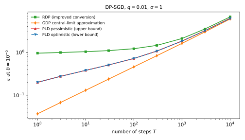

# Numerical accounting with privacy loss distributions

You trained a model with differential privacy (DP) by 10,000 steps of stochastic gradient descent (SGD). In this algorithm, DP-SGD, each step sampled every record independently with probability $q = 0.01$, clipped each gradient to a fixed norm, and added Gaussian noise whose standard deviation is $\sigma = 1$ times that norm. You need the smallest $\varepsilon$ for which the whole run is $(\varepsilon, 10^{-5})$-DP for datasets that differ by adding or removing one record. Rényi differential privacy (RDP), from [Rényi DP](01-renyi-dp.md), gives an upper bound of unknown slack, 6.7127, and the Gaussian central limit theorem (CLT) of [f-DP and Gaussian DP](04-gaussian-dp.md) gives an approximation, 6.0071. This chapter brackets the truth, here between 6.1377 and 6.2377, and a finer grid narrows the bracket at a known cost.

The one idea is to track the whole distribution of the privacy loss. [Composition](../part03-dp-foundations/04-composition.md) showed that $\delta(\varepsilon)$ is an average of a non-decreasing function of the loss, and that the loss of a composition is the sum of the step losses. For independent steps the total loss therefore has a convolution as its distribution, which a computer can evaluate once the loss sits on a grid of width $h$. Rounding every loss up can only raise $\delta$ and rounding down can only lower it, so the two roundings bracket the truth, and after $k$ steps the bracket is at most $kh$ wide in $\varepsilon$.

The running example is this run, for up to $T = 10{,}000$ steps. Because $q$ is the sampling rate, the densities of the two output distributions $P$ and $Q$ are written $P(y)$ and $Q(y)$ rather than $p$ and $q$. @tbl-num-symbols lists the symbols.

| Symbol | Meaning |
| --- | --- |
| $P$, $Q$; $P(y)$, $Q(y)$ | Output distributions on $D$ and on its neighbour $D'$; their densities |
| $L(y)$ | Privacy loss of the output $y$, the log of $P(y)/Q(y)$ |
| $\omega$ | Privacy loss distribution, the law of $L(Y)$ with $Y \sim P$ |
| $\mu$ | Shift between two Gaussians, in standard deviations |
| $h$; $\tau$ | Grid width of a discretized loss; tail mass cut off by truncation |
| $k$; $T$ | Number of composed steps; number of DP-SGD steps |
| $q$; $\sigma$ | Sampling rate; noise multiplier |
| $\Phi$ | Standard normal distribution function |

: The symbols of this chapter. {#tbl-num-symbols}

## The privacy loss distribution {#sec-num-pld}

The guarantee you report is $\delta(\varepsilon) = E_{e^\varepsilon}(P\|Q)$, the **hockey-stick divergence** of [Divergences](../part01-prerequisites/03-divergences.md), the smallest $\delta$ for which $P(S) \le e^\varepsilon Q(S) + \delta$ holds for every set $S$ of outputs. Computed directly it is a sum over outputs, and the output space of a training run is enormous. This section shows that the one-dimensional distribution of the privacy loss (@def-comp-loss) carries all of $\delta(\varepsilon)$.

::: {#def-num-pld name="Privacy loss distribution"}
Let $P$ and $Q$ be the output distributions of a mechanism on neighbouring datasets $D \sim D'$, with densities $P(y)$ and $Q(y)$. The **privacy loss** of an output $y$ is $L(y) = \ln\frac{P(y)}{Q(y)}$, which is $+\infty$ where $Q(y) = 0 < P(y)$ and $-\infty$ where $P(y) = 0 < Q(y)$. The **privacy loss distribution (PLD)** $\omega$ of the pair is the law of $L(Y)$ with $Y \sim P$. Its atom $\omega(\{+\infty\})$ is the $P$-mass of the outputs that are impossible under $D'$.
:::

An output adds to $\delta$ only if its loss $\ell$ exceeds $\varepsilon$, and then it adds the fraction $1 - e^{\varepsilon - \ell}$ of its probability, so $\delta$ is an average of that weight over the PLD. Equivalently, it is the gap $P(S) - e^\varepsilon Q(S)$ on the set $S$ of outputs whose loss exceeds $\varepsilon$, which is the set that makes the gap largest. The $Q$-probability of that set needs no extra information, because reweighting by the likelihood ratio recovers it from $\omega$.

::: {#thm-num-delta name="δ is an average over the PLD"}
Let $\omega$ be the PLD of a pair $(P, Q)$, including its atom at $+\infty$. Then for every real $\varepsilon$,
$$\delta(\varepsilon) = \mathbb E_{L\sim\omega}\big[(1 - e^{\varepsilon - L})_+\big] = \Pr_P[L > \varepsilon] - e^{\varepsilon}\,\Pr_Q[L > \varepsilon],$$ {#eq-num-delta}
where $(x)_+ = \max\{x, 0\}$ and an infinite loss gets the weight 1. The law of $L$ under $Q$ is fixed by $\omega$: it is $e^{-\ell}\,\omega(\mathrm d\ell)$ on the finite losses, plus an atom at $-\infty$ of size $1 - \mathbb E_\omega[e^{-L}]$.
:::

::: {.proof}
The plan is to take the first form from the composition chapter, split its weight into two terms, and move the second term from $P$ to $Q$ by reweighting.

1. *The first form.* @lem-comp-delta proved it: each term $(P(y) - e^\varepsilon Q(y))_+$ of the hockey-stick sum equals $P(y)(1 - e^{\varepsilon - L(y)})_+$, and outputs with $Q(y) = 0 < P(y)$ add their whole probability.
2. *Split the weight.* When $L > \varepsilon$ the bracket $1 - e^{\varepsilon - L}$ is positive, and otherwise its positive part is 0, so
$$(1 - e^{\varepsilon - L})_+ = \mathbf 1[L > \varepsilon] - e^\varepsilon\,e^{-L}\,\mathbf 1[L > \varepsilon].$$
The first term averages to $\Pr_P[L > \varepsilon]$.
3. *Reweight from $P$ to $Q$.* An output with $P(y) > 0$ has $Q$-probability equal to its $P$-probability times $Q(y)/P(y) = e^{-L(y)}$. This is the change of measure of @lem-div-change-of-measure with the roles of $P$ and $Q$ swapped, and it reaches only the outputs that $P$ can produce. For any function $g$ of the loss it gives
$$\mathbb E_Q\big[g(L)\,\mathbf 1[P > 0]\big] = \mathbb E_P\big[g(L)\,e^{-L}\big].$$
4. *The second form.* Take $g$ to be the indicator of a loss above $\varepsilon$. The outputs with $P(y) = 0$ have $L = -\infty$ and are not in that event, so the factor $\mathbf 1[P > 0]$ can be dropped, and the second term of step 2 averages to $e^\varepsilon\Pr_Q[L > \varepsilon]$.
5. *The law under $Q$.* With $g$ the indicator of a set $A$ of finite losses, step 3 gives $\Pr_Q[L \in A] = \int_A e^{-\ell}\omega(\mathrm d\ell)$. With $g = 1$ it gives the $Q$-mass of the outputs where $P > 0$, which is $\mathbb E_\omega[e^{-L}]$. The rest of $Q$ sits where $P = 0$, at $L = -\infty$.
:::

So two pairs with the same PLD have the same $\delta(\varepsilon)$, whatever their output spaces. The weight $(1 - e^{\varepsilon - \ell})_+$ is 0 up to $\ell = \varepsilon$ and then rises towards 1, so $\delta(\varepsilon)$ is the upper tail of the PLD beyond $\varepsilon$, down-weighted near $\varepsilon$ (@fig-num-pld-weight). Because the weight is at most 1, $\delta(\varepsilon) \le \Pr_P[L > \varepsilon]$, and because losses just above $\varepsilon$ get a weight close to 0, that tail bound is loose ([Exercise 2](../../book-exercises/part04-privacy-accounting/06-numerical-accounting.md#sec-sol-num-2)).

{#fig-num-pld-weight}

Not every distribution is a PLD. By step 5, $\mathbb E_\omega[e^{-L}]$ is a $Q$-mass, so it is at most 1. @sec-num-discretize will round a PLD and must know that the result still belongs to a real pair, so it needs the converse, that every distribution with this property is a PLD.

::: {#prp-num-valid name="Which distributions are PLDs"}
A distribution $\omega$ on $\mathbb R \cup \{+\infty\}$ is the PLD of some pair of distributions if and only if $\mathbb E_\omega[e^{-L}] \le 1$, where $e^{-\infty} = 0$.
:::

::: {.proof}
1. *Necessity.* By @thm-num-delta, $\mathbb E_\omega[e^{-L}]$ is the $Q$-mass of the outputs where $P > 0$, and no mass exceeds 1.
2. *Build $P$.* For the converse, let the outputs be the losses themselves, and take $P = \omega$ on the real line, with its atom at $+\infty$, if any, on an extra point $y_+$.
3. *Build $Q$.* Put $Q(\mathrm d\ell) = e^{-\ell}\omega(\mathrm d\ell)$ on the finite losses, of total mass at most 1 by assumption, and the missing mass $1 - \mathbb E_\omega[e^{-L}]$ on a second extra point $y_-$, where $P$ is zero.
4. *Check the loss.* At each finite $\ell$ the ratio of the two masses is $1/e^{-\ell}$, so the loss is $\ell$, and at $y_+$, where $Q$ is zero, it is $+\infty$. So the loss under $P$ has law $\omega$.
:::

For the **Gaussian pair** $P = \mathcal N(0, \sigma^2)$, $Q = \mathcal N(s, \sigma^2)$ of a query whose answer moves by $s$ between the neighbours, write $\mu = s/\sigma$ for the shift in noise standard deviations. The loss is then linear in the output, so it is normal, with mean $\mu^2/2$ and variance $\mu^2$ under $P$ and mean $-\mu^2/2$ under $Q$ (@lem-lg-gaussian-loss). Inserting the two normal tails into @eq-num-delta gives the exact profile of @thm-lg-analytic, which is also the curve of Gaussian differential privacy (GDP) with parameter $\mu$ in [f-DP and Gaussian DP](04-gaussian-dp.md):
$$L \sim \mathcal N\big(\tfrac{\mu^2}2, \mu^2\big)\ \text{under } P, \qquad \delta(\varepsilon) = \Phi\Big(\frac\mu2 - \frac\varepsilon\mu\Big) - e^{\varepsilon}\,\Phi\Big(-\frac\mu2 - \frac\varepsilon\mu\Big).$$ {#eq-num-gauss}
The law under $Q$ agrees with @thm-num-delta, since tilting a normal density by $e^{-\ell}$ moves its mean down by its variance ([Exercise 1](../../book-exercises/part04-privacy-accounting/06-numerical-accounting.md#sec-sol-num-1)).

::: {#exm-num-gauss}
With sensitivity 1 and $\sigma = 1$, $\mu = 1$ and the PLD is $\mathcal N(0.5, 1)$. A million samples in the chapter's script (@sec-num-code) give a mean loss of 0.4990, a variance of 1.0013 and $\mathbb E[e^{-L}] = 1.0015$, against the exact 0.5, 1 and 1. The green area of @fig-num-pld-weight is @eq-num-gauss at $\varepsilon = 1$:
$$\delta(1) = \Phi(-0.5) - e\,\Phi(-1.5) = 0.3085 - 0.1816 = 0.1269.$$
@tbl-num-gauss-delta checks @eq-num-gauss against numerical integration over the PLD density and against Monte Carlo. Solving $\delta(\varepsilon) = 10^{-5}$ shows that the mechanism is $(4.3772, 10^{-5})$-DP.

| $\varepsilon$ | Closed form @eq-num-gauss | Quadrature over the PLD | Monte Carlo ($10^6$ draws) |
| --- | --- | --- | --- |
| 0 | 0.382925 | 0.382925 | 0.382644 |
| 0.5 | 0.238422 | 0.238422 | 0.238748 |
| 1 | 0.126937 | 0.126937 | 0.126967 |
| 2 | 0.020924 | 0.020924 | 0.020922 |

: δ(ε) of the Gaussian pair with $\mu = 1$, computed three ways. {#tbl-num-gauss-delta}

:::

## Composition is convolution {#sec-num-convolution}

DP-SGD releases $T$ noisy gradients, and more generally a composition of $k$ mechanisms outputs a tuple $(y_1, \dots, y_k)$, whose $\delta(\varepsilon)$ you want. The bounds of [Composition](../part03-dp-foundations/04-composition.md), including the optimal composition theorem (@thm-comp-kov), see each step only through its pair $(\varepsilon_i, \delta_i)$, so they must cover the worst PLD with those values. With the PLDs themselves, composition is exact. The loss of a tuple is the sum of the per-step losses (@lem-comp-sum), and the law of a sum of independent variables is the **convolution** of their laws.

::: {#thm-num-conv name="Composition is convolution"}
Let $k$ steps run independently, step $i$ with the pair $(P_i, Q_i)$ and the PLD $\omega_i$. The product pair $(P_1 \times \dots \times P_k,\ Q_1 \times \dots \times Q_k)$ has PLD
$$\omega_{1..k} = \omega_1 * \omega_2 * \dots * \omega_k, \qquad \omega^{*k} \text{ for } k \text{ identical steps},$$ {#eq-num-conv}
where $*$ is the convolution of distributions and a sum that contains $+\infty$ is $+\infty$. For $k$ Gaussian steps with shift $\mu$ the result is again Gaussian,
$$\mathcal N\big(\tfrac{\mu^2}2, \mu^2\big)^{*k} = \mathcal N\big(\tfrac{k\mu^2}2, k\mu^2\big),$$
the PLD of one Gaussian pair with shift $\sqrt k\,\mu$.
:::

::: {.proof}
The plan is to follow the probability of the tuple from a product, to a sum of losses, to a convolution.

1. *Losses add.* By @lem-comp-sum, the loss of the tuple is $\sum_iL_i(y_i)$, with $L_i = \ln(P_i/Q_i)$. A sum that contains $+\infty$ is $+\infty$, because once one step gives the dataset away, the whole run does.
2. *The terms are independent.* Under the product of the $P_i$, the outputs $Y_i$ are independent with $Y_i \sim P_i$, and each $L_i(Y_i)$ depends only on its own $Y_i$, with law $\omega_i$.
3. *A sum's law is the convolution.* The chance that two independent terms sum to $\ell$ adds, over every split $\ell = a + b$, the chance of $a$ times the chance of $b$, which is what convolution computes. Adding one term at a time gives @eq-num-conv.
4. *Gaussian steps.* A sum of independent normals is normal, with the means and the variances added, which gives mean $k\mu^2/2$ and variance $k\mu^2$.
:::

In DP-SGD each gradient depends on the model, which depends on the earlier outputs, so step 2 fails: the second step's pair, and with it its loss, depends on the first output. The way around is to replace each step by one fixed pair that is at least as easy to tell apart, whatever happened before. Comparing pairs at every level of strictness uses the hockey-stick divergence with a general weight $\gamma \ge 0$ in place of $e^\varepsilon$,
$$E_\gamma(P\|Q) = \sum_y\big(P(y) - \gamma Q(y)\big)_+.$$

::: {#def-num-dominating name="Dominating pair"}
A pair $(P, Q)$ **dominates** a mechanism $M$ if $E_\gamma(M(D)\|M(D')) \le E_\gamma(P\|Q)$ for all neighbours $D \sim D'$ and all $\gamma \ge 0$ (Zhu, Dong & Wang 2022, Definition 7).
:::

Every $(\varepsilon, \delta)$ statement true of a dominating pair is then true of the mechanism, and domination survives adaptive composition.

::: {#thm-num-adaptive name="Dominating pairs compose"}
Run $k$ mechanisms in sequence, each chosen as a function of the earlier outputs. If $(P_i, Q_i)$ dominates step $i$ for every value of the earlier outputs, then $(P_1 \times \dots \times P_k,\ Q_1 \times \dots \times Q_k)$ dominates the adaptive composition. So the convolution of the dominating PLDs gives a valid $\delta(\varepsilon)$ for the adaptive run.
:::
<!-- proof: cited -->

Its proof is in Zhu, Dong & Wang (2022, Theorem 10), and @sec-apx-comp-dominating in the appendices derives it step by step. It compares the adaptive run with the fixed pairs one step at a time, and that comparison needs $E_\gamma$ for every $\gamma \ge 0$, not only for $\gamma \ge 1$.

@eq-num-conv has no slack at all, so the only errors in a PLD accountant are the ones you introduce to compute the convolution, by discretization (@sec-num-discretize) and in floating point (@sec-num-fft). The bound is only as tight as the dominating pair, though. For the Gaussian mechanism with $\ell_2$ sensitivity 1, the pair $\mathcal N(0, \sigma^2)$, $\mathcal N(1, \sigma^2)$ dominates and is attained by some neighbouring datasets, so the result is tight, while a subsampled mechanism needs one pair for adding a record and one for removing it (@sec-num-subsampled).

::: {#exm-num-ten-gauss}
One Gaussian step with $\sigma = 1$ has $\mu = 1$ and PLD $\mathcal N(0.5, 1)$. Ten steps add ten means and ten variances, so their PLD is $\mathcal N(5, 10)$, a single Gaussian pair with $\mu = \sqrt{10}$. Solving @eq-num-gauss with that $\mu$ for $\delta = 10^{-5}$, the composition is $(17.8566, 10^{-5})$-DP. For 100 steps, $\mu = \sqrt{100} = 10$ and $\varepsilon = 91.8173$. @sec-num-fft recovers both numbers from a discretized PLD.
:::

## Pessimistic and optimistic discretization {#sec-num-discretize}

A computer cannot convolve continuous distributions, so the loss must sit on a finite grid $\{ih : i \in \mathbb Z\}$ of width $h$, and any rounding changes $\delta$. The question is whether the error can have a known sign for every number of compositions, so that the answer is still a guarantee. It can, because the weight $(1 - e^{\varepsilon - \ell})_+$ never decreases as the loss grows, so moving every loss up can only raise $\delta$ and moving every loss down can only lower it.

::: {#def-num-rounding name="Pessimistic and optimistic PLDs"}
Let $\omega$ be a PLD, $h > 0$ a grid width and $\tau \ge 0$ a tail mass. The **pessimistic** PLD $\omega^\uparrow$ moves every loss $\ell \in ((i-1)h, ih]$ up to $ih$. It may also truncate each tail, of mass at most $\tau$, moving the top one to $+\infty$ and the bottom one up to the lowest kept grid point. The **optimistic** PLD $\omega^\downarrow$ moves every loss $\ell \in [ih, (i+1)h)$ down to $ih$. It may move the top tail down to the highest kept grid point, and drop the bottom tail, which leaves a total mass just below 1.
:::

To compare averages before and after such moves, the next proof builds the rounded loss from the same random draw as the true one, a **coupling**, and its step 3 needs one lemma.

::: {#lem-num-coupling name="Monotone coupling"}
Let $g$ be non-decreasing, and let $X$ and $X'$ be random variables built on the same random draw with $X \le X'$ for every outcome. Then $\mathbb E[g(X)] \le \mathbb E[g(X')]$.
:::

::: {.proof}
For every outcome $g(X) \le g(X')$, because $g$ is non-decreasing. Averaging an inequality that holds outcome by outcome keeps it.
:::

Write $\delta_\nu(\varepsilon)$ for @eq-num-delta evaluated on a distribution $\nu$.

::: {#thm-num-sandwich name="The discretization sandwich"}
Let $\omega$ be the PLD of a pair $(P, Q)$. For every number of steps $k$ and every $\varepsilon$,
$$\delta_{(\omega^\downarrow)^{*k}}(\varepsilon) \;\le\; \delta_{\omega^{*k}}(\varepsilon) \;\le\; \delta_{(\omega^\uparrow)^{*k}}(\varepsilon),$$ {#eq-num-sandwich}
and the same holds for convolutions of different PLDs, each rounded the same way. Moreover:

1. $\omega^\uparrow$ is the PLD of a pair that dominates $(P, Q)$, so the upper bound also holds for adaptive composition.
2. Without truncation, let $\varepsilon^\uparrow(\delta)$ and $\varepsilon^\downarrow(\delta)$ be the values of $\varepsilon$ at which the composed pessimistic and optimistic curves reach $\delta$. Then $\varepsilon^\uparrow(\delta) \le \varepsilon^\downarrow(\delta) + kh$.
:::

::: {.proof}
The plan is to build both roundings from the same draw of the loss, add up $k$ steps, and apply @lem-num-coupling to the weight of @eq-num-delta. Validity, domination and the width then follow from the same coupling.

1. *Couple one step.* Draw $L \sim \omega$ and set $L^\uparrow = h\lceil L/h\rceil$ and $L^\downarrow = h\lfloor L/h\rfloor$, which have the laws $\omega^\uparrow$ and $\omega^\downarrow$. A number lies between its two roundings, which are at most one grid step apart, so for every outcome
$$L^\downarrow \le L \le L^\uparrow \le L^\downarrow + h.$$
2. *Add $k$ steps.* Coupling each of $k$ independent steps as in step 1 and adding the inequalities gives
$$\sum_i L_i^\downarrow \le \sum_i L_i \le \sum_i L_i^\uparrow \le \sum_i L_i^\downarrow + kh,$$
and by @thm-num-conv each sum has the convolved law of its PLDs.
3. *Apply the lemma.* By @eq-num-delta, $\delta(\varepsilon)$ is the average of $g_\varepsilon(\ell) = (1 - e^{\varepsilon - \ell})_+$ at the total loss, and $g_\varepsilon$ is non-decreasing. @lem-num-coupling applied to the first two inequalities of step 2 gives @eq-num-sandwich.
4. *Truncation keeps the sign.* The pessimistic truncation moves mass up, so @lem-num-coupling still applies. The optimistic truncation moves mass down, which the lemma covers in the other direction, or deletes it, which removes a non-negative term from $\delta$. Both can be repeated after every convolution.
5. *The pessimistic PLD belongs to a pair.* Rounding up raises every loss and so lowers $e^{-L}$, and mass moved to $+\infty$ contributes $e^{-\infty} = 0$. So $\mathbb E_{\omega^\uparrow}[e^{-L}] \le \mathbb E_\omega[e^{-L}] \le 1$, and @prp-num-valid builds a pair $(P^\uparrow, Q^\uparrow)$ with PLD $\omega^\uparrow$ (Doroshenko et al. 2022, Lemma 4.2, prove it for this rounding).
6. *That pair dominates.* Step 3 with $k = 1$ says $E_{e^\varepsilon}(P\|Q) \le E_{e^\varepsilon}(P^\uparrow\|Q^\uparrow)$ for every real $\varepsilon$, that is for every $\gamma = e^\varepsilon > 0$. At $\gamma = 0$ both divergences are the total mass 1. So $(P^\uparrow, Q^\uparrow)$ dominates $(P, Q)$ at every $\gamma \ge 0$, and @thm-num-adaptive extends the bound to adaptive composition.
7. *The width.* Write $\delta^\uparrow$ and $\delta^\downarrow$ for the composed pessimistic and optimistic curves. Adding a constant $c$ to the loss shifts its $\delta$ curve to the right by $c$, because $g_\varepsilon$ sees only the difference $\varepsilon - \ell$:
$$\mathbb E[g_\varepsilon(X + c)] = \mathbb E[g_{\varepsilon - c}(X)].$$
The last inequality of step 2 and @lem-num-coupling then give $\delta^\uparrow(\varepsilon) \le \delta^\downarrow(\varepsilon - kh)$. So wherever the optimistic curve has dropped to $\delta$, the pessimistic curve has dropped to it at most $kh$ further right.
:::

Rounding down raises $e^{-L}$, so $\mathbb E[e^{-L}]$ can exceed 1, and then $\omega^\downarrow$ is no pair's PLD. Its $\delta$ still lies below that of $k$ non-adaptive copies of $(P, Q)$, so it bounds the mechanism's $\delta$ from below whenever some neighbours actually produce $(P, Q)$, as they do for the Gaussian and the subsampled Gaussian. Each truncation of mass $\tau$ adds at most $\tau$ to $\delta$, since a weight never exceeds 1, and a few dozen truncations at $\tau = 10^{-15}$ are far below any reported $\delta$.

For a continuous PLD the width is almost exactly $kh$. Such a PLD puts no mass on the grid points, so every loss moves by exactly $h$ between its two roundings ([Exercise 3](../../book-exercises/part04-privacy-accounting/06-numerical-accounting.md#sec-sol-num-3)), and a fixed width at $10^4$ steps needs a grid $10^4$ times finer than for one step. When the losses spread evenly inside each cell, each rounding moves a loss by about $h/2$ on average, so the midpoint of the two sides is a nearly unbiased estimate, but only the two sides are guarantees.

::: {#exm-num-rr}
Randomized response with $\varepsilon_0 = \ln 3$ ([The definition of differential privacy](../part03-dp-foundations/01-definition.md#sec-dpdef-rr)) reports the true bit with probability $\frac34$. The true report has loss $\ln 3 = 1.0986$, with probability 0.7500, and the flipped one has loss $-1.0986$, with probability 0.2500. On the grid $h = 0.5$, rounding up gives the losses $\{-1, 1.5\}$ and rounding down gives $\{-1.5, 1\}$. The rounded-up PLD is valid:
$$\mathbb E[e^{-L}] = 0.75\,e^{-1.5} + 0.25\,e^{1} = 0.1673 + 0.6796 = 0.8469 \le 1.$$
The rounded-down one has $\mathbb E[e^{-L}] = 1.3963$, which no pair can have.

@tbl-num-rr follows the four outcomes of three steps, indexed by the number $j$ of steps with a positive loss. The exact total is $(2j - 3)\ln 3$, the rounded-up total is $1.5j - (3 - j)$, and the rounded-down total is $j - 1.5(3 - j)$. The gap between the two roundings is $3 \times 0.5 = 1.5$ in every row, as step 7 of the proof predicts.

| $j$ | Probability | Exact total loss | Rounded up | Rounded down |
| --- | --- | --- | --- | --- |
| 0 | 0.0156 | −3.2958 | −3 | −4.5 |
| 1 | 0.1406 | −1.0986 | −0.5 | −2 |
| 2 | 0.4219 | 1.0986 | 2 | 0.5 |
| 3 | 0.4219 | 3.2958 | 4.5 | 3 |

: Three-fold randomized response with $\varepsilon_0 = \ln 3$: each outcome's total loss, exact and rounded on the grid $h = 0.5$. {#tbl-num-rr}

Feeding each column into @eq-num-delta gives the three $\delta$ curves. At $\varepsilon = 0$ only the two positive exact totals count, $3\ln 3$ for $j = 3$ and $\ln 3$ for $j = 2$. Both have probability $\frac{27}{64}$, since $(\frac34)^3 = 3(\frac34)^2\frac14$, and their weights are $1 - \frac1{27}$ and $1 - \frac13$, so
$$\delta(0) = \tfrac{27}{64}\cdot\tfrac{26}{27} + \tfrac{27}{64}\cdot\tfrac23 = \tfrac{44}{64} = 0.6875.$$
@tbl-num-rr-delta and @fig-num-rounding show that the pessimistic and optimistic values bracket the exact ones at every $\varepsilon$.

| $\varepsilon$ | Exact $\delta$ | Pessimistic | Optimistic |
| --- | --- | --- | --- |
| 0 | 0.6875 | 0.7820 | 0.5669 |
| 1 | 0.4190 | 0.6758 | 0.3648 |
| 2 | 0.3064 | 0.3872 | 0.2667 |

: δ(ε) of three-fold randomized response, exact and from the rounded PLDs on the grid $h = 0.5$. {#tbl-num-rr-delta}

{#fig-num-rounding}
:::

## Composition by FFT {#sec-num-fft}

A discretized PLD is a vector of masses $m_0, \dots, m_{n-1}$ at the losses $(o + i)h$, where the integer offset $o$ says where the vector starts on the grid, plus an atom at $+\infty$. Convolving two such vectors directly costs a number of operations proportional to the product of their lengths. On the grid $h = 10^{-5}$, one DP-SGD step of the running example already has 329590 bins, and after 10,000 steps the composed PLD has 2103251. The fast Fourier transform (FFT), brought to PLD accounting by Koskela, Jälkö and Honkela (2020), makes this cheap.

The proof of @prp-num-fft below needs one tool, which turns a convolution into a pointwise product. The discrete Fourier transform attaches to index $i$ the power $\zeta^i$ of a fixed complex number $\zeta$, and powers multiply by adding exponents, so indices add the way losses add.

::: {#lem-num-dft name="The discrete convolution theorem"}
For a length $N$, let $\zeta = e^{-2\pi\mathrm i/N}$, and let the discrete Fourier transform of $a_0, \dots, a_{N-1}$ be $\hat a_m = \sum_{i=0}^{N-1}a_i\,\zeta^{im}$. Then $\hat a_m\hat b_m$ is the transform of the **circular convolution**
$$c_n = \sum_{i + j \equiv n \bmod N}a_ib_j.$$
:::

::: {.proof}
1. *Multiply the transforms.* Expanding the product $\hat a_m\hat b_m$ gives one term per pair $(i, j)$, and the powers combine as $\zeta^{im}\zeta^{jm} = \zeta^{(i+j)m}$.
2. *Group by the index sum.* Since $\zeta^N = 1$, exponents matter only modulo $N$, so grouping the pairs by $i + j$ modulo $N$ gives
$$\hat a_m\,\hat b_m = \sum_{n=0}^{N-1}\Big(\sum_{i + j \equiv n \bmod N}a_ib_j\Big)\zeta^{nm},$$
which is the transform of $c$.
:::

The FFT computes a transform of length $N$ in $O(N\log N)$ operations instead of $O(N^2)$. Two discretized PLDs on a common grid then compose as follows.

::: {#prp-num-fft name="Convolution of discretized PLDs"}
Let $a$ and $b$ be the mass vectors of two discretized PLDs on the same grid, with lengths $n_a$ and $n_b$, offsets $o_a$ and $o_b$, and atoms $a_\infty$ and $b_\infty$ at $+\infty$. Their convolution has offset $o_a + o_b$, atom $a_\infty + b_\infty - a_\infty b_\infty$, and masses
$$c = \mathrm{IDFT}_N\big(\mathrm{DFT}_N(a)\cdot\mathrm{DFT}_N(b)\big), \qquad N \ge n_a + n_b - 1,$$
where $\mathrm{DFT}_N$ transforms the vectors padded with zeros to length $N$ and $\mathrm{IDFT}_N$ is its inverse. For $k$ copies of one vector $m$ of length $n$, with $N \ge k(n - 1) + 1$,
$$\omega^{*k} = \mathrm{IDFT}_N\big(\mathrm{DFT}_N(m)^k\big).$$
If $N$ is smaller, the result is the PLD of the total loss reduced modulo $Nh$ into the window of $N$ grid points.
:::

::: {.proof}
The plan is to turn adding losses into adding indices, handle the atom, and then apply @lem-num-dft.

1. *Grid losses add as indices.* A loss $(o_a + i)h$ plus a loss $(o_b + j)h$ is $(o_a + o_b + i + j)h$. So the mass at index $n$ of the sum collects every pair with $i + j = n$, which is the discrete convolution $c_n = \sum_{i + j = n}a_ib_j$.
2. *The atom.* The sum is finite only when both terms are, which has probability $(1 - a_\infty)(1 - b_\infty)$. So it is $+\infty$ with probability $a_\infty + b_\infty - a_\infty b_\infty$.
3. *Padding.* By @lem-num-dft the product of transforms gives the circular convolution. With $N \ge n_a + n_b - 1$, every pair of nonzero entries has $i + j \le n_a + n_b - 2 < N$, so no index sum wraps and the circular convolution is $c$.
4. *Powers.* Each further convolution multiplies the transform by one more copy, which gives $\mathrm{DFT}(m)^k$. The composed vector's largest index is $k(n - 1)$, so it has $k(n - 1) + 1$ entries, and that is the padding needed.
5. *Wraparound.* With $N$ too small, @lem-num-dft still holds but indices add modulo $N$. Mass at total index $n \ge N$ lands at $n - N$, so the total loss is reduced modulo $Nh$.
:::

The one-shot $k$-th power needs a window $k$ times wider than one step. The script instead uses **repeated squaring**, which lets it trim the vector between convolutions. It forms $\omega^{*2}, \omega^{*4}, \omega^{*8}, \dots$ by convolving each with itself and multiplies the powers in the binary expansion of $k$, so that $\omega^{*10} = \omega^{*8} * \omega^{*2}$, at most $2\log_2k$ convolutions in all. After each one it truncates both tails at mass $\tau = 10^{-15}$ in the safe directions of @def-num-rounding. Since all but $\tau$ of the mass lies within a fixed number of standard deviations of the mean, the vector then grows like the composed PLD's standard deviation, $\sqrt k$ times one step's, and not like the worst-case range $k(n - 1)$.

The FFT is not exact in floating point, since each mass has an absolute error of order $10^{-16}$ times the largest mass. Tiny tail masses therefore come out as noise, sometimes negative, which the script sets to zero. Noise summed over millions of bins can exceed $\tau$, and then truncation by mass never trims the ends, so the script also cuts every loss below $-100$ or above $200$ in the safe direction. That noise is far below a $\delta$ of $10^{-5}$ but is not part of the certified bound, and the privacy loss random variable (PRV) accountant of Gopi, Lee and Wutschitz (2021) also leaves it out, as negligible for $\delta$ above $10^{-10}$ (their Section 6).

To choose the grid, pick $h$ from the width $kh$ you can accept. Pick the range of losses to keep from the tails, which Chebyshev's inequality (@thm-conc-chebyshev) bounds from the composed variance alone ([Exercise 4](../../book-exercises/part04-privacy-accounting/06-numerical-accounting.md#sec-sol-num-4)). Two published refinements allow coarser grids: the PRV accountant rounds to the nearest grid point and recentres the mean, so its errors grow like $\sqrt k\,h$ (Gopi et al., Lemma 5.3), and connect the dots (Doroshenko et al. 2022) finds the tightest pessimistic PLD on a given grid.

::: {#exm-num-grid}
On the grid $h = 10^{-3}$, truncated at $\tau = 10^{-15}$ per tail, the Gaussian PLD $\mathcal N(0.5, 1)$ has 15884 bins. After ten steps by repeated squaring it has 50257, a ratio of $3.16 = \sqrt{10}$, while the one-shot power needs a window of $10 \times (15884 - 1) + 1 = 158831$. Both give the same pessimistic $\delta(1) = 0.81891018$, against the exact 0.81851782 from @eq-num-gauss with $\mu = \sqrt{10}$. @tbl-num-gauss-grid turns this into $\varepsilon$ at $\delta = 10^{-5}$ and compares it with @exm-num-ten-gauss.

| $k$ | Exact $\varepsilon$ | Pessimistic | Optimistic | Mean of the pessimistic PLD |
| --- | --- | --- | --- | --- |
| 10 | 17.8566 | 17.8616 | 17.8516 | 5.0050 (exact 5) |
| 100 | 91.8173 | 91.8673 | 91.7673 | 50.0500 (exact 50) |

: Composed Gaussian steps with $\mu = 1$ on the grid $h = 10^{-3}$: $\varepsilon$ at $\delta = 10^{-5}$. {#tbl-num-gauss-grid}

The width is $kh$, and the exact value sits in the middle, $17.8616 - 17.8566 = 0.005 = kh/2$, because each rounding moves a step's loss by $h/2$ on average. The last column shows that shift in the pessimistic means.

Without padding, wraparound appears. On an unpadded circular window from loss 0 to 10, centred at the mean, the tenth power gives $\delta(1) = 0.83478562$, wrong in the second decimal. Losses below 0 wrap to the top of the window and losses above 10 to the bottom. Width 20 gives 0.81890091, and width 40 gives 0.81891018, the padded value. [Exercise 6](../../book-exercises/part04-privacy-accounting/06-numerical-accounting.md#sec-sol-num-6) explains why the short window errs upwards.
:::

## The subsampled Gaussian {#sec-num-subsampled}

One DP-SGD step with Poisson sampling includes each record independently with probability $q$, sums the clipped gradients of the sampled records, and adds Gaussian noise. Look at it from the one record that may be missing, and measure the noisy sum along that record's gradient, in units of the clipping norm, the bound on each gradient's length. Without the record, this sum is a Gaussian centred at 0. With it, the record is sampled with probability $q$ and then shifts the centre by the sensitivity 1, so the output is a mixture. [Amplification by subsampling](05-subsampling.md) derives this reduction, and this section gives its PLD in closed form, so that only rounding separates the grid from the truth.

Under add/remove, each direction gives its own pair. Write $D' = D \cup \{x\}$ for the dataset that holds the record, as in the rest of the part. The **remove** direction puts $D'$ first, $P = M(D')$ and $Q = M(D)$, because its neighbour $D$ is obtained by removing $x$. The **add** direction is the order $P = M(D)$, $Q = M(D')$.

::: {#thm-num-subsampled-pairs name="Dominating pairs of the subsampled Gaussian"}
Let one step of DP-SGD use Poisson sampling at rate $q$, noise multiplier $\sigma$ and sensitivity 1, under add/remove neighbours. The pair
$$P = (1 - q)\,\mathcal N(0, \sigma^2) + q\,\mathcal N(1, \sigma^2),\qquad Q = \mathcal N(0, \sigma^2)$$
dominates the remove direction, and the same pair with $P$ and $Q$ swapped dominates the add direction.
:::
<!-- proof: cited -->

Zhu, Dong & Wang (2022, Theorem 11 and the paragraph after it) prove each pair dominates its case, and @sec-apx-amp-poisson in the appendices derives it step by step from two exact hockey-stick identities. Their mixture component sits at 0 and their base Gaussian at 1, and the reflection $y \mapsto 1 - y$ turns that into the form above. By @thm-num-adaptive, a $T$-step run has the guarantee $\max\{\delta_{\mathrm{rem}, T}(\varepsilon), \delta_{\mathrm{add}, T}(\varepsilon)\}$. Neither pair dominates the other in general, so an accountant that uses only the remove pair covers only half of the add/remove relation.

The ratio of the mixture density to the base density $\mathcal N(0, \sigma^2)$ is $1 - q$ plus $q$ times the ratio of the shifted Gaussian to the base, an exponential in $y$. Swapping $P$ and $Q$ flips the sign of the log of that ratio.

::: {#prp-num-subsampled-loss name="The PLD of the subsampled Gaussian"}
For the pairs of @thm-num-subsampled-pairs, with $Y \sim P$ of the respective pair, the privacy losses are
$$L_{\mathrm{rem}}(y) = \ln\Big((1 - q) + q\,e^{(2y - 1)/(2\sigma^2)}\Big), \qquad L_{\mathrm{add}}(y) = -L_{\mathrm{rem}}(y).$$
The remove loss is increasing, takes values in $(\ln(1 - q), \infty)$, and the output with loss $\ell$ is
$$y(\ell) = \sigma^2\ln\frac{e^\ell - 1 + q}{q} + \frac12,$$
with $y(\ell) = -\infty$ for $\ell \le \ln(1 - q)$. A bin of remove losses is therefore an interval of outputs, with mass
$$\Pr_P\big[L_{\mathrm{rem}} \in (a, b]\big] = (1 - q)\Big[\Phi\Big(\tfrac{y(b)}\sigma\Big) - \Phi\Big(\tfrac{y(a)}\sigma\Big)\Big] + q\Big[\Phi\Big(\tfrac{y(b) - 1}\sigma\Big) - \Phi\Big(\tfrac{y(a) - 1}\sigma\Big)\Big],$$
and for the add pair $\Pr_P[L_{\mathrm{add}} \in (a, b]] = \Phi(y(-a)/\sigma) - \Phi(y(-b)/\sigma)$. One step's $\delta(\varepsilon)$ is a difference of two normal tails at the output $y(\varepsilon)$.
:::

::: {.proof}
The plan is to divide the mixture by the base, read off the loss and its inverse, and turn loss bins into output intervals; step 6 then gives the single-step $\delta$.

1. *Divide the mixture by the base.* Write $\varphi$ for the standard normal density, so that $\mathcal N(c, \sigma^2)$ has density proportional to $\varphi((y - c)/\sigma)$, with the same constant for both centres. Dividing each part of the mixture by the base gives
$$\frac{P(y)}{Q(y)} = (1 - q) + q\,\frac{\varphi((y-1)/\sigma)}{\varphi(y/\sigma)}.$$
2. *The ratio of two Gaussians.* The densities are exponentials of minus a square, so their ratio is the exponential of the difference of the squares:
$$\frac{\varphi((y-1)/\sigma)}{\varphi(y/\sigma)} = \exp\Big(\frac{y^2 - (y - 1)^2}{2\sigma^2}\Big) = e^{(2y - 1)/(2\sigma^2)}.$$
Taking logs of step 1 gives $L_{\mathrm{rem}}$, and swapping $P$ and $Q$ flips the sign, which gives $L_{\mathrm{add}}$.
3. *The loss is increasing.* The exponential is positive and increasing in $y$. As $y \to -\infty$ it vanishes and the loss tends to $\ln(1 - q)$, and as $y \to \infty$ the loss tends to $\infty$.
4. *Invert it.* To solve $e^\ell = (1 - q) + q\,e^{(2y - 1)/(2\sigma^2)}$ for $y$, subtract $1 - q$, divide by $q$, take logs, multiply by $\sigma^2$ and add $\frac12$.
5. *Bins are intervals.* Because the map is increasing, the bin $\{L_{\mathrm{rem}} \in (a, b]\}$ is the interval $\{Y \in (y(a), y(b)]\}$. Its probability under the mixture is $1 - q$ times that under $\mathcal N(0, \sigma^2)$ plus $q$ times that under $\mathcal N(1, \sigma^2)$. For the add pair, $L_{\mathrm{add}} \in (a, b]$ exactly when $Y \in [y(-b), y(-a))$, with $Y \sim \mathcal N(0, \sigma^2)$.
6. *Single-step $\delta$ in closed form.* For the remove pair, $L > \varepsilon$ exactly when $Y > y(\varepsilon)$, so by @eq-num-delta
$$\delta(\varepsilon) = \Pr_P[Y > y(\varepsilon)] - e^\varepsilon\,\Pr_Q[Y > y(\varepsilon)],$$
two normal tail probabilities. The add pair is the same with the event $Y < y(-\varepsilon)$.
:::

The two directions have very different losses (@fig-num-subsampled-loss). The remove loss is bounded below by $\ln(1 - q)$ and has an unbounded upper tail, because a rare large output betrays that the record was used. The add loss is its mirror image, bounded above by $-\ln(1 - q)$, so a single add step has $\delta(\varepsilon) = 0$ once $\varepsilon \ge -\ln(1 - q)$.

In the running example the remove direction gives the larger $\varepsilon$ at every $T$ of @tbl-num-dpsgd. That is an observation, not a theorem, so the accountant computes both and takes the larger.

{#fig-num-subsampled-loss}

::: {#exm-num-onestep}
For $q = 0.01$ and $\sigma = 1$, the lowest possible remove loss is $\ln(0.99) = -0.0101$. Except for $10^{-15}$ of mass, the remove loss is in $[-0.0101, 3.2858]$ and the add loss in $[-2.8926, 0.0101]$, which on the grid $h = 10^{-5}$ is 329590 and 290268 bins. The rounded-up remove PLD has $\mathbb E[e^{-L}] = 0.999995$, below 1 and so valid, as step 5 of the proof of @thm-num-sandwich requires. @tbl-num-onestep compares the pessimistic PLD's $\delta$ with the closed form of step 6 above.

| $\varepsilon$ | Remove: exact $\delta$ | Remove: pessimistic | Add: exact $\delta$ | Add: pessimistic |
| --- | --- | --- | --- | --- |
| 0 | 3.829249e-03 | 3.830792e-03 | 3.829249e-03 | 3.832688e-03 |
| 0.5 | 2.214519e-07 | 2.214633e-07 | 0 | 0 |
| 1 | 2.732009e-09 | 2.732117e-09 | 0 | 0 |

: One subsampled-Gaussian step ($q = 0.01$, $\sigma = 1$): δ(ε) exactly and from the pessimistic PLD, $h = 10^{-5}$. {#tbl-num-onestep}

At $\varepsilon = 0$ both directions have the same $\delta$, the total variation distance $\sum_y(P(y) - Q(y))_+$. It is unchanged by swapping the pair, because both distributions sum to 1, so $P$ exceeds $Q$ in total by as much as $Q$ exceeds $P$. At $\delta = 10^{-5}$, bisection on the closed form gives one step $\varepsilon = 0.1995$ in the remove direction and 0.0091 in the add direction.
:::

## Accounting for DP-SGD {#sec-num-dpsgd}

To answer the opening question, the accountant discretizes each direction's PLD up and down (@sec-num-subsampled), composes it $T$ times by FFT (@sec-num-fft), and reads off $\varepsilon$, which can be done exactly because between two grid points $\delta(\varepsilon)$ has a simple form.

::: {#prp-num-solve name="Reading ε off a discretized PLD"}
Let a discretized PLD have masses $m_\ell$ at the grid losses $\ell$ and an atom $m_\infty$ at $+\infty$, and let $\varepsilon$ lie between two consecutive grid points. Write $A$ for the total mass of the grid points above $\varepsilon$, and $B$ for the sum of those masses times $e^{-\ell}$. Then
$$\delta(\varepsilon) = m_\infty + A - e^\varepsilon B,$$
so on that interval the equation $\delta(\varepsilon) = \delta$ has the root $\varepsilon = \ln\big((m_\infty + A - \delta)/B\big)$.
:::

::: {.proof}
1. *The weights.* Between two grid points the set of grid losses above $\varepsilon$ does not change. So the weight of @eq-num-delta is $1 - e^{\varepsilon - \ell}$ on those losses, 1 on the atom, and 0 elsewhere.
2. *Sum them.* Summing the weights against the masses gives
$$\delta(\varepsilon) = m_\infty + \sum_{\ell > \varepsilon}m_\ell - e^\varepsilon\sum_{\ell > \varepsilon}m_\ell\,e^{-\ell},$$
which is the stated form. It is linear in $e^\varepsilon$, so setting it equal to $\delta$ and solving for $e^\varepsilon$ gives the root.
:::

Two accountants from earlier chapters serve as comparisons. The RDP accountant of [Amplification by subsampling](05-subsampling.md) tracks, for each order $\alpha > 1$, the per-step Rényi divergence $\frac1{\alpha - 1}\ln A_\alpha$ of the remove pair. Here $A_\alpha$ is the likelihood ratio of @prp-num-subsampled-loss raised to the power $\alpha$ and averaged under the base,
$$A_\alpha = \mathbb E_{y\sim\mathcal N(0,\sigma^2)}\Big[\big((1 - q) + q\,e^{(2y-1)/(2\sigma^2)}\big)^\alpha\Big].$$
The script multiplies the divergence by $T$, converts it to $(\varepsilon, \delta)$ with the improved conversion of [From Rényi DP to (ε, δ) and to tests](02-rdp-conversions.md), and takes the best order on a grid of orders. For integer orders the binomial theorem turns $A_\alpha$ into a finite sum, which agrees with numerical integration on $\ln A_2 = 0.00017181$ and $\ln A_{10} = 0.34443377$.

The GDP central limit theorem of [f-DP and Gaussian DP](04-gaussian-dp.md) replaces the $T$ steps by one Gaussian pair. Heuristically, the average squared deviation of the likelihood ratio from 1 is $e^{1/\sigma^2} - 1$ for one Gaussian step, subsampling scales it by $q^2$, and $\mu^2$ adds over steps, which gives the shift
$$\mu = q\sqrt{T(e^{1/\sigma^2} - 1)},$$
and $\varepsilon$ then comes from @eq-num-gauss. At $T = 10{,}000$ this gives $\mu = 0.01 \times 100 \times 1.3108 = 1.3108$.

::: {#exm-num-dpsgd}
@tbl-num-dpsgd gives $\varepsilon$ at $\delta = 10^{-5}$ from the pessimistic PLD, an upper bound valid for adaptive composition, and from the optimistic PLD, a lower bound for the non-adaptive run, each the larger over the two directions. At $T = 1000$ the true $\varepsilon$ lies between 1.8232 and 1.8332, and at $T = 10{,}000$ the bracket is $[6.1377, 6.2377]$, wider because its width is $Th$ (@fig-num-eps-k).

| $T$ | PLD upper | PLD lower | Width | Add direction, upper | RDP | GDP CLT |
| --- | --- | --- | --- | --- | --- | --- |
| 1 | 0.1995 | 0.1994 | 1.0e-05 | 0.0091 | 0.9555 | 0.0368 |
| 10 | 0.3800 | 0.3799 | 1.0e-04 | 0.0655 | 1.0353 | 0.1304 |
| 100 | 0.7185 | 0.7175 | 1.0e-03 | 0.3387 | 1.2141 | 0.4575 |
| 1000 | 1.8332 | 1.8232 | 1.0e-02 | 1.4217 | 2.1014 | 1.6177 |
| 10000 | 6.2377 | 6.1377 | 1.0e-01 | 5.6615 | 6.7127 | 6.0071 |

: DP-SGD with $q = 0.01$, $\sigma = 1$: $\varepsilon$ at $\delta = 10^{-5}$ after $T$ steps, from the PLDs on the grid $h = 10^{-5}$ (the larger direction), the add direction alone, RDP, and the GDP central-limit approximation. {#tbl-num-dpsgd}

@tbl-num-width repeats $T = 1000$ on three grids. The width equals $Th$ to four decimals, as @thm-num-sandwich predicts, and on the coarsest grid the upper bound 2.3279 is worse than RDP's 2.1014. Each tenfold refinement of $h$ makes the vectors about ten times longer, up to 767721 bins after 1000 steps at $h = 10^{-5}$.

| $h$ | Upper | Lower | Width | $Th$ |
| --- | --- | --- | --- | --- |
| $10^{-3}$ | 2.3279 | 1.3279 | 1.0000 | 1.0000 |
| $10^{-4}$ | 1.8782 | 1.7782 | 0.1000 | 0.1000 |
| $10^{-5}$ | 1.8332 | 1.8232 | 0.0100 | 0.0100 |

: DP-SGD after $T = 1000$ steps: the PLD bounds on $\varepsilon$ at $\delta = 10^{-5}$ for three grid widths. {#tbl-num-width}

:::

{#fig-num-eps-k}

RDP is a valid bound, but loose. It exceeds the PLD upper bound by $0.9555 - 0.1995 = 0.7560$ at $T = 1$ and by $6.7127 - 6.2377 = 0.4750$ at $T = 10{,}000$, because its conversion pays about $\ln(1/\delta)/(\alpha - 1)$ whatever the curve, the price of turning one moment of the loss into a tail bound.

The CLT is not a bound, and here it is too optimistic. It falls below the PLD *lower* bound at every $T$, by $1.8232 - 1.6177 = 0.2055$ at $T = 1000$ and by $6.1377 - 6.0071 = 0.1306$ at $T = 10{,}000$. The subsampled PLD has a heavy right tail (@fig-num-histograms), and at $\delta = 10^{-5}$ you read exactly that tail, where the Gaussian approximation is worst. So report the pessimistic $\varepsilon$ with the optimistic one as its error bar, and pick $h$ for the largest $T$ you will run, since a bracket of 0.01 at $T = 10{,}000$ needs $Th \le 0.01$, that is $h \le 10^{-6}$.

{#fig-num-histograms}

## Code {#sec-num-code}

The script [code/numerical_accounting.py](../../code/part04-privacy-accounting/numerical_accounting.py) implements the accountant in NumPy, with the RDP and CLT comparisons, and checks each piece against something exact, such as a closed form or the one-shot power. From the repository root:

```bash
uv run python code/part04-privacy-accounting/numerical_accounting.py
```

It takes from half a minute to a few minutes, nearly all of it the $T = 10{,}000$ compositions of the two directions, each rounded up and down.

| Experiment | Result |
| --- | --- |
| Gaussian PLD, $\mu = 1$ | Mean 0.4990, variance 1.0013, $\mathbb E[e^{-L}]$ 1.0015; @tbl-num-gauss-delta; $\varepsilon = 4.3772$ at $\delta = 10^{-5}$ |
| Finite pair $(0.1, 0.2, 0.3, 0.4)$ against its reverse, $\varepsilon = 0.5$ | Both forms of @eq-num-delta give 0.2351 |
| Randomized response, three steps, $h = 0.5$ | @tbl-num-rr and @tbl-num-rr-delta; $\mathbb E[e^{-L}]$ 0.8469 (up), 1.3963 (down) |
| Gaussian steps on $h = 10^{-3}$ | @tbl-num-gauss-grid; squaring and one-shot power agree, $\delta(1) = 0.81891018$ |
| Wraparound, $k = 10$ | Window 10: 0.83478562; window 20: 0.81890091; window 40: 0.81891018 |
| One subsampled step | @tbl-num-onestep; exact $\varepsilon$ 0.1995 (remove) and 0.0091 (add) |
| RDP check | $\ln A_2 = 0.00017181$ and $\ln A_{10} = 0.34443377$ by both methods |
| DP-SGD | @tbl-num-dpsgd and @tbl-num-width |

: The script's output with the default seed. {#tbl-num-code}

[tests/test_numerical_accounting.py](../../tests/test_numerical_accounting.py) checks that the output still matches.

## Summary {#sec-num-summary}

| Result | Statement | Use |
| --- | --- | --- |
| @def-num-pld | $\omega$ is the law of $L(Y)$, $Y \sim P$, atom at $+\infty$ included | What a numerical accountant tracks |
| @thm-num-delta | $\delta(\varepsilon) = \mathbb E_\omega[(1 - e^{\varepsilon - L})_+]$; law under $Q$ is $e^{-\ell}\omega(\mathrm d\ell)$ | $(\varepsilon, \delta)$ from any PLD |
| @prp-num-valid | A PLD if and only if $\mathbb E_\omega[e^{-L}] \le 1$ | The pessimistic PLD is a real pair's |
| @eq-num-gauss | Gaussian PLD $\mathcal N(\mu^2/2, \mu^2)$ and its closed-form $\delta$ | Checking the code; Gaussian DP |
| @thm-num-conv | Independent steps: $\omega_1 * \dots * \omega_k$ | Exact composition |
| @thm-num-adaptive | Products of dominating pairs dominate the adaptive run | DP-SGD |
| @lem-num-coupling | Pointwise $X \le X'$ gives $\mathbb E[g(X)] \le \mathbb E[g(X')]$ for non-decreasing $g$ | The sign of rounding errors |
| @thm-num-sandwich | $\delta^\downarrow \le \delta \le \delta^\uparrow$ for every $k$; width at most $kh$ | Report the pessimistic $\varepsilon$, the optimistic one as error bar; choose $h$ from $kh$ |
| @lem-num-dft | Product of transforms is circular convolution | Convolution in $O(N\log N)$ |
| @prp-num-fft | Pad to $n_a + n_b - 1$, or losses wrap modulo $Nh$ | Never let an FFT wrap silently |
| @thm-num-subsampled-pairs | Remove: mixture against $\mathcal N(0, \sigma^2)$; add: swapped | Compute both directions, take the larger |
| @prp-num-subsampled-loss | $L = \pm\ln\big((1 - q) + q\,e^{(2y-1)/(2\sigma^2)}\big)$ | Exact bin masses for DP-SGD |
| @prp-num-solve | $\delta(\varepsilon) = m_\infty + A - e^\varepsilon B$ between grid points | Exact $\varepsilon$; RDP over-reports, the CLT can under-report |

: The results of this chapter, and where each is used. {#tbl-num-summary}

## References {#sec-num-references}

- Sommer, Meiser & Mohammadi, "Privacy Loss Classes: The Central Limit Theorem in Differential Privacy" (Proceedings on Privacy Enhancing Technologies, PoPETs 2019). Defines the privacy loss distribution, proves that composition convolves PLDs, and shows that composed PLDs tend to Gaussians. Read it for the PLD formalism of @sec-num-pld and @sec-num-convolution.
- Meiser & Mohammadi, "Tight on Budget? Tight Bounds for r-Fold Approximate Differential Privacy" (CCS 2018). The privacy buckets: discretize the loss into buckets, round up for a certified upper bound and down for a lower bound. The origin of @sec-num-discretize.
- Koskela, Jälkö & Honkela, "Computing Tight Differential Privacy Guarantees Using FFT" (AISTATS 2020). FFT-based PLD accounting on a fixed window, with error analysis for the truncation and wraparound. Read it for @sec-num-fft.
- Koskela, Jälkö, Prediger & Honkela, "Tight Differential Privacy for Discrete-Valued Mechanisms and for the Subsampled Gaussian Mechanism Using FFT" (AISTATS 2021). Rigorous upper and lower bounds with the FFT accountant, applied to the subsampled Gaussian; the source for the setting of @sec-num-subsampled and @sec-num-dpsgd.
- Gopi, Lee & Wutschitz, "Numerical Composition of Differential Privacy" (NeurIPS 2021). The PRV accountant: nearest-point discretization with a mean-matching shift, explicit error bounds, and a running time of order $\sqrt k$ (up to logarithmic factors) for $k$ identical steps. Read it when you need certified error bars on a fast accountant.
- Doroshenko, Ghazi, Kamath, Kumar & Manurangsi, "Connect the Dots: Tighter Discrete Approximations of Privacy Loss Distributions" (PoPETs 2022). Frames discretization with dominating pairs, proves rounding up gives a valid PLD (Lemma 4.2) and builds the optimal pessimistic PLD on a grid. Read it for the cleanest account of why the pessimistic bound is valid.
- Zhu, Dong & Wang, "Optimal Accounting of Differential Privacy via Characteristic Function" (AISTATS 2022). Dominating pairs (Definition 7), their adaptive composition (Theorem 10), the two directions of Poisson subsampling (Theorem 11), and accounting through the characteristic function of the privacy loss.
- Google, `dp_accounting` library documentation (the `pld` module). A production PLD accountant with pessimistic and optimistic estimates and connect-the-dots discretization; use it to check the numbers here.

**Practice.** Exercises for this chapter, each with a worked solution, are in [the exercise book](../../book-exercises/part04-privacy-accounting/06-numerical-accounting.md).
