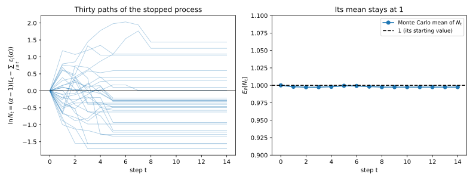
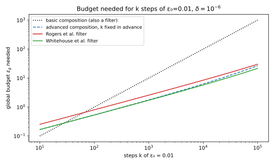
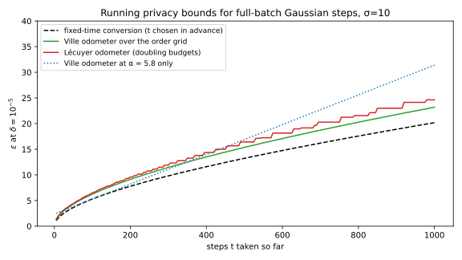
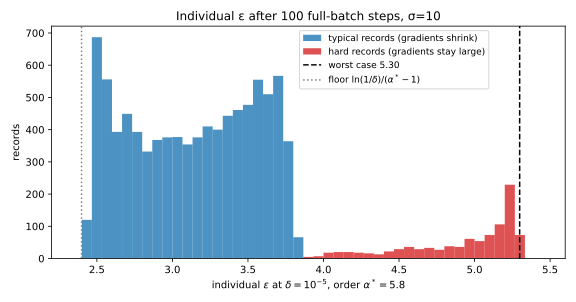
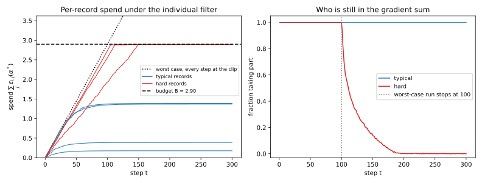

# Adaptive composition: filters, odometers and individual accounting

Every composition theorem so far assumes that the privacy parameters of the steps are fixed before the run starts. The mechanisms may be chosen after seeing earlier outputs, as in [Composition](../part03-dp-foundations/04-composition.md) (@thm-comp-adaptive), but the per-step budgets and the number of steps must be known in advance. Real systems break this. You train until the validation loss stops improving, or lower the noise when training stalls, so the number of steps and their budgets depend on the outputs. And when a model is trained with differential privacy (DP) by stochastic gradient descent (SGD), each record's gradient is scaled down to a maximum norm, and a record whose gradient is small costs less than the worst case, by an amount that depends on the current model.

Plugging the parameters that occurred into a fixed-parameter theorem fails, because an analyst who chooses when to stop can make the bound fail about three times as often as it claims. So the question splits in two. A **privacy filter** decides before each step whether the run may continue within a budget fixed in advance. A **privacy odometer** reports how much has been spent, and it must hold at every step at once, because you may stop at any of them. The one idea behind both is a quantity built from the privacy loss that never goes up on average, since stopping it at a time of your choosing cannot raise its mean. In Rényi differential privacy (RDP) this makes adaptivity almost free: if the spends at a fixed order add up to at most a budget on every path, the run has that budget.

The running example is full-batch noisy gradient descent whose noise has standard deviation $\sigma = 10$ times the sensitivity, the noise multiplier. One hundred steps planned in advance are $(5.299, 10^{-5})$-DP, best at the Rényi order 5.8, where the RDP budget is $B = 2.900$ (@exm-adapt-noise-switch). The chapter lowers the noise mid-run, reports the spend with an odometer, and tracks each record's own spend. The pure-DP sections use randomized response instead, because a Gaussian step is not pure DP.

| Symbol | Meaning |
| --- | --- |
| $t$; $y_t$; $y_{<t}$ | a step; the output it releases; the outputs released before it |
| $L_t$; $L_{1:t}$ | the privacy loss of step $t$ given the past; the loss of the first $t$ steps |
| $\varepsilon_t$; $\varepsilon_t(\alpha)$ | the pure-DP parameter of step $t$; its RDP spend at order $\alpha$ |
| $T$ | the last step a run takes, decided from the outputs |
| $(\varepsilon_g, \delta)$; $U_t$ | a filter's global budget; an odometer's running bound |
| $N_t$; $B$ | the supermartingale of the Rényi filter; its budget at order $\alpha$ |
| $S_t(\alpha)$; $\Lambda$ | the spend of the first $t$ steps at order $\alpha$; a finite grid of orders |

: The symbols of this chapter. {#tbl-adapt-symbols}

## When the parameters are chosen during the run {#sec-adapt-why-breaks}

Before building anything, you need to see why the obvious approach fails. Advanced composition bounds the privacy loss of $k$ steps of $\varepsilon$-DP, with $k$ and $\varepsilon$ fixed, except with probability $\delta$ (@eq-comp-advanced-tanh). The shortcut is to apply it **ex post**, reporting advanced composition of the parameters used when you stop. Rogers, Roth, Ullman & Vadhan (2016) showed that this is not valid, because a bound that fails with probability $\delta$ at each fixed time can fail far more often at a time chosen from the outputs.

A run has steps $t = 1, 2, \dots$, and step $t$ releases $y_t$ from a mechanism chosen from the earlier outputs $y_{<t}$. On neighbours $D \sim D'$, which differ by adding or removing one record, write $P_t(y_t \mid y_{<t})$ and $Q_t(y_t \mid y_{<t})$ for the probability of $y_t$ after that history on $D$ and on $D'$. The privacy loss of step $t$ is $L_t = \ln\big(P_t(y_t \mid y_{<t})/Q_t(y_t \mid y_{<t})\big)$, and by @lem-comp-sum the loss of the first $t$ steps is the sum $L_{1:t}$. Step $t$ is $\varepsilon_t$-DP whatever the history, where $\varepsilon_t$ may depend on $y_{<t}$ but not on $y_t$. Such a parameter is **predictable**. The **analyst** is whoever makes these choices from the outputs. Probabilities are under $P$, the distribution of the whole transcript on $D$, unless written otherwise.

::: {#def-adapt-filter name="Privacy filter"}
A **privacy filter** with budget $(\varepsilon_g, \delta)$ is a rule that, before each step, looks at the parameters $\varepsilon_1, \dots, \varepsilon_t$ so far, including the one about to run, and says *continue* or *halt*. It is valid if the stopped run $(y_1, \dots, y_T)$ is $(\varepsilon_g, \delta)$-DP for every analyst, however the analyst picks the steps and their parameters.
:::

An odometer makes a claim at every step. Since you may stop at any of them, the claim you report is only safe if it held at all times at once.

::: {#def-adapt-odometer name="Privacy odometer"}
A **privacy odometer** with confidence $\delta$ is a sequence of functions $U_t(\varepsilon_1, \dots, \varepsilon_t)$ of the parameters spent so far. It is valid if, for every analyst and every pair of neighbours, the probability that the loss ever exceeds the running bound is at most $\delta$:
$$\Pr\big[\exists\, t: L_{1:t} > U_t\big] \le \delta.$$ {#eq-adapt-odometer-def}
:::

The natural candidate for $U_t$ is advanced composition of the parameters used so far, which is correct at every fixed time and still not an odometer. The simplest mechanism shows it. Randomized response at level $\varepsilon$ reports a person's bit truthfully with probability $e^\varepsilon/(1 + e^\varepsilon)$ and flips it otherwise.

::: {#prp-adapt-plugin name="The plug-in odometer fails"}
Let every step be randomized response at level $\varepsilon$ on the same person's bit, and let
$$U_t = t\varepsilon\tanh(\varepsilon/2) + \varepsilon\sqrt{2t\ln(1/\delta)}.$$
At every fixed $t$, $\Pr[L_{1:t} > U_t] \le \delta$. But the probability that $L_{1:t} > U_t$ at some $t \le n$ tends to 1 as $n \to \infty$, so $U_t$ is not a valid odometer.
:::

::: {.proof}
The plan is to prove the fixed-time bound with Azuma's inequality, then to show that an analyst who stops at the first crossing turns the crossing probability into the failure probability, and that this probability tends to 1.

1. *The loss is a walk.* Take a person whose bit is 1 in $D$ and 0 in $D'$. A report of 1 has probability $e^\varepsilon/(1 + e^\varepsilon)$ on $D$ and $1/(1 + e^\varepsilon)$ on $D'$, so its loss is $+\varepsilon$, and a report of 0 has loss $-\varepsilon$. By @prp-comp-rr-loss the mean loss per step under $D$ is $\varepsilon\tanh(\varepsilon/2)$. So $L_{1:t}$ is a random walk with steps $\pm\varepsilon$ and a slight upward drift.
2. *Centre it.* Subtracting the drift gives $M_t = L_{1:t} - t\varepsilon\tanh(\varepsilon/2)$, a martingale whose increments lie in intervals of length $2\varepsilon$.
3. *The fixed-time bound.* Azuma's inequality (@thm-conc-azuma) bounds the chance that such a martingale exceeds $s$ after $t$ steps by $\exp(-2s^2/(4t\varepsilon^2))$. Setting this to $\delta$ gives $s = \varepsilon\sqrt{2t\ln(1/\delta)}$, and adding the drift back gives $\Pr[L_{1:t} > U_t] \le \delta$.
4. *The analyst's rule.* Run until $L_{1:t} > U_t$, then stop. The loss is $\varepsilon$ times the number of reports of 1 minus the number of reports of 0, a function of the outputs, so this rule decides from what has been released.
5. *The event the odometer must control.* The claim $L_{1:T} \le U_T$ fails exactly when the walk crossed the boundary at some $t \le n$, because that is when the analyst stops. So the failure probability is $\Pr[\exists\,t \le n: L_{1:t} > U_t]$, a probability over the whole path.
6. *The crossing probability tends to 1.* The boundary sits $\varepsilon\sqrt{2t\ln(1/\delta)}$ above the mean, a fixed multiple of $\sqrt t$. The centred steps are $\pm\varepsilon$ minus their mean, so their variance is the mean square minus the squared mean, $v = \varepsilon^2 - \varepsilon^2\tanh^2(\varepsilon/2)$. The law of the iterated logarithm, which we cite (Durrett, in the References), says that a centred walk with step variance $v$ exceeds $\frac12\sqrt{2vt\ln\ln t}$ infinitely often with probability 1. That curve grows faster than any fixed multiple of $\sqrt t$, because $\ln\ln t$ grows without bound, so the walk crosses the boundary with probability 1.
:::

The theorem was never wrong; its use was. An analyst who stops when the loss happens to be high selects exactly the paths where a fixed-time bound fails. Rogers et al. (2016, Theorem 6.1) turn this construction into a lower bound: every valid odometer pays an extra $\ln\ln n$ inside the logarithm, where $n$ is the number of steps.

Basic composition does not suffer from this, because $|L_{1:t}| \le \sum_{j\le t}\varepsilon_j$ holds for every output and leaves no bad event to select. Filters escape by another route. A filter fixes the budget in advance and only asks whether the next step fits, so there is no running claim to catch out, and @sec-adapt-dp-filters answers that question with no $\ln\ln$ loss.

{#fig-adapt-plugin-failure}

::: {#exm-adapt-plugin}
Take randomized response with $\varepsilon = 0.1$, whose mean loss per step is $0.1 \times \tanh(0.05) = 0.004996$. The crossing probability is exact: propagate the distribution of $L_{1:t}/\varepsilon$, an integer walk, step by step, and remove at each $t$ the mass above $U_t/\varepsilon$ (@tbl-adapt-plugin).

| Horizon $n$ | 10 | 100 | 1000 | 10,000 | worst single fixed $t \le 1000$ |
| --- | --- | --- | --- | --- | --- |
| $\delta = 0.05$ | 0.0110 | 0.0575 | 0.1004 | 0.1424 | 0.0110 ($t = 17$) |
| $\delta = 0.01$ | 0.0000 | 0.0090 | 0.0202 | 0.0318 | 0.0016 ($t = 21$) |
| $\delta = 10^{-5}$ | 0 | $3.12\times10^{-6}$ | $1.80\times10^{-5}$ | $3.69\times10^{-5}$ | $8.18\times10^{-7}$ ($t = 758$) |

: The exact probability $\Pr[\exists\,t \le n: L_{1:t} > U_t]$ that randomized response with $\varepsilon = 0.1$ crosses the plug-in bound by step $n$. The last column is the largest probability of exceeding it at one fixed step $t \le 1000$, and that step. {#tbl-adapt-plugin}

With $\delta = 0.01$, the plug-in bound after $t = 100$ steps is $100 \times 0.004996 + 0.1\sqrt{200\ln 100} = 3.534$. In @fig-adapt-plugin-failure (left), a few runs cross the boundary early, where it is narrow, and the analyst freezes them there. By $n = 10^4$ a fraction 0.0318 of runs have crossed, so a report "$\varepsilon = U_T$ with $\delta = 0.01$" is wrong $0.0318/0.01 = 3.18$ times as often as it claims. At $\delta = 0.05$ the factor is $0.1424/0.05 = 2.85$, although the bound fails at a single fixed time $t \le 1000$ with probability at most 0.0110. A small $\delta$ does not cure it: at $\delta = 10^{-5}$ the factor is 3.69.
:::

## The Rényi filter {#sec-adapt-renyi-filter}

Rényi differential privacy describes a mechanism by a curve. The Rényi divergence of order $\alpha > 1$ is $D_\alpha(P\|Q) = \frac{1}{\alpha - 1}\ln\mathbb E_P\big[e^{(\alpha - 1)L}\big]$, a log of an exponential moment of the privacy loss $L$ (@eq-cdp-psi), and a mechanism is $(\alpha, \varepsilon(\alpha))$-RDP if this is at most $\varepsilon(\alpha)$ for every pair of neighbours. RDP composition adds curves fixed in advance (@eq-rdp-compose). This section asks what happens when the spend $\varepsilon_t(\alpha)$ depends on the earlier outputs. Feldman & Zrnic (2021) and Lécuyer (2021) showed that nothing is lost at a fixed order, and every later section rests on that.

The proof stops a random process at a time chosen from the outputs, so it needs two tools. The first extends @lem-comp-sum to a run whose length is decided by its outputs.

::: {#lem-adapt-stopped-loss name="The loss of a stopped run"}
Let the run stop after step $T$, where the decision to stop after $y_t$ is a function of $y_1, \dots, y_t$ alone. Then the privacy loss of the stopped transcript $(y_1, \dots, y_T)$ is $L_{1:T} = \sum_{t \le T}L_t$.
:::

::: {.proof}
1. *Chain rule.* The transcript has probability $\prod_{t \le T}P_t(y_t \mid y_{<t})$ under $P$, times the probability of the stopping decisions, and likewise with $Q_t$ under $Q$.
2. *The stopping decisions cancel.* Each decision is a function of outputs already released, so given them it has probability 1 or 0, the same under $P$ and $Q$, and it cancels from the ratio.
3. *Take logs.* The log of the remaining ratio of products is the sum of the step losses.
:::

The second tool says that stopping early cannot raise the mean of a process that never goes up on average. Picture your wealth in a game that is fair or unfavourable to you, where you may quit at any time by looking at the past but not at the future.

::: {#def-adapt-supermartingale name="Supermartingale and stopping time"}
A process $N_0, N_1, \dots$, with $N_t$ a function of $y_{\le t}$, is a **supermartingale** if $\mathbb E[N_t \mid y_{<t}] \le N_{t-1}$ for every $t$, and a **martingale** if equality holds. A **stopping time** $T$ is a random step such that the event $\{T \ge t\}$, "the run takes step $t$", is decided by $y_{<t}$.
:::

::: {#lem-adapt-optional-stopping name="Optional stopping"}
Let $N$ be a supermartingale and $T$ a stopping time with $T \le n$ for a fixed $n$. Then
$$\mathbb E[N_T] \le \mathbb E[N_0].$$ {#eq-adapt-optional-stopping}
If $N_t \ge 0$ for every $t$, the horizon can be dropped: $\mathbb E\big[N_T\mathbf 1[T < \infty]\big] \le \mathbb E[N_0]$ for every stopping time $T$.
:::

::: {.proof}
The idea is to write the stopped process as a running total of the increments it collects, and to show that each has non-positive mean. Write $T\wedge t = \min(T, t)$.

1. *Write the stopped process as a sum.* The stopped process gains $N_t - N_{t-1}$ only if the run takes step $t$, which the indicator $\mathbf 1[T \ge t]$ records:
$$N_{T\wedge t} = N_{T\wedge(t-1)} + \mathbf 1[T \ge t](N_t - N_{t-1}).$$
2. *Each collected increment has non-positive mean.* The indicator is decided by $y_{<t}$, so given $y_{<t}$ it comes out of the conditional expectation, and what remains, $\mathbb E[N_t \mid y_{<t}] - N_{t-1}$, is non-positive. This is where the stopping decision must not look at $y_t$.
3. *Add up the steps.* Taking expectations and summing over $t \le n$ gives $\mathbb E[N_{T\wedge n}] \le \mathbb E[N_0]$, and $T \wedge n = T$.
4. *Drop the horizon.* For $N \ge 0$, apply step 3 to $T \wedge n$ and let $n \to \infty$. Fatou's lemma, which says that the mean of a limit of non-negative variables is at most the limit of their means, gives the second bound.
:::

The horizon matters only for processes that can go negative. With both tools in hand, the result says: fix an order and a budget, add up the RDP spends as the run goes, and stop before the sum would pass the budget.

::: {#thm-adapt-renyi-filter name="The Rényi filter (Feldman & Zrnic 2021; Lécuyer 2021)"}
Fix an order $\alpha > 1$ and a budget $B$. Let step $t$ be $(\alpha, \varepsilon_t(\alpha))$-RDP conditionally on $y_{<t}$, with $\varepsilon_t(\alpha)$ predictable. Run step $t$ only if
$$\sum_{j \le t}\varepsilon_j(\alpha) \le B.$$ {#eq-adapt-renyi-filter}
Then the stopped run is $(\alpha, B)$-RDP. Equivalently, if $\sum_t\varepsilon_t(\alpha) \le B$ on every path, the adaptive composition is $(\alpha, B)$-RDP.
:::

::: {.proof}
The proof builds a supermartingale from the privacy loss and the spends, stops it with the filter, and reads the RDP bound off its mean. The quantity to use is $e^{(\alpha - 1)L}$, whose mean is what the Rényi divergence measures, divided by what the spends allow. Fix $D \sim D'$ and define
$$N_t = \exp\Big((\alpha - 1)\Big(L_{1:t} - \sum_{j\le t}\varepsilon_j(\alpha)\Big)\Big), \qquad N_0 = 1.$$ {#eq-adapt-supermartingale}

1. *One step's moment is bounded by its spend.* Given $y_{<t}$, step $t$ is a fixed mechanism, so the moment form of $D_\alpha$ and the RDP assumption give $\mathbb E\big[e^{(\alpha - 1)L_t} \mid y_{<t}\big] = e^{(\alpha - 1)D_\alpha(P_t\|Q_t)} \le e^{(\alpha - 1)\varepsilon_t(\alpha)}$.
2. *$N_t$ is a supermartingale.* Each step multiplies $N$ by $e^{(\alpha - 1)(L_t - \varepsilon_t(\alpha))}$. Both $N_{t-1}$ and $\varepsilon_t(\alpha)$ are functions of $y_{<t}$, so they come out of the conditional expectation, and step 1 bounds what remains by 1. This is where predictability is used.
3. *Stop it.* Whether step $t$ runs depends on spends that are functions of $y_{<t}$, so the filter's last step $T$ is a stopping time, and @lem-adapt-optional-stopping gives $\mathbb E[N_T] \le 1$.
4. *Use the budget on every path.* Undoing the definition, $e^{(\alpha - 1)L_{1:T}} = N_T\,e^{(\alpha - 1)\sum_{j\le T}\varepsilon_j(\alpha)}$, and the filter keeps the spend at most $B$ on every path. Taking expectations,
$$\mathbb E\big[e^{(\alpha - 1)L_{1:T}}\big] \le e^{(\alpha - 1)B}\,\mathbb E[N_T] \le e^{(\alpha - 1)B}.$$
5. *Read off the divergence.* By @lem-adapt-stopped-loss, $L_{1:T}$ is the privacy loss of the stopped transcript, so the left side is $e^{(\alpha - 1)D_\alpha}$ of the stopped run, and $D_\alpha \le B$. Swapping $D$ and $D'$ gives the other direction.
:::

Step 4 needs the budget on every path, not on average, because paths with a large spend may also have a large $N_T$. When every path spends exactly $B$ and each step's moment equals its RDP parameter, as for Gaussian steps, $N$ is a martingale and the bound is attained. In @fig-adapt-supermartingale, adaptive Gaussian steps (shift 0.3 after a positive output, 0.6 otherwise, in units of the noise) are stopped by a filter with $\alpha = 2$ and $B = 1$. If the last step spends exactly what is left, $10^6$ Monte Carlo paths give $D_2 = 1.0004$. If the filter simply stops, $D_2 = 0.9305$, because no path uses the whole budget.

The price is the order, which must be fixed before the run. You can track several orders and stop when any one is exhausted, but continuing while *some* order still fits is a choice made after seeing the spends, which @sec-adapt-odometers prices. At the end, Mironov's conversion (@eq-rdp-mironov) turns a DP target $(\varepsilon_g, \delta)$ into the budget $B = \varepsilon_g - \ln(1/\delta)/(\alpha - 1)$.

{#fig-adapt-supermartingale}

::: {#exm-adapt-noise-switch}
You train with full-batch noisy gradient descent and want to lower the noise when progress stalls. With $(\varepsilon_g, \delta) = (5.299, 10^{-5})$ and the order $\alpha = 5.8$, the RDP budget is $B = 5.299 - \ln(10^5)/4.8 = 2.900$. A Gaussian step with noise multiplier $\sigma_t$ spends $\alpha/(2\sigma_t^2)$ (@eq-rdp-gauss). With $\sigma_t = 10$ throughout, each step spends $5.8/200 = 0.0290$, which gives $2.900/0.0290 = 100$ steps. If you switch to $\sigma_t = 5$ after a plateau at step 60, each later step costs $5.8/50 = 0.1160$, and the filter allows $(2.900 - 60\times0.0290)/0.1160 = 1.160/0.1160 = 10$ more. Either way the run is $(5.8, 2.900)$-RDP, whatever rule decided the switch.
:::

The filter can also beat fixed-curve composition outright when branches trade costs. Two steps, as in @tbl-rdp-adaptive of [Rényi DP](01-renyi-dp.md), are too few to show it, but three are enough.

::: {#exm-adapt-three-step}
Take $\alpha = 2$, so $N_t = e^{L_{1:t} - \text{spend}}$, and one person's bit, 1 in $D$ and 0 in $D'$. Step 1 is randomized response with $\varepsilon = \ln 3$, keep-probability $p = 3/4$, and RDP at order 2 (@eq-rdp-rr) $\ln\big(p^2/(1 - p) + (1 - p)^2/p\big) = 0.8473$. After $y_1 = 1$, steps 2 and 3 are randomized response with $\ln 3$ (strong) and then $\ln 1.5$ (weak, keep-probability $0.6$, RDP 0.1542), and after $y_1 = 0$ they come in the other order. So every path spends $B = 2 \times 0.8473 + 0.1542 = 1.8487$ (computed before rounding), while fixed-curve composition charges each later step its worst branch, $3 \times 0.8473 = 2.5419$.

| $(y_1, y_2, y_3)$ | $P$ | $Q$ | $L_{1:3}$ | spend $\sum_j\varepsilon_j(2)$ | $N_3$ | $P \times N_3$ |
| --- | --- | --- | --- | --- | --- | --- |
| (1, 1, 1) | 0.3375 | 0.0250 | +2.6027 | 1.8487 | 2.1254 | 0.7173 |
| (1, 1, 0) | 0.2250 | 0.0375 | +1.7918 | 1.8487 | 0.9446 | 0.2125 |
| (1, 0, 1) | 0.1125 | 0.0750 | +0.4055 | 1.8487 | 0.2362 | 0.0266 |
| (1, 0, 0) | 0.0750 | 0.1125 | −0.4055 | 1.8487 | 0.1050 | 0.0079 |
| (0, 1, 1) | 0.1125 | 0.0750 | +0.4055 | 1.8487 | 0.2362 | 0.0266 |
| (0, 1, 0) | 0.0375 | 0.2250 | −1.7918 | 1.8487 | 0.0262 | 0.0010 |
| (0, 0, 1) | 0.0750 | 0.1125 | −0.4055 | 1.8487 | 0.1050 | 0.0079 |
| (0, 0, 0) | 0.0250 | 0.3375 | −2.6027 | 1.8487 | 0.0117 | 0.0003 |

: Three adaptive randomized-response steps at $\alpha = 2$, in which every path spends the same. {#tbl-adapt-three-step}

In the first row of @tbl-adapt-three-step, $P = 0.75 \times 0.75 \times 0.6 = 0.3375$ and $Q = 0.25 \times 0.25 \times 0.4 = 0.0250$, so $N_3 = e^{2.6027 - 1.8487} = 2.1254$. The last column sums to $1.0000$, because randomized response meets step 1 of the proof with equality. So the joint divergence $D_2 = \ln\sum P^2/Q = 1.8487$ is exactly $B$, well below the fixed-curve 2.5419.
:::

## Filters for pure differential privacy {#sec-adapt-dp-filters}

You run an interactive system with a global budget $(\varepsilon_g, \delta)$, and each query comes with its own $\varepsilon_t$, chosen after seeing the earlier answers. Before each query you need a rule that says whether it may run. Summing the $\varepsilon_t$ is valid however you stop, but the total grows like the number of steps $k$, and advanced composition, which grows like $\sqrt k$, cannot be applied ex post. This section gives filters that grow like $\sqrt k$. Its examples use pure-DP steps, since Gaussian steps are not pure DP.

Every filter below continues while one statistic of $\varepsilon_1, \dots, \varepsilon_t$ is at most $\varepsilon_g$. The simplest statistic is the plain sum, which works because a pure-DP step bounds the loss of every single output.

::: {#prp-adapt-basic-filter name="The basic filter (Rogers et al. 2016, Theorem 3.4)"}
Let each step be $\varepsilon_t$-DP conditionally on the past, with $\varepsilon_t$ predictable. The filter that continues while $\sum_{j\le t}\varepsilon_j \le \varepsilon_g$ gives an $\varepsilon_g$-DP stopped run, and $U_t = \sum_{j \le t}\varepsilon_j$ is a valid odometer with $\delta = 0$.
:::

::: {.proof}
1. *Each step's loss is bounded on every output.* An $\varepsilon_t$-DP step makes no output more than $e^{\varepsilon_t}$ times likelier on one neighbour than on the other, so $|L_t| \le \varepsilon_t$.
2. *So is the stopped run's loss.* By @lem-adapt-stopped-loss, $|L_{1:T}| \le \sum_{t\le T}\varepsilon_t \le \varepsilon_g$ on every path, and the same bound holds at every $t$, which is the odometer.
3. *A bounded loss is pure DP.* A loss of at most $\varepsilon_g$ on every transcript $y$ means $P(y) \le e^{\varepsilon_g}Q(y)$, and summing over the transcripts in any event $E$ gives $P(E) \le e^{\varepsilon_g}Q(E)$.
:::

To grow like $\sqrt k$, the statistic needs a mean term plus a spread term like advanced composition's $\sqrt{2V\ln(1/\delta)}$, where $V = \sum_t\varepsilon_t^2$ plays the role of a variance. Because $V$ is random, Rogers et al. pad it by a constant $x$ and multiply it by a logarithmic factor in $V/x$.

::: {#thm-adapt-rogers name="The Rogers et al. filter (2016, Theorem 5.1)"}
Under the assumptions of @prp-adapt-basic-filter, let $\delta < 1/e$ and $x = \varepsilon_g^2/(28.04\ln(1/\delta))$. The filter that continues while
$$K = \sum_t\frac{\varepsilon_t(e^{\varepsilon_t} - 1)}{2} + \sqrt{2(V + x)\Big(1 + \tfrac12\ln\big(\tfrac Vx + 1\big)\Big)\ln(1/\delta)} \le \varepsilon_g$$ {#eq-adapt-rogers}
gives an $(\varepsilon_g, \delta)$-DP stopped run.
:::
<!-- proof: cited -->

The proof is in Rogers et al.'s Section 5. Its centred loss has random increment ranges $2\varepsilon_t$, so Azuma's inequality no longer applies, and they use a **self-normalized** inequality instead (their Theorem 4.4), which bounds the martingale divided by $\sqrt{V + x}$ whatever $V$ turns out to be. The extra $x$ and the logarithmic factor are its price, while the constant 28.04 and the condition $\delta < 1/e$ are constants of their proof.

Zero-concentrated differential privacy (zCDP) avoids that price. A mechanism is $\rho$-zCDP if it is $(\alpha, \alpha\rho)$-RDP at every order $\alpha > 1$, so its RDP curve lies below a line through the origin with slope $\rho$. In zCDP, adaptive budgets add up for free at every order by @thm-adapt-renyi-filter, and the conversion to $(\varepsilon, \delta)$-DP happens once, at the end.

::: {#thm-adapt-whitehouse name="The Whitehouse et al. filter (2023, Theorem 2)"}
Under the same assumptions, let $\delta \in (0, 1)$. The filter that continues while
$$\sqrt{2\ln(1/\delta)\textstyle\sum_t\varepsilon_t^2} + \tfrac12\textstyle\sum_t\varepsilon_t^2 \le \varepsilon_g$$ {#eq-adapt-whitehouse}
gives an $(\varepsilon_g, \delta)$-DP stopped run. Equivalently, it continues while $\frac12\sum_t\varepsilon_t^2 \le \rho^*$, where
$$\rho^* = \Big(\sqrt{\ln(1/\delta) + \varepsilon_g} - \sqrt{\ln(1/\delta)}\Big)^2.$$
:::

::: {.proof}
Measure each step in zCDP, apply the Rényi filter at every order at once, then convert. Write $\ell = \ln(1/\delta)$.

1. *Each step is zCDP.* An $\varepsilon_t$-DP step is $(\alpha, \alpha\varepsilon_t^2/2)$-RDP for every $\alpha > 1$ (@eq-cdp-pure), because its loss lies in $[-\varepsilon_t, \varepsilon_t]$. So it is $\varepsilon_t^2/2$-zCDP.
2. *The rule is a Rényi filter at every order.* Multiplying $\frac12\sum_t\varepsilon_t^2 \le \rho^*$ by $\alpha$ gives $\sum_t\alpha\varepsilon_t^2/2 \le \alpha\rho^*$, a Rényi filter with budget $\alpha\rho^*$. By @thm-adapt-renyi-filter the stopped run is $(\alpha, \alpha\rho^*)$-RDP. The rule does not mention $\alpha$, so this holds at every order, and the stopped run is $\rho^*$-zCDP.
3. *Convert.* A $\rho$-zCDP mechanism is $(\rho + 2\sqrt{\rho\ell}, \delta)$-DP (@eq-cdp-simple), Mironov's conversion at the best order.
4. *The choice of $\rho^*$ makes this $\varepsilon_g$.* The equation $\rho + 2\sqrt{\rho\ell} = \varepsilon_g$ completes to $(\sqrt\rho + \sqrt\ell)^2 = \varepsilon_g + \ell$, whose solution is the $\rho^*$ of the statement (@eq-cdp-inverse).
5. *Rewrite the rule.* The map $\rho \mapsto \rho + 2\sqrt{\rho\ell}$ is increasing, so $\rho \le \rho^*$ is the same as $\rho + 2\sqrt{\rho\ell} \le \varepsilon_g$. With $\rho = \frac12\sum_t\varepsilon_t^2$, the square root is $\sqrt{2\ell\sum_t\varepsilon_t^2}$, and the rule becomes @eq-adapt-whitehouse.
:::

This is the budget-spending rule that @sec-comp-adaptive asked for, and adaptivity costs it essentially nothing. Its mean term $\varepsilon_t^2/2$ lies slightly above the sharp mean $\varepsilon_t\tanh(\varepsilon_t/2)$ of @eq-comp-advanced-tanh but below the $\varepsilon_t(e^{\varepsilon_t} - 1)$ of @eq-comp-advanced, which is why @tbl-adapt-budgets puts it below fixed-$k$ advanced composition. For the same reason, a plug-in filter on @eq-comp-advanced is valid: it halts no later than the Whitehouse filter, and stopping earlier is post-processing.

{#fig-adapt-filter-budgets}

::: {#exm-adapt-filter-budgets}
Take $k$ steps of $\varepsilon_0$ each at $\delta = 10^{-6}$. The budget each rule needs is its statistic after $k$ steps, compared in @tbl-adapt-budgets with advanced composition for a $k$ fixed in advance (@eq-comp-advanced) and plotted in @fig-adapt-filter-budgets. The Rogers filter needs 1.40 to 1.51 times the Whitehouse budget.

| $\varepsilon_0$ | $k$ | Basic | Advanced (fixed $k$) | Rogers filter | Whitehouse filter | Rogers / Whitehouse |
| --- | --- | --- | --- | --- | --- | --- |
| 0.01 | 100 | 1.000 | 0.536 | 0.803 | 0.531 | 1.51 |
| 0.01 | 1000 | 10.000 | 1.763 | 2.570 | 1.712 | 1.50 |
| 0.01 | 10,000 | 100.000 | 6.262 | 8.450 | 5.757 | 1.47 |
| 0.1 | 100 | 10.000 | 6.308 | 8.472 | 5.757 | 1.47 |
| 0.1 | 1000 | 100.000 | 27.140 | 30.244 | 21.623 | 1.40 |

: Global budget $\varepsilon_g$ needed for $k$ steps of $\varepsilon_0$ at $\delta = 10^{-6}$. For the Rogers filter, the smallest $\varepsilon_g$ at which @eq-adapt-rogers holds. {#tbl-adapt-budgets}

Turned around, a budget of $\varepsilon_g = 1$ allows the numbers of steps in @tbl-adapt-steps. For the Whitehouse filter, $\rho^* = (\sqrt{\ln(10^6) + 1} - \sqrt{\ln(10^6)})^2 = 0.017469$, which allows $\lfloor 2\rho^*/\varepsilon_0^2\rfloor$ steps, and the Rogers filter lets through fewer than half as many.

| $\varepsilon_0$ | Basic | Advanced (fixed $k$) | Rogers filter | Whitehouse filter |
| --- | --- | --- | --- | --- |
| 0.01 | 100 | 337 | 154 | 349 |
| 0.001 | 1000 | 33,785 | 15,481 | 34,937 |

: Number of steps of $\varepsilon_0$ allowed by a global budget $\varepsilon_g = 1$ at $\delta = 10^{-6}$. {#tbl-adapt-steps}

:::

## Odometers {#sec-adapt-odometers}

Early stopping and open-ended analyses have no budget to stop at. They need a running answer to "how much have I spent?" that stays valid however the stopping time is chosen, the odometer of @def-adapt-odometer. This section builds odometers from the Rényi filter's supermartingale, at the cost of a union over the orders you might pick.

The tool is a time-uniform Markov inequality. Markov's inequality (@thm-conc-markov) says that a non-negative variable with mean 1 is at least $c$ with probability at most $1/c$. Ville's inequality gives the same bound for the event that a supermartingale is *ever* that large, because stopping at the first time it reaches $c$ leaves the mean at most 1.

::: {#lem-adapt-ville name="Ville's inequality"}
If $N_t \ge 0$ is a supermartingale with $N_0 = 1$, then for every $c > 0$,
$$\Pr\big[\exists\, t: N_t \ge c\big] \le \frac1c.$$ {#eq-adapt-ville}
:::

::: {.proof}
1. *Stop at the first crossing.* Fix a horizon $n$ and let $T$ be the first $t$ with $N_t \ge c$, or $n$ if there is none. Whether $T \ge t$ depends only on $N_1, \dots, N_{t-1}$, so $T$ is a stopping time bounded by $n$.
2. *The stopped process keeps its mean.* By @lem-adapt-optional-stopping, $\mathbb E[N_T] \le 1$.
3. *Apply Markov's argument to the stopped value.* If the process reaches $c$ by time $n$, then $N_T \ge c$, and elsewhere $N_T \ge 0$. So $N_T$ is at least $c$ times the indicator of that event, and taking means gives $c\Pr[\exists\,t \le n: N_t \ge c] \le 1$.
4. *Drop the horizon.* These events grow with $n$, and their union is $\{\exists\,t: N_t \ge c\}$.
:::

Each odometer below turns the running RDP spend at a few orders into a running $\varepsilon$. The orders form a finite grid $\Lambda$ fixed in advance, with $|\Lambda|$ orders, and $S_t(\alpha) = \sum_{j\le t}\varepsilon_j(\alpha)$ is the spend so far. The first odometer reports Mironov's conversion at the best order in the grid, with $\delta$ replaced by $\delta/|\Lambda|$ to pay for choosing the order late.

::: {#thm-adapt-ville-odometer name="The Ville odometer"}
Let step $t$ be $(\alpha, \varepsilon_t(\alpha))$-RDP conditionally on the past for each $\alpha \in \Lambda$, with predictable spends. With probability at least $1 - \delta$, simultaneously for all $t$,
$$L_{1:t} \le U_t = \min_{\alpha\in\Lambda}\Big[S_t(\alpha) + \frac{\ln(|\Lambda|/\delta)}{\alpha - 1}\Big].$$ {#eq-adapt-ville-odometer}
:::

::: {.proof}
Ville's inequality, applied to the Rényi filter's supermartingale at each order, unpacks into a bound on the loss, and a union bound pays for all the orders.

1. *A supermartingale at each order.* Fix $\alpha \in \Lambda$. Steps 1 and 2 of the proof of @thm-adapt-renyi-filter showed that $N_t$ of @eq-adapt-supermartingale is a non-negative supermartingale with $N_0 = 1$, using only that the spends are predictable.
2. *Ville.* @lem-adapt-ville with $c = |\Lambda|/\delta$ gives
$$\Pr\big[\exists\,t: N_t \ge |\Lambda|/\delta\big] \le \delta/|\Lambda|.$$
3. *Unpack.* Taking logarithms and dividing by $\alpha - 1$ turns $N_t \ge |\Lambda|/\delta$ into $L_{1:t} \ge S_t(\alpha) + \ln(|\Lambda|/\delta)/(\alpha - 1)$. So at this order the bound holds for all $t$ at once, except with probability $\delta/|\Lambda|$.
4. *Union over the orders.* By the union bound (@lem-conc-union), the bound fails at some order with probability at most $\delta$. Outside that event it holds at every order and time, so it holds at the minimizing order, chosen after the fact.
:::

With a single order the Ville odometer is Mironov's fixed-time conversion, so at one fixed order a running bound is free. For Gaussian steps it is then exactly tight. In the limit of small steps the loss is a Brownian motion with drift, which crosses the boundary with probability exactly $\delta$: $N$ is then a martingale with continuous paths, so it equals $1/\delta$ at the crossing, and the inequalities in the proof of @lem-adapt-ville become equalities. The script checks this at $\delta = 0.05$ and order 2, with 1000 Gaussian steps whose mean shifts by 0.2 noise widths. The crossing probability is 0.0461, a little below 0.0500 because whole steps miss crossings between them, while at any single fixed time it is at most 0.0072. Several orders add the union's $\ln|\Lambda|$. At $\delta = 10^{-5}$, with the grid of 154 orders that this part's accountants use, $\ln(1/\delta) = 11.513$ becomes $11.513 + \ln 154 = 16.550$.

An odometer is a tail bound, not a DP guarantee: "$\varepsilon = U_T$" means that this run's loss exceeds $U_T$ with probability at most $\delta$. A filter that stops before $U_T$ passes $\varepsilon_g$ is $(\varepsilon_g, \delta)$-DP, by splitting any event on whether the loss exceeds $\varepsilon_g$ (@sec-rdp-conversion).

Lécuyer (2021, Section 4) builds a second odometer from Rényi filters with doubling budgets $B_f(\alpha) = 2^{f-1}\ln(2|\Lambda|/\delta)/(\alpha - 1)$, for $f = 1, 2, \dots$ Let $f(\alpha)$ be the first $f$ whose budget covers $S_t(\alpha)$. The odometer reports that budget plus a conversion term whose confidence shrinks with $f$.

::: {#thm-adapt-lecuyer name="The Lécuyer odometer"}
Under the assumptions of @thm-adapt-ville-odometer, with probability at least $1 - \delta$, simultaneously for all $t$,
$$L_{1:t} \le \min_{\alpha\in\Lambda}\Big[B_{f(\alpha)}(\alpha) + \frac{\ln(2|\Lambda|f(\alpha)^2/\delta)}{\alpha - 1}\Big].$$ {#eq-adapt-lecuyer}
:::

::: {.proof}
1. *One filter at one order.* Fix $\alpha$ and $f$, and let $T_f$ be the first step at which $S_t(\alpha)$ exceeds $B_f(\alpha)$. The supermartingale $N_t$ stopped at $T_f$ is still non-negative and starts at 1. So @lem-adapt-ville with $c = 2|\Lambda|f^2/\delta$, unpacked as in the previous proof, bounds the loss by $B_f(\alpha) + \ln(2|\Lambda|f^2/\delta)/(\alpha - 1)$ at every $t$ before $T_f$, except with probability $\delta/(2|\Lambda|f^2)$.
2. *Union over filters and orders.* The failure probabilities add up to $\delta\sum_f 1/(2f^2) = \delta\pi^2/12 < \delta$.
3. *Pick the filter.* At time $t$, filter $f(\alpha)$ has not run out, so $t$ comes before $T_{f(\alpha)}$, and step 1's bound holds at every order. Minimizing over the orders gives @eq-adapt-lecuyer.
:::

Because the budgets double, the certified budget is at most twice the spend once the spend exceeds $B_1$. For pure-DP steps, Rogers et al. (2016, Theorem 6.5) and Whitehouse et al. (2023, Theorem 3) give advanced-composition odometers.

{#fig-adapt-odometers}

::: {#exm-adapt-odometers}
Take the running example's steps with $\sigma = 10$, so $S_t(\alpha) = \alpha t/(2\sigma^2)$, at $\delta = 10^{-5}$ with the part's 154 orders. @tbl-adapt-odometers and @fig-adapt-odometers compare the fixed-time conversion with the two odometers and with a Ville odometer at the single order 5.8, chosen for $t = 100$. That last one spends $0.029$ per step plus $\ln(10^5)/4.8 = 2.399$, so it is $0.29 + 2.399 = 2.689$ at $t = 10$ and $29 + 2.399 = 31.399$ at $t = 1000$.

| Steps $t$ | Fixed-time conversion | Ville odometer (154 orders) | Lécuyer odometer | Ville at $\alpha = 5.8$ only |
| --- | --- | --- | --- | --- |
| 10 | 1.568 | 1.869 | 1.916 | 2.689 |
| 100 | 5.299 | 6.253 | 6.507 | 5.299 |
| 300 | 9.812 | 11.465 | 11.892 | 11.099 |
| 1000 | 20.175 | 23.194 | 24.633 | 31.399 |

: Running $\varepsilon$ at $\delta = 10^{-5}$ for $t$ full-batch Gaussian steps with $\sigma = 10$. Only the last three columns are valid when $t$ is chosen from the outputs. {#tbl-adapt-odometers}

The Ville odometer costs 15–19% over the fixed-time value, 6.253 against 5.299 at $t = 100$. The single-order odometer is free at its design point and poor far from it. For the part's subsampled example ($q = 0.01$, $\sigma = 1$, $10^4$ steps, $\delta = 10^{-5}$, with the curve of [Amplification by subsampling](05-subsampling.md)), the fixed-time conversion gives 7.43, and an odometer valid whenever the run stops costs 8.82 (Ville) or 9.08 (Lécuyer).
:::

## Individual privacy accounting in DP-SGD {#sec-adapt-individual}

A step of DP-SGD, the private form of SGD, **clips** each record's gradient to norm at most $C$, adds the clipped gradients and releases the sum with Gaussian noise. The usual analysis charges every record as if its clipped gradient always had norm $C$, but once the model fits a record, its gradient shrinks. Feldman & Zrnic (2021) observed that a record's actual cost is random and predictable, so the Rényi filter applies record by record. This section does the full-batch case, where every number is exact. A record's cost depends on how far it moves the released sum.

::: {#prp-adapt-individual-rdp name="Individual RDP of a Gaussian step (Feldman & Zrnic 2021, Section 2)"}
At step $t$, let the mechanism release $\sum_i\bar g_{i,t} + \mathcal N(0, \sigma^2C^2 I)$, where $\bar g_{i,t}$ is record $i$'s gradient at the current model, clipped to norm $C$. For the datasets with and without record $i$, the step's RDP at order $\alpha$ is
$$\varepsilon_{i,t}(\alpha) = \frac{\alpha\|\bar g_{i,t}\|^2}{2\sigma^2C^2} \le \frac{\alpha}{2\sigma^2}.$$ {#eq-adapt-individual-rdp}
:::

::: {.proof}
1. *Reduce to one dimension.* With record $i$ the output is $\mathcal N(m + \bar g_{i,t}, \sigma^2C^2I)$, and without it $\mathcal N(m, \sigma^2C^2I)$, where $m$ sums the other clipped gradients. Rotate so that $\bar g_{i,t}$ lies along one axis. The noise is the same in every direction, so the other coordinates contribute nothing.
2. *Use the Gaussian divergence.* What remains is two normals with standard deviation $\sigma C$, a shift of $\|\bar g_{i,t}\|/(\sigma C)$ in units of the noise. Two normals with shift $\mu$ in units of the noise have $D_\alpha = \alpha\mu^2/2$ in both directions (@eq-div-gauss-renyi), which gives the equality.
3. *Clip.* Clipping makes $\|\bar g_{i,t}\| \le C$, which gives the bound.
:::

The filter then runs separately for each record: a record takes part only while its own spend fits in the budget.

::: {#thm-adapt-individual-filter name="The individual filter (Feldman & Zrnic 2021, Section 4.1)"}
Fix $\alpha$ and $B$. At step $t$, let record $i$ take part in the gradient sum only if $\sum_{j\le t}\varepsilon_{i,j}(\alpha) \le B$, counting only the steps it took part in. Then the whole run is $(\alpha, B)$-RDP.
:::

::: {.proof}
It is enough to check that a record's spend is predictable and to apply the Rényi filter to each pair of neighbours.

1. *The spend is predictable.* The clipped gradient $\bar g_{i,t}$ is a function of record $i$ and the current model, which is a function of $y_{<t}$. So by @prp-adapt-individual-rdp, $\varepsilon_{i,t}(\alpha)$ is the RDP of step $t$ for the pair with and without record $i$, given $y_{<t}$. It must not depend on the other records, or removing record $i$ would change which of them take part.
2. *Dropping a record costs it nothing.* Whether record $i$ takes part depends only on its own past spends. If it is dropped, the outputs with and without it have the same law at that step, and its spend is 0.
3. *Apply the Rényi filter per record.* For the pair with and without record $i$, the spends are predictable and never sum past $B$, so @thm-adapt-renyi-filter makes the transcript $(\alpha, B)$-RDP for this pair. Every pair of neighbours differs in one record.
:::

The filter gives the same guarantee with more training. Since no spend exceeds $\alpha/(2\sigma^2)$, every record survives at least as long as the worst-case run, and records whose gradients shrink keep taking part long after. A per-record $\varepsilon$ computed from the realized spend is only an ex post estimate, for the reasons of @sec-adapt-why-breaks, and it is sensitive, since a small spend says the record is well fitted. For Poisson-subsampled DP-SGD the argument is unchanged, with the subsampled-Gaussian curve of [Amplification by subsampling](05-subsampling.md).

There is a fairness cost. Records that the model fits poorly, often from under-represented groups, keep large gradients, spend their budget first and are dropped first, so the model sees even less of them. Yu et al. (2023) find that the classes a model serves worst also get the weakest individual guarantees.

::: {#exm-adapt-individual}
The simulation has 10,000 records, clip $C = 1$, $\sigma = 10$ and full-batch steps. **Typical records** (90%) have gradient norms $\|g_{i,t}\| = s_ie^{-t/40}e^{0.25Z_{i,t}}$, with $s_i$ uniform between 0.3 and 2 and $Z_{i,t}$ standard normal, so they shrink as the model fits them. **Hard records** (10%; 962 in this draw) have $\|g_{i,t}\| = s_ie^{0.25Z_{i,t}}$ with $s_i$ uniform between 0.7 and 1.5, and never shrink. The worst-case run is the running example: 100 steps, $\varepsilon = 5.299$ at $\delta = 10^{-5}$, order $\alpha^* = 5.8$, budget $B = 2.900$ and a per-step spend of at most $0.0290$.

After the same 100 steps, record $i$'s $\varepsilon$ at order 5.8 is its own spend plus $\ln(10^5)/4.8$, a floor of 2.399 that no record can go below. @tbl-adapt-individual and @fig-adapt-individual-hist show the distribution.

| Records | 10th percentile | Median | 90th percentile | Median, order chosen per record |
| --- | --- | --- | --- | --- |
| All | 2.56 | 3.25 | 3.81 | 2.75 |
| Typical | 2.55 | 3.17 | 3.67 | 2.61 |
| Hard | 4.23 | 5.02 | 5.26 | 5.01 |

: Individual $\varepsilon$ at $\delta = 10^{-5}$ after 100 steps, at order 5.8 and, in the last column, at each record's best order in the part's grid. {#tbl-adapt-individual}

The typical median is 3.17, against 5.299 for the worst case, and 16.3% of all records are below half the worst case. Hard records sit just under it, 5.02 at the median. Optimizing the order per record lowers the typical median to 2.61, because a small spend is best converted at a larger order, where the floor is smaller. All these values are ex post estimates, and the filter certifies only 5.299.

{#fig-adapt-individual-hist}

Now run the individual filter for 300 steps with $B = 2.900$ at order 5.8. Everyone takes part in the first 100 steps, since $100 \times 0.0290 = 2.900$. Then hard records run out: the first is excluded at step 101, the median one at step 111, and by step 200 none takes part (0.1% are back at step 300, when a small gradient fits what was left). No typical record is ever excluded, and at step 300 their median spend is 0.778, about a quarter of the budget. Every record has the same $(5.8, 2.900)$-RDP guarantee as the 100-step worst-case run (@fig-adapt-individual-spend).
:::

{#fig-adapt-individual-spend}

## Code {#sec-adapt-code}

The script [code/adaptive_composition.py](../../code/part04-privacy-accounting/adaptive_composition.py) computes every number in this chapter and draws every figure, with the plug-in failure exact by dynamic programming and the Rényi filter checked by Monte Carlo. From the repository root:

```bash
uv run python code/part04-privacy-accounting/adaptive_composition.py
```

| Experiment | Result |
| --- | --- |
| Plug-in advanced composition, randomized response $\varepsilon = 0.1$ | Crossing by $n = 10^4$: 0.1424 at $\delta = 0.05$, 0.0318 at $\delta = 0.01$, $3.69\times10^{-5}$ at $\delta = 10^{-5}$; at a single fixed $t \le 1000$ at most 0.0110, 0.0016 and $8.18\times10^{-7}$ |
| Budget for $k = 1000$ steps of $0.01$, $\delta = 10^{-6}$ | Basic 10.000; advanced (fixed $k$) 1.763; Rogers filter 2.570; Whitehouse filter 1.712 |
| Steps allowed at $\varepsilon_g = 1$, $\varepsilon_0 = 0.01$ | Basic 100; advanced 337; Rogers 154; Whitehouse 349 |
| Three-step randomized response, $\alpha = 2$ | $\mathbb E[N_3] = 1.0000$; joint $D_2 = 1.8487$ = budget; fixed-curve bound 2.5419 |
| Adaptive Gaussian filter, $\alpha = 2$, $B = 1$, $10^6$ paths | Last step spends the rest: $D_2 = 1.0004$; plain stop: $D_2 = 0.9305$ |
| Odometers, $\sigma = 10$, $t = 100$, $\delta = 10^{-5}$ | Fixed time 5.299; Ville 6.253; Lécuyer 6.507 |
| Odometers, running example ($q = 0.01$, $\sigma = 1$, $10^4$ steps) | Fixed time 7.43; Ville 8.82; Lécuyer 9.08 |
| Ville crossing, Gaussian steps, $\delta = 0.05$ | Monte Carlo 0.0461; Brownian limit 0.0500 |
| Individual $\varepsilon$, 100 steps, $\sigma = 10$ | Worst case 5.299; median typical 3.17, hard 5.02 |
| Individual filter, 300 steps | Hard records excluded from step 101 (median 111); typical never; typical median spend 0.778 of 2.900 |

: The script's output with the default seed. {#tbl-adapt-code}

[tests/test_adaptive_composition.py](../../tests/test_adaptive_composition.py) checks that the output still matches.

## Summary {#sec-adapt-summary}

| Result | Statement | Use |
| --- | --- | --- |
| @def-adapt-filter, @def-adapt-odometer | A filter halts within a fixed budget; an odometer bounds the loss at all times | A filter if you have a budget, an odometer if not |
| @prp-adapt-plugin | Advanced composition of realized parameters is eventually crossed | Never report a fixed-time bound at a data-dependent time |
| @lem-adapt-optional-stopping | A stopped supermartingale keeps its mean at most its start | Stopping cannot manufacture privacy loss |
| @thm-adapt-renyi-filter | $S_T(\alpha) \le B$ on every path gives $(\alpha, B)$-RDP | Adaptive noise or stopping; fix the order before the run |
| @prp-adapt-basic-filter | $\sum_t\varepsilon_t \le \varepsilon_g$ gives $\varepsilon_g$-DP | Few pure-DP queries; also an odometer |
| @thm-adapt-rogers | @eq-adapt-rogers $\le \varepsilon_g$ gives $(\varepsilon_g, \delta)$-DP | 1.40 to 1.51 times the Whitehouse budget |
| @thm-adapt-whitehouse | $\sqrt{2\ln(1/\delta)V} + V/2 \le \varepsilon_g$ gives $(\varepsilon_g, \delta)$-DP | Adaptive pure-DP queries at the cost of advanced composition |
| @lem-adapt-ville | $\Pr[\exists\,t: N_t \ge c] \le 1/c$ | Markov's inequality for the whole path |
| @thm-adapt-ville-odometer | $U_t = \min_{\alpha\in\Lambda}[S_t(\alpha) + \ln(\lvert\Lambda\rvert/\delta)/(\alpha - 1)]$ | Early stopping; 15–19% over fixed time here; keep the grid small |
| @thm-adapt-lecuyer | Doubling Rényi filters, @eq-adapt-lecuyer | An alternative odometer |
| @prp-adapt-individual-rdp | $\varepsilon_{i,t}(\alpha) = \alpha\Vert\bar g_{i,t}\Vert^2/(2\sigma^2C^2)$ | A record's own cost in a clipped Gaussian sum |
| @thm-adapt-individual-filter | Dropping a record once its spend reaches $B$ gives $(\alpha, B)$-RDP | Well-fitted records train longer; the worst-served are dropped first |

: The results of this chapter, and where each is used. {#tbl-adapt-summary}

## References {#sec-adapt-references}

- Rogers, Roth, Ullman & Vadhan, "Privacy Odometers and Filters: Pay-as-you-Go Composition" (NeurIPS 2016; arXiv:1605.08294). Defines filters and odometers, proves basic composition works for both (Theorem 3.4), gives the first advanced-composition filter (Theorem 5.1), the lower bound separating odometers from filters (Theorem 6.1) and an odometer (Theorem 6.5). Read Sections 1 and 3 for the model.
- Whitehouse, Ramdas, Rogers & Wu, "Fully-Adaptive Composition in Differential Privacy" (ICML 2023; arXiv:2203.05481). Filters that match advanced composition including constants (Theorems 1–2, through approximate zCDP), and odometers from time-uniform martingale concentration (Theorem 3). The place to look for steps with $\delta_t > 0$.
- Feldman & Zrnic, "Individual Privacy Accounting via a Rényi Filter" (NeurIPS 2021; arXiv:2008.11193). The fully adaptive RDP composition theorem and the Rényi filter (Sections 3–4), individual RDP and the individual filter, and private gradient descent with filtering (Section 5).
- Lécuyer, "Practical Privacy Filters and Odometers with Rényi Differential Privacy and Applications to Differentially Private Deep Learning" (2021, arXiv:2103.01379). An independent proof of the Rényi filter, the filter over a set of orders, and the RDP odometer with doubling budgets; experiments with adaptive training.
- Koskela, Tobaben & Honkela, "Individual Privacy Accounting with Gaussian Differential Privacy" (ICLR 2023). Individual filtering with Gaussian differential privacy and privacy loss distributions, tighter than RDP for the Gaussian mechanism.
- Yu, Kamath, Kulkarni, Liu, Yin & Zhang, "Individual Privacy Accounting for Differentially Private Stochastic Gradient Descent" (TMLR 2023). Output-specific per-example guarantees for DP-SGD, and the link between a record's training loss, its privacy and group fairness.
- Dwork, Rothblum & Vadhan, "Boosting and Differential Privacy" (FOCS 2010). Advanced composition with parameters fixed in advance, the theorem this chapter makes adaptive.
- Howard, Ramdas, McAuliffe & Sekhon, "Time-uniform Chernoff Bounds via Nonnegative Supermartingales" (Probability Surveys 2020). Ville's inequality and the time-uniform bounds behind the Whitehouse et al. odometers.
- Williams, *Probability with Martingales* (1991), chs. 10–11. Optional stopping (ch. 10) and martingale convergence (ch. 11), with proofs.
- Durrett, *Probability: Theory and Examples* (5th ed., Cambridge University Press, 2019), the chapter on Brownian motion. The law of the iterated logarithm used in @sec-adapt-why-breaks, and Brownian hitting probabilities.
