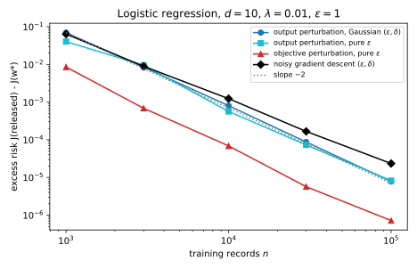

# Private empirical risk minimization

## Why this matters

Most of machine learning is **empirical risk minimization (ERM)**: choose the parameters $\theta$ that minimize the average loss on the training data, usually plus a penalty on the size of $\theta$. The trained weights are a function of every training record, and [Membership inference](../part02-attacks/02-membership-inference.md) showed that they give some of those records away. Differential privacy (DP) promises the opposite: the distribution of whatever you release changes by at most a factor $e^\varepsilon$, plus a slack $\delta$, when one record is replaced. To keep that promise for a trained model, randomness has to enter somewhere between the data and the released weights. This chapter asks where.

Two familiar examples show how directly an exact minimizer can expose a record. The median of an odd number of values minimizes the average absolute loss, and it *is* one of the values, the middle one, released exactly. A hard-margin support vector machine (SVM) maximizes the margin between the classes, and its weight vector is a weighted sum of a few training records, the support vectors that sit closest to the boundary. Add one record just inside the margin and it becomes a support vector, so the hyperplane swings toward it, by an amount that does not shrink as the dataset grows. Neither model leaks by accident: an exact minimizer is a function of the records, and nothing stops a single record from moving it.

There are three natural places, and each gives a classic algorithm. **Output perturbation** trains as usual and adds noise to the final weights. **Objective perturbation** adds a random linear term to the objective, then minimizes it exactly. **Gradient perturbation** adds noise to every gradient during training. All three were analysed for convex losses between 2008 and 2014, by Chaudhuri, Monteleoni and Sarwate, by Kifer, Smith and Thakurta, and by Bassily, Smith and Thakurta, and the third is the ancestor of the algorithm almost every private deep-learning system runs today: stochastic gradient descent (SGD) with per-example clipping and Gaussian noise, DP-SGD, the subject of the [next chapter](02-dp-sgd.md). A fourth place, the data themselves, is not on the list. Adding noise to each record before training is the local model of [Trust models](../part03-dp-foundations/09-trust-models.md), in which every record must hide itself from everyone. That model needs far more data for the same accuracy than adding the noise once, inside the computation.

### The one idea: privacy needs a bound on how far one record can move what you release

Every DP mechanism in this book works the same way. Find a quantity whose change, when one record is replaced, is bounded by a known number, its **sensitivity**. Then add noise large enough to hide a change of that size. The three methods differ only in *which* quantity they bound.

Output perturbation bounds the minimizer itself. Strong convexity, the curvature a ridge penalty $\frac\lambda2\|\theta\|^2$ adds, guarantees that replacing one of $n$ records moves the minimizer by at most $2L/(\lambda n)$, where $L$ bounds the length of each record's loss gradient ([Optimization](../part01-prerequisites/06-optimization.md)). Objective perturbation bounds the *gradient* of the objective at every point, which also moves by at most $2L/n$, and turns that into a bound on the output's density through a change of variables. Gradient perturbation bounds the gradient at the points the algorithm actually visits, one step at a time, and composes the steps.

The order matters because each step back toward the data needs fewer assumptions. Output perturbation needs an exact, unique minimizer of a strongly convex objective. Objective perturbation needs that and a loss with bounded curvature. Gradient perturbation, for its privacy, needs only that each record's gradient is bounded: no convexity, no exact solution. That is why it is the one that survives in deep learning.

@tbl-dperm-overview lists the results and where each is used.

| Result | Where it is used |
| --- | --- |
| Output perturbation: noise of scale $2L/(\lambda n)$ on the minimizer | Convex models trained to convergence; the baseline the others are measured against |
| Sensitivity of an approximate minimizer | Why output perturbation needs the exact solution, and how much an inexact one costs |
| Objective perturbation: a random linear term, minimized exactly | Private logistic regression and linear support vector machines; why curvature in the data helps |
| Noisy gradient descent: Gaussian noise on every gradient | The privacy argument of [DP-SGD](02-dp-sgd.md); every iterative private trainer |
| Noisy projected gradient descent without a ridge | The $\sqrt d/(n\varepsilon)$ rate for convex Lipschitz losses; why noise is just more gradient variance; [Public data](06-public-data.md) |
| Excess risk of all three, and the optimal rates | Choosing between them; what no method can beat ([Lower bounds](../part03-dp-foundations/10-lower-bounds.md)) |
| What survives without convexity | Why deep learning uses gradient perturbation, with clipping |

: The results of this chapter and where each is used. {#tbl-dperm-overview}

**Notation.** A training set $D = (z_1, \dots, z_n)$ holds $n$ records $z_i = (x_i, y_i)$ with features $x_i \in \mathbb R^d$ and labels $y_i \in \{-1, +1\}$. The loss of parameters $\theta$ on a record is $\ell(\theta; z)$, and the objective is the empirical risk, which in this chapter includes the ridge penalty,
$$\mathcal L(\theta; D) = \frac1n\sum_{i=1}^n\ell(\theta; z_i) + \frac\lambda2\|\theta\|^2,$$
with minimizer $\theta^*(D)$. Neighbouring datasets $D \sim D'$ differ by **replacing** one record, $z$ in $D$ by $z'$ in $D'$, so both have size $n$; the next chapter switches to adding or removing one, and says why. $L$ bounds the length of every gradient $\nabla_\theta\ell(\theta; z)$, $\|\cdot\|$ is the Euclidean norm, and a released, private version of the parameters is written $\tilde\theta$. The **excess risk** of a release is $\mathcal L(\tilde\theta; D) - \mathcal L(\theta^*; D)$, how much worse it fits the training objective than the exact minimizer.

**The running example.** Regularized logistic regression, with loss $\ell(\theta; (x, y)) = \ln(1 + e^{-y\langle \theta, x\rangle})$, in $d = 10$ dimensions with ridge $\lambda = 0.01$. The features are uniform on the unit sphere, $\|x\| = 1$, and the labels come from a logistic model whose true weights have length 5. The derivative of $\ln(1 + e^{-m})$ in the margin $m = y\langle \theta, x\rangle$ lies in $(-1, 0)$, so each gradient has length at most $\|x\| = 1$ and $L = 1$. Every method targets $\varepsilon = 1$, with $\delta = 10^{-5}$ for those that need a $\delta$, on $n$ from 1,000 to 100,000 records.

**How to read this chapter.** Read the toolkit, then @sec-dperm-output, which sets the pattern. @sec-dperm-objective has the chapter's one long derivation; its one-dimensional example shows each step on numbers. @sec-dperm-gradient is the one to know well, because the next chapter builds on it. @sec-dperm-convex drops the ridge and derives the rate for convex Lipschitz losses. @sec-dperm-compare and @sec-dperm-nonconvex say which method to use when.

## Toolkit: six facts every derivation uses

### Fact 1 — The Gaussian mechanism, calibrated exactly

To release a vector-valued function $f(D)$ whose value moves by at most $\Delta_2 f$ in Euclidean length between neighbours (its **$\ell_2$ sensitivity**), add independent normal noise $\mathcal N(0, \sigma^2)$ to each coordinate. What matters for privacy is only the ratio $\mu = \Delta_2 f/\sigma$, the shift measured in noise standard deviations: rotate so the shift lies along one axis, and the other coordinates have the same distribution under both datasets. The mechanism is then $(\varepsilon, \delta)$-DP exactly when
$$\delta \ge \Phi\Big(\frac\mu2 - \frac\varepsilon\mu\Big) - e^\varepsilon\,\Phi\Big(-\frac\mu2 - \frac\varepsilon\mu\Big),$$ {#eq-dperm-gauss-delta}
where $\Phi$ is the standard normal distribution function ([The Laplace and Gaussian mechanisms](../part03-dp-foundations/03-laplace-gaussian.md), Balle & Wang 2018). The right side increases with $\mu$, so for each $(\varepsilon, \delta)$ there is a largest admissible ratio $\mu(\varepsilon, \delta)$, and the smallest noise is $\sigma = \Delta_2 f/\mu(\varepsilon, \delta)$. For $\varepsilon = 1$ and $\delta = 10^{-5}$, $\mu = 0.2681$, so $\sigma = 3.7306\,\Delta_2 f$. The classic formula $\sigma = \Delta_2 f\sqrt{2\ln(1.25/\delta)}/\varepsilon$ gives $4.8448\,\Delta_2 f$, 30% more noise for the same guarantee; this chapter always uses the exact calibration.

### Fact 2 — The regularized minimizer moves by at most $2L/(\lambda n)$

The ridge is the same device that stops a model from overfitting, and for the same reason. Fit a polynomial of high degree to a handful of points without a penalty and it passes through every point, so it swings wildly between them, and it swings again if you delete one point. A penalty on the size of the weights makes the fit prefer smooth curves, which change little when one point goes. Generalization and privacy both ask for that stability, and the ridge supplies a guaranteed amount of it.

[Optimization](../part01-prerequisites/06-optimization.md) proves the bound, and the argument is short enough to restate. Replacing $z$ by $z'$ changes $\mathcal L$ by $h(v) = \frac1n(\ell(v; z') - \ell(v; z))$, whose gradient has length at most $2L/n$: one gradient leaves, another arrives. At the new minimizer $\theta' = \theta^*(D')$, the old objective's gradient is therefore $\nabla \mathcal L(\theta'; D) = -\nabla h(\theta')$, of length at most $2L/n$. The ridge makes $\mathcal L(\cdot; D)$ **$\lambda$-strongly convex**: its gradient grows by at least $\lambda$ per unit of distance in every direction, so a point where the gradient has length $g$ is within $g/\lambda$ of the minimizer. Hence
$$\|\theta^*(D) - \theta^*(D')\| \le \frac{2L}{\lambda n}.$$ {#eq-dperm-sens}
The same argument gives a bound for any point, not only the exact minimizer: if $\|\nabla \mathcal L(\theta; D)\| \le g$, then $\|\theta - \theta^*(D)\| \le g/\lambda$.

### Fact 3 — Noise with density proportional to $e^{-\|b\|/s}$

Pure $\varepsilon$-DP, with $\delta = 0$, needs noise whose density falls off no faster than exponentially in every direction. The standard choice in $d$ dimensions has density $\nu(b) \propto e^{-\|b\|/s}$: it depends on $b$ only through its length. If $f$ has $\ell_2$ sensitivity $\Delta_2 f$ and $s = \Delta_2 f/\varepsilon$, then $f(D) + b$ is $\varepsilon$-DP. At any output $y$, the ratio of the two output densities is $e^{(\|y - f(D')\| - \|y - f(D)\|)/s}$. By the triangle inequality the exponent is at most $\|f(D) - f(D')\|/s \le \Delta_2 f/s = \varepsilon$.

To sample it, split $b$ into a direction and a length. The density depends only on the length $r$, and the sphere of radius $r$ has surface area proportional to $r^{d - 1}$, so the length has density proportional to $r^{d-1}e^{-r/s}$. That is a **gamma distribution** with shape $d$ and scale $s$, and the direction is uniform on the sphere. Its moments are $\mathbb E\|b\| = ds$ and $\mathbb E\|b\|^2 = d(d + 1)s^2$. Compare the Gaussian, whose squared length has mean $d\sigma^2$: the pure-DP noise is longer by a factor that grows with $d$.

### Fact 4 — Change of variables for densities

If a random vector $b$ has density $\nu$ and $\theta$ is obtained from $b$ by a smooth invertible map, write the inverse as $b = \phi(\theta)$. Then $\theta$ has density
$$p(\theta) = \nu\big(\phi(\theta)\big)\,\big|\det\nabla\phi(\theta)\big|.$$ {#eq-dperm-cov}
The determinant corrects for stretching: if $\phi$ squeezes a small box around $\theta$ into a box of half the volume around $b$, the probability of that box is the same, so the density at $\theta$ is half the density at $b$. In one dimension this is the familiar $p(\theta) = \nu(\phi(\theta))|\phi'(\theta)|$.

### Fact 5 — Adaptive Gaussian steps compose into one Gaussian

Run $T$ Gaussian mechanisms in sequence, each allowed to depend on the outputs of the earlier ones, with sensitivity-to-noise ratios $\mu_1, \dots, \mu_T$. The whole sequence is exactly as private as a single Gaussian mechanism with ratio
$$\mu = \sqrt{\mu_1^2 + \dots + \mu_T^2}.$$ {#eq-dperm-gdp}
This is composition of Gaussian differential privacy (GDP) from [f-DP and Gaussian differential privacy](../part04-privacy-accounting/04-gaussian-dp.md). The reason is that the privacy loss of each step is a normal random variable with variance $\mu_t^2$ and mean $\mu_t^2/2$, given the past. Their sum is normal with variance $\sum_t\mu_t^2$ and half that as its mean, which is the privacy loss of one Gaussian with ratio $\mu$. So $T$ equal steps with ratio $\mu_{\text{step}}$ give $\mu = \sqrt T\,\mu_{\text{step}}$, and @eq-dperm-gauss-delta converts the total to $(\varepsilon, \delta)$ with no slack.

### Fact 6 — Projected SGD needs only unbiased gradients of bounded second moment

Sometimes the weights must stay inside a closed convex set fixed in advance, written $\mathcal W$, such as the ball of all weights with length at most a radius $R$. After each step, the optimizer replaces its point by the closest point of the set, which is called **projecting** onto it. For the ball, that shrinks a point that left the ball back to the sphere of radius $R$.

Projected stochastic gradient descent steps along a random vector $g_t$ instead of the true gradient of the objective $\mathcal L$. [Optimization](../part01-prerequisites/06-optimization.md) proves that only two properties of $g_t$ matter. Given the points visited so far, it must be right on average,
$$\mathbb E[g_t \mid \theta_1, \dots, \theta_t] = \nabla\mathcal L(\theta_t),$$
and its squared length must be bounded on average by a number written $G^2$,
$$\mathbb E\|g_t\|^2 \le G^2.$$
Suppose $\mathcal L$ is convex, and its minimizer $\theta^*$ over $\mathcal W$ is within distance $R$ of the starting point. Run $T$ steps with the learning rate $\eta = R/(G\sqrt T)$ (also called the step size), and average the points visited into $\bar\theta_T = \frac1T\sum_{t=1}^T\theta_t$. Then
$$\mathbb E\big[\mathcal L(\bar\theta_T)\big] - \mathcal L(\theta^*) \le \frac{RG}{\sqrt T}.$$ {#eq-dperm-sgd-convex}
The proof follows the squared distance to $\theta^*$. Each step shrinks it by an amount that convexity ties to the current error, and grows it by at most $\eta^2\|g_t\|^2$. So the randomness of $g_t$ enters only through that second term, that is through $G^2$, and neither smoothness nor strong convexity is needed.

## Output perturbation {#sec-dperm-output}

### Context

The simplest private trainer treats training as a black box: compute the exact minimizer $\theta^*(D)$, then add noise. Fact 2 says the minimizer is a function with $\ell_2$ sensitivity $2L/(\lambda n)$, so this is just the Gaussian mechanism (or Fact 3's mechanism) applied to it. Chaudhuri & Monteleoni (2008) introduced it for logistic regression. Two questions remain: how much accuracy does it cost, and what happens when, as always in practice, the minimizer is only computed approximately?

### Statement

Release
$$\tilde\theta = \theta^*(D) + Z, \qquad Z \sim \mathcal N\big(0, \sigma^2I\big), \qquad \sigma = \frac{2L}{\lambda n\,\mu(\varepsilon, \delta)}.$$ {#eq-dperm-output}
This is $(\varepsilon, \delta)$-DP for replace-one neighbours. Replacing $Z$ by noise with density $\propto e^{-\|b\|/s}$ and $s = 2L/(\lambda n\varepsilon)$ gives pure $\varepsilon$-DP. If the objective has Hessian $H$ at $\theta^*$, the excess risk is, to second order,
$$\mathbb E\big[\mathcal L(\tilde\theta) - \mathcal L(\theta^*)\big] \approx \frac12\,\mathbb E\big[Z^\top HZ\big] = \frac{\mathbb E\|Z\|^2}{2d}\operatorname{tr}H,$$ {#eq-dperm-output-risk}
for any noise whose direction is uniform, so $\frac{\sigma^2}{2}\operatorname{tr}H$ for the Gaussian. Without the second-order approximation, @sec-apx-learn-erm in the appendices brackets the excess risk exactly between $\frac\lambda2\mathbb E\|Z\|^2$ and $\frac\beta2\mathbb E\|Z\|^2$, where $\lambda$ and $\beta$ are the smallest and largest curvature of $\mathcal L$. An approximate minimizer $\theta$ with $\|\nabla \mathcal L(\theta; D)\| \le g$ has sensitivity at most
$$\frac{2L}{\lambda n} + \frac{2g}{\lambda}.$$ {#eq-dperm-approx}

### Derivation

1. **Privacy.** By Fact 2, $\theta^*$ moves by at most $\Delta_2\theta^* = 2L/(\lambda n)$ between neighbours. Adding Gaussian noise with $\sigma = \Delta_2\theta^*/\mu(\varepsilon, \delta)$ is $(\varepsilon, \delta)$-DP by Fact 1, and adding noise $\propto e^{-\|b\|/s}$ with $s = \Delta_2\theta^*/\varepsilon$ is $\varepsilon$-DP by Fact 3. Nothing else about the data reaches the output.
2. **Expand the objective around its minimizer.** The gradient vanishes at $\theta^*$, so a second-order Taylor expansion gives $\mathcal L(\theta^* + Z) - \mathcal L(\theta^*) \approx \frac12Z^\top HZ$, with $H = \nabla^2\mathcal L(\theta^*)$. The noise is small next to the scale on which the curvature changes in the cases of interest; @sec-dperm-compare checks the approximation against simulation.
3. **Average over the direction.** Write $Z = \|Z\|u$ with $u$ a unit vector. For a uniformly random direction, $\mathbb E[u_iu_j]$ is $1/d$ when $i = j$, because the $d$ squared coordinates of a unit vector add up to 1 and are exchangeable, and 0 otherwise, by symmetry under flipping one coordinate's sign. So $\mathbb E[u^\top Hu] = \sum_iH_{ii}/d = \operatorname{tr}H/d$, and if the length is independent of the direction, as for both noises here, $\mathbb E[Z^\top HZ] = \mathbb E\|Z\|^2\operatorname{tr}H/d$. For the Gaussian, $\mathbb E\|Z\|^2 = d\sigma^2$. This is @eq-dperm-output-risk.
4. **Approximate minimizers.** Let $\theta$ and $\theta'$ be the outputs of the optimizer on $D$ and $D'$, with gradients of length at most $g$. By the last line of Fact 2, each is within $g/\lambda$ of its exact minimizer. The triangle inequality along the path $\theta \to \theta^*(D) \to \theta^*(D') \to \theta'$ gives $\|\theta - \theta'\| \le g/\lambda + 2L/(\lambda n) + g/\lambda$, which is @eq-dperm-approx. The stopping rule must be a gradient check, not a step count: only the gradient bound is guaranteed on every dataset.

### Interpretation

**The noise is calibrated to the worst case, the damage to the actual case.** The sensitivity $2L/(\lambda n)$ uses only the curvature $\lambda$ that the ridge guarantees. The damage, @eq-dperm-output-risk, is measured by the actual curvature $H$, which includes the data's own. Put the two together for the Gaussian: the excess risk is about $\frac{\operatorname{tr}H}{2}\cdot\frac{4L^2}{\lambda^2n^2\mu^2}$. If every eigenvalue of $H$ is close to some $h$, this is $\frac{2dL^2}{\mu^2n^2}\cdot\frac{h}{\lambda^2}$. The factor $h/\lambda^2$ grows as the ridge shrinks, whatever the data look like. A small ridge buys a better non-private fit and costs a lot of noise.

**It falls like $1/n^2$.** The noise standard deviation falls like $1/n$, so its square, and the excess risk with it, falls like $1/n^2$. The statistical error of the non-private minimizer falls only like $1/n$, so for large $n$ privacy eventually costs less than sampling does, in this convex, low-dimensional setting.

**It needs the exact solution.** @eq-dperm-approx adds $2g/\lambda$ to the sensitivity. To keep that below the exact term, the optimizer must reach a gradient of length $g \le L/n$, which shrinks with the dataset. An optimizer stopped after a fixed number of steps has no such guarantee on every dataset, and then the sensitivity bound, and the privacy proof, do not apply. Wu et al. (2017) analyse output perturbation of SGD run for a fixed number of passes directly, with a different sensitivity bound.

{#fig-dperm-output-1d}

### Example: one dimension, then the running example

Take one feature, $n = 20$ records and $\lambda = 0.5$ (@fig-dperm-output-1d). Replacing the last record, which has $x = 1$, by the same feature with the opposite label moves the minimizer from 0.2128 to 0.1296, by 0.0832. The bound is $2/(0.5 \times 20) = 0.2$, and that is what the noise is calibrated to: $\sigma = 3.7306 \times 0.2 = 0.7461$. The two output densities overlap almost completely, as they must.

In the running example ($d = 10$, $\lambda = 0.01$), $n = 10{,}000$ gives sensitivity $2/(0.01 \times 10{,}000) = 0.02$ and $\sigma = 0.07461$ per coordinate, next to a minimizer of length 2.886. The Hessian at $\theta^*$ has eigenvalues between 0.0263 and 0.0330, and trace 0.3129. @eq-dperm-output-risk predicts $\frac12 \times 0.07461^2 \times 0.3129 = 8.711 \times 10^{-4}$, and 20 simulated releases average $9.274 \times 10^{-4}$. The pure-DP version, with noise $\propto e^{-\|b\|/s}$ and $s = 0.02$, has $\mathbb E\|b\|^2 = 110 \times 0.02^2$; the prediction $6.885 \times 10^{-4}$ and the simulated $8.321 \times 10^{-4}$ differ by more, because the squared length of gamma noise varies a lot from draw to draw and 20 draws average it only roughly.

Stopping early is costly. With a gradient tolerance of $g = 10^{-6}$ the sensitivity is 0.0202, essentially exact. With $g = 10^{-4}$ it doubles to 0.04, and with $g = 10^{-3}$ it is 0.22, eleven times the exact value. A tolerance that looks tight, $10^{-3}$, multiplies the noise by eleven and the excess risk by about 121.

### Check yourself

- You halve the ridge $\lambda$. By what factor does the Gaussian noise grow, and roughly by what factor does the excess risk grow if the data's curvature dominates $H$? *(The noise doubles, since $\sigma \propto 1/\lambda$. With $H$ unchanged the excess risk, proportional to $\sigma^2\operatorname{tr}H$, grows fourfold.)*
- Why must the stopping rule be "stop when $\|\nabla \mathcal L\| \le g$" rather than "stop after 50 Newton steps"? *(The privacy proof needs the sensitivity bound on every pair of neighbouring datasets. A gradient check guarantees it everywhere; a step count only guarantees it on datasets where 50 steps happen to be enough.)*

## Objective perturbation {#sec-dperm-objective}

### Context

Output perturbation wastes the data's curvature: it pays for the worst case $\lambda$ and is judged on the actual $H$. Chaudhuri, Monteleoni & Sarwate (2011) put the noise inside the optimization instead. Add a random linear term $\frac1n\langle b, \theta\rangle$ to the objective and minimize exactly. A linear term is a constant force; the objective's curvature, all of it, resists that force. Where the data add curvature, the minimizer moves less. The price is a subtler privacy proof, because the output is no longer "something fixed plus noise".

### Statement

Let the loss have the form $\ell(\theta; (x, y)) = g(y\langle \theta, x\rangle)$ with $g$ convex and twice differentiable, $|g'| \le 1$ and $0 \le g'' \le c$, and let $\|x\| \le 1$; so the gradients have length at most $L = 1$. Logistic regression qualifies with $c = \frac14$. Set
$$\varepsilon' = \varepsilon - 2\ln\Big(1 + \frac{c}{n\lambda}\Big),$$ {#eq-dperm-eps-prime}
draw $b$ with density $\nu(b) \propto e^{-\varepsilon'\|b\|/2}$ (Fact 3 with $s = 2/\varepsilon'$), and release
$$\tilde\theta = \arg\min_\theta\Big[\mathcal L(\theta; D) + \frac1n\langle b, \theta\rangle\Big].$$ {#eq-dperm-objective}
If $\varepsilon' > 0$, this is $\varepsilon$-DP for replace-one neighbours (Chaudhuri, Monteleoni & Sarwate 2011, Algorithm 2). If not, increase the ridge to $\lambda + \lambda_+$ with $\lambda_+ = \frac{c}{n(e^{\varepsilon/4} - 1)} - \lambda$, which makes the logarithm $\varepsilon/4$ and lets $\varepsilon' = \varepsilon/2$.

The minimizer moves, to first order, by $-H^{-1}b/n$, so the excess risk is about
$$\mathbb E\big[\mathcal L(\tilde\theta) - \mathcal L(\theta^*)\big] \approx \frac{1}{2n^2}\mathbb E\big[b^\top H^{-1}b\big] = \frac{\mathbb E\|b\|^2}{2dn^2}\operatorname{tr}H^{-1}.$$ {#eq-dperm-objective-risk}
Without the approximation, @sec-apx-learn-erm in the appendices brackets it between $\lambda\mathbb E\|b\|^2/(2\beta^2n^2)$ and $\mathbb E\|b\|^2/(2\lambda n^2)$.


### Derivation

The plan is to write the density of $\tilde\theta$ explicitly with Fact 4, then bound the ratio of the two densities, for $D$ and $D'$, at every point. The ratio splits into a noise factor and a stretching factor, and each consumes part of $\varepsilon$.

1. **From the output back to the noise.** The perturbed objective is $\lambda$-strongly convex, so it has exactly one minimizer, where its gradient is zero: $\nabla \mathcal L(\tilde\theta; D) + b/n = 0$. Solving for $b$,
$$b = \phi_D(\tilde\theta) = -n\nabla \mathcal L(\tilde\theta; D) = -\sum_{i=1}^n\nabla\ell(\tilde\theta; z_i) - n\lambda\tilde\theta.$$
Every $\theta$ is the output for exactly one $b$, namely $\phi_D(\theta)$, so the map from noise to output is invertible and $\phi_D$ is its inverse.
2. **The density of the output.** By Fact 4, $p_D(\theta) = \nu(\phi_D(\theta))\,|\det\nabla\phi_D(\theta)|$, and the same for $D'$ with $\phi_{D'}$. The ratio at any $\theta$ is
$$\frac{p_D(\theta)}{p_{D'}(\theta)} = \underbrace{\frac{\nu(\phi_D(\theta))}{\nu(\phi_{D'}(\theta))}}_{\text{noise}}\cdot\underbrace{\frac{|\det\nabla\phi_D(\theta)|}{|\det\nabla\phi_{D'}(\theta)|}}_{\text{Jacobian}}.$$
3. **The noise factor is at most $e^{\varepsilon'}$.** The sums in $\phi_D$ and $\phi_{D'}$ share every term except the replaced record's, so $\phi_{D'}(\theta) - \phi_D(\theta) = \nabla\ell(\theta; z) - \nabla\ell(\theta; z')$, of length at most $2$. The noise factor is $e^{\varepsilon'(\|\phi_{D'}(\theta)\| - \|\phi_D(\theta)\|)/2}$, and by the triangle inequality the exponent is at most $\varepsilon'\cdot 2/2 = \varepsilon'$.
4. **The Jacobian is the Hessian.** $\nabla\phi_D(\theta) = -n\nabla^2\mathcal L(\theta; D) = -A$, with $A = \sum_ig''(m_i)x_ix_i^\top + n\lambda I$, where $m_i = y_i\langle \theta, x_i\rangle$ is the margin; the chain rule gives each loss's Hessian as $g''(m_i)$ times $y_i^2x_ix_i^\top = x_ix_i^\top$. Every term is positive semi-definite and $n\lambda I$ is added, so all eigenvalues of $A$ are at least $n\lambda$. For $D'$ the matrix is $A' = A + E$ with $E = g''(m')x'x'^\top - g''(m)xx^\top$: one rank-one term in, one out.
5. **The Jacobian factor is at most $(1 + c/(n\lambda))^2$.** The ratio of determinants is $\det(A')/\det(A) = \det(I + A^{-1}E) = \det(I + K)$ with $K = A^{-1/2}EA^{-1/2}$, since $A^{-1}E$ and $K$ are similar matrices. $K$ is symmetric and is the difference of two rank-one positive semi-definite matrices, $g''(m')\tilde x'\tilde x'^\top - g''(m)\tilde x\tilde x^\top$ with $\tilde x = A^{-1/2}x$. A rank-one matrix $vv^\top$ has one nonzero eigenvalue, $\|v\|^2$, and here $\|\tilde x\|^2 = x^\top A^{-1}x \le \|x\|^2/(n\lambda) \le 1/(n\lambda)$. So $K$ has at most two nonzero eigenvalues, which we call $\kappa_1$ and $\kappa_2$, each between $-a$ and $a$ with $a = c/(n\lambda)$, and $\det(I + K) = (1 + \kappa_1)(1 + \kappa_2) \le (1 + a)^2$. Exchanging the roles of $D$ and $D'$ gives the same bound for the inverse ratio, because $A'$ also has all eigenvalues at least $n\lambda$.
6. **Add the two budgets.** The log of the density ratio is at most $\varepsilon' + 2\ln(1 + c/(n\lambda)) = \varepsilon$ by @eq-dperm-eps-prime, at every $\theta$ and in both directions. A bound on the density ratio everywhere is pure $\varepsilon$-DP.
7. **When $\varepsilon' \le 0$.** The Jacobian factor alone would exceed $\varepsilon$. A larger ridge shrinks $a$: with $\lambda + \lambda_+$ in place of $\lambda$, $c/(n(\lambda + \lambda_+)) = e^{\varepsilon/4} - 1$, so $2\ln(1 + a) = \varepsilon/2$, and the noise gets the other half.
8. **Excess risk.** To first order in $b$, the perturbed minimizer solves $H(\tilde\theta - \theta^*) + b/n = 0$, so $\tilde\theta - \theta^* = -H^{-1}b/n$. Substituting this into the second-order expansion $\mathcal L(\tilde\theta) - \mathcal L(\theta^*) \approx \frac12(\tilde\theta - \theta^*)^\top H(\tilde\theta - \theta^*)$ of step 2 of @sec-dperm-output gives $\frac{1}{2n^2}b^\top H^{-1}HH^{-1}b = \frac{1}{2n^2}b^\top H^{-1}b$. Averaging over the uniform direction, as in step 3 there, replaces $b^\top H^{-1}b$ by $\mathbb E\|b\|^2\operatorname{tr}H^{-1}/d$, which is @eq-dperm-objective-risk.

**Walk-through in one dimension.** With $d = 1$ everything in steps 1–5 is a number, and the script computes both densities exactly on a grid of outputs. Take $n = 5$ records with features in $[-1, 1]$, $\lambda = 0.1$ and $\varepsilon = 1$. Then $c/(n\lambda) = 0.25/0.5 = 0.5$, the Jacobian budget is $2\ln 1.5 = 0.8109$, and the noise gets $\varepsilon' = 0.1891$. @fig-dperm-objective-density shows one dataset: the two densities, and their log ratio, which stays inside $\pm\varepsilon$. Over 500 random datasets and replacements, the largest log ratio anywhere on the grid is 0.3779. Its noise part never exceeds 0.0992, about half its budget of 0.1891, and its Jacobian part never exceeds 0.3395, well under its budget of 0.8109, and under even $\ln 1.5 = 0.4055$, half of it.

{#fig-dperm-objective-density}

### Interpretation

**Where the slack is.** Both factors in step 2 are bounded by worst cases that cannot happen together, and mostly cannot happen at all for logistic regression. The noise factor reaches $e^{\varepsilon'}$ only if the old and new record have full-length gradients pointing in opposite directions. A logistic gradient has full length only when its margin is very negative, and two records whose gradients point in opposite directions have opposite margins, so at most one of them can be saturated: the difference has length at most about 1, not 2, which is why the noise part stops at half its budget. The Jacobian bound charges both the record that leaves and the one that arrives the full curvature $c$, while their eigenvalues $\kappa_1 \ge 0 \ge \kappa_2$ have opposite signs, so the product $(1 + \kappa_1)(1 + \kappa_2)$ is at most $1 + a$: the Jacobian needs only half its budget ([Exercise 6](../../book-exercises/part05-dp-ml/01-dp-erm.md#sec-sol-dperm-6)). The analysis is safe, not tight.

**Curvature helps.** Compare @eq-dperm-objective-risk with @eq-dperm-output-risk. In output perturbation the noise has length about $1/(\lambda n)$ and the damage is weighted by $H$; in objective perturbation the noise has length about 1, is divided by $n$, and the damage is weighted by $H^{-1}$. If every eigenvalue of $H$ is close to $h$, the ratio of the two excess risks is about $(h/\lambda)^2$ (with $\varepsilon' \approx \varepsilon$). When the ridge supplies all the curvature, $h = \lambda$ and the two are equivalent. When the data supply more, objective perturbation wins quadratically.

**What it needs.** It needs exact minimization, which no computer delivers. An iterative solver stops early, and floating-point arithmetic rounds every number. Rounding can itself leak, as Mironov (2012) showed for a textbook implementation of Laplace noise ([Discrete mechanisms](../part03-dp-foundations/08-discrete-mechanisms.md)). Beyond that, it needs twice-differentiable losses (the hinge loss of a support vector machine must be smoothed first), a bound $c$ on the curvature, and a loss that depends on $\theta$ through one inner product, which makes each record's Hessian rank one. Kifer, Smith & Thakurta (2012) extend it to Gaussian noise with $(\varepsilon, \delta)$-DP and to constrained problems, and Iyengar et al. (2019) give a version that tolerates approximate minimization by adding a little output noise on top.

### Example: the running example at $n = 10{,}000$

At $n = 10{,}000$ the Jacobian budget is $2\ln(1 + 0.25/100) = 0.0050$, so $\varepsilon' = 0.9950$: almost all of $\varepsilon$ goes to the noise. (At $n = 100$ the split would be $\varepsilon' = 0.5537$, and the Jacobian would take almost half.) The noise has $\mathbb E\|b\|^2 = d(d+1)(2/\varepsilon')^2$, and $\operatorname{tr}H^{-1} = 320.7$, so @eq-dperm-objective-risk predicts an excess risk of $7.127 \times 10^{-5}$; 20 simulated releases average $8.156 \times 10^{-5}$. The pure-DP output perturbation of @sec-dperm-output, with the same $\varepsilon$, had $8.321 \times 10^{-4}$: objective perturbation is ten times better. The rule of thumb $(h/\lambda)^2$ predicts this: the objective's curvature, ridge included, lies between 0.0263 and 0.0330, about three times the ridge's 0.01, and $3^2 = 9$.

### Check yourself

- Why does the proof need the minimizer to be unique? *(Step 1 inverts the map from noise to output. If two weights both minimized the perturbed objective, the output would not be a function of $b$, and Fact 4 would not apply.)*
- If you double $n$, what happens to the share of $\varepsilon$ that the Jacobian consumes? *(It roughly halves: $2\ln(1 + c/(n\lambda)) \approx 2c/(n\lambda)$ for large $n$.)*

## Gradient perturbation: noisy gradient descent {#sec-dperm-gradient}

### Context

The first two methods release one point and need the exact minimizer. Real training is iterative and stops early. Gradient perturbation, proposed by Williams & McSherry (2010) and analysed by Song, Chaudhuri & Sarwate (2013) and Bassily, Smith & Thakurta (2014), makes each step of the optimizer private and composes the steps. Here is its simplest form, full-batch gradient descent with Gaussian noise. Its privacy argument uses nothing about convexity; convexity enters only when you ask how accurate it is.

### Statement

Start from $\theta_0 = 0$ and run $T$ steps of
$$\theta_{t+1} = \theta_t - \eta\big(\nabla \mathcal L(\theta_t; D) + \xi_t\big), \qquad \xi_t \sim \mathcal N(0, \sigma^2I)\ \text{independent}, \qquad \sigma = \frac{2L}{n}\cdot\frac{\sqrt T}{\mu(\varepsilon, \delta)}.$$ {#eq-dperm-noisy-gd}
Releasing all the iterates $\theta_1, \dots, \theta_T$ is $(\varepsilon, \delta)$-DP for replace-one neighbours, for any loss whose per-record gradients have length at most $L$, convex or not.

For a $\lambda$-strongly convex, $\beta$-smooth objective (curvature between $\lambda$ and $\beta$ everywhere) and learning rate $\eta = 1/\beta$, the excess risk of the last iterate is approximately
$$\mathbb E\big[\mathcal L(\theta_T) - \mathcal L(\theta^*)\big] \approx \Big(1 - \frac\lambda\beta\Big)^T\big(\mathcal L(\theta_0) - \mathcal L(\theta^*)\big) + \frac{d\sigma^2}{4\beta},$$ {#eq-dperm-gd-risk}
an optimization error that shrinks with $T$ plus a noise floor that grows with $T$, because $\sigma^2 \propto T$.

### Derivation

1. **One step is a Gaussian mechanism.** Given $\theta_t$, the step releases $\nabla \mathcal L(\theta_t; D) + \xi_t$. The ridge term $\lambda \theta_t$ is the same on both datasets, and the averages differ only in the replaced record, so the gradient moves by $\frac1n\|\nabla\ell(\theta_t; z) - \nabla\ell(\theta_t; z')\| \le 2L/n$. Its ratio is $\mu_{\text{step}} = 2L/(n\sigma)$. The point $\theta_t$ was itself computed from earlier noisy gradients, but it is public at that moment, which is what adaptive composition allows.
2. **Compose.** By Fact 5, $T$ such steps are exactly as private as one Gaussian with $\mu = \sqrt T\cdot 2L/(n\sigma)$. Setting this to $\mu(\varepsilon, \delta)$ gives the $\sigma$ of @eq-dperm-noisy-gd. The iterates are computed from the noisy gradients and $\theta_0$ alone, so releasing them is post-processing.
3. **Where convexity was not used.** Steps 1 and 2 bounded the gradient's change by $2L/n$ at the point $\theta_t$, whatever $\theta_t$ is. Nothing required a minimizer, convexity or smoothness.
4. **Optimization error.** Without noise, gradient descent with learning rate $\eta = 1/\beta$ on a $\lambda$-strongly convex, $\beta$-smooth function shrinks $\mathcal L(\theta_t) - \mathcal L(\theta^*)$ by at least a factor $1 - \lambda/\beta$ per step ([Optimization](../part01-prerequisites/06-optimization.md)), which gives the first term.
5. **The noise floor.** Near the minimizer, the gradient is about $H(\theta_t - \theta^*)$, so the error $e_t = \theta_t - \theta^*$ evolves as $e_{t+1} \approx (I - \eta H)e_t - \eta\xi_t$. Along an eigenvector of $H$ with curvature $h$, the error's variance $v$ settles where one step leaves it unchanged: $v = (1 - \eta h)^2v + \eta^2\sigma^2$, so $v = \eta^2\sigma^2/(1 - (1 - \eta h)^2) = \eta\sigma^2/(h(2 - \eta h))$. Its cost is $\frac12hv = \eta\sigma^2/(2(2 - \eta h))$, about $\eta\sigma^2/4$ when $\eta h$ is small. Summing over the $d$ directions with $\eta = 1/\beta$ gives $d\sigma^2/(4\beta)$, and the curvature $h$ has cancelled: directions with little curvature wander farther but cost less per unit of wandering.

### Interpretation

**The step count is a privacy parameter.** Every step spends budget, so the noise per step grows like $\sqrt T$ and the noise floor like $T$. Too few steps leave optimization error, too many drown the solution in noise. @fig-dperm-noisy-gd-steps shows the trade-off on the running example. And you cannot pick the best $T$ by trying several and keeping the one with the best validation score without paying for it: that selection is itself a computation on the data, the subject of [Hyperparameter tuning](03-hyperparameter-tuning.md).

**A public rule for $T$.** @eq-dperm-gd-risk can be evaluated without looking at the data, using only public quantities: $\lambda$, the curvature bound $\beta = \frac14 + \lambda$ for logistic loss with unit features, $\mathcal L(\theta_0) = \ln 2$ for $\theta_0 = 0$ (each loss is $\ln 2$ at $\theta = 0$, and $\mathcal L(\theta^*) \ge 0$), $d$, $n$ and the budget. The rule picks the $T$ that minimizes it. It is pessimistic, because it only knows that the curvature is at least $\lambda$.

**Why it is the one that generalizes.** Gradient perturbation needs a gradient bound, not a minimizer. For a neural network no such bound holds, because gradients can be arbitrarily long, but you can force one by **clipping**: rescale each record's gradient to length at most $C$ before averaging, exactly as [Beyond global sensitivity](../part03-dp-foundations/07-sensitivity.md#sec-sens-clip) clips a value before averaging it. That, with minibatches instead of full batches, is DP-SGD.

{#fig-dperm-noisy-gd-steps}

### Example: choosing $T$ for the running example

For $n = 10{,}000$, the public rule picks $T = 218$, which gives per-step noise $\sigma = 0.01102$ on the mean gradient and an estimated excess risk of $1.301 \times 10^{-3}$. Simulated runs average $1.384 \times 10^{-3}$, close to the estimate.

@fig-dperm-noisy-gd-steps shows that the rule overshoots. With the actual curvature of the data, between 0.0263 and 0.0330 rather than the 0.01 the rule assumes, noiseless gradient descent is already within $2.679 \times 10^{-11}$ of the minimum after 100 steps. Measured over 10 datasets, the excess risk is $1.027 \times 10^{-3}$ at $T = 20$, $2.875 \times 10^{-4}$ at $T = 50$, $7.137 \times 10^{-4}$ at $T = 100$ and $6.018 \times 10^{-3}$ at $T = 1{,}000$. The best $T$ is near 50, four times smaller than the rule's, and gives five times less excess risk. You may only use that knowledge if you obtained it privately, or from public data that resembles yours.

| $n$ | Steps $T$ (public rule) | Per-step $\sigma$ on the mean gradient | Estimated excess risk |
| --- | --- | --- | --- |
| 1,000 | 100 | 0.07461 | $6.725 \times 10^{-2}$ |
| 3,000 | 156 | 0.03106 | $1.080 \times 10^{-2}$ |
| 10,000 | 218 | 0.01102 | $1.301 \times 10^{-3}$ |
| 30,000 | 274 | 0.004117 | $1.779 \times 10^{-4}$ |
| 100,000 | 335 | 0.001366 | $1.930 \times 10^{-5}$ |

: Noisy gradient descent on the running example: the step count chosen by minimizing @eq-dperm-gd-risk with public quantities only, the resulting noise, and the estimated excess risk. {#tbl-dperm-gd}

The step count grows slowly with $n$, like $\ln n$, because the optimization error shrinks geometrically while the target, the noise floor, shrinks like $1/n^2$ (@tbl-dperm-gd).

### Check yourself

- Noisy gradient descent with $T = 100$ steps is $(1, 10^{-5})$-DP. You run it for $T = 400$ steps with the same per-step noise. What is $\mu$ now? *(Twice as large: $\mu = \sqrt T\,\mu_{\text{step}}$, and $\sqrt{400/100} = 2$. So $\mu = 2 \times 0.2681 = 0.5362$, a weaker guarantee.)*
- In step 1 of the derivation, why is it allowed that the point $\theta_t$ at which the gradient is evaluated depends on the data? *(Because $\theta_t$ is computed from earlier released outputs only. Adaptive composition covers mechanisms chosen based on earlier outputs, so the bound holds conditionally on the past, at whatever $\theta_t$ it produced.)*

## Noisy projected gradient descent without a ridge {#sec-dperm-convex}

### Context

Every method so far leaned on the ridge. Output and objective perturbation need it for their privacy, and the noise floor of @eq-dperm-gd-risk needs it for its accuracy. Many models have no ridge, though, or one so small that a bound in $1/\lambda$ says nothing. A linear classifier trained with the hinge or logistic loss inside a fixed ball of weights is convex and has bounded gradients, but it is not strongly convex. How accurate can a private trainer be on such a model, and where does the dimension enter? Bassily, Smith & Thakurta (2014) answer with noisy gradient descent and the convergence guarantee of projected SGD, and get a rate of order $RL\sqrt d/(n\varepsilon)$ for gradients of length at most $L$ in a ball of radius $R$. The derivation also shows that privacy noise acts on the optimizer exactly like any other gradient noise.

### Statement

Keep the weights in the ball $\mathcal W = \{\|\theta\| \le R\}$, fixed in advance. Let the loss be convex in $\theta$ with per-record gradients of length at most $L$, and minimize the plain average $\mathcal L(\theta; D) = \frac1n\sum_i\ell(\theta; z_i)$, with no ridge. Start from $\theta_1 = 0$ and run $T$ steps of
$$\theta_{t+1} = \Pi_{\mathcal W}\Big(\theta_t - \eta\big(\nabla \mathcal L(\theta_t; D) + \xi_t\big)\Big), \qquad \xi_t \sim \mathcal N(0, \sigma^2I), \qquad \sigma = \frac{2L}{n}\cdot\frac{\sqrt T}{\mu(\varepsilon, \delta)},$$ {#eq-dperm-projected-gd}
where $\Pi_{\mathcal W}$ is the projection onto the ball and $\mu(\varepsilon, \delta)$ is, as in Fact 1, the largest ratio of sensitivity to noise at which one Gaussian release is $(\varepsilon, \delta)$-DP. Use the learning rate $\eta = R/(G\sqrt T)$ with $G^2 = L^2 + d\sigma^2$, and release the average of the iterates, $\bar\theta = \frac1T\sum_{t=1}^T\theta_t$. The release is $(\varepsilon, \delta)$-DP for replace-one neighbours, and its excess risk over the best weights in the ball is at most
$$\mathbb E\big[\mathcal L(\bar\theta; D)\big] - \min_{\theta\in\mathcal W}\mathcal L(\theta; D) \le RL\sqrt{\frac1T + \frac{4d}{n^2\mu(\varepsilon, \delta)^2}}.$$ {#eq-dperm-convex-bound}
Once $T \ge n^2\mu^2/(4d)$, this is at most $2\sqrt2\,RL\sqrt d/(n\mu)$. For $\varepsilon < 1$ the exact ratio is at least the classic one, $\mu \ge \varepsilon/\sqrt{2\ln(1.25/\delta)}$, so
$$\mathbb E\big[\mathcal L(\bar\theta; D)\big] - \min_{\theta\in\mathcal W}\mathcal L(\theta; D) \le \frac{4RL\sqrt{d\ln(1.25/\delta)}}{n\varepsilon}.$$ {#eq-dperm-convex-rate}

### Derivation

1. **Privacy.** Each step releases the noisy gradient $\nabla \mathcal L(\theta_t; D) + \xi_t$, whose noiseless part moves by at most $2L/n$ when one record is replaced, as in step 1 of @sec-dperm-gradient. Fact 5 composes the $T$ steps into one Gaussian with ratio $\sqrt T\cdot 2L/(n\sigma) = \mu(\varepsilon, \delta)$. The projection uses only the public ball, and the average uses only the iterates, so both are post-processing.
2. **The noisy gradient is unbiased.** Write $g_t = \nabla \mathcal L(\theta_t; D) + \xi_t$. Given the past, $\xi_t$ is fresh noise with mean zero, so $\mathbb E[g_t] = \nabla \mathcal L(\theta_t; D)$, the first condition of Fact 6.
3. **Its second moment is $L^2 + d\sigma^2$.** Expand the square: $\mathbb E\|g_t\|^2 = \|\nabla \mathcal L\|^2 + 2\,\mathbb E\langle\nabla \mathcal L, \xi_t\rangle + \mathbb E\|\xi_t\|^2$. The gradient of $\mathcal L$ is an average of vectors of length at most $L$, so its length is at most $L$. The cross term is zero, because $\xi_t$ has mean zero and is independent of $\theta_t$. The last term is $d\sigma^2$, one $\sigma^2$ per coordinate. So $G^2 = L^2 + d\sigma^2$ satisfies the second condition of Fact 6.
4. **Apply Fact 6.** The minimizer over the ball and the start $\theta_1 = 0$ both lie in the ball, so they are at most $R$ apart. With the learning rate $\eta = R/(G\sqrt T)$, @eq-dperm-sgd-convex bounds the excess risk of $\bar\theta$ by $RG/\sqrt T = R\sqrt{(L^2 + d\sigma^2)/T}$.
5. **The step count cancels from the noise term.** By @eq-dperm-projected-gd, $\sigma^2 = 4L^2T/(n^2\mu^2)$, so $d\sigma^2/T = 4L^2d/(n^2\mu^2)$, whatever $T$ is. Factoring out $L^2$ gives @eq-dperm-convex-bound.
6. **Choose $T$.** The first term under the root falls with $T$ and the second does not. When $T \ge n^2\mu^2/(4d)$, the first is at most the second, and the root is at most $\sqrt{8d/(n^2\mu^2)} = 2\sqrt2\,\sqrt d/(n\mu)$.
7. **In terms of $\varepsilon$.** The classic calibration of Fact 1 adds noise $\Delta_2 f\sqrt{2\ln(1.25/\delta)}/\varepsilon$, and it is $(\varepsilon, \delta)$-DP for $\varepsilon < 1$. The exact calibration uses the least noise that is $(\varepsilon, \delta)$-DP, so it adds no more noise than the classic one, and its ratio $\mu$ is at least the classic ratio,
$$\frac1\mu \le \frac{\sqrt{2\ln(1.25/\delta)}}{\varepsilon}.$$
   Substituting this into step 6 gives $2\sqrt2 \cdot \sqrt2 = 4$ in front, which is @eq-dperm-convex-rate.

### Interpretation

**Privacy noise is just more gradient variance.** The convergence guarantee of Fact 6 does not care where the randomness of $g_t$ comes from, only how large its second moment is. Sampling one record instead of averaging all of them raises $G^2$, and so does Gaussian noise for privacy, by $d\sigma^2$. That is where the dimension enters the cost of privacy: one $\sigma^2$ for every coordinate the optimizer moves. [Public data and private fine-tuning](06-public-data.md) builds on this, by training fewer coordinates.

**More steps never hurt here.** In @sec-dperm-gradient the noise floor grew with $T$, because the learning rate $\eta = 1/\beta$ was fixed while the noise per step grew like $\sqrt T$. Here the learning rate shrinks like $1/\sqrt T$ and the iterates are averaged, and step 5 shows the two effects cancel exactly. The noise term is fixed by $n$, $d$ and the budget, and extra steps only remove optimization error. So the step count needs no tuning. It only has to reach the public threshold $n^2\mu^2/(4d)$.

**The rate cannot be beaten.** For convex losses with $L$-bounded gradients over a ball of radius $R$, Bassily, Smith & Thakurta (2014) prove that, as long as $\sqrt d \le n\varepsilon$, every $(\varepsilon, \delta)$-DP algorithm has excess risk of order $RL\sqrt d/(n\varepsilon)$ on some dataset, by the fingerprinting argument of [Lower bounds](../part03-dp-foundations/10-lower-bounds.md). @sec-apx-learn-erm in the appendices derives this lower bound step by step, with explicit but loose constants. @eq-dperm-convex-rate matches it up to the factor $\sqrt{\ln(1/\delta)}$ and constants. Compare the strongly convex rate @eq-dperm-rate-strong of @sec-dperm-compare, which is of order $d/(\lambda n^2\varepsilon^2)$: a guaranteed curvature $\lambda$ turns $\sqrt d/(n\varepsilon)$ into its square, divided by $\lambda$.

**The cost is computation.** Full-batch steps touch all $n$ records, so $T \approx n^2\mu^2/(4d)$ steps cost about $n^3\mu^2/(4d)$ gradient evaluations. Bassily, Smith & Thakurta use one random record per step instead, about $n^2$ steps. Sampling makes each step cheaper, and by [Amplification by subsampling](../part04-privacy-accounting/05-subsampling.md) also more private, so the noise per step can be smaller. The rate is the same up to logarithms. Random batches, clipping and an accountant for many such steps are the ingredients of DP-SGD in the [next chapter](02-dp-sgd.md).

**It is a worst case.** The bound uses only convexity and the gradient bound, and the worst case is a loss that is nearly linear around its minimizer. The logistic loss is curved there, so the measured excess risk falls faster than $1/n$, as the example shows.

{#fig-dperm-convex}

### Example: logistic regression in a ball

Take the running example's data, with $d = 10$ features and gradients of length at most $L = 1$, drop the ridge, and keep the weights in the ball of radius $R = 5$. The budget is $\varepsilon = 1$ and $\delta = 10^{-5}$, for which the exact ratio is $\mu = 0.2681$. The classic ratio $\varepsilon/\sqrt{2\ln(1.25/\delta)}$ is smaller, 0.2064, as step 7 requires. With a thousand records the rule $T = \lceil n^2\mu^2/(4d)\rceil$ gives 1,797 steps, and the noise on the mean gradient is $\sigma = 0.3163$. The noise adds $d\sigma^2 = 10 \times 0.3163^2$ to the second moment, so $G^2 = 2.0004$, about twice the noiseless $L^2 = 1$. The learning rate is then 0.0834, and @eq-dperm-convex-bound evaluates to 0.1668.

The bound falls with the number of steps but levels off at its limit, $2RL\sqrt d/(n\mu) = 0.1180$. It is 0.5137 after 100 steps and 0.1973 after 1,000. After 10,000 steps it is 0.1281, and after 100,000 it is 0.1190, within 1% of the limit.

@tbl-dperm-convex runs the algorithm for three dataset sizes, five datasets each.

| $n$ | Steps $T$ | $\sigma$ | Measured excess risk | Bound @eq-dperm-convex-bound | Bound / measured |
| --- | --- | --- | --- | --- | --- |
| 300 | 162 | 0.3166 | $1.119 \times 10^{-1}$ | $5.558 \times 10^{-1}$ | 5.0 |
| 1,000 | 1,797 | 0.3163 | $3.028 \times 10^{-2}$ | $1.668 \times 10^{-1}$ | 5.5 |
| 3,000 | 16,167 | 0.3162 | $7.297 \times 10^{-3}$ | $5.561 \times 10^{-2}$ | 7.6 |

: Noisy projected gradient descent without a ridge on the running example's data, ball of radius 5, $(1, 10^{-5})$-DP: mean excess risk over 5 datasets against the bound. {#tbl-dperm-convex}

The bound holds at every $n$ and is loose by a factor of 5 to 8. Its log-log slope in $n$ is $-1.00$, while the measured slope is $-1.18$, steeper because the logistic loss has curvature near its minimizer that the bound does not use (@fig-dperm-convex). The rule's $\sigma$ is the same at every $n$, because $T \propto n^2$ and $\sigma \propto \sqrt T/n$.

The dimension enters as $\sqrt d$. At $n = 10{,}000$ the limit $2RL\sqrt d/(n\mu)$ is 0.0118 for $d = 10$, 0.0236 for $d = 40$ and 0.0472 for $d = 160$: each fourfold increase in $d$ doubles it. The step rule needs 179,629, 44,908 and 11,227 steps for these three dimensions, which is why the batch-size-one version matters in practice.

### Check yourself

- Noisy gradient descent with a ridge has a noise floor that grows with the number of steps, but here extra steps never raise the bound. What is different? *(Here the learning rate shrinks like $1/\sqrt T$ and the iterates are averaged, so the noise contributes $d\sigma^2/T$, which does not depend on $T$. With a fixed learning rate $\eta = 1/\beta$ and the last iterate, the floor is $d\sigma^2/(4\beta)$, which grows with $\sigma^2 \propto T$.)*
- You double the dimension and keep everything else. By what factor does the limit of the bound grow, and what happens to the number of steps the rule asks for? *(The limit grows by $\sqrt2$, since it is proportional to $\sqrt d$. The rule's $T = n^2\mu^2/(4d)$ halves.)*

## How the three compare {#sec-dperm-compare}

### Context

Each method is private by its own argument. Which should you use? Theory answers by rates, how the excess risk falls with $n$, $d$ and $\varepsilon$, and by lower bounds that no method can beat. Simulation answers for the running example. They agree on the rate and disagree on the constant, and the constant is what you choose by.

### Statement

For $\lambda$-strongly convex objectives with $L$-Lipschitz losses, Bassily, Smith & Thakurta (2014) show that the best achievable expected excess risk under $(\varepsilon, \delta)$-DP is of order
$$\frac{L^2\,d}{\lambda\,n^2\varepsilon^2},$$ {#eq-dperm-rate-strong}
up to logarithmic factors in $n$ and $1/\delta$. Their upper bound, attained by noisy stochastic gradient descent, carries such factors. Their lower bound, which holds for every $(\varepsilon, \delta)$-DP algorithm, does not, so the two match only up to those logarithms. @sec-apx-learn-erm in the appendices proves both sides with explicit constants; with full gradients and a weighted average of the iterates, the upper bound needs no logarithm of $n$. For convex objectives over a ball of radius $R$, without strong convexity, the rate is of order $LR\sqrt d/(n\varepsilon)$ up to logarithms, and @sec-dperm-convex derives the upper bound. The lower bounds come from the fingerprinting codes of [Lower bounds](../part03-dp-foundations/10-lower-bounds.md): a private algorithm whose output is too accurate would let an adversary trace which records were used.

On the running example, @tbl-dperm-compare gives the measured excess risk of the four private releases.

| $n$ | Output, Gaussian | Output, pure | Objective, pure | Noisy gradient descent (public $T$) |
| --- | --- | --- | --- | --- |
| 1,000 | $8.170 \times 10^{-2}$ | $7.060 \times 10^{-2}$ | $1.009 \times 10^{-2}$ | $6.558 \times 10^{-2}$ |
| 3,000 | $1.211 \times 10^{-2}$ | $7.206 \times 10^{-3}$ | $6.303 \times 10^{-4}$ | $8.888 \times 10^{-3}$ |
| 10,000 | $9.274 \times 10^{-4}$ | $8.321 \times 10^{-4}$ | $8.156 \times 10^{-5}$ | $1.384 \times 10^{-3}$ |
| 30,000 | $9.973 \times 10^{-5}$ | $8.943 \times 10^{-5}$ | $7.135 \times 10^{-6}$ | $1.538 \times 10^{-4}$ |
| 100,000 | $8.543 \times 10^{-6}$ | $6.379 \times 10^{-6}$ | $8.798 \times 10^{-7}$ | $1.621 \times 10^{-5}$ |
| Slope in $\ln n$ | $-2.01$ | $-2.00$ | $-2.01$ | $-1.79$ |

: Mean excess risk $\mathcal L(\tilde\theta) - \mathcal L(\theta^*)$ over 20 datasets of the running example ($d = 10$, $\lambda = 0.01$, $\varepsilon = 1$, $\delta = 10^{-5}$ for the Gaussian methods), and the slope of a straight-line fit of $\ln$ excess risk against $\ln n$. {#tbl-dperm-compare}

### Derivation

The upper bounds for output and objective perturbation are @eq-dperm-output-risk and @eq-dperm-objective-risk with the noise of each method substituted. Both have $\mathbb E\|\text{noise}\|^2 \propto 1/n^2$ (the output noise has scale $1/(\lambda n)$; the objective noise has scale 1 and is divided by $n$), which gives the $1/n^2$. For noisy gradient descent, the noise floor $d\sigma^2/(4\beta)$ has $\sigma^2 \propto T/n^2$, and the optimization error must be pushed below it, which takes $T \propto \frac\beta\lambda\ln n$ steps; this gives $1/n^2$ times a logarithm. Bassily, Smith & Thakurta (2014) give both proofs. @sec-apx-learn-erm in the appendices derives an upper bound of this order, with explicit constants, for noisy projected gradient descent, and the lower bound by a reduction to the fingerprinting bound.

### Interpretation

**The rate is the same; the constants are not.** All three methods fall like $1/n^2$, and noisy gradient descent a little slower, $-1.79$, because its step count grows with $\ln n$. On this problem objective perturbation is about ten times better than output perturbation at every $n$, the $(h/\lambda)^2$ of @sec-dperm-objective, and noisy gradient descent with the public step rule is the worst of the three for $n \ge 10{,}000$. Tuned privately to $T \approx 50$, it would sit between the two perturbation methods.

**Pure against approximate DP.** At $d = 10$ the pure-DP noise of Fact 3 and the Gaussian are close: their mean squared lengths are $d(d+1)s^2 = 110\,(\Delta_2 f)^2$ at $\varepsilon = 1$ and $d\sigma^2 = 10 \times 3.7306^2\,(\Delta_2 f)^2 = 139.2\,(\Delta_2 f)^2$, which is why the pure-DP column is slightly better here. At $d = 100$ they are $10{,}100\,(\Delta_2 f)^2$ against $1{,}392\,(\Delta_2 f)^2$: pure DP costs a factor that grows like $d$, the price of $\delta = 0$ that [Lower bounds](../part03-dp-foundations/10-lower-bounds.md) proves unavoidable.

**Accuracy is forgiving.** Excess risk is a fine measure, but you care about predictions. On held-out data the non-private model has accuracy 0.747 at $n = 1{,}000$; output perturbation drops it to 0.681, noisy gradient descent to 0.695 and objective perturbation only to 0.736. By $n = 10{,}000$ all four are within 0.002 of the non-private 0.753. A low-dimensional convex model on ten thousand records can be made private almost for free.

**Training error is not test error.** The excess risk in this chapter is measured on the training objective. A deployed model is judged instead by its **population risk**, the expected loss on a new record drawn from the same distribution as the training data. For convex losses with $L$-bounded gradients over a ball of radius $R$, Bassily, Feldman, Talwar & Thakurta (2019) show that the best population excess risk under $(\varepsilon, \delta)$-DP is of order
$$LR\Big(\frac{1}{\sqrt n} + \frac{\sqrt{d\ln(1/\delta)}}{n\varepsilon}\Big).$$
The first term is what any learner pays for seeing only $n$ samples, private or not. The second is the price of privacy, and it is the smaller of the two once $n$ exceeds about $d\ln(1/\delta)/\varepsilon^2$. So, with enough data, privacy adds nothing to the error that sampling already causes, the same conclusion that @sec-dperm-output reached for strongly convex objectives.

{#fig-dperm-comparison}

### Example: reading the rate

@eq-dperm-rate-strong predicts how much data you need. Suppose an excess risk of $10^{-4}$ is acceptable, and output perturbation gives $9.274 \times 10^{-4}$ at $n = 10{,}000$. The rate $1/n^2$ says that multiplying $n$ by $\sqrt{9.274} = 3.05$ brings it to about $10^{-4}$; @tbl-dperm-compare confirms it, with $9.973 \times 10^{-5}$ at $n = 30{,}000$. Equivalently, halving $\varepsilon$ costs the same as halving $n$, because $n$ and $\varepsilon$ appear only as the product $n\varepsilon$: to keep the same accuracy at half the budget, you need twice the data.

### Check yourself

- In @eq-dperm-rate-strong, why do $n$ and $\varepsilon$ appear only as the product $n\varepsilon$? *(Every sensitivity in this chapter is proportional to $1/n$ and every noise to sensitivity over $\varepsilon$, so the noise scale is proportional to $1/(n\varepsilon)$.)*
- Objective perturbation beat output perturbation by a factor of ten. Name a problem on which it would not help at all. *(Any problem whose data add no curvature beyond the ridge, such as a linear loss: then $H = \lambda I$, $h = \lambda$, and the ratio $(h/\lambda)^2$ is 1.)*

## When the model is not convex {#sec-dperm-nonconvex}

### Context

A neural network's loss is not convex in its parameters. What survives of the three methods?

### Statement

The privacy proofs of @sec-dperm-output and @sec-dperm-objective do not carry over to non-convex objectives, because both need a unique minimizer that moves only a little when one record changes. Neither method becomes impossible. Output perturbation over a bounded set of weights is always private with noise scaled to the set's diameter, but then the noise swamps the answer. Objective perturbation can be proved private without convexity (Neel, Roth, Vietri & Wu 2020), but only if the optimizer returns a global minimizer of the perturbed objective, which no practical optimizer for a neural network guarantees. Noisy gradient descent keeps its guarantee, @eq-dperm-noisy-gd, for any loss whose per-record gradients have length at most $L$, and loses only its accuracy guarantee. When no such $L$ exists, clipping each per-record gradient to length $C$ makes $L = C$.

### Derivation

1. **The minimizer can jump.** [Optimization](../part01-prerequisites/06-optimization.md) gives a one-dimensional loss with two wells, $\frac14(\theta^2 - 1)^2 - y\theta$ with labels $y = \pm1$, whose empirical minimizer sits in the well favoured by the majority label. With 501 labels $+1$ and 500 labels $-1$, changing one label flips the majority and moves the minimizer by 2.0010. No $1/n$ appears: the sensitivity of the minimizer is a constant, so output perturbation would need noise with $\sigma = 3.7306 \times 2.0010 = 7.465$ at $\varepsilon = 1$, more than three times the distance between the wells, whatever the dataset size.
2. **The objective-perturbation proof breaks at step 1.** Without strong convexity the perturbed objective can have several minimizers, the map from noise to output is no longer invertible, and Fact 4 cannot be applied. Neel et al. (2020) replace the change of variables with a different argument. It shows that a variant of objective perturbation is private for bounded, Lipschitz losses, convex or not, when the perturbed objective is handed to an oracle that returns its global minimizer, or a point provably close to it. The guarantee is therefore about that minimizer, and it holds only for an optimizer that is certain to find it. Gradient descent on a neural network finds a local minimum that depends on the starting point, and the guarantee says nothing about that.
3. **Gradient perturbation survives.** Its derivation in @sec-dperm-gradient used only the gradient bound at the visited points (step 3 there).
4. **Clipping supplies the bound.** Replace each per-record gradient $\nabla\ell(\theta; z_i)$ by $\nabla\ell(\theta; z_i)\min(1, C/\|\nabla\ell(\theta; z_i)\|)$, which has length at most $C$ and is unchanged when it is already shorter. The average of clipped gradients changes by at most $2C/n$ when one record is replaced, and the derivation goes through with $L = C$.

### Interpretation

What the non-convex case loses is the guarantee of accuracy, not of privacy. Noisy gradient descent on a neural network is private whatever the network does; whether it learns anything is an empirical question, and the answer depends on the clipping norm, the noise and the number of steps, which the [next chapter](02-dp-sgd.md) studies. Clipping also changes what is being optimized: the average of clipped gradients is not the gradient of $\mathcal L$, so the algorithm no longer minimizes $\mathcal L$, a bias that the next chapter measures.

Full-batch gradient descent is also too slow for large datasets: each step touches every record. Using a random minibatch at each step makes each step cheaper and, by [Amplification by subsampling](../part04-privacy-accounting/05-subsampling.md), more private per step, because each record is used only with probability $q$. Clipping, noise, minibatches and a subsampled-Gaussian accountant together are DP-SGD.

### Example: two wells and output perturbation

Take the double-well loss with $n = 1{,}001$, whose minimizer sits in one of the two wells near $\pm1$. Output perturbation with $\sigma = 7.465$ releases a weight whose standard deviation is more than seven times the distance from either well to the origin; the released value carries almost no information about which well the data chose, which is exactly what privacy demands, since one record decides it. Noisy gradient descent with clipping still moves toward whichever well the noisy average gradient points to; on datasets where many records agree, the average gradient is large compared with the noise and the method finds the majority well with high probability.

### Check yourself

- Why does clipping not break the privacy proof, even though it changes the gradients? *(The proof needs only that each step releases a function of the data with bounded sensitivity plus Gaussian noise. The clipped average is such a function, with sensitivity $2C/n$, whatever it is the gradient of.)*
- Does noisy gradient descent on a non-convex loss need to find the global minimum to be private? *(No. Privacy holds for every run, whatever point it reaches; finding a good point is a question of accuracy only.)*

## Code: check every number by computation

The script [code/dp_erm.py](../../code/part05-dp-ml/dp_erm.py) implements the three methods for regularized logistic regression with exact Newton solves, computes the exact output densities of objective perturbation in one dimension, runs noisy projected gradient descent without a ridge against its bound, and runs the comparison. From the repository root:

```bash
uv run python code/part05-dp-ml/dp_erm.py
```

Its public functions are used by later chapters of this part: `make_logistic_data`, `fit_logistic`, `logistic_objective`, `logistic_grad`, `excess_risk`, `gaussian_delta(eps, mu)`, `gaussian_mu(eps, delta)`, `gaussian_sigma(sensitivity, eps, delta)` and `project_ball`.

**Output** (seed 0), summarized in @tbl-dperm-code:

| Experiment | Result |
| --- | --- |
| Gaussian calibration, $\varepsilon = 1$, $\delta = 10^{-5}$ | $\mu = 0.2681$; exact $\sigma = 3.7306\,\Delta_2 f$ against classic $4.8448\,\Delta_2 f$ |
| Output perturbation, one dimension | Minimizers 0.0832 apart, bound 0.2 |
| Output perturbation, $n = 10{,}000$ | Predicted excess risk $8.711 \times 10^{-4}$, measured $9.274 \times 10^{-4}$ |
| Approximate minimizer, $g = 10^{-3}$ | Sensitivity 0.22 against 0.02 exact |
| Objective perturbation, one dimension, 500 datasets | Largest log ratio 0.3779 against $\varepsilon = 1$; noise part 0.0992 of 0.1891, Jacobian part 0.3395 of 0.8109 |
| Objective perturbation, $n = 10{,}000$ | Predicted $7.127 \times 10^{-5}$, measured $8.156 \times 10^{-5}$ |
| Noisy gradient descent, $n = 10{,}000$ | Public rule $T = 218$, measured $1.384 \times 10^{-3}$; best $T \approx 50$ gives $2.875 \times 10^{-4}$ |
| Noisy projected gradient descent, no ridge, $n = 1{,}000$ | $T = 1{,}797$, bound 0.1668, measured $3.028 \times 10^{-2}$ |
| Slopes in $\ln n$ | $-2.01$, $-2.00$, $-2.01$, $-1.79$ with a ridge; $-1.18$ measured and $-1.00$ for the bound without |

: The script's output with the default seed. {#tbl-dperm-code}

[tests/test_dp_erm.py](../../tests/test_dp_erm.py) checks that the output still matches.

**What to take from it.** Three things. First, the privacy proofs can be checked numerically where the output distribution is computable: in one dimension the change-of-variables density is exact, and the log ratio stays inside its bound with room to spare. Second, the second-order predictions of excess risk match simulation to within the sampling error, so you can predict the cost of privacy before training. Third, all methods have the same $1/n^2$ rate on this problem, and the constant, a factor of ten here, comes from how each method uses the data's curvature. Without the ridge the guaranteed rate slows to $1/n$, and the measured excess risk stays five to eight times below its bound.

## References

- Chaudhuri & Monteleoni, "Privacy-preserving logistic regression" (NeurIPS 2008). Output and objective perturbation for logistic regression, the first private ERM algorithms.
- Chaudhuri, Monteleoni & Sarwate, "Differentially Private Empirical Risk Minimization" (JMLR 2011). The general analysis of both: output perturbation (Algorithm 1), objective perturbation (Algorithm 2) and their excess-risk bounds. The reference for @sec-dperm-output and @sec-dperm-objective.
- Kifer, Smith & Thakurta, "Private Convex Empirical Risk Minimization and High-dimensional Regression" (COLT 2012). Objective perturbation with Gaussian noise, constraints and non-smooth losses.
- Williams & McSherry, "Probabilistic Inference and Differential Privacy" (NeurIPS 2010). The first use of noisy gradient steps for private learning.
- Song, Chaudhuri & Sarwate, "Stochastic gradient descent with differentially private updates" (IEEE GlobalSIP 2013). Gradient perturbation for SGD, with minibatches.
- Bassily, Smith & Thakurta, "Private Empirical Risk Minimization: Efficient Algorithms and Tight Error Bounds" (FOCS 2014). Noisy stochastic gradient methods that attain the optimal rates, and the matching lower bounds; the reference for @sec-dperm-convex and @sec-dperm-compare.
- Bassily, Feldman, Talwar & Thakurta, "Private Stochastic Convex Optimization with Optimal Rates" (NeurIPS 2019). The optimal population risk under DP, the rate quoted in @sec-dperm-compare.
- Neel, Roth, Vietri & Wu, "Oracle Efficient Private Non-Convex Optimization" (ICML 2020). Objective perturbation without convexity, given an optimization oracle; the caveat of @sec-dperm-nonconvex.
- Mironov, "On Significance of the Least Significant Bits for Differential Privacy" (CCS 2012). Floating-point noise sampling breaks DP; why exact minimization is a real assumption.
- Wu, Li, Kumar, Chaudhuri, Jha & Naughton, "Bolt-on Differential Privacy for Scalable Stochastic Gradient Descent-based Analytics" (SIGMOD 2017). Output perturbation for SGD run for a fixed number of passes, without an exact minimizer.
- Iyengar, Near, Song, Thakkar, Thakurta & Wang, "Towards Practical Differentially Private Convex Optimization" (IEEE S&P 2019). Approximate minima perturbation, an objective perturbation that tolerates inexact solvers, and a benchmark of all three methods.
- Balle & Wang, "Improving the Gaussian Mechanism for Differential Privacy: Analytical Calibration and Optimal Denoising" (ICML 2018). The exact calibration of Fact 1.
- Dong, Roth & Su, "Gaussian Differential Privacy" (JRSS-B 2022). The composition of Fact 5.

## Cheat sheet

$n$ records, ridge $\lambda$, per-record gradients of length at most $L$, replace-one neighbours, $\mu(\varepsilon, \delta)$ the largest admissible Gaussian ratio (0.2681 at $\varepsilon = 1$, $\delta = 10^{-5}$), $H$ the Hessian at the minimizer. @tbl-dperm-cheat collects the results.

| Result | Formula | Needs | Guarantee |
| --- | --- | --- | --- |
| Sensitivity of the minimizer | $2L/(\lambda n)$ | $\lambda$-strong convexity, exact minimizer | — |
| Approximate minimizer | $2L/(\lambda n) + 2g/\lambda$ | $\|\nabla \mathcal L\| \le g$ checked at stopping | — |
| Output perturbation | $\theta^* + \mathcal N(0, \sigma^2I)$, $\sigma = 2L/(\lambda n\mu)$ | As above | $(\varepsilon, \delta)$-DP |
| Output, pure | $\theta^* + b$, $\nu(b) \propto e^{-\|b\|\lambda n\varepsilon/(2L)}$ | As above | $\varepsilon$-DP |
| Excess risk, output | $\approx\mathbb E\|Z\|^2\operatorname{tr}H/(2d)$ | Second order | — |
| Objective perturbation | $\arg\min \mathcal L + \langle b, \theta\rangle/n$, $\nu(b) \propto e^{-\varepsilon'\|b\|/2}$, $\varepsilon' = \varepsilon - 2\ln(1 + c/(n\lambda))$ | Loss $g(y\langle \theta, x\rangle)$, $|g'| \le 1$, $0 \le g'' \le c$, $\|x\| \le 1$, exact minimizer | $\varepsilon$-DP |
| Excess risk, objective | $\approx\mathbb E\|b\|^2\operatorname{tr}H^{-1}/(2dn^2)$ | Second order | — |
| Noisy gradient descent | $\sigma = (2L/n)\sqrt T/\mu$ on the mean gradient | Per-record gradients $\le L$ (or clipped) | $(\varepsilon, \delta)$-DP, all iterates |
| Excess risk, noisy gradient descent | $\approx(1 - \lambda/\beta)^T(\mathcal L(\theta_0) - \mathcal L(\theta^*)) + d\sigma^2/(4\beta)$ | Strong convexity, smoothness, $\eta = 1/\beta$ | — |
| Optimal rate, strongly convex | $L^2d/(\lambda n^2\varepsilon^2)$, up to logarithms in $n$ and $1/\delta$ | $\lambda$-strong convexity | Bassily, Smith & Thakurta (2014) |
| Noisy projected gradient descent, no ridge | $\sigma = (2L/n)\sqrt T/\mu$, learning rate $\eta = R/(G\sqrt T)$, $G^2 = L^2 + d\sigma^2$, averaged iterate | Convex, gradients $\le L$, ball of radius $R$ | $(\varepsilon, \delta)$-DP |
| Excess risk, no ridge | $\le RL\sqrt{1/T + 4d/(n^2\mu^2)} \le 4RL\sqrt{d\ln(1.25/\delta)}/(n\varepsilon)$ | $T \ge n^2\mu^2/(4d)$, $\varepsilon < 1$ | Optimal up to logarithms |

: Every result of the chapter. {#tbl-dperm-cheat}

**Rules of thumb**

- All three methods give excess risk falling like $1/(n\varepsilon)^2$ on strongly convex problems. Halving $\varepsilon$ costs as much as halving the data.
- Output perturbation pays for the ridge's curvature, objective perturbation benefits from the data's. If the data add curvature $h$ beyond $\lambda$, expect objective perturbation to win by about $(h/\lambda)^2$.
- Output and objective perturbation need the exact minimizer; stop on a gradient tolerance well below $L/n$, never on a step count.
- The number of steps of noisy gradient descent is part of the privacy budget. Choose it from public quantities, or pay for choosing it.
- Only gradient perturbation is private without convexity. Clip per-record gradients to get the bound it needs.

**Practice.** Exercises for this chapter, each with a worked solution, are in [the exercise book](../../book-exercises/part05-dp-ml/01-dp-erm.md).
