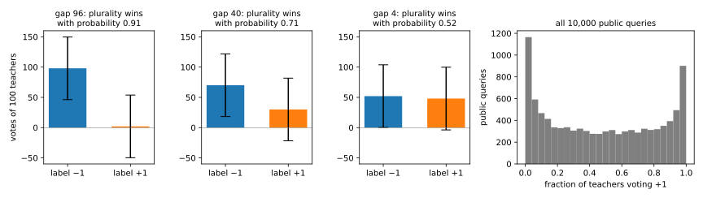
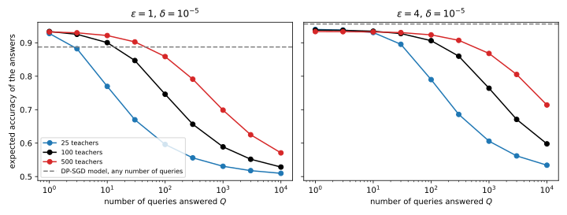
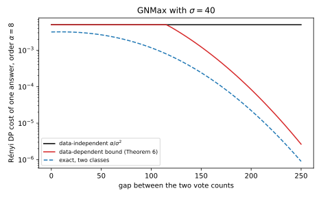
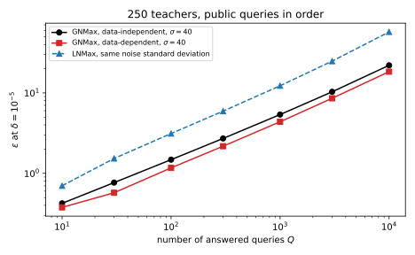
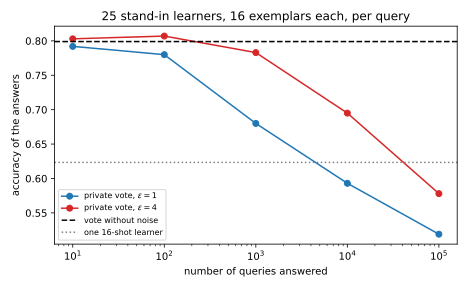

# Private prediction: PATE and in-context learning

Training with differential privacy (DP) by stochastic gradient descent (SGD) with clipped and noisy gradients, [DP-SGD](02-dp-sgd.md), makes the weights private, so every later query to the model is free post-processing. But you pay during training, and sometimes you cannot. The model may be a large language model (LLM) that you can prompt but not train, or a model with no gradients. When is it better to make each *answer* private instead, and how?

The chapter's idea is one record, one vote. Split the private records into disjoint shards, train an ordinary model, a **teacher**, on each, and answer a query by a noisy vote of the teachers. A record lives in one shard, so it moves at most one vote, whatever the teachers are, as in the subsample-and-aggregate idea of [Beyond global sensitivity](../part03-dp-foundations/07-sensitivity.md#sec-sens-saa). So privacy is easy, and accuracy depends on the gap between the top two vote counts, against noise that grows like the square root of the number of answers. Private aggregation of teacher ensembles (PATE), by Papernot, Abadi, Erlingsson, Goodfellow and Talwar (2017), turns a few private answers into a private model.

The running example is the part's task ([DP-SGD](02-dp-sgd.md)): 50-dimensional standard normal inputs labelled $\pm1$ by a fixed random network, with $n = 10{,}000$ private records. Its 20,000 test records form a **public pool**, whose inputs count as public and unlabelled, and an **evaluation set**, 10,000 each. The teachers are regularized logistic regressions ([Private empirical risk minimization](01-dp-erm.md)), each fitted on one shard of consecutive records. Neighbours $D \sim D'$ differ by one added or removed record, $\delta = 10^{-5}$ throughout, and @tbl-pate-symbols lists the symbols.

| Symbol | Meaning |
| --- | --- |
| $k$; $m$ | number of teachers; number of labels |
| $N_i(x)$; $i^*$; $g$ | votes for label $i$ on query $x$; plurality label; gap between the top two counts |
| $b$; $\sigma$ | Laplace scale of LNMax; Gaussian standard deviation of GNMax |
| $Q$ | number of answered queries |
| $\alpha$; $D_\alpha$ | Rényi order; Rényi divergence |
| $\rho(\varepsilon, \delta)$ | largest slope of a linear Rényi curve that converts to $(\varepsilon, \delta)$ |
| $\tilde\beta$; $\varepsilon_0$ | bound on the chance of missing the plurality; pure-DP parameter of one step |

: The symbols of this chapter. {#tbl-pate-symbols}

## The noisy vote: LNMax and GNMax {#sec-pate-noisy-max}

A query arrives, the teachers vote, and you must release one label. Which mechanism releases it, and how does the cost of many answers grow with their number? That growth is what limits private prediction.

::: {#def-pate-vote name="Teacher ensemble and noisy vote"}
Split the private dataset $D$ into $k$ disjoint shards by a rule fixed before looking at the data, such as a hash of a record identifier, and train one **teacher** on each shard. On a query $x$ with $m$ possible labels, let $N_i(x)$ be the number of teachers that vote for label $i$. The label with the most votes is the **plurality** $i^*$, and the **gap** $g$ is the top count minus the runner-up. **LNMax** (Laplace noisy max) releases
$$\arg\max_i\big(N_i(x) + Z_i\big), \qquad Z_i \sim \mathrm{Lap}(b),$$
and **GNMax** (Gaussian noisy max) releases the same label with $Z_i \sim \mathcal N(0, \sigma^2)$, the noise independent across labels. Only the label is released, never the noisy counts.
:::

Every privacy statement below starts from one fact: one record can move the vote histogram $(N_1(x), \dots, N_m(x))$ only a little, whatever the teachers do. The cost theorem needs this in the $\ell_1$ norm, the sum of absolute changes, and in the $\ell_2$ norm, their Euclidean length.

::: {#lem-pate-one-vote name="One record changes one vote"}
With the shards fixed in advance, adding or removing one record changes at most one teacher. On every query, the vote histogram then moves by at most 2 in $\ell_1$ norm and by at most $\sqrt2$ in $\ell_2$ norm.
:::

::: {.proof}
1. The record lands in the one shard its hash points to, and every other shard, and so every other teacher, is unchanged. Shards cut by position would not do, since one inserted record would shift every later record into the next shard. The script cuts by position only because, on its one fixed dataset, that is the same as a fixed assignment.
2. The changed teacher may vote differently, so one count goes down by 1 and another goes up by 1, or nothing changes. One vote is replaced, so this is the change of a histogram under replace in @prp-lg-standard-queries, with $\ell_1$ norm $1 + 1 = 2$ and $\ell_2$ norm $\sqrt{1^2 + 1^2} = \sqrt2$.
:::

The cost of many answers is counted in Rényi differential privacy (RDP), whose curves add under composition. The improved conversion of @thm-conv-improved then turns a composed RDP curve $\varepsilon(\alpha)$ into $(\varepsilon, \delta)$-DP. It adds the price of the conversion to the curve at each order and keeps the best order:
$$\varepsilon = \min_\alpha\Big[\varepsilon(\alpha) + \ln\frac{\alpha - 1}{\alpha} - \frac{\ln\delta + \ln\alpha}{\alpha - 1}\Big].$$ {#eq-pate-convert}
A curve that is a line $\rho\alpha$ enters only through its slope, so write $\rho(\varepsilon, \delta)$ for the largest slope that converts to a given budget. At $\delta = 10^{-5}$ it is $\rho = 0.0306$ for $\varepsilon = 1$ and $\rho = 0.3731$ for $\varepsilon = 4$.

::: {#thm-pate-noisy-max name="The cost of noisy votes"}
Under add/remove neighbours, with the shards fixed in advance:

1. Each LNMax answer is $(2/b)$-DP (Papernot et al. 2017).
2. Each GNMax answer is $(\alpha, \alpha/\sigma^2)$-RDP for every $\alpha > 1$ (Papernot, Song, Mironov, Raghunathan, Talwar & Erlingsson 2018, Proposition 8).
3. $Q$ GNMax answers, even on adaptively chosen queries, are $(\alpha, Q\alpha/\sigma^2)$-RDP. A budget $(\varepsilon, \delta)$ therefore needs the noise
$$\sigma = \sqrt{\frac{Q}{\rho(\varepsilon, \delta)}}.$$ {#eq-pate-sigma}
:::

::: {.proof}
The plan is to read LNMax as report-noisy-max and GNMax as a Gaussian mechanism followed by post-processing, then to compose and solve for the noise.

1. *LNMax.* LNMax is report-noisy-max (@thm-sel-rnm) with the counts as scores, each moving by at most 1. By @lem-pate-one-vote one count may go up while another goes down, so the scores are not monotone, and the theorem's scale $b = 2/\varepsilon$ applies. Solving for $\varepsilon$ gives $2/b$.
2. *GNMax.* Adding $\mathcal N(0, \sigma^2)$ to every count is the Gaussian mechanism on a histogram of $\ell_2$ sensitivity $\sqrt2$, so its noise multiplier is $\sigma/\sqrt2$. The Gaussian curve of @thm-rdp-curves, $\alpha$ over twice the squared multiplier, gives
$$\varepsilon(\alpha) = \frac{\alpha}{2(\sigma/\sqrt2)^2} = \frac{\alpha}{\sigma^2}.$$
The argmax reads only this output, so by post-processing (@thm-rdp-post) it cannot raise the curve.
3. *Compose.* Each answer is $(\alpha, \alpha/\sigma^2)$-RDP whatever the earlier answers were, so by adaptive composition (@thm-rdp-composition) the curves of $Q$ answers add to $Q\alpha/\sigma^2$.
4. *Calibrate.* That curve is the line with slope $Q/\sigma^2$. Setting the slope to $\rho(\varepsilon, \delta)$ and solving for $\sigma$ gives @eq-pate-sigma.
:::

What the teachers are never enters the cost, so a teacher can even be a human annotator. But release only the label. The winner's noisy count would publish the noise that the report-noisy-max proof keeps hidden.

An LNMax answer enters the RDP accountant as an $\varepsilon_0$-DP step with $\varepsilon_0 = 2/b$, charged the curve of randomized response, which bounds every such step (@thm-cdp-pure-sharp). That charges every answer for its worst case, while Gaussian curves add without slack, so Gaussian noise wins for many answers. The RDP accountant is itself a little loose for GNMax, whose $Q$ answers are exactly one Gaussian shift ([f-DP and Gaussian DP](../part04-privacy-accounting/04-gaussian-dp.md#sec-gdp-gdp)). At the $\sigma$ the accountant picks for $\varepsilon = 1$ and 4, the exact $\varepsilon$ is 0.915 and 3.698, about 9% and 8% lower.

::: {#exm-pate-noise}
@tbl-pate-noise gives the noise for four numbers of answers at $\varepsilon = 1$ and $\varepsilon = 4$, with the Laplace scale also shown as a standard deviation, $\sqrt2b$.

| Budget | Answers $Q$ | GNMax $\sigma$ | LNMax $b$ | LNMax standard deviation $\sqrt2b$ |
| --- | --- | --- | --- | --- |
| $\varepsilon = 1$ | 1 | 5.72 | 2.02 | 2.85 |
| | 100 | 57.2 | 79.7 | 113 |
| | 1,000 | 181 | 255 | 361 |
| | 10,000 | 572 | 809 | 1,140 |
| $\varepsilon = 4$ | 1 | 1.64 | 0.501 | 0.709 |
| | 100 | 16.4 | 22.7 | 32.1 |
| | 1,000 | 51.8 | 73.1 | 103 |
| | 10,000 | 164 | 231 | 327 |

: Noise per count for $Q$ answers at $(\varepsilon, 10^{-5})$, from the RDP accountant, with LNMax charged the randomized-response curve. {#tbl-pate-noise}

For a single answer Laplace needs less noise, and from 100 answers on $\sigma$ is smaller than $\sqrt2b$ by a factor close to 2. From 100 to 10,000 answers $\sigma$ grows tenfold, from 57.2 to 572, as @eq-pate-sigma says. Noise of 572 on each count swamps the vote of any ensemble of fewer than a few thousand teachers.
:::

## How accurate is a noisy vote {#sec-pate-accuracy}

The cost of an answer does not depend on the teachers, but its accuracy depends almost only on them. How likely is the noisy vote to return the plurality label, and the right label? You need the answer to choose the number of teachers. Whether GNMax picks one label over another depends only on the difference of their two noises, which is $\mathcal N(0, 2\sigma^2)$, because the variances of independent variables add.

::: {#prp-pate-accuracy name="Accuracy of a noisy vote"}
Let $\Phi$ be the standard normal distribution function. On two labels with gap $g$, GNMax returns the plurality label with probability
$$\Pr[\text{plurality}] = \Phi\Big(\frac{g}{\sqrt2\,\sigma}\Big).$$ {#eq-pate-two-class}
On $m$ labels, it misses the plurality with probability at most
$$\tilde\beta = \sum_{i \ne i^*}\frac12\operatorname{erfc}\Big(\frac{N_{i^*} - N_i}{2\sigma}\Big),$$ {#eq-pate-qtilde}
where $\operatorname{erfc}$ is the complementary error function (Papernot et al. 2018, Proposition 7). If a fraction $a(x)$ of the teachers vote for the correct label on a two-label query $x$, the answer is correct with probability $\Phi\big(k(2a(x) - 1)/(\sqrt2\sigma)\big)$, and the expected accuracy is the average of this over queries.
:::

::: {.proof}
1. *Two labels.* GNMax returns label 1 when $N_1 + Z_1 > N_2 + Z_2$, that is, when the noise difference $Z_2 - Z_1$ is below $N_1 - N_2$. That difference is $\mathcal N(0, 2\sigma^2)$, so the event has probability $\Phi((N_1 - N_2)/(\sqrt2\sigma))$, and with label 1 the plurality, $N_1 - N_2 = g$.
2. *Many labels.* GNMax misses the plurality only if some other label beats it, and the chance of a union of events is at most the sum of their chances. By step 1, label $i$ beats the plurality with probability $\Phi(-(N_{i^*} - N_i)/(\sqrt2\sigma))$, which equals $\frac12\operatorname{erfc}((N_{i^*} - N_i)/(2\sigma))$ because $\Phi(-u) = \frac12\operatorname{erfc}(u/\sqrt2)$.
3. *Toward the truth.* The gap toward the correct label is the number of teachers that are right minus the number that are wrong, $ka - k(1 - a) = k(2a - 1)$. Step 1 with this signed gap gives the chance of a correct answer, and averaging over queries gives the expected accuracy.
:::

For a fixed number of answers and budget, $\sigma$ is fixed, while the signal $k(2a - 1)$ grows with $k$. But each teacher then sees $n/k$ records and is right less often, so $2a - 1$ shrinks. Which effect wins depends on how fast a teacher's accuracy falls with its shard size.

The noiseless plurality vote is an ordinary ensemble, and its accuracy is the ceiling of every private answer, because noise only pulls answers toward a coin flip. @eq-pate-two-class is exact, because two labels have one competitor, while @eq-pate-qtilde is loose when many labels are nearly tied with the plurality.

::: {#exm-pate-teachers}
Take $k = 100$ teachers and the noise for 1,000 answers at $\varepsilon = 4$, $\sigma = 51.8$ (@fig-pate-votes). A query split 98 to 2 gets the plurality label with probability 0.9051, one split 70 to 30 with probability 0.7076, and one split 52 to 48 with probability 0.5218.

{#fig-pate-votes}

@tbl-pate-teachers splits the 10,000 private records among 25 to 500 teachers.

| Teachers $k$ | Records each | Mean teacher accuracy | Plurality vote accuracy | Median $|g|/k$ |
| --- | --- | --- | --- | --- |
| 25 | 400 | 0.8954 | 0.9403 | 1.000 |
| 50 | 200 | 0.8518 | 0.9389 | 0.880 |
| 100 | 100 | 0.7896 | 0.9384 | 0.660 |
| 250 | 40 | 0.7031 | 0.9336 | 0.408 |
| 500 | 20 | 0.6459 | 0.9339 | 0.276 |

: Teachers on the running example, on the evaluation set: mean teacher accuracy, noiseless plurality accuracy, and the median gap as a fraction of $k$. {#tbl-pate-teachers}

The teachers get much worse as their shards shrink, from 0.8954 to 0.6459. But the plurality vote stays between 0.9336 and 0.9403, because their errors are close to independent. The absolute median gap grows, from 25 to $0.276 \times 500 = 138$, so here larger ensembles give more accurate noisy answers (@tbl-pate-answers).

| Budget | Answers $Q$ | $\sigma$ | $k = 25$ | $k = 50$ | $k = 100$ | $k = 250$ | $k = 500$ |
| --- | --- | --- | --- | --- | --- | --- | --- |
| $\varepsilon = 1$ | 100 | 57.2 | 0.5961 | 0.6651 | 0.7461 | 0.8250 | 0.8588 |
| | 1,000 | 180.9 | 0.5308 | 0.5546 | 0.5889 | 0.6489 | 0.6987 |
| | 10,000 | 572.1 | 0.5097 | 0.5173 | 0.5285 | 0.5498 | 0.5709 |
| $\varepsilon = 4$ | 100 | 16.4 | 0.7899 | 0.8803 | 0.9064 | 0.9185 | 0.9237 |
| | 1,000 | 51.8 | 0.6059 | 0.6805 | 0.7641 | 0.8378 | 0.8682 |
| | 10,000 | 163.7 | 0.5340 | 0.5602 | 0.5979 | 0.6625 | 0.7140 |

: Expected accuracy of $Q$ GNMax answers on the evaluation set, from @eq-pate-two-class. {#tbl-pate-answers}

With 100 answers at $\varepsilon = 4$, 500 teachers reach 0.9237, but with 1,000 answers at $\varepsilon = 1$ only 0.6987.
:::

## Private answers against a private model {#sec-pate-versus}

You have a budget $(\varepsilon, \delta)$. You can spend it on one model trained with DP-SGD, whose answers are then free, or on answers to queries one at a time from a teacher ensemble. Which gives more accurate answers, and how does the choice depend on the number of queries you expect? Write $A_{\mathrm{model}}(\varepsilon)$ for the accuracy of a privately trained model and $A_{\mathrm{vote}}(Q, \varepsilon)$ for the expected accuracy of $Q$ private answers at the same budget.

::: {#prp-pate-breakeven name="The break-even number of queries"}
Suppose that $A_{\mathrm{vote}}(Q, \varepsilon)$ decreases in $Q$, as it does when the plurality is correct on most queries. Then private answers are more accurate than a private model exactly when
$$Q < Q^*(\varepsilon) = \max\{Q : A_{\mathrm{vote}}(Q, \varepsilon) \ge A_{\mathrm{model}}(\varepsilon)\},$$ {#eq-pate-breakeven}
with $Q^* = 0$ when even one answer is worse than the model.
:::

::: {.proof}
1. *The model is constant in $Q$.* Every query to a released model is post-processing of its weights (@thm-dpprop-post), so it costs nothing and is as accurate as the model.
2. *The vote falls toward $\frac12$.* By @eq-pate-sigma, $\sigma$ grows like $\sqrt Q$, and by @prp-pate-accuracy each answer is correct with probability $\Phi(g/(\sqrt2\sigma))$ for its signed gap $g$. That chance falls toward $\frac12$ as $\sigma$ grows when the gap is positive, which is why the hypothesis holds when most gaps are positive.
3. *Break-even.* A decreasing function crosses a constant at most once, and the last $Q$ before the crossing is $Q^*$.
:::

DP-SGD pays a fixed price, which at small $\varepsilon$ is a much worse model, while the vote's first answers are almost as good as the noiseless ensemble. So private prediction wins when the budget is small and the queries are few. At large $\varepsilon$ the ensemble's ceiling decides. A million queries are out of reach either way, because they need a $\sigma$ a hundred times that of 100 answers. The comparison assumes that you *can* run DP-SGD. With LLMs behind an interface, or parties who will not pool their data, private prediction is the only private option.

::: {#exm-pate-breakeven}
The DP-SGD baseline is the configuration of [DP-SGD](02-dp-sgd.md), retrained twice per budget. @tbl-pate-breakeven gives its accuracy and the break-even number of queries for the best number of teachers.

| $\varepsilon$ | DP-SGD accuracy (2 runs) | Break-even $Q^*$ | Best $k$ |
| --- | --- | --- | --- |
| 0.5 | $0.8164 \pm 0.0060$ | 58 | 500 |
| 1 | $0.9128 \pm 0.0207$ | 18 | 500 |
| 2 | $0.9438 \pm 0.0039$ | 0 | — |
| 4 | $0.9573 \pm 0.0024$ | 0 | — |
| 8 | $0.9605 \pm 0.0004$ | 0 | — |

: DP-SGD on the running example against GNMax answers, with the break-even number of queries. {#tbl-pate-breakeven}

At $\varepsilon = 0.5$, 500 teachers answer up to 58 queries more accurately than the private model, and at $\varepsilon = 1$ up to 18. From $\varepsilon = 2$ on, DP-SGD beats even the noiseless vote, because the ensemble's ceiling, 0.9336 to 0.9403, is below its 0.9438 (@fig-pate-answers).

{#fig-pate-answers}
:::

## PATE: from private answers to a private model {#sec-pate-student}

Private answers cost budget for as long as queries arrive, while a private model costs it once. PATE spends the budget on private labels for a fixed number of public, unlabelled inputs, then trains a new model on them and releases only that model. How private is the released model, and how good can it be?

::: {#def-pate-student name="PATE"}
Train teachers as in @def-pate-vote and label $Q$ public inputs $x_1, \dots, x_Q$ by GNMax with noise $\sigma$. Then train a **student** on these inputs and labels, by any algorithm, possibly with other public data. The student is released, and the teachers never are.
:::

The student never sees a private record, only public inputs and private labels, so its privacy should be that of the labels.

::: {#thm-pate-student name="Privacy of the PATE student"}
The student of @def-pate-student, and every prediction it ever makes, is $(\alpha, Q\alpha/\sigma^2)$-RDP, and so $(\varepsilon, \delta)$-DP with $\varepsilon$ from @eq-pate-convert, even when each input to be labelled is chosen after seeing the earlier labels. The cost depends on nothing about the student.
:::

::: {.proof}
1. *The only private output is the labels.* The student's training sees the public inputs, which do not depend on the private data, and the $Q$ labels, never the teachers or the records.
2. *The labels are $Q$ GNMax answers.* By @thm-pate-noisy-max they cost $Q\alpha/\sigma^2$, and adaptive composition lets the student choose which inputs to ask about.
3. *Post-processing.* The student's weights are a function of the labels and of public data, so by @thm-rdp-post they are as private as the labels, and so is every prediction computed from them.
:::

Three things limit the student. It is trained on $Q$ examples rather than $n$, its labels are noisy, and the plurality vote has the ensemble's ceiling. More labels mean more noise per label by @eq-pate-sigma, so each $\varepsilon$ has a best $Q$. The semi-supervised students of Papernot et al. (2017, 2018) also learn from unlabelled public inputs, which this chapter's student does not. PATE needs public, unlabelled inputs from the same distribution as the private data. The teachers are non-private models of their shards, so keep them secret ([Part 2](../part02-attacks/00-introduction.md) attacks them).

::: {#exm-pate-student}
Take $k = 250$ teachers, whose plurality vote labels the public pool with accuracy 0.9322. The student is the part's network, trained non-privately for 2,000 steps on the first $Q$ public inputs and their GNMax labels (@tbl-pate-student; the first two rows have no privacy).

| Labels | $Q = 250$ | $Q = 500$ | $Q = 1{,}000$ | $Q = 2{,}000$ |
| --- | --- | --- | --- | --- |
| True labels (not private) | 0.8726 | 0.8990 | 0.9188 | 0.9410 |
| Noiseless plurality (not private) | 0.8913 | 0.9106 | 0.9229 | 0.9297 |
| GNMax, $\varepsilon = 1$ | 0.8238 (0.7760) | 0.7595 (0.6880) | 0.6995 (0.6350) | 0.6749 (0.6260) |
| GNMax, $\varepsilon = 2$ | 0.7980 (0.8040) | 0.8393 (0.8140) | 0.8141 (0.7490) | 0.7318 (0.6885) |
| GNMax, $\varepsilon = 4$ | 0.8633 (0.8720) | 0.8754 (0.8740) | 0.8898 (0.8360) | 0.8259 (0.7840) |
| GNMax, $\varepsilon = 8$ | 0.8950 (0.9160) | 0.9037 (0.9040) | 0.9049 (0.8870) | 0.8884 (0.8525) |

: Test accuracy of a PATE student with 250 teachers and $Q$ labels, one run each; in parentheses, the fraction of correct GNMax labels. {#tbl-pate-student}

The best student reaches 0.8238 at $\varepsilon = 1$ and 0.9049 at $\varepsilon = 8$, while DP-SGD, at 0.9128 to 0.9605, is better at every budget (@fig-pate-student). With true labels the student needs 2,000 examples to reach 0.9410. But at $\varepsilon = 4$, 2,000 labels need $\sigma = 73.2$ by @eq-pate-sigma, and only 0.7840 of them are right. To choose the best $Q$ by test accuracy is itself a leak ([Hyperparameter tuning](03-hyperparameter-tuning.md)).

{#fig-pate-student}

PATE loses here for two reasons. The task is binary, so a wrong label is the other label, and the teachers are weak (0.7031 each with 40 records), so many gaps are small against the noise. Its published successes are on tasks where the teachers agree on most inputs, such as handwritten digits (Papernot et al. 2018, Table 1).
:::

## Data-dependent analysis and Confident-GNMax {#sec-pate-data-dependent}

The cost $\alpha/\sigma^2$ of a GNMax answer is a worst case over all vote histograms, including ties that one teacher decides. When 249 of 250 teachers agree, one record can hardly change the answer. Can such an answer cost less, and can a mechanism answer only such queries?

The charge is a Rényi divergence, which RDP bounds for every pair of neighbours (@def-rdp-rdp). Between two distributions $P$ and $P'$ on a discrete set of outputs, the **Rényi divergence** of order $\alpha$ is
$$D_\alpha(P\|P') = \frac{1}{\alpha - 1}\ln\sum_yP(y)^\alpha P'(y)^{1 - \alpha}.$$ {#eq-pate-renyi}
If the mechanism almost always returns one output on the actual dataset, that output dominates the sum, and one record can hardly change its probability. The bound below makes this precise for a pure-DP step.

::: {#thm-pate-dd-pure name="The data-dependent bound, pure-DP form"}
Let $M$ be $\varepsilon_0$-DP, and suppose that on the actual dataset $D$ some output $i^*$ has $\Pr[M(D) \ne i^*] = \beta < e^{-\varepsilon_0}$. Then for every neighbour $D'$ (Papernot et al. 2017, Theorem 3, written in RDP),
$$D_\alpha\big(M(D)\|M(D')\big) \le \frac{1}{\alpha - 1}\ln\Big[(1 - \beta)^\alpha\big(1 - e^{\varepsilon_0}\beta\big)^{1 - \alpha} + \beta\,e^{(\alpha - 1)\varepsilon_0}\Big].$$ {#eq-pate-dd-pure}
The bound also holds with any upper bound $\tilde\beta \ge \beta$ below $e^{-\varepsilon_0}$ in place of $\beta$. For LNMax, $\varepsilon_0 = 2/b$.
:::

::: {.proof}
The plan is to split the sum of @eq-pate-renyi into the likely output and the rest, bound each part with pure DP, and then pass from the true failure probability to its bound.

1. *Split the sum.* Write $P = M(D)$ and $P' = M(D')$. By @eq-pate-renyi, $e^{(\alpha - 1)D_\alpha}$ is the sum of $P(y)^\alpha P'(y)^{1 - \alpha}$ over outputs. Split it into the term of $i^*$ and the rest, and write $\beta'$ for $P'(\text{not } i^*)$.
2. *The unlikely outputs.* For $y \ne i^*$ the term is $P(y)\big(P(y)/P'(y)\big)^{\alpha - 1}$. Pure DP bounds the ratio by $e^{\varepsilon_0}$, so these terms add up to at most $\beta\,e^{(\alpha - 1)\varepsilon_0}$.
3. *The likely output.* Its term is $(1 - \beta)^\alpha(1 - \beta')^{1 - \alpha}$. Pure DP applied to the event "not $i^*$" gives $\beta' \le e^{\varepsilon_0}\beta$, so $1 - \beta' \ge 1 - e^{\varepsilon_0}\beta > 0$. The exponent $1 - \alpha$ is negative, so a larger base gives a smaller power, and the term is at most $(1 - \beta)^\alpha(1 - e^{\varepsilon_0}\beta)^{1 - \alpha}$.
4. *Collect, and pass to $\tilde\beta$.* Adding the two parts and taking $\frac{1}{\alpha - 1}\ln$ gives @eq-pate-dd-pure with the true $\beta$. The right side increases in $\beta$ for every $\beta < e^{-\varepsilon_0}$, because it is convex in $\beta$ with a non-negative slope at 0 (Appendix @sec-apx-learn-pate proves both). So the largest value over all $\beta \le \tilde\beta$ is at $\tilde\beta$.
:::

For small $\beta$ the bound is about $\beta$ times a constant, as the numbers of @exm-pate-dd show, so an answer costs in proportion to the chance that the noise overturns it. GNMax has a Gaussian form of the same bound. GNMax is not pure DP, so its proof bounds the unlikely outputs with Rényi divergences at two higher orders $\alpha_1$ and $\alpha_2$ instead of a ratio. But the bracket keeps the two parts of @eq-pate-dd-pure: the likely output, weighted by $1 - \tilde\beta$, and the rest, weighted by $\tilde\beta$.

::: {#thm-pate-dd-gauss name="The data-dependent bound, Gaussian form"}
Let $M$ be GNMax with noise $\sigma$, and $\tilde\beta$ the bound of @eq-pate-qtilde on the actual dataset $D$. Set $\alpha_2 = \sigma\sqrt{\ln(1/\tilde\beta)}$, $\alpha_1 = \alpha_2 + 1$, $\varepsilon_1 = \alpha_1/\sigma^2$ and $\varepsilon_2 = \alpha_2/\sigma^2$. If $\alpha \le \alpha_1$, $\alpha_2 > 1$ and $\tilde\beta \le e^{(\alpha_2 - 1)\varepsilon_2}\big/\big(\frac{\alpha_1}{\alpha_1 - 1}\cdot\frac{\alpha_2}{\alpha_2 - 1}\big)^{\alpha_2}$, then for every neighbour $D'$ (Papernot et al. 2018, Theorem 6, with the orders of their Proposition 10)
$$D_\alpha\big(M(D)\|M(D')\big) \le \frac{1}{\alpha - 1}\ln\Big[(1 - \tilde\beta)A^{\alpha - 1} + \tilde\beta B^{\alpha - 1}\Big],\quad A = \frac{1 - \tilde\beta}{1 - (\tilde\beta e^{\varepsilon_2})^{(\alpha_2 - 1)/\alpha_2}},\quad B = \frac{e^{\varepsilon_1}}{\tilde\beta^{1/(\alpha_1 - 1)}}.$$ {#eq-pate-dd-gauss}
Each answer is charged the smaller of this and $\alpha/\sigma^2$, and the charges add up over answers.
:::

<!-- proof: cited -->

The Gaussian form follows the plan of @thm-pate-dd-pure, and its proof is in Papernot et al. (2018, Appendix A). Appendix @sec-apx-learn-pate derives it step by step.

@fig-pate-dd-cost draws the cost of one GNMax answer with $\sigma = 40$ at order 8 against the gap. Up to gaps of 100 the bound is no better than the data-independent $\alpha/\sigma^2 = 0.005$. Then it falls steeply, to $1.23 \times 10^{-3}$ at a gap of 150 and $8.37 \times 10^{-5}$ at 200. The exact cost on two labels is five times lower at a gap of 150 ($2.42 \times 10^{-4}$), even though it takes the worse of the two directions while the bound covers only $D_\alpha(M(D)\|M(D'))$. So @thm-pate-dd-gauss is valid but not tight.

{#fig-pate-dd-cost}

The data-dependent $\varepsilon$ is itself private information. One record changes one teacher, whose votes can change on *every* query, so the $\varepsilon$ computed from all the votes can change too. Papernot et al. (2018, Appendix B) release it with noise scaled to its **smooth sensitivity** ([Beyond global sensitivity](../part03-dp-foundations/07-sensitivity.md#sec-sens-smooth)), and pay for that release. Without that step, a data-dependent $\varepsilon$ is a measurement, not a guarantee.

A query with strong consensus is cheap under this analysis and more likely to get the right label. So a noisy check of the top count can pick out the queries worth an answer.

::: {#def-pate-confident name="Confident-GNMax"}
For each query, release $\bot$ (no answer) unless $\max_iN_i + \mathcal N(0, \sigma_1^2) \ge \tau_1$, with check noise $\sigma_1$ and threshold $\tau_1$. If the check passes, release a GNMax answer with noise $\sigma_2$ (Papernot et al. 2018, Algorithm 1).
:::

::: {#prp-pate-confident name="Cost of Confident-GNMax"}
With data-independent accounting, a pool of $Q_{\mathrm{pool}}$ queries, of which $Q_{\mathrm{ans}}$ are answered, costs
$$\varepsilon(\alpha) = \Big(\frac{Q_{\mathrm{pool}}}{2\sigma_1^2} + \frac{Q_{\mathrm{ans}}}{\sigma_2^2}\Big)\alpha,$$ {#eq-pate-confident}
provided this total is kept below a budget fixed in advance.
:::

::: {.proof}
1. *The check.* One record moves one count up or down by 1, which moves the maximum by at most 1. So the check is a Gaussian mechanism with sensitivity 1, $(\alpha, \alpha/(2\sigma_1^2))$-RDP by @thm-rdp-curves, on every query.
2. *The answer.* It is GNMax, $(\alpha, \alpha/\sigma_2^2)$-RDP by @thm-pate-noisy-max, run only when the check passes.
3. *Compose.* Whether an answer runs depends on a released output, so its cost is chosen adaptively. The Rényi filter (@thm-adapt-renyi-filter) says that adaptive RDP costs that stay below a budget fixed in advance compose as if fixed, and summing the two lines gives @eq-pate-confident.
:::

Every query pays for the check, so choose $\sigma_1$ much larger than $\sigma_2$. The price of skipping the expensive, likely-wrong queries is that the student never sees labels near the decision boundary.

::: {#exm-pate-dd}
Take first the pure-DP form. For an LNMax answer with $\varepsilon_0 = 0.1$ at order 8, the randomized-response curve charges 0.0367, and @eq-pate-dd-pure gives 0.0235 at $\tilde\beta = 0.1$ and 0.00025 at $\tilde\beta = 0.001$.

For GNMax with 250 teachers and $\sigma = 40$, @tbl-pate-dd compares the costs of answering the first $Q$ public queries.

| Answers $Q$ | Data-independent $\varepsilon$ | Data-dependent $\varepsilon$ (not sanitized) |
| --- | --- | --- |
| 250 | 2.45 | 1.93 |
| 1,000 | 5.38 | 4.37 |
| 4,000 | 12.30 | 10.23 |

: $\varepsilon$ at $\delta = 10^{-5}$ for $Q$ GNMax answers, 250 teachers, $\sigma = 40$. {#tbl-pate-dd}

The saving is about 20% at every $Q$, because only 0.2879 of the public queries have a gap of at least 150. LNMax at the same noise standard deviation costs more at every $Q$ (@fig-pate-epsilon-queries).

{#fig-pate-epsilon-queries}

@tbl-pate-confident runs Confident-GNMax with the 250 teachers and the parameters Papernot et al. use on MNIST.

| Pool $Q_{\mathrm{pool}}$ | Answered $Q_{\mathrm{ans}}$ | Label accuracy | Data-independent $\varepsilon$ | Data-dependent $\varepsilon$ | Student accuracy |
| --- | --- | --- | --- | --- | --- |
| 1,000 | 459 | 0.8693 | 3.59 | 2.82 | 0.8894 |
| 4,000 | 1,773 | 0.8917 | 7.87 | 6.28 | 0.9043 |

: Confident-GNMax with 250 teachers, $\tau_1 = 200$, $\sigma_1 = 150$, $\sigma_2 = 40$; the student is trained on the answered queries. {#tbl-pate-confident}

At a data-independent $\varepsilon = 3.59$, the student reaches 0.8894, about what plain GNMax reached at $\varepsilon = 4$ (0.8898). The check costs only $1{,}000/(2 \times 150^2) = 0.022$ in slope, against $459/40^2 = 0.287$ for the answers.
:::

## Stable aggregation {#sec-pate-stable}

The data-dependent $\varepsilon$ depends on the votes, so to publish it needs a separate private release. Can agreement be cheap with a budget fixed before any vote is seen? The idea is to test privately whether a vote is so lopsided that one record cannot overturn it, and then to release the exact plurality. Only failed tests cost budget, because they run through the sparse vector technique of [Selection](../part03-dp-foundations/05-selection.md#sec-sel-svt). This is the stability-based aggregation of Thakurta & Smith (2013), applied to PATE by Bassily, Thakkar & Thakurta (2018).

The **distance to instability** $\operatorname{dist}(x)$ of a query $x$ is the largest number $j$ such that changing the votes of *any* $j$ teachers leaves the same label strictly on top, the stability score of @thm-sens-stable applied to the votes.

::: {#lem-pate-dist name="Distance to instability"}
With $g$ the gap between the top two counts,
$$\operatorname{dist}(x) = \Big\lceil\frac g2\Big\rceil - 1, \quad\text{and } 0 \text{ when } g = 0.$$ {#eq-pate-dist}
Adding or removing one record moves the distance of every query by at most 1.
:::

::: {.proof}
1. *The formula.* One changed teacher moves one vote between labels, which lowers the gap by at most 2. After $j$ changes the label stays strictly on top while $g - 2j \ge 1$, that is, for $j \le (g - 1)/2$, and the largest such whole number is $\lceil g/2\rceil - 1$.
2. *Sensitivity.* A record changes one teacher (@lem-pate-one-vote). If any $j$ changes from $D'$ keep the label on top, then any $j - 1$ changes from $D$ do, because $D$ is one change away from $D'$. This is the argument of @lem-sens-distance, and it holds for every query at once.
:::

AboveThreshold halts at the first high value, so stable aggregation, defined next, runs it on the negated distances to halt at the first low distance.

::: {#def-pate-stable name="Stable aggregation"}
Fix a budget $\varepsilon_0$ per run, a cutoff $c$ and a pool of $Q_{\mathrm{pool}}$ public queries. Go through the queries in order, running AboveThreshold (@def-sel-above-threshold) at budget $\varepsilon_0$ on the values $-\operatorname{dist}(x_i)$ with threshold $-\tau$, threshold noise $\xi \sim \mathrm{Lap}(2/\varepsilon_0)$ and fresh query noise $\nu_i \sim \mathrm{Lap}(4/\varepsilon_0)$. A query with $-\operatorname{dist}(x_i) + \nu_i \ge -\tau + \xi$ is **unstable**: it gets no label, and the run restarts with fresh threshold noise. Every other query is **stable** and gets the exact plurality label. Stop after $c$ unstable answers or at the end of the pool. The slack has two parts: $\delta_{\text{bad}}$, for the event that a query at distance 0 is declared stable, and $\delta'$, for the RDP conversion of @thm-pate-stable. Choose $\tau$ so that
$$Q_{\mathrm{pool}}\cdot\Pr[\nu - \xi > \tau] \le \delta_{\text{bad}}, \qquad \Pr[\nu - \xi > \tau] = \frac{b_1^2e^{-\tau/b_1} - b_2^2e^{-\tau/b_2}}{2(b_1^2 - b_2^2)},$$ {#eq-pate-stable-threshold}
with $b_1 = 4/\varepsilon_0$ and $b_2 = 2/\varepsilon_0$ the two Laplace scales.
:::

Appendix @sec-apx-prob-laplace-diff derives the tail formula. A label can leak only through a query at distance 0 that is declared stable, and the threshold makes that rarer than $\delta_{\text{bad}}$.

::: {#thm-pate-stable name="Privacy of stable aggregation"}
The labels that stable aggregation releases are together $(\varepsilon, \delta' + \delta_{\text{bad}})$-DP, where $\varepsilon$ is the better of basic composition and the RDP conversion at $\delta'$ of $c$ composed $\varepsilon_0$-DP steps,
$$\varepsilon = \min\Big\{c\varepsilon_0,\ \min_\alpha\Big[c\,\varepsilon_{\mathrm{RR}}(\alpha) + \ln\frac{\alpha - 1}{\alpha} - \frac{\ln\delta' + \ln\alpha}{\alpha - 1}\Big]\Big\},$$ {#eq-pate-stable-eps}
with $\varepsilon_{\mathrm{RR}}$ the RDP curve of randomized response at $\varepsilon_0$ (@thm-rdp-curves). The budget does not depend on how many stable labels are released.
:::

::: {.proof}
The plan is to price the stable/unstable answers, show that the exact labels add nothing outside a bad event, and bound that event by $\delta_{\text{bad}}$.

1. *The answers cost $c$ runs.* By @lem-pate-dist the values $-\operatorname{dist}(x_i)$ have sensitivity 1, so each run of AboveThreshold is $\varepsilon_0$-DP however many queries it reads (@thm-sel-svt). Basic composition (@thm-dpprop-basic) of at most $c$ runs gives $c\varepsilon_0$. Alternatively, @thm-cdp-pure-sharp gives each run the randomized-response curve, the curves add, and @eq-pate-convert at $\delta'$ gives the second term. Either bound is valid, so the smaller one is.
2. *Exact labels are safe at distance at least 1.* At such a query, one change of teacher leaves the same label on top, so the plurality is the same on $D$ and $D'$. When every labelled query has distance at least 1 on $D$, the output is therefore fixed by which queries were declared stable, in the same way for both datasets.
3. *The bad event.* A query at distance 0 is declared stable when $\nu_i - \xi < -\tau$. The difference of two independent symmetric variables is symmetric, so this has probability $\Pr[\nu - \xi > \tau]$, and a union bound over at most $Q_{\mathrm{pool}}$ queries with @eq-pate-stable-threshold bounds the bad event by $\delta_{\text{bad}}$.
4. *Put the two together.* For a set $S$ of outputs, the chance of landing in $S$ on $D$ is at most the chance of doing so without the bad event, plus $\delta_{\text{bad}}$. Without it, the output lands in $S$ only if the stable/unstable answers land in a set $S'$ whose labels, the same on both datasets by step 2, put the output in $S$. Step 1 bounds the chance of $S'$ on $D$ by $e^\varepsilon$ times its chance on $D'$, plus $\delta'$, which gives $(\varepsilon, \delta' + \delta_{\text{bad}})$-DP.
:::

Nothing needs sanitizing, as long as $c$ is fixed in advance. The labels are exact, so the label noise that hurt the students of @sec-pate-student is gone. Only the number of labels that the budget buys depends on the data.

The threshold is the obstacle. It must stop every query at distance 0 across the pool, so $\tau$ grows like $4\ln(Q_{\mathrm{pool}}/\delta_{\text{bad}})/\varepsilon_0$. A query is then reliably stable only when the plurality leads by about $2\tau$ votes. So the method pays only with many teachers that are nearly unanimous on almost every query, and deployed PATE systems use Confident-GNMax instead.

::: {#exm-pate-stable}
Take $\varepsilon_0 = 1$ and $\delta_{\text{bad}} = \delta' = 5 \times 10^{-6}$, a total $\delta$ of $10^{-5}$. For a pool of 1,000 queries @eq-pate-stable-threshold gives $\tau = 74.8$, and for 10,000 queries 84.0, a lead of about $2\tau \approx 170$ votes. The budget of @eq-pate-stable-eps is $\varepsilon = 20.00$ for $c = 20$, from basic composition, and 100 unstable answers cost 83.45 by the RDP route rather than 100.

With 250 teachers the largest distance on the pool is 124, and only 0.1996 of the queries reach 84.0, against 0.3923 with 500 teachers. @tbl-pate-stable runs the procedure.

| Teachers | $\varepsilon_0$ | Cutoff $c$ | Queries read | Labels released | Label accuracy | $\varepsilon$ |
| --- | --- | --- | --- | --- | --- | --- |
| 250 | 1 | 20 | 23 | 3 | 1.0000 | 20.00 |
| 250 | 2 | 20 | 41 | 21 | 0.9524 | 40.00 |
| 500 | 1 | 20 | 34 | 14 | 1.0000 | 20.00 |
| 500 | 2 | 20 | 54 | 34 | 0.9412 | 40.00 |

: Stable aggregation on the public pool, $\delta_{\text{bad}} = \delta' = 5 \times 10^{-6}$: queries read before the $c$-th unstable answer, labels released, their accuracy, and the budget. {#tbl-pate-stable}

The labels are accurate, but only 3 to 34 at a budget of 20 or more.
:::

## Private in-context learning {#sec-pate-icl}

An LLM can learn a task from examples in its prompt, without training: show it four labelled movie reviews and it labels the fifth. If these examples, the **exemplars**, are private records, every answer leaks them. Duan, Dziedzic, Papernot and Boenisch (NeurIPS 2023) show this with a membership inference attack on GPT-3, and DP-SGD is not an option behind an interface. How do you answer privately from a prompt? Treat each prompt built from a group of exemplars as a teacher.

::: {#def-pate-icl name="Private in-context learning and PromptPATE"}
**Private in-context learning** (Wu, Panda, Wang & Mittal, ICLR 2024, and Duan et al. 2023) splits the private exemplars into disjoint groups by a rule fixed in advance. It prompts the model once per group with that group's exemplars and the query, and releases the GNMax label of the answers. In the version of Wu et al., each query first draws a fresh Poisson sample of the exemplars, each record included independently with probability $q$, and splits the sample into groups by the fixed rule. **PromptPATE** (Duan et al.) labels a few public inputs with Confident-GNMax over prompted models and uses them as the exemplars of one public prompt.
:::

::: {#thm-pate-icl name="The cost of private in-context learning"}
A PromptPATE prompt costs only its labels, however often it is used. For answers to queries, each is $(\alpha, \alpha/\sigma^2)$-RDP without subsampling. With Poisson subsampling at rate $q$, $Q$ answers have $Q$ times the curve of the Poisson-subsampled Gaussian at rate $q$ and noise multiplier $\sigma/\sqrt2$ ([Amplification by subsampling](../part04-privacy-accounting/05-subsampling.md#sec-sub-rdp-gaussian)), the accountant DP-SGD uses:
$$\varepsilon(\alpha) = Q\,\varepsilon_{q,\,\sigma/\sqrt2}(\alpha).$$ {#eq-pate-icl}
:::

::: {.proof}
The plan is to show that one exemplar moves one vote, so that the earlier analysis applies, then to add the subsampling and compose.

1. *One exemplar, one prompt.* The groups are fixed by a rule that does not depend on the data, which places each exemplar without looking at the others, so adding or removing an exemplar changes one group's prompt and at most one answer. As in @lem-pate-one-vote, the histogram has $\ell_2$ sensitivity $\sqrt2$.
2. *Without subsampling.* GNMax on this histogram is $(\alpha, \alpha/\sigma^2)$-RDP by @thm-pate-noisy-max, whatever the model computes from its prompt.
3. *With subsampling.* The record is in the query's sample with probability $q$. If it is not, the output is distributed as without it. If it is, the histogram shifts by at most $\sqrt2$ against noise $\sigma$ on each coordinate, which, rotated onto one axis and divided by $\sqrt2$, is the subsampled Gaussian with sensitivity 1 and noise multiplier $\sigma/\sqrt2$.
4. *Compose.* The $Q$ answers use independent samples, so their curves add (@thm-rdp-composition), which is @eq-pate-icl.
5. *PromptPATE.* The deployed prompt is a function of public inputs and private labels, so by @thm-rdp-post it costs what the labels cost.
:::

Everything about private prediction carries over, and only the teacher is different. A prompted LLM learns from very few examples, because most of what it knows comes from pretraining. So its votes agree far more than those of small independent models, and high consensus makes data-dependent costs small. Within one query the groups must still be disjoint, or a record in two groups moves two votes. With a real LLM the loss is small: on a movie-review sentiment task, Duan et al. report 92.7% with GPT-3 and PromptPATE at $(\varepsilon, \delta) = (0.147, 10^{-6})$, against 95.2% without privacy.

::: {#exm-pate-icl}
No language model is available here, so the script uses a **stand-in** without pretraining: given exemplars $(x_j, y_j)$, it labels a query $x$ by the sign of $\langle\theta, x\rangle$, with $\theta = \sum_jy_jx_j$. An attacker can score a candidate record $(x, y)$ by $y\langle\theta, x\rangle$. Over 400 trials, its area under the curve (AUC) is 1.000 against a 1-shot learner, 0.996 against a 4-shot learner and 0.889 against a 16-shot learner.

For private answers, each query samples the private records at rate $q = 0.04$ and splits the sample by record index into 25 groups of about 16. One 16-shot learner is right on 0.6232 of the evaluation set, and the 25-vote without noise on 0.8090. @tbl-pate-icl adds the noise from @eq-pate-icl.

| Budget | Answers $Q$ | $\sigma$ | Accuracy |
| --- | --- | --- | --- |
| $\varepsilon = 1$ | 100 | 2.75 | 0.7780 |
| | 1,000 | 7.39 | 0.6800 |
| | 10,000 | 22.93 | 0.5615 |
| $\varepsilon = 4$ | 100 | 1.30 | 0.8080 |
| | 1,000 | 2.36 | 0.7910 |
| | 10,000 | 6.65 | 0.7025 |

: Private in-context learning with the stand-in: 25 groups of about 16 exemplars per query, sampling rate 0.04, accuracy on 2,000 evaluation queries. {#tbl-pate-icl}

Subsampling makes the noise small, $\sigma = 7.39$ for 1,000 answers at $\varepsilon = 1$ against 181 without it (@tbl-pate-noise). But 25 voters have small gaps, so accuracy still falls from 0.8090 to 0.6800 (@fig-pate-icl).

{#fig-pate-icl}

A student prompt avoids the per-query cost. Split the records into 625 disjoint 16-shot learners, whose noiseless vote is right on 0.9366 of the evaluation set, and label the first $Q$ public inputs with GNMax at $\varepsilon = 1$. With 256 labelled inputs ($\sigma = 91.5$) the student prompt reaches 0.7954, about the accuracy of 100 private answers, but for any number of queries. An LLM needs a handful of exemplars rather than hundreds, so PromptPATE can stop at a very small $\varepsilon$.
:::

## Code {#sec-pate-code}

The script [code/private_prediction.py](../../code/part05-dp-ml/private_prediction.py) implements every mechanism and accountant of this chapter, trains the students and the DP-SGD baselines, and simulates private in-context learning. It imports the running example and DP-SGD from [code/dp_sgd.py](../../code/part05-dp-ml/dp_sgd.py), and the logistic regression from [code/dp_erm.py](../../code/part05-dp-ml/dp_erm.py). From the repository root:

```bash
uv run python code/part05-dp-ml/private_prediction.py
```

| Experiment | Result |
| --- | --- |
| Noise for $Q$ answers | $\sigma \propto \sqrt Q$: 57.2 for 100 answers at $\varepsilon = 1$, 572 for 10,000 |
| Teachers | Plurality accuracy 0.9336 to 0.9403 for 25 to 500 teachers |
| Answers against DP-SGD | Answers win for up to 58 queries at $\varepsilon = 0.5$, 18 at $\varepsilon = 1$, none from $\varepsilon = 2$ |
| PATE student, 250 teachers | Best 0.8238 at $\varepsilon = 1$ to 0.9049 at $\varepsilon = 8$; DP-SGD 0.9128 to 0.9605 |
| Data-dependent analysis | About 20% lower $\varepsilon$ on this task; @thm-pate-dd-gauss above the exact two-label cost |
| Confident-GNMax | 459 of 1,000 queries answered, student 0.8894 at $\varepsilon = 3.59$ |
| Stable aggregation | Threshold 84.0 at $\varepsilon_0 = 1$; 14 exact labels for $\varepsilon = 20$ with 500 teachers |
| In-context learning, stand-in | Membership AUC 0.889 for a 16-shot learner; 0.7780 accuracy for 100 private answers at $\varepsilon = 1$ |

: The script's output with the default seed. {#tbl-pate-code}

[tests/test_private_prediction.py](../../tests/test_private_prediction.py) checks that the output still matches.

## Summary {#sec-pate-summary}

| Result | Statement | Use |
| --- | --- | --- |
| @def-pate-vote | Disjoint shards fixed by a hash; release only the noisy argmax label | Count your queries first |
| @lem-pate-one-vote | One record moves the histogram by 2 in $\ell_1$, $\sqrt2$ in $\ell_2$ | Every cost here |
| @thm-pate-noisy-max | LNMax $(2/b)$-DP; GNMax $(\alpha, \alpha/\sigma^2)$-RDP; $\sigma = \sqrt{Q/\rho(\varepsilon, \delta)}$ | Gaussian beyond a handful of answers |
| @prp-pate-accuracy | Two labels: $\Phi(g/(\sqrt2\sigma))$; $m$ labels: failure at most $\tilde\beta$ | Add teachers while gaps grow |
| @prp-pate-breakeven | Answers win for $Q < Q^*(\varepsilon)$ | Private prediction or [DP-SGD](02-dp-sgd.md) |
| @thm-pate-student | The student costs its $Q$ labels | Needs public inputs; teachers stay secret |
| @thm-pate-dd-pure | @eq-pate-dd-pure, for $\beta < e^{-\varepsilon_0}$ | Cost proportional to the chance of being overturned |
| @thm-pate-dd-gauss | @eq-pate-dd-gauss under its conditions | Not a guarantee until sanitized |
| @prp-pate-confident | $(Q_{\mathrm{pool}}/(2\sigma_1^2) + Q_{\mathrm{ans}}/\sigma_2^2)\alpha$ | $\sigma_1 \gg \sigma_2$ |
| @lem-pate-dist | $\operatorname{dist} = \lceil g/2\rceil - 1$, sensitivity 1 | The stability score |
| @thm-pate-stable | Exact labels, $(\varepsilon, \delta' + \delta_{\text{bad}})$ from $c$ runs | Check the share of queries above the threshold first |
| @thm-pate-icl | $Q\,\varepsilon_{q,\sigma/\sqrt2}(\alpha)$ | Never answer users from a prompt of private exemplars without a noisy vote |

: The results of this chapter, and where each is used. {#tbl-pate-summary}

## References {#sec-pate-references}

- Papernot, Abadi, Erlingsson, Goodfellow & Talwar, "Semi-supervised Knowledge Transfer for Deep Learning from Private Training Data" (ICLR 2017). PATE: teachers on disjoint shards, LNMax, a student trained on privately labelled public data, and the first data-dependent analysis (their Theorem 3, @eq-pate-dd-pure).
- Papernot, Song, Mironov, Raghunathan, Talwar & Erlingsson, "Scalable Private Learning with PATE" (ICLR 2018). GNMax and its RDP (Proposition 8), the union bound @eq-pate-qtilde (Proposition 7), the data-dependent bound @eq-pate-dd-gauss (Theorem 6, Proposition 10), Confident- and Interactive-GNMax, and the smooth-sensitivity release of the data-dependent $\varepsilon$ (Appendix B).
- Duan, Dziedzic, Papernot & Boenisch, "Flocks of Stochastic Parrots: Differentially Private Prompt Learning for Large Language Models" (NeurIPS 2023). The membership attack on prompts and PromptPATE.
- Wu, Panda, Wang & Mittal, "Privacy-Preserving In-Context Learning for Large Language Models" (ICLR 2024). Disjoint exemplar groups with Poisson subsampling and a Gaussian noisy vote.
- Thakurta & Smith, "Differentially Private Feature Selection via Stability Arguments, and the Robustness of the Lasso" (COLT 2013). The distance-to-instability test that releases a stable answer exactly.
- Bassily, Thakkar & Thakurta, "Model-Agnostic Private Learning" (NeurIPS 2018). PATE with stable aggregation and the sparse vector technique, and accuracy guarantees for the student; @sec-pate-stable.
