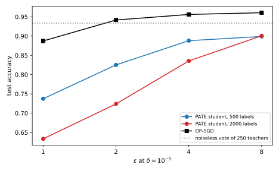

# Private prediction: PATE and in-context learning

## Why this matters

Training a model with differential privacy (DP) by stochastic gradient descent (SGD) with clipped and noisy gradients, DP-SGD ([DP-SGD](02-dp-sgd.md)), makes the trained weights private. Every later use of the model is then free: anyone may download the weights and query them as often as they like, because releasing the weights was the private step and everything after it is post-processing. The price is paid during training. Every step adds noise to every gradient, the training code must compute and clip per-example gradients, and you must own the training loop.

Sometimes that price is the wrong one to pay, or cannot be paid at all. The model may be a large language model (LLM) behind an application programming interface, which you can prompt but not train. It may be a model that someone else trains, or one with no gradients, such as a forest of decision trees. Or it may answer only a few dozen questions in its whole life, a medical consultation tool for one study, for which a private training run is overkill. In each case there is another option: train ordinary, non-private models, **never release them**, and make each *answer* private instead. A query goes in, a differentially private answer comes out, and the models themselves stay behind a wall.

This chapter asks when that is the better choice and how to make it work. It answers with DP applied to predictions rather than to weights. Two questions organize it. How much does each private answer cost, and how many can you afford? And how do you turn a stream of private answers into a private model, so that the cost stops growing? The answer to the second question is private aggregation of teacher ensembles (PATE), introduced by Papernot, Abadi, Erlingsson, Goodfellow and Talwar (2017). Its modern descendant privatizes in-context learning: the private examples are placed in an LLM's prompt rather than used for training.

### The one idea: one record, one vote

Split the private records into $k$ disjoint shards, and train one model, a **teacher**, on each. To answer a query $x$, let every teacher vote for a label and release only the label with the most votes after adding noise to the counts. A record lives in exactly one shard, so it influences exactly one teacher, and that teacher casts exactly one vote. Adding or removing the record can therefore move at most one vote from one label to another, whatever the teachers are, however they were trained, and however badly one of them overfits its shard. The privacy proof stops there. It is the subsample-and-aggregate idea of [Beyond global sensitivity](../part03-dp-foundations/07-sensitivity.md#sec-sens-saa), with a vote as the aggregator.

Everything else is about accuracy, and it comes down to one comparison: the **gap** between the top two vote counts against the noise. When the teachers agree, the gap is large and the noisy winner is almost always the true plurality. When they disagree, the noise decides. And the noise must grow like the square root of the number of answered queries, because each answer spends budget. So private prediction is cheap for a few queries on which the teachers agree, and expensive otherwise. @tbl-pate-overview lists the results.

| Result | Where it is used |
| --- | --- |
| The noisy vote, LNMax and GNMax, and its cost per answer | Every private-prediction system; the noise needed for $Q$ queries |
| The accuracy of a noisy vote: the gap against the noise | Choosing the number of teachers |
| Private answers against a private model: the break-even number of queries | Deciding between private prediction and [DP-SGD](02-dp-sgd.md) |
| PATE: a student trained on privately labelled public data | Turning answers into a model whose use is free |
| Data-dependent analysis and Confident-GNMax | Paying less for answers the teachers agree on; what must be sanitized |
| Stable aggregation: distance to instability and sparse vector | Exact labels and a budget fixed in advance, paid only for contested queries |
| Private in-context learning | Prompting an LLM with private examples |

: The results of this chapter and where each is used. {#tbl-pate-overview}

**Notation.** A private dataset $D$ has $n$ records and is split into $k$ disjoint shards of $n/k$ records, one per teacher. A query $x$ has $m$ possible labels; $n_i(x)$ is the number of teachers that vote for label $i$, so $\sum_in_i(x) = k$, and $i^*$ is the label with the most votes, the **plurality**. The **gap** is the difference between the top count and the runner-up; on two labels it is $|n_1 - n_2|$. The noise on each count is $\mathcal N(0, \sigma^2)$ for GNMax and $\mathrm{Lap}(b)$ for LNMax. $Q$ is the number of answered queries, $\alpha > 1$ an order of Rényi differential privacy (RDP), and $\tilde q$ an upper bound on the probability that the noisy winner differs from the plurality. Neighbouring datasets differ by **adding or removing** one record, as in [DP-SGD](02-dp-sgd.md), and $\delta = 10^{-5}$ throughout.

**The running example.** The part's neural-network task ([DP-SGD](02-dp-sgd.md)): 50-dimensional standard normal inputs labelled $\pm1$ by a fixed random network, $n = 10{,}000$ private training records. Its 20,000 test records are split in two. The first 10,000 form a **public pool**: their inputs are treated as public and unlabelled, as PATE requires, and their labels are used only to measure how good the private labels are. The last 10,000 form the **evaluation set**, on which every accuracy in this chapter is measured. The teachers are regularized logistic regressions, the model of [Private empirical risk minimization](01-dp-erm.md), each fitted on one shard of consecutive records. Logistic regression is cheap and, on this task, as accurate as the part's network on the same few records.

**How to read this chapter.** Read the toolkit and @sec-pate-noisy-max, which give the mechanism and its cost. @sec-pate-accuracy and @sec-pate-versus answer the question in the title: when private answers beat a private model. @sec-pate-student builds PATE, and @sec-pate-data-dependent the analysis that makes it competitive in practice; the second is the most technical section and can be skimmed for its statement and interpretation. @sec-pate-stable gives the alternative that needs no sanitizing, and why it is rarely used. @sec-pate-icl applies everything to in-context learning.

## Toolkit: four facts every derivation uses

### Fact 1 — One record changes one vote

Fix the partition of records into shards *before* looking at the data, by a hash of a record identifier rather than by position. Adding or removing a record then changes one shard, the one its hash points to, and leaves every other shard, and so every other teacher, exactly as it was. That teacher may now vote differently on a query: one count goes down by 1 and another goes up by 1, or nothing changes. The vote histogram $(n_1(x), \dots, n_m(x))$ therefore moves by at most 2 in $\ell_1$ norm, the sum of absolute changes, and by at most $\sqrt{1^2 + 1^2} = \sqrt2$ in $\ell_2$ norm, the Euclidean length of the change. This is the step of subsample-and-aggregate in [Beyond global sensitivity](../part03-dp-foundations/07-sensitivity.md#sec-sens-saa): one record touches one block.

The partition rule matters. If shards were cut by position, inserting one record at the front would shift every later record into the next shard, change every shard, and possibly change every teacher. The derivations below assume a fixed hash; the script splits the records by position only because they are never added or removed in its experiments.

### Fact 2 — The Gaussian mechanism in Rényi DP, and its accountant

Adding $\mathcal N(0, s^2)$ noise to every coordinate of a vector-valued function whose value moves by at most $\Delta$ in $\ell_2$ norm between neighbours gives a mechanism whose Rényi divergence of order $\alpha$ between neighbours is at most $\alpha\Delta^2/(2s^2)$ ([Rényi DP](../part04-privacy-accounting/01-renyi-dp.md)). The **Rényi divergence** of order $\alpha$ between two distributions $P$ and $P'$ on a discrete set of outputs is
$$D_\alpha(P\|P') = \frac{1}{\alpha - 1}\ln\sum_yP(y)^\alpha P'(y)^{1 - \alpha},$$ {#eq-pate-renyi}
and a mechanism is $(\alpha, \varepsilon(\alpha))$-RDP if this is at most $\varepsilon(\alpha)$ for every pair of neighbours. Three properties make RDP the accountant here. Any computation on a private output that does not touch the data again, **post-processing**, cannot increase the divergence. RDP curves **add** under composition, even when each mechanism is chosen after seeing the earlier outputs. And a composed curve converts to $(\varepsilon, \delta)$-DP at the best order,
$$\varepsilon = \min_\alpha\Big[\varepsilon(\alpha) + \ln\frac{\alpha - 1}{\alpha} - \frac{\ln\delta + \ln\alpha}{\alpha - 1}\Big]$$ {#eq-pate-convert}
(Balle et al. 2020; [From Rényi DP to (ε, δ)](../part04-privacy-accounting/02-rdp-conversions.md)). When the curve is a line, $\varepsilon(\alpha) = \rho\alpha$, the result depends only on its slope $\rho$: at $\delta = 10^{-5}$, the largest slope that converts to $\varepsilon = 1$ is $\rho = 0.0306$, and to $\varepsilon = 4$ it is $\rho = 0.3731$. A pure Gaussian mechanism also has an exact conversion: its privacy is that of one Gaussian shift by $\mu = \Delta/s$ standard deviations, Gaussian differential privacy (GDP) with parameter $\mu$, and composing $Q$ of them gives $\mu\sqrt Q$ ([f-DP and Gaussian DP](../part04-privacy-accounting/04-gaussian-dp.md)).

### Fact 3 — Report-noisy-max, and the RDP curve of any pure-DP step

Report-noisy-max adds independent Laplace noise $\mathrm{Lap}(b)$ to every candidate's score and releases only the index of the largest noisy score ([Selection](../part03-dp-foundations/05-selection.md#sec-sel-rnm)). If one record moves each score by at most $\Delta$, it is $(2\Delta/b)$-DP. The reason is that, with every other candidate's noise held fixed, candidate $i$ wins exactly when its own noise clears a bar, the best of the others' noisy scores minus its own score. One record moves that bar by at most $2\Delta$, $\Delta$ through the maximum of the others and $\Delta$ through candidate $i$'s own score, and moving a Laplace threshold by $s$ changes its tail probability by at most $e^{s/b}$. When all scores move in the same direction, the factor 2 disappears. A vote histogram is not of that kind: one count goes up while another goes down.

An $\varepsilon_0$-DP mechanism also has an RDP curve. The worst $\varepsilon_0$-DP mechanism at every order is randomized response, which reports a bit truthfully with probability $p = e^{\varepsilon_0}/(1 + e^{\varepsilon_0})$, so its curve,
$$\varepsilon_{\mathrm{RR}}(\alpha) = \frac{1}{\alpha - 1}\ln\big(p^\alpha(1 - p)^{1 - \alpha} + (1 - p)^\alpha p^{1 - \alpha}\big),$$
is a valid RDP curve for any $\varepsilon_0$-DP step ([Concentrated differential privacy](../part04-privacy-accounting/03-concentrated-dp.md#sec-cdp-pure)). This lets Laplace answers enter the same accountant as Gaussian ones.

### Fact 4 — The difference of two independent Gaussians

If $Z_1$ and $Z_2$ are independent $\mathcal N(0, \sigma^2)$, then $Z_1 - Z_2$ is $\mathcal N(0, 2\sigma^2)$: variances of independent variables add, and subtracting does not change a variance. So $\Pr[Z_1 - Z_2 > t] = \Phi(-t/(\sqrt2\sigma))$, where $\Phi$ is the standard normal cumulative distribution function. In terms of the complementary error function $\operatorname{erfc}$, which numerical libraries provide, $\Phi(-u) = \frac12\operatorname{erfc}(u/\sqrt2)$, so $\Pr[Z_1 - Z_2 > t] = \frac12\operatorname{erfc}(t/(2\sigma))$. Every accuracy statement about GNMax uses this, because whether a noisy vote picks label $i$ over label $j$ depends only on the difference of their two noises.

## The noisy vote: LNMax and GNMax {#sec-pate-noisy-max}

### Context

A query arrives, the $k$ teachers vote, and you must release one label. Which mechanism releases it, and how much does each answer cost? Two mechanisms are used in practice, and they differ in their noise: Laplace noise in the original PATE paper, Gaussian noise in its successor. The question is also how the cost of $Q$ answers grows with $Q$, since that is what limits private prediction.

### Statement

**LNMax** releases $\arg\max_i\big(n_i(x) + \mathrm{Lap}(b)\big)$ and **GNMax** releases $\arg\max_i\big(n_i(x) + \mathcal N(0, \sigma^2)\big)$, with independent noise on every count. Under add/remove neighbours and a fixed partition:

1. Each LNMax answer is $(2/b)$-DP (Papernot et al. 2017).
2. Each GNMax answer is $(\alpha, \alpha/\sigma^2)$-RDP for every $\alpha > 1$ (Papernot, Song, Mironov, Raghunathan, Talwar & Erlingsson 2018, Proposition 8).
3. $Q$ GNMax answers, even with queries chosen adaptively, are $(\alpha, Q\alpha/\sigma^2)$-RDP. To meet a budget $(\varepsilon, \delta)$ the noise must therefore be
$$\sigma = \sqrt{\frac{Q}{\rho(\varepsilon, \delta)}},$$ {#eq-pate-sigma}
where $\rho(\varepsilon, \delta)$ is the largest slope whose line $\rho\alpha$ converts to $(\varepsilon, \delta)$ by @eq-pate-convert. The noise grows like $\sqrt Q$.

### Derivation

1. **The histogram's sensitivity.** By Fact 1, one record moves the vote vector by at most 2 in $\ell_1$ norm and $\sqrt2$ in $\ell_2$ norm.
2. **LNMax is report-noisy-max.** The counts are the scores, each moves by at most $\Delta = 1$, and they can move in opposite directions. Fact 3 with $\Delta = 1$ gives $(2/b)$-DP.
3. **GNMax is post-processing of a Gaussian histogram.** Adding $\mathcal N(0, \sigma^2)$ to every count is the Gaussian mechanism on a vector with $\ell_2$ sensitivity $\sqrt2$, so by Fact 2 its RDP is $\alpha(\sqrt2)^2/(2\sigma^2) = \alpha/\sigma^2$. Taking the argmax and discarding the noisy counts is post-processing, which cannot increase it.
4. **Compose.** Each answer is $(\alpha, \alpha/\sigma^2)$-RDP whatever the earlier answers were, so $Q$ answers add up to $Q\alpha/\sigma^2$ (Fact 2). This holds even if the analyst chooses query $t$ after seeing answers $1, \dots, t - 1$.
5. **Calibrate.** The composed curve is the line $\rho\alpha$ with $\rho = Q/\sigma^2$, and its $\varepsilon$ depends only on $\rho$. Setting $Q/\sigma^2 = \rho(\varepsilon, \delta)$ and solving for $\sigma$ gives @eq-pate-sigma.

### Interpretation

**The cost is per answer, not per teacher.** Neither the number of teachers nor what they are enters the privacy cost. A teacher can be a neural network trained without any noise, a decision forest, or a human annotator who saw one shard. The cost is set by the noise and the number of answers, and the noise can be large in absolute terms because the counts themselves are large: with 250 teachers, noise of standard deviation 40 on each count is noticeable but not overwhelming.

**Gaussian noise wins for many queries, Laplace for very few.** A Laplace answer is analysed as a pure-DP step, which pays for the worst case of every answer; a Gaussian answer has a privacy loss that is itself Gaussian and composes exactly. For one answer the pure-DP analysis is cheap, and as answers accumulate the Gaussian's analysis wins. @tbl-pate-noise compares the noise each needs, expressed as a standard deviation ($\sqrt2b$ for Laplace). For a single answer, Laplace needs less noise. From 100 answers on, Gaussian noise is smaller by a factor close to 2 at both budgets, and the gap persists, since both grow like $\sqrt Q$ once the composition is in its square-root regime.

**Only the label is released.** As in report-noisy-max, publishing the noisy counts as well would release a vector, and step 3 would no longer apply to the published output; the analysis would then have to pay for all $m$ counts as a release in their own right. GNMax happens to have a valid analysis for the noisy counts too, since it is a Gaussian mechanism, but the data-dependent analysis of @sec-pate-data-dependent needs the label alone.

**How tight is the RDP accountant here?** A Gaussian histogram has an exact conversion (Fact 2). At the $\sigma$ the RDP accountant picks for $\varepsilon = 1$, the exact $\varepsilon$ is 0.915, and for $\varepsilon = 4$ it is 3.698: the accountant overstates $\varepsilon$ by about 9% and 8%. The ratio is the same for every $Q$ because both depend only on $Q/\sigma^2$.

### Example: the noise for $Q$ answers

@tbl-pate-noise gives the noise for four numbers of answers at $\varepsilon = 1$ and $\varepsilon = 4$.

| Budget | Answers $Q$ | GNMax $\sigma$ | LNMax $b$ | LNMax standard deviation $\sqrt2b$ |
| --- | --- | --- | --- | --- |
| $\varepsilon = 1$ | 1 | 5.72 | 2.02 | 2.85 |
| | 100 | 57.2 | 79.7 | 113 |
| | 1,000 | 181 | 255 | 361 |
| | 10,000 | 572 | 809 | 1,140 |
| $\varepsilon = 4$ | 1 | 1.64 | 0.501 | 0.709 |
| | 100 | 16.4 | 22.7 | 32.1 |
| | 1,000 | 51.8 | 73.1 | 103 |
| | 10,000 | 164 | 231 | 327 |

: Noise per count for $Q$ answers at $(\varepsilon, 10^{-5})$, from the RDP accountant; Laplace answers are charged the randomized-response curve of Fact 3. {#tbl-pate-noise}

The $\sqrt Q$ law of @eq-pate-sigma is exact here: from 100 to 10,000 answers, a hundredfold increase, $\sigma$ grows tenfold, from 57.2 to 572. That is what makes 10,000 answers at $\varepsilon = 1$ hopeless for any ensemble of fewer than a few thousand teachers: noise of standard deviation 572 on each count swamps any vote.

@fig-pate-votes shows what the noise does to real votes. With $k = 100$ teachers on the running example and the noise for 1,000 answers at $\varepsilon = 4$, $\sigma = 51.8$, a query on which 98 teachers vote $-1$ and 2 vote $+1$, a gap of 96, gets the plurality label with probability 0.9051. A query split 70 to 30, gap 40, gets it with probability 0.7076, and one split 52 to 48, gap 4, with probability 0.5218, barely better than a coin. Across the public pool, the fraction of teachers voting $+1$ piles up near 0 and 1, but a large share of queries sits in between.

{#fig-pate-votes}

### Check yourself

- You double the number of teachers and keep $Q$ and $\varepsilon$. Does $\sigma$ change? *(No. @eq-pate-sigma does not contain $k$: one record still moves one vote. What changes is the counts, which are now twice as large, so the same noise matters less if the teachers agree as much as before.)*
- Why would publishing the noisy winning count along with the label break the LNMax analysis? *(The report-noisy-max proof conditions on the other candidates' noise and integrates over the winner's own noise. Publishing the winner's noisy count publishes that noise, which the proof assumed stays hidden.)*

## How accurate is a noisy vote {#sec-pate-accuracy}

### Context

The cost of an answer does not depend on the teachers. Its accuracy depends on little else. How likely is the noisy vote to return the plurality label, and how should you choose the number of teachers $k$, given that more teachers means fewer records each?

### Statement

On two labels, GNMax returns the plurality label with probability
$$\Pr[\text{plurality}] = \Phi\Big(\frac{g}{\sqrt2\,\sigma}\Big),$$ {#eq-pate-two-class}
where $g$ is the gap. On $m$ labels, the probability that it returns anything other than the plurality $i^*$ is at most
$$\tilde q = \sum_{i \ne i^*}\frac12\operatorname{erfc}\Big(\frac{n_{i^*} - n_i}{2\sigma}\Big)$$ {#eq-pate-qtilde}
(Papernot et al. 2018, Proposition 7). If a fraction $a(x)$ of the $k$ teachers vote for the correct label on a two-label query $x$, the gap measured toward the correct label is $k(2a(x) - 1)$, and the expected accuracy of the private answers is the average of $\Phi\big(k(2a(x) - 1)/(\sqrt2\sigma)\big)$ over queries.

### Derivation

1. **Two labels.** GNMax returns label 1 when $n_1 + Z_1 > n_2 + Z_2$, that is when $Z_2 - Z_1 < n_1 - n_2$. By Fact 4, $Z_2 - Z_1$ is $\mathcal N(0, 2\sigma^2)$, so this has probability $\Phi((n_1 - n_2)/(\sqrt2\sigma))$. With label 1 the plurality, $n_1 - n_2 = g$: @eq-pate-two-class.
2. **Many labels.** GNMax returns some $i \ne i^*$ only if $n_i + Z_i > n_{i^*} + Z_{i^*}$ for at least one $i$. The probability that at least one of several events happens is at most the sum of their probabilities (the union bound), and each has probability $\frac12\operatorname{erfc}((n_{i^*} - n_i)/(2\sigma))$ by Fact 4: @eq-pate-qtilde.
3. **Accuracy toward the truth.** Measure the gap toward the correct label instead of the plurality: it is the number of teachers that are right minus the number that are wrong, $ka - k(1 - a) = k(2a - 1)$, negative when most teachers are wrong. Step 1 with this signed gap gives the probability of a correct answer, and averaging over queries gives the expected accuracy.

### Interpretation

**The trade-off in $k$.** For a fixed number of answers and budget, $\sigma$ is fixed (@eq-pate-sigma), and the signal is $k(2a - 1)$. More teachers multiply the signal by $k$; but each teacher sees $n/k$ records, is less accurate, and agrees less with the others, so $2a - 1$ shrinks. Whether to add teachers depends on which effect wins. When the teachers' accuracy falls slowly with shard size, as it does for a model that learns from few examples, more teachers win; when a teacher needs many records to be any good, fewer teachers are better.

**The ceiling.** Without noise, the plurality vote is an ensemble, and its accuracy is the best any private answer can reach. Noise can only pull answers toward a coin flip. On queries the teachers find hard, where $a(x)$ is near $\frac12$, any noise at all makes the answer close to random; this is the part of the accuracy that noise destroys first.

**How tight is @eq-pate-qtilde?** For two labels it is exact, since there is only one competitor. For many labels it adds the probabilities of beating the plurality one competitor at a time, which double-counts the outcomes where several competitors beat it. It is close when one competitor dominates the error and loose when many are nearly tied with the plurality.

### Example: teachers on the running example

@tbl-pate-teachers splits the 10,000 private records among 25 to 500 teachers.

| Teachers $k$ | Records each | Mean teacher accuracy | Plurality vote accuracy | Median $|g|/k$ |
| --- | --- | --- | --- | --- |
| 25 | 400 | 0.8954 | 0.9403 | 1.000 |
| 50 | 200 | 0.8518 | 0.9389 | 0.880 |
| 100 | 100 | 0.7896 | 0.9384 | 0.660 |
| 250 | 40 | 0.7031 | 0.9336 | 0.408 |
| 500 | 20 | 0.6459 | 0.9339 | 0.276 |

: Teachers on the running example, measured on the evaluation set: each teacher's accuracy, the accuracy of the noiseless plurality vote, and the median gap as a fraction of the number of teachers. {#tbl-pate-teachers}

The teachers get much worse as their shards shrink, from 0.8954 with 400 records to 0.6459 with 20, but the plurality vote hardly moves, between 0.9336 and 0.9403. Averaging many weak linear classifiers recovers most of what one classifier on all the data would learn. The relative gap falls from 1.000 to 0.276, but the absolute median gap grows, from 25 to $0.276 \times 500 = 138$. Since the noise does not depend on $k$, more teachers win here. @tbl-pate-answers puts numbers on it.

| Budget | Answers $Q$ | $\sigma$ | $k = 25$ | $k = 50$ | $k = 100$ | $k = 250$ | $k = 500$ |
| --- | --- | --- | --- | --- | --- | --- | --- |
| $\varepsilon = 1$ | 100 | 57.2 | 0.5961 | 0.6651 | 0.7461 | 0.8250 | 0.8588 |
| | 1,000 | 180.9 | 0.5308 | 0.5546 | 0.5889 | 0.6489 | 0.6987 |
| | 10,000 | 572.1 | 0.5097 | 0.5173 | 0.5285 | 0.5498 | 0.5709 |
| $\varepsilon = 4$ | 100 | 16.4 | 0.7899 | 0.8803 | 0.9064 | 0.9185 | 0.9237 |
| | 1,000 | 51.8 | 0.6059 | 0.6805 | 0.7641 | 0.8378 | 0.8682 |
| | 10,000 | 163.7 | 0.5340 | 0.5602 | 0.5979 | 0.6625 | 0.7140 |

: Expected accuracy of $Q$ GNMax answers on the evaluation set, computed exactly from @eq-pate-two-class and each query's vote gap. {#tbl-pate-answers}

With 100 answers at $\varepsilon = 4$, 500 teachers answer with accuracy 0.9237, about 1 point below their noiseless vote, 0.9339. With 1,000 answers at $\varepsilon = 1$, even 500 teachers fall to 0.6987, and 25 teachers, whose gaps never exceed 25, to 0.5308, a coin flip with a slight bias.

### Check yourself

- A query has 250 teachers split 175 to 75. With $\sigma = 40$, what is the probability that GNMax returns the plurality? *(The gap is 100, so $\Phi(100/(\sqrt2 \times 40)) = \Phi(1.77) \approx 0.96$.)*
- Why does the plurality accuracy in @tbl-pate-teachers barely depend on $k$, when the teachers' own accuracy drops by 25 points? *(Each teacher's error is mostly its own sampling noise on a small shard, and these errors are close to independent across shards; a majority of many weak but independent voters is right much more often than any one of them.)*

## Private answers against a private model {#sec-pate-versus}

### Context

Here is the question of the title in its sharpest form. You have a budget $(\varepsilon, \delta)$. You can spend it on training one model with DP-SGD, whose answers are then free, or on answering queries one at a time with a teacher ensemble. Which gives more accurate answers, and how does the answer depend on how many queries you expect?

### Statement

Let $A_{\mathrm{model}}(\varepsilon)$ be the accuracy of a privately trained model at budget $\varepsilon$; it does not depend on how many queries the model answers. Let $A_{\mathrm{vote}}(Q, \varepsilon)$ be the expected accuracy of $Q$ private answers at the same budget, with $\sigma$ from @eq-pate-sigma. Then $A_{\mathrm{vote}}(Q, \varepsilon)$ decreases in $Q$, from the noiseless vote's accuracy toward $\frac12$ (on two labels), and private answers are better exactly for
$$Q < Q^*(\varepsilon) = \max\{Q : A_{\mathrm{vote}}(Q, \varepsilon) \ge A_{\mathrm{model}}(\varepsilon)\},$$ {#eq-pate-breakeven}
with $Q^* = 0$ when even one answer is worse than the model.

### Derivation

1. **The model's accuracy is constant in $Q$.** Every query to a released model is post-processing of its weights (Fact 2), so its answers cost nothing and are exactly as accurate as the model.
2. **The vote's accuracy falls with $Q$.** By @eq-pate-sigma, $\sigma$ grows like $\sqrt Q$. Each query's probability of a correct answer, $\Phi(g/(\sqrt2\sigma))$ with its signed gap $g$, decreases in $\sigma$ when $g > 0$ and increases toward $\frac12$ when $g < 0$; as $\sigma \to \infty$ every term tends to $\frac12$. On this task the plurality is correct on most queries, and the average decreases in $Q$ throughout the range shown here.
3. **Break-even.** A decreasing function crosses a constant at most once, at $Q^*$.

### Interpretation

**Private prediction wins when the budget is small and the queries are few.** DP-SGD pays a fixed price whatever the number of queries, and at small $\varepsilon$ that price is a model much worse than the non-private one. The vote pays per query; its first answers are almost as good as the noiseless ensemble. So at small $\varepsilon$ there is a range of $Q$ where the vote wins, and at large $\varepsilon$, where DP-SGD loses little, there may be none.

**The ensemble's ceiling sets the large-$\varepsilon$ limit.** Even one noiseless answer is only as good as the plurality vote. If the teachers, each trained on a small shard, cannot match one model trained on all the data, no amount of budget closes the gap. On the running example the ensemble of linear teachers reaches 0.9403 at best, below what DP-SGD reaches at $\varepsilon = 2$.

**What the comparison leaves out.** It assumes you *can* run DP-SGD. When the teachers are LLMs behind an interface, models without gradients, or models trained by different parties who will not pool their data, the comparison is not with DP-SGD but with nothing, and private prediction is the only private option. It also ignores cost: DP-SGD trains once, while private prediction runs $k$ models on every query.

### Example: the running example

The DP-SGD baseline is the configuration of [DP-SGD](02-dp-sgd.md): $q = 0.01$, $C = 0.5$, step size 0.5, 10,000 steps, with the noise multiplier for each budget, retrained here and evaluated on this chapter's evaluation set (two runs each). @tbl-pate-breakeven gives its accuracy and the break-even number of queries, taking for each budget the number of teachers that answers the most queries.

| $\varepsilon$ | DP-SGD accuracy (2 runs) | Break-even $Q^*$ | Best $k$ |
| --- | --- | --- | --- |
| 0.5 | $0.8164 \pm 0.0060$ | 58 | 500 |
| 1 | $0.9128 \pm 0.0207$ | 18 | 500 |
| 2 | $0.9438 \pm 0.0039$ | 0 | — |
| 4 | $0.9573 \pm 0.0024$ | 0 | — |
| 8 | $0.9605 \pm 0.0004$ | 0 | — |

: DP-SGD on the running example against private answers by GNMax: the largest number of queries for which the answers' expected accuracy is at least the private model's. {#tbl-pate-breakeven}

At $\varepsilon = 0.5$, where DP-SGD reaches only 0.8164, 500 teachers answer up to 58 queries more accurately than the private model. At $\varepsilon = 1$ the range shrinks to 18 queries. From $\varepsilon = 2$ on, DP-SGD beats even a single noiseless vote, because the ensemble's ceiling, 0.9336 to 0.9403, is below its 0.9438. @fig-pate-answers shows the whole curve.

{#fig-pate-answers}

### Check yourself

- If DP-SGD at $\varepsilon = 1$ were much worse on your task, say because you had only 1,000 records, would $Q^*$ grow or shrink? *(It would grow, because the model's accuracy, the constant in @eq-pate-breakeven, falls. The teachers would also be weaker, though, so the vote's curve falls too; which effect wins has to be measured.)*
- A product team expects a model to answer a million queries. Should it use private prediction? *(Not query by query: a million answers need $\sigma$ a hundred times that of 100 answers. It should either train privately or turn a few hundred private answers into a model, which is the next section.)*

## PATE: from private answers to a private model {#sec-pate-student}

### Context

Private answers cost budget forever; a private model costs it once. PATE combines them. Spend the budget on labelling a fixed number of *public, unlabelled* inputs with private answers, then train a new model, the **student**, on those inputs and labels. The student is released; the teachers never are. How private is the student, and how good can it be?

### Statement

Let a student be trained, by any algorithm, on $Q$ public inputs $x_1, \dots, x_Q$ and their GNMax labels with noise $\sigma$, and on any other public data, possibly unlabelled. Then the student, and every prediction it ever makes, is $(\alpha, Q\alpha/\sigma^2)$-RDP with respect to the private data, and so $(\varepsilon, \delta)$-DP with $\varepsilon$ from @eq-pate-convert. The privacy cost depends on the number of labelled queries $Q$ and on $\sigma$, and on nothing about the student: not its size, its training algorithm or how many predictions it makes.

### Derivation

1. **The only private output is the labels.** The student's training algorithm sees the public inputs, which do not depend on the private data, and the $Q$ labels. It never touches the teachers or the private records.
2. **The labels are $Q$ GNMax answers.** The inputs to be labelled may be chosen adaptively, for example by the student asking about inputs it is unsure of, because RDP composition holds for adaptively chosen mechanisms. Their total cost is $Q\alpha/\sigma^2$ (@sec-pate-noisy-max).
3. **Post-processing.** The student's weights are a function of the labels and of public data, so they are as private as the labels (Fact 2), and so is every prediction computed from the weights.

### Interpretation

**Three things limit the student.** It is trained on $Q$ examples rather than $n$, so it learns less than a model trained on all the private data. Its labels are noisy versions of the plurality vote, wrong on some fraction of the queries. And the plurality vote itself has the ensemble's ceiling. Budget pulls these in opposite directions: more labels mean more noise per label by @eq-pate-sigma, so for each $\varepsilon$ there is a best $Q$.

**What PATE needs from you.** Public, unlabelled inputs from the same distribution as the private data. In some domains this is easy (unlabelled images or text are plentiful; the labels are what is sensitive), in others impossible (there is no public pool of medical records). PATE also needs the public pool to be really public: an input that is itself a private record of someone else is protected by nothing in this analysis.

**Semi-supervised students.** The student may use every unlabelled public input, not only the $Q$ it paid to label. Papernot et al. (2017) train the student as a semi-supervised generative adversarial network (GAN) on the labelled and unlabelled inputs, and Papernot et al. (2018) use semi-supervised methods for their image tasks. This chapter's student uses only its $Q$ labelled inputs, which is the simplest choice and the least favourable to PATE.

**What PATE protects, and against whom.** The guarantee covers the released student and its predictions. The teachers are non-private models of the data and must stay secret: an attacker who steals one can run any attack of [Part 2](../part02-attacks/00-introduction.md) on its shard. PATE moves the trust from the training algorithm to the server that holds the teachers.

### Example: students on the running example

Take $k = 250$ teachers. Their plurality vote labels the public pool with accuracy 0.9322. The student is the part's network (64 hidden units, 3,329 weights), trained non-privately on the first $Q$ public inputs and their GNMax labels for 2,000 steps. @tbl-pate-student gives the results; the first two rows are references without privacy.

| Labels | $Q = 250$ | $Q = 500$ | $Q = 1{,}000$ | $Q = 2{,}000$ |
| --- | --- | --- | --- | --- |
| True labels (not private) | 0.8726 | 0.8990 | 0.9188 | 0.9410 |
| Noiseless plurality (not private) | 0.8913 | 0.9106 | 0.9229 | 0.9297 |
| GNMax, $\varepsilon = 1$ | 0.8238 (0.7760) | 0.7595 (0.6880) | 0.6995 (0.6350) | 0.6749 (0.6260) |
| GNMax, $\varepsilon = 2$ | 0.7980 (0.8040) | 0.8393 (0.8140) | 0.8141 (0.7490) | 0.7318 (0.6885) |
| GNMax, $\varepsilon = 4$ | 0.8633 (0.8720) | 0.8754 (0.8740) | 0.8898 (0.8360) | 0.8259 (0.7840) |
| GNMax, $\varepsilon = 8$ | 0.8950 (0.9160) | 0.9037 (0.9040) | 0.9049 (0.8870) | 0.8884 (0.8525) |

: Test accuracy of a PATE student with 250 teachers, against the number of labelled public queries $Q$, one run each; in parentheses, the fraction of the student's GNMax labels that are correct. {#tbl-pate-student}

The best student reaches 0.8238 at $\varepsilon = 1$ ($Q = 250$), 0.8393 at $\varepsilon = 2$ ($Q = 500$), 0.8898 at $\varepsilon = 4$ ($Q = 1{,}000$) and 0.9049 at $\varepsilon = 8$ ($Q = 1{,}000$). DP-SGD, at 0.9128, 0.9438, 0.9573 and 0.9605, is better at every budget (@fig-pate-student). The table shows why. With true labels, the student needs 2,000 examples to reach 0.9410; at $\varepsilon = 4$, 2,000 labels need $\sigma = 73.2$, and only 0.7840 of them are right. With fewer labels the noise is lower, but the student has too few examples. (The best $Q$ for each budget is chosen here by looking at test accuracy, which is itself a leak; [Hyperparameter tuning](03-hyperparameter-tuning.md) shows how to pay for it.)

{#fig-pate-student}

On this task PATE loses, and it is worth saying why, because the reasons are the conditions under which it wins elsewhere. The task is binary, so a wrong label is the other label and label noise is as damaging as it can be. The teachers are weak (0.7031 each with 40 records) and disagree on many queries, so many gaps are small against the noise. The student needs thousands of labels to learn the decision boundary. And DP-SGD does well on this task even at $\varepsilon = 1$. PATE's published successes are on tasks where teachers agree on most inputs and a student learns from few labels plus many unlabelled inputs: on a handwritten-digit benchmark (MNIST), Papernot et al. (2018, Table 1) report a student with 98.5% accuracy against a non-private 99.2%, at $\varepsilon = 1.97$ with 286 answered queries. The next section explains the analysis behind such small $\varepsilon$.

### Check yourself

- The student is trained with 2,000 steps of non-private SGD and has 3,329 weights. Does either number change its $\varepsilon$? *(No. The student's training is post-processing of the labels; only $Q$ and $\sigma$ enter.)*
- Could the student query the teachers about inputs it is uncertain about, after a first round of training? *(Yes. The queries are public inputs chosen from earlier private answers, which adaptive composition allows; each answer still costs $\alpha/\sigma^2$.)*

## Data-dependent analysis and Confident-GNMax {#sec-pate-data-dependent}

### Context

The cost $\alpha/\sigma^2$ of a GNMax answer is a worst case over all vote histograms, including those where the vote is tied and one teacher decides it. But when 249 of 250 teachers agree, one record, which changes one teacher, can hardly change the answer: the noisy vote returns the plurality with overwhelming probability, with or without that record. Can a query on which the teachers agree be charged less? And can a mechanism be designed to answer only such queries?

### Statement

**The pure-DP form** (Papernot et al. 2017, Theorem 3, written in RDP). Let $M$ be $\varepsilon_0$-DP and suppose that on the actual dataset $D$ there is an output $i^*$ with $\Pr[M(D) \ne i^*] = q < e^{-\varepsilon_0}$. Then for every neighbour $D'$,
$$D_\alpha\big(M(D)\|M(D')\big) \le \frac{1}{\alpha - 1}\ln\Big[(1 - q)^\alpha\big(1 - e^{\varepsilon_0}q\big)^{1 - \alpha} + q\,e^{(\alpha - 1)\varepsilon_0}\Big].$$ {#eq-pate-dd-pure}
When only an upper bound $\tilde q \ge q$ is known, the bound holds with the largest value of the right side over $q \in (0, \tilde q]$. For LNMax, $\varepsilon_0 = 2/b$.

**The Gaussian form** (Papernot et al. 2018, Theorem 6, with their orders from Proposition 10). For GNMax with noise $\sigma$ and $\tilde q$ from @eq-pate-qtilde, let $\mu_2 = \sigma\sqrt{\ln(1/\tilde q)}$, $\mu_1 = \mu_2 + 1$, $\varepsilon_1 = \mu_1/\sigma^2$ and $\varepsilon_2 = \mu_2/\sigma^2$. If $\alpha \le \mu_1$, $\mu_2 > 1$ and $\tilde q \le e^{(\mu_2 - 1)\varepsilon_2}\big/\big(\frac{\mu_1}{\mu_1 - 1}\cdot\frac{\mu_2}{\mu_2 - 1}\big)^{\mu_2}$, then for every neighbour $D'$
$$D_\alpha\big(M(D)\|M(D')\big) \le \frac{1}{\alpha - 1}\ln\Big[(1 - \tilde q)A^{\alpha - 1} + \tilde qB^{\alpha - 1}\Big],\quad A = \frac{1 - \tilde q}{1 - (\tilde qe^{\varepsilon_2})^{(\mu_2 - 1)/\mu_2}},\quad B = \frac{e^{\varepsilon_1}}{\tilde q^{1/(\mu_1 - 1)}}.$$ {#eq-pate-dd-gauss}
Each answer is charged the smaller of this and $\alpha/\sigma^2$, and the charges add up over answers.

**Confident-GNMax** (Papernot et al. 2018, Algorithm 1). For each query, release $\bot$ (no answer) unless $\max_in_i + \mathcal N(0, \sigma_1^2) \ge T$; if the check passes, release a GNMax answer with noise $\sigma_2$. With data-independent accounting, $P$ checks and $A$ answers cost
$$\varepsilon(\alpha) = \Big(\frac{P}{2\sigma_1^2} + \frac{A}{\sigma_2^2}\Big)\alpha,$$ {#eq-pate-confident}
provided the total is kept below a budget fixed in advance.

### Derivation

The pure-DP form shows where all data-dependent bounds come from; the Gaussian form follows the same plan with Rényi bounds at higher orders in place of the pure-DP ratio, and its proof is in Papernot et al. (2018, Appendix A). @sec-apx-learn-pate in the appendices derives it step by step.

1. **Write the divergence as a sum over outputs.** By @eq-pate-renyi, $e^{(\alpha - 1)D_\alpha} = \sum_yP(y)^\alpha P'(y)^{1 - \alpha}$, with $P = M(D)$ and $P' = M(D')$. Split the sum into the likely output $i^*$ and the rest. Write $q = P(\text{not } i^*)$ and $p = P'(\text{not } i^*)$.
2. **The unlikely outputs.** For $y \ne i^*$, $P(y)^\alpha P'(y)^{1 - \alpha} = P(y)\big(P(y)/P'(y)\big)^{\alpha - 1} \le P(y)e^{(\alpha - 1)\varepsilon_0}$, because $\varepsilon_0$-DP bounds the ratio by $e^{\varepsilon_0}$. Summed over $y \ne i^*$, this is at most $q\,e^{(\alpha - 1)\varepsilon_0}$.
3. **The likely output.** Its term is $(1 - q)^\alpha(1 - p)^{1 - \alpha}$. Pure DP, applied to the event "not $i^*$", gives $p \le e^{\varepsilon_0}q$, so $1 - p \ge 1 - e^{\varepsilon_0}q > 0$. The exponent $1 - \alpha$ is negative, so a larger base gives a smaller power: $(1 - p)^{1 - \alpha} \le (1 - e^{\varepsilon_0}q)^{1 - \alpha}$.
4. **Collect.** Adding the two parts and taking $\frac{1}{\alpha - 1}\ln$ gives @eq-pate-dd-pure with the true $q$. Since only a bound $\tilde q$ is computable, take the largest value over all $q$ the bound allows; the right side increases in $q$ for every $q < e^{-\varepsilon_0}$, because it is convex in $q$ with a non-negative slope at 0 (@sec-apx-learn-pate in the appendices proves both), so the largest value is at $q = \tilde q$.
5. **Small $q$.** At $q = 0$ the bracket is 1 and the bound is 0. Its derivative there is $e^{(\alpha - 1)\varepsilon_0} + (\alpha - 1)e^{\varepsilon_0} - \alpha$, so for small $q$ the bound is about $q$ times a constant: the cost of an answer is proportional to the probability that the noise overturns the plurality.
6. **Confident-GNMax.** The check releases a noisy version of $\max_in_i$, which one record changes by at most 1 (one count up or down by 1 moves the maximum by at most 1), so it is a Gaussian mechanism with sensitivity 1: $(\alpha, \alpha/(2\sigma_1^2))$-RDP for every query, answered or not. The second step is GNMax, $(\alpha, \alpha/\sigma_2^2)$-RDP, run only when the check passes. Whether it runs is decided by a released output, so its cost is chosen adaptively. Both costs are lines in $\alpha$, and the Rényi filter of [Adaptive composition](../part04-privacy-accounting/08-adaptive-composition.md#sec-adapt-renyi-filter) says that adaptively chosen RDP costs that stay below a fixed budget on every path compose as if fixed. Summing gives @eq-pate-confident.

### Interpretation

**Agreement is cheap, disagreement costs full price.** @fig-pate-dd-cost draws the cost of one GNMax answer with $\sigma = 40$ at order 8 against the gap. At gaps up to 100 the data-dependent bound is no better than the data-independent $\alpha/\sigma^2 = 0.005$; then it falls steeply, to $1.23 \times 10^{-3}$ at a gap of 150 and $8.37 \times 10^{-5}$ at 200. The dashed curve is the exact data-dependent cost on two labels, which the script computes directly: the output is then a coin with probability $\Phi(g/(\sqrt2\sigma))$, one record moves $g$ by 2, and @eq-pate-renyi applies to two outcomes. It lies below the bound everywhere: at a gap of 150, $2.42 \times 10^{-4}$, five times below. Theorem 6 is valid but not tight, and it is far from tight for small gaps, where on two labels even the data-independent cost overstates the truth.

{#fig-pate-dd-cost}

**Why it helps little here and a lot elsewhere.** The total is a sum over queries, so the saving depends on how many queries have large gaps. With 250 teachers on the running example, only 0.2879 of the public queries have a gap of at least 150, so most answers pay close to full price. On a task where nearly all teachers agree on nearly all inputs, as on handwritten digits, almost every answer is nearly free, and $\varepsilon$ falls by a large factor.

**The data-dependent $\varepsilon$ is itself private information.** It is computed from the votes, so publishing it reveals something about the teachers and so about the data. Worse, its sensitivity is large: one record changes one teacher, and that teacher's votes can change on *every* query, moving every term of the sum. Papernot et al. (2018, Appendix B) therefore release the data-dependent $\varepsilon$ with Gaussian noise scaled to its **smooth sensitivity**, the device of [Beyond global sensitivity](../part03-dp-foundations/07-sensitivity.md#sec-sens-smooth) for functions whose worst-case sensitivity is far above their typical one, and pay for that release too. On MNIST, with 250 teachers of 200 examples, 640 queries, $T = 200$, $\sigma_1 = 150$ and $\sigma_2 = 40$, they report an expected 283 answered queries and a data-dependent $\varepsilon = 2.00$ at $\delta = 10^{-5}$, which becomes $2.52 \pm 0.385$ once sanitized (their Table 2). Without that step, a data-dependent $\varepsilon$ is a measurement, not a guarantee.

**A one-directional bound.** @eq-pate-dd-pure and @eq-pate-dd-gauss bound $D_\alpha(M(D)\|M(D'))$ for the actual dataset $D$ against every neighbour, the direction the accounting of Papernot et al. uses. The exact two-label computation above takes the worse of both directions, and is still below the bound.

**Confident-GNMax answers what is cheap and correct.** Queries with a strong consensus are cheap under the data-dependent analysis, and their plurality label is more likely to be right. The noisy check selects them. It costs something on every query, but with $\sigma_1$ much larger than $\sigma_2$ that cost is small per query, and the expensive, likely-wrong queries are mostly skipped. The price is that the student never sees labels for the hard inputs near the decision boundary.

### Example: data-dependent costs on the running example

**The pure-DP form.** For an LNMax answer with $\varepsilon_0 = 0.1$, at order 8 the data-independent cost is 0.0367. If the plurality fails with probability $\tilde q = 0.1$, @eq-pate-dd-pure gives 0.0235; at $\tilde q = 0.01$, 0.00248; at $\tilde q = 0.001$, 0.00025. Below $\tilde q = 0.1$ the cost falls in proportion to $\tilde q$, as step 5 predicts.

**GNMax on 250 teachers.** @tbl-pate-dd compares the costs of answering the first $Q$ public queries with $\sigma = 40$.

| Answers $Q$ | Data-independent $\varepsilon$ | Data-dependent $\varepsilon$ (not sanitized) |
| --- | --- | --- |
| 250 | 2.45 | 1.93 |
| 1,000 | 5.38 | 4.37 |
| 4,000 | 12.30 | 10.23 |

: $\varepsilon$ at $\delta = 10^{-5}$ for $Q$ GNMax answers with 250 teachers and $\sigma = 40$ on the running example's public pool. {#tbl-pate-dd}

The saving is about 20% at every $Q$, the fraction of queries with large gaps. @fig-pate-epsilon-queries shows the same over $Q$, with LNMax at the same noise standard deviation for comparison: Laplace answers cost more at every $Q$ shown, and the ratio grows with $Q$. The data-dependent $\varepsilon$ also has the instability described above: if one teacher among the 250 switched every one of its votes on the first 1,000 queries, the data-dependent $\varepsilon$ would move from 4.375 to 4.389.

{#fig-pate-epsilon-queries}

**Confident-GNMax.** With the parameters Papernot et al. use on MNIST, $T = 200$, $\sigma_1 = 150$ and $\sigma_2 = 40$, @tbl-pate-confident runs the 250 teachers on pools of 1,000 and 4,000 public queries.

| Pool $P$ | Answered $A$ | Label accuracy | Data-independent $\varepsilon$ | Data-dependent $\varepsilon$ | Student accuracy |
| --- | --- | --- | --- | --- | --- |
| 1,000 | 459 | 0.8693 | 3.59 | 2.82 | 0.8894 |
| 4,000 | 1,773 | 0.8917 | 7.87 | 6.28 | 0.9043 |

: Confident-GNMax with 250 teachers, $T = 200$, $\sigma_1 = 150$, $\sigma_2 = 40$, on the running example; the student is trained on the answered queries only. {#tbl-pate-confident}

At a data-independent $\varepsilon = 3.59$, Confident-GNMax trains a student to 0.8894, about what plain GNMax reached at $\varepsilon = 4$ (0.8898 in @tbl-pate-student). It improves on GNMax a little, not enough to catch DP-SGD at 0.9573. The check costs little: $1{,}000/(2 \times 150^2) = 0.022$ in slope, against $459/40^2 = 0.287$ for the answers.

### Check yourself

- Why can't the data-dependent $\varepsilon$ simply be released with noise calibrated to its global sensitivity? *(Its global sensitivity is huge. One record changes one teacher, whose votes may change on every query; on a histogram near a tie, each such change moves that query's cost from almost 0 to the full $\alpha/\sigma^2$, so the worst-case change of the sum is close to the data-independent total.)*
- In Confident-GNMax, why is $\sigma_1$ chosen much larger than $\sigma_2$? *(The check is paid on every query and the answer only on answered ones. A large $\sigma_1$ makes the frequent cost small; the check only needs to separate strong consensus from weak, which a noisy maximum can do even with a lot of noise when $T$ is set well.)*

## Paying only for disagreement, with a worst-case guarantee {#sec-pate-stable}

### Context

The data-dependent analysis of @sec-pate-data-dependent charges agreed answers less, but the $\varepsilon$ it computes is itself a function of the votes, and publishing it needs a separate private release with smooth sensitivity. There is another way to make agreement cheap. Instead of measuring after the fact how much each answer cost, test privately, before answering, whether the vote is so lopsided that one record cannot overturn it. Release the plurality label exactly when the test passes, and nothing when it fails. Then let only the failures cost budget, by running the tests through the sparse vector technique of [Selection](../part03-dp-foundations/05-selection.md#sec-sel-svt). This is the stability-based aggregation of Thakurta & Smith (2013), which Bassily, Thakkar & Thakurta (2018) apply to PATE. Its guarantee is an ordinary $(\varepsilon, \delta)$ fixed before any vote is seen. What does it cost, and when does it pay?

### Statement

For a query $x$, the **distance to instability** is the largest number $j$ such that changing the votes of *any* $j$ teachers leaves the same label strictly on top. With $g$ the gap between the top two counts,
$$\operatorname{dist}(x) = \Big\lceil\frac g2\Big\rceil - 1, \quad\text{and } 0 \text{ when } g = 0.$$ {#eq-pate-dist}
**Stable aggregation** goes through the public queries in order, and asks of each one whether its distance is clearly above a threshold $t$. AboveThreshold halts at the first query whose value is high, and here the procedure should halt at the first query whose distance is low. So it runs AboveThreshold at a budget $\varepsilon_0$ on the negated distances $-\operatorname{dist}(x_i)$ with threshold $-t$. The threshold gets noise $\rho \sim \mathrm{Lap}(2/\varepsilon_0)$ and each query fresh noise $\nu_i \sim \mathrm{Lap}(4/\varepsilon_0)$.

A query with $-\operatorname{dist}(x_i) + \nu_i \ge -t + \rho$ is **unstable**. It gets no label, and the run restarts with fresh threshold noise. Every other query is **stable**, and it gets the exact plurality label, with no noise. The procedure stops after $c$ unstable answers or at the end of the pool of $P$ queries.

The total slack $\delta$ is split in two. One part, $\delta_{\text{bad}}$, bounds the chance that a query with no margin slips through the test, and the other, $\delta'$, goes to the conversion from RDP. Choose the threshold $t$ so that
$$P\cdot\Pr[\nu - \rho > t] \le \delta_{\text{bad}}, \qquad \Pr[\nu - \rho > t] = \frac{b_1^2e^{-t/b_1} - b_2^2e^{-t/b_2}}{2(b_1^2 - b_2^2)},$$ {#eq-pate-stable-threshold}
with $b_1 = 4/\varepsilon_0$ and $b_2 = 2/\varepsilon_0$ the two Laplace scales. Then all the released labels together are $(\varepsilon, \delta' + \delta_{\text{bad}})$-DP, where $\varepsilon$ is the better of basic composition, $c\varepsilon_0$, and the conversion at $\delta'$ of $c$ composed $\varepsilon_0$-DP steps,
$$\varepsilon = \min\Big\{c\varepsilon_0,\ \min_\alpha\Big[c\,\varepsilon_{\mathrm{RR}}(\alpha) + \ln\frac{\alpha - 1}{\alpha} - \frac{\ln\delta' + \ln\alpha}{\alpha - 1}\Big]\Big\},$$ {#eq-pate-stable-eps}
with $\varepsilon_{\mathrm{RR}}$ the randomized-response curve of Fact 3 at $\varepsilon_0$, the Rényi curve that bounds every $\varepsilon_0$-DP mechanism. The budget does not depend on how many stable labels are released.

### Derivation

1. **The distance.** One changed teacher moves one vote from one label to another, so it lowers the gap by at most 2. After $j$ changes the gap is at least $g - 2j$, and the label stays strictly on top while $g - 2j \ge 1$, that is for $j \le (g - 1)/2$. The largest such whole number is $\lceil g/2\rceil - 1$, which is @eq-pate-dist.
2. **One record moves every distance by at most 1.** Adding or removing a record changes one teacher (Fact 1), which changes each query's distance by at most 1: if any $j$ changes from $D'$ keep the label on top, then any $j - 1$ changes from $D$ do, because $D$ is one change away from $D'$. This is the distance-to-a-set argument of [Beyond global sensitivity](../part03-dp-foundations/07-sensitivity.md#sec-sens-ptr). So the query values $-\operatorname{dist}(x_i)$ have sensitivity 1, for every query at the same time.
3. **The stable/unstable answers cost $c$ runs.** Each run of AboveThreshold on sensitivity-1 queries is $\varepsilon_0$-DP, however many queries it reads ([Selection](../part03-dp-foundations/05-selection.md#sec-sel-svt)). There are at most $c$ runs, each started after the previous one's output. Basic composition gives $c\varepsilon_0$ with no slack. Alternatively, Fact 3 gives each run the randomized-response RDP curve, the curves add, and the conversion of Fact 2 at $\delta'$ gives the second term of @eq-pate-stable-eps. Either bound is valid, so the smaller one is.
4. **Exact labels are safe where the distance is at least 1.** If $\operatorname{dist}(x_i) \ge 1$ on $D$, one change of teacher leaves the same label strictly on top, so the plurality of $x_i$ is the same on $D$ and on its neighbour $D'$. So on such queries the released label is the same on $D$ and $D'$. Whenever every labelled query has distance at least 1 on $D$, the whole output is therefore determined by which queries were declared stable, in the same way for both datasets.
5. **The only danger is a passed test at distance 0.** Call it the bad event. A query with distance 0 is declared stable when $\nu_i < -t + \rho$, that is $\nu_i - \rho < -t$. The difference of two independent symmetric variables is symmetric, so this has probability $\Pr[\nu - \rho > t]$. A union bound over at most $P$ queries bounds the probability of the bad event by $P\cdot\Pr[\nu - \rho > t] \le \delta_{\text{bad}}$. The tail formula in @eq-pate-stable-threshold comes from integrating the density of a sum of two Laplace variables (@sec-apx-prob-laplace-diff in the appendices does the integral), and the script checks it by simulation.
6. **Put the two together.** For any set $S$ of outputs, the probability that the output lands in $S$ on $D$ is at most the probability that it lands in $S$ without the bad event, plus $\delta_{\text{bad}}$. Without the bad event, every labelled query has distance at least 1 on $D$. So the output lands in $S$ only if the stable/unstable answers land in a set $S'$ of answer sequences, defined from $D$, whose stable queries all have distance at least 1 on $D$ and whose labels, the same on $D$ and $D'$ by step 4, put the output in $S$. Step 3 bounds the probability of $S'$ on $D$ by $e^\varepsilon$ times its probability on $D'$, plus $\delta'$. On $D'$, answers in $S'$ produce an output in $S$, because their labels are the same. That gives $(\varepsilon, \delta' + \delta_{\text{bad}})$-DP.

### Interpretation

**Nothing needs sanitizing.** The budget is fixed by $c$, $\varepsilon_0$ and the two $\delta$s before any vote is seen, so it can be published as it is. What depends on the data is how many labels you get for that budget, which is the reverse of the data-dependent analysis, where the labels are fixed and the cost depends on the data. The cutoff $c$ must be fixed in advance for this to hold.

**The labels are exact.** A stable query gets the noiseless plurality, so the student's labels are as good as the ensemble's on every query it receives. Label noise, which hurt the students of @sec-pate-student, is gone. The hard queries near the boundary are skipped, as in Confident-GNMax.

**The threshold is the obstacle.** The test must almost never pass a query at distance 0, over the whole pool, so $t$ grows like $4\ln(P/\delta_{\text{bad}})/\varepsilon_0$. At $\varepsilon_0 = 1$ and a pool of 10,000 queries, that is $t = 84.0$. So a query passes reliably only when the plurality leads by about $2t \approx 170$ votes. On top of that, every unstable answer costs a whole $\varepsilon_0$, and $c$ runs compose almost linearly unless $c$ is in the hundreds. So the method pays only when there are many teachers and they are nearly unanimous on almost every query. Bassily, Thakkar & Thakurta (2018) use it to prove accuracy guarantees for the student under such conditions. Deployed PATE systems use Confident-GNMax with data-dependent accounting instead, and pay for the sanitizing.

### Example: the running example

Take $\varepsilon_0 = 1$, and split the slack equally, $\delta_{\text{bad}} = \delta' = 5 \times 10^{-6}$, so that the total $\delta$ is $10^{-5}$. For a pool of 1,000 queries @eq-pate-stable-threshold gives the threshold $t = 74.8$, and for 10,000 queries it gives 84.0. The tail formula is easy to check, since at $t = 8$ it gives 0.0872 and a million simulated pairs give 0.0866. The budget of @eq-pate-stable-eps is $\varepsilon = 5.00$ for $c = 5$ unstable answers, and 20.00 for $c = 20$, both from basic composition. The composition saves almost nothing at this scale: even 100 unstable answers cost 83.45 rather than 100.

The teachers rarely clear the bar. The running example's pool has 10,000 queries, so the threshold is 84.0. With 250 teachers the largest distance on the pool is 124, and only 0.1996 of the queries have a distance of at least 84.0. With 500 teachers that share is 0.3923. @tbl-pate-stable runs the procedure on the pool.

| Teachers | $\varepsilon_0$ | Cutoff $c$ | Queries read | Labels released | Label accuracy | $\varepsilon$ |
| --- | --- | --- | --- | --- | --- | --- |
| 250 | 1 | 20 | 23 | 3 | 1.0000 | 20.00 |
| 250 | 2 | 20 | 41 | 21 | 0.9524 | 40.00 |
| 500 | 1 | 20 | 34 | 14 | 1.0000 | 20.00 |
| 500 | 2 | 20 | 54 | 34 | 0.9412 | 40.00 |

: Stable aggregation on the running example's public pool, $\delta_{\text{bad}} = \delta' = 5 \times 10^{-6}$: queries read before the $c$-th unstable answer, labels released, their accuracy against the true labels, and the budget. {#tbl-pate-stable}

The labels it releases are accurate, but there are only between 3 and 34 of them at a budget of 20 or more, against hundreds of noisy GNMax labels at $\varepsilon = 4$ in @tbl-pate-student. On this task, where most queries fall short of the threshold, the worst-case-safe route is far more expensive than paying for the sanitizing.

### Check yourself

- Why is it safe to release the plurality with no noise at all when the test says "stable"? *(If the query's distance is at least 1, the neighbouring dataset has the same plurality, so the label carries no information that the stable/unstable answer did not. The only risk is a query at distance 0 that passes, which the threshold makes unlikely, at probability $\delta_{\text{bad}}$ over the whole pool.)*
- Why must the cutoff $c$ be fixed before the run? *(The budget is set by $c$. Choosing $c$ after seeing how many queries turned out unstable would make the budget depend on the votes, the problem this construction avoids.)*

## Private in-context learning {#sec-pate-icl}

### Context

An LLM can learn a task from examples placed in its prompt, without any training: show it four labelled movie reviews and it will label the fifth. This **in-context learning** has its own privacy problem. If the examples, the **exemplars**, are private records, every answer is computed from them, and an attacker who can query the prompted model can learn about them. Duan, Dziedzic, Papernot and Boenisch (NeurIPS 2023) demonstrate this with a membership inference attack (MIA): querying GPT-3 prompted with one private example, the model's probability for the correct label is markedly higher on the example that was in the prompt than on other records. Training the LLM with DP-SGD is not an option when it is only reachable through an interface. How do you answer privately from a prompt?

### Statement

**Private in-context learning** (Wu, Panda, Wang & Mittal, ICLR 2024; Duan et al. 2023): split the private exemplars into disjoint groups by a fixed rule, prompt the model once per group with that group's exemplars and the query, and release the GNMax label of the $k$ answers. Each answer is $(\alpha, \alpha/\sigma^2)$-RDP, exactly as in @sec-pate-noisy-max. If, as in Wu et al., each query first draws a fresh Poisson sample of the exemplars, each record included independently with probability $r$, and the sample is split into groups by the fixed rule, then each answer's RDP curve is that of the Poisson-subsampled Gaussian with sampling rate $r$ and noise multiplier $\sigma/\sqrt2$, and $Q$ answers add up:
$$\varepsilon(\alpha) = Q\,\varepsilon_{r,\,\sigma/\sqrt2}(\alpha),$$ {#eq-pate-icl}
with $\varepsilon_{q, s}$ the subsampled-Gaussian curve of [Amplification by subsampling](../part04-privacy-accounting/05-subsampling.md), the same accountant DP-SGD uses. **PromptPATE** (Duan et al.) turns the answers into a public prompt instead: label a few public inputs with Confident-GNMax over an ensemble of prompted models, and use the labelled public inputs as the exemplars of a single prompt that is then deployed with no further cost, the student of PATE in prompt form.

### Derivation

1. **One exemplar, one prompt.** With the groups fixed by a rule that does not depend on the data (a hash, as in Fact 1), adding or removing an exemplar changes the content of one group's prompt and so at most one answer: one vote moves. The histogram has $\ell_2$ sensitivity $\sqrt2$.
2. **Without subsampling.** GNMax on this histogram is $(\alpha, \alpha/\sigma^2)$-RDP (@sec-pate-noisy-max), whatever the language model computes from its prompt.
3. **With Poisson subsampling.** The record is in the query's sample with probability $r$, independently of the others. If it is not, the output is distributed as without it; if it is, the histogram shifts by a vector of length at most $\sqrt2$ against noise of standard deviation $\sigma$ on each coordinate. Rotating the shift onto one axis and rescaling by $\sqrt2$, this is the subsampled Gaussian of [DP-SGD](02-dp-sgd.md) with sensitivity 1 and noise multiplier $\sigma/\sqrt2$.
4. **Compose.** The $Q$ answers use independent samples and add up in RDP: @eq-pate-icl.
5. **PromptPATE.** The deployed prompt contains public inputs and their private labels. It is post-processing of the labels, so its cost is that of the labels alone, however often it is used.

### Interpretation

**Answering from a prompt is private prediction.** Everything in the previous sections carries over: the cost grows with the number of answered queries, the accuracy depends on how much the prompted models agree, and the data-dependent analysis applies. The difference is the teacher. A prompted LLM is a strong learner from very few examples, because most of what it knows comes from pretraining; its errors with different exemplars are correlated, so its votes agree far more than independently trained small models do. Duan et al. observe this high consensus and suggest that it may come from all teachers sharing the same underlying model. High consensus is exactly what makes data-dependent costs small.

**Subsampling amplifies; disjointness is still needed.** Subsampling lets a large exemplar set serve many queries cheaply, since each record takes part in a fraction $r$ of them. But within one query the groups must be disjoint, or a record in two groups moves two votes.

**Text generation needs another aggregator.** Votes work for labels. For free text, Wu et al. map each group's answer into a space where averaging makes sense, either sentence embeddings, which they privatize with the Gaussian mechanism, or keyword counts, from which they select keywords privately with propose-test-release or a joint exponential mechanism, and then ask the model to produce an answer from the private aggregate.

**What the papers report.** These numbers are from the papers, not from this chapter's script. Duan et al. report, with GPT-3 as the base model, 92.7% accuracy on a movie-review sentiment task at $(\varepsilon, \delta) = (0.147, 10^{-6})$ with PromptPATE, against 95.2% without privacy. Wu et al. (arXiv version) report on the same sentiment task, with 10,000 queries each answered by a vote of ten 4-shot prompts, 91.97% at $\varepsilon = 1$ and 92.83% at $\varepsilon = 3$ with GPT-3 Babbage, against 91.89% for a single non-private 4-shot prompt and 86.58% with no examples at all.

### Example: a simulated in-context learner

No language model is available here, so the script simulates the mechanics with a **stand-in**: an "in-context learner" that, given exemplars $(x_j, y_j)$, labels a query by the sign of $\langle\sum_jy_jx_j, x\rangle$. It has no pretraining at all, which makes it far weaker than an LLM; what carries over is the accounting and the dependence on agreement, not the accuracy.

**The leak.** An attacker who knows a candidate record $(x, y)$ scores it by $y\langle w, x\rangle$, the learner's confidence in the right label. The area under the curve (AUC) of this attack, the probability that a random member scores above a random non-member, is 1.000 against a 1-shot learner, 0.996 against a 4-shot learner and 0.889 against a 16-shot learner (400 trials each). A prompt with few exemplars reveals them almost perfectly, as Duan et al. found for GPT-3.

**Private answers.** Each query draws a Poisson sample of the 10,000 private records at rate $r = 0.04$, about 400 records, and splits it by record index into 25 groups of about 16. One 16-shot learner is right on 0.6232 of the evaluation set (50 draws); the 25-vote without noise, on 0.8090 of 2,000 queries. @tbl-pate-icl adds the noise for a budget spread over $Q$ queries, from @eq-pate-icl.

| Budget | Answers $Q$ | $\sigma$ | Accuracy |
| --- | --- | --- | --- |
| $\varepsilon = 1$ | 100 | 2.75 | 0.7780 |
| | 1,000 | 7.39 | 0.6800 |
| | 10,000 | 22.93 | 0.5615 |
| $\varepsilon = 4$ | 100 | 1.30 | 0.8080 |
| | 1,000 | 2.36 | 0.7910 |
| | 10,000 | 6.65 | 0.7025 |

: Private in-context learning with the stand-in learner: 25 groups of about 16 exemplars per query, Poisson sampling rate 0.04, GNMax noise for $Q$ answers at $(\varepsilon, 10^{-5})$, accuracy on 2,000 evaluation queries. {#tbl-pate-icl}

Subsampling makes the noise small: 1,000 answers at $\varepsilon = 1$ need $\sigma = 7.39$ here, against 181 without subsampling (@tbl-pate-noise). But the vote has only 25 voters, so even $\sigma = 7.39$ is large against its gaps, and accuracy falls from 0.8090 to 0.6800. @fig-pate-icl shows the decline over $Q$.

{#fig-pate-icl}

**A student prompt.** Split all 10,000 records into 625 disjoint 16-shot learners; their noiseless vote is right on 0.9366 of the evaluation set. Label the first $Q$ public inputs with GNMax at $\varepsilon = 1$ and use them as the exemplars of one public learner. With 16 labelled inputs ($\sigma = 22.9$) the student prompt reaches 0.6315; with 64 ($\sigma = 45.8$), 0.7237; with 256 ($\sigma = 91.5$, labels 0.8086 correct), 0.7954, about the accuracy of 100 private answers at the same budget, but for any number of queries. The stand-in needs hundreds of exemplars because it has no prior knowledge; an LLM needs a handful, which is why PromptPATE can stop at very few labelled public inputs and a very small $\varepsilon$.

### Check yourself

- A developer puts 200 private exemplars into one long prompt and answers 1,000 user queries with it. Is anything private? *(No. Every answer is a deterministic or sampled function of all 200 exemplars, with no noise and no bound on any one exemplar's influence; the membership attack above works against it.)*
- Why does @eq-pate-icl use noise multiplier $\sigma/\sqrt2$ rather than $\sigma$? *(The vote histogram moves by $\sqrt2$ in $\ell_2$ norm when one exemplar's group changes its vote. The subsampled-Gaussian curve is stated for a shift of 1, and a shift of $\sqrt2$ against noise $\sigma$ is the same as a shift of 1 against noise $\sigma/\sqrt2$.)*

## Code: check every number by computation

The script [code/private_prediction.py](../../code/part05-dp-ml/private_prediction.py) trains the teachers, implements LNMax, GNMax, Confident-GNMax, stable aggregation and their accountants (data-independent, the data-dependent bounds of @eq-pate-dd-pure and @eq-pate-dd-gauss, and the exact two-label cost), trains the PATE students and the DP-SGD baselines, and simulates private in-context learning. It imports the running example, the network, DP-SGD and the subsampled-Gaussian accountant from [code/dp_sgd.py](../../code/part05-dp-ml/dp_sgd.py), and the logistic regression from [code/dp_erm.py](../../code/part05-dp-ml/dp_erm.py). From the repository root:

```bash
uv run python code/part05-dp-ml/private_prediction.py
```

**Output** (seed 0), summarized in @tbl-pate-code:

| Experiment | Result |
| --- | --- |
| Noise for $Q$ answers | $\sigma \propto \sqrt Q$: 57.2 for 100 answers at $\varepsilon = 1$, 572 for 10,000 |
| Teachers | Plurality accuracy 0.9336 to 0.9403 for 25 to 500 teachers |
| Answers against DP-SGD | Answers win for up to 58 queries at $\varepsilon = 0.5$, 18 at $\varepsilon = 1$, none from $\varepsilon = 2$ |
| PATE student, 250 teachers | Best 0.8238 at $\varepsilon = 1$ to 0.9049 at $\varepsilon = 8$; DP-SGD 0.9128 to 0.9605 |
| Data-dependent analysis | About 20% lower $\varepsilon$ on this task; Theorem 6 above the exact two-label cost |
| Confident-GNMax | 459 of 1,000 queries answered, student 0.8894 at $\varepsilon = 3.59$ |
| Stable aggregation | Threshold 84.0 at $\varepsilon_0 = 1$; 14 exact labels for $\varepsilon = 20$ with 500 teachers |
| In-context learning, stand-in | Membership AUC 0.889 for a 16-shot learner; 0.7780 accuracy for 100 private answers at $\varepsilon = 1$ |

: The script's output with the default seed. {#tbl-pate-code}

[tests/test_private_prediction.py](../../tests/test_private_prediction.py) checks that the output still matches.

**What to take from it.** The privacy of private prediction is easy: one record, one vote, a Gaussian histogram, an accountant. Its accuracy is the hard part, and it is decided by the teachers' agreement against noise that grows like $\sqrt Q$. On a binary task where DP-SGD works well, private prediction wins only at small budgets and for a few dozen queries, and PATE's student loses to DP-SGD at every budget. That is not a verdict on the method but a description of when to use it: when you cannot train privately, when the queries are few, and when the teachers agree, which is what pretrained models in in-context learning provide.

## References

- Papernot, Abadi, Erlingsson, Goodfellow & Talwar, "Semi-supervised Knowledge Transfer for Deep Learning from Private Training Data" (ICLR 2017). PATE: teachers on disjoint shards, LNMax, a student trained on privately labelled public data, and the first data-dependent analysis (their Theorem 3, @eq-pate-dd-pure).
- Papernot, Song, Mironov, Raghunathan, Talwar & Erlingsson, "Scalable Private Learning with PATE" (ICLR 2018). GNMax and its RDP (Proposition 8), the union bound @eq-pate-qtilde (Proposition 7), the data-dependent bound @eq-pate-dd-gauss (Theorem 6, Proposition 10), Confident- and Interactive-GNMax, and the smooth-sensitivity release of the data-dependent $\varepsilon$ (Appendix B).
- Nissim, Raskhodnikova & Smith, "Smooth Sensitivity and Sampling in Private Data Analysis" (STOC 2007). Sample-and-aggregate, of which PATE is an instance, and smooth sensitivity.
- Duan, Dziedzic, Papernot & Boenisch, "Flocks of Stochastic Parrots: Differentially Private Prompt Learning for Large Language Models" (NeurIPS 2023). The membership attack on prompts and PromptPATE.
- Wu, Panda, Wang & Mittal, "Privacy-Preserving In-Context Learning for Large Language Models" (ICLR 2024). Disjoint exemplar groups with Poisson subsampling and a Gaussian noisy vote for classification; embedding- and keyword-space aggregation for text generation.
- Thakurta & Smith, "Differentially Private Feature Selection via Stability Arguments, and the Robustness of the Lasso" (COLT 2013). The distance-to-instability test that releases a stable answer exactly.
- Bassily, Thakkar & Thakurta, "Model-Agnostic Private Learning" (NeurIPS 2018). PATE with stable aggregation and the sparse vector technique, and accuracy guarantees for the student; @sec-pate-stable.
- Dwork & Feldman, "Privacy-preserving Prediction" (COLT 2018). Private prediction as a learning problem in its own right, with sample-complexity bounds for answering predictions privately.
- Mironov, "Rényi Differential Privacy" (CSF 2017). The Gaussian mechanism's RDP and composition used throughout.
- Balle, Barthe, Gaboardi, Hsu & Sato, "Hypothesis Testing Interpretations and Rényi Differential Privacy" (AISTATS 2020). The conversion of @eq-pate-convert.

## Cheat sheet

$k$ teachers on disjoint shards fixed by a hash, $m$ labels, vote counts $n_i$, gap $g$, $Q$ answered queries, add/remove neighbours. @tbl-pate-cheat collects the results.

| Result | Formula | Conditions |
| --- | --- | --- |
| Histogram sensitivity | $\ell_1$: 2, $\ell_2$: $\sqrt2$ | One record in one shard |
| LNMax | $(2/b)$-DP per answer | Release the label only |
| GNMax | $(\alpha, \alpha/\sigma^2)$-RDP per answer | Release the label only |
| Noise for $Q$ answers | $\sigma = \sqrt{Q/\rho(\varepsilon, \delta)}$; $\rho = 0.0306$ for $\varepsilon = 1$, 0.3731 for $\varepsilon = 4$ at $\delta = 10^{-5}$ | Adaptive queries allowed |
| Accuracy, two labels | $\Phi(g/(\sqrt2\sigma))$ | Exact |
| Failure, $m$ labels | $\tilde q = \sum_{i\ne i^*}\frac12\operatorname{erfc}((n_{i^*} - n_i)/(2\sigma))$ | Union bound |
| Break-even | Answers beat a private model for $Q < Q^*(\varepsilon)$ | Compare at the same budget |
| PATE student | Cost of its $Q$ labels; predictions free | Public unlabelled inputs |
| Data-dependent, pure DP | $\frac{1}{\alpha - 1}\ln[(1 - q)^\alpha(1 - e^{\varepsilon_0}q)^{1 - \alpha} + qe^{(\alpha - 1)\varepsilon_0}]$ | $q < e^{-\varepsilon_0}$; must be sanitized to publish |
| Data-dependent, GNMax | @eq-pate-dd-gauss | Conditions of Theorem 6; must be sanitized |
| Confident-GNMax | $(P/(2\sigma_1^2) + A/\sigma_2^2)\alpha$ | Budget fixed in advance |
| Stable aggregation | Exact plurality where $\operatorname{dist} = \lceil g/2\rceil - 1$ passes a sparse-vector test at threshold $t$; $c$ runs of $\varepsilon_0$-DP | $P\Pr[\nu - \rho > t] \le \delta_{\text{bad}}$; $c$ fixed in advance |
| Private in-context learning | $Q\,\varepsilon_{r,\sigma/\sqrt2}(\alpha)$ | Poisson rate $r$, disjoint groups per query |

: Every result of the chapter. {#tbl-pate-cheat}

**Rules of thumb**

- Private prediction costs per answer; private training costs once. Count your queries before choosing.
- The noise grows like $\sqrt Q$ and does not depend on the number of teachers; add teachers as long as their vote gaps grow.
- Use Gaussian noise for more than a handful of answers, Laplace only for one or two.
- A teacher ensemble is only as good as its noiseless vote; measure that ceiling first.
- Data-dependent $\varepsilon$ is not a guarantee until it is released privately; report the data-independent one, or pay for the release.
- Stable aggregation avoids the sanitizing, but only pays with many, nearly unanimous teachers: check what share of your queries clears its threshold first.
- Never put private exemplars in a prompt that answers users directly; vote over disjoint groups with noise, or distil into a public prompt.

**Practice.** Exercises for this chapter, each with a worked solution, are in [the exercise book](../../book-exercises/part05-dp-ml/05-private-prediction.md).
