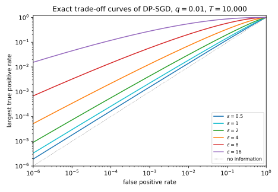
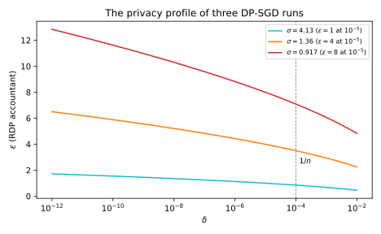
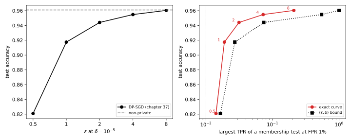

# Choosing ε

Every model trained with differential privacy (DP) ships with a budget $\varepsilon$. DP is the guarantee that one record changes the probability of any output by at most a factor $e^\varepsilon$, up to a slack $\delta$. An earlier chapter trained the part's running example, a small neural network on 10,000 records, with stochastic gradient descent (SGD) made private by clipping and Gaussian noise, which is [DP-SGD](02-dp-sgd.md). At $\delta = 10^{-5}$ its test accuracy was 0.9175 at $\varepsilon = 1$, 0.9441 at $\varepsilon = 2$, 0.9548 at $\varepsilon = 4$ and 0.9604 at $\varepsilon = 8$, against 0.9610 without privacy. Those accuracies are half of a decision. The other half is what each budget means for the people in the data: what an attacker who sees the model can learn about one of them, and how sure it can be.

The one idea of this chapter is that $(\varepsilon, \delta)$ is one straight line above a curve. An attacker who asks whether a record was in the training set runs a test with two error rates, and DP bounds the true positive rate by a line in the false positive rate. A training algorithm has a whole trade-off curve, the best true positive rate at each false positive rate, which lies below that line. At $\varepsilon = 8$ the line allows a test that catches every member while almost never accusing a non-member, yet the curve of DP-SGD caps the true positive rate at 0.0589 when the false positive rate is $10^{-3}$. So choosing $\varepsilon$ well means computing the curve and reading it where your threat lies, as a bound on membership tests, on beliefs or on reconstruction.

The running example is DP-SGD with sampling rate $q = 0.01$, $T = 10{,}000$ steps and $n = 10{,}000$ records, at six budgets from $\varepsilon = 0.5$ to 16. Each budget has the noise multiplier $\sigma$ that the Rényi differential privacy (RDP) accountant of [DP-SGD](02-dp-sgd.md) requires at $\delta = 10^{-5}$. @tbl-epsc-symbols lists the symbols that recur.

| Symbol | Meaning |
| --- | --- |
| $P$, $Q$ | Output distribution without and with the target record |
| $L$ | Privacy loss $\ln(Q(y)/P(y))$ of an output $y$ |
| $\omega$ | Distribution of $L$ under $Q$ |
| $\delta(\varepsilon)$ | Privacy profile, the smallest $\delta$ at each $\varepsilon$ |
| $\mathrm{TPR}^*$ | Trade-off curve, the best true positive rate at each false positive rate |

: The symbols of this chapter. {#tbl-epsc-symbols}

## What one (ε, δ) pair says about a membership test {#sec-epsc-pair}

A model card says "trained with $(\varepsilon, \delta) = (8, 10^{-5})$". What does that number alone forbid an attacker to do? This question comes first because it is the only one you can answer for a model whose training algorithm you have not seen.

::: {#def-epsc-test name="Membership test"}
Fix the training set without the target, $D^-$, and a target record $z^*$, so that $D^-$ and $D^- \cup \{z^*\}$ are add/remove neighbours, the relation DP-SGD with Poisson sampling uses. The attacker sees an output $y$, the model or all its iterates, drawn from $Q = M(D^- \cup \{z^*\})$ if $z^*$ is a member and from $P = M(D^-)$ if not. A **membership test** says "member" on a set $S$ of outputs. Its **false positive rate (FPR)** is $P(S)$, and its **true positive rate (TPR)** is $Q(S)$. A randomized test, which says "member" with probability $\phi(y)$, has rates $\mathbb E_P[\phi]$ and $\mathbb E_Q[\phi]$. The **privacy loss** of an output is $L(y) = \ln(Q(y)/P(y))$, with $Q(y)$ and $P(y)$ the two densities.
:::

Both rates are probabilities of one event, so DP bounds them directly. By @thm-dpdef-testing, a mechanism is $(\varepsilon, \delta)$-DP exactly when every test obeys two lines, the definition applied to $S$ and to its complement with the pair swapped. That theorem names the errors $\alpha$ and $\beta$, but this page keeps $\alpha$ for the Rényi order of @sec-epsc-curve. Since a probability is also at most 1, every membership test satisfies
$$\mathrm{TPR} \le \min\big\{1,\ e^\varepsilon\,\mathrm{FPR} + \delta,\ 1 - e^{-\varepsilon}(1 - \delta - \mathrm{FPR})\big\}.$$ {#eq-epsc-pair}
The **advantage** $\mathrm{TPR} - \mathrm{FPR}$ measures how much a test beats guessing. It is largest where the two lines cross, and @cor-dpdef-advantage bounds it there:
$$\mathrm{TPR} - \mathrm{FPR} \le \frac{e^\varepsilon - 1 + 2\delta}{e^\varepsilon + 1}.$$ {#eq-epsc-adv}

The line that matters is $e^\varepsilon\mathrm{FPR} + \delta$, which binds at low FPR. [Membership inference](../part02-attacks/02-membership-inference.md) judges attacks by their TPR at an FPR of $10^{-3}$ or below, because an attack that flags members while almost never flagging non-members confidently identifies people. Once $e^\varepsilon\mathrm{FPR} + \delta$ reaches 1, the pair allows a perfect TPR, and at $\varepsilon = 8$ that happens from an FPR of $(1 - 10^{-5})e^{-8} = 3.35\times10^{-4}$ on. So at $\varepsilon = 8$ the pair says nothing where attacks are judged. An audit refutes a claimed budget only when its measured point lies above the line, and [Exercise 1](../../book-exercises/part05-dp-ml/09-choosing-epsilon.md#sec-sol-epsc-1) finds the smallest $\varepsilon$ that a measurement proves.

The advantage, by contrast, is read where the two error rates are equal. It is 0.4621 at $\varepsilon = 1$ and 0.9640 at $\varepsilon = 4$, numbers that make $\varepsilon = 4$ sound hopeless. But they are tight only for randomized response, whose curve is exactly the two lines, and DP-SGD is not that mechanism.

::: {#exm-epsc-pair}
@tbl-epsc-pair evaluates @eq-epsc-pair and @eq-epsc-adv at the six budgets, all at $\delta = 10^{-5}$. For $\varepsilon = 1$ and an FPR of 0.01, the line $e^\varepsilon\mathrm{FPR} + \delta$ gives $e \times 0.01 + 10^{-5} = 0.02719$.

| $\varepsilon$ | TPR at FPR $10^{-3}$ | TPR at FPR $10^{-2}$ | TPR at FPR $10^{-1}$ | Advantage |
| --- | --- | --- | --- | --- |
| 0.5 | 0.001659 | 0.0165 | 0.1649 | 0.2449 |
| 1 | 0.002728 | 0.02719 | 0.2718 | 0.4621 |
| 2 | 0.007399 | 0.0739 | 0.7389 | 0.7616 |
| 4 | 0.05461 | 0.546 | 0.9835 | 0.9640 |
| 8 | 0.9997 | 0.9997 | 0.9997 | 0.9993 |
| 16 | 1 | 1 | 1 | 1.0000 |

: The largest TPR and advantage of any membership test that the pair $(\varepsilon, 10^{-5})$ allows. {#tbl-epsc-pair}

Read this way, $\varepsilon \le 2$ is strong at low FPR, $\varepsilon = 4$ only at very low FPR, and $\varepsilon \ge 8$ is no guarantee against membership inference. For DP-SGD the last two conclusions are far too pessimistic.
:::

## The whole curve of DP-SGD {#sec-epsc-curve}

The pair is one point of a privacy profile, the $\delta$ an accountant reports at each $\varepsilon$. The accountant could equally have reported $\varepsilon$ at $\delta = 10^{-6}$ or $10^{-3}$, and each such pair is another line that every test obeys. The best TPR an attacker can reach is the curve that all those lines enclose, and for DP-SGD it can be computed. Here it is computed exactly and compared with the line and with two cheaper summaries, from RDP and from a Gaussian limit.

[DP-SGD](02-dp-sgd.md) reduced a run to one pair of distributions per step, the worst case over models, data and directions. In units of the clipping norm, a step's output is $\mathcal N(0, \sigma^2)$ without the target and the mixture $(1 - q)\mathcal N(0, \sigma^2) + q\,\mathcal N(1, \sigma^2)$ with it. The log of the ratio of the two densities is the privacy loss of one step,
$$L_1(y) = \ln\big((1 - q) + q\,e^{(2y - 1)/(2\sigma^2)}\big).$$

::: {#def-epsc-curve name="Trade-off curve, privacy profile and privacy loss distribution"}
Let $P$ and $Q$ be as in @def-epsc-test. The **trade-off curve** $\mathrm{TPR}^*(\mathrm{FPR})$ is the largest TPR of any test whose false positive rate is at most $\mathrm{FPR}$. The **privacy profile** $\delta(\varepsilon)$ is the smallest $\delta$ with $Q(S) \le e^\varepsilon P(S) + \delta$ for every event $S$. The **privacy loss distribution (PLD)** $\omega$ is the distribution of $L(y)$ when $y$ is drawn from $Q$.
:::

The PLD fixes the other two, because the best tests compare the loss with a threshold. @thm-gdp-duality proved a version for curves that treat adding and removing the record alike; a membership test needs only adding, which the proof below handles (Dong, Roth & Su 2022).

::: {#thm-epsc-curve name="The trade-off curve from the privacy loss"}
Let $P$ and $Q$ have positive densities, privacy loss $L$ and PLD $\omega$, and write $\mathbb E_\omega[X;\ A]$ for the average of $X$ times the indicator of the event $A$. The best tests say "member" when $L$ exceeds a threshold $\tau$, and they trace the trade-off curve
$$\big(\mathrm{FPR}(\tau), \mathrm{TPR}(\tau)\big) = \big(\mathbb E_\omega[e^{-L};\ L > \tau],\ \omega(L > \tau)\big), \qquad \tau \in \mathbb R.$$ {#eq-epsc-roc}
The curve is the lower envelope of the lines of the privacy profile,
$$\mathrm{TPR}^*(\mathrm{FPR}) = \inf_{\varepsilon \in \mathbb R}\big(e^\varepsilon \mathrm{FPR} + \delta(\varepsilon)\big), \qquad \delta(\varepsilon) = Q[L > \varepsilon] - e^\varepsilon P[L > \varepsilon],$$ {#eq-epsc-duality}
and the line at $\varepsilon$ touches it at the threshold test with $\tau = \varepsilon$, whose FPR is at most $e^{-\varepsilon}Q[L > \varepsilon]$. For $T$ steps of DP-SGD, $\omega$ is the $T$-fold convolution of the one-step PLD. Rounding each one-step loss up, or down, to a grid gives a curve above, or below, the true one.
:::

::: {.proof}
The plan is to find the best tests, show that every line of the profile lies above them and touches them once, and then compute the PLD of the composed run.

1. *The best tests threshold the loss.* The likelihood ratio $Q(y)/P(y)$ is $e^{L(y)}$, which increases with $L$. By the Neyman–Pearson lemma (@thm-ht-np), the test with the largest TPR at a given FPR says "member" where $L(y) > \tau$, randomizing where $L = \tau$. Its TPR is $Q[L > \tau]$, which is $\omega(L > \tau)$.
2. *Its FPR by a change of measure.* Both densities are positive, so the definition of $L$ gives $P(y) = e^{-L(y)}Q(y)$. The $P$-probability of an event is therefore the $Q$-average of $e^{-L}$ over it (@lem-ht-change-of-measure):
$$P[L > \tau] = \mathbb E_Q\big[e^{-L};\ L > \tau\big].$$
With step 1, this is @eq-epsc-roc.
3. *Every line lies above the curve.* By the definition of the profile, every test has $\mathrm{TPR} \le e^\varepsilon\mathrm{FPR} + \delta(\varepsilon)$. Taking the smallest right-hand side over $\varepsilon$ gives "$\le$" in @eq-epsc-duality.
4. *The profile is a tail of the loss.* We want the event that makes $Q(S) - e^\varepsilon P(S)$ largest. Since $P(y) = e^{-L(y)}Q(y)$, adding an output with $L(y) \le \varepsilon$ adds $Q(y) - e^\varepsilon P(y) = Q(y)(1 - e^{\varepsilon - L(y)})$, which is not positive, and removing one with $L(y) > \varepsilon$ removes a positive amount. So the best event is $\{L > \varepsilon\}$, which gives the formula for $\delta(\varepsilon)$, as in @lem-lg-bad-event.
5. *Each line touches the curve.* By step 4 the threshold test with $\tau = \varepsilon$ has $\mathrm{TPR} = e^\varepsilon\mathrm{FPR} + \delta(\varepsilon)$, so it lies on the line. Every FPR is reached by some threshold test, with randomization at the threshold, so the infimum is attained at every FPR. On its event $e^{-L} < e^{-\varepsilon}$, so by step 2 its FPR is at most $e^{-\varepsilon}Q[L > \varepsilon]$.
6. *Composition adds losses.* The steps use independent noise, so the total loss is the sum of the per-step losses (@lem-dpprop-add). The worst-case pair is the same at every step, so under $Q$ these losses are independent with one distribution, and $\omega$ is its $T$-fold convolution ([Numerical accounting](../part04-privacy-accounting/06-numerical-accounting.md)).
7. *A guaranteed bracket.* Rounding each one-step loss up to a grid makes every output look more revealing, so the rounded pair is less private and its curve lies above the true one ([Numerical accounting](../part04-privacy-accounting/06-numerical-accounting.md)). Rounding down gives a curve below it.
:::

The RDP accountant that set $\sigma$ also gives a curve, at no extra cost. A test turns the two distributions into two coins, and processing cannot increase a Rényi divergence, so the coins must stay within the run's RDP budget at every order $\alpha$.

::: {#prp-epsc-rdp name="A trade-off bound from the RDP curve"}
If $D_\alpha(Q\|P) \le \varepsilon(\alpha)$ at each order $\alpha > 1$, as the RDP accountant of the whole run certifies, then every test satisfies
$$\mathrm{TPR} \le \min_{\alpha > 1}\big(\mathrm{FPR}\cdot e^{\varepsilon(\alpha)}\big)^{(\alpha - 1)/\alpha}.$$ {#eq-epsc-rdp}
:::

::: {.proof}
1. *Reduce the test to two coins.* The test maps $Q$ to a coin that says "member" with probability TPR, and $P$ to one that does so with probability FPR. Post-processing cannot increase a Rényi divergence (@thm-rdp-post), so at each order
$$e^{(\alpha - 1)\varepsilon(\alpha)} \ge \mathrm{TPR}^\alpha\mathrm{FPR}^{1 - \alpha} + (1 - \mathrm{TPR})^\alpha(1 - \mathrm{FPR})^{1 - \alpha}.$$
2. *Drop a term.* The second term is not negative, so dropping it keeps the inequality, and $\mathrm{TPR}^\alpha \le e^{(\alpha - 1)\varepsilon(\alpha)}\mathrm{FPR}^{\alpha - 1}$.
3. *Solve for TPR.* The power $1/\alpha$ gives the bound at order $\alpha$, and since it holds at every order, it holds at the best one.
:::

@thm-gdp-rdp keeps the dropped term and gives the best curve that RDP allows; @eq-epsc-rdp is looser but closed-form at each order. The Gaussian summary is a limit. By @thm-gdp-sgd, as $T$ grows with $q\sqrt T$ fixed, the curve approaches that of $\mathcal N(0, 1)$ against $\mathcal N(\mu, 1)$ (@thm-ht-gaussian). With $\Phi$ the standard normal distribution function, this Gaussian differential privacy (GDP) approximation is
$$\mathrm{TPR}^*(\mathrm{FPR}) \approx 1 - \Phi\big(\Phi^{-1}(1 - \mathrm{FPR}) - \mu\big), \qquad \mu = q\sqrt{T\big(e^{1/\sigma^2} - 1\big)},$$ {#eq-epsc-gdp}
and it is not a bound. @tbl-epsc-accountants gives each run's $\sigma$ and what the three accountants report. Against the upper end of the PLD bracket, the RDP accountant overstates $\varepsilon$ by between 0.035 (at $\varepsilon = 0.5$) and 0.264 (at $\varepsilon = 4$), and by 0.58 at $\varepsilon = 8$.

| Target $\varepsilon$ (RDP) | $\sigma$ | RDP $\varepsilon$ | PLD $\varepsilon$, bracket | GDP $\mu$ | GDP $\varepsilon$ |
| --- | --- | --- | --- | --- | --- |
| 0.5 | 7.72 | 0.500 | [0.445, 0.465] | 0.130 | 0.454 |
| 1 | 4.13 | 0.999 | [0.903, 0.923] | 0.246 | 0.909 |
| 2 | 2.28 | 1.998 | [1.825, 1.845] | 0.461 | 1.819 |
| 4 | 1.36 | 3.993 | [3.629, 3.729] | 0.847 | 3.615 |
| 8 | 0.917 | 7.997 | [7.317, 7.417] | 1.511 | 7.116 |
| 16 | 0.695 | 15.955 | [14.582, 14.682] | 2.632 | 14.097 |

: The running example's noise multipliers at $q = 0.01$, $T = 10{,}000$, $\delta = 10^{-5}$, and the $\varepsilon$ each accountant reports; runs are named by their target. The PLD bracket runs from the loss rounded down, for adding the record, to the loss rounded up, for adding or removing it. {#tbl-epsc-accountants}

The pair overstates the attacker, and more so the larger $\varepsilon$: at an FPR of $10^{-3}$ the factor is about 1.2 at $\varepsilon = 1$, about 4 at $\varepsilon = 4$ and about 17 at $\varepsilon = 8$ (@tbl-epsc-curve). @fig-epsc-tradeoff shows why. The curve of DP-SGD is smooth and close to a Gaussian curve, and by @thm-epsc-curve the line reported at $\delta = 10^{-5}$ touches it at an FPR of at most $e^{-\varepsilon}Q[L > \varepsilon]$, below $10^{-4}$ for every run here (@tbl-epsc-loss). Everywhere else the line is a loose summary.

The RDP bound stays looser than the exact curve, because one Rényi order summarizes the loss by one moment. GDP is close but not on the safe side. Up to $\varepsilon = 8$ it lies inside the exact bracket at an FPR of $10^{-3}$, but at $\varepsilon = 16$ it overshoots, because $\mu = 2.632$ is far from the regime where the limit holds. Use it to explain, not to certify.

{#fig-epsc-tradeoff}

::: {#exm-epsc-curve}
@tbl-epsc-curve gives the four answers at an FPR of $10^{-3}$. At $\varepsilon = 8$ the pair allows 0.9997, the RDP bound 0.09016 and the curve at most 0.0589.

| $\varepsilon$ | Pair, @eq-epsc-pair | RDP, @eq-epsc-rdp | Exact (PLD bracket) | GDP, @eq-epsc-gdp |
| --- | --- | --- | --- | --- |
| 0.5 | 0.001659 | 0.00161 | [0.001524, 0.001554] | 0.001537 |
| 1 | 0.002728 | 0.002427 | [0.002209, 0.00225] | 0.002224 |
| 2 | 0.007399 | 0.005033 | [0.004267, 0.004342] | 0.004273 |
| 4 | 0.05461 | 0.01668 | [0.01215, 0.01312] | 0.01244 |
| 8 | 0.9997 | 0.09016 | [0.05555, 0.0589] | 0.05719 |
| 16 | 1 | 0.4971 | [0.2714, 0.2808] | 0.3234 |

: The largest TPR of a membership test against the running example's DP-SGD at FPR $10^{-3}$, $\delta = 10^{-5}$. {#tbl-epsc-curve}

@tbl-epsc-curve-more gives the exact bracket at higher FPR, and the advantage. There the pair allows 0.9640 at $\varepsilon = 4$, while DP-SGD allows at most 0.3429.

| $\varepsilon$ | Exact TPR at FPR $10^{-2}$ | Exact TPR at FPR $10^{-1}$ | Exact advantage |
| --- | --- | --- | --- |
| 0.5 | [0.01391, 0.01418] | [0.1236, 0.126] | [0.0472, 0.0567] |
| 1 | [0.01859, 0.01893] | [0.1489, 0.1515] | [0.0933, 0.1023] |
| 2 | [0.03088, 0.03141] | [0.2043, 0.2076] | [0.1778, 0.1859] |
| 4 | [0.06739, 0.0724] | [0.3211, 0.3416] | [0.3094, 0.3429] |
| 8 | [0.1987, 0.2092] | [0.5682, 0.5901] | [0.5271, 0.5498] |
| 16 | [0.5447, 0.5588] | [0.8637, 0.8752] | [0.7647, 0.7758] |

: The exact trade-off curve of the running example at two more false positive rates, and its largest advantage. {#tbl-epsc-curve-more}

The ratio TPR/FPR, the factor by which a flag is more likely on a member, grows only slowly as the FPR falls (@fig-epsc-curves). At $\varepsilon = 8$ it is about 21 at an FPR of $10^{-2}$ and about 59 at $10^{-3}$, nowhere near $e^8 \approx 2{,}981$.

The curve is the worst case of an attacker that sees every iterate and targets a record whose gradient is as large as clipping allows, and Nasr et al. (2021) showed that such an attacker reaches it. A typical record seen through the final model is safer. @tbl-epsc-attack runs the loss-threshold attack of [Membership inference](../part02-attacks/02-membership-inference.md) on one model per budget, with the 10,000 training records as members and the 20,000 test records as non-members.

| $\varepsilon$ | TPR at FPR $10^{-3}$ | TPR at FPR $10^{-2}$ | TPR at FPR $10^{-1}$ | Best advantage |
| --- | --- | --- | --- | --- |
| 0.5 | 0.0010 | 0.0102 | 0.0989 | 0.0155 |
| 1 | 0.0013 | 0.0108 | 0.1019 | 0.0085 |
| 2 | 0.0011 | 0.0096 | 0.0983 | 0.0059 |
| 4 | 0.0008 | 0.0072 | 0.0963 | 0.0116 |
| 8 | 0.0007 | 0.0098 | 0.1007 | 0.0162 |
| 16 | 0.0013 | 0.0102 | 0.0992 | 0.0158 |
| Non-private | 0.0004 | 0.0099 | 0.0956 | 0.0221 |

: A loss-threshold membership attack on one trained model per budget. The best advantage is the largest TPR − FPR over 999 thresholds. {#tbl-epsc-attack}

The attack is at chance at every budget, and nearly so without privacy, because the network generalizes. That is no guarantee, and [Auditing private training](10-auditing.md) builds attacks that come close to the curve.
:::

{#fig-epsc-curves}

## The Bayesian reading {#sec-epsc-bayes}

People who are not statisticians rarely think in error rates. They ask "if someone sees the model, how sure can they be that I was in the data?", which is a question about posterior probabilities. Read as beliefs, the curve answers it, and the answer depends on what the attacker believed before.

Bayes' rule in odds form says that the posterior odds of membership are the prior odds times the likelihood ratio $e^{L(y)}$ (@thm-ht-bayes). So an attacker with prior $p$ believes afterwards that the target is a member with probability $pe^L/(pe^L + 1 - p)$, which grows with the loss. Wherever the loss is at most $\varepsilon$, @thm-dpdef-posterior bounds this posterior:
$$\Pr[\text{member} \mid y] \le \frac{p\,e^\varepsilon}{p\,e^\varepsilon + 1 - p}.$$ {#eq-epsc-posterior}
Under $(\varepsilon, \delta)$-DP the same theorem lets the bound fail only on rare outputs, those whose loss exceeds a higher level. An attacker who acts only on a flag, the test's verdict "member", also faces the base rate $p$, by the same odds rule.

::: {#prp-epsc-precision name="The precision of a flag"}
Let a membership test have rates TPR and FPR, and let the attacker's prior be $p$. A flag ("the test said member") is right with probability
$$\Pr[\text{member} \mid \text{flag}] = \frac{p\,\mathrm{TPR}}{p\,\mathrm{TPR} + (1 - p)\,\mathrm{FPR}} \le \frac{p\,(e^\varepsilon\mathrm{FPR} + \delta)}{p\,(e^\varepsilon\mathrm{FPR} + \delta) + (1 - p)\,\mathrm{FPR}},$$ {#eq-epsc-precision}
where the bound holds if the mechanism is $(\varepsilon, \delta)$-DP. With $\delta = 0$ the bound equals @eq-epsc-posterior.
:::

::: {.proof}
1. *The odds of a flag.* A flag has probability TPR for a member and FPR for a non-member, so the posterior odds are $\frac{p}{1 - p}\cdot\frac{\mathrm{TPR}}{\mathrm{FPR}}$. Odds $o$ convert to the probability $o/(1 + o)$, which gives the equality.
2. *The bound.* The precision increases with TPR, so replacing TPR by its bound from @eq-epsc-pair can only increase it.
3. *Pure DP.* With $\delta = 0$ the FPR cancels, leaving $pe^\varepsilon/(pe^\varepsilon + 1 - p)$. A flag is never more convincing than the most convincing single output.
:::

DP bounds the change of belief, not the belief, as @tbl-epsc-posterior shows at three priors. An attacker who thinks there is a 1% chance that you are in the data can reach at most 2.67% at $\varepsilon = 1$, but 35.55% at $\varepsilon = 4$ and 96.79%, near certainty, at $\varepsilon = 8$.

| $\varepsilon$ | Prior 0.01 | Prior 0.1 | Prior 0.5 |
| --- | --- | --- | --- |
| 0.5 | 0.0164 | 0.1548 | 0.6225 |
| 1 | 0.0267 | 0.2320 | 0.7311 |
| 2 | 0.0695 | 0.4509 | 0.8808 |
| 4 | 0.3555 | 0.8585 | 0.9820 |
| 8 | 0.9679 | 0.9970 | 0.9997 |
| 16 | 1.0000 | 1.0000 | 1.0000 |

: The largest posterior probability of membership when the privacy loss is at most $\varepsilon$, @eq-epsc-posterior. {#tbl-epsc-posterior}

But only outputs whose loss is $\varepsilon$ attain the bound, and for DP-SGD the realized loss, drawn from $\omega$, is usually much smaller (@tbl-epsc-loss). In the $\varepsilon = 8$ run, a worst-case member's total loss is at most 1.136 half the time, which moves a prior of 1% to at most 0.0305. Only once in a thousand does it exceed 5.971 (posterior 0.7984). The chance that the loss exceeds the reported $\varepsilon$, in the column $Q[L > \varepsilon]$, is of the order of $\delta$.

| Run | Median loss | Loss exceeded w.p. $10^{-3}$ | Loss exceeded w.p. $10^{-5}$ | $Q[L > \varepsilon]$ | Posterior from prior 0.01: median, $10^{-3}$, $10^{-5}$ |
| --- | --- | --- | --- | --- | --- |
| $\varepsilon = 0.5$ | 0.018 | 0.421 | 0.575 | $1.10\times10^{-4}$ | 0.0102, 0.0152, 0.0176 |
| $\varepsilon = 1$ | 0.040 | 0.802 | 1.093 | $5.04\times10^{-5}$ | 0.0104, 0.0220, 0.0293 |
| $\varepsilon = 2$ | 0.115 | 1.549 | 2.099 | $2.52\times10^{-5}$ | 0.0112, 0.0454, 0.0762 |
| $\varepsilon = 4$ | 0.401 | 3.059 | 4.092 | $1.59\times10^{-5}$ | 0.0149, 0.1771, 0.3768 |
| $\varepsilon = 8$ | 1.136 | 5.971 | 7.910 | $7.86\times10^{-6}$ | 0.0305, 0.7984, 0.9649 |
| $\varepsilon = 16$ | 3.032 | 11.661 | 15.314 | $3.78\times10^{-6}$ | 0.1732, 0.9991, 1.0000 |

: The total privacy loss of a worst-case member, from the pessimistic PLD (so slightly overstated), and the posterior it produces from a prior of 1%. {#tbl-epsc-loss}

{#fig-epsc-posterior}

::: {#exm-epsc-insider}
An insider who knows the training set holds you or a colleague, not both, has prior 0.5. Against the $\varepsilon = 2$ run, @tbl-epsc-posterior caps its posterior at 0.8808. A stranger with prior 0.01 reaches at most 0.0695 against the same run and, for a typical member, $0.01e^{0.115}/(0.01e^{0.115} + 0.99) = 0.0112$. The guarantee is the same, and what it protects against depends on what the attacker knew before.

Base rates also make flags unconvincing, because in @eq-epsc-precision the prior enters through $p/(1 - p)$. At $\varepsilon = 8$, prior 1% and an FPR of $10^{-2}$, the pair allows a precision of 0.5024, while the exact curve allows 0.1744, so five flags out of six are false.
:::

## Reconstruction {#sec-epsc-recon}

Membership is a strict standard for the defender, because the attacker is handed the target record and only has to decide whether it was used. Many harms need more, such as recovering a diagnosis or a face the attacker does not know. The same curve bounds them too, read at a false positive rate set by the attacker's uncertainty beforehand.

::: {#def-epsc-rero name="Reconstruction robustness (Balle, Cherubin & Hayes 2022)"}
An **informed adversary** knows every training record except the target $Z$, knows a prior $\pi$ from which $Z$ was drawn, sees the trained model, and outputs a guess. It succeeds if the guess is within an error radius $\xi$ of $Z$, as measured by an error function $\mathrm{err}$. The **baseline** is the best success without the model,
$$\kappa = \sup_{z_0}\Pr_{Z \sim \pi}\big[\mathrm{err}(Z, z_0) \le \xi\big],$$
for example $\kappa = 1/m$ when $Z$ is uniform over $m$ candidates and only an exact guess counts.
:::

The proof below averages one membership test per candidate over the prior, and moving that average inside the curve needs the curve to be concave. @thm-ht-tradeoff proved that every trade-off function, the smallest false negative rate at each FPR, is convex and non-increasing, and $\mathrm{TPR}^*$ is one minus such a function, so it is concave and non-decreasing.

::: {#thm-epsc-rero name="Reconstruction is membership at the baseline"}
If every neighbouring pair of $M$ has trade-off curve at or below $\mathrm{TPR}^*$, then every informed reconstruction attack succeeds with probability at most
$$\Pr[\text{success}] \le \mathrm{TPR}^*(\kappa).$$ {#eq-epsc-rero}
With the pair $(\varepsilon, \delta)$ this is $e^\varepsilon\kappa + \delta$, and with one RDP order it is $(\kappa e^{\varepsilon(\alpha)})^{(\alpha - 1)/\alpha}$.
:::

::: {.proof}
The plan is to bound each candidate's test by the curve, then average over the prior, using concavity to bring the average inside.

1. *One test per candidate.* Fix $D^-$ and the attack $\mathcal A$. For a candidate $z$, let $S_z$ be the set of models $\theta$ for which $\mathcal A(\theta)$ is within $\xi$ of $z$. The attack succeeds on $z$ exactly when the model trained on $D^- \cup \{z\}$ falls in $S_z$.
2. *Bound each test by the curve.* "Say member when $\theta \in S_z$" is a membership test for $z$, with $Q_z = M(D^- \cup \{z\})$ and $P = M(D^-)$. Its FPR is $\mathrm{FPR}_z = P(S_z)$, so $Q_z(S_z) \le \mathrm{TPR}^*(\mathrm{FPR}_z)$.
3. *Average over the prior.* The success probability is the average of $Q_Z(S_Z)$ over $Z \sim \pi$. Because the curve is concave, Jensen's inequality moves the average inside it:
$$\mathbb E_Z[Q_Z(S_Z)] \le \mathbb E_Z[\mathrm{TPR}^*(\mathrm{FPR}_Z)] \le \mathrm{TPR}^*(\mathbb E_Z[\mathrm{FPR}_Z]).$$
4. *The average FPR is at most the baseline.* The average FPR is the chance that the attack succeeds on a model trained without $Z$. That model is independent of $Z$, and for each fixed model the guess is a fixed $z_0$ (a randomized attack averages such guesses), which succeeds with probability at most $\kappa$. Since the curve is non-decreasing, @eq-epsc-rero follows.
5. *The special cases.* Substituting the line of @eq-epsc-pair, or @eq-epsc-rdp at one order, for $\mathrm{TPR}^*$ gives the closed forms.
:::

Balle, Cherubin & Hayes state the pure-DP and RDP forms, and the $(\varepsilon, \delta)$ form is a corollary given here. With the exact curve of DP-SGD it is the bound of Hayes, Mahloujifar & Balle (2023), who found it close to their best attack. They also found that hyperparameters with the same $\varepsilon$ have different curves and so different reconstruction success. A large prior uncertainty is a small FPR, which is where the curve of DP-SGD lies far below the line.

A small baseline is an honest assumption only if you can defend it. If the attacker can narrow the target to two candidates, $\kappa = 0.5$ and reconstruction is as easy as membership at an FPR of 0.5, so a defensible claim states the prior. Guo, Karrer, Chaudhuri & van der Maaten (2022) bound continuous targets differently. Under RDP of order 2 at level $\varepsilon$, an unbiased reconstruction of a target in an interval of width $w$ has expected squared error at least $w^2/(4(e^\varepsilon - 1))$, and Fisher information gives a tighter bound. @sec-apx-audit-recon derives the first and shows why it needs unbiasedness.

::: {#exm-epsc-candidates}
Choosing one of $m$ equally likely candidates is reconstruction with $\kappa = 1/m$, so its success bound is the curve at an FPR of $1/m$, read from @tbl-epsc-curve and @tbl-epsc-curve-more. At $\varepsilon = 8$ the pair gives no bound for any $m$ up to 1,000, but the curve caps the success among 1,000 candidates at 0.0589, against 0.001 by guessing. With only ten candidates the attacker already knows a lot: at $\varepsilon = 4$ the curve allows 0.3416 against a baseline of 0.1. Among a thousand candidates even $\varepsilon = 16$ keeps the success at 0.2808, as Balle, Cherubin & Hayes also observed in experiments.
:::

## Interpreting δ {#sec-epsc-delta}

Every number so far was at $\delta = 10^{-5}$. What does $\delta$ mean, how small must it be, and what does a smaller one cost in $\varepsilon$ for DP-SGD? The answer depends on the losses at which a mechanism uses up its $\delta$.

The worst way to spend it is to publish records. @prp-dpdef-release showed that the mechanism that publishes each record in full, independently with probability $\delta$, is $(0, \delta)$-DP. On $n$ records it publishes at least one with probability
$$1 - (1 - \delta)^n \approx 1 - e^{-n\delta}.$$ {#eq-epsc-release}
So $\delta = 1/n$ permits exposing a record with probability about 0.63, and a meaningful guarantee needs $n\delta$ well below 1. That mechanism spends $\delta$ at infinite loss, since a published record is identified with certainty. So the National Institute of Standards and Technology (NIST) prefers guarantees that rule out such failure, such as zero-concentrated differential privacy (zCDP). DP-SGD spends $\delta$ at moderate losses, because $\delta(\varepsilon)$ is at most the tail $Q[L > \varepsilon]$ (@thm-epsc-curve), which is thin (@tbl-epsc-loss). So for DP-SGD $\delta$ is not a probability of catastrophe, and shrinking it raises $\varepsilon$ only moderately.

How small? NIST SP 800-226 (Near, Darais, Lefkovitz & Howarth 2025) calls $\delta \le 1/n^2$ a common recommendation and $\delta$ above $10^{-5}$ suspicious. The running example has $n\delta = 0.1$, acceptable for DP-SGD but not by the $1/n^2 = 10^{-8}$ rule. If one person can contribute many records, $n$ is the number of people, and a per-record guarantee is not a per-person one ([User-level differential privacy](07-user-level.md)).

| $\sigma$ (run) | $\delta = 10^{-4}$ | $10^{-5}$ | $10^{-6}$ | $10^{-8}$ | $10^{-10}$ |
| --- | --- | --- | --- | --- | --- |
| 4.13 ($\varepsilon = 1$) | 0.852 | 0.999 | 1.129 | 1.354 | 1.548 |
| 1.36 ($\varepsilon = 4$) | 3.501 | 3.993 | 4.432 | 5.209 | 5.890 |
| 0.917 ($\varepsilon = 8$) | 7.088 | 7.997 | 8.821 | 10.301 | 11.627 |

: The $\varepsilon$ of three runs of the running example at five values of $\delta$, from the RDP accountant. {#tbl-epsc-delta}

{#fig-epsc-delta}

::: {#exm-epsc-delta}
For $n = 10{,}000$, @eq-epsc-release gives the release mechanism an exposure probability of 0.6321 at $\delta = 10^{-4} = 1/n$, 0.09516 at $\delta = 10^{-5}$ and 0.00995 at $10^{-6}$. For DP-SGD the same reductions cost little (@tbl-epsc-delta, @fig-epsc-delta). From $10^{-5}$ to $10^{-6}$ the $\varepsilon = 4$ run's budget rises from 3.993 to 4.432, the $1/n^2$ rule makes it $(5.209, 10^{-8})$-DP, and at $10^{-10}$ it reaches 5.890. Every factor of 100 in $\delta$ costs between about 0.2 and 0.9 in $\varepsilon$ for the $\varepsilon = 1$ and $\varepsilon = 4$ runs, so when in doubt, use a smaller $\delta$.
:::

## Deployed values and their units {#sec-epsc-deployed}

"Industry uses $\varepsilon$ between 1 and 10" is a common justification. What have real deployments published, and in which units? Comparing your budget with theirs needs one notion first, because an $\varepsilon$ means nothing without it.

::: {#def-epsc-unit name="Privacy unit and period"}
The **privacy unit** of a guarantee is what one neighbouring change is: one record, one user's data for a day, or one user's data forever, under add/remove or replace-one. The **period** is the time over which the budget is spent, counting every release and training run that touched the data.
:::

@tbl-epsc-deployed lists deployments documented in a primary source. The unit, period and accounting differ from row to row, so the values are not comparable without conversion. A zCDP guarantee with parameter $\rho$ converts by the simple bound of @thm-cdp-conversion (Bun & Steinke 2016),
$$\varepsilon = \rho + 2\sqrt{\rho\ln(1/\delta)},$$ {#eq-epsc-zcdp}
and tighter numerical conversions give somewhat smaller values. The Gboard models were trained on users' devices by follow the regularized leader (FTRL) with noise on sums of gradients ([DP-FTRL and matrix factorization](04-matrix-mechanisms.md)).

| Deployment | Privacy unit and period | Published parameters |
| --- | --- | --- |
| US Census Bureau, 2020 redistricting data (zCDP) | One person's or housing unit's record, replace-one; one release | $\rho = 2.56$ for persons, 0.07 for housing units; reported as $\varepsilon = 17.14$ plus 2.47, 19.61 in total, at $\delta = 10^{-10}$ |
| Google Gboard language models (zCDP) | One device's data, whole training run | $\rho$ from 0.25 to 1.86, that is $\varepsilon$ from 4.49 to 13.69 at $\delta = 10^{-10}$; Spanish model (2022) $(8.9, 10^{-10})$; later models down to $\varepsilon = 0.994$ |
| Apple, local DP on iOS and macOS | One donation; limited donations per day | Emoji $\varepsilon = 4$, one per day; QuickType $\varepsilon = 8$, two per day; Safari domains $\varepsilon = 4$, two per day |
| Google RAPPOR in Chrome, local | One report ($\varepsilon_1$); one unchanging value ($\varepsilon_\infty$) | $\varepsilon_1 = 0.5343$; $\varepsilon_\infty = 2.043$ |
| Microsoft Windows telemetry, local | One user, one round every 6 hours | $\varepsilon = 1$ per round and app; 0.686 after output perturbation; 1.672 across all apps |
| LinkedIn Audience Engagements API | One member, per analyst, per month | $(0.15, 10^{-10})$ per result; $(34.9, 7\times10^{-9})$ per month |
| Facebook URLs dataset (zCDP) | One action; or one user per kind of action, up to its 99th percentile | Per action $\varepsilon$ up to 0.45 at $\delta = 10^{-5}$; per user $\rho$ about 0.005, so that $\varepsilon = 0.45$ |

: Published parameters of real deployments, as stated in the sources in the references, except the RAPPOR $\varepsilon_\infty$, computed here. {#tbl-epsc-deployed}

The conversions are short. With $\rho = 2.56$ and $\delta = 10^{-10}$, @eq-epsc-zcdp gives $2.56 + 2\sqrt{2.56 \times 23.026} = 17.915$, the persons' figure of Kazan & Reiter (2022); the Bureau's 17.14 uses a tighter conversion. Local reports add up over time, so QuickType's two donations of $\varepsilon = 8$ cost up to 16 per day, and Tang, Korolova et al. (2017) found that this budget resets daily. RAPPOR reuses one randomized answer for a value that does not change, so all its reports cost at most $\varepsilon_\infty = 2H\ln\frac{1 - f/2}{f/2}$, for $H$ hash functions and a probability $f$ of replacing a bit by a coin. At $H = 2$ and $f = 0.75$ that is $4\ln(5/3) = 2.043$, but a value that changes is reported afresh ([Local, shuffle and distributed trust models](../part03-dp-foundations/09-trust-models.md)). In the Facebook release a user with $k$ actions costs $k$ times one action, because zCDP composes by adding $\rho$.

Only the Gboard rows train a model. They give device-level guarantees for a whole run, with $\varepsilon$ between about 1 and 14 at $\delta = 10^{-10}$, while the running example's 1 to 8 are at a much larger $\delta$ and per record. NIST notes that many deployments have used $1 < \varepsilon \le 20$, but practice is no evidence that a value is safe. To compare budgets, convert both to the same unit, neighbouring relation, accounting and $\delta$, as Desfontaines' list of real-world uses does, or say that you did not.

The deployments also show what a published $\varepsilon$ leaves out, as four questions to ask of any budget. Does it renew? Rogers et al. (2021) count one RAPPOR report every 30 minutes as $0.534 \times 48 \times 30 = 769$ per month for a user whose value changes, and Microsoft's four rounds a day as $0.686 \times 4 \times 30 = 82.3$. What sits outside it? Apple's encrypted channel and stripped IP addresses protect users, but $\varepsilon$ does not count them. What does it assume? LinkedIn's budget per analyst holds only if analysts do not collude, which a contract enforces, not noise. Whom does it cover? The Facebook release protects whole users only up to the 99th percentile of activity ([Exercise 7](../../book-exercises/part05-dp-ml/09-choosing-epsilon.md#sec-sol-epsc-7)). LinkedIn even chose its value from an attack, accepting the 0.115 chance that an analyst who averages a count over 30 days recovers it.

::: {#exm-epsc-census}
Is the $\varepsilon = 8$ run "less than half the Census budget"? The Census 17.14 is replace-one at $\delta = 10^{-10}$, the run's 7.997 add/remove at $\delta = 10^{-5}$. At $\delta = 10^{-10}$ the run is at 11.627 (@tbl-epsc-delta). Replacing a record is a removal and an addition, so in the worst case replace-one doubles an add/remove guarantee (@prp-dpdef-replace). Doubled, the run's 11.627 exceeds 17.14, so after converting the two are of the same order, a weaker claim than the slogan.
:::

## Justifying a choice {#sec-epsc-justify}

You must now pick a target for the running example and write a statement that a sceptical reviewer will check. The earlier sections supply the pieces, and a good statement states what is claimed before giving the number.

::: {#def-epsc-statement name="A defensible privacy statement"}
A **defensible privacy statement** for a trained model gives six things.

1. **The unit**, with the period, counting every run and hyperparameter search that touched the data ([Hyperparameter tuning](03-hyperparameter-tuning.md)).
2. **The threat**: membership, attribute inference or reconstruction, the attacker's prior, and what it observes.
3. **The whole guarantee**: the curve from a tight accountant, with $\delta$ well below $1/n$, read at the threat's operating points.
4. **The evidence**: an audit ([Auditing private training](10-auditing.md)) consistent with the claim, and a check of the code against the proof's assumptions ([DP-SGD](02-dp-sgd.md#sec-dpsgd-algorithm)).
5. **The utility**: the accuracy curve against $\varepsilon$, and the smallest budget beyond which accuracy stops rising steeply.
6. **The comparison**: the tiers of Ponomareva et al. (2023), in which $\varepsilon \le 1$ is strong, $\varepsilon \le 10$ is reasonable for many applications, and above 10 the guarantee alone is not enough.
:::

The first four items answer failures seen earlier. Without the unit, one number can mean protection of a single click or of a whole history. The threat decides where to read the curve, and the pair alone can overstate the attacker 17-fold, which tempts a reader to dismiss DP as vacuous. Whether the code runs the algorithm of the proof is an empirical fact, which audits check.
The utility item matters because the accuracy curve is steeply non-linear (@fig-epsc-accuracy). Each doubling of $\varepsilon$ buys less accuracy and more risk, read as the exact TPR at an FPR of 1%. Going from $\varepsilon = 1$ to 2 gains 2.66 percentage points and moves that TPR from at most 0.01893 to at most 0.03141, while the step from 2 to 4 gains 1.07 points for a TPR of at most 0.0724. The step from 4 to 8 gains only 0.56 points yet nearly triples the TPR, to at most 0.2092. So past $\varepsilon = 4$, accuracy is bought with a much larger increase in worst-case risk. This is also why the tiers are reasonable: below 1 every mechanism is strong by @eq-epsc-pair, from 1 to 10 DP-SGD's curve lies far below the line, and above 10 even the curve allows a TPR above 0.27 at an FPR of $10^{-3}$, at $\varepsilon = 16$.

{#fig-epsc-accuracy}

::: {#exm-epsc-statement}
Following @def-epsc-statement, a team might choose the $\varepsilon = 4$ run and write:

> The model was trained with DP-SGD (Poisson sampling rate 0.01, noise multiplier 1.36, clipping norm 0.5, 10,000 steps) on 10,000 records, one record per person. The privacy unit is one record under add/remove neighbours; no other run touched the training data. The RDP accountant gives $(3.993, 10^{-5})$-DP and $(5.209, 10^{-8})$-DP; a PLD accountant gives $\varepsilon \le 3.729$ at $\delta = 10^{-5}$. Against an attacker who knows every other record and sees every iterate, any membership test has TPR at most 0.01312 at FPR $10^{-3}$ and at most 0.0724 at FPR $10^{-2}$, and any attack that picks a record out of 100 equally likely candidates succeeds with probability at most 0.0724. Test accuracy is 0.9548, against 0.9610 without privacy.

Every number in it is checkable, and a reviewer who thinks $\varepsilon = 4$ is too large can now argue with the TPR at a specific FPR rather than with the number.
:::

## Code {#sec-epsc-code}

The script [code/choosing_epsilon.py](../../code/part05-dp-ml/choosing_epsilon.py) calibrates the noise multipliers with the RDP accountant, discretizes the one-step loss pessimistically and optimistically, composes it 10,000 times by fast Fourier transform (FFT), and reads off the curves and bounds of this chapter. It also runs the loss-threshold attack and checks the deployment conversions, in two to three minutes. From the repository root:

```bash
uv run python code/part05-dp-ml/choosing_epsilon.py
```

| Experiment | Result |
| --- | --- |
| Accountants | RDP $\varepsilon$ = target; PLD brackets 0.02 to 0.1 wide and below it; GDP $\varepsilon$ below the PLD lower end except at $\varepsilon = 0.5$ and 1 (@tbl-epsc-accountants) |
| Membership at FPR $10^{-3}$ | Pair 0.002728 / 0.05461 / 0.9997 at $\varepsilon = 1$ / 4 / 8; exact curve at most 0.00225 / 0.01312 / 0.0589 |
| Advantage | Pair 0.9640 at $\varepsilon = 4$; exact at most 0.3429 |
| Bayes | Median total loss 0.401 at $\varepsilon = 4$, 1.136 at $\varepsilon = 8$; $Q[L > \varepsilon]$ between $3.78\times10^{-6}$ and $1.10\times10^{-4}$ |
| Reconstruction, 1,000 candidates | At most 0.0589 at $\varepsilon = 8$, 0.2808 at $\varepsilon = 16$ |
| $\delta$ | $\varepsilon = 4$ run: 3.993 at $10^{-5}$, 5.209 at $10^{-8}$, 5.890 at $10^{-10}$ |
| Conversions | $\rho = 2.56$ gives 17.915 at $\delta = 10^{-10}$ by @eq-epsc-zcdp; RAPPOR $\varepsilon_\infty = 2.043$ |
| Deployment checks | Facebook clicks: $\rho = 0.0053$, $\varepsilon = 0.454$ per user; Microsoft one round by Ding et al.'s Theorem 6: 0.569 (reported 0.686); LinkedIn averaging attack at $\varepsilon = 0.15$: 0.115; monthly totals 769 (RAPPOR) and 82.3 (Microsoft) |
| Loss-threshold attack | TPR within 0.004 of the FPR at every budget and every FPR (@tbl-epsc-attack) |

: The script's output with the default seed. {#tbl-epsc-code}

[tests/test_choosing_epsilon.py](../../tests/test_choosing_epsilon.py) checks that the output still matches.

## Summary {#sec-epsc-summary}

| Result | Statement | Use |
| --- | --- | --- |
| @def-epsc-test | $\mathrm{FPR} = P(S)$, $\mathrm{TPR} = Q(S)$ | Every reading of a budget |
| @eq-epsc-pair, @eq-epsc-adv | $\mathrm{TPR} \le e^\varepsilon\mathrm{FPR} + \delta$; advantage $\le \frac{e^\varepsilon - 1 + 2\delta}{e^\varepsilon + 1}$ | $\varepsilon \le 1$ is strong for any mechanism |
| @thm-epsc-curve | Curve $(\mathbb E_\omega[e^{-L}; L > \tau], \omega(L > \tau))$ | Report the TPR at FPR $10^{-3}$ and $10^{-2}$, not just the pair |
| @prp-epsc-rdp | $\mathrm{TPR} \le \min_\alpha(\mathrm{FPR}\,e^{\varepsilon(\alpha)})^{(\alpha - 1)/\alpha}$ | A free, valid bound from RDP |
| @eq-epsc-gdp | $\mathrm{TPR} \approx 1 - \Phi(\Phi^{-1}(1 - \mathrm{FPR}) - \mu)$ | To explain, not to certify |
| @eq-epsc-posterior | Posterior $\le pe^\varepsilon/(pe^\varepsilon + 1 - p)$ | State the prior |
| @prp-epsc-precision | Precision $p\,\mathrm{TPR}/(p\,\mathrm{TPR} + (1 - p)\mathrm{FPR})$ | Base rates dominate at small priors |
| @thm-epsc-rero | Reconstruction success $\le \mathrm{TPR}^*(\kappa)$ | Large budgets can still prevent reconstruction |
| @eq-epsc-release | Exposure $1 - (1 - \delta)^n$ | $\delta$ well below $1/n$; for DP-SGD a smaller $\delta$ is cheap |
| @def-epsc-unit, @eq-epsc-zcdp | Unit and period; $\varepsilon = \rho + 2\sqrt{\rho\ln(1/\delta)}$ | Convert before comparing; ask how a budget renews, what it assumes, whom it covers |
| @def-epsc-statement | Unit, threat, curve, evidence, utility, comparison | The smallest budget past the bend in accuracy; above 10, show the curve and an audit |

: The results of this chapter, and where each is used. {#tbl-epsc-summary}

## References {#sec-epsc-references}

- Dwork & Roth, *The Algorithmic Foundations of Differential Privacy* (Foundations and Trends in Theoretical Computer Science, 2014). The definition and its testing and Bayesian readings.
- Kairouz, Oh & Viswanath, "The Composition Theorem for Differential Privacy" (ICML 2015), and Dong, Roth & Su, "Gaussian Differential Privacy" (JRSS B, 2022). The testing view of DP, trade-off curves, the duality of @eq-epsc-duality and the central limit theorem for composition.
- Koskela, Jälkö & Honkela, "Computing Tight Differential Privacy Guarantees Using FFT" (AISTATS 2020), and Gopi, Lee & Wutschitz, "Numerical Composition of Differential Privacy" (NeurIPS 2021). Numerical PLD accounting, which @eq-epsc-roc reuses for the curve.
- Nasr, Song, Thakurta, Papernot & Carlini, "Adversary Instantiation: Lower Bounds for Differentially Private Machine Learning" (IEEE S&P 2021). Attacks that reach the accountant's guarantee when the adversary controls the target's gradient and sees every iterate.
- Balle, Cherubin & Hayes, "Reconstructing Training Data with Informed Adversaries" (IEEE S&P 2022). Reconstruction robustness and its bounds from pure DP, RDP and zCDP.
- Hayes, Mahloujifar & Balle, "Bounding Training Data Reconstruction in DP-SGD" (NeurIPS 2023). The reconstruction bound from the trade-off curve of DP-SGD, @eq-epsc-rero, and experiments showing it is nearly tight.
- Guo, Karrer, Chaudhuri & van der Maaten, "Bounding Training Data Reconstruction in Private (Deep) Learning" (ICML 2022). Lower bounds on the mean squared error of reconstruction from RDP and Fisher information.
- Near, Darais, Lefkovitz & Howarth, *Guidelines for Evaluating Differential Privacy Guarantees* (NIST SP 800-226, March 2025). Privacy units, $\delta \le 1/n^2$, the hazards of large $\varepsilon$ and of event-level units, and the case for publishing parameters.
- Ponomareva et al., "How to DP-fy ML: A Practical Guide to Machine Learning with Differential Privacy" (JAIR 2023). The three tiers of $\varepsilon$ for machine learning and what to report.
- Dwork, Kohli & Mulligan, "Differential Privacy in Practice: Expose your Epsilons!" (Journal of Privacy and Confidentiality, 2019). Interviews with practitioners and the proposal of an Epsilon Registry.
- Desfontaines, "A list of real-world uses of differential privacy" (blog, desfontain.es, updated 2025). A maintained list of deployments, converted to a common $\delta$ and unit.
- Abowd et al., "The 2020 Census Disclosure Avoidance System TopDown Algorithm" (Harvard Data Science Review, 2022), and US Census Bureau, "Census Bureau Sets Key Parameters to Protect Privacy in 2020 Census Results" (press release, June 2021). The redistricting data's $\rho$ and $\varepsilon$. Cumings-Menon et al., "Disclosure Avoidance for the 2020 Census Demographic and Housing Characteristics File" (HDSR, 2023). Kazan & Reiter, "Assessing Statistical Disclosure Risk for Differentially Private, Hierarchical Count Data" (arXiv 2022), for the 17.91 conversion.
- Xu, Zhang, Andrew, Choquette-Choo, Kairouz, McMahan, Rosenstock & Zhang, "Federated Learning of Gboard Language Models with Differential Privacy" (ACL 2023 Industry Track); McMahan & Thakurta, "Federated Learning with Formal Differential Privacy Guarantees" (Google AI blog, 2022); Xu & Zhang, "Advances in private training for production on-device language models" (Google Research blog, 2024). The Gboard rows.
- Apple Differential Privacy Team, "Learning with Privacy at Scale" (Apple Machine Learning Journal, 2017), and Apple, "Differential Privacy Overview" (2017). Tang, Korolova, Bai, Wang & Wang, "Privacy Loss in Apple's Implementation of Differential Privacy on MacOS 10.12" (arXiv 2017). The Apple rows.
- Erlingsson, Pihur & Korolova, "RAPPOR: Randomized Aggregatable Privacy-Preserving Ordinal Response" (CCS 2014). Ding, Kulkarni & Yekhanin, "Collecting Telemetry Data Privately" (NeurIPS 2017), §6 for the deployment and Theorems 6 and 7 for the per-round values. Rogers et al., "LinkedIn's Audience Engagements API: A Privacy Preserving Data Analytics System at Scale" (Journal of Privacy and Confidentiality, 2021), §8 for the non-collusion assumption, the attack behind $\varepsilon = 0.15$, and Table 2, which puts deployments on a monthly scale. Messing et al., "Facebook Privacy-Protected Full URLs Data Set" (Harvard Dataverse, 2020), the privacy section and its table of noise per kind of action. The other rows of @tbl-epsc-deployed.
- Bun & Steinke, "Concentrated Differential Privacy: Simplifications, Extensions, and Lower Bounds" (TCC 2016). The conversion @eq-epsc-zcdp.

**Practice.** Exercises for this chapter, each with a worked solution, are in [the exercise book](../../book-exercises/part05-dp-ml/09-choosing-epsilon.md).
