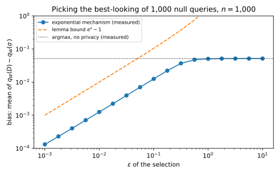
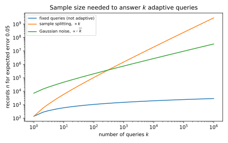

# Adaptive data analysis

## Why this matters

Every chapter so far has used differential privacy (DP) to protect the people in a dataset. This chapter uses it for a different purpose: to keep a data analysis honest. Machine learning reuses its evaluation data all the time. You tune hyperparameters on a validation set, look at the scores, and try new settings. Likewise, a competition shows a leaderboard score after every submission and teams adjust to it, while a benchmark test set is used by a whole field for a decade. In each case the next question asked of the data depends on the answers to the previous ones. **How many such questions can one holdout set answer before its answers stop telling you anything about new data?**

The answer depends on how the questions are answered. If you report exact averages on the holdout set, answers break quickly. When the holdout labels are coin flips, so that no model can beat 50% on new data, a thousand random submissions to a leaderboard of 1,000 records are enough to make one look 72% accurate. If you split the holdout set and answer each question on its own fresh part, the answers stay valid, but the data you need grows linearly with the number of questions. A DP mechanism does much better: adding Gaussian noise to each answer makes the data you need grow only like the square root of the number of questions. When there is also a training set to explore freely, the **reusable holdout** does better still: it adds noise, and pays privacy, only for the questions whose answers on the holdout set disagree with the training set.

### The one idea: an answer that reveals little about any one record cannot be overfitted

Overfitting a holdout set means choosing questions that fit its particular records. To do that, the analyst must learn something about those records from the earlier answers. A DP mechanism limits what any answer, and any sequence of answers, reveals about a single record, so it stops the overfitting. The proof reuses the main identity of [Algorithmic stability and generalization](../part01-prerequisites/07-stability-generalization.md) in Part 1, which @sec-ada-transfer restates. There, the expected gap between a chosen question's value on the sample and on the population is an average, over records, of how much the chosen question's value on a record changes when that record is replaced by a fresh one. Part 1 bounded each such term by the uniform stability of one fixed algorithm. DP bounds each term whatever the analyst does with the answers, because DP survives post-processing and adaptive composition, while uniform stability survives neither (@sec-ada-transfer explains why).

@tbl-ada-uses lists the results and where each is used.

| Result | Where it is used |
| --- | --- |
| Fixed questions need records growing like $\ln k$; one adaptive question can break exact answers | Recognizing when a reused holdout set is invalid |
| Sample splitting costs $k$ | The baseline every method must beat; final test sets |
| DP implies generalization (transfer lemma and theorem) | Turning any DP mechanism into a valid answering procedure |
| Gaussian noise answers $k$ adaptive questions to accuracy $\alpha$ with about $\sqrt k/\alpha^2$ records | Sizing a holdout set for an interactive analysis |
| The reusable holdout (Thresholdout) | Confirming findings from a training set on a holdout set |
| What it means for practice | Hyperparameter search, leaderboards, benchmark reuse |

: The results of this chapter and where each is used. {#tbl-ada-uses}

**Notation.** The data are a sample of $n$ records, the dataset $D = (x_1, \dots, x_n)$. The records are drawn independently from a distribution $\mathcal D$, the population, and each record $x_i$ holds features and label together. A **statistical query** is a function $q$ from one record to $[0, 1]$, such as "does this classifier get this record right?". Its **empirical value** is its average over the sample, $q(D) = \frac1n\sum_iq(x_i)$, and its **population value** is its average over the distribution, $q(\mathcal D) = \mathbb E_{x\sim\mathcal D}\,q(x)$.

An **analyst** asks $k$ queries, $q_1$ to $q_k$, one at a time. A mechanism $M$ answers each of them, giving the number $a_j$ for query $q_j$. Because the analyst may choose each query from the earlier answers, the analysis is **adaptive**. Write $D^{(i)}$ for the sample with $x_i$ replaced by an independent fresh draw $x_i'$. Samples that differ in one record, such as $D$ and $D^{(i)}$, are neighbours under the **replace-one relation**. Under this relation, every statistical query has sensitivity $1/n$, since one record moves an average of $n$ values in $[0, 1]$ by at most $1/n$. The goal is **accuracy against the population**. The largest error $\max_j|a_j - q_j(\mathcal D)|$ should be at most a target accuracy $\alpha$, either on average or with probability at least $1 - \beta$ for a small failure probability $\beta$.

**How to read this chapter.** @sec-ada-overfit shows the problem and @sec-ada-split the simple fix. @sec-ada-transfer is the key result, and its proof is short. @sec-ada-gauss turns it into a rate, @sec-ada-thresholdout into the reusable holdout, and @sec-ada-practice into advice for machine-learning practice.

## Toolkit: four facts every derivation uses

### Fact 1 — The largest of many averages: the maximal inequality

Each empirical value is an average of $n$ independent values in $[0, 1]$, so its error, written $Z = q(D) - q(\mathcal D)$, is rarely large. Hoeffding's lemma ([Concentration inequalities](../part01-prerequisites/02-concentration.md)) makes this precise through the moment generating function. For a query fixed before the sample is drawn, and for every real $\lambda$,
$$\mathbb E\,e^{\lambda Z} \le e^{\lambda^2v/2}, \qquad v = \frac{1}{4n}.$$
The value of $v$ comes from applying the lemma to each of the $n$ centred terms, each scaled by $1/n$ and so lying in a range of length $1/n$, which gives $e^{\lambda^2/(8n^2)}$ per term. Independence multiplies the $n$ bounds to $e^{\lambda^2/(8n)}$.
A variable with this property is called **sub-Gaussian with variance proxy $v$**, because a Gaussian variable with variance $\sigma^2$ has the property with $v = \sigma^2$, as an equality.

The fact this chapter uses is about the largest of many such variables. If $Z_1, \dots, Z_m$ are each sub-Gaussian with variance proxy $v$, whatever their dependence, then
$$\mathbb E\Big[\max_{j\le m}Z_j\Big] \le \sqrt{2v\ln m}.$$ {#eq-ada-max}
The reason is that the exponential of a maximum is at most the sum of the exponentials. For $\lambda > 0$, Jensen's inequality for the convex function $e^x$ gives $e^{\lambda\,\mathbb E\max_jZ_j} \le \mathbb E\,e^{\lambda\max_jZ_j}$. The exponential of the maximum is at most the sum of all $m$ exponentials, and each has expectation at most $e^{\lambda^2v/2}$, so the right side is at most $m\,e^{\lambda^2v/2}$. Taking logarithms and dividing by $\lambda$ gives $\mathbb E\max_jZ_j \le \ln m/\lambda + \lambda v/2$, and the choice $\lambda = \sqrt{2\ln m/v}$ gives @eq-ada-max. For $k$ queries, write $Z_j = q_j(D) - q_j(\mathcal D)$ for the error of query $j$. Applied to the $2k$ variables $\pm Z_j$, the inequality bounds the largest error in absolute value, with $m = 2k$.

### Fact 2 — Renaming a record and a fresh draw

The stability chapter's main identity rests on one observation. Suppose $x_i$ and the fresh draw $x_i'$ are independent and have the same distribution, and both are independent of the other records and of an algorithm's own coins. Then swapping them does not change the joint distribution of all these random quantities. So any expectation computed from $(D, x_i')$ equals the same expectation computed after the swap, from $(D^{(i)}, x_i)$. Write $q_{W(D)}$ for the query that a randomized algorithm $W$ outputs on the dataset $D$ (the chapter shortens it to $q_W$ when the sample is clear). Then
$$\mathbb E\big[q_{W(D)}(x_i')\big] = \mathbb E\big[q_{W(D^{(i)})}(x_i)\big].$$
The left side is the population value of the chosen query, because $x_i'$ is a new record that $W$ never saw. Averaging over $x_i'$ alone, with $D$ and $W$'s coins fixed, gives $q_{W(D)}(\mathcal D)$. The right side is the value of a query chosen *without* $x_i$ on the record $x_i$. The stability chapter walks through the swap on a table of every outcome.

### Fact 3 — DP bounds the average of any bounded function of the output

Differential privacy has two parameters, a privacy level $\varepsilon$ and a slack $\delta$. A mechanism $M$ is $(\varepsilon, \delta)$-DP when replacing a dataset $D$ by a neighbour $D'$ multiplies the probability of every set of outputs $S$ by at most $e^\varepsilon$, up to the slack $\delta$ ([The definition](../part03-dp-foundations/01-definition.md)):
$$\Pr[M(D) \in S] \le e^\varepsilon\Pr[M(D') \in S] + \delta.$$
The derivations need the same bound for averages. For every function $f$ of the output with values in $[0, 1]$,
$$\mathbb E\big[f(M(D))\big] \le e^\varepsilon\,\mathbb E\big[f(M(D'))\big] + \delta.$$ {#eq-ada-avg}
To see this, write the average of a quantity between 0 and 1 as the integral of its tail. For a random output $Y$, the average of $f(Y)$ is the integral, over thresholds $t$ from 0 to 1, of the chance that $f(Y)$ exceeds $t$:
$$\mathbb E[f(Y)] = \int_0^1\Pr[f(Y) > t]\,dt.$$
Each tail is the probability of an event, so DP bounds it by $e^\varepsilon$ times the tail for $D'$, plus $\delta$. Integrating over $t$ from 0 to 1 gives @eq-ada-avg, because the $\delta$ integrates to $\delta$.

Two properties of DP make this useful against an analyst ([Post-processing, group privacy and composition](../part03-dp-foundations/02-properties.md)). **Post-processing**: any computation on the output that does not touch the data is as private as the output. **Adaptive composition**: a sequence of mechanisms, each chosen from the earlier outputs, is private with parameters that add up, or that grow more slowly under the accountants of [Composition](../part03-dp-foundations/04-composition.md). The analyst's choice of each query is post-processing of the earlier answers, and the answers to those chosen queries compose adaptively. So the whole transcript of queries and answers inherits the guarantee of the answering mechanism, however clever the analyst. The derivations swap one record for a fresh one, so the guarantees here are for the replace-one relation. A mechanism that is $\varepsilon$-DP for adding or removing a record is $2\varepsilon$-DP for replacing one. An $(\varepsilon, \delta)$-DP mechanism becomes $(2\varepsilon, (1 + e^\varepsilon)\delta)$-DP.

### Fact 4 — The Gaussian mechanism in zero-concentrated DP

Zero-concentrated differential privacy (zCDP) measures privacy by one number $\rho$, which bounds the Rényi divergence between the outputs on neighbours by $\rho$ times the order. Adding Gaussian noise of standard deviation $\sigma$ to a query of sensitivity $\Delta$ satisfies zCDP with $\rho = \Delta^2/(2\sigma^2)$. Under adaptive composition the values of $\rho$ add, and a $\rho$-zCDP mechanism is $(\varepsilon, \delta)$-DP for every $\delta > 0$ with
$$\varepsilon = \rho + 2\sqrt{\rho\ln(1/\delta)}$$ {#eq-ada-zcdp}
([Concentrated differential privacy](../part04-privacy-accounting/03-concentrated-dp.md)). For $k$ statistical queries, with $\Delta = 1/n$, the total is $\rho = k/(2n^2\sigma^2)$. Because $\varepsilon$ grows like $\sqrt\rho$ when $\rho$ is small, at a fixed noise level and sample size it grows like $\sqrt k$ in the number of queries. That $\sqrt k$ is the one this chapter's rate inherits.

## Reusing a holdout set overfits {#sec-ada-overfit}

### Context

A holdout set gives an unbiased verdict on a model that was fixed before the holdout set was drawn. The trouble starts on the second question. In a hyperparameter search, a competition or a benchmark, the analyst sees an answer and lets it shape the next question. How quickly does that go wrong, and how many questions does it take?

### Statement

**Fixed queries.** If the $k$ queries are chosen before the sample is drawn, their empirical values are accurate, and the number of queries enters only through its logarithm. On average,
$$\mathbb E\Big[\max_{j\le k}\big|q_j(D) - q_j(\mathcal D)\big|\Big] \le \sqrt{\frac{\ln(2k)}{2n}},$$ {#eq-ada-fixed}
and all $k$ errors are below $\alpha$ with probability at least $1 - \beta$ once
$$n \ge \frac{\ln(2k/\beta)}{2\alpha^2}.$$
At $\alpha = \beta = 0.05$, ten queries need 1,199 records. A thousand queries need 2,120, and a million need only 3,501.

**One adaptive query, after many fixed ones, is enough to break this.** Let the records be uniform on $N$ values, labelled $1, \dots, N$. The analyst asks the $N$ point queries $q_v(x) = \mathbf 1[x = v]$, one per value, which are fixed in advance. Their empirical values say exactly which values occur in the sample. Then the analyst asks one more query, chosen from those answers: "is this record's value one of those that occur in the sample?". Its empirical value is 1, while its population value is the fraction of the $N$ values that the sample covers, at most $n/N$. So with $k = N + 1$ queries the largest error is
$$\max_j\big|q_j(D) - q_j(\mathcal D)\big| \ge 1 - \frac nN = 1 - \frac{n}{k - 1}.$$ {#eq-ada-point}
With exact empirical answers, $n$ must therefore grow linearly in $k$ to keep the error below $\frac12$, against $\ln k$ for fixed queries.

### Derivation

1. **Fixed queries, on average.** For a query fixed in advance, Fact 1 says the error $q_j(D) - q_j(\mathcal D)$ is sub-Gaussian with variance proxy $1/(4n)$, and so is its negative. The maximal inequality @eq-ada-max over these $2k$ variables, with $v = 1/(4n)$, gives $\sqrt{2\ln(2k)/(4n)}$, which is @eq-ada-fixed.
2. **Fixed queries, with high probability.** Hoeffding's inequality bounds the chance that one error exceeds $\alpha$ by $2e^{-2n\alpha^2}$, so the union bound over $k$ queries bounds the chance that any of them does by $2ke^{-2n\alpha^2}$. Setting this equal to $\beta$ and solving for $n$ gives the sample size of the statement.
3. **Where adaptivity enters.** Step 1 needs $q_j$ fixed while the records are drawn, so that $q_j(x_1), \dots, q_j(x_n)$ are independent draws with mean $q_j(\mathcal D)$. The final query of the attack is built from the sample, so its values on the sample's records are all 1, whatever $\mathcal D$ is.
4. **The attack's population value.** The final query is 1 exactly on the distinct values in the sample, of which there are at most $n$. Each value has probability $1/N$, so the population value is at most $n/N$. Averaged over samples, the population value is exactly $1 - (1 - 1/N)^n$, because a given value is missed by all $n$ draws with probability $(1 - 1/N)^n$.

### Interpretation

The point queries are harmless one at a time: each of their errors is tiny. Together they reveal the sample, and the damage is done by one query that the revealed sample makes possible. That is the general shape of adaptive overfitting. Earlier answers carry information about individual records, and a later query exploits it.

Real analysts leak more slowly than this attack, but they leak. **Freedman's paradox** (Freedman 1983) is the statistical version. Screen many candidate variables on a sample, keep those that look related to the outcome, and test the kept ones on the same sample, and the test looks significant even when every variable is noise. Part 1's stability chapter runs this experiment on a holdout set ([Choosing what to measure after looking](../part01-prerequisites/07-stability-generalization.md#sec-stability-adaptive)). The **boosting attack** of Blum & Hardt (2015) is the leaderboard version. Its queries are random submissions, and it combines the ones that happened to score above chance by a majority vote.

### Example: the point-query attack and a leaderboard

With $n = 1{,}000$ records on $N = 2{,}000$ values, the 2,000 point queries are all within 0.0035 of their population values in one run of the chapter's script. The final query has empirical value 1 and population value 0.3905, against an expected $1 - (1 - 1/2{,}000)^{1{,}000} = 0.3935$. So its error is about 0.61, while @eq-ada-fixed would bound the average largest error of 2,001 fixed queries by 0.0644. With $N = 10{,}000$ values the error is about 0.90.

The boosting attack is closer to practice. The holdout labels are $n$ fair coins, so no submission can beat 50% on new data. The attacker submits $k$ random labellings and reads each one's exact accuracy. Then it submits the majority vote of those that scored above 50%. @tbl-ada-boosting averages 20 runs.

| Holdout $n$ | Submissions $k$ | Reported accuracy of the final submission | Overfitting | Approximation $\sqrt{k/(2n)}/\pi$ | Bound @eq-ada-fixed for $k + 1$ fixed queries |
| --- | --- | --- | --- | --- | --- |
| 1,000 | 10 | 0.5224 | 0.0224 | 0.0225 | 0.0393 |
| 1,000 | 100 | 0.5739 | 0.0739 | 0.0712 | 0.0515 |
| 1,000 | 1,000 | 0.7182 | 0.2182 | 0.2251 | 0.0617 |
| 10,000 | 100 | 0.5227 | 0.0227 | 0.0225 | 0.0163 |
| 10,000 | 1,000 | 0.5712 | 0.0712 | 0.0712 | 0.0195 |
| 10,000 | 10,000 | 0.7142 | 0.2142 | 0.2251 | 0.0223 |

: The boosting attack against a leaderboard that reports exact holdout accuracy, averaged over 20 runs. The final submission's true accuracy is exactly 0.5. {#tbl-ada-boosting}

The overfitting grows like $\sqrt{k/n}$, and a short argument predicts its constant. A random submission's accuracy is $\frac12$ plus an error of standard deviation $1/(2\sqrt n)$, approximately normal. Given that the error is positive, its average is $\frac{1}{2\sqrt n}\sqrt{2/\pi}$, the mean of a half-normal. The accuracy is the average agreement over the records, and the records are interchangeable, so a kept submission agrees with each holdout label with probability $\frac12 + \frac{1}{2\sqrt n}\sqrt{2/\pi}$. About $k/2$ submissions are kept.

On each record the vote is then a sum of $k/2$ terms of $\pm1$. Each term has mean twice the excess agreement, $\frac{1}{\sqrt n}\sqrt{2/\pi}$, so the sum has mean $k\sqrt{2/\pi}/(2\sqrt n)$, and its standard deviation is about $\sqrt{k/2}$. Their ratio is $\sqrt{k/n}/\sqrt\pi$. A normal sum with a small mean-to-spread ratio $z$ is positive with probability $\Phi(z) \approx \frac12 + z/\sqrt{2\pi}$, the first-order expansion of the normal distribution function. So the vote is right with probability about $\frac12 + z/\sqrt{2\pi}$, which gives
$$\text{overfitting} \approx \frac{1}{\sqrt{2\pi}}\cdot\frac{\sqrt{k/n}}{\sqrt\pi} = \frac{\sqrt{k/(2n)}}{\pi}.$$
The approximation matches the simulation until the overfitting is large, where the first-order expansion of $\Phi$ overstates it, since an accuracy cannot pass 1 (@fig-ada-boosting). Once $k$ is a few dozen, the attack beats the bound for fixed queries, and with $k = n$ submissions it reports 71% to 72% for a coin.

{#fig-ada-boosting}

### Check yourself

- In the point-query attack, which queries are adaptive? *(Only the last one. The $N$ point queries are fixed in advance and accurate. The attack needs only one adaptive round.)*
- A leaderboard rounds every score to the nearest 0.01. Does the boosting attack still work? *(Yes, more slowly. Rounding hides small differences, but submissions that land above 0.5 after rounding still lean towards the labels. Blum & Hardt's Ladder, in @sec-ada-practice, goes further and releases a new score only when it beats the previous best by a margin.)*

## Sample splitting and its cost {#sec-ada-split}

### Context

The attack works because a query can depend on the records that answer it. The obvious fix is to make that impossible: never let a record answer a query it helped to choose. How much data does this cost?

### Statement

Split the sample into $k$ parts $D_1, \dots, D_k$ of $n/k$ records each, and answer query $j$ with its empirical value on part $j$ only, $a_j = q_j(D_j)$. Then, however the queries are chosen,
$$\mathbb E\Big[\max_{j\le k}\big|q_j(D_j) - q_j(\mathcal D)\big|\Big] \le \sqrt{\frac{k\ln(2k)}{2n}},$$ {#eq-ada-split}
and all errors are below $\alpha$ with probability $1 - \beta$ once $n \ge k\ln(2k/\beta)/(2\alpha^2)$. The data needed grows linearly in $k$.

### Derivation

1. **Condition on the past.** Fix the parts $D_1, \dots, D_{j-1}$ and the analyst's own randomness. Query $q_j$ depends only on the answers from those parts, so it is now fixed. Part $D_j$ is independent of them, so its $n/k$ records are fresh draws from $\mathcal D$ as far as $q_j$ is concerned.
2. **One query.** Given the past, Fact 1 applies to $q_j(D_j) - q_j(\mathcal D)$ with $n/k$ records, so its moment generating function is at most $e^{\lambda^2k/(8n)}$. A bound that holds for every value of the past also holds on average over it, so the same bound holds without conditioning.
3. **All queries.** The maximal inequality @eq-ada-max needs only the bound of step 2 for each variable, not independence between them. With $v = k/(4n)$ and $m = 2k$ it gives @eq-ada-split. The high-probability version follows in the same way from Hoeffding's inequality and the union bound.

### Interpretation

Splitting buys validity by using each record once, which is the same as collecting fresh data for every query. It is the right tool when the analysis has few rounds of adaptivity. If the queries come in $r$ rounds, and each round is fixed before its answers are seen, one part per round suffices, and $k$ becomes $r$ in the factor in front of $\ln(2k)$. A final test set, used once after all decisions are made, is the extreme case $r = 1$.

When every query is adaptive, though, the cost is steep. At $\alpha = 0.05$ and $k = 1{,}000$ the expected-error bound @eq-ada-split needs 1,520,181 records, against 1,521 for the expected-error bound @eq-ada-fixed if the queries were fixed in advance (@tbl-ada-rates). The 2,120 records quoted earlier for 1,000 fixed queries are larger because they make every error small with probability 0.95, not just on average.

### Example: a hyperparameter search

A team tries 1,000 configurations one after another, each chosen from the validation scores of the earlier ones, on a validation set of 10,000 records. If each score were a query fixed in advance, @eq-ada-fixed would bound the average largest error by 0.0195. The search is adaptive, so that bound does not apply. Splitting the validation set into 1,000 parts of 10 records restores validity but leaves @eq-ada-split at $\sqrt{1{,}000\ln 2{,}000/20{,}000} = 0.6165$, which is useless for scores between 0 and 1.

### Check yourself

- Why does step 3 not need the parts to give independent answers? *(The maximal inequality bounds the expected maximum through a sum of moment generating functions. A sum of expectations needs no independence.)*
- An analysis has 3 rounds of 100 queries each, each round fixed before its answers are seen. How many parts does it need? *(Three, one per round. Within a round the queries are fixed with respect to that round's part.)*

## Differential privacy implies generalization {#sec-ada-transfer}

### Context

The attack learns individual records from the answers and then asks a query that fits them. A mechanism that hides individual records should therefore stop it, without throwing away any data. This section proves that it does. The proof is the replace-one argument of Part 1's stability chapter, with the stability of the algorithm replaced by the privacy of the answers. The first result, the **transfer lemma**, says that a query chosen privately has nearly the same expected value on the sample as on the population. The second, the **transfer theorem**, turns this into accuracy against the population for every answer of a private mechanism. It follows Dwork, Feldman, Hardt, Pitassi, Reingold & Roth (2015) and the lecture notes of Kamath's course (2020).

### Statement

**Transfer lemma.** Let $W$ be an $(\varepsilon, \delta)$-DP algorithm, under the replace-one relation, that takes a sample and outputs a statistical query $q_W$. Then the chosen query's empirical value and its population value have nearly the same expectation:
$$\Big|\mathbb E\big[q_W(D)\big] - \mathbb E\big[q_W(\mathcal D)\big]\Big| \le e^\varepsilon - 1 + \delta.$$ {#eq-ada-lemma}
The proof gives two one-sided bounds, which are sharper than @eq-ada-lemma when the expectations are small:
$$\mathbb E[q_W(D)] \le e^\varepsilon\,\mathbb E[q_W(\mathcal D)] + \delta, \qquad \mathbb E[q_W(\mathcal D)] \le e^\varepsilon\,\mathbb E[q_W(D)] + \delta.$$

**Transfer theorem.** Let $M$ answer $k$ adaptively chosen statistical queries, and let the whole interaction be $(\varepsilon, \delta)$-DP in the sample. Suppose its answers are accurate on the sample on average, $\mathbb E[\max_j|a_j - q_j(D)|] \le \alpha$. Then they are accurate on the population, up to the lemma's term:
$$\mathbb E\Big[\max_{j\le k}\big|a_j - q_j(\mathcal D)\big|\Big] \le \alpha + e^\varepsilon - 1 + \delta.$$ {#eq-ada-transfer}
For small $\varepsilon$, $e^\varepsilon - 1 \approx \varepsilon$, so privacy at level $\varepsilon$ costs about $\varepsilon$ in accuracy.

### Derivation

The lemma first, in five steps.

1. **The empirical value is an average over records.** By definition, $q_W(D) = \frac1n\sum_iq_W(x_i)$, so $\mathbb E[q_W(D)] = \frac1n\sum_i\mathbb E[q_{W(D)}(x_i)]$, by linearity of expectation.
2. **The population value is the same average after a swap.** By Fact 2, $\mathbb E[q_{W(D)}(\mathcal D)] = \mathbb E[q_{W(D)}(x_i')] = \mathbb E[q_{W(D^{(i)})}(x_i)]$ for every $i$. In words, the population value of a query chosen from $D$ equals the value on $x_i$ of a query chosen without $x_i$.
3. **DP compares the two choices.** Hold $D$ and $x_i'$ fixed. Then $D$ and $D^{(i)}$ are neighbours, and $f(q) = q(x_i)$ is a function of $W$'s output with values in $[0, 1]$. Fact 3 gives $\mathbb E_W[q_{W(D)}(x_i)] \le e^\varepsilon\,\mathbb E_W[q_{W(D^{(i)})}(x_i)] + \delta$, where $\mathbb E_W$ averages over $W$'s coins. Averaging over $D$ and $x_i'$ keeps the inequality.
4. **Combine.** Average step 3 over $i$, then use step 1 on the left and step 2 on the right: $\mathbb E[q_W(D)] \le e^\varepsilon\,\mathbb E[q_W(\mathcal D)] + \delta$. Subtracting $\mathbb E[q_W(\mathcal D)]$ from both sides leaves $(e^\varepsilon - 1)\,\mathbb E[q_W(\mathcal D)] + \delta$, which is at most $e^\varepsilon - 1 + \delta$ because a query's value is at most 1.
5. **The other direction.** The replace-one relation is symmetric, so step 3 also holds from $D^{(i)}$ to $D$: $\mathbb E_W[q_{W(D^{(i)})}(x_i)] \le e^\varepsilon\,\mathbb E_W[q_{W(D)}(x_i)] + \delta$. The same averaging gives $\mathbb E[q_W(\mathcal D)] \le e^\varepsilon\,\mathbb E[q_W(D)] + \delta$, and the two directions together give @eq-ada-lemma.

The theorem then follows by choosing the worst query privately.

1. **Add the complements.** For each query $q_j$, also consider $1 - q_j$, answered by $1 - a_j$. These answers are computed from the original ones, so they cost nothing (post-processing, Fact 3). Their errors are the original errors with the sign flipped, $(1 - q_j(\mathcal D)) - (1 - a_j) = -(q_j(\mathcal D) - a_j)$. Over the $2k$ queries, the largest signed error $q(\mathcal D) - a$ is therefore the largest absolute error of the original $k$.
2. **Pick the worst query privately.** Let $W$ read the transcript of queries and answers and output the query, among the $2k$, with the largest $q(\mathcal D) - a$. $W$ uses the distribution $\mathcal D$, which is fixed and is not data, and the transcript, which is $(\varepsilon, \delta)$-DP. So $W$ is post-processing, and it is $(\varepsilon, \delta)$-DP.
3. **Split the worst error.** Writing $a_W$ for the answer to the chosen query, add and subtract its empirical value:
$$\mathbb E\Big[\max_j\big|a_j - q_j(\mathcal D)\big|\Big] = \mathbb E\big[q_W(\mathcal D) - a_W\big] = \mathbb E\big[q_W(\mathcal D) - q_W(D)\big] + \mathbb E\big[q_W(D) - a_W\big].$$
4. **Bound each part.** The first part is at most $e^\varepsilon - 1 + \delta$ by the lemma, since $W$ is DP. The second is at most $\mathbb E[\max_j|q_j(D) - a_j|] \le \alpha$, by the assumed accuracy on the sample. Adding them gives @eq-ada-transfer.

**Step 1 on a small case.** The complements turn a largest absolute error into a largest signed one, so that a single query $W$ can carry it. @tbl-ada-complement takes two queries, one answered too high and one too low.

| Query | Answer $a$ | Population value $q(\mathcal D)$ | Signed error $q(\mathcal D) - a$ |
| --- | --- | --- | --- |
| $q_1$ | 0.62 | 0.50 | $-0.12$ |
| $q_2$ | 0.40 | 0.45 | $+0.05$ |
| $1 - q_1$ | 0.38 | 0.50 | $+0.12$ |
| $1 - q_2$ | 0.60 | 0.55 | $-0.05$ |

: Two queries and their complements. The largest signed error over all four, 0.12, equals the largest absolute error of the original two. {#tbl-ada-complement}

The largest absolute error is 0.12, on $q_1$, whose answer is too high. Its signed error is negative, so the largest signed error among $q_1$ and $q_2$ alone would be 0.05. The complement $1 - q_1$ has the same error with the opposite sign, $+0.12$, and $W$ picks it.

### Interpretation

**It is Part 1's identity with a different bound on each term.** Steps 1 and 2 of the lemma together say that
$$\mathbb E\big[q_W(D)\big] - \mathbb E\big[q_W(\mathcal D)\big] = \frac1n\sum_{i=1}^n\mathbb E\Big[q_{W(D)}(x_i) - q_{W(D^{(i)})}(x_i)\Big].$$
This is the stability chapter's identity for the expected gap ([Algorithmic stability and generalization](../part01-prerequisites/07-stability-generalization.md)), with the chosen query as the model and $q(x)$ as the loss. That chapter bounded each term by the uniform stability of a fixed algorithm, the largest change in the loss when one record is replaced. Here each term's expectation is bounded through the distribution of $W$'s output. Step 3 bounds one expectation by $e^\varepsilon$ times the other plus $\delta$, and since the values lie in $[0, 1]$ their difference is at most $e^\varepsilon - 1 + \delta$. DP is a form of stability: a bound on how much one record can change the *distribution* of an output.

**Why this form of stability survives the analyst.** Uniform stability is a property of one algorithm, and it does not survive what the analyst does next. Keeping the query with the largest of several values is a discontinuous choice. When two values are nearly tied, one record can change which query wins, and the chosen query's value on that record can jump by a large amount. Part 1 showed the same instability in the 1-nearest-neighbour rule. DP survives post-processing and adaptive composition (Fact 3), so every query the analyst can build from private answers is chosen privately. That is the property the lemma needs.

**How good the bound is.** For small $\varepsilon$ the lemma costs about $\varepsilon$. A cost linear in $\varepsilon$ is the right order in general. For example, take a single record that is a fair bit, keep it with probability $e^\varepsilon/(1 + e^\varepsilon)$ and flip it otherwise, and choose the query "equals the result". This choice already has a bias of about $\varepsilon/4$ ([Exercise 2](../../book-exercises/part05-dp-ml/11-adaptive-data-analysis.md#sec-sol-ada-2)). The sharper form in step 4, $(e^\varepsilon - 1)\,\mathbb E[q_W(\mathcal D)] + \delta$, is smaller when the chosen query has a small population value. The bound becomes useless once $\varepsilon$ is near the accuracy you want, which ties the privacy level to the target accuracy: answering to within 0.05 needs $\varepsilon$ around 0.05 or below. The theorem holds only on average. High-probability versions exist, with different proofs, and @sec-ada-gauss states them.

### Example: picking the best-looking query

Take $k = 1{,}000$ queries that are all pure noise, each the rate at which a random feature agrees with a random label on $n = 1{,}000$ records. Every population value is $\frac12$, and the empirical values are independent with standard deviation $1/(2\sqrt n) = 0.0158$. Choosing the query with the largest empirical value, with no privacy, overstates it by 0.0509 on average over 2,000 runs. That is close to the maximal inequality's bound, 0.0616, which @eq-ada-fixed gives for 1,000 queries.

Now choose with the exponential mechanism of [Selection](../part03-dp-foundations/05-selection.md#sec-sel-exp), which picks query $j$ with probability proportional to $e^{\varepsilon nq_j(D)/2}$. Its score has sensitivity $1/n$, so it is $\varepsilon$-DP. The script computes its selection bias exactly for each sample, as the probability-weighted average of the empirical values, and @tbl-ada-selection compares it with the lemma.

| $\varepsilon$ | Measured bias $\mathbb E[q_W(D)] - \frac12$ | Lemma $e^\varepsilon - 1$ | Sharper $(e^\varepsilon - 1)\cdot\frac12$ |
| --- | --- | --- | --- |
| 0.01 | 0.00124 | 0.01005 | 0.00503 |
| 0.1 | 0.01245 | 0.10517 | 0.05259 |
| 1 | 0.04991 | 1.71828 | 0.85914 |
| No privacy (argmax) | 0.0509 | | |

: Selection bias of the exponential mechanism over 1,000 null queries on 1,000 records, averaged over 2,000 runs, against the transfer lemma. {#tbl-ada-selection}

For small $\varepsilon$ the measured bias is $\varepsilon/8$, a quarter of the sharper bound and half the $\varepsilon/4$ of the one-record example above. A short calculation explains it. The mechanism weights the empirical values by $e^{tq_j(D)}$ with $t = \varepsilon n/2$. The derivative in $t$ of an average with these weights is the weighted variance of the values, so for small $t$ the weighted average exceeds the plain average by about $t$ times their variance, which is about $1/(4n)$. The product is $\varepsilon n/2 \cdot 1/(4n) = \varepsilon/8$. At $\varepsilon = 1$ the mechanism behaves like the argmax, and the lemma's bound, 1.72, says nothing (@fig-ada-selection).

{#fig-ada-selection}

### Check yourself

- In step 2 of the theorem, $W$ uses $\mathcal D$, which nobody knows. Is that a problem? *(No. The selector $W$ exists only inside the proof, so no one has to run it. It only has to be a DP function of the transcript, and using $\mathcal D$ costs no privacy because the distribution is fixed, not data.)*
- Why does the lemma need the replace-one relation rather than add or remove? *(The swap in step 2 replaces $x_i$ by $x_i'$ and keeps $n$ records, so step 3 compares two samples that differ by one replacement. An add-or-remove guarantee at $(\varepsilon, \delta)$ gives $(2\varepsilon, (1 + e^\varepsilon)\delta)$ for a replacement.)*

## Answering with Gaussian noise: the $\sqrt k$ rate {#sec-ada-gauss}

### Context

The transfer theorem turns any private mechanism that is accurate on the sample into one that is accurate on the population. The simplest choice is to add Gaussian noise to each empirical value. How many records does it need for $k$ adaptive queries, and how does that compare with splitting?

### Statement

Answer each query with $a_j = q_j(D) + \xi_j$, where the $\xi_j$ are independent Gaussian noises of standard deviation $\sigma$. For every $\delta > 0$,
$$\mathbb E\Big[\max_j\big|a_j - q_j(\mathcal D)\big|\Big] \le \sigma\sqrt{2\ln(2k)} + e^\varepsilon - 1 + \delta, \qquad \varepsilon = \rho + 2\sqrt{\rho\ln(1/\delta)}, \quad \rho = \frac{k}{2n^2\sigma^2}.$$ {#eq-ada-gauss}
Choosing $\sigma$ and $\delta$ to minimize the bound makes the error at most $\alpha$. Step 4 below explains why $\delta$ should then be of order $\alpha$. With that choice, the number of records grows like the square root of $k$:
$$n = O\Big(\frac{\sqrt{k\,\ln k\,\ln(1/\alpha)}}{\alpha^2}\Big).$$ {#eq-ada-gauss-n}

Three results go further, and this chapter states them with citations rather than proofs. The first is a **high-probability** version of the transfer theorem (Bassily, Nissim, Smith, Steinke, Stemmer & Ullman 2016). Suppose a mechanism is $(\varepsilon, \delta)$-DP, and with probability $1 - \beta$ all its answers are within $\alpha$ of the empirical values. Suppose also that $\varepsilon$ is at most a constant times $\alpha$, and $\delta$ at most a constant times $\alpha\beta$. Then its answers are within a constant times $\alpha$ of the population values, with probability at least $1 - c\beta$ for a constant $c$. Jung, Ligett, Neel, Roth, Sharifi-Malvajerdi & Shenfeld (2020) give a shorter proof with explicit constants. @sec-apx-audit-transfer in the appendices derives it step by step, in a form that divides the sample's failure probability by a free constant, which for Gaussian noise costs only a logarithm. With Gaussian noise this gives $n = \tilde O(\sqrt k/\alpha^2)$ records with high probability, where $\tilde O$ means "of this order, up to factors logarithmic in $k$, $1/\alpha$ and $1/\beta$".

The second result helps when the number of queries is huge. Suppose the records take at most $|\mathcal X|$ distinct values, a finite domain. Then private multiplicative weights ([Query release](../part03-dp-foundations/06-query-release.md)) answers $k$ adaptive queries with a number of records that grows only with $\ln k$ (Bassily et al. 2016):
$$n = \tilde O\Big(\frac{\sqrt{\ln|\mathcal X|}\,\ln k}{\alpha^3}\Big).$$
It beats the Gaussian mechanism once $k$ is large compared with $\ln|\mathcal X|/\alpha^2$.

The third result is a lower bound. Once the records have enough dimensions, and assuming that one-way functions exist, no computationally efficient mechanism can answer more than about $n^2$ adaptive queries accurately (Hardt & Ullman 2014; Steinke & Ullman 2015). Under that assumption, the $\sqrt k$ rate is the best an efficient mechanism can reach in general.

### Derivation

1. **Privacy.** Each answer is the Gaussian mechanism on a query of sensitivity $1/n$, so by Fact 4 it is $\rho_1$-zCDP with $\rho_1 = 1/(2n^2\sigma^2)$. The analyst chooses each query from earlier answers, and adaptive composition adds the $\rho$ values to $\rho = k\rho_1$. @eq-ada-zcdp converts it to $(\varepsilon, \delta)$.
2. **Accuracy on the sample.** The errors on the sample are the noises $\xi_j$, Gaussian with variance $\sigma^2$, so they are sub-Gaussian with $v = \sigma^2$. The maximal inequality over the $2k$ values $\pm\xi_j$ gives $\mathbb E\max_j|\xi_j| \le \sigma\sqrt{2\ln(2k)}$.
3. **Transfer.** The transfer theorem with $\alpha = \sigma\sqrt{2\ln(2k)}$ from step 2 and $(\varepsilon, \delta)$ from step 1 gives @eq-ada-gauss.
4. **The rate.** For small $\varepsilon$ the transfer term is about $\varepsilon$, and for small $\rho$ the conversion is dominated by its square-root term, so
$$e^\varepsilon - 1 \approx \varepsilon \approx 2\sqrt{\rho\ln(1/\delta)} = \frac{\sqrt{2k\ln(1/\delta)}}{n\sigma}.$$
More noise lowers this term but raises the noise term of step 2. Write the bound as $\sigma A + B/\sigma$, where the constant $A = \sqrt{2\ln(2k)}$ comes from step 2 and the constant $B = \sqrt{2k\ln(1/\delta)}/n$ from the display above. Setting the derivative $A - B/\sigma^2$ to zero gives the best noise level $\sigma = \sqrt{B/A}$, and there the bound equals $2\sqrt{AB}$. Setting $2\sqrt{AB}$ equal to $\alpha$, leaving the small $\delta$ term aside for now, and solving for $n$ gives the approximate size below. It slightly understates the exact optimum of @tbl-ada-rates, because $e^\varepsilon - 1$ exceeds $\varepsilon$ and the conversion's $\rho$ term was dropped.
$$n \approx \frac{8\sqrt{k\ln(2k)\ln(1/\delta)}}{\alpha^2}.$$
Taking $\delta$ of order $\alpha$, so that the $\delta$ term stays below $\alpha$, gives @eq-ada-gauss-n.

### Interpretation

**The $\sqrt k$ is the $\sqrt k$ of composition.** To hide each record across $k$ answers, the total privacy loss must stay small, and under zCDP it grows like $\sqrt k$ times the loss of one answer. Balancing the two terms, as in step 4, puts the best noise per answer at $\sigma = \sqrt{B/A}$, which grows like $k^{1/4}/\sqrt n$ up to logarithms. The error, the noise plus the transfer term, then grows like $k^{1/4}$ and falls like $1/\sqrt n$. Splitting pays $\sqrt{k/n}$ instead. Answering empirically pays nothing for privacy, but it loses validity quickly. The boosting attack's overfitting, about $\sqrt{k/(2n)}/\pi$, reaches 0.05 after about $0.05n$ adaptive queries, and the point-query attack pushes the error past $\frac12$ after about $2n$.

**The constants are large.** @tbl-ada-rates solves each expected-error bound for the smallest $n$ that reaches $\alpha = 0.05$. For one query the Gaussian bound needs 7,300 records, against 139 for the other two expected-error bounds, because the transfer term must itself be below 0.05. Splitting stays cheaper up to a few hundred adaptive queries. Beyond that, the square root wins by a growing factor: at a million queries, 33 million records against 2.9 billion. Neither is close to the 2,902 records that a million fixed queries need.

| Queries $k$ | Fixed in advance @eq-ada-fixed | Sample splitting @eq-ada-split | Gaussian noise @eq-ada-gauss |
| --- | --- | --- | --- |
| 1 | 139 | 139 | 7,300 |
| 10 | 600 | 5,992 | 47,985 |
| 100 | 1,060 | 105,967 | 201,800 |
| 1,000 | 1,521 | 1,520,181 | 764,337 |
| 10,000 | 1,981 | 19,806,976 | 2,758,964 |
| 1,000,000 | 2,902 | 2,901,731,548 | 33,393,779 |

: Records needed to bring each bound on the expected largest error down to 0.05. The fixed-query column is valid only for queries chosen in advance; the other two hold for adaptive queries. {#tbl-ada-rates}

At the optimum, the Gaussian bound splits the error almost equally between the noise, 0.0242, and the transfer term, 0.0258. The privacy parameters there are $\varepsilon = 0.0236$ and $\delta = 0.0019$, the same for every $k$. They do not depend on $k$ because, once the noise term $\sigma\sqrt{2\ln(2k)}$ is fixed, $k$ and $n$ enter the transfer term only through $k\ln(2k)/n^2$, and the $n$ that reaches the target fixes that combination. Here $\delta$ protects no one, because the goal is valid answers. It is only a parameter of the bound, where it adds to the error, so the optimizer sets it to whatever minimizes the total, here 0.0019. @fig-ada-rates shows the three slopes.

{#fig-ada-rates}

### Example: 1,000 queries on 10,000 records

With $n = 10{,}000$ and $k = 1{,}000$ adaptive queries, the best Gaussian bound is 0.4095. It uses $\sigma = 0.0513$, so that the noise contributes 0.2001 and the transfer term 0.2093, with $\varepsilon = 0.1674$. Splitting gives 0.6165, and fixed queries would give 0.0195. So at this size the guarantee for adaptive queries is weak whichever method you use. The theorem is a worst-case statement, against an analyst who attacks the holdout set on purpose. @sec-ada-thresholdout shows that a typical analyst is much easier to defend against.

### Check yourself

- Why does the noise per answer grow like $k^{1/4}$ rather than $\sqrt k$? *(Composition in zCDP makes $\varepsilon$ grow like $\sqrt k/(n\sigma)$, so keeping $\varepsilon$ fixed needs $\sigma \propto \sqrt k$. But the optimum balances $\varepsilon$ against the noise, and the balance point is $\sigma \propto k^{1/4}/\sqrt n$, up to logarithms.)*
- At $k = 1$ the Gaussian bound needs 7,300 records, against 139 for the plain empirical answer. Why use it at all? *(For one query you would not. The method pays a fixed overhead for a guarantee whose cost grows like $\sqrt k$, which only pays off for many adaptive queries.)*

## The reusable holdout: Thresholdout {#sec-ada-thresholdout}

### Context

In machine learning the analyst usually has two sets: a training set to explore freely, and a holdout set only for confirming what the training set suggests. Most of the time the two agree, and then the holdout set's answer adds nothing that the training set did not already say. Only disagreements, the sign of overfitting to the training set, carry information about the holdout set. The **reusable holdout** of Dwork, Feldman, Hardt, Pitassi, Reingold & Roth (2015), built on an algorithm called **Thresholdout**, answers from the training set when the two agree and pays privacy only when they do not. That is the pattern of the sparse vector technique of [Selection](../part03-dp-foundations/05-selection.md#sec-sel-svt).

### Statement

Thresholdout holds a training set $D_t$ and a holdout set $D_h$ of $n$ records, a threshold $\tau$ and a noise scale $b$. It starts with a noisy threshold $\hat\tau = \tau + \zeta$, where $\zeta$ is Laplace noise of scale $2b$, and answers each query $q$ in two steps.

1. Draw Laplace noise $\nu$ of scale $4b$, and compare the gap between the two sets with the noisy threshold: is $|q(D_h) - q(D_t)| + \nu > \hat\tau$?
2. If not, answer with the training value $q(D_t)$. If so, count one **overfitting detection**, answer with $q(D_h) + \xi$, where $\xi$ is Laplace noise of scale $b$, and redraw the threshold noise $\zeta$.

The holdout set is protected by the detections alone. If a query changes by at most $\Delta$ when one holdout record is replaced, then a run that stops at its $B$-th detection is $\varepsilon$-DP in the holdout records with
$$\varepsilon = \frac{2B\Delta}{b},$$ {#eq-ada-tho}
however many queries were answered below the threshold. For statistical queries $\Delta = 1/n$. Every answer is close to the holdout value, within the threshold plus noise for an answer below and within the noise $\xi$ for an answer above. So the transfer theorem applies with the holdout set as the sample. The answers are accurate on the population to within their accuracy on the holdout set, about $\tau$ plus noise, plus $e^\varepsilon - 1$.

### Derivation

1. **One detection is one run of AboveThreshold.** Between two detections, Thresholdout compares a stream of queries $|q(D_h) - q(D_t)|$ with one noisy threshold and stops at the first that exceeds it. That is AboveThreshold from [Selection](../part03-dp-foundations/05-selection.md#sec-sel-svt). It is $(\varepsilon_1 + \varepsilon_2)$-DP when its threshold noise has scale $\Delta/\varepsilon_1$ and its query noise scale $2\Delta/\varepsilon_2$, for any number of answers below the threshold. The reason is that all the answers below are explained by one shift of the threshold noise.
2. **The sensitivity of the compared quantity.** The training set does not depend on the holdout set, so hold it fixed. Replacing one holdout record moves $q(D_h)$ by at most $\Delta$, so it moves $|q(D_h) - q(D_t)|$ by at most $\Delta$ too.
3. **The cost of one detection.** The threshold noise has scale $2b = \Delta/\varepsilon_1$, so $\varepsilon_1 = \Delta/(2b)$. The query noise has scale $4b = 2\Delta/\varepsilon_2$, so $\varepsilon_2 = \Delta/(2b)$. The noisy answer is the Laplace mechanism with scale $b$, which costs $\Delta/b$. The total is $\Delta/(2b) + \Delta/(2b) + \Delta/b = 2\Delta/b$.
4. **The answers below the threshold.** They are training values, which do not depend on the holdout set. Their only link to it is the comparison, which step 1 already paid for.
5. **All detections.** Each detection closes one run, and the next run starts with fresh threshold noise. Basic composition over the $B$ closed runs gives @eq-ada-tho. Queries after the last detection would form an unfinished run, which costs the threshold term $\Delta/(2b)$ of step 3. That is why the holdout set stops at the $B$-th detection. If the analysis ends earlier, the unfinished run fits within the unused budget. Advanced composition would make the cost grow like $\sqrt B$ rather than $B$, at the price of a $\delta$.

### Interpretation

**Only overfitting is charged.** A query whose training and holdout values agree costs nothing, however many such queries there are. An analyst who overfits the training set triggers detections, and each detection spends a fixed amount of privacy. When the budget is spent, the holdout set must stop answering. This is the right accounting for confirmatory analysis, where most hypotheses either hold on both sets or fail on the training set first.

**Accuracy means accuracy to within the threshold.** Below the threshold, the answer is the training value, which can differ from the holdout value by about $\tau$. So $\tau$ sets the resolution of every answer. A smaller $\tau$ gives sharper answers but more detections. Dwork et al. (2015) prove a high-probability guarantee for Thresholdout directly, in which the number of queries can grow exponentially with $n$ as long as the number of detections stays small.

**The formal guarantee needs large holdout sets.** For the transfer term to be below the accuracy $\alpha$ you want, $\varepsilon = 2B/(nb)$ must be at most about $\alpha$, so $B$ detections need $n$ of order $B/(b\alpha)$ records. The experiment below runs far outside that regime and still works, because its analyst is not trying to attack the holdout set.

### Example: selecting features on a training set and confirming them on a holdout set

This is the experiment of Dwork et al. (2015), scaled down. A training set and a holdout set each have $n = 2{,}000$ records with $d = 5{,}000$ features, each $+1$ or $-1$, and a label $\pm1$. In the first setting, every feature is independent of the label, so no classifier can beat 50%. In the second, 20 features agree with the label with probability $\frac12 + 1.5/\sqrt n$, a **correlation** of $3/\sqrt n = 0.067$. The correlation of a $\pm1$ feature with a $\pm1$ label is the average of their product, twice the agreement rate minus 1. It lies between $-1$ and 1, and one record moves it by at most $2/n$. The analyst works as follows.

1. Compute each feature's correlation with the label on the training set, and keep the features where it exceeds $1/\sqrt n$ in size.
2. Ask the holdout set for the correlations of those features, and keep the ones whose holdout correlation also exceeds $1/\sqrt n$ in size, with the same sign.
3. Rank them by training correlation. For each $m$ from 10 to 200, build the classifier $\mathrm{sign}(\sum_j s_jx_j)$ over the top $m$, where $s_j$ is the sign of feature $j$'s correlation, and ask the holdout set for its accuracy.

The holdout queries are answered in three ways: exactly, with Gaussian noise of standard deviation $1/\sqrt n$ (the sampling error of one correlation), or by Thresholdout with $\tau = 4/\sqrt n$ and $b = 1/\sqrt n$. The script computes each classifier's true accuracy exactly, from the distribution of the features. @tbl-ada-reuse averages 10 repetitions for $m = 200$.

| Setting | Holdout answered | Training accuracy | Reported holdout accuracy | True accuracy |
| --- | --- | --- | --- | --- |
| No signal | Exactly | 0.6980 | 0.6842 | 0.5000 |
| No signal | With Gaussian noise | 0.7172 | 0.6135 | 0.5000 |
| No signal | By Thresholdout | 0.7664 | 0.5217 | 0.5000 |
| 20 informative features | Exactly | 0.7146 | 0.7039 | 0.5355 |
| 20 informative features | With Gaussian noise | 0.7322 | 0.6386 | 0.5347 |
| 20 informative features | By Thresholdout | 0.7759 | 0.5471 | 0.5312 |

: The reusable-holdout experiment with 200 selected features, averaged over 10 repetitions. The true accuracy is computed exactly. {#tbl-ada-reuse}

Answered exactly, the holdout set reports 68% for a classifier that cannot beat 50%. Gaussian noise of the size of the sampling error removes only part of the bias, because the selection still sees the holdout correlations through modest noise. Thresholdout reports 52%, within its threshold of the truth. That threshold is $\tau = 4/\sqrt n$ on a correlation, and since an accuracy is (1 + correlation)/2, it is $2/\sqrt n = 0.045$ on an accuracy. Thresholdout works in two ways. Most holdout correlations in step 2 come back as training values, so nearly every feature that passed on the training set is confirmed, and the selection barely depends on the holdout set. Then the accuracy queries of step 3 have training accuracies far above their holdout accuracies, so they trigger detections and come back as noisy holdout values. The training accuracy differs between the three rows because each way of answering confirms a different set of features. With 20 informative features, Thresholdout's report, 0.5471, is close to the true accuracy of 0.5312, and its selection is about as good as the others (@fig-ada-reuse).

The privacy accounting tells the other half of the story. Each repetition asks about 1,587 holdout queries, and Thresholdout records 325.8 detections on average. A correlation moves by at most $\Delta = 2/n$ when one record changes, and each detection costs $2\Delta/b = 0.0894$ by @eq-ada-tho. The 325.8 detections of an average repetition therefore cost $\varepsilon = 29.1$, plus $\Delta/(2b) = 0.022$ for the run left open at the end. The Gaussian answers, of standard deviation $\sigma = 1/\sqrt n$, cost $\rho = \Delta^2/(2\sigma^2) = 2/n$ each, so all of them together have $\rho = 1.59$, which is $\varepsilon = 10.1$ at $\delta = 10^{-5}$. Neither is anywhere near the small $\varepsilon$ the transfer theorem needs. The guarantee is a worst case. This analyst only screens features, and does not attack the holdout set the way the boosting attack does.

{#fig-ada-reuse}

### Check yourself

- Why may Thresholdout use the training set without any noise? *(The guarantee protects the holdout records. The training set is independent of them, so answering from it reveals nothing about the holdout set.)*
- What happens if an analyst keeps asking queries after the budget of detections is spent? *(The holdout set must stop answering, or answer only from the training set. Every further detection would add $2\Delta/b$ to $\varepsilon$.)*

## What it means for machine-learning practice {#sec-ada-practice}

### Context

Few machine-learning projects call their workflow "adaptive data analysis", but most are. Hyperparameter search, early stopping on a validation loss, choosing an architecture after looking at errors, competition leaderboards and benchmark test sets all ask a fixed set of records many questions chosen from earlier answers. What should you do differently?

### Statement

Five rules follow from the earlier sections.

1. **Count adaptive rounds, not queries.** Questions chosen before any answer was seen are cheap: $k$ of them cost $\ln k$ (@eq-ada-fixed). Choosing the best of $k$ models trained without the validation set is in this class. The bias of its validation score is at most $\sqrt{\ln(2k)/(2n)}$. The cost grows with every round in which answers shape the next questions.
2. **Keep a final test set and use it once.** One query is never adaptive. If the analysis has a few rounds, give each round its own part of the data (@sec-ada-split).
3. **Answer through noise when the rounds are many.** Gaussian noise with the transfer theorem (@sec-ada-gauss), or Thresholdout when there is a training set to compare with (@sec-ada-thresholdout), lets one holdout set answer many more adaptive queries than splitting.
4. **Private tuning generalizes for free.** A hyperparameter search that is $(\varepsilon, \delta)$-DP in the validation set, as in [Hyperparameter tuning and private selection](03-hyperparameter-tuning.md), chooses its winner privately. By the transfer lemma, the winner's validation score overstates its true score by at most $e^\varepsilon - 1 + \delta$ on average.
5. **For leaderboards, release less.** Blum & Hardt's (2015) **Ladder** reports a new score only when a submission beats the best so far by a margin, rounded to that margin. Its error against the population is of order $n^{-1/3}$, times a factor that grows only like the cube root of $\ln(kn)$, and it stops the boosting attack.

### Derivation

Rules 1 and 2 are @eq-ada-fixed and @eq-ada-split. A score of a model trained elsewhere is a query fixed before the validation set was drawn, and the winner's overstatement is at most the largest error among the $k$ scores, which @eq-ada-fixed bounds. Rule 3 is @eq-ada-gauss and @eq-ada-tho. Rule 4 is the transfer lemma @eq-ada-lemma applied to the search, whose output, the winning configuration, is a DP choice of a query: "is this record classified correctly by the winner?". Rule 5 is the Ladder paper's theorem. @sec-apx-audit-ladder in the appendices proves it with Hoeffding's inequality and a union bound over the leaderboard's possible histories. Its idea is that a leaderboard that changes rarely reveals few bits, and few bits cannot encode much about individual records.

### Interpretation

**Worst case against typical case.** The theory guards against an analyst who attacks the holdout set. Real practice is usually milder, and the evidence agrees. Recht, Roelofs, Schmidt & Shankar (2019) collected new test sets for CIFAR-10 and ImageNet after years of reuse of the old ones. Accuracy dropped, by 3 to 15 points on CIFAR-10 and 11 to 14 points on ImageNet, but the ranking of models was largely preserved. The authors attribute the drop to small differences between the old and new test images rather than to adaptive overfitting. Roelofs et al. (2019) found little adaptive overfitting across more than a hundred Kaggle competitions. One proposed reason is that similar models ask similar questions, and a question close to an earlier one reveals little new about the records (Mania et al. 2019). The theory still explains when reuse is dangerous: few records, many truly adaptive rounds, and an incentive to climb the leaderboard.

**Splitting is often the practical answer.** A training, validation and test split is splitting with three rounds. It is cheap because a typical project has few true rounds. Noise-based reuse earns its keep when the rounds are many and the data are scarce, such as in a long interactive analysis of a fixed medical cohort.

**The same mechanism serves both goals.** A DP mechanism used for adaptive data analysis also protects the people in the holdout set. Thresholdout's guarantee is a privacy guarantee. A team that already pays for privacy in its validation set gets protection against adaptive overfitting at no extra cost.

### Example: what a search on 10,000 validation records can claim

A team on a validation set of 10,000 records reports the best of 1,000 configurations. If the configurations were all trained and fixed before the validation set was opened, rule 1 bounds the expected optimism of the winner's score by 0.0195. If the search was sequential, with each configuration chosen from the earlier scores, that bound no longer holds, and the adaptive bounds of @tbl-ada-rates show that 10,000 records are far too few to certify 1,000 adaptive scores to within 0.05. The honest options are a fresh test set for the final model, or a private search whose $\varepsilon$ bounds the optimism by rule 4. With $\varepsilon = 0.05$ and a negligible $\delta$, that bound is $e^{0.05} - 1 = 0.051$.

### Check yourself

- A team uses early stopping on a validation set, checking the loss after every epoch for 100 epochs. Is that adaptive? *(Yes, mildly. Each decision to continue depends on earlier validation losses. Here the questions are few and similar, so the bias is small, but the validation loss at the stopping point is still optimistic.)*
- Why does rule 4 not make every private search's reported score trustworthy to within $\varepsilon$? *(The lemma bounds the bias on average, not for one search, and it assumes the reported score was computed on the same records the search was private in. A score on other data is a different question.)*

## Code: check every number by simulation {#sec-ada-code}

The script [code/part05-dp-ml/adaptive_data_analysis.py](../../code/part05-dp-ml/adaptive_data_analysis.py) computes every number in this chapter and draws its figures. It runs the point-query attack, the boosting attack against an exact leaderboard, and the selection-bias experiment. It solves the three expected-error bounds for the sample size each needs, and runs the reusable-holdout experiment with exact population accuracies. From the repository root:

```bash
uv run python code/part05-dp-ml/adaptive_data_analysis.py
```

It takes about three minutes, most of it in the boosting attack and the holdout experiment.

**Output** (seed 0), summarized in @tbl-ada-code:

| Experiment | Result |
| --- | --- |
| Fixed queries, $\alpha = \beta = 0.05$ | 1,199 records for 10 queries, 3,501 for a million |
| Point-query attack, $n = 1{,}000$ | Error 0.61 with 2,001 queries, 0.90 with 10,001 |
| Boosting attack | Overfitting 0.2182 at $k = n = 1{,}000$; approximation $\sqrt{k/(2n)}/\pi$ within 0.01 below saturation |
| Selection bias, 1,000 null queries | Argmax 0.0509; exponential mechanism 0.00124 at $\varepsilon = 0.01$, against $e^\varepsilon - 1 = 0.01005$ |
| Records for error 0.05, $k = 1{,}000$ | Fixed 1,521; splitting 1,520,181; Gaussian 764,337 |
| Reusable holdout, no signal, $m = 200$ | Reported 0.6842 exactly, 0.6135 with Gaussian noise, 0.5217 with Thresholdout; true 0.5 |

: Summary of the script's output. {#tbl-ada-code}

[tests/test_adaptive_data_analysis.py](../../tests/test_adaptive_data_analysis.py) checks that the output still matches the numbers in this chapter.

**What to take from it.** Exact answers break quickly under adaptive queries: the boosting attack grows like $\sqrt k$, as the short argument predicts. The transfer lemma is valid but loose by a factor of about 8 for small $\varepsilon$ and useless for $\varepsilon$ near 1. The rates are real but carry large constants, so splitting wins for small numbers of queries. Finally, a typical analyst is much easier to defend against than the worst case, and Thresholdout removes most of the overfitting at privacy levels far outside its theorem.

## References

- Dwork, Feldman, Hardt, Pitassi, Reingold & Roth, "Preserving Statistical Validity in Adaptive Data Analysis" (STOC 2015). The first connection between DP and adaptive data analysis, and the transfer results of @sec-ada-transfer.
- Dwork, Feldman, Hardt, Pitassi, Reingold & Roth, "The Reusable Holdout: Preserving Validity in Adaptive Data Analysis" (*Science* 349, 2015), and "Generalization in Adaptive Data Analysis and Holdout Reuse" (NeurIPS 2015). Thresholdout, its guarantee and the experiment of @sec-ada-thresholdout.
- Bassily, Nissim, Smith, Steinke, Stemmer & Ullman, "Algorithmic Stability for Adaptive Data Analysis" (STOC 2016). The high-probability transfer theorem, the $\tilde O(\sqrt k/\alpha^2)$ rate for the Gaussian mechanism and the rate for private multiplicative weights.
- Jung, Ligett, Neel, Roth, Sharifi-Malvajerdi & Shenfeld, "A New Analysis of Differential Privacy's Generalization Guarantees" (ITCS 2020). A short proof of the high-probability transfer theorem.
- Hardt & Ullman, "Preventing False Discovery in Interactive Data Analysis Is Hard" (FOCS 2014), and Steinke & Ullman, "Interactive Fingerprinting Codes and the Hardness of Preventing False Discovery" (COLT 2015). The lower bound: about $n^2$ adaptive queries for efficient mechanisms.
- Blum & Hardt, "The Ladder: A Reliable Leaderboard for Machine Learning Competitions" (ICML 2015). The boosting attack and the Ladder.
- Mania, Miller, Schmidt, Hardt & Recht, "Model Similarity Mitigates Test Set Overuse" (NeurIPS 2019). Why similar models overfit a reused test set less.
- Freedman, "A Note on Screening Regression Equations" (*The American Statistician* 37, 1983). Freedman's paradox.
- Recht, Roelofs, Schmidt & Shankar, "Do ImageNet Classifiers Generalize to ImageNet?" (ICML 2019), and Roelofs, Shankar, Recht, Fridovich-Keil, Hardt, Miller & Schmidt, "A Meta-Analysis of Overfitting in Machine Learning" (NeurIPS 2019). How much adaptive overfitting happens in practice.
- Kamath, *CS 860: Algorithms for Private Data Analysis*, University of Waterloo (2020), lectures 16A and 16B. The point-query attack, the three regimes of @tbl-ada-rates and the proof of the expectation transfer theorem, following notes by Nikolov and Steinke.
- Dwork & Roth, *The Algorithmic Foundations of Differential Privacy* (2014), §3.6. The sparse vector technique behind Thresholdout.

## Cheat sheet

@tbl-ada-cheat collects the results. Each query maps a record to $[0, 1]$, the sample has $n$ records, and $k$ queries are asked.

| Result | Statement | Conditions |
| --- | --- | --- |
| Maximal inequality | $\mathbb E\max_{j\le m}Z_j \le \sqrt{2v\ln m}$ | Each $Z_j$ sub-Gaussian with proxy $v$ |
| Fixed queries | $\mathbb E\max_j\lvert q_j(D) - q_j(\mathcal D)\rvert \le \sqrt{\ln(2k)/(2n)}$ | Queries chosen before the sample is drawn |
| Point-query attack | Error $\ge 1 - n/(k - 1)$ with $k$ queries | Exact empirical answers, one adaptive query |
| Boosting attack | Overfitting $\approx \sqrt{k/(2n)}/\pi$ | Exact leaderboard, random submissions |
| Sample splitting | $\mathbb E\max_j\lvert q_j(D_j) - q_j(\mathcal D)\rvert \le \sqrt{k\ln(2k)/(2n)}$ | Query $j$ answered on its own part |
| Transfer lemma | $\lvert\mathbb E q_W(D) - \mathbb E q_W(\mathcal D)\rvert \le e^\varepsilon - 1 + \delta$ | $W$ is $(\varepsilon, \delta)$-DP under replace-one |
| Transfer theorem | Population error $\le \alpha + e^\varepsilon - 1 + \delta$ | Sample error $\le \alpha$ on average; interaction DP |
| Gaussian noise | $\sigma\sqrt{2\ln 2k} + e^\varepsilon - 1 + \delta$, $\rho = k/(2n^2\sigma^2)$; $n = \tilde O(\sqrt k/\alpha^2)$ | Noise of standard deviation $\sigma$ per answer |
| High probability (Bassily et al.) | $(\alpha, \beta)$ on the sample gives $(O(\alpha), O(\beta))$ on the population | $\varepsilon = O(\alpha)$, $\delta = O(\alpha\beta)$ |
| Thresholdout | $\varepsilon = 2B\Delta/b$ for $B$ detections | Answers below the threshold are free |
| Lower bound (Hardt–Ullman, Steinke–Ullman) | About $n^2$ adaptive queries at most | Efficient mechanisms, high-dimensional records, one-way functions exist |

: Every result of the chapter. {#tbl-ada-cheat}

**Rules of thumb**

- Count adaptive rounds, not queries. The records needed grow like $\ln k$ for queries fixed in advance, and for adaptive ones like $k$ with splitting and $\sqrt k$ with noise.
- An answer that reveals little about any record cannot be overfitted. Privacy at level $\varepsilon$ costs about $\varepsilon$ in accuracy.
- Keep a test set that is used once, at the end.
- On a leaderboard, release improvements, not scores.

**Practice.** Exercises for this chapter, each with a worked solution, are in [the exercise book](../../book-exercises/part05-dp-ml/11-adaptive-data-analysis.md).
