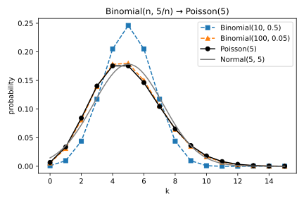

# Probability distributions

## Why this matters

Later parts keep asking two questions about a random output: how wide is it, and how hard is it to tell apart from a slightly different one? Both answers depend on its distribution, and a handful of families cover almost every case: counts of events, such as errors on a test set, and additive noise, usually normal or Laplace.

These families are built from one another. A binomial is a sum of coin flips, a Poisson is a binomial with many unlikely trials, a Laplace is two exponential waiting times back to back, and a normal is what many small independent pieces add up to. Each family's spread and tail follow from how it is built, and so does what matters most later: how far a density drifts from a shifted copy of itself.

## Counts: binomial and Poisson {#sec-dist-counts}

Every measured rate (accuracy, error rate, false positive rate) is a count of yes/no outcomes divided by the number of trials. With $n$ independent trials, each a yes with probability $p$, the count is $\mathrm{Binomial}(n, p)$. Its mean is $np$ and its variance $np(1-p)$, because one trial has variance $p(1-p)$ and variances add over independent terms. Dividing the count by $n$, the measured rate $\hat p$ has standard deviation $\sqrt{p(1-p)/n}$: four times the data only halves the error.

The variance vanishes near $p = 0$, which sounds like good news for rare events but is not. What matters is the error relative to the rate, and the count's standard deviation, about $\sqrt{np}$, divided by its mean $np$ is about $1/\sqrt{np}$. So relative precision is set by the expected count, not by the number of trials. A classifier that errs with probability 0.05 on 2,000 test examples makes about 100 errors, with standard deviation about 9.7, and the measured rate is typically within about half a point of 5%. At an error rate of 0.001 the same test set expects 2 errors, with standard deviation about 1.4, a relative error of about 70%, and one test set in seven shows no error at all.

When the trials are many and each is unlikely, the binomial depends only on the expected count $\mu = np$, and the limit is the **Poisson distribution** $\mathrm{Poisson}(\mu)$. Its variance equals its mean, $\mu$, because the factor $1 - p$ in the binomial variance tends to 1. A training loop that includes each of 60,000 examples independently with probability 0.01 gets batches whose size is close to $\mathrm{Poisson}(600)$: mean 600, standard deviation about 24.5 (@fig-poisson-limit).

{#fig-poisson-limit}

## Laplace and exponential {#sec-dist-laplace}

The waiting time for a rare event, with many independent chances each unlikely, follows the **exponential distribution** $\mathrm{Exp}(b)$: density $\frac1be^{-y/b}$ on $y \ge 0$, mean $b$, tail $e^{-t/b}$. The **Laplace distribution** puts one exponential on each side of a centre. $\mathrm{Lap}(\mu, b)$, with centre $\mu$ and scale $b$, has density
$$f(x) = \frac{1}{2b}e^{-|x - \mu|/b}.$$
So the size $|X - \mu|$ is exactly $\mathrm{Exp}(b)$: the average absolute error is $b$, the variance is $2b^2$ (so a standard deviation $\sigma$ means $b = \sigma/\sqrt2$), and the two-sided tail is exact,
$$\Pr[|X - \mu| \ge t] = e^{-t/b}.$$

The Laplace has heavier tails than a normal of the same variance, and the log scale shows why (@fig-laplace-vs-normal). The logarithm of each density is its exponent: two straight lines $-|x|/b$ for the Laplace, a parabola $-x^2/(2\sigma^2)$ for the normal. Far enough out a parabola always falls below a line, so the normal's tail eventually becomes far lighter. With the same variance, the Laplace exceeds three times its scale with probability $e^{-3} \approx 0.050$, the normal only with probability about 0.034, and the gap widens. So a tail bound shaped for the normal fails for Laplace noise far enough out.

{#fig-laplace-vs-normal}

Libraries differ in whether they take the scale $b$ or the rate $1/b$ (NumPy's `rng.exponential(b)` takes the scale), so check before trusting a noise level.

## Normal {#sec-dist-normal}

$\mathcal N(\mu, \sigma^2)$ has density $\frac{1}{\sigma\sqrt{2\pi}}e^{-(x-\mu)^2/(2\sigma^2)}$, and every probability reduces to the standard normal cumulative distribution function (CDF) $\Phi$, through $\Pr[X \le x] = \Phi((x - \mu)/\sigma)$. It stays normal under sums: $\sum_ia_iX_i$ for independent normals is normal with mean $\sum_ia_i\mu_i$ and variance $\sum_ia_i^2\sigma_i^2$.

That rule explains normal noise in many dimensions. A vector $X \sim \mathcal N(0, \sigma^2I_d)$ has $d$ independent coordinates, so its squared length is a sum of $d$ terms of mean $\sigma^2$, and like any sum of many independent terms its relative spread shrinks: the length sits at $\sigma\sqrt d$, with relative spread about $1/\sqrt{2d}$ (@tbl-gaussian-norms). Yet the projection onto a fixed unit vector is a weighted sum whose squared weights add to 1, so it is just $\mathcal N(0, \sigma^2)$. Noise $\mathcal N(0, 0.01^2I_d)$ on a model with $d = 10^6$ parameters has length about $0.01 \times 1000 = 10$, yet along any direction fixed in advance it is only $\mathcal N(0, 0.01^2)$: large in norm, small in every direction.

| $d$ | 1 | 10 | 100 | 1,000 | 10,000 |
| --- | --- | --- | --- | --- | --- |
| mean of $\|X\|/\sqrt d$ | 0.802 | 0.977 | 0.998 | 1.000 | 1.000 |
| std of $\|X\|/\sqrt d$ | 0.611 | 0.220 | 0.069 | 0.022 | 0.007 |

: Mean and standard deviation of $\|X\|/\sqrt d$ over 2,000 draws of $X \sim \mathcal N(0, I_d)$. {#tbl-gaussian-norms}

The **central limit theorem (CLT)** explains why the normal is everywhere: the standardized sum of $n$ independent draws with finite variance approaches $\mathcal N(0, 1)$. But the skew of the summands averages out only like $1/\sqrt n$: for sums of exponentials the largest error in the CDF is still 0.0243 at $n = 30$. That is fine for the bulk and useless in the far tail, whose probabilities are much smaller than that error; tails need [Concentration inequalities](02-concentration.md). Small tails need care in code too: $1 - \Phi(x)$ subtracts two nearly equal numbers and loses every digit, so compute the tail directly as $\frac12\operatorname{erfc}(x/\sqrt2)$.

## A density against its shifted copy {#sec-dist-shift}

You observe $x = \mu + X$ with noise density $f$, and $\mu$ is either 0 or a known shift $s$. The two candidates give $x$ the densities $f(x)$ and $f(x - s)$, the same curve moved sideways, and how much one observation favours the first is the **log ratio**
$$L(x) = \ln f(x) - \ln f(x - s).$$
If $|L(x)|$ is bounded, no single observation can settle the question; if not, some observations settle it almost for certain.

The log of each density is its exponent, so the answer comes from the shapes in @fig-laplace-vs-normal. Two copies of the normal's parabola have the same curvature, so subtracting them cancels the $x^2$ terms and leaves a straight line, unbounded:
$$L(x) = \frac{s^2 - 2sx}{2\sigma^2}.$$
The Laplace's log density is $-|x|/b$, a distance from the centre divided by $b$. Moving the centre by $s$ changes the distance from any point by at most $|s|$, so
$$L(x) = \frac{|x - s| - |x|}{b}, \qquad |L(x)| \le \frac{|s|}{b},$$
and the bound is reached on whole half-lines, every $x \le 0$ and every $x \ge s$, where both distances change by exactly $s$.

Take $s = 1$, $\sigma = 1$ and $b = 1$ (@tbl-shifted-log-ratio and @fig-shifted-log-ratio). At $x = 10$ the normal log ratio is $-9.5$: the observation is about 13,360 times more likely under $\mu = 1$. The Laplace never says more than $e \approx 2.72$ times, however far out $x$ lies.

| $x$ | $-2$ | $0$ | $0.5$ | $1$ | $3$ | $10$ |
| --- | --- | --- | --- | --- | --- | --- |
| Normal, $L(x) = (1 - 2x)/2$ | 2.5 | 0.5 | 0 | $-0.5$ | $-2.5$ | $-9.5$ |
| Laplace, $L(x) = \lvert x - 1\rvert - \lvert x\rvert$ | 1 | 1 | 0 | $-1$ | $-1$ | $-1$ |

: The log ratio of a density and its copy shifted by $s = 1$, for $\mathcal N(0, 1)$ and $\mathrm{Lap}(1)$. {#tbl-shifted-log-ratio}

{#fig-shifted-log-ratio}

But "unbounded" does not mean "often large": the normal's extreme ratios sit in tails with very little probability. How little, and what it buys an observer, is what [Divergences](03-divergences.md) and [Hypothesis testing](04-hypothesis-testing.md) measure. And only shift over scale matters: doubling the noise is the same as halving the shift.

## Cheat sheet

| Distribution | Density or probability mass function | Mean | Variance | Tail |
| --- | --- | --- | --- | --- |
| $\mathrm{Binomial}(n, p)$ | $\binom nk p^k(1-p)^{n-k}$ | $np$ | $np(1-p)$ | Chernoff, see [Concentration inequalities](02-concentration.md) |
| $\mathrm{Poisson}(\mu)$ | $e^{-\mu}\mu^k/k!$ | $\mu$ | $\mu$ | $\approx(e\mu/k)^k$ |
| $\mathrm{Exp}(b)$ | $\frac1be^{-y/b}$, $y \ge 0$ | $b$ | $b^2$ | $e^{-t/b}$ |
| $\mathrm{Lap}(\mu, b)$ | $\frac{1}{2b}e^{-\lvert x-\mu\rvert/b}$ | $\mu$ | $2b^2$ | $\Pr[\lvert X - \mu\rvert \ge t] = e^{-t/b}$ |
| $\mathcal N(\mu, \sigma^2)$ | $\frac{1}{\sigma\sqrt{2\pi}}e^{-(x-\mu)^2/(2\sigma^2)}$ | $\mu$ | $\sigma^2$ | $\Pr[X - \mu \ge t] \le \frac12e^{-t^2/(2\sigma^2)}$ |

: The five families: density or probability mass function, moments and tail. {#tbl-distributions-cheat-sheet}

**Rules of thumb**

- A measured rate has standard deviation $\sqrt{p(1-p)/n}$; its relative precision is set by the expected count $np$.
- Normal noise in $d$ dimensions has norm $\approx \sigma\sqrt d$ and is $\mathcal N(0, \sigma^2)$ along every fixed direction.
- Laplace shifted by $s$: log ratio at most $|s|/b$. Normal: unbounded, but large only in the tails, which carry very little probability.

## Further reading

- Blitzstein & Hwang, *Introduction to Probability* (2nd ed., 2019), ch. 3–5 and 7: every distribution here, with worked examples.
- Wasserman, *All of Statistics* (2004), ch. 2–3: a compact reference.
- Vershynin, *High-Dimensional Probability* (2018), §3.1: why the norm of a normal vector concentrates.

**Derivations.** Every result in this chapter is derived step by step in [the full edition's chapter](../../book-full/part01-prerequisites/01-distributions.md).
