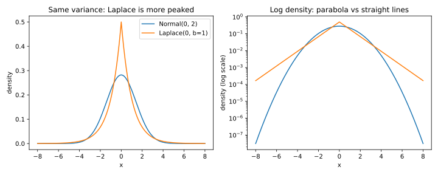

# Probability distributions

## Why this matters

Most of the random numbers in a machine-learning system are either counts or draws of noise. The number of mistakes a model makes on a test set is a count, and so is the size of a randomly sampled minibatch. The noise a system adds on purpose is the other kind, usually drawn from a Laplace or a normal distribution. Before you trust any of these numbers, you need to know where each one usually lands and how rare its large values are.

A handful of families covers almost every case. For a count, you need its spread, so that you can size a test set. For noise, you need its tail, so that you can calibrate its scale to an error bar.

## Means, variances and the square-root law {#sec-dist-moments}

The **mean** of a random quantity $X$, written $\mathbb E[X]$, is the long-run average of many independent draws of it. The **variance** measures the spread around it, as the average squared distance from the mean:
$$\operatorname{Var}(X) = \mathbb E\big[(X - \mathbb E X)^2\big] = \mathbb E[X^2] - (\mathbb E X)^2.$$
The **standard deviation** $\sigma$ is its square root, in the same units as the quantity, so it is the number to compare with the mean.

Three rules cover almost every calculation. The mean of a sum is the sum of the means, always. Scaling a quantity by a constant $c$ multiplies its variance by $c^2$. And when two quantities are independent, their variances add:
$$\operatorname{Var}(X + Y) = \operatorname{Var}(X) + \operatorname{Var}(Y).$$
Without independence the last rule fails. Add a quantity to an exact copy of itself, and the variance of the sum is four times the original, not twice.

Together, the second and third rules give the square-root law. An average of $n$ independent draws has the variance of one draw divided by $n$, so its standard deviation is that of one draw divided by $\sqrt n$. The law breaks when the draws are not independent, for example when one user contributes many rows, so count independent units, not rows.

## Counts and rates: binomial and Poisson {#sec-dist-counts}

A yes-or-no outcome, such as whether a test example is misclassified, is a **Bernoulli** variable. It is 1 with probability $p$, so its mean is $p$ and its variance is $p(1-p)$. Counting the yeses over $n$ independent trials gives a **binomial** count, with mean $np$ and variance $np(1-p)$. Every measured rate, such as accuracy or a false-positive rate, is such a count divided by $n$, so its standard deviation is
$$\sqrt{\frac{p(1-p)}{n}}.$$

This formula is how you size a test set. Suppose a classifier errs on each of 2,000 test examples independently with probability 0.05. Then the measured error rate is typically within about half a percentage point of the true 5%. But if the true error rate is 0.001, the same test set expects only 2 mistakes, so the relative error of the count is about 70%. So what sets the relative precision is the expected number of events $np$, not $n$.

That is also why the normal approximation to a binomial count needs its variance $np(1-p)$ to be about 10 or more, and fails for rare events. The snippet in @sec-dist-code turns a target precision into a test-set size. For a relative standard deviation of 10%, a 5% error rate needs 1,900 examples, while a 0.1% rate needs 99,900.

When the trials are many and each is rare, the binomial depends almost only on the expected count, written $\mu$. It then becomes the **Poisson distribution** $\mathrm{Poisson}(\mu)$. Its variance equals its mean, so its relative spread is $1/\sqrt\mu$, and independent Poisson counts add up to a Poisson count. The main use in this book is the batch size under Poisson sampling, where each example joins a batch independently with a sampling probability $q$. Out of $n$ examples, the batch size is then binomial with mean $qn$. It is close to $\mathrm{Poisson}(qn)$, so its standard deviation is about $\sqrt{qn}$. For example, when each of 60,000 examples joins with probability 0.01, the standard deviation is about 24.5. A batch of 550 or 650 is then unremarkable.

So code that assumes a fixed batch size under this kind of sampling, such as a preallocated buffer or a per-batch average over a constant, is wrong. You can simulate the sizes with NumPy's `rng.binomial(n, q)` or `rng.poisson(q * n)`.

The waiting time until the first rare event follows the **exponential distribution** $\mathrm{Exp}(b)$, whose mean is the scale $b$. In this book it serves mainly as half of a Laplace distribution. The size of a Laplace draw is exponential, and the difference of two independent exponential draws is a Laplace draw, which is one way to sample it.

## Tails and heavy tails {#sec-dist-tails}

The mean and the variance describe the bulk of a distribution, but a guarantee that must hold except in rare cases depends on the **tail**, the chance of landing far from the mean. The Laplace tail shrinks exponentially with the distance, and the normal tail shrinks much faster, like the exponential of the squared distance. The tail bounds of [Concentration inequalities](02-concentration.md) work through the **moment generating function**, the average of $e^{\lambda X}$ for a number $\lambda$ you choose. A **heavy-tailed** quantity, such as an unclipped loss or gradient, has none, so those bounds do not apply to it, which is one reason to clip values before adding noise.

## Laplace and normal noise {#sec-dist-noise}

The two standard noise distributions are the Laplace and the normal. The **Laplace distribution** $\mathrm{Lap}(b)$ with scale $b$ is an exponential density mirrored around zero. Its variance is $2b^2$, so its standard deviation is $\sqrt2\,b$, not $b$. A draw $X$ lands at least a distance $t$ from zero with probability
$$\Pr[|X| \ge t] = e^{-t/b}.$$
Setting this chance to 5% gives the 95% half-width $b\ln 20$, about three scales, which `scipy.stats.laplace(scale=b).ppf(0.975)` computes. So a count reported with Laplace noise of scale 2 is within 5.99 of the true count with 95% probability. The **normal distribution** has a mean $\mu$ and a standard deviation $\sigma$, written $\mathcal N(\mu, \sigma^2)$. Its 95% half-width is $1.96\sigma$, from `scipy.stats.norm.ppf(0.975)`.

@fig-laplace-vs-normal compares the two at the same variance. On a log scale the normal's density is a parabola and the Laplace's is two straight lines, so the Laplace has a sharper peak and much heavier tails.

{#fig-laplace-vs-normal}

Calibrating noise means solving the tail for the scale. Say the noise must stay within a width $t$ of zero, except with a failure probability $\beta$. Then the Laplace scale and the normal standard deviation can be at most
$$b = \frac{t}{\ln(1/\beta)}, \qquad \sigma = \frac{t}{z_{1-\beta/2}},$$
where $z_{1-\beta/2}$ is the normal quantile at $1 - \beta/2$. @tbl-dist-multipliers shows that the two multipliers grow very differently as $\beta$ shrinks.

| Failure probability $\beta$ | 0.05 | $10^{-3}$ | $10^{-6}$ |
| --- | --- | --- | --- |
| Normal, $z_{1-\beta/2}$ standard deviations | 1.96 | 3.29 | 4.89 |
| Laplace, $\ln(1/\beta)$ scales | 3.00 | 6.91 | 13.82 |

: How many standard deviations or scales a noise draw stays within, except with probability $\beta$. {#tbl-dist-multipliers}

The two families also combine differently. A weighted sum of independent normal quantities is again normal, with the weighted means added and the variances added with squared weights:
$$\sum_i a_iX_i \sim \mathcal N\Big(\sum_i a_i\mu_i,\ \sum_i a_i^2\sigma_i^2\Big).$$
So the total noise of many noisy normal measurements is one normal draw that you can analyse exactly. A sum of Laplace draws is not Laplace, and its error bar needs the bound in [Concentration inequalities](02-concentration.md). Either way, a noisy mean computed as a noisy sum divided by $n$ has its noise standard deviation divided by $n$, on top of the sampling spread of the data itself.

The most common bug with these distributions is a mismatched parameter. With `rng = numpy.random.default_rng(seed)`, NumPy's `rng.laplace(0, b, size)` and SciPy's `scipy.stats.laplace(scale=b)` take the scale $b$, whose standard deviation is $b\sqrt2$. By contrast, NumPy's `rng.normal(loc, scale)`, Python's `random.gauss(mu, sigma)` and `scipy.stats.norm(scale=...)` take the standard deviation, never the variance. So before you trust a noise level, check which one a call expects, and draw a million samples to confirm the variance.

## Normal noise in many dimensions {#sec-dist-highdim}

Noise is often added to a whole vector, such as a model's parameters, as $d$ independent normal coordinates with standard deviation $\sigma$ each. Along any direction fixed in advance, this noise is a single draw from $\mathcal N(0, \sigma^2)$. Yet the vector's length is large and predictable, close to $\sigma\sqrt d$. For example, with a million parameters and a standard deviation of 0.01 on each, the noise vector has a length of about 10. So judge high-dimensional noise by its effect along the directions you care about, not by its total length.

The same picture explains noisy gradient descent. Suppose each example's gradient is clipped to a length of at most $C$, and normal noise with standard deviation $\sigma C$ per coordinate is added to the sum of a batch of $B$ clipped gradients. The noise vector then has length about $\sigma C\sqrt d$, which can dwarf the clipped sum, whose length is at most $BC$. Along the gradient's own direction, though, the noise is only $\sigma C$. Dividing the sum by the batch size divides both, leaving per-coordinate noise $\sigma C/B$ on the averaged gradient, so larger batches shrink the noise relative to the signal.

## The central limit theorem {#sec-dist-clt}

The **central limit theorem** says that a standardized sum of many independent draws with finite variance looks normal, whatever each draw's distribution, which is what justifies a normal error bar on an average. The approach is slow for skewed data. For a sum of 30 exponential draws, the largest gap between its distribution function and the normal one is still 0.0243. And it describes the bulk, so for small tail probabilities use [Concentration inequalities](02-concentration.md) instead.

## A density against its shifted copy {#sec-dist-shift}

Later parts keep asking how strongly one noisy observation can favour one underlying value over another that differs by a shift $s$. The answer is the ratio of the noise density to its shifted copy at the observation. Laplace noise with scale $b$ caps this ratio at $e^{|s|/b}$, so no observation is very telling. Normal noise leaves it unbounded, so an observation far out in the tail can be overwhelming, although such observations are rare. With the shift and both scales set to 1, for example, Laplace noise never favours either value by more than a factor of about 2.72. Later parts rely on this difference, and [Divergences](03-divergences.md) averages this ratio.

## Code {#sec-dist-code}

The snippet prints the noise multipliers of @tbl-dist-multipliers and sizes a test set.

```python
import math
from statistics import NormalDist


def normal_multiplier(beta: float) -> float:
    """Number of standard deviations a normal draw stays within, except with probability beta."""
    return NormalDist().inv_cdf(1 - beta / 2)


def test_set_size(p: float, relative: float) -> int:
    """Test examples needed for a measured rate near p to have this relative standard deviation."""
    return math.ceil((1 - p) / (p * relative**2))


print(f"{normal_multiplier(0.05):.2f} {normal_multiplier(1e-3):.2f} {normal_multiplier(1e-6):.2f}")  # 1.96 3.29 4.89
print(f"{math.log(1 / 0.05):.2f} {math.log(1 / 1e-3):.2f} {math.log(1 / 1e-6):.2f}")  # 3.00 6.91 13.82
print(test_set_size(0.05, 0.1), test_set_size(0.001, 0.1))  # 1900 99900
```

## Cheat sheet

| Distribution | Mean | Variance | Tail | Library parameter |
| --- | --- | --- | --- | --- |
| $\mathrm{Binomial}(n, p)$ | $np$ | $np(1-p)$ | Chernoff bound | $n$, $p$ |
| $\mathrm{Poisson}(\mu)$ | $\mu$ | $\mu$ | Chernoff bound | the mean $\mu$ |
| $\mathrm{Lap}(b)$ | $0$ | $2b^2$ | $\Pr[\lvert X\rvert \ge t] = e^{-t/b}$ | scale $b$, not the standard deviation |
| $\mathcal N(\mu, \sigma^2)$ | $\mu$ | $\sigma^2$ | $\Pr[X - \mu \ge t] \le \frac12e^{-t^2/(2\sigma^2)}$ | standard deviation $\sigma$, not the variance |

: The families of this chapter, with what library calls usually expect. {#tbl-distributions-cheat-sheet}

**Rules of thumb**

- Variances add only for independent quantities, so count independent units, not rows.
- Size a test set by the expected number of events $np$, not by $n$, and don't use the normal approximation when $np$ is small.
- A Laplace scale $b$ is not its standard deviation, which is $\sqrt2\,b$, and NumPy's normal `scale` is the standard deviation, not the variance.
- Under Poisson sampling the batch size varies, with standard deviation about $\sqrt{qn}$.

## Further reading

- Blitzstein & Hwang, *Introduction to Probability* (2nd ed., 2019), ch. 3–5 and 7: every distribution here, with worked examples.
- Vershynin, *High-Dimensional Probability* (2018), §3.1: why the length of a normal vector concentrates.

**Derivations.** Every result here is derived step by step in [the full edition's chapter](../../book-full/part01-prerequisites/01-distributions.md).
