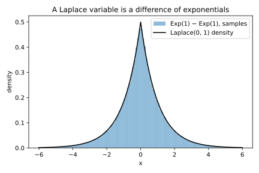
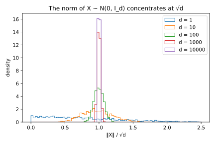

# Probability distributions

## Why this matters

Most of the random numbers in a private machine-learning system are either counts or draws of noise. The number of mistakes a model makes on a test set is a count, and so is the size of a randomly sampled minibatch. The noise a system adds on purpose is usually drawn from a normal or a Laplace distribution. Before you can trust any of these numbers, you need to know where each one usually lands and how rare its large values are.

A handful of distribution families covers almost every case. They are not unrelated formulas, because each is built from simpler ones. Counting the successes in a series of coin flips gives the binomial, and when each flip rarely succeeds, the binomial becomes the Poisson. Waiting for the first of those rare successes gives the exponential, and placing two exponentials back to back gives the Laplace. Adding many small independent pieces, whatever their own distribution, gives the normal. So each family's average and spread follow from its pieces, and this chapter explains each fact that way.

The chapter ends with a question that later chapters keep asking. Noise is added to one of two values that differ by a known amount, and an observer sees only the result. How strongly can that result make the observer favour one value over the other? With normal noise, some observations settle the question almost for certain. With Laplace noise, no observation can make one value more than a fixed factor more likely than the other. The normal's chances fall off much faster far from the centre, and that makes its extreme observations far more telling.

## Mean and variance {#sec-dist-moments}

The **mean** of a random quantity $X$, written $\mathbb E[X]$, is the long-run average of many independent draws of it. The mean says where a distribution sits, but not how wide it is. The **variance** measures the width. It squares each draw's distance from the mean, so that distances on either side count the same, and averages these squares. It is often easier to compute as the mean of the square minus the square of the mean:
$$\operatorname{Var}(X) = \mathbb E\big[(X - \mathbb E X)^2\big] = \mathbb E[X^2] - (\mathbb E X)^2.$$
The **standard deviation**, written $\sigma$, is the square root of the variance. It is in the same units as the quantity, so it is the number to compare with the mean. For a fair die the mean is 3.5 and the variance is about 2.92. The standard deviation is about 1.71, the typical size of a roll's distance from the mean.

Three rules cover almost every calculation in this chapter. The first rule says that the mean of a sum is the sum of the means. It holds even when the quantities depend on each other. An average weighs each outcome by its chance, and at each outcome the sum is just the two values added, so the weighted total splits into two separate averages. The second rule says what scaling does to the spread. Multiplying a quantity by a constant $c$ multiplies every distance from the mean by $c$, and squaring turns that factor into $c^2$. So scaling by $c$ multiplies the variance by $c^2$.

The third rule says that variances add when the quantities are independent. In general the variance of a sum has an extra term, the **covariance**, which measures how much the two quantities tend to move together. Independence makes the covariance zero, so the variances add. With dependence the rule can fail. Add a quantity to an exact copy of itself and the sum is twice the quantity. By the second rule its variance is then four times the original, not twice.

The second and third rules together say how fast an average becomes precise. Take some number $n$ of independent draws and average them. Their sum has $n$ times the variance of one draw, by the third rule. Dividing the sum by $n$ divides that variance by $n^2$, by the second rule. So the average has the variance of one draw divided by $n$, and its standard deviation is that of one draw divided by $\sqrt n$. Four times as much data therefore only halves the error.

## Tails and the moment generating function {#sec-dist-tails}

The mean and the variance describe the bulk of a distribution. A guarantee that must hold except in rare cases depends instead on the **tail**. The tail is the chance $\Pr[X \ge t]$ that the quantity reaches a threshold $t$ far from the mean. What matters is how fast the tail shrinks as the threshold grows, and three shapes recur in this book. Take the threshold $t = 5$. A polynomial decay such as $1/t^2$ gives 0.04 there. An exponential decay such as $e^{-t}$ is down to about $6.7\times10^{-3}$. A Gaussian decay such as $e^{-t^2/2}$ is down to about $3.7\times10^{-6}$.

The gap widens quickly as the threshold grows, because the exponent of the Gaussian decay grows like $t^2$ and that of the exponential decay only like $t$. Among the families defined below, the exponential and Laplace distributions have exponential tails, and the normal distribution has a Gaussian tail.

One function connects a distribution to its tail and also makes sums of independent quantities easy. The **moment generating function** (MGF) of $X$ is the average of $e^{\lambda X}$:
$$M_X(\lambda) = \mathbb E\big[e^{\lambda X}\big].$$
The number $\lambda$ is not a parameter of the distribution but a dial that you set. When $\lambda$ is positive, the weight $e^{\lambda X}$ grows exponentially with the quantity, so large values dominate the average. The larger you set the dial, the further into the right tail the MGF looks. A negative dial would look at the left tail instead, so bounds on the right tail use positive values.

A coin shows how an MGF is computed. Take a quantity that is 1 with some probability $p$ and 0 otherwise. Its weight is $e^0 = 1$ at the outcome 0 and $e^\lambda$ at the outcome 1. The MGF averages the two weights, which gives $1 + p(e^\lambda - 1)$. The factor $e^\lambda$, the weight of the outcome 1, will reappear in every count below.

Two properties of the MGF matter in practice. The first is that adding independent quantities multiplies their MGFs:
$$M_{X+Y}(\lambda) = M_X(\lambda)\,M_Y(\lambda) \quad\text{when $X$ and $Y$ are independent.}$$
The reason is that the exponential of a sum is the product of the exponentials. Independence then lets the average of that product split into the product of the averages. Without independence the average need not split, and the rule can fail. A standard theorem, which the full edition cites, adds that two distributions whose MGFs are finite and equal for every dial in some interval around zero are the same distribution. Finiteness matters because two different heavy-tailed distributions can both have an infinite MGF at every positive dial, and agreeing there says nothing. So when the MGF of a sum matches a known family's MGF near zero, the sum belongs to that family.

The second property links the MGF to the tail. For every positive $\lambda$,
$$\Pr[X \ge t] \le M_X(\lambda)\,e^{-\lambda t}.$$
Because the dial is positive, the weight $e^{\lambda X}$ grows with the quantity. So whenever the quantity reaches the threshold, the weight is at least $e^{\lambda t}$. The weight is never negative, so the other outcomes cannot pull its average below what these outcomes contribute. The MGF is therefore at least $e^{\lambda t}$ times the chance of reaching the threshold, and dividing both sides by $e^{\lambda t}$ gives the bound. So if the MGF is finite for some positive dial, the tail shrinks at least exponentially. A **heavy-tailed** distribution, whose tail shrinks more slowly than every exponential, has an infinite MGF for every positive dial, and the bound says nothing. [Concentration inequalities](02-concentration.md) turns this bound into error bars by choosing the dial well.

## Counts: Bernoulli and binomial {#sec-dist-counts}

The simplest random quantity is a yes-or-no outcome, such as whether a test example is misclassified. A **Bernoulli** variable is 1 with probability $p$ and 0 otherwise. Its mean is $p$. Because it is 0 or 1, it equals its own square, so the average of its square is also $p$. The variance, the mean of the square minus the square of the mean, is therefore $p - p^2$, which is $p(1-p)$.

Count the yeses over $n$ independent trials and you get a **binomial** count, written $\mathrm{Binomial}(n, p)$. Any one sequence with $k$ yeses has probability $p^k(1-p)^{n-k}$, because independent trials multiply their probabilities. There are $\binom nk$ such sequences, one for each choice of which trials say yes. So the count $S$ equals $k$ with probability
$$\Pr[S = k] = \binom nk p^k(1-p)^{n-k}, \qquad k = 0, 1, \dots, n.$$
For the mean and the variance, it is easier to write the count as a sum of $n$ independent Bernoulli trials and apply the rules for sums. The mean is $np$, and the variance is $np(1-p)$ because the trials are independent. The MGF of the count is the product of $n$ coin MGFs, $(1 + p(e^\lambda - 1))^n$.

The variance of one trial, $p(1-p)$, is zero when the outcome is certain either way. It is largest at $p = 1/2$, where it equals a quarter. So in absolute terms, a rate near zero is measured much more precisely than a rate near one half. Hoeffding's inequality, a bound in [Concentration inequalities](02-concentration.md) that knows only that each trial lies between 0 and 1, must assume the worst case of a quarter. It is therefore loose when rates are small.

Every measured rate, such as accuracy or a false-positive rate, is a binomial count divided by $n$. By the scaling rule, the measured rate has mean $p$ and variance $p(1-p)/n$. Its standard deviation is therefore $\sqrt{p(1-p)/n}$.

Suppose a classifier makes a mistake on each test example independently with probability 0.05. On 2,000 test examples it makes 100 mistakes on average. The standard deviation of that count is about 9.7. Divided by the number of examples, the standard deviation is about 0.005. So the measured error rate is typically within about half a percentage point of the true 5%.

Now lower the true error rate to 0.001. The same test set then expects only 2 mistakes, with a standard deviation of about 1.4. The error relative to the count is now about 70%. A test set can easily show no mistakes at all. The chance of that is $0.999^{2000}$. A small chance of failure repeated many times behaves like an exponential, since $(1-p)^n$ is close to $e^{-np}$ when $p$ is small. So the chance of a clean test set is about $e^{-2}$, or one in seven. What sets the relative precision is the expected number of mistakes, not the number of test examples.

## Rare events: Poisson {#sec-dist-poisson}

Many counts, such as an accurate model's mistakes on a large test set, add up many trials that each rarely succeed. Write $\mu$ for the expected count, which is $np$. When the trials are many and each success is rare, the binomial depends almost only on $\mu$. Each part of the binomial formula has a simple limit when $p$ is small. A particular set of $k$ trials all succeed with chance $p^k$. When $k$ is much smaller than $n$, there are about $n^k/k!$ such sets. Together they contribute about $\mu^k/k!$. All the other trials fail with chance close to $e^{-\mu}$, because $(1-p)^n$ is close to $e^{-np}$. Only $\mu$ survives in either limit.

Holding $\mu$ fixed as the number of trials grows gives the **Poisson distribution** $\mathrm{Poisson}(\mu)$. A Poisson count $N$ equals a whole number $k$ with probability
$$\Pr[N = k] = e^{-\mu}\frac{\mu^k}{k!}.$$
@fig-poisson-limit shows how fast the binomial approaches the Poisson.

{#fig-poisson-limit}

A Poisson count has its variance equal to its mean. In the binomial variance $np(1-p)$, the factor $1 - p$ tends to 1 as the trials become rare, which leaves only $\mu$. So the standard deviation is $\sqrt\mu$, and the spread relative to the mean is $1/\sqrt\mu$, which is small only once you expect many events. With a mean of 4, for example, the standard deviation is 2. A count of 0 or 8, two standard deviations away, is then unremarkable.

The Poisson MGF is $\exp(\mu(e^\lambda - 1))$. It is the limit of the binomial MGF $(1 + p(e^\lambda - 1))^n$, for the same reason that $(1-p)^n$ tends to $e^{-np}$. Multiplying the MGFs of two independent Poisson counts adds their exponents, and the result is again a Poisson MGF. So a sum of independent Poisson counts is a Poisson count whose mean is the sum of their means.

The same MGF also bounds every count of independent yes-or-no outcomes. The line $1 + x$ touches the curve $e^x$ at zero, and the curve bends upward away from it. So $1 + x \le e^x$ everywhere. Put $x = p(e^\lambda - 1)$ into this inequality. The left side becomes the coin's MGF, and the right side becomes $\exp(p(e^\lambda - 1))$, the Poisson MGF with mean $p$. Now take independent coins, each with its own probability, and let $\mu$ be the sum of their probabilities. The MGF of their total is the product of their MGFs, and each factor is at most its Poisson bound. Multiplying the bounds adds their exponents, so the total's MGF is at most the Poisson MGF with mean $\mu$. The Chernoff bound in [Concentration inequalities](02-concentration.md) starts from this fact.

A Poisson count is skewed to the right, since it cannot go below zero but can run far above its mean. The chance that it equals exactly $k$ is at most $(e\mu/k)^k$, for every $k$. The reason is that $k!$ is always at least $(k/e)^k$. Dividing by it therefore gives at most $(e\mu/k)^k$, and the factor $e^{-\mu}$ only lowers the chance further. The bound says something only once $k$ exceeds $e\mu$, where its base drops below 1. Beyond that point it falls faster than any exponential decay, but more slowly than a Gaussian decay with the same variance.

Some training procedures form each minibatch by including each of 60,000 examples independently with probability 0.01. The batch size is then a binomial count with many unlikely trials, so it is very close to $\mathrm{Poisson}(600)$. Its mean is 600 and its standard deviation is about 24.5. Batch sizes between 550 and 650, about two standard deviations on either side, are typical. [Concentration inequalities](02-concentration.md) shows how rarely a batch leaves the range of 600 plus or minus 20%.

## Waiting times: exponential {#sec-dist-exponential}

The Poisson counts how many rare events fall in a window of time. The exponential answers how long you wait for the first one. For this book it is mainly a building block of the Laplace distribution.

The exponential comes from the same construction as the Poisson. Chop time into short slots, and let each slot hold an event independently with a small probability. Write $b$ for the average time between events, the **scale**. Write $m$ for the number of slots per unit of time. Each slot holds an event with probability $1/(bm)$, which keeps the expected number of events per unit of time at $1/b$. A time $t$ spans $tm$ slots. The wait $T$ exceeds that time when all of them are empty. These are $tm$ independent trials that all fail, and they expect $t/b$ events in total. As in the Poisson limit, the chance that they all fail tends to $e^{-t/b}$ as the slots shrink:
$$\Pr[T > t] = e^{-t/b}, \qquad t \ge 0.$$ {#eq-exponential-survival}

@fig-exponential-limit shows the limit for a scale of 2. With one slot per unit of time, each slot holds an event with probability one half, so the chance of waiting past $t$ halves at every whole number. With five slots per unit of time, this staircase already hugs the limiting curve.

![$\Pr[T_n > t]$ for the slotted waiting time with $b = 2$ and $n = 1$ or $5$ slots per unit of time, against the exponential tail $e^{-t/2}$.](figures/exponential_limit.svg){#fig-exponential-limit}

The **exponential distribution** $\mathrm{Exp}(b)$ is the distribution of this wait. Its density at a waiting time $y$ is $\frac1be^{-y/b}$. Its mean is the scale $b$, so $b$ really is the average wait, and its variance is $b^2$. Some libraries take the rate $1/b$ instead, while NumPy's `rng.exponential(b)` takes the scale, so check before you trust a noise level.

The exponential's MGF is $1/(1 - b\lambda)$, but only for $\lambda < 1/b$. The MGF averages the weight $e^{\lambda y}$ against the density $e^{-y/b}$. Once the dial reaches $1/b$, the density no longer shrinks faster than the weight grows, and the average is infinite. An MGF that exists only on part of the line is the mark of an exponential tail.

The exponential also forgets how long you have waited. If you have already waited a time $s$ without an event, the chance of waiting at least $t$ more is the same as from scratch:
$$\Pr[T \ge s + t \mid T \ge s] = \Pr[T \ge t].$$
The slots after time $s$ are independent of the empty slots before it, so the wait starts afresh. This **memorylessness** rests on that independence. Suppose instead that a run of empty slots made the next slot more or less likely to hold an event. A long quiet spell would then carry information about the remaining wait, and the exponential would be the wrong model. It is the only continuous distribution that is memoryless.

A deployed classifier serves 50 requests per second and misclassifies each one independently with probability $10^{-4}$. Mistakes then arrive at a rate of 0.005 per second. The time to the first mistake is therefore about exponential, with a scale of 200 seconds. A clean window of ten minutes lasts three scales, so its probability is $e^{-3}$, about 0.050. By memorylessness, after 10 clean minutes you still expect to wait 200 seconds for the first mistake.

## Laplace {#sec-dist-laplace}

The Laplace distribution is symmetric noise with exponential tails, and one of the two standard noise distributions in later parts of this book. Its density is an exponential density on each side of a centre $\mu$, mirrored, with each side carrying half the probability. With scale $b$, written $\mathrm{Lap}(\mu, b)$, the density is
$$f(x) = \frac{1}{2b}e^{-|x - \mu|/b}.$$
This chapter writes $\mathrm{Lap}(b)$ when the centre is zero.

Most facts about the Laplace follow from the exponential. Take the centre to be zero. The density has the same value at $x$ and at $-x$, so the size $|X|$ of a draw collects the density from both sides. Its density is then $\frac1be^{-x/b}$ for every size $x \ge 0$, which is exactly the $\mathrm{Exp}(b)$ density.

The two-sided tail is the exponential tail,
$$\Pr[|X| \ge t] = e^{-t/b},$$
and each side carries half of it. The average size of a draw is $b$. For the variance, recall that the average square of a quantity is its variance plus its squared mean. For the exponential that is $b^2 + b^2 = 2b^2$. A Laplace draw has the same square as its size, and its mean is zero by symmetry, so its variance is also $2b^2$. Turned around, a Laplace distribution with standard deviation $\sigma$ has scale $\sigma/\sqrt2$. Each side has an exponential tail, so as for the exponential, the MGF is finite only for $|\lambda| < 1/b$. There it equals $1/(1 - b^2\lambda^2)$.

The same picture suggests how to build a Laplace draw. Subtract an independent second exponential draw from a first one. The first draw supplies the right half, and the second, negated, supplies the left half. The MGFs confirm it, because the product $1/(1 - b\lambda)$ times $1/(1 + b\lambda)$ is the Laplace MGF. On a million samples, the difference has a cumulative distribution function (CDF) within 0.0006 of the Laplace CDF. @fig-difference-of-exponentials shows the fit.

{#fig-difference-of-exponentials}

@fig-laplace-vs-normal puts a Laplace distribution with scale 1 and a normal distribution side by side, both with variance 2. On a linear scale the Laplace has a sharp peak at zero and fatter tails. On a log scale the reason becomes visible. Taking the logarithm of a density undoes the exponential and leaves the exponent, plus a constant from the factor in front. The normal's log density is a parabola, and the Laplace's log density is two straight lines. Far enough out, a parabola always falls below a line, so the normal's tails are much lighter. A Laplace draw lands at least three scales from zero with probability $e^{-3}$, about 0.050. A normal draw with the same variance gets that far with probability about 0.034, and further out the gap grows quickly.

{#fig-laplace-vs-normal}

The Laplace also explains absolute-error regression. Suppose each target is a linear function of its features plus independent Laplace noise. The logarithm of the likelihood is the sum of the log densities of the errors. Each of these is a constant minus the absolute error divided by $b$. So the most likely fit has the smallest sum of absolute errors. Normal noise leads in the same way to least squares. With no features, the fit is the median, which ignores how far out an extreme point lies and so resists outliers.

## Normal {#sec-dist-normal}

The normal distribution appears whenever many small independent effects add up, and it is the default model for measurement noise. With mean $\mu$ and standard deviation $\sigma$, the normal distribution is written $\mathcal N(\mu, \sigma^2)$. Its density is
$$f(x) = \frac{1}{\sigma\sqrt{2\pi}}e^{-(x-\mu)^2/(2\sigma^2)}.$$
Subtracting the mean and dividing by the standard deviation turns any normal quantity into a **standard normal**, with mean 0 and variance 1. Write $\Phi(t)$ for the chance that a standard normal lands below $t$. Every normal probability reduces to it, since the chance that $X$ lands below $x$ is $\Phi((x - \mu)/\sigma)$. The function $\Phi$ has no closed form, so code computes it from the complementary error function, as @sec-dist-code shows.

The normal MGF is $e^{\mu\lambda + \sigma^2\lambda^2/2}$, and it is finite for every $\lambda$. In the exponent, the weight grows along a straight line while the density falls along a parabola, and the parabola always wins.

The exponent of the MGF is quadratic in $\lambda$, and that makes normal noise easy to combine. Scaling a quantity by a factor $a$ is the same, inside its MGF, as turning the dial to $a\lambda$. Adding independent quantities multiplies their MGFs, which adds the exponents. Both operations keep the exponent quadratic. So a weighted sum of independent normal quantities is again normal. Its mean is the weighted sum of the means, and its variance is the sum of the variances, each multiplied by its squared weight:
$$\sum_i a_iX_i \sim \mathcal N\Big(\sum_i a_i\mu_i,\ \sum_i a_i^2\sigma_i^2\Big).$$
Among distributions with finite variance, only the normal keeps every weighted sum of independent copies in its own family, once a shift and a rescaling are allowed. This is a classical result of Lévy. The Laplace fails the test. The sum of two independent Laplace draws has the MGF $1/(1 - b^2\lambda^2)^2$, which is not a Laplace MGF.

## Normal noise in many dimensions {#sec-dist-highdim}

Noise is often added to a whole vector at once, such as a model's parameters. Write $X \sim \mathcal N(0, \sigma^2I_d)$ for a vector of $d$ independent coordinates, each normal with mean 0 and variance $\sigma^2$. The identity matrix $I_d$ in the notation records that the coordinates are independent and alike. Two facts about such a vector are used constantly.

The first fact is that the noise looks the same in every direction. Project the vector onto a fixed direction, given by a unit vector whose squared entries add up to 1. The projection is a weighted sum of independent normal coordinates, so it is normal with variance $\sigma^2$ times the sum of the squared weights, which is just $\sigma^2$. Along any direction fixed in advance, the noise is a single draw from $\mathcal N(0, \sigma^2)$. The direction must not depend on the noise, because along the noise's own direction the projection is the vector's full length.

The second fact is that this length is large and predictable. The squared length is a sum of $d$ independent and alike squared coordinates, each with mean $\sigma^2$, so its mean is $d\sigma^2$. By the rules for sums, its standard deviation divided by its mean is $\sqrt{2/d}$. Taking a square root halves a small relative deviation. So the length itself sits close to $\sigma\sqrt d$, with a relative spread of about $1/\sqrt{2d}$. A normal vector in high dimension is almost never near the origin and lives on a thin shell (@tbl-gaussian-norms and @fig-gaussian-norms).

| $d$ | 1 | 10 | 100 | 1,000 | 10,000 |
| --- | --- | --- | --- | --- | --- |
| mean of $\|X\|/\sqrt d$ | 0.802 | 0.977 | 0.998 | 1.000 | 1.000 |
| std of $\|X\|/\sqrt d$ | 0.611 | 0.220 | 0.069 | 0.022 | 0.007 |

: Mean and standard deviation of $\|X\|/\sqrt d$ over 2,000 draws of $X \sim \mathcal N(0, I_d)$. {#tbl-gaussian-norms}

{#fig-gaussian-norms}

Take a model with a million parameters and noise of standard deviation 0.01 on each. The noise vector has a length of about $0.01 \times 1000 = 10$, with a relative spread under 0.1%. Yet along any fixed direction it is only a draw from $\mathcal N(0, 0.01^2)$.

## The central limit theorem {#sec-dist-clt}

The **central limit theorem** (CLT) explains why the normal distribution is everywhere. Take a sum of $n$ independent draws from one distribution with mean $\mu$ and finite variance $\sigma^2$. The sum has mean $n\mu$ and standard deviation $\sigma\sqrt n$. Subtract the mean and divide by the standard deviation, and the result has mean 0 and variance 1. The CLT says that, whatever the distribution of each draw, the shape of this standardized sum approaches the standard normal as $n$ grows. The variance must be finite, because the standardization divides by it.

The theorem is easiest to see from a badly skewed distribution, such as the exponential. @fig-clt-exponential shows the standardized sum of $n$ exponential draws. At $n = 1$ it is the exponential itself, with a hard wall where the draw is zero. By $n = 30$ the curve is close to the standard normal, but a small lean remains.

{#fig-clt-exponential}

The leftover lean is measured by the **skewness**. It is the average cubed deviation from the mean, divided by the cube of the standard deviation. Cubed deviations keep their sign, positive above the mean and negative below it, so a long right tail makes the skewness positive. A normal distribution is symmetric, so its skewness is zero. One exponential draw with scale 1 has skewness 2. Cubed deviations add over independent draws, just as squared ones do. So a sum of $n$ draws has an average cubed deviation of $2n$, while the cube of its standard deviation is $n^{3/2}$. Their ratio, the skewness of the sum, is $2/\sqrt n$, so it falls only like $1/\sqrt n$. The largest gap between the sum's CDF and the normal CDF falls at the same rate (@tbl-clt-exponential).

| $n$ | Skewness $2/\sqrt n$ | Largest CDF gap to $\mathcal N(0, 1)$ |
| --- | --- | --- |
| 1 | 2.000 | 0.1587 |
| 2 | 1.414 | 0.0945 |
| 5 | 0.894 | 0.0596 |
| 30 | 0.365 | 0.0243 |

: How far the standardized sum of $n$ $\mathrm{Exp}(1)$ variables is from $\mathcal N(0, 1)$. The CDF gap is the maximum of $|F_n(z) - \Phi(z)|$ over $z \in [-5, 5]$ in steps of 0.01. {#tbl-clt-exponential}

Multiply each gap by $\sqrt n$ and the product settles near 0.133, so the error decays like $1/\sqrt n$. The Berry–Esseen theorem says that this rate holds in general, provided the average cubed distance of a draw from its mean is finite. Its bound on the gap grows with that cubed distance, so the more skewed the draws, the more of them you need. A common rule of thumb says that the normal approximation to a binomial count is reasonable once its variance $np(1-p)$ is about 10 or more. The normal curve also fits the Poisson in @fig-poisson-limit. A Poisson count with mean 5 is a sum of five independent Poisson counts with mean 1, so the CLT already applies to it.

The CLT describes the bulk of the distribution, not its far tails. The error it controls is an absolute error of order $1/\sqrt n$, and a tail probability that a guarantee depends on can be far smaller than that. In the far tail, the normal approximation can then be wrong by a large factor. Bounding tails is the job of [Concentration inequalities](02-concentration.md).

## A density against its shifted copy {#sec-dist-shift}

You see a noisy measurement $x$, which is an unknown value plus noise $X$. The noise has a density, written $f$, centred at zero. The unknown value can only be zero or a known **shift** $s$. How strongly can one observation favour one candidate over the other?

If the value is zero, the observation has the density $f(x)$. If the value is $s$, it has the density $f(x - s)$, the same curve moved sideways by the shift. The ratio of the two densities at the observation says how many times more likely it is if the value is zero than if it is the shift. Its logarithm is the **log ratio**:
$$L(x) = \ln f(x) - \ln f(x - s).$$
A positive log ratio favours zero, and a negative one favours the shift. If the log ratio is bounded, no single observation can make one candidate much more likely than the other. If it is unbounded, some observations settle the question almost for certain.

The answer comes from the shapes of the two log densities in @fig-laplace-vs-normal. For normal noise with standard deviation $\sigma$, the log density is a parabola, and both copies have the same curvature. Subtracting them cancels the squared terms and leaves a straight line:
$$L(x) = \frac{s^2 - 2sx}{2\sigma^2}.$$
A line with a nonzero slope has no bound, so for normal noise the log ratio grows without limit as the observation moves out.

The Laplace's log density is $-|x|/b$ plus a constant, so up to the constant it is a distance from the centre divided by the scale. The constant cancels in the log ratio. Moving the centre by the shift changes the distance from any point by at most the size of the shift. So the log ratio can never exceed $|s|/b$ in size:
$$L(x) = \frac{|x - s| - |x|}{b}, \qquad |L(x)| \le \frac{|s|}{b}.$$
The bound is reached, not just approached. For a positive shift, every observation outside the stretch between the two centres is exactly $s$ closer to one centre than to the other. Between the centres, the log ratio falls along a straight line from one limit to the other.

@tbl-shifted-log-ratio puts numbers on both formulas, with the shift and both noise scales set to 1. Both log ratios are zero at the midpoint, where the candidates are equally plausible. Further out, they part ways. At $x = 10$ the normal log ratio is $-9.5$. That makes the observation about 13,360 times more likely under the shifted candidate. The Laplace never says more than about 2.72 times, however far out the observation lies (@fig-shifted-log-ratio).

| $x$ | $-2$ | $0$ | $0.5$ | $1$ | $3$ | $10$ |
| --- | --- | --- | --- | --- | --- | --- |
| Normal, $L(x) = (1 - 2x)/2$ | 2.5 | 0.5 | 0 | $-0.5$ | $-2.5$ | $-9.5$ |
| Laplace, $L(x) = \lvert x - 1\rvert - \lvert x\rvert$ | 1 | 1 | 0 | $-1$ | $-1$ | $-1$ |

: The log ratio of a density and its copy shifted by $s = 1$, for $\mathcal N(0, 1)$ and $\mathrm{Lap}(1)$. {#tbl-shifted-log-ratio}

{#fig-shifted-log-ratio}

So the two Laplace copies stay within a fixed factor of each other everywhere, while the two normal copies do not. Unbounded does not mean often large, though, because the extreme ratios sit in tails that carry very little probability. The next three chapters make this precise. [Concentration inequalities](02-concentration.md) bounds how rare those observations are, and [Divergences](03-divergences.md) averages the log ratio. [Hypothesis testing](04-hypothesis-testing.md) says what an observer can decide from it.

## Code {#sec-dist-code}

Normal tails need care in code. Far out, $\Phi(t)$ is so close to 1 that computing the tail as one minus $\Phi(t)$ loses every digit and returns zero. The complementary error function computes the small tail directly. The snippet also checks the tails from @sec-dist-laplace.

```python
from math import erfc, exp, sqrt


def normal_cdf(x: float) -> float:
    """Chance that a standard normal lands below x."""
    return 0.5 * erfc(-x / sqrt(2))


def normal_tail(t: float) -> float:
    """Chance that a standard normal lands at or above t, computed without subtraction."""
    return 0.5 * erfc(t / sqrt(2))


def laplace_two_sided_tail(t: float, b: float) -> float:
    """Chance that a Lap(b) draw lands at least t from zero."""
    return exp(-t / b)


print(f"{1 - normal_cdf(10.0):.3e}")  # 0.000e+00
print(f"{normal_tail(10.0):.3e}")  # 7.620e-24
# Same variance 2: Laplace scale 1 against normal sigma sqrt(2), at three Laplace scales.
print(f"{laplace_two_sided_tail(3.0, 1.0):.3f} {2 * normal_tail(3.0 / sqrt(2)):.3f}")  # 0.050 0.034
```

The full edition's script, [distributions.py](../../code/part01-prerequisites/distributions.py), draws every figure in this chapter and checks each mean and variance against a million samples. Run it from the repository root with `uv run python code/part01-prerequisites/distributions.py`.

## Cheat sheet

| Distribution | Density or probability of $k$ | Mean | Variance | MGF | Tail |
| --- | --- | --- | --- | --- | --- |
| $\mathrm{Bernoulli}(p)$ | 1 with probability $p$, else 0 | $p$ | $p(1-p)$ | $1 + p(e^\lambda - 1)$ | — |
| $\mathrm{Binomial}(n, p)$ | $\binom nk p^k(1-p)^{n-k}$ | $np$ | $np(1-p)$ | $(1 + p(e^\lambda - 1))^n$ | Chernoff, see [Concentration inequalities](02-concentration.md) |
| $\mathrm{Poisson}(\mu)$ | $e^{-\mu}\mu^k/k!$ | $\mu$ | $\mu$ | $e^{\mu(e^\lambda - 1)}$ | $\Pr[N = k] \le (e\mu/k)^k$, the chance of the single value $k$ |
| $\mathrm{Exp}(b)$ | $\frac1be^{-y/b}$, $y \ge 0$ | $b$ | $b^2$ | $\frac{1}{1 - b\lambda}$, $\lambda < \frac1b$ | $e^{-t/b}$ |
| $\mathrm{Lap}(\mu, b)$ | $\frac{1}{2b}e^{-\lvert x-\mu\rvert/b}$ | $\mu$ | $2b^2$ | $\frac{e^{\mu\lambda}}{1 - b^2\lambda^2}$, $\lvert\lambda\rvert < \frac1b$ | $\Pr[\lvert X - \mu\rvert \ge t] = e^{-t/b}$ |
| $\mathcal N(\mu, \sigma^2)$ | $\frac{1}{\sigma\sqrt{2\pi}}e^{-(x-\mu)^2/(2\sigma^2)}$ | $\mu$ | $\sigma^2$ | $e^{\mu\lambda + \sigma^2\lambda^2/2}$ | $\Pr[X - \mu \ge t] \le \frac12e^{-t^2/(2\sigma^2)}$ for $t \ge 0$ |

: The families of this chapter: density or probability, mean, variance, MGF and tail. {#tbl-distributions-cheat-sheet}

**Rules of thumb**

- Means always add. Variances add only for independent quantities, so an average of $n$ independent draws has its standard deviation divided by $\sqrt n$.
- A measured rate has standard deviation $\sqrt{p(1-p)/n}$. Its relative precision is set by the expected count $np$, not by $n$.
- Normal noise in $d$ dimensions has length about $\sigma\sqrt d$, but only $\mathcal N(0, \sigma^2)$ along any direction fixed in advance.
- The CLT describes the bulk, with an error of order $1/\sqrt n$. Don't use it for small tail probabilities.
- For a shift $s$, the Laplace log ratio is at most $|s|/b$. The normal log ratio is unbounded, but large only in tails that carry very little probability.

## Further reading

- Blitzstein & Hwang, *Introduction to Probability* (2nd ed., 2019), ch. 3–5 and 7: every distribution here, with worked examples, and the proof that the MGF determines the distribution.
- Wasserman, *All of Statistics* (2004), ch. 2–3: a compact reference.
- Vershynin, *High-Dimensional Probability* (2018), §3.1: why the length of a normal vector concentrates.

**Derivations.** Every result in this chapter is derived step by step in [the full edition's chapter](../../book-full/part01-prerequisites/01-distributions.md), except the central limit theorem, the Berry–Esseen bound, Lévy's result and the fact that the MGF determines the distribution, which it cites. The normal tail bound in the cheat sheet is derived in [the full edition's concentration chapter](../../book-full/part01-prerequisites/02-concentration.md).
