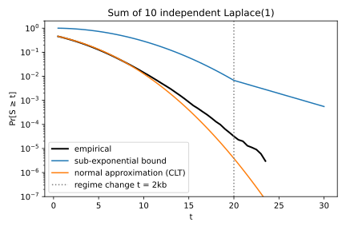
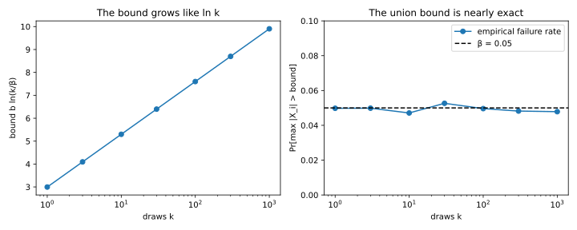
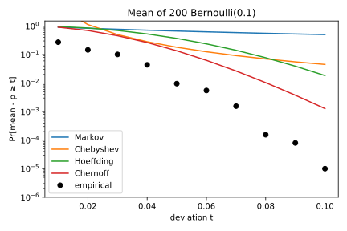
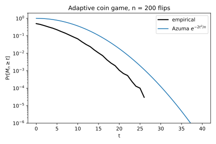

# Concentration inequalities

## Why this matters

Almost every number in a private system is random. Some are random by design, like the noise a mechanism adds to a count. Others are random because of how they were measured. An error rate depends on which examples happened to land in the test set, and the size of a randomly sampled minibatch changes from one step to the next. Before you rely on any of these numbers, you need to know how far it can stray from the value you actually care about.

A concentration inequality answers that question. It tells you how wide to make an interval around your estimate so that the true value falls outside it only rarely, say once in a thousand runs. This chapter calls that rare event a failure, and the chance of it the **failure probability**, written $\beta$. It calls the distance from the estimate to either end of the interval the **width**, so the interval reaches one width on each side.

How wide the interval must be depends on how much you know about the random quantity. If you know only its variance, the width grows quickly as you ask for a smaller failure probability. If you also know the shape of its distribution far from the centre, the width grows very slowly. For a 95% interval the difference is modest, under a factor of two in the examples below. But later parts of this book often ask for failure probabilities of one in a hundred thousand or less. At one in a million, knowing that shape can make an interval a hundred times narrower. This chapter shows how to use everything you know.

## Knowing only the variance: Markov and Chebyshev {#sec-conc-chebyshev}

Every bound in this chapter starts from **Markov's inequality**. It applies only to quantities that cannot be negative, such as a waiting time, a count or a squared error. For such a quantity, knowing the average alone limits how often it can be large. Suppose customers wait 2 minutes at a counter on average. Then at most a quarter of them can wait 8 minutes or more. If more than a quarter did, those customers alone would push the average above 2 minutes, and no customer can have a negative wait that pulls it back down. In general, take a quantity $X$ that cannot be negative, and write $\mathbb E[X]$ for its average. For any positive threshold $a$, Markov's inequality says that
$$\Pr[X \ge a] \le \frac{\mathbb E[X]}{a}.$$
In the example, an average of 2 minutes and a threshold of 8 give the bound of a quarter.

The requirement that the quantity cannot be negative is what makes the argument work. A quantity that can be negative can balance a large value with negative ones, and then its average says nothing about how often it is large. A gain that averages zero, for example, could be large and positive half the time and equally large and negative the other half.

On its own, Markov's inequality is rarely useful, because it ignores how spread out the quantity is. What makes it useful is that you can apply it to other quantities built from $X$, and the first of these is the squared distance from the mean. Write $\mu$ for the mean of $X$ and $\sigma^2$ for its variance, the average squared distance from $\mu$. A squared distance is never negative, so Markov's inequality applies to it, with $\sigma^2$ as the average. Now pick a distance $t$. Being at least $t$ from the mean is the same as having a squared distance of at least $t^2$, so the chance of it is at most $\sigma^2/t^2$. This is **Chebyshev's inequality**:
$$\Pr[|X - \mu| \ge t] \le \frac{\sigma^2}{t^2}.$$

To turn the bound into an interval, set the right side equal to $\beta$ and solve for $t$, which gives $t = \sigma/\sqrt\beta$. So with probability at least $1 - \beta$, the quantity lies within $\sigma/\sqrt\beta$ of its mean. The same works for an average of $n$ independent samples. Averaging divides the variance by $n$, so the width becomes $\sigma/\sqrt{n\beta}$.

Chebyshev's bound is weak because it must hold for every distribution with the given variance, including those that hide their spread in a rare spike far from the mean. To cover such spikes, the width has to grow like $1/\sqrt\beta$ as the failure probability falls. Most noise is better behaved than that, because its **tail**, the chance of landing far from the centre, falls off quickly. For a quantity whose tail falls off like a normal distribution's, the width is only $\sigma\sqrt{2\ln(1/\beta)}$, and the next section shows where this comes from. @tbl-width-price compares the two widths.

| Failure probability $\beta$ | Chebyshev, $1/\sqrt\beta$ | Normal-shaped tail, $\sqrt{2\ln(1/\beta)}$ |
| --- | --- | --- |
| $0.05$ | 4.5 | 2.4 |
| $10^{-3}$ | 31.6 | 3.7 |
| $10^{-6}$ | 1,000 | 5.3 |

: Width needed to fail with probability at most $\beta$, in standard deviations. {#tbl-width-price}

At a failure probability of 5%, Chebyshev needs 4.5 standard deviations, and the normal-shaped tail needs about half as many. At one in a million the gap becomes enormous, since Chebyshev needs 1,000 standard deviations where the normal-shaped tail needs 5.3. So Chebyshev's inequality is fine for a quick 95% error bar, and useless when failures must be very rare.

## Normal and Laplace noise {#sec-conc-noise}

When you know the distribution of the noise, you don't need a general inequality. You can read the width directly off the distribution's tail. The two noise distributions this book uses most are the Laplace and the normal distributions ([Probability distributions](01-distributions.md)), both centred at zero.

Laplace noise, written $\mathrm{Lap}(b)$, has a scale $b$ that sets its typical size. Its tail has an exact formula, which says how likely a draw $L$ is to land more than a distance $t$ from zero:
$$\Pr[|L| > t] = e^{-t/b}.$$
Setting this chance equal to $\beta$ and solving for $t$ gives the width, so with probability $1 - \beta$ the noise stays within $b\ln(1/\beta)$ of zero.

Chebyshev's inequality would use only the variance of Laplace noise, which is $2b^2$, and it pays for that. For scale 1 and a 95% interval, it gives a width of about 6.3, while the exact tail gives about 3.0. At a failure probability of one in a million, the gap grows to 1,414 against 13.8. So ignoring the shape of the noise makes the interval a hundred times wider.

Normal noise with standard deviation $\sigma$ has no simple formula for its tail, but a simple bound on it is enough to compute the width. For a draw $Z$ of that noise, it says
$$\Pr[|Z| > t] \le e^{-t^2/(2\sigma^2)}.$$
Solving for $t$ in the same way gives the width $\sigma\sqrt{2\ln(1/\beta)}$ from @tbl-width-price.

The shapes of the two tails explain why the widths grow at different rates. The Laplace tail falls like $e^{-t}$, so its width grows like $\ln(1/\beta)$. The normal tail falls faster, like $e^{-t^2}$, so only the squared width grows like $\ln(1/\beta)$. That leaves the width itself growing like the square root of the logarithm, which is very slowly indeed.

Sometimes you add noisy values together, for example to compute a total from several noisy counts. Write $S$ for the sum of $k$ independent Laplace draws with scale $b$. Near its centre the sum looks like a normal distribution, as the central limit theorem (CLT) predicts. Far from the centre, though, its tail keeps the slow decay of a single Laplace draw, like $e^{-t}$ rather than $e^{-t^2}$. A bound that is valid everywhere has to describe both regions:
$$\Pr[S \ge t] \le \exp\Big(-\min\Big(\frac{t^2}{8kb^2}, \frac{t}{4b}\Big)\Big).$$
The constants come from the derivation in the full edition. What matters here is the shape. Up to $t = 2kb$, where the two terms inside the minimum are equal, the first term is the smaller one, and the bound has the normal shape. Beyond that point the second term takes over, and the bound falls only like $e^{-t}$, as a Laplace tail does.

The difference matters whenever you need a guarantee. Take 10 draws with scale 1, and approximate their sum by a normal distribution with the same mean and variance. That approximation says the sum reaches 20 with probability $3.9\times10^{-6}$, but simulation gives $3.4\times10^{-5}$, about nine times more (@fig-laplace-sum). A system that trusted the approximation would therefore fail nine times as often as it promised. The bound above gives $6.7\times10^{-3}$ at the same point, which is far from the truth but never below it. So when the answer must be a guarantee, use a bound, not the CLT.

{#fig-laplace-sum}

## Many quantities at once: the union bound {#sec-conc-union}

Often you need many random quantities to stay close to their targets at the same time. A system might release $k$ noisy counts and need every one of them to be accurate. The **union bound** handles this. It says that the chance that at least one of several events happens is at most the sum of their separate chances. The sum can overcount, because an outcome in which two events happen is counted twice, but it never misses an outcome. So if you want all $k$ counts to be accurate except with probability $\beta$, ask each one to fail with probability at most $\beta/k$.

Dividing the failure probability by $k$ costs little, because the widths depend on it only through a logarithm, and the logarithm turns the division into an addition:
$$\ln\frac{k}{\beta} = \ln k + \ln\frac1\beta.$$
All $k$ Laplace draws then stay within $b\ln(k/\beta)$ of zero, and all $k$ normal draws within $\sigma\sqrt{2\ln(k/\beta)}$. Because the number of quantities enters only through a logarithm, controlling many of them at once is cheap.

The union bound looks crude, but for rare, independent failures it is nearly exact. When the failures are independent and each is rare, two at once are rarer still, so the double counting adds almost nothing. For an example, take 100 Laplace draws with scale 1, and look at the one furthest from zero. With a failure probability of 0.05, the union bound gives the width $\ln(100/0.05) = 7.60$. In simulation, the draw furthest from zero lands beyond 7.60 in 4.86% of runs, just under the 5% the bound allows (@fig-laplace-max). The bound is far less exact when the failures are correlated. If all $k$ events were the same event, the sum would count it $k$ times.

{#fig-laplace-max}

## Counts: the Chernoff bound {#sec-conc-chernoff}

Many quantities in machine learning are counts, such as the errors on a test set, the examples in a sampled minibatch or the records that match a query. A count adds up many yes-or-no outcomes. When you need a very small failure probability, Chebyshev's bound for a count is far too loose. The **Chernoff bound** does much better, with a tail that falls exponentially, by adding one more idea. It assumes that the outcomes are independent of one another, and the calculation below shows where it needs this.

The idea is to apply Markov's inequality to $e^{\lambda X}$ instead of to $X$ itself, where $\lambda$ is a positive number you are free to choose. The exponential keeps the order of values, so $X$ is at least $t$ exactly when $e^{\lambda X}$ is at least $e^{\lambda t}$. Markov's inequality then gives
$$\Pr[X \ge t] \le \frac{\mathbb E[e^{\lambda X}]}{e^{\lambda t}}.$$
The exponential turns a modest gap between $X$ and $t$ into a huge gap between $e^{\lambda X}$ and $e^{\lambda t}$. The threshold on the bottom of the fraction is then far above the typical values on top, so the bound becomes small. The bound holds for every positive $\lambda$, and you pick the one that makes it smallest. For a count, the average on top, $\mathbb E[e^{\lambda X}]$, is also easy to compute, because the exponential of a sum is a product of exponentials. This is where independence comes in. For independent outcomes, the average of that product is the product of the averages, one factor per outcome.

Carrying out this calculation for a count $S$ gives a bound in terms of two numbers. The first is the expected count, written $\mu$. The second is the relative deviation you ask about, written $\delta$, so that $\delta = 0.2$ means 20% above or below $\mu$. The two Chernoff bounds are
$$\Pr[S \ge (1+\delta)\mu] \le \exp\Big(-\frac{\delta^2\mu}{2+\delta}\Big), \qquad \Pr[S \le (1-\delta)\mu] \le \exp\Big(-\frac{\delta^2\mu}{2}\Big).$$
The first bounds the chance that the count overshoots its mean by the fraction $\delta$. The second bounds the chance that it undershoots, and holds for $\delta$ between 0 and 1. For small $\delta$, setting either bound to $\beta$ gives a one-sided width of about $\sqrt{2\mu\ln(1/\beta)}$.

The exponent contains the expected count $\mu$, not the number of trials, and this has a cost and a benefit. The cost is that a count of rare events has a small error relative to its mean only once you expect many of them. For example, a million trials that each succeed with probability one in a million expect a single success. That count is far from concentrated, since no success at all and two successes are both common outcomes.

The benefit is that the calculation works with each outcome's own probability before adding them up into $\mu$. An outcome that is a yes with probability $p$ has variance $p(1-p)$, which is about $p$ when $p$ is small. The variance of a count is the sum of its outcomes' variances, so a count of rare events has a variance of about $\mu$. The Chernoff bound adapts to that small variance. A bound that knew only that each outcome is 0 or 1 would have to assume the largest variance such an outcome can have, which is 0.25. The next section shows how much that costs.

The overshoot and undershoot bounds also differ. For large $\delta$, the exponent of the overshoot bound grows like $\delta\mu$ rather than $\delta^2\mu$, so the overshoot bound falls more slowly. Counts have long right tails, like the Poisson distribution, so a count can overshoot its mean by a lot far more easily than it can undershoot it.

Here is how the bound is used in practice. A training loop forms each minibatch by including each of 60,000 examples independently with probability 0.01. The batch size is a count with expected value $\mu = 600$. If your code or your analysis assumes a batch size near 600, you need to know how often that assumption fails. With $\delta = 0.2$, the overshoot bound says a batch is more than 20% too large with probability at most $1.8\times10^{-5}$. The undershoot bound gives $6.1\times10^{-6}$ for a batch more than 20% too small. Adding the two, a single batch leaves the range $600 \pm 20\%$ with probability about $2.4\times10^{-5}$. Over 1,000 training steps, the union bound multiplies this by 1,000, so the chance that any batch leaves the range is about 0.024.

## Averages of bounded quantities: Hoeffding and Bernstein {#sec-conc-hoeffding}

Often you know neither the distribution nor the variance, only the range. A loss clipped to lie between 0 and 1 is one example, and a 0/1 indicator of a mistake is another. Knowing the range already tells you a lot. A quantity confined to an interval cannot have a heavy tail, one that reaches far out with sizable probability, because it cannot go past the ends at all. Its variance cannot be large either. The most spread-out quantity on an interval puts half its probability on each end, like a fair coin, and its variance is a quarter of the squared length of the interval.

**Hoeffding's inequality** turns this into a width for an average. Take $n$ independent quantities, each in the same interval from $a$ to $b$. Write $\bar X_n$ for their average and $\mu$ for its expected value. Hoeffding's inequality says that the average has a normal-shaped tail, as if each quantity had the largest variance its range allows. With probability at least $1-\beta$,
$$|\bar X_n - \mu| < (b - a)\sqrt{\frac{\ln(2/\beta)}{2n}}.$$
The 2 inside the logarithm appears because the interval has two sides, and each side is allowed half the failure probability. The width shrinks like $1/\sqrt n$ as you add samples. As you lower the failure probability, it grows only like the square root of a logarithm, as for normal noise.

The most common use is to compare a model's error on its training data with its **true error**, its average loss on new data from the same source. For one fixed model, the training error is an average of $n$ losses between 0 and 1, so Hoeffding's inequality applies directly. A learner, however, picks its model after seeing the data. The model it picks is the one that looks best on the training data, which makes it the one whose training error is most likely to be too optimistic. So the bound must hold for every model the learner might pick.

Suppose the candidates form a finite set $H$, and write $|H|$ for their number. The union bound over all of them puts an extra $\ln|H|$ inside the logarithm. With probability at least $1-\beta$, every candidate's training error is then within
$$\sqrt{\frac{\ln(2|H|/\beta)}{2n}}$$
of its true error. Because the number of candidates enters only through its logarithm, even a huge set of them costs little.

Knowing only the range is Hoeffding's strength, since there is nothing to estimate. It is also its weakness, because the inequality assumes the largest variance that the range allows. A 0/1 quantity that is rarely 1 has a much smaller variance than that. The gap is therefore widest exactly when you measure small rates, such as a false-positive rate.

Suppose a classifier makes 1 false positive on 1,000 negative examples, and you want a 95% upper bound on its true false-positive rate. An upper bound needs only one side of the interval, so it uses $\ln(1/\beta)$ in place of $\ln(2/\beta)$. With $n = 1{,}000$, this one-sided Hoeffding bound adds about 0.039 to the measured rate, so the added width alone is about 40 times the rate you measured. The culprit is the variance Hoeffding's inequality assumes, which is 0.25, the variance of a fair coin. A single 0/1 outcome that is 1 with probability near 0.001 has a variance of only about 0.001.

**Bernstein's inequality** fixes this by using the variance. Write $\sigma^2$ for the variance of each quantity, and $M$ for the largest distance it can be from its mean. Then the one-sided width is about
$$\sqrt{\frac{2\sigma^2\ln(1/\beta)}{n}} + \frac{2M\ln(1/\beta)}{3n}.$$
The first term is the normal-shaped width, computed with the true variance. The second term pays for the range, but it shrinks like $1/n$ instead of $1/\sqrt n$. For the classifier, take $M = 1$ and estimate the variance as 0.001. Bernstein's inequality then adds about 0.0045, against Hoeffding's 0.039. This calculation is only a heuristic, because the variance was estimated from the same data. A rigorous version, empirical Bernstein, gives a wider interval.

The exact answer comes from the binomial distribution itself, through the Clopper–Pearson interval. Its one-sided 95% upper bound on the rate is 0.0047, a little below the measured rate plus Bernstein's 0.0045. The same number is the upper end of a two-sided 90% interval, which is how [Hypothesis testing](04-hypothesis-testing.md) computes it.

@fig-bernoulli-tails shows the cost of ignoring the variance on a second example. It averages 200 yes-or-no outcomes (Bernoulli variables), each a yes with probability 0.1, and asks how likely the average is to reach 0.15. Hoeffding's inequality bounds that chance by 0.37. Chebyshev's inequality does better here, with 0.18, because it uses the variance. At this moderate deviation its $1/t^2$ has not yet fallen far behind an exponential tail, so knowing the variance counts for more than knowing the tail's shape. The Chernoff bound uses both and gets 0.135. Even that is far above the true chance of about $9.6\times10^{-3}$, because a bound must cover every case its assumptions allow.

{#fig-bernoulli-tails}

## Functions of many inputs: McDiarmid and Azuma {#sec-conc-mcdiarmid}

So far, every quantity was a sum of independent pieces. Two common situations break this. A trained model's error is a complicated function of its training data, not a sum. And in a sequential procedure, each step can depend on what happened before, so the pieces are not independent. Concentration still holds in both situations, provided that no single input or step can move the result by much.

Start with a function $f$ of independent inputs $X_1, \dots, X_n$, and write $X$ for all of them together. Suppose that changing only the $i$-th input, with the others held fixed, moves the result by at most an amount $c_i$. **McDiarmid's inequality** says that the result then concentrates around its average as tightly as a sum of pieces with ranges $c_i$ would:
$$\Pr[f(X) - \mathbb E f(X) \ge t] \le \exp\Big(-\frac{2t^2}{\sum_ic_i^2}\Big).$$

The reason is easiest to see if you reveal the inputs one at a time and keep a running best guess of the result. Before you see any input, the best guess is the average result. After you see the first input, it is the average over the inputs you have not seen yet, with the first one fixed. Each revealed input updates the guess in this way, and after the last one the guess is the result itself. So the deviation you want to bound is the sum of $n$ updates.

Two facts about these updates make the sum concentrate. First, an update is zero on average. Before you see an input, you cannot predict which way it will move your guess, or that prediction would already be part of the guess. Second, the $i$-th update is small. Changing the $i$-th input moves the result by at most $c_i$, so it moves the guess by at most $c_i$ too. The updates are not independent, since each one depends on the inputs before it. The next paragraphs explain why the two facts are enough anyway.

For the training error of a fixed model, with losses between 0 and 1, changing one example moves the average by at most $1/n$. With $c_i = 1/n$ for every input, McDiarmid's inequality gives back Hoeffding's bound. Its real use is for functions that are not averages, such as the error of a model retrained on the data, and [Algorithmic stability and generalization](07-stability-generalization.md) uses it that way. The amount $c_i$ must hold for every possible change to the $i$-th input, not just for typical ones, because the argument charges each input its largest possible move. This per-record influence returns in later parts under the name sensitivity.

Hoeffding's inequality was stated for independent pieces, but its conclusion needs less. It is enough that each piece averages zero given everything before it, and lies in a short interval. A running total whose steps average zero given the past is called a **martingale**, and **Azuma's inequality** bounds how far it drifts. Suppose the $k$-th step always lies in an interval of length $d_k$, and write $D$ for the total drift. Then the chance that it drifts upward by $t$ or more is at most
$$\Pr[D \ge t] \le \exp\Big(-\frac{2t^2}{\sum_kd_k^2}\Big),$$
which is McDiarmid's bound with the step lengths $d_k$ in place of the influences $c_i$.

Azuma's inequality covers procedures that adapt as they go. As an example, flip a coin 200 times, and let each flip depend on the one before. If the previous flip was heads, flip a coin that lands heads with probability 0.7. Otherwise, including for the first flip, use a coin that lands heads with probability 0.3. Because the flips depend on each other, Hoeffding's inequality does not apply, but you can still bound the drift. To get it, count the heads, and subtract the number of heads you would expect from the coins you chose. Each step of the drift is then the flip's outcome, 1 or 0, minus the chosen coin's probability of heads. Given the past, a step averages zero and lies in an interval of length 1. Azuma's inequality bounds the chance of an upward drift of 20 or more by $1.83\times10^{-2}$, while simulation gives $1.12\times10^{-3}$ (@fig-azuma-adaptive).

{#fig-azuma-adaptive}

The bound is loose partly for the same reason as Hoeffding's. It assumes that each step has the largest variance its interval allows, which is 0.25. The true variance of each step is 0.21 for either coin, since $0.7 \times 0.3 = 0.3 \times 0.7$.

## Cheat sheet

| Bound | What you need to know | Width at failure probability $\beta$ (Markov: a threshold) |
| --- | --- | --- |
| Markov | $X \ge 0$, mean $\mu$ | Threshold $\mu/\beta$ |
| Chebyshev | Variance $\sigma^2$ | $\sigma/\sqrt\beta$ (two-sided) |
| Normal noise $\mathcal N(0, \sigma^2)$ | The distribution | $\sigma\sqrt{2\ln(1/\beta)}$ (two-sided); $k$ draws: $\sigma\sqrt{2\ln(k/\beta)}$ |
| Laplace noise $\mathrm{Lap}(b)$ | The distribution | $b\ln(1/\beta)$ (two-sided); $k$ draws: $b\ln(k/\beta)$ |
| Chernoff | A count of independent outcomes, mean $\mu$ | $\approx\sqrt{2\mu\ln(1/\beta)}$ for small deviations (one-sided) |
| Hoeffding | An average of $n$ independent values in $[a, b]$ | $(b-a)\sqrt{\ln(1/\beta)/(2n)}$ (one-sided) |
| Bernstein | An average of $n$ independent values with variance $\sigma^2$ and largest deviation $M$ | $\sqrt{2\sigma^2\ln(1/\beta)/n} + 2M\ln(1/\beta)/(3n)$ (one-sided) |
| McDiarmid, Azuma | Influences $c_i$, or step lengths $d_k$ | $\sqrt{\sum_i c_i^2\ln(1/\beta)/2}$, with $d_k$ in place of $c_i$ for Azuma (one-sided) |

: The widths of this chapter's bounds. Rows marked two-sided already cover both sides. To make a one-sided width two-sided, replace $\beta$ by $\beta/2$. {#tbl-concentration-cheat-sheet}

**Rules of thumb**

- If you know only the variance, the width grows like $1/\sqrt\beta$. With a normal-shaped tail it grows like $\sqrt{\ln(1/\beta)}$, and with a Laplace-shaped tail like $\ln(1/\beta)$.
- To control $k$ quantities at once, add $\ln k$ inside the logarithm.
- If the variance is far below what the range allows, use Chernoff, Bernstein or an exact interval, not Hoeffding.

## Further reading

- Mitzenmacher & Upfal, *Probability and Computing*, ch. 4: the clearest Chernoff chapter, with computer-science examples.
- Vershynin, *High-Dimensional Probability* (2018), ch. 2: sub-Gaussian and sub-exponential variables in depth.
- Boucheron, Lugosi & Massart, *Concentration Inequalities* (2013), ch. 2 and 6: reference depth, including the derivation of Bernstein's inequality.

**Derivations.** Every result in this chapter except Bernstein's inequality is derived step by step in [the full edition's chapter](../../book-full/part01-prerequisites/02-concentration.md).
