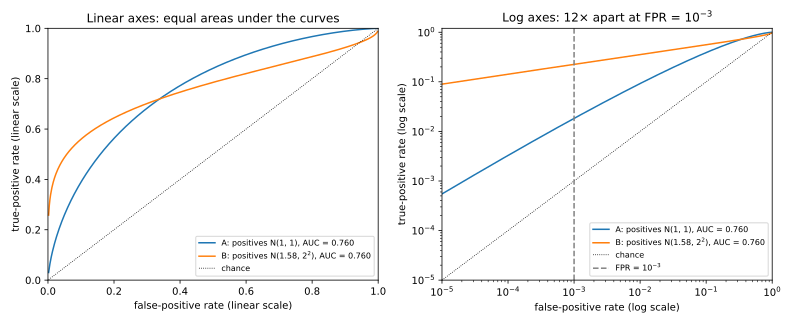

# Hypothesis testing

## Why this matters

A fraud detector must call a transaction normal or fraudulent. The observation came from one of two distributions, and it must decide which. So every detector and every binary classifier is a hypothesis test, and evaluating one means measuring its two kinds of error, false alarms and missed cases. What matters throughout is how a detector does when false alarms must be rare, which accuracy hides.

## Tests and their two errors {#sec-ht-setup}

The default assumption, called the **null hypothesis** $H_0$, is that the observation comes from a distribution $P$, such as a fraud model's scores for normal transactions. The **alternative hypothesis** $H_1$ is that it comes from a distribution $Q$, such as its scores for fraudulent ones. A **test** decides whether to reject the null, which here means flagging the transaction.

A test can make two kinds of mistake. Flagging a normal case is a false positive, and its probability is the **false positive rate (FPR)**, written $\alpha$. Missing a real case is a false negative, with probability $\beta$, the **false negative rate (FNR)**. The share of real cases caught, $1 - \beta$, is the **true positive rate (TPR)**. Lowering a test's threshold raises the TPR but also the FPR. So you fix a budget for the FPR first, called the **level**, and then look for the test with the highest TPR, or **power**, within it.

## The Neyman–Pearson lemma {#sec-ht-np}

Write $p(x)$ and $q(x)$ for the probabilities, or densities, of an observation $x$ under the two hypotheses. Their quotient is the **likelihood ratio**
$$\Lambda(x) = \frac{q(x)}{p(x)},$$
and a **likelihood ratio (LR) test** rejects wherever it exceeds a threshold $\tau$, set so that the test's FPR equals the budget. The **Neyman–Pearson lemma** says that no other test at that level catches more real cases.

So the best test looks at an observation only through its likelihood ratio. A threshold on a raw score is that test only when a higher score always means a higher ratio. To estimate the ratio from labelled scores, fit a logistic regression of the label on the score, whose log-odds, less the log prior odds, estimate $\ln\Lambda$. If a known group shifts the scores, the ratio depends on the group, so the best test thresholds within each group.

## Trade-off curves {#sec-ht-tradeoff}

How hard $P$ is to tell from $Q$ is captured by the best FNR at every level, the **trade-off function** $T(P, Q)$, which you compute by sweeping the LR threshold. The **receiver operating characteristic (ROC)** curve holds the same information upside down, as TPR against FPR. Any particular detector traces its own ROC curve, which lies on or below the best one.

## The Gaussian trade-off curve {#sec-ht-gaussian}

A common pair is a score that is normal under both hypotheses with the same spread, scaled so that normal cases have mean 0 and standard deviation 1. Write $\mu$ for the distance between the two centres in standard deviations, and $\Phi$ for the standard normal cumulative distribution function. The best test thresholds at $\Phi^{-1}(1 - \alpha)$, and its FNR at level $\alpha$ is the Gaussian trade-off function
$$G_\mu(\alpha) = \Phi\big(\Phi^{-1}(1 - \alpha) - \mu\big).$$ {#eq-ht-gaussian-tradeoff}
In SciPy this is `norm.cdf(norm.isf(alpha) - mu)`, with `isf` because `norm.ppf(1 - alpha)` loses the digits that matter at a tiny $\alpha$. So the single number $\mu$ fixes the best TPR at every FPR. At $\mu = 2$, for example, the best TPR is 0.6388 at an FPR of 5%. At an FPR of $10^{-3}$ it drops to 0.1378. Conversely, a measured pair gives $\mu = \Phi^{-1}(1 - \alpha) + \Phi^{-1}(\mathrm{TPR})$, `norm.isf(alpha) + norm.ppf(tpr)`. If that estimate changes with $\alpha$, the scores are not of this shape.

## The Laplace trade-off curve {#sec-ht-laplace}

For a Laplace distribution and a copy shifted by $\kappa$ times its scale, the likelihood ratio is capped between $e^{-\kappa}$ and $e^{\kappa}$ ([Divergences](03-divergences.md)). Every outcome a test rejects is then at most $e^\kappa$ times likelier under $Q$ than under $P$, so every test has
$$\mathrm{TPR} \le e^\kappa\,\mathrm{FPR}.$$
At a low FPR the best test reaches this cap. At $\kappa = 1$ and an FPR of 0.05, its TPR is $e \times 0.05 = 0.1359$.

The cap is what sets the Laplace pair apart from the normal one. A Laplace pair at $\kappa = 1$ and a normal pair at $\mu = 1.0301$ have the same best advantage, the largest TPR minus FPR of any test (@sec-ht-tv). But at a level of $10^{-6}$ the normal pair allows 36 times the TPR, because its unbounded ratio lets a test find rare, highly telling observations. So judge a pair at the level you will use.

## Best advantage and total variation {#sec-ht-tv}

The **advantage** of a test is its TPR minus its FPR. The best advantage over all tests is the **total variation (TV)** distance of [Divergences](03-divergences.md):
$$\max(\mathrm{TPR} - \mathrm{FPR}) = \mathrm{TV}(P, Q) = \frac12\sum_x |q(x) - p(x)|.$$
For the normal pair it is $2\Phi(\mu/2) - 1$, or 0.3829 at a shift of one standard deviation. Accuracy on a balanced set is one half plus half the advantage, so it measures the same single point of the curve and says nothing about its low-FPR end.

## ROC summaries: why AUC hides the low-FPR regime {#sec-ht-auc}

Detectors are often compared by the **area under the curve (AUC)** of their ROC curves, the chance that a random positive scores higher than a random negative. But the area weighs every FPR from 0 to 1 equally, so the low FPRs where a strict detector operates add almost nothing to it. Take two detectors with standard normal scores on negatives. Detector A's positives score normal with mean 1 and standard deviation 1. B's are more spread out, with standard deviation 2, and their mean of 1.5811 gives both detectors an AUC of 0.7602. Yet at an FPR of $10^{-3}$, A catches 0.0183 of the positives and B about 12 times as many (@fig-ht-auc-low-fpr). A few of B's positives score far above every negative, and a strict threshold catches exactly those.

{#fig-ht-auc-low-fpr}

So plot the ROC curve on log–log axes, dropping the first point of `roc_curve`, whose FPR is 0, and report the TPR at fixed low FPRs. Pass `roc_curve(y_true, y_score)` scores, not the labels from `predict`. At a target FPR, take the highest TPR among the points at or below it, since a value interpolated with `np.interp` is one no single threshold reaches. And don't read a TPR at an FPR below one over the number of negatives, because there the curve rests on one false positive or none.

## The Bayesian view {#sec-ht-bayes}

Often you know a base rate $\pi$, such as one transaction in a thousand being fraud. Bayes' rule says that the odds of $H_1$ after seeing $x$ are the odds before, multiplied by the likelihood ratio:
$$\frac{\Pr[H_1 \mid x]}{\Pr[H_0 \mid x]} = \frac{\pi}{1 - \pi} \times \Lambda(x).$$ {#eq-ht-posterior-odds}
So the decision with the fewest errors, which says $H_1$ when these odds exceed 1, is again an LR test.

The same rule applies to an alarm, whose likelihood ratio is the TPR divided by the FPR. Take the test with $\mu = 2$ in a population where 1% are positive. At an FPR of 0.05, a flagged case is positive with probability only 0.114, so most alarms are false. At an FPR of $10^{-3}$ the alarm's ratio is far larger, and that probability rises to 0.582. So when positives are rare, the FPR decides whether an alarm is worth believing.

## Measuring rates from finite trials {#sec-ht-estimation}

You measure a detector's FPR by counting false positives among $n$ test negatives. If each negative is flagged independently with the same small probability, the count $k$ is binomial and fluctuates by about $\sqrt k$.

The **Clopper–Pearson interval** gives the range of true rates that make the observed count unsurprising. Write $1 - \alpha$ for the confidence level, so that $\alpha$ is the probability that the interval misses the true rate. Its lower end $l$ and upper end $u$ solve
$$\Pr[\mathrm{Bin}(n, l) \ge k] = \frac\alpha2, \qquad \Pr[\mathrm{Bin}(n, u) \le k] = \frac\alpha2.$$
It is exact, because it uses the binomial itself, and conservative, covering the true rate at least $1 - \alpha$ of the time. SciPy computes it as `binomtest(k, n).proportion_ci(method="exact")`. To claim that an FPR is below a target, you need only the upper end, which `alternative="less"` gives. With no events at all, the one-sided 95% bound is about $3/n$, the **rule of three**. Computed exactly, certifying an FPR below $10^{-3}$ takes 2,995 negatives with no false positive.

These intervals are wide. Even 10 false positives in 10,000 negatives give the interval $[0.00048, 0.00184]$, from about half to almost twice the observed rate. About 100 events pin a rate to within about 20%, so measuring an FPR of $p$ takes on the order of $100/p$ negatives. The **Wald interval**, which treats the count as normal, fails here, because it is too narrow and collapses to $[0, 0]$ with no events.

## Evaluating a detector at a low false positive rate {#sec-ht-recipe}

1. Fix the target FPRs, such as $10^{-2}$ and $10^{-3}$.
2. Plan the trials with about $100/p$ negatives for a target FPR $p$.
3. Choose the threshold on the negatives of one split and measure the rates on another, because a threshold tuned on the evaluation set looks better there than it is. The calibration split needs as many negatives, since below one over their number `np.quantile` only interpolates between the top scores.
4. Report the TPR and FPR measured at that threshold, with Clopper–Pearson intervals on both, and the full ROC curve on log–log axes. A TPR read off the test split's ROC curve is optimistic, because it picks its threshold on the test data.
5. Compare two detectors at the same FPR, never by AUC or accuracy alone. On a shared evaluation set, check the gap with McNemar's test, `binomtest(m1, m1 + m2, 0.5)`, where $m_1$ and $m_2$ count the positives that only one of them catches.

The snippet runs steps 3 and 4 on scikit-learn's breast cancer dataset, with a logistic regression as the detector and malignant tumours as positives. It holds out 30% of the data for calibration and 30% for testing. For a target FPR of 1%, it thresholds at the 99th percentile of the calibration split's benign scores.

```python
import numpy as np
from scipy.stats import binomtest
from sklearn.datasets import load_breast_cancer
from sklearn.linear_model import LogisticRegression
from sklearn.model_selection import train_test_split
from sklearn.pipeline import make_pipeline
from sklearn.preprocessing import StandardScaler

X, y = load_breast_cancer(return_X_y=True)
y = 1 - y  # make malignant (coded 0) the positive class
X_tr, X_ev, y_tr, y_ev = train_test_split(X, y, test_size=0.6, stratify=y, random_state=0)
X_cal, X_te, y_cal, y_te = train_test_split(X_ev, y_ev, test_size=0.5, stratify=y_ev, random_state=0)
model = make_pipeline(StandardScaler(), LogisticRegression(max_iter=1000)).fit(X_tr, y_tr)
threshold = np.quantile(model.decision_function(X_cal[y_cal == 0]), 0.99)  # target FPR 1%, set on calibration
s = model.decision_function(X_te)
pos, neg = s[y_te == 1] > threshold, s[y_te == 0] > threshold  # flagged positives, negatives
tpr = binomtest(int(pos.sum()), pos.size).proportion_ci(method="exact")
fpr_upper = binomtest(int(neg.sum()), neg.size, alternative="less").proportion_ci(method="exact").high
print(pos.sum(), pos.size, f"{pos.mean():.3f} [{tpr.low:.3f}, {tpr.high:.3f}]")  # 56 63 0.889 [0.784, 0.954]
print(neg.sum(), neg.size, f"{neg.mean():.4f} <= {fpr_upper:.4f}")  # 2 108 0.0185 <= 0.0571
```

The detector catches 56 of the 63 malignant test cases, a TPR of 0.889 with a 95% interval from 0.784 to 0.954. But the threshold aimed at 1% flags 2 of the 108 benign test cases, and the one-sided 95% bound from those counts certifies only an FPR below 0.0571. Step 2 asks for about 10,000 negatives at this target, so on a dataset this small, report the interval and don't claim the target.

## Cheat sheet

| Question | Answer |
| --- | --- |
| What is the best test? | Threshold the likelihood ratio, per group if groups score differently (Neyman–Pearson) |
| How good can any test be? | The trade-off curve; normal pair $G_\mu(\alpha) = \Phi(\Phi^{-1}(1 - \alpha) - \mu)$ |
| What does a capped ratio allow? | $\mathrm{TPR} \le e^\kappa\,\mathrm{FPR}$ |
| What do accuracy and advantage measure? | Best advantage $=$ TV, one point of the curve |
| Why is AUC not enough? | Equal AUC can hide a 12-fold gap in TPR at an FPR of $10^{-3}$ |
| What does a base rate do? | Posterior odds $=$ prior odds $\times$ TPR/FPR |
| How sure is a measured rate? | Clopper–Pearson; zero events give about $3/n$ at 95% |

: The questions of this chapter and their answers. {#tbl-ht-cheat-sheet}

**Rules of thumb**

- Plan for $100/p$ negatives, and use Clopper–Pearson, never Wald.
- Report TPR at fixed low FPRs on log–log axes, never AUC alone.

## References

- Fawcett, "An introduction to ROC analysis" (Pattern Recognition Letters, 2006): ROC curves and their pitfalls.
- Brown, Cai & DasGupta, "Interval Estimation for a Binomial Proportion" (Statistical Science, 2001): why Wald fails and what to use.

**Derivations.** Every result here is derived step by step in [the full edition's chapter](../../book-full/part01-prerequisites/04-hypothesis-testing.md).
