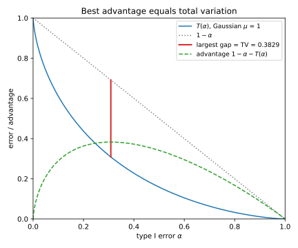

# Hypothesis testing

## Why this matters

A spam filter reads an email and must say "ham", meaning a legitimate email, or "spam". A fraud detector must likewise call a transaction "normal" or "fraud", and a monitoring job must decide from a batch of readings whether a sensor has drifted. These are all the same problem, since in each one an observation came from one of two distributions and you must decide which one. Hypothesis testing is the study of that decision.

Later parts of this book ask how well *any* test could tell two distributions apart, not just the test someone happened to build. To answer that, you need three things from this chapter. They are what the best possible test looks like, how good that test can be, and how to measure a real test's error rates from a finite number of trials.

The central tool is a number computed from each observation, called the **likelihood ratio**. It says how many times more likely the observation is under one distribution than under the other. The best test compares this number with a cut-off, and the choice of cut-off is a compromise, because a stricter one raises fewer false alarms but misses more real cases. Listing the best pair of error rates you can reach at every cut-off gives a curve, which depends only on the two distributions. Much of what goes wrong in practice comes from summarizing that curve by one number. A single number hides how a test behaves when false alarms must be rare, and that is often the case that matters.

## Tests and their two errors {#sec-ht-setup}

The chapter's running example is a spam filter that counts suspicious words in an email, recording any count above 3 as 3. The default assumption is that an email is ham, and this default is called the **null hypothesis**, written $H_0$. Under it, the count has a distribution we call $P$. We write $p(x)$ for the probability, under $P$, that the count equals $x$.

The **alternative hypothesis** $H_1$ is that the email is spam. Under it, the count has a distribution $Q$, and $q(x)$ is the probability of the count $x$. @tbl-ht-spam gives both distributions. Its last row is the likelihood ratio, written $\Lambda(x)$, which is the spam probability of each count divided by its ham probability,
$$\Lambda(x) = \frac{q(x)}{p(x)}.$$
A large ratio points to spam. Spam tends to contain more suspicious words, so the ratio grows with the count. A count of 3 is four times as likely in spam as in ham, while a count of 0 is only a quarter as likely.

| $x$ | 0 | 1 | 2 | 3 |
| --- | --- | --- | --- | --- |
| $p(x)$, ham | 0.4 | 0.3 | 0.2 | 0.1 |
| $q(x)$, spam | 0.1 | 0.2 | 0.3 | 0.4 |
| $\Lambda(x) = q(x)/p(x)$ | 0.250 | 0.667 | 1.500 | 4.000 |

: Word-count distributions under ham ($P$) and spam ($Q$), and their likelihood ratio. {#tbl-ht-spam}

[Divergences](03-divergences.md) writes the ratio the other way up, with $p$ on top, but in this chapter the ratio always has the alternative on top.

A **test** is a rule that looks at the count and decides whether to say "spam", which is called rejecting $H_0$. The simplest test picks a set of counts and rejects exactly when the count lands in it. We will also let a test reject some counts only with some probability, by flipping a biased coin. Such a **randomized test** can spend a false-alarm budget exactly where a plain set of counts often cannot, as the example below shows. So we describe any test by a function $\phi$, where $\phi(x)$ is the probability of rejecting after seeing the count $x$. A test that never flips a coin is the special case where $\phi$ takes only the values 0 and 1.

A test can make two kinds of mistake. The first is to reject when the email is ham, flagging a good email as spam. This is a **type I error**, or false positive, and its probability is the **false positive rate (FPR)** of the test, written $\alpha$.

The second mistake is to keep $H_0$ when the email is spam, letting spam through. This is a **type II error**, or false negative, and its probability is written $\beta$.

The **power** of a test is $1 - \beta$, the probability that it catches spam. In classification the power is called the **true positive rate (TPR)**, or recall.

A test has **level** $\alpha$ if its FPR is at most $\alpha$, so the level is a budget and the FPR is what the test actually spends. Both error rates are averages of $\phi$. On a ham email the test rejects with probability $\phi(x)$, so averaging $\phi$ over counts drawn from $P$ gives the FPR. Averaging it over counts drawn from $Q$ gives the power in the same way. Summed over all counts, the two rates are
$$\alpha = \sum_x \phi(x)\,p(x), \qquad 1 - \beta = \sum_x \phi(x)\,q(x).$$

For example, take the test "reject when the count is at least 2". Its FPR is the ham probability of the counts 2 and 3, which is $0.2 + 0.1 = 0.3$. Its power is the spam probability of the same counts, $0.3 + 0.4 = 0.7$, so its type II error is 0.3.

The two errors pull in opposite directions. Adding a count to the rejection set adds its ham probability to the FPR and its spam probability to the power. So it raises the FPR and lowers the type II error, and growing the set cannot lower both. The convention therefore treats the two errors asymmetrically. The null hypothesis is the default, and a false alarm, such as blocking a real email, is the costly error you budget for. You fix the level first, and then you look for the most powerful test at that level.

A useful yardstick is a test that ignores the email and rejects with probability $\alpha$ by flipping a coin. It rejects ham and spam equally often, so its FPR and its power are both $\alpha$, and any test worth using must beat it. The test that rejects only a count of 0 does not. Its FPR is 0.4, the same as a coin that rejects 40% of emails, but its power is only 0.1 against the coin's 0.4. It does so badly because it rejects the count most typical of ham, where spam is four times rarer.

A plain set of counts can spend only certain budgets, because each count brings its whole ham probability with it. For example, the sets that reject every count from some cut-off upward have FPRs of 0, 0.1, 0.3, 0.6 and 1. Suppose your policy allows an FPR of 0.25. Rejecting only a count of 3 spends just 0.1, while adding the count 2 brings the FPR to 0.3, which overspends. The randomized test that always rejects 3, and rejects 2 with probability 0.75, spends exactly 0.25.

That randomized test is a coin flip between two plain tests. With probability 0.25 it runs "reject 3", and otherwise it runs "reject 2 or 3". Because both error rates are averages of $\phi$, its errors are the same weighted average of the two tests' errors. Its FPR, for instance, is a quarter of 0.1 plus three quarters of 0.3, which is exactly 0.25. Now plot each test as a point, its FPR against its type II error. Mixing tests in this way makes every point on the segment between two achievable points achievable too.

Randomization is needed only for discrete data, where moving a threshold makes the FPR jump from one count to the next. For a continuous score, moving the threshold changes the FPR smoothly, so a plain threshold can hit any budget.

@fig-ht-errors shows a continuous example, a biomarker that is normal with variance 1 in both groups, centred at 0 in healthy patients and at 2 in ill ones. A screening test flags patients above a threshold of 1.645, which flags 5% of healthy patients. Ill patients fall below the threshold with probability 0.361, so the test catches about two ill patients in three. Lowering the threshold would catch more ill patients, but it would also alarm more healthy ones.

{#fig-ht-errors}

Which point on the plot of FPR against type II error to pick is a policy decision. What the mathematics can say is which points are achievable at all, and the next section answers that.

## The Neyman–Pearson lemma {#sec-ht-np}

Among all tests with a given level, which one has the most power? There are infinitely many tests, one for every function $\phi$ with values between 0 and 1, but it turns out that you only need to look at one family.

The reasoning is about a budget. Rejecting a count $x$ costs $p(x)$ of false-positive budget, and it buys $q(x)$ of power. The exchange rate at $x$ is therefore $q(x)/p(x)$, which is the likelihood ratio $\Lambda(x)$. To get the most power for a fixed budget, spend it on the counts with the best exchange rate first. That means rejecting exactly where the likelihood ratio is above some cut-off.

A **likelihood ratio (LR) test** does exactly this. It picks a threshold, written $\eta$, and rejects wherever
$$q(x) > \eta\,p(x).$$
It keeps $H_0$ wherever $q(x)$ is less, and on ties, where the two are equal, it may reject with any probability. Writing the rule this way, rather than as a comparison of the ratio with the threshold, also handles outcomes that $P$ never produces. At such an outcome $p(x)$ is zero, so any positive $q(x)$ is above $\eta\,p(x)$ whatever the threshold, and rejecting it costs no budget at all.

The **Neyman–Pearson lemma** says that this family contains the best tests, in two parts. First, no test whose FPR is at most that of an LR test has a smaller type II error. Second, for every level between 0 and 1 there is an LR test whose FPR is exactly that level. To hit the level exactly, that test may need to randomize on the ties. Together, the two parts say that the most powerful test at level $\alpha$ is the LR test whose FPR is exactly $\alpha$.

The budget picture also explains why no other test can beat it. Wherever the LR test rejects, each unit of budget buys at least $\eta$ units of power, while wherever it keeps $H_0$, each unit would buy at most $\eta$. So any other test with the same budget must move some spending from counts where the ratio is above $\eta$ to counts where it is below. Each such move gives up at least as much power as it gains.

Back to the spam filter with a budget of 0.25. The count 3 has the highest ratio, 4, and rejecting it costs 0.1. The count 2 comes next with a ratio of 1.5, but rejecting it fully would cost another 0.2 and overspend. The cut-off therefore sits at the ratio of the count 2, which is 1.5. Counts above it are always rejected, while the count 2, tied with the cut-off, is rejected only in part. The LR test spends the remaining 0.15 on it by rejecting it with probability 0.75. This is the randomized test from @sec-ht-setup, and its power is 0.625.

A brute-force check confirms that no other test does better. It draws 200,000 random tests, each picking every $\phi(x)$ uniformly between 0 and 1. Of these, 11,727 stay within the budget of 0.25, and the most powerful of them reaches 0.587. @fig-ht-discrete-tradeoff plots 400 random tests, and every one lies on or above the line traced by the LR tests. The next section calls that line the trade-off curve.

{#fig-ht-discrete-tradeoff}

The best test looks at an observation only through its likelihood ratio. Two observations with the same ratio are therefore interchangeable for testing, and everything else about them is noise.

Often the likelihood ratio grows with some simple statistic, such as the word count. Then "the ratio is above $\eta$" is the same event as "the statistic is above some threshold", so the best test is a plain threshold on that statistic. This is why thresholding a score works. For example, take a fraud model whose score is calibrated, meaning that the score is the probability of fraud given the transaction. That probability grows with the likelihood ratio, as @sec-ht-bayes shows, so thresholding a calibrated score is an LR test. No other use of the data then catches more fraud at the same false-alarm rate. A score may instead rank transactions differently from the likelihood ratio. In that case re-ranking them by an estimate of the ratio helps, provided the estimate puts the transactions in the same order as the true ratio.

With several independent observations, the probability of the whole sample is the product of the individual probabilities. The likelihood ratio of the sample is therefore the product of the individual ratios, and the LR test thresholds its logarithm, which is a sum of independent terms. Because sums of independent terms concentrate ([Concentration inequalities](02-concentration.md)), the best test can make both errors small as the number of observations $n$ grows.

The Chernoff–Stein lemma makes this precise for one setting. Hold the FPR fixed at any level, and ask how fast the type II error falls as $n$ grows. The answer uses the Kullback–Leibler (KL) divergence $\mathrm{KL}(P\|Q)$ of [Divergences](03-divergences.md), which is the average log-ratio by which a ham observation favours ham over spam. The type II error falls like
$$e^{-n\,\mathrm{KL}(P\|Q)}.$$

The Neyman–Pearson lemma needs both hypotheses to be **simple**, meaning that each one names a single, fully specified distribution. A **composite** hypothesis, such as "the mean is positive", names a whole family of distributions. Each member has its own LR test, so there is usually no single test that is best against all of them at once. The main exception is a **one-sided test**, which asks whether a parameter such as the mean is above a given value. Suppose that for every member of the family the likelihood ratio grows with the same statistic. Then every member's LR test is the same threshold on that statistic, and that one threshold is best against all of them.

## Trade-off curves {#sec-ht-tradeoff}

A single test gives one pair of errors. To say how hard it is to tell $P$ from $Q$, though, you want the best type II error at every level at once. So for each budget $\alpha$, look at every test whose FPR stays within it, and record the smallest type II error any of them achieves. As a function of the budget, this is the **trade-off function** of $P$ and $Q$, written $T(\alpha)$. By the Neyman–Pearson lemma, the LR test at each level achieves that best value, so in practice you compute the curve by sweeping the LR threshold.

The **receiver operating characteristic (ROC)** curve of the best test plots its power against its FPR, which is $1 - T(\alpha)$ against $\alpha$. It holds the same information as the trade-off curve, turned upside down. A particular score, thresholded at every value, also traces an ROC curve, and by the lemma that curve lies on or below the best one.

Every trade-off curve has four properties, and each has a simple reason. It never increases, because a bigger budget still allows every test that a smaller one allowed. It lies on or below the line $1 - \alpha$, because the coin-flip test is always available. It is convex, meaning that it bends upward like a bowl, because mixing two tests reaches every point between them. And it has no jumps, for a reason that depends on where you look. Strictly between the ends this follows from convexity, while at a budget of 1 it follows from the bound $1 - \alpha$, which forces the curve down to 0. At a budget of zero the full edition gives a separate argument.

The four properties also work in reverse, since any function with all four is the trade-off curve of some pair of distributions. They are therefore the only constraints a trade-off curve has to satisfy.

The slope of the curve has a meaning too. Moving along it means rejecting one more count with a little more probability, which spends $p(x)$ of budget and buys $q(x)$ of power. The curve therefore falls by the likelihood ratio $\Lambda(x)$ for each unit the FPR rises. In other words, the slope at a point is minus the likelihood ratio at the threshold. The spam curve shows this, since its four segments in @fig-ht-discrete-tradeoff have slopes $-4$, $-1.5$, $-0.667$ and $-0.25$, which are minus the four ratios of @tbl-ht-spam. The LR test adds counts in decreasing order of their ratio, so each segment is less steep than the last. That is another way to see why the curve is convex.

The two extremes of the curve are the two extremes of difficulty. If the curve is the line $1 - \alpha$, no test beats a coin flip, which happens exactly when $P$ and $Q$ are the same. If instead it is zero everywhere, some test makes no errors at all, which happens when the two distributions never produce the same outcome. In between, the further the curve bends below the line, the easier the problem.

One problem is harder than another if its curve is nowhere below the other's, so that the best test misses at least as often at every budget. But two curves can cross, and then neither problem is harder at every level, so you have to know the level you care about.

Two more details are worth knowing. First, the curve's value at $\alpha = 0$ need not be 1. If $Q$ puts some probability on outcomes that $P$ never produces, a test can catch that probability with no false alarms. Second, the curve depends on which distribution is the null. Swapping $P$ and $Q$ reflects the curve across the line where the two errors are equal.

## The Gaussian trade-off curve {#sec-ht-gaussian}

The most common pair of hypotheses in practice is a normal distribution and a shifted copy of it. A score, a biomarker or a sample mean is normal under both hypotheses, with the same spread but different centres, and its curve has a closed form.

The formula uses the standard normal cumulative distribution function (CDF), written $\Phi$, where $\Phi(x)$ is the probability that a standard normal variable is at most $x$. Its inverse $\Phi^{-1}$ gives the point below which a standard normal has a given probability. For example, $\Phi^{-1}(0.95) = 1.6449$, so a standard normal exceeds that point with probability 0.05.

Take $P = \mathcal N(0, 1)$, the standard normal, against $Q = \mathcal N(\mu, 1)$, the same distribution shifted right by $\mu$. When you divide the two densities, the squared terms in $x$ cancel, and the likelihood ratio is
$$\Lambda(x) = e^{\mu x - \mu^2/2}.$$
This grows with $x$, so the best test is a threshold on $x$, as in @fig-ht-errors. To spend a budget $\alpha$, the threshold must leave probability $\alpha$ of $P$ above it, and that point is $\Phi^{-1}(1 - \alpha)$. The test misses when $Q$, centred $\mu$ higher, falls below that threshold, so the curve is
$$T(\alpha) = \Phi\big(\Phi^{-1}(1 - \alpha) - \mu\big).$$ {#eq-ht-gaussian-tradeoff}
The same curve holds for any two normal distributions with a common standard deviation, with $\mu$ the distance between their means measured in standard deviations. Only that distance matters, because shifting and rescaling the observation changes no test's errors. @fig-ht-gaussian-tradeoff shows the family.

{#fig-ht-gaussian-tradeoff}

Near $\alpha = 0$ the normal curve is vertical, because its slope is minus the likelihood ratio at the threshold. A small budget means a high threshold, and the normal likelihood ratio grows without limit as the threshold rises. So the first sliver of false-alarm budget buys power at an unlimited exchange rate. The Laplace pair in the next section behaves differently.

Averaging many readings makes the problem easier. Suppose you take $n$ independent readings, each normal with the same standard deviation $\sigma$ under both hypotheses, and that the alternative shifts their mean by an amount $\delta$. Because the readings are normal with a common spread, each reading's log likelihood ratio is a straight-line function of the reading. Their sum then depends on the data only through the sample mean, so the best test thresholds the sample mean. The sample mean has standard deviation $\sigma/\sqrt n$, so the curve is @eq-ht-gaussian-tradeoff with
$$\mu = \frac{\delta\sqrt n}{\sigma}.$$
How easily you can tell the two apart therefore grows like $\sqrt n$, the rate at which a sample mean concentrates.

For example, a monitoring job averages 100 readings and must detect a drift of $0.2\sigma$ in the mean, so the shift is $\mu = 2$. At a false-alarm rate of 5%, the threshold sits 1.6449 standard deviations of the sample mean above the healthy mean. The job then catches the drift with probability 0.6388. A simulation with a million draws per hypothesis agrees, giving an FPR of 0.0503 and a type II error of 0.3617.

| $\mu$ | $\alpha$ | Threshold $\Phi^{-1}(1 - \alpha)$ | $\beta = T(\alpha)$ | Power |
| --- | --- | --- | --- | --- |
| 1 | 0.05 | 1.6449 | 0.7405 | 0.2595 |
| 1 | $10^{-3}$ | 3.0902 | 0.9817 | 0.0183 |
| 2 | 0.05 | 1.6449 | 0.3612 | 0.6388 |
| 2 | $10^{-3}$ | 3.0902 | 0.8622 | 0.1378 |

: The Gaussian trade-off curve at two shifts and two levels. {#tbl-ht-gaussian}

If false alarms must be rare, at a rate of $10^{-3}$, the threshold moves out to 3.0902 and the power drops to 0.1378 (@tbl-ht-gaussian). So a strict threshold costs a lot of power when the shift is moderate.

You can also turn the question around and ask how many readings you need. Say you want power at least $1 - \beta'$ at level $\alpha$, so the curve must be at most $\beta'$ at that level. The curve is $\Phi$ evaluated at the threshold minus the shift. That value of $\Phi$ is at most $\beta'$ only when the threshold minus the shift is at most $-\Phi^{-1}(1 - \beta')$. The shift must therefore be at least
$$\mu \ge \Phi^{-1}(1 - \alpha) + \Phi^{-1}(1 - \beta').$$
Substituting $\mu = \delta\sqrt n/\sigma$ and solving for $n$ gives
$$n \ge \left(\frac{\Phi^{-1}(1 - \alpha) + \Phi^{-1}(1 - \beta')}{\delta/\sigma}\right)^2.$$
For example, take a target power of 0.9 at a level of 0.01, with a drift of $0.25\sigma$. The quantile for the level is 2.3263 and the quantile for the power is 1.2816, so the bound comes to 208.3. You therefore need 209 readings.

## The Laplace trade-off curve {#sec-ht-laplace}

Now replace the normal by a Laplace distribution, which has exponential tails. The Laplace distribution $\mathrm{Lap}(m, b)$ has the centre $m$ and the scale $b$. Its density is proportional to $e^{-|x - m|/b}$ ([Probability distributions](01-distributions.md)). Take $P = \mathrm{Lap}(0, b)$ against $Q = \mathrm{Lap}(s, b)$, a shift by $s$. It helps to write $\kappa = s/b$ for the shift measured in units of the scale.

The key fact is that the likelihood ratio of this pair is capped. Moving the centre by $s$ changes the distance from any point to the centre by at most $s$, so the exponent changes by at most $\kappa$. The shifted density is therefore within a factor $e^\kappa$ of the original everywhere, which keeps the likelihood ratio within
$$e^{-\kappa} \le \Lambda(x) \le e^{\kappa}.$$
A shifted normal has no such cap, as the previous section showed.

The cap shapes the whole curve, because the slope of the curve is minus the likelihood ratio at the threshold. Above the centre $s$ of $Q$ the ratio sits at its cap $e^\kappa$. Below the centre of $P$, which is 0, it sits at its floor $e^{-\kappa}$. So the two ends of the curve are straight lines, with slopes $-e^{\kappa}$ and $-e^{-\kappa}$. Between the two centres the ratio rises with $x$, and the curve bends there. The full edition derives the formula for that middle piece from the Laplace tails. The full curve is
$$T(\alpha) = \begin{cases} 1 - e^{\kappa}\alpha, & \alpha < \tfrac12 e^{-\kappa}, \\[2pt] \dfrac{e^{-\kappa}}{4\alpha}, & \tfrac12 e^{-\kappa} \le \alpha \le \tfrac12, \\[6pt] e^{-\kappa}(1 - \alpha), & \alpha > \tfrac12. \end{cases}$$ {#eq-ht-laplace-tradeoff}
The three pieces correspond to a threshold above the centre of $Q$, between the two centres, and below the centre of $P$.

The first piece is the one that matters most. Since the ratio is never above $e^\kappa$, no test can buy power faster than $e^\kappa$ per unit of FPR. So for any test at level $\alpha$,
$$\text{power} \le e^\kappa\alpha,$$
and for small budgets the best test reaches exactly that power.

As an example, suppose a regression model's residuals are roughly Laplace with scale $b$, and you suspect that a batch of inputs carries an offset equal to $b$, so $\kappa = 1$. The first breakpoint of the curve is then $\tfrac12 e^{-1}$, which is 0.1839. A level of 0.05 lies below it, on the first piece, where the best power is 0.1359. A level of 0.25 lies on the middle piece instead, where the type II error is $e^{-1}$, or 0.3679. A simulation of the threshold test with a million draws per hypothesis gives 0.3685.

To compare the two shapes fairly, match a Laplace pair and a normal pair by their best advantage, the largest gap between TPR and FPR that any test achieves (@sec-ht-tv). At $\kappa = 1$ the Laplace pair's best advantage is 0.3935, and a normal pair with $\mu = 1.0301$ has the same. In the middle of the curve the two nearly coincide, but at small levels they do not (@tbl-ht-laplace-vs-gaussian).

| $\alpha$ | Laplace power, $\kappa = 1$ | Normal power, $\mu = 1.0301$ |
| --- | --- | --- |
| $10^{-3}$ | $2.718\times10^{-3}$ | $1.969\times10^{-2}$ |
| $10^{-6}$ | $2.718\times10^{-6}$ | $9.829\times10^{-5}$ |

: Best power at small false positive rates for a Laplace pair and a normal pair with the same best advantage. {#tbl-ht-laplace-vs-gaussian}

At a level of $10^{-6}$, the best test on the normal pair has 36 times the power of the best test on the Laplace pair. This is because the unbounded normal likelihood ratio lets a test find rare observations that are overwhelmingly more likely under $Q$, while the capped Laplace ratio rules that out (@fig-ht-laplace-tradeoff). Two problems that look equally hard on average can therefore differ enormously when false alarms must be rare. Plan for the level you will actually use.

{#fig-ht-laplace-tradeoff}

## Best advantage and total variation {#sec-ht-tv}

Sometimes you want a single number for how distinguishable two distributions are. A natural choice is the **advantage** of a test, its TPR minus its FPR, which says how much more often the test fires under $Q$ than under $P$. The coin-flip test fires equally often under both, so its advantage is 0. In medicine, the advantage at a threshold is called Youden's index.

Written as a sum over outcomes, the advantage of a test $\phi$ is
$$\sum_x \phi(x)\,\big(q(x) - p(x)\big).$$
Each term can be made as large as possible on its own, so the best test fires exactly on the outcomes where $q$ exceeds $p$. That is the LR test with threshold 1, and its advantage is the total amount by which $q$ exceeds $p$. This total is the **total variation (TV)** distance of [Divergences](03-divergences.md), which equals half the summed gaps between the two distributions,
$$\mathrm{TV}(P, Q) = \frac12\sum_x |q(x) - p(x)|.$$

In the spam example, the gaps between the two rows of @tbl-ht-spam are 0.3, 0.1, 0.1 and 0.3. Half their sum gives the TV distance, 0.40. Spam is more likely than ham at the counts 2 and 3, so the best test rejects those two counts. Its FPR is 0.3 and its type II error is also 0.3, which gives an advantage of 0.4, as it should.

For the normal pair, the best test rejects above $\mu/2$, halfway between the means, where the two bell curves cross. Its advantage is $2\Phi(\mu/2) - 1$, which is 0.3829 at $\mu = 1$. For the Laplace pair the best advantage is $1 - e^{-\kappa/2}$, which is 0.3935 at $\kappa = 1$.

On the trade-off curve, the advantage at level $\alpha$ is the vertical gap between the line $1 - \alpha$ and the curve. The gap is largest where the curve's slope is $-1$, which is where the LR threshold is 1 (@fig-ht-tv-advantage).

{#fig-ht-tv-advantage}

The TV distance answers one question well. It tells you how small the sum of the two error rates can be, when one error counts as much as the other. That question picks out a single point of the curve, the one where the threshold is 1, so it says nothing about the ends of the curve. The Laplace and normal pairs of @tbl-ht-laplace-vs-gaussian, for example, share the same TV distance, yet their powers at the smallest level differ by a factor of 36. If false alarms must be rare, the TV distance is the wrong summary, and the whole curve is the right one.

## ROC summaries: why AUC hides the low-FPR regime {#sec-ht-auc}

Real detectors are compared on held-out data by their ROC curves, with the negatives in that data drawn under $H_0$ and the positives under $H_1$. The usual summary of an ROC curve is the **area under the curve (AUC)**. But in many applications only a small corner of the curve matters. For example, a fraud team can review only a tiny fraction of transactions, and a spam filter must almost never discard real mail. Two detectors with the same AUC can differ by a factor of ten in that corner.

The AUC has a direct meaning. Write $S_-$ for the score of a random negative and $S_+$ for the score of a random positive, drawn independently. Then the AUC is the probability that the positive scores higher,
$$\mathrm{AUC} = \Pr[S_+ > S_-].$$
In words, it is the chance that the detector ranks a random positive above a random negative.

The reason is easiest to see on a test set, by sweeping the threshold down from the top. Each time the threshold passes the score of a negative, the FPR rises by the same small step. At that moment, the TPR is the share of positives that score above that negative. The area under the curve adds up these TPRs, each times the same step, which makes it their average over the negatives. That average is the chance that a positive beats a random negative. This reading assumes continuous scores, so that a positive and a negative never tie.

A common model, called the binormal model, has normal scores in both classes. Negatives score $\mathcal N(0, 1)$, while positives score $\mathcal N(m, \sigma^2)$, with the mean $m$ and the standard deviation $\sigma$. The difference of the two scores is then normal, with mean $m$ and variance $1 + \sigma^2$, and the AUC is the chance that this difference is positive,
$$\mathrm{AUC} = \Phi\big(m/\sqrt{1 + \sigma^2}\big).$$
The ROC curve follows from setting the threshold from the FPR, as in @sec-ht-gaussian, which gives
$$\mathrm{TPR}(\mathrm{FPR}) = 1 - \Phi\Big(\frac{\Phi^{-1}(1 - \mathrm{FPR}) - m}{\sigma}\Big).$$

Now compare two detectors. Detector A has positives that score $\mathcal N(1, 1)$, while detector B has positives that score $\mathcal N(1.5811, 2^2)$. B's positives are more spread out, and their mean is chosen to give the same AUC, so both have an AUC of 0.7602. @tbl-ht-auc shows their TPRs at two FPRs.

| Detector | AUC (formula / simulated) | TPR at FPR $= 0.1$ | TPR at FPR $= 10^{-3}$ |
| --- | --- | --- | --- |
| A, $\mathcal N(1, 1)$ | 0.7602 / 0.7605 | 0.3891 | 0.0183 |
| B, $\mathcal N(1.5811, 2^2)$ | 0.7602 / 0.7601 | 0.5595 | 0.2253 |

: Two detectors with normal scores in both classes and equal AUC. The simulated AUC counts correctly ranked pairs among 1,000,000. {#tbl-ht-auc}

At an FPR of $10^{-3}$, detector B catches 12 times as many positives as detector A. Because B's positives are more spread out, a few of them score far above every negative, and those are exactly the cases a strict threshold catches. On linear axes the two ROC curves cross and look comparable, but on log axes the gap at low FPR is obvious (@fig-ht-auc-low-fpr).

{#fig-ht-auc-low-fpr}

The AUC hides this because it weighs all FPRs equally. The region of FPRs below $10^{-3}$ is a tenth of a percent of the horizontal axis, so it barely changes the area. Most of the AUC comes from FPRs nobody would operate at.

An extreme case makes the point. Picture a detector whose ROC curve jumps to a TPR of 0.05 at an FPR of 0 and then follows the diagonal. Its AUC is only about 0.525, yet it catches 5% of positives with no false alarms. So report the TPR at a fixed low FPR chosen by the application, and plot ROC curves on log–log axes, where that corner is visible.

For detector A, thresholding the score is already the best test. That is because its positives and negatives have the same spread, so its likelihood ratio grows with the score, as in @sec-ht-gaussian. Detector B is different. Its positives are more spread out than its negatives, with a standard deviation of 2 against 1. So its log likelihood ratio contains a positive term in the square of the score, and the ratio is large at both ends. The best test for B would therefore also flag very *low* scores. By the Neyman–Pearson lemma, B's best ROC curve is therefore at least as good as the one plotted.

## The Bayesian view {#sec-ht-bayes}

The Neyman–Pearson lemma uses no prior. But often you know a base rate, such as 1% of patients being ill or one transaction in a thousand being fraud. Then the useful question is how likely $H_1$ is, given the observation, and the likelihood ratio answers it with one multiplication.

Write $\pi$ for the base rate, the probability of $H_1$ before seeing anything. The odds of $H_1$ are its probability divided by the probability of $H_0$. Bayes' rule says that the odds after seeing $x$ are the odds before, multiplied by the likelihood ratio,
$$\frac{\Pr[H_1 \mid x]}{\Pr[H_0 \mid x]} = \frac{\pi}{1 - \pi} \times \Lambda(x).$$ {#eq-ht-posterior-odds}
To see why, note that the chance that $H_1$ holds and you see $x$ is $\pi\,q(x)$. In the same way, the chance that $H_0$ holds and you see $x$ is $(1 - \pi)\,p(x)$. Dividing each by the total chance of seeing $x$ gives the two posterior probabilities, and that total cancels in their ratio.

The rule also tells you how to decide. To make as few mistakes as possible, say $H_1$ whenever its posterior odds exceed 1, which happens exactly when
$$\Lambda(x) > \frac{1 - \pi}{\pi}.$$
So the decision with the fewest errors is again an LR test, with its threshold set by the base rate.

Unequal costs change only the threshold. If a miss costs $c$ times as much as a false alarm, the threshold becomes $(1 - \pi)/(c\pi)$, and the test simply moves along the same trade-off curve.

When both hypotheses are equally likely beforehand, the fewest errors means the smallest sum of the two error rates. Minimizing that sum is the same as maximizing the advantage, so the smallest possible probability of error is one minus the TV distance, halved,
$$\frac{1 - \mathrm{TV}(P, Q)}{2}.$$
For the normal pair at $\mu = 1$, it is 0.3085.

The same rule applies to any evidence, not only to the raw observation. Suppose all you know is that the test fired. The likelihood ratio of that event is then the chance of firing under $H_1$ divided by the chance under $H_0$, which is
$$\frac{\mathrm{TPR}}{\mathrm{FPR}}.$$

Take the biomarker test with $\mu = 2$ in a population where 1% are ill. At an FPR of 0.05 the power is 0.6388, so a positive result is 12.8 times as likely in an ill patient as in a healthy one. Even so, a positive patient is ill with probability only 0.114, so nine in ten positives are false alarms. At an FPR of $10^{-3}$ the power is 0.1378, and a positive result is 137.8 times as likely in an ill patient. A positive patient is then ill with probability 0.582 (@fig-ht-posterior).

{#fig-ht-posterior}

The stricter threshold catches fewer ill patients, but it makes each positive result far more informative. This is a second reason that behaviour at low FPR matters, because when positives are rare, the FPR, not the power, decides whether an alarm is worth acting on.

The test with the fewest errors at this base rate is stricter still. It rejects when the ratio exceeds 99, which for this pair means a reading above 3.2976. Its FPR is then $4.88\times10^{-4}$, and its power only 0.0972. When both kinds of error count equally and the disease is rare, it is cheapest to rarely say "ill".

## Measuring rates from finite trials {#sec-ht-estimation}

Everything so far assumed that you know $P$ and $Q$. In practice you measure a detector's FPR on test data, by counting the false positives among the negatives. Write $n$ for the number of negatives and $k$ for the number of false positives among them. If each negative is falsely flagged independently, with the same probability $\alpha$, then $k$ follows a binomial distribution ([Probability distributions](01-distributions.md)). The intervals below are computed from that distribution, so they are only as valid as this model.

The measured rate $k/n$ is uncertain, and at low rates the uncertainty is large compared with the rate itself. When the rate is small, a count of $k$ events fluctuates by about $\sqrt k$, so its relative uncertainty is about $1/\sqrt k$. The relative precision of a measured rate therefore depends mainly on how many events you see, not on $n$ alone.

The **Clopper–Pearson interval** turns the observed count into a range of plausible true rates, by asking which true rates would make the observed count unsurprising. A true rate far above $k/n$, for example, would make a count as small as $k$ very unlikely. So the upper end $u$ is the rate at which seeing $k$ or fewer events has a small probability. Likewise, the lower end $l$ is the rate at which seeing $k$ or more events has that small probability.

For a two-sided interval at confidence $1 - a$, each end gets half of the allowed failure probability $a$, so the two ends solve
$$\Pr[\mathrm{Bin}(n, l) \ge k] = \frac a2, \qquad \Pr[\mathrm{Bin}(n, u) \le k] = \frac a2.$$
By convention, the lower end is 0 when no events are seen, and the upper end is 1 when every trial is an event. The interval then contains the true rate with probability at least $1 - a$.

The reason is that each end can miss on only one side. The true rate lies above the upper end only when the observed count was unusually small for it. By the choice of $u$, that happens with probability at most $a/2$. The same holds for the lower end. The union bound, which says that the chance of either of two events is at most the sum of their chances, then gives at most $a$ in total.

The interval is called exact because it uses the binomial distribution itself, not an approximation. It is also conservative, because its coverage is at least $1 - a$ and often more. A simulation checks this, with a true FPR of $10^{-3}$ and 10,000 negatives. Over 2,000 runs, the 95% interval covered the true rate 97.20% of the time.

Often you need only an upper bound, for example to claim that an FPR is below a target. The upper end on its own misses with probability at most $a/2$. So the upper end of a two-sided interval at confidence $1 - a$ is a one-sided upper bound at confidence $1 - a/2$. A two-sided 90% interval, for instance, gives each end a failure probability of 0.05, so its upper end is a one-sided 95% upper bound. You compute it by solving $\Pr[\mathrm{Bin}(n, u) \le k] = 0.05$, and for 1 false positive in 1,000 negatives this bound is 0.0047 (the code below prints it).

With no events at all, the chance of seeing none at rate $u$ is $(1 - u)^n$, so the one-sided 95% upper bound solves $(1 - u)^n = 0.05$. For a small rate, $(1 - u)^n$ is close to $e^{-nu}$, which puts the bound at about
$$u \approx \frac{\ln 20}{n}.$$
Since $\ln 20$ is about 3, the bound is about $3/n$, a shortcut called the **rule of three**. With 3,000 negatives and no false positives, for example, the bound is $9.981\times10^{-4}$. Turned around, certifying an FPR below $10^{-3}$ at 95% confidence takes 2,995 negatives with no false positive at all.

Here is what this means for the monitor with $\mu = 2$, run at its $10^{-3}$ threshold. Its true FPR is $10^{-3}$, and its true TPR is 0.1378. Test it on 10,000 negatives and 10,000 positives, and look at one simulated run in @tbl-ht-one-run.

| Quantity | Count | Estimate | 95% Clopper–Pearson interval |
| --- | --- | --- | --- |
| False positives | 10 | 0.0010 | $[0.00048, 0.00184]$ |
| True positives | 1,350 | 0.1350 | $[0.1284, 0.1419]$ |

: One simulated evaluation of the $\mu = 2$ test at its $10^{-3}$ threshold, with 10,000 examples per class. {#tbl-ht-one-run}

The TPR is pinned down to about $\pm 0.007$, but the FPR is not, because it rests on only 10 events. The data are consistent with a true FPR anywhere from about half to almost twice the target. With 100,000 negatives you would expect about 100 false positives, and the interval would then be $[0.00081, 0.00122]$, about 20% on either side. As a rule of thumb, then, you need on the order of $100/\alpha$ negatives to measure an FPR of $\alpha$ to within a factor of about 1.2. @fig-ht-rate-ci shows how slowly the interval tightens as the number of negatives grows.

{#fig-ht-rate-ci}

Two other common intervals do worse on the same 10 false positives. The **Wald interval** uses a normal approximation to the binomial, and here it gives $[0.00038, 0.00162]$, which is too narrow. It is also symmetric, while a count of rare events is skewed to the right. And with no events it collapses to $[0, 0]$, claiming certainty from no data.

The Hoeffding interval comes from Hoeffding's inequality ([Concentration inequalities](02-concentration.md)), which uses only the fact that each outcome lies between 0 and 1. It must therefore assume the largest variance such an outcome can have, a quarter, while the true variance of a rare false positive is tiny. As a result, its half-width here is 0.0136, more than 13 times the rate being measured.

One last trap is that the threshold is often estimated too. Suppose you choose the threshold on the same data so that the measured FPR is $10^{-3}$. That choice favours thresholds whose measured FPR happens to be low by chance. So the chosen threshold looks better on that data than it is, and its true FPR is as uncertain as the interval above. Choose thresholds on one split of the data, and measure their rates on another.

## Code {#sec-ht-code}

The normal trade-off curve and the Clopper–Pearson interval need only the standard library. The quantile is found by bisection on the upper tail, which keeps full precision when $\alpha$ is tiny. Computing $\Phi^{-1}(1 - \alpha)$ directly would round $1 - \alpha$ to a number very close to 1 and lose the digits that matter.

```python
from collections.abc import Callable
from math import erfc, exp, lgamma, log, log1p, sqrt


def normal_cdf(x: float) -> float:
    return 0.5 * erfc(-x / sqrt(2))


def upper_quantile(a: float) -> float:
    """The point a standard normal exceeds with probability a, found by bisection on the tail."""
    lo, hi = -40.0, 40.0
    for _ in range(200):
        mid = (lo + hi) / 2
        lo, hi = (mid, hi) if 0.5 * erfc(mid / sqrt(2)) > a else (lo, mid)
    return lo


def gaussian_power(alpha: float, mu: float) -> float:
    """Best power at false positive rate alpha between N(0, 1) and N(mu, 1)."""
    return 1 - normal_cdf(upper_quantile(alpha) - mu)


def binom_cdf(k: int, n: int, p: float) -> float:
    """Pr[Binomial(n, p) <= k], summed in log space."""
    if p <= 0.0:
        return 1.0
    if p >= 1.0:
        return 1.0 if k >= n else 0.0
    total = 0.0
    for i in range(k + 1):
        log_pmf = lgamma(n + 1) - lgamma(i + 1) - lgamma(n - i + 1) + i * log(p) + (n - i) * log1p(-p)
        total += exp(log_pmf)
    return total


def clopper_pearson(k: int, n: int, confidence: float = 0.95) -> tuple[float, float]:
    """Exact two-sided interval for a rate after k successes in n trials."""
    tail = (1 - confidence) / 2  # a/2 in the text

    def solve(f: Callable[[float], float], target: float) -> float:
        """The rate p at which f, a binomial CDF that falls as p grows, equals target."""
        lo, hi = 0.0, 1.0
        for _ in range(100):
            mid = (lo + hi) / 2
            lo, hi = (mid, hi) if f(mid) > target else (lo, mid)
        return lo

    # Lower end: Pr[Bin(n, l) >= k] = tail, that is Pr[Bin(n, l) <= k - 1] = 1 - tail.
    lower = 0.0 if k == 0 else solve(lambda p: binom_cdf(k - 1, n, p), 1 - tail)
    # Upper end: Pr[Bin(n, u) <= k] = tail.
    upper = 1.0 if k == n else solve(lambda p: binom_cdf(k, n, p), tail)
    return lower, upper


def upper_bound(k: int, n: int, confidence: float = 0.95) -> float:
    """One-sided upper bound: the upper end of the two-sided interval at confidence 2 * confidence - 1."""
    return clopper_pearson(k, n, 2 * confidence - 1)[1]


print(f"{gaussian_power(0.05, 2.0):.4f} {gaussian_power(1e-3, 2.0):.4f}")  # 0.6388 0.1378
low, high = clopper_pearson(10, 10_000)
print(f"[{low:.5f}, {high:.5f}]")  # [0.00048, 0.00184]
print(f"{upper_bound(1, 1_000):.4f}")  # 0.0047
print(f"{upper_bound(0, 3_000):.3e}")  # 9.981e-04
```

The last two lines are one-sided 95% upper bounds, the first for 1 false positive in 1,000 negatives and the second for no false positives in 3,000. The second is close to the rule of three's $3/n$.

## Cheat sheet

| Result | Statement |
| --- | --- |
| Errors of a test $\phi$ | FPR $\alpha$ is the average of $\phi$ under $P$; power $1 - \beta$ (TPR) is its average under $Q$ |
| Neyman–Pearson | The LR test, rejecting where $q > \eta p$ and randomizing at ties, is most powerful at its level |
| Trade-off curve $T(\alpha)$ | Best $\beta$ at level $\alpha$; non-increasing, at most $1 - \alpha$, convex, continuous; slope $-\Lambda$ at the threshold |
| Normal shift $\mu$ | $T(\alpha) = \Phi(\Phi^{-1}(1 - \alpha) - \mu)$; $n$ averaged readings: $\mu = \delta\sqrt n/\sigma$ |
| Laplace shift $\kappa = s/b$ | @eq-ht-laplace-tradeoff; power at most $e^\kappa\alpha$ |
| Best advantage | $\max(\mathrm{TPR} - \mathrm{FPR}) = \mathrm{TV}$; normal $2\Phi(\mu/2) - 1$, Laplace $1 - e^{-\kappa/2}$ |
| AUC | $\Pr[S_+ > S_-]$; binormal $\Phi(m/\sqrt{1 + \sigma^2})$ |
| Bayes | Posterior odds $=$ prior odds $\times\,\Lambda$; an alarm has $\Lambda = \mathrm{TPR}/\mathrm{FPR}$ |
| Clopper–Pearson | $\Pr[\mathrm{Bin}(n, l) \ge k] = \Pr[\mathrm{Bin}(n, u) \le k] = a/2$ |
| One-sided upper bound | 95% one-sided $=$ upper end of the two-sided 90% interval; zero events: $u \approx 3/n$ |

: The results of this chapter. {#tbl-ht-cheat-sheet}

**Rules of thumb**

- To find the best test, compute the likelihood ratio and threshold it. If the ratio grows with a statistic, threshold the statistic.
- Compare detectors by their TPR at a fixed low FPR, on log axes. AUC and TV hide that regime.
- A capped likelihood ratio caps power at small levels: power is at most the cap times $\alpha$.
- To measure a rate near $\alpha$, plan for about $100/\alpha$ trials, and report a Clopper–Pearson interval.

## Further reading

- Casella & Berger, *Statistical Inference* (2nd ed., 2002), §8.3: the Neyman–Pearson lemma and the Karlin–Rubin theorem for one-sided composite tests.
- Cover & Thomas, *Elements of Information Theory* (2nd ed., 2006), §11.7–11.9: the Chernoff–Stein lemma, on how fast errors fall with many observations.
- Fawcett, "An introduction to ROC analysis" (Pattern Recognition Letters, 2006): ROC curves, AUC as a ranking probability, and convex hulls.
- Brown, Cai & DasGupta, "Interval Estimation for a Binomial Proportion" (Statistical Science, 2001): why the Wald interval fails and what to use instead.

**Derivations.** Every result in this chapter is derived step by step in [the full edition's chapter](../../book-full/part01-prerequisites/04-hypothesis-testing.md), except two that it cites: the Chernoff–Stein lemma and the exception for one-sided composite tests (Karlin–Rubin).
