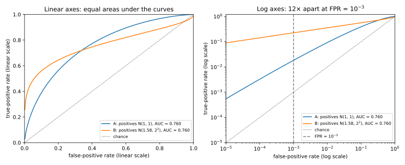

# Hypothesis testing

## Why this matters

A fraud detector classifies each transaction as normal or fraudulent, testing which of two distributions generated its score. Every binary classifier is a hypothesis test. Evaluate both error rates at the required low false-alarm rate; accuracy does not report that rate.

## Tests and their two errors {#sec-ht-setup}

The default assumption, the **null hypothesis** $H_0$, is that the observation comes from a distribution $P$, such as the fraud model's scores for normal transactions. The **alternative hypothesis** $H_1$ is that it comes from a distribution $Q$, such as its scores for fraudulent ones. A **test** decides whether to reject the null, which here means to flag the transaction.

A test can make two errors. A false positive flags a normal case; its probability is the **false positive rate (FPR)**, written $\alpha$. A false negative misses a real case; its probability is the **false negative rate (FNR)**, written $\beta$. The **true positive rate (TPR)** is $1-\beta$. A lower threshold raises both TPR and FPR. First set the FPR budget, or **level**, then find the test with the highest TPR, or **power**, at that level.

## The Neyman–Pearson lemma {#sec-ht-np}

Write $p(x)$ and $q(x)$ for the probabilities, or densities, of an observation $x$ under the two hypotheses. Their quotient is the **likelihood ratio**
$$\Lambda(x) = \frac{q(x)}{p(x)}.$$
A **likelihood ratio (LR) test** rejects wherever this ratio exceeds a threshold $\tau$, which you set so that the FPR of the test equals the budget. The **Neyman–Pearson lemma** says that no other test at that level catches more real cases.

The optimal test thresholds the likelihood ratio. Thresholding a raw score is equivalent only if higher scores always imply higher ratios. Estimate the ratio from labelled scores by fitting logistic regression of the label on the score; its log-odds minus the log prior odds estimates $\ln\Lambda$. If scores shift across known groups, the likelihood ratio also depends on group, and the optimal test uses group-specific thresholds.

## Trade-off curves {#sec-ht-tradeoff}

The best FNR at every level says how hard $P$ is to tell from $Q$. This curve is the **trade-off function** $T(P, Q)$, which you get when you move the LR threshold across its range. The **receiver operating characteristic (ROC)** curve holds the same information upside down, as TPR against FPR. Each real detector has its own ROC curve, on or below the best one.

## The Gaussian trade-off curve {#sec-ht-gaussian}

A common model has normal scores under both hypotheses, with equal standard deviations. Scale the normal-case scores to mean 0 and standard deviation 1. Let $\mu$ be the distance between the means in standard deviations, and let $\Phi$ be the standard normal cumulative distribution function. The optimal threshold is $\Phi^{-1}(1 - \alpha)$, and the FNR at level $\alpha$ is the Gaussian trade-off function
$$G_\mu(\alpha) = \Phi\big(\Phi^{-1}(1 - \alpha) - \mu\big).$$ {#eq-ht-gaussian-tradeoff}
In SciPy this is `norm.cdf(norm.isf(alpha) - mu)`. Use `isf`, because `norm.ppf(1 - alpha)` loses the digits that matter at a very small $\alpha$. The single number $\mu$ fixes the best TPR at every FPR. At $\mu = 2$, for example, the best TPR is 0.6388 at an FPR of 5%, and only 0.1378 at an FPR of $10^{-3}$. In the other direction, a measured pair gives $\mu = \Phi^{-1}(1 - \alpha) + \Phi^{-1}(\mathrm{TPR})$, or `norm.isf(alpha) + norm.ppf(tpr)`. If that estimate changes with $\alpha$, the scores do not have this shape.

## The Laplace trade-off curve {#sec-ht-laplace}

Take a Laplace distribution and a copy shifted by $\kappa$ times its scale. Their likelihood ratio stays between $e^{-\kappa}$ and $e^{\kappa}$ ([Divergences](03-divergences.md)). So each outcome that a test rejects is at most $e^\kappa$ times more likely under $Q$ than under $P$, and every test has
$$\mathrm{TPR} \le e^\kappa\,\mathrm{FPR}.$$
At a low FPR the best test reaches this cap. At $\kappa = 1$ and an FPR of 0.05, its TPR is $e \times 0.05 = 0.1359$.

This cap distinguishes the Laplace pair from the normal pair. A Laplace pair at $\kappa = 1$ and a normal pair at $\mu = 1.0301$ have the same maximum advantage, the largest possible TPR minus FPR (@sec-ht-tv). At a level of $10^{-6}$, however, the normal pair permits 36 times the TPR. Its likelihood ratio is unbounded, allowing a test to detect rare, high-evidence observations. Compare distributions at the FPR relevant to the application.

## Best advantage and total variation {#sec-ht-tv}

The **advantage** of a test is its TPR minus its FPR. The best advantage over all tests is the **total variation (TV)** distance of [Divergences](03-divergences.md):
$$\max(\mathrm{TPR} - \mathrm{FPR}) = \mathrm{TV}(P, Q) = \frac12\sum_x |q(x) - p(x)|.$$
For the normal pair, TV is $2\Phi(\mu/2) - 1$, or 0.3829 at a shift of one standard deviation. Accuracy on a balanced set is one half plus half the advantage. Thus, accuracy describes one point on the curve and does not determine performance at low FPR.

## ROC summaries: why AUC hides the low-FPR regime {#sec-ht-auc}

The **area under the curve (AUC)** is the probability that a random positive scores higher than a random negative. It weights every FPR equally from 0 to 1, so performance at very low FPR contributes little. For example, consider two detectors with standard normal scores on negatives. Detector A's positive scores have mean 1 and standard deviation 1; detector B's have mean 1.5811 and standard deviation 2. Both have an AUC of 0.7602.

But at an FPR of $10^{-3}$, A catches 0.0183 of the positives and B about 12 times as many (@fig-ht-auc-low-fpr). A few positives of B score far above all negatives, and a strict threshold catches exactly those.

{#fig-ht-auc-low-fpr}

Plot the ROC curve on log–log axes and report TPR at fixed low FPRs. Drop the first point of `roc_curve`, whose FPR is 0. Pass scores, not `predict` labels, to `roc_curve(y_true, y_score)`. At a target FPR, use the highest TPR at or below it; `np.interp` may report a value no threshold achieves. Do not report TPR below an FPR of one divided by the number of negatives, where the curve represents at most one false positive.

## The Bayesian view {#sec-ht-bayes}

Often you know a base rate $\pi$, for example that one transaction in a thousand is fraud. Bayes' rule says that the odds of $H_1$ after you see $x$ are the odds before, multiplied by the likelihood ratio:
$$\frac{\Pr[H_1 \mid x]}{\Pr[H_0 \mid x]} = \frac{\pi}{1 - \pi} \times \Lambda(x).$$ {#eq-ht-posterior-odds}
The decision with the fewest errors says $H_1$ when these odds exceed 1, so it is again an LR test.

The same calculation applies to an alarm, whose likelihood ratio is TPR divided by FPR. Consider a test with $\mu = 2$ in a population where 1% of cases are positive. At FPR 0.05, a flagged case is positive with probability 0.114, so most alarms are false. At FPR $10^{-3}$, that probability rises to 0.582. When positives are rare, the FPR strongly affects the probability that an alarm is correct.

## Measuring rates from finite trials {#sec-ht-estimation}

Estimate a detector's FPR by counting false positives among $n$ negative test cases. If each case is independently flagged with the same probability, the count $k$ is binomial, with standard deviation approximately $\sqrt{k}$ when the rate is small.

The **Clopper–Pearson interval** gives rates consistent with the observed count. It is exact because it uses the binomial distribution, and conservative because a 95% interval covers the true rate at least 95% of the time. In SciPy, compute it with `binomtest(k, n).proportion_ci(method="exact")`. To show that an FPR is below a target, report only the upper bound using `alternative="less"`. With no events, the one-sided 95% upper bound is about $3/n$, the **rule of three**. An exact computation requires 2,995 negative cases with no false positives to bound the FPR below $10^{-3}$.

These intervals can be wide. Ten false positives in 10,000 negatives give the interval $[0.00048, 0.00184]$, from about half to nearly twice the observed rate. About 100 events estimate a rate within about 20%, so an FPR of $p$ requires about $100/p$ negative cases. The **Wald interval** is too narrow and gives $[0, 0]$ when there are no events.

## Evaluating a detector at a low false positive rate {#sec-ht-recipe}

1. Fix the target FPRs, such as $10^{-2}$ and $10^{-3}$.
2. Plan the trials with about $100/p$ negatives for a target FPR $p$.
3. Choose the threshold on the negatives of one split, and measure the rates on another. A threshold tuned on the evaluation set looks better there than it is. The calibration split needs as many negatives, because below one over their number, `np.quantile` only interpolates between the top scores.
4. Report the TPR and FPR measured at that threshold, with Clopper–Pearson intervals on the two, and the full ROC curve on log–log axes. A TPR read off the ROC curve of the test split is too high, because it picks its threshold on the test data.
5. Compare two detectors at the same FPR, never by AUC or accuracy alone. On a shared evaluation set, check the gap with McNemar's test, `binomtest(m1, m1 + m2, 0.5)`. Here $m_1$ and $m_2$ count the positives that only one of the two detectors catches.

The snippet applies steps 3 and 4 to scikit-learn's breast cancer dataset. It uses logistic regression to detect malignant tumours and reserves 30% of the data for calibration and 30% for testing. For a target FPR of 1%, it sets the threshold at the 99th percentile of benign calibration scores.

```python
import numpy as np
from scipy.stats import binomtest
from sklearn.datasets import load_breast_cancer
from sklearn.linear_model import LogisticRegression
from sklearn.model_selection import train_test_split
from sklearn.pipeline import make_pipeline
from sklearn.preprocessing import StandardScaler

X, y = load_breast_cancer(return_X_y=True)
y = 1 - y  # make malignant (coded 0) the positive class
X_tr, X_ev, y_tr, y_ev = train_test_split(X, y, test_size=0.6, stratify=y, random_state=0)
X_cal, X_te, y_cal, y_te = train_test_split(X_ev, y_ev, test_size=0.5, stratify=y_ev, random_state=0)
model = make_pipeline(StandardScaler(), LogisticRegression(max_iter=1000)).fit(X_tr, y_tr)
threshold = np.quantile(model.decision_function(X_cal[y_cal == 0]), 0.99)  # target FPR 1%, set on calibration
s = model.decision_function(X_te)
pos, neg = s[y_te == 1] > threshold, s[y_te == 0] > threshold  # flagged positives, negatives
tpr = binomtest(int(pos.sum()), pos.size).proportion_ci(method="exact")
fpr_upper = binomtest(int(neg.sum()), neg.size, alternative="less").proportion_ci(method="exact").high
print(pos.sum(), pos.size, f"{pos.mean():.3f} [{tpr.low:.3f}, {tpr.high:.3f}]")  # 56 63 0.889 [0.784, 0.954]
print(neg.sum(), neg.size, f"{neg.mean():.4f} <= {fpr_upper:.4f}")  # 2 108 0.0185 <= 0.0571
```

The detector catches 56 of 63 malignant test cases: TPR 0.889, with a 95% interval from 0.784 to 0.954. The threshold set for 1% FPR flags 2 of 108 benign test cases. These counts give a one-sided 95% upper bound of 0.0571 on the FPR. Step 2 requires about 10,000 negative cases for this target, so this dataset is too small to establish the target rate; report the interval instead.

## Cheat sheet

| Question | Answer |
| --- | --- |
| What is the best test? | Threshold the likelihood ratio, per group if groups score differently (Neyman–Pearson) |
| How good can any test be? | The trade-off curve; normal pair $G_\mu(\alpha) = \Phi(\Phi^{-1}(1 - \alpha) - \mu)$ |
| What does a capped ratio allow? | $\mathrm{TPR} \le e^\kappa\,\mathrm{FPR}$ |
| What do accuracy and advantage measure? | Best advantage $=$ TV, one point of the curve |
| Why is AUC not enough? | Equal AUC can hide a 12-fold gap in TPR at an FPR of $10^{-3}$ |
| What does a base rate do? | Posterior odds $=$ prior odds $\times$ TPR/FPR |
| How sure is a measured rate? | Clopper–Pearson; zero events give about $3/n$ at 95% |

: The questions of this chapter and their answers. {#tbl-ht-cheat-sheet}

**Rules of thumb**

- Plan for $100/p$ negatives, and use Clopper–Pearson, never Wald.
- Report TPR at fixed low FPRs on log–log axes, never AUC alone.

## References

- Fawcett, "An introduction to ROC analysis" (Pattern Recognition Letters, 2006): ROC curves and their pitfalls.
- Brown, Cai & DasGupta, "Interval Estimation for a Binomial Proportion" (Statistical Science, 2001): why Wald fails and what to use.

**Derivations.** Every result here is derived step by step in [the full edition's chapter](../../book-full/part01-prerequisites/04-hypothesis-testing.md).
