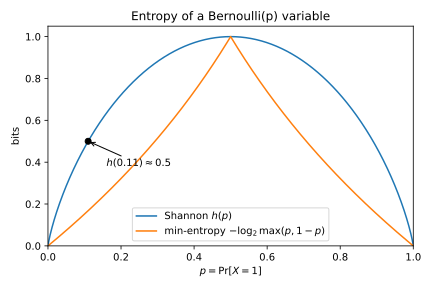

# Information theory

## Why this matters

You often observe one thing and want to know how much it tells you about another thing you cannot see. A word in an email, for example, hints at whether the email is spam. In the same way, a noisy sensor reading carries some trace of the true state of a machine, and a model's prediction is evidence about the true label. Information theory turns "how much" into a number, and it does so in two different ways, because you might be asking two different questions.

The first question is how many bits the observation saves you, on average, when you describe the hidden value. Shannon entropy and mutual information answer it. That makes them the language of compression, of the cross-entropy loss you train classifiers with, of decision-tree splits and of sending data over noisy links. The second question is how much more likely a single best guess becomes once you have seen the observation. Min-entropy and vulnerability answer that one, so they are the language of password strength, and of anyone who gets only one try.

Every quantity in this chapter is built from the logarithm of a probability. Shannon's quantities average that logarithm over all the outcomes, while the one-guess quantities look only at the most likely outcome. The two kinds of answer usually agree, but when a rare outcome reveals a lot, they can disagree wildly. One may rank an observation as the less revealing of two, while one guess against it succeeds a million billion times as often. So later parts of the book need to know which one to trust.

Logarithms in this chapter are base 2, so every quantity is in **bits**. [Divergences](03-divergences.md) uses natural logarithms instead, whose unit is the nat, and one nat is about 1.443 bits.

## Entropy {#sec-info-entropy}

A measure of uncertainty should give a fair coin one unit and two fair coins two units, and a coin that always lands heads none at all. Shannon entropy is the measure with these properties, and it is also the average number of bits that the best possible code needs to describe each value.

The construction starts from single outcomes. A rare outcome tells you more when it happens than a common one, so measure the information in an outcome by its **surprisal**, the logarithm of one over its probability. An outcome of probability one half then has a surprisal of 1 bit, one of probability one quarter has 2 bits, and a certain outcome has none. The logarithm is what makes two independent coins count twice, because their probabilities multiply and the logarithm turns that product into a sum.

Write $H(X)$ for the **entropy** of a random variable $X$, its average surprisal. Writing $p(x)$ for the probability that $X$ takes the value $x$, it is
$$H(X) = -\sum_x p(x)\log p(x),$$
where an outcome of probability zero adds nothing to the sum. For a coin that lands heads with probability $p$, the sum has two terms and is called the **binary entropy** $h(p)$. As @fig-binary-entropy shows, it is 1 bit for a fair coin and zero for a coin whose outcome is certain.

The binary entropy is very steep near the ends, which means it climbs quickly as the probability of heads moves away from 0. So even a quite lopsided coin keeps a lot of uncertainty. For example, a coin with an 11% chance of heads still carries $h(0.11) = 0.4999$ bits, about half a bit.

{#fig-binary-entropy}

Entropy has a floor and a ceiling. It cannot be negative, because no probability exceeds 1 and so no surprisal is negative, and it is zero only when one value is certain. For the ceiling, write $\lvert\mathcal X\rvert$ for the number of possible values. The entropy then lies between the two,
$$0 \le H(X) \le \log\lvert\mathcal X\rvert,$$
and it reaches the ceiling only when every value is equally likely. A uniform 4-digit PIN, for example, has $\log_2 10{,}000 = 13.2877$ bits.

The reason for the ceiling is a comparison with the uniform distribution, under which every value has the same surprisal, $\log\lvert\mathcal X\rvert$. The ceiling minus the entropy is the average gap between that surprisal and the true one. This average gap is the Kullback–Leibler (KL) divergence from the true distribution to the uniform one. [Divergences](03-divergences.md) shows that this divergence is never negative, and zero only when the two distributions are the same.

Entropy depends only on the probabilities, never on the values themselves. Calling the outcomes "red" and "blue" instead of 0 and 1 does not change it.

Two variables need two more quantities. The **joint entropy** $H(X, Y)$ is the entropy of the pair, computed from the table of joint probabilities. The **conditional entropy** $H(X \mid Y)$ is the uncertainty about $X$ that remains once you have seen $Y$. Once you see a particular value $y$, the uncertainty left is the entropy of the distribution of $X$ given that value. But before you observe $Y$, you do not know which value you will see. So the conditional entropy is the average of these entropies, weighted by how likely each $y$ is:
$$H(X \mid Y) = \sum_y p(y)\,H(X \mid Y = y).$$

The **chain rule** links the three. The uncertainty in the pair is the uncertainty in $Y$, plus whatever uncertainty about $X$ remains after that:
$$H(X, Y) = H(Y) + H(X \mid Y).$$ {#eq-chain-rule}
It holds because the probability of a pair is the probability of $y$ times the probability of $x$ given $y$. Taking logarithms turns this product into a sum of two surprisals, and the average of a sum is the sum of the averages, which here are $H(Y)$ and $H(X \mid Y)$. Applied again and again, the rule splits the uncertainty of many variables into one piece per variable, each piece being a variable's uncertainty given the ones before it.

Learning something should not make you more uncertain, and on average it does not. The conditional entropy $H(X \mid Y)$ is never larger than $H(X)$, and the two are equal only when the variables are independent, as the next section explains. But a particular observation can increase the uncertainty, as a spam filter shows.

Let $X$ be the label of an email, ham or spam, and let $Y$ say whether it contains the word "offer". One email in eight is spam, and every spam email contains the word, as does one ham email in seven. @tbl-spam gives the joint probabilities.

| | Word absent | Word present | Total |
| --- | --- | --- | --- |
| ham | 3/4 | 1/8 | 7/8 |
| spam | 0 | 1/8 | 1/8 |
| Total | 3/4 | 1/4 | |

: Joint distribution of an email's label and whether it contains the keyword. {#tbl-spam}

Before you read the email, it is spam with probability one in eight, so $H(X) = h(1/8) = 0.5436$ bits, which is low because most email is ham. If the word is absent, the email is certainly ham and no uncertainty is left. But if the word is present, ham and spam are equally likely, so the uncertainty is a full bit. In that case, seeing the word made you more uncertain than you were before.

On average, though, the word helps. It is absent three times in four, leaving no uncertainty, and present one time in four, leaving 1 bit. So $H(X \mid Y)$ is 0.25 bits, less than $H(X)$. The common observation settles the question, while the rare one only muddies it (@fig-conditioning). In short, conditioning reduces entropy on average, not for every observation.

{#fig-conditioning}

The same table checks the chain rule. The word is present with probability one quarter, so its entropy is $H(Y) = h(1/4) = 0.8113$ bits. Adding the 0.25 bits that remain about the label gives 1.0613 bits, which is the entropy of the pair, computed directly from the three non-zero cells of the table.

Entropy is also part of the loss you train classifiers with. The cross-entropy loss averages, over the true labels, the surprisal that the model's predicted probabilities assign to each label. That surprisal splits into two parts, the surprisal under the true label distribution plus the log ratio of the true probability to the predicted one. Averaged, the first part is the entropy of the true labels and the second is a KL divergence from the true distribution to the model's. No model can remove the entropy, so training can only drive down the divergence.

## Mutual information and data processing {#sec-info-mi}

How much does observing $Y$ tell you about $X$? A natural answer is the drop in uncertainty that it causes on average, which is called the **mutual information** and written $I(X; Y)$.

Mutual information can also be written as a KL divergence $D$ between two distributions of the pair. The first is the true joint distribution, written $P_{XY}$. The second is the product $P_XP_Y$ of the two separate distributions, which is what the joint distribution would be if $X$ and $Y$ were independent. The two forms give the same number:
$$I(X; Y) = H(X) - H(X \mid Y) = D\big(P_{XY}\,\big\|\,P_XP_Y\big).$$ {#eq-mi-kl}
A decision tree calls this quantity the **information gain** and uses it to choose a split, and many feature-selection methods use it to rank features.

The second form explains how mutual information behaves. It says that $Y$ helps exactly to the extent that the joint distribution differs from independence. Mutual information is therefore never negative, because a KL divergence is never negative, and that is why the conditional entropy can never exceed $H(X)$. It is zero only when $X$ and $Y$ are independent. It is also symmetric, because swapping the two variables changes neither $P_{XY}$ nor $P_XP_Y$, so $Y$ tells you exactly as much about $X$ as the other way round.

Mutual information measures dependence of any kind, not only linear correlation. Take a variable that is symmetric around zero and can take more than one size, such as a value from −2 to 2, together with its square. Their correlation is zero, yet the square is fully determined by the variable, so their mutual information is positive.

Sometimes you already know $Y$ and then learn a third variable, written $Z$. The **conditional mutual information** $I(X; Z \mid Y)$ is the further drop in uncertainty about $X$ that $Z$ causes. For each value of $Y$, take the KL divergence between the joint distribution of $X$ and $Z$ given that value and the product of their separate distributions given that value. The conditional mutual information is the average of these divergences, so it is never negative.

Revealing two variables one after the other gives a chain rule for mutual information, like the one for entropy. What the pair $(Y, Z)$ tells you about the hidden value is what $Y$ tells you, plus what $Z$ adds on top:
$$I(X; Y, Z) = I(X; Y) + I(X; Z \mid Y).$$

The chain rule leads to the most useful fact in this chapter, the **data-processing inequality**. Suppose $Z$ is computed from $Y$ alone, possibly with fresh randomness of its own. Then once you know $Y$, also knowing $X$ tells you nothing more about $Z$. This condition is written $X \to Y \to Z$. Then $Z$ cannot know more about the hidden value than $Y$ does:
$$I(X; Z) \le I(X; Y).$$
The reason is that the pair $(Y, Z)$ tells you the same amount about $X$ whichever of the two you reveal first. If you reveal $Y$ first, $Z$ adds nothing, because it was computed from $Y$. But if you reveal $Z$ first, $Y$ may still add something. So $Z$ alone carries at most what $Y$ carries. The condition is essential, since a $Z$ that also looked at the hidden value directly could know more about it than $Y$ does.

The two sides are equal only when $Y$ adds nothing about $X$ once $Z$ is known. Such a $Z$ keeps everything in $Y$ that matters for $X$, and is called a **sufficient statistic**. An invertible function of $Y$ is one, because you can compute $Y$ back from it.

For the spam filter, the word reduced the uncertainty from 0.5436 bits to 0.25 bits on average, so $I(X; Y) = 0.2936$ bits. Now suppose the word is detected by a sloppy tokenizer that gets the answer wrong 10% of the time, whatever the email. The tokenizer looks only at the word, not at the label, so the condition of the inequality holds. The full edition's script computes, from the joint table of label and tokenizer output, that the output keeps 0.1668 bits about the label. That is 57% of what the clean feature carries. So a 10% error rate in the detector costs over 40% of the information.

The data-processing inequality says that no function of the data, however clever, can contain more information about the source than the data itself. Denoising, feature extraction and training a model are all processing steps, which can make information easier to use but never larger. So a bound on what the raw observation reveals also covers everything anyone computes from it alone. [Divergences](03-divergences.md) gives its own data-processing inequality for KL divergence, and the one here follows from it.

Mutual information has a blind spot, because it is an average over all pairs of values. A small average can hide a few outcomes in which $Y$ gives $X$ away completely, because those outcomes carry little weight in the average. @sec-info-shannon-vs-min shows how large the gap can be.

## Channels and capacity {#sec-info-capacity}

A **channel** is a rule that turns an input into a random output. A noisy storage device, a communication link and a lossy sensor are all examples. Any channel can be written as a table, with one row per input, and each row gives the probability of each output for that input, so it sums to 1.

The channel fixes the noise, but you choose how often to send each input, and how much information gets through depends on that choice. The **capacity** of a channel is the largest mutual information between input and output, over all input distributions $P_X$:
$$\mathcal C = \max_{P_X} I(X; Y).$$

Shannon's channel coding theorem gives capacity a concrete meaning. It involves a **code**, a scheme that turns each block of data bits into a longer block of channel inputs. That added redundancy lets the receiver correct the noise. Capacity is exactly the highest rate, in data bits per channel use, at which long enough codes can send data with an error rate as small as you like. The full edition cites this theorem rather than proving it.

A basic noisy channel is the binary symmetric channel (BSC), which takes a bit and flips it with a fixed probability $p$. Its capacity is
$$\mathcal C_{\mathrm{BSC}}(p) = 1 - h(p),$$ {#eq-bsc-capacity}
and you reach it by sending 0 and 1 equally often, the uniform input. The formula says that the channel carries one bit, the most a binary output can hold, minus the entropy of the noise.

The reason is easiest to see from the symmetric form of mutual information, the uncertainty in the output minus the part of that uncertainty that comes from the noise:
$$I(X; Y) = H(Y) - H(Y \mid X).$$
The noise part is $h(p)$ whatever you send, because each input is flipped with the same probability. So to maximize the mutual information, you only have to make the output as uncertain as possible. A binary output has at most 1 bit of entropy, and the uniform input reaches that bit by making the output a fair coin.

@fig-bsc shows what the choice of input costs. On the left, each curve is the mutual information as a function of how often you send a 1. Every curve peaks at one half, and away from the peak you lose a lot. With a flip probability of 0.11, for example, sending a 1 only 20% of the time carries 0.3358 bits, against 0.5001 bits with the uniform input.

{#fig-bsc}

The right panel shows the capacity against the flip probability. It is zero at one half, where the output is a fair coin flip whatever the input, and it is symmetric around one half. A channel that almost always flips is as good as one that never flips, because the receiver can simply flip every output back.

Here is what this means in practice. A cheap storage medium flips each stored bit independently with probability 0.11, so each stored bit is one use of a binary symmetric channel, with a capacity of 0.5001 bits. That means good error-correcting codes can store about one bit of data in two raw bits, with an error rate as small as you like. No code can do better. At a flip probability of 0.25, the capacity drops to 0.1887 bits, so each data bit needs about five raw bits.

Most channels lack this symmetry, and their capacity has no closed form. The **Blahut–Arimoto** algorithm computes it numerically instead, by taking turns improving two things until neither changes. One is the input distribution, and the other is, for each output, the receiver's probabilities of each input given that output. The full edition's script uses it to confirm @eq-bsc-capacity.

## Min-entropy and one-guess leakage {#sec-info-min}

Shannon entropy counts the bits needed to describe a value on average. A guesser who gets one try asks something else, namely how likely the best single guess is to be right. The answer is the probability of the most likely value, because no other guess does better. Write $V(X)$ for that probability, the **vulnerability** of $X$. Its negative logarithm puts it on the same bit scale as entropy, and is the **min-entropy**:
$$V(X) = \max_x p(x), \qquad H_\infty(X) = -\log V(X).$$

Min-entropy is never larger than Shannon entropy,
$$H_\infty(X) \le H(X),$$
because Shannon entropy averages the surprisals of all outcomes, while min-entropy uses only the surprisal of the most likely outcome. That is the smallest surprisal, and an average is never below its smallest term. The two are equal only when every possible value is equally likely. Min-entropy also has a direct reading. A value with a min-entropy of $k$ bits is as hard to guess in one try as a uniform string of $k$ bits, however large its Shannon entropy is.

Both measures belong to one family, the **Rényi entropies**, in which each member has an order, a number that sets how much weight the most likely values get. As the order grows, the largest probability dominates more and more, and the limit is the min-entropy, while as the order approaches 1, the limit is Shannon entropy. [Divergences](03-divergences.md) has the matching family of divergences.

A PIN shows how far apart the two can be. A uniform 4-digit PIN has 13.2877 bits of both entropies. Now suppose that 10% of people choose 1234 and the rest choose uniformly among the other 9,999 PINs. The Shannon entropy barely moves, falling only to 12.4278 bits.

The chain rule says why, by describing the PIN in two steps. The first step says whether the PIN is 1234, and costs $h(0.1) = 0.4690$ bits on average. The second step is needed only in the 90% of cases where it is not, and says which of the other PINs it is. Averaged over all cases, it costs 11.9588 bits, almost as much as for a uniform PIN, and the two steps add up to 12.4278 bits. The min-entropy, by contrast, falls to 3.3219 bits, because the guess "1234" succeeds one time in ten. So if the guesser gets one try, only the second number matters.

Now let the guesser see an observation $Y$ before guessing the hidden value $X$, which this section calls the secret. The observation comes through a channel, written $C$, whose entry $C[x, y]$ is the probability of seeing $y$ when the secret is $x$. How likely each secret is to begin with is the **prior**, written $\pi$. The joint table then has entries $\pi(x)C[x, y]$, each the probability of the secret times the probability of the observation given that secret.

The best strategy guesses, for each observation, the secret that is most likely given that observation. This is the maximum a posteriori (MAP) guess, and its success probability is the **posterior vulnerability**. A guess for one observation does not affect the guesser's success on any other observation. So the guesser can pick the best cell in each column of the joint table separately, and its success is the sum of the cells it picked.

Dividing a column by its total gives the posterior, the distribution of the secret given that observation. Dividing does not change which entry is largest, so the largest entry in each column is the MAP guess. The posterior vulnerability is therefore the sum of these largest entries:
$$V(X \mid Y) = \sum_y\max_x \pi(x)C[x, y].$$ {#eq-posterior-vulnerability}
Its negative logarithm is the **conditional min-entropy**,
$$H_\infty(X \mid Y) = -\log V(X \mid Y).$$

The **min-entropy leakage**, written $\mathcal L$, compares the two vulnerabilities. It is the logarithm of the factor by which the observation multiplies the chance of a correct first guess:
$$\mathcal L = \log\frac{V(X \mid Y)}{V(X)}.$$
A leakage of 1 bit means the observation doubles the chance of a correct guess, and 2 bits means it quadruples it. An engineer can act on a statement like that. This is why min-entropy is the usual measure in quantitative information flow, the field that studies how much a program's outputs reveal about its secret inputs.

A small example shows each step. A secret takes four values, the first with prior probability 0.4 and each next value 0.1 less likely. An observation takes three values, through the channel in @tbl-guess-channel, and multiplying each row by its prior gives the joint table drawn in @fig-guessing.

| $C[x, y]$ | $y_1$ | $y_2$ | $y_3$ |
| --- | --- | --- | --- |
| $x_1$ | 0.8 | 0.2 | 0 |
| $x_2$ | 0.1 | 0.8 | 0.1 |
| $x_3$ | 0 | 0.5 | 0.5 |
| $x_4$ | 0 | 0.2 | 0.8 |

: The channel of the guessing example. Rows are secret values, columns are observations. {#tbl-guess-channel}

![The joint distribution $p(x, y) = \pi(x)C[x, y]$ of four secret values and three observations. The MAP guesser picks the boxed cell in each column, and its success probability is their sum $V(X \mid Y) = 0.66$.](figures/information_theory_guessing.svg){#fig-guessing}

Without the observation, the best guess is the first value, which is right with probability 0.4. With it, the guesser picks the boxed cell in each column and wins with probability 0.66, and a million simulated rounds agree, with a win rate of 0.6594. The conditional min-entropy is therefore $-\log_2 0.66 = 0.5995$ bits. The leakage is 0.7225 bits, which means the observation multiplies the chance of success by 1.65. For comparison, the Shannon leakage of the same table, its mutual information, is 0.6865 bits.

Since only the guesser's success probability counts, two tempting shortcuts give wrong answers. The first compares channel entries instead of joint entries. On the third observation, that shortcut would pick the fourth secret, because the fourth secret produces that observation more often. But the right guess is the third secret, which is twice as likely to begin with, and that more than makes up the difference.

The second shortcut takes the logarithm too early, by computing the min-entropy of the posterior after each observation and then averaging those values. That gives 0.6548 bits here, against 0.5995 bits for the conditional min-entropy. The correct version averages the success probabilities first and takes the logarithm last.

The two orders differ because the logarithm curves downward, so the logarithm of an average is never below the average of the logarithms. Min-entropy has a minus sign in front, which flips this, so the early version is never smaller than the correct one. More importantly, it is not the logarithm of any guesser's success rate.

The leakage depends on the prior. A skewed prior already makes the guess without the observation good, so the observation adds less. Often, though, you do not know the prior, and then you want the worst case over all priors. That worst case is the **min-capacity**, and it has a simple closed form:
$$\mathcal{ML}(C) = \log\sum_y\max_x C[x, y].$$ {#eq-min-capacity}
It is the logarithm of the sum of the column maxima of the channel itself, with no prior in it.

The reason comes in three steps. First, each entry of the joint table is a prior probability times a channel entry. So each column maximum of the joint table is at most the largest prior times the largest channel entry in that column.

Second, the largest prior is just the vulnerability $V(X)$ before any observation. Summing the first step over the columns therefore bounds the posterior vulnerability by $V(X)$ times the sum of the channel's column maxima,
$$V(X \mid Y) \le V(X)\sum_y\max_x C[x, y].$$
Dividing by $V(X)$ shows that the ratio in the leakage is at most that sum, whatever the prior.

Third, a uniform prior loses nothing in the first step, because every prior probability is then the largest one, so the uniform prior attains the bound. For the example, the min-capacity is 1.2630 bits, against a Shannon capacity of 0.8269 bits for the same channel. For the binary symmetric channel with flip probability 0.11, the min-capacity is 0.8319 bits, the dashed curve in @fig-bsc.

The min-capacity is never negative, since an observation never hurts the best guesser. It is also at most the logarithm of the number of observations, because each column maximum is at most 1. It is at most the logarithm of the number of secrets as well. Each column maximum is at most its column's total, and the totals of all the columns add up to the number of secrets, because each row sums to 1. Finally, computing it needs only one maximum per column, while the Shannon capacity needs an iterative algorithm.

## Shannon against min-entropy leakage {#sec-info-shannon-vs-min}

The Shannon leakage, which is the mutual information, and the min-entropy leakage both measure how much an observation reveals about a secret. They often agree, as they do for a channel that reveals the same bits on every outcome. When they disagree, though, the disagreement is large and always of one kind, with a channel that reveals the secret completely on a few outcomes and nothing on the rest.

Two families of channels make this concrete. Both act on a uniformly random secret, whose length in bits is written $n$, and both are deterministic, so their output is a fixed function of the secret. The first family always reveals the lowest $m$ bits of the secret, and for it both leakages equal $m$ bits. The second family reveals the whole secret, but only when its lowest $j$ bits are all zero, which happens with probability $2^{-j}$. Otherwise it outputs a fixed symbol that says nothing.

For the second family the two leakages part ways, because of where the logarithm sits. Shannon leakage averages the logarithm over outcomes, so the revealing outcome, which carries $n$ bits but has weight $2^{-j}$, contributes only about $2^{-j}n$ bits. Min-entropy leakage instead takes the logarithm of a success probability. The guesser wins whenever the reveal happens, so its success rises from $2^{-n}$ to just over $2^{-j}$, and the leakage is close to $n - j$ bits (@fig-leakage).

{#fig-leakage}

@tbl-two-channels compares two such channels on a 64-bit secret. Shannon leakage says the second channel leaks more, yet a guesser with one try does better against the first channel by a factor of more than $10^{15}$. Smith (2009) used a pair of programs like these to argue that Shannon leakage is the wrong measure for one-try guessing. So when the adversary gets one try, use min-entropy.

| Channel | Shannon leakage | Min-entropy leakage | One-guess success |
| --- | --- | --- | --- |
| Reveal all if the low 3 bits are zero | 8.1686 bits | 61.0000 bits | 0.1250 |
| Reveal the low 9 bits | 9.0000 bits | 9.0000 bits | $2.78\times10^{-17}$ |

: Shannon and min-entropy leakage of two deterministic channels on a uniform 64-bit secret. {#tbl-two-channels}

Min-entropy leakage has its own blind spot. Min-entropy itself looks only at the most likely value, but the posterior vulnerability averages the best guess's success over the observations. So the leakage, too, is an average over secrets and observations.

Take a channel that reveals a 4-bit secret only when it is all zeros. Its Shannon leakage is 0.3373 bits, while its min-entropy leakage is exactly 1 bit, because the guesser's chance of success doubles. The guesser wins whenever it sees the reveal, which happens one time in sixteen. Without the reveal, it guesses among the 15 other values and wins one time in fifteen, which adds another one in sixteen overall.

For a 32-bit secret, the Shannon leakage falls to $7.786\times10^{-9}$ bits, while the min-entropy leakage stays at 1 bit by the same doubling argument. Both numbers are small, yet for the one secret value made of zeros, the channel reveals everything. Any measure that averages over the secret can hide a value that is fully exposed, because that value carries only its small share of the average. Later parts build a measure for the worst case.

## Fano's inequality {#sec-info-fano}

Mutual information can also show that a problem is hard, which means that no estimator can beat some error rate. You need such a lower bound to know when to stop looking for a better method, and Fano's inequality is the basic tool. It says that if the secret is still uncertain after you have seen the observation, every guess must often be wrong. The reason is that a guesser who is usually right leaves little uncertainty about the secret.

Let the secret take one of $M$ values, and let a guess computed from the observation be wrong with probability $P_e$. Describing the secret once you know the guess then takes at most two pieces. The first piece says whether the guess was right, and is worth at most $h(P_e)$ bits. The second piece is needed only when the guess was wrong, and says which of the $M - 1$ other values is true, which takes at most $\log(M - 1)$ bits.

The guess sees only the observation, so by the data-processing inequality it knows no more about the secret than the observation does. The uncertainty $H(X \mid Y)$ that remains about the secret after the observation is therefore at most the uncertainty that remains after the guess, and the two pieces bound it:
$$H(X \mid Y) \le h(P_e) + P_e\log(M - 1).$$ {#eq-fano}

The right side grows as the error probability grows from zero, up to the error of a guesser who ignores the observation and picks uniformly. So you can find by bisection the smallest error probability that satisfies the inequality. A weaker form replaces $h(P_e)$ by its largest value of 1 bit, and $\log(M - 1)$ by the slightly larger $\log M$. That form you can solve by hand:
$$P_e \ge \frac{H(X \mid Y) - 1}{\log M}.$$ {#eq-fano-weak}

Here is how the bound is used. A label is uniform over 8 classes, so it has 3 bits of entropy. Suppose you know the features carry at most 1 bit about it, so that at least 2 bits of uncertainty remain. Then by Fano's inequality, every classifier, however it is trained, errs at least 0.3730 of the time, while the weak form gives 0.3333.

The same idea shows that estimating a parameter needs many samples. Pick $M$ candidate values for the parameter that are far apart, so that a good estimate would identify the right candidate. The secret is then which candidate is true, chosen uniformly at random, and if the samples carry little information about it, no estimator can identify it.

Write $\kappa$ for the largest KL divergence between the sample distributions of two candidates, measured in bits like $\log M$. One sample then carries at most $\kappa$ bits about the candidate, because this information is the average KL divergence from each candidate's distribution to the average of all of them. The average distribution is the closest single reference, so measuring against any one candidate instead can only increase the divergence, and no pairwise divergence exceeds $\kappa$.

The samples must be independent given the candidate, so that their information adds up to at most $n\kappa$ bits for $n$ samples. Dependent samples could reveal the candidate together while each one alone reveals little, and then the count would fail. With independent samples, at least $\log M - n\kappa$ bits of uncertainty remain, and putting this into the weak form gives
$$P_e \ge 1 - \frac{n\kappa + 1}{\log M}.$$
For example, take 1,024 candidates whose pairwise KL divergences are at most 0.01 bits. With 100 samples, every estimator still errs with probability at least 0.8000, and quadrupling the samples to 400 only brings this bound down to 0.5000. The art of this method lies in choosing candidates that are many and far apart, yet hard to tell apart from samples.

Fano's bound is tight only when a wrong guess leaves the truth spread evenly over the other values. A symmetric channel does exactly this, because it keeps its input with some probability and otherwise replaces it with one of the other symbols, each equally likely. For example, take 8 equally likely symbols, and a total probability of 0.2 that the channel replaces the input. The bound is then 0.2000, exactly the error of the best guesser (@fig-fano, left).

When errors go to one neighbour instead, little uncertainty remains after a wrong guess, and the bound becomes loose. Take a channel that shifts each of 8 equally likely symbols to the next one with probability 0.2. The best guesser still errs 0.2000 of the time, but Fano's bound is only 0.0954 (@fig-fano, right).

The weak form is worse, because it pays a full bit for $h(P_e)$. For the symmetric channel it gives 0.0945, and for the shift channel it gives a negative number, which says nothing. In general, the weak form is useless whenever at most 1 bit of uncertainty remains.

{#fig-fano}

## Code {#sec-info-code}

Everything about guessing comes from the joint table. This snippet computes the guessing example of @sec-info-min:

```python
from math import log2

prior = [0.4, 0.3, 0.2, 0.1]
channel = [  # channel[x][y] = probability of observation y given secret x
    [0.8, 0.2, 0.0],
    [0.1, 0.8, 0.1],
    [0.0, 0.5, 0.5],
    [0.0, 0.2, 0.8],
]


def joint(prior: list[float], channel: list[list[float]]) -> list[list[float]]:
    return [[px * c for c in row] for px, row in zip(prior, channel)]


def mutual_information(p: list[list[float]]) -> float:
    """Shannon leakage I(X; Y) in bits, from the joint table p[x][y]."""
    px = [sum(row) for row in p]
    py = [sum(col) for col in zip(*p)]
    return sum(
        pxy * log2(pxy / (px[x] * py[y]))
        for x, row in enumerate(p)
        for y, pxy in enumerate(row)
        if pxy > 0
    )


def posterior_vulnerability(p: list[list[float]]) -> float:
    """Success probability of the best one-shot guess after seeing y: sum of column maxima."""
    return sum(max(col) for col in zip(*p))


p = joint(prior, channel)
v_prior = max(prior)
v_post = posterior_vulnerability(p)
print(f"{v_prior:.4f} {v_post:.4f}")  # 0.4000 0.6600
print(f"{log2(v_post / v_prior):.4f}")  # 0.7225
print(f"{mutual_information(p):.4f}")  # 0.6865
print(f"{log2(sum(max(col) for col in zip(*channel))):.4f}")  # 1.2630
```

It prints the two vulnerabilities, the min-entropy leakage, the Shannon leakage and the min-capacity. The full edition's script [information_theory.py](../../code/part01-prerequisites/information_theory.py) computes every number in this chapter. Run it from the repository root:

```bash
uv run python code/part01-prerequisites/information_theory.py
```

## Cheat sheet

| Quantity | Formula | Notes |
| --- | --- | --- |
| Entropy | $H(X) = -\sum_x p(x)\log p(x)$ | $0 \le H \le \log\lvert\mathcal X\rvert$; uniform attains the maximum |
| Conditional entropy | $H(X \mid Y) = \sum_y p(y)H(X \mid Y = y)$ | $\le H(X)$ on average; one observation can raise it |
| Chain rule | $H(X, Y) = H(Y) + H(X \mid Y)$ | Extends to any number of variables |
| Mutual information | $I(X; Y) = H(X) - H(X \mid Y) = D(P_{XY}\,\Vert\,P_XP_Y)$ | Symmetric, $\ge 0$, zero iff independent |
| Data processing | $X \to Y \to Z$: $I(X; Z) \le I(X; Y)$ | Bound the raw observation |
| Capacity | $\max$ of $I(X; Y)$ over input distributions | BSC: $1 - h(p)$, at the uniform input |
| Vulnerability, min-entropy | $V(X) = \max_x p(x)$, $H_\infty = -\log V$ | $H_\infty \le H$; one-guess success |
| Posterior vulnerability | $V(X \mid Y) = \sum_y\max_x \pi(x)C[x, y]$ | Success of the MAP guesser |
| Min-entropy leakage | $\log V(X \mid Y)/V(X)$ | 1 bit doubles one-guess success |
| Min-capacity | $\log\sum_y\max_x C[x, y]$ | Worst case over priors, at the uniform prior |
| Fano | $H(X \mid Y) \le h(P_e) + P_e\log(M - 1)$ | Lower bound on any estimator's error; tight when errors spread evenly |

: The quantities of this chapter. {#tbl-info-cheat}

**Rules of thumb**

- Shannon quantities average logarithms. Min-entropy quantities take the logarithm of a best-case probability. Use the one that matches how many tries the adversary gets.
- Both are averages over the secret. Neither says how exposed a single secret value is.
- Processing never adds information. Bound what the raw observation reveals, and the bound covers everything computed from it.
- To show that every estimator must fail, bound the mutual information between the unknown and the data, then apply Fano.

## Further reading

- Cover & Thomas, *Elements of Information Theory* (2nd ed., 2006), ch. 2 and 7: the standard reference for every Shannon result here, including channel capacity and the channel coding theorem.
- MacKay, *Information Theory, Inference, and Learning Algorithms* (2003): the same material with a machine-learning slant, free online.
- Smith, "On the Foundations of Quantitative Information Flow" (FoSSaCS 2009): vulnerability, and why Shannon leakage is the wrong measure for one-try guessing.
- Alvim et al., *The Science of Quantitative Information Flow* (2020): the full theory of leakage and capacity.

**Derivations.** Most results in this chapter are derived step by step in [the full edition's chapter](../../book-full/part01-prerequisites/05-information-theory.md). It cites Shannon's channel coding theorem, and states a few facts without proof: the limits of the Rényi entropies, the split of the cross-entropy loss, and the Blahut–Arimoto algorithm.
