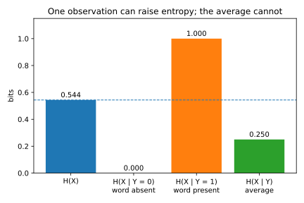

# Information theory

## Why this matters

How much does an observation tell you about something you cannot see, such as the word "offer" about whether an email is spam? There are two honest answers, because there are two questions. How many bits does the observation save you, on average, when you describe the hidden value? Shannon entropy and mutual information answer that. How much more likely is a single best guess to be right? Min-entropy and vulnerability answer that.

Every quantity here is the logarithm of a probability, and the two families differ only in where the logarithm sits: Shannon's quantities average the log over all outcomes, the one-guess quantities take the log of the best probability. Usually they agree. When a rare outcome reveals a lot they disagree by orders of magnitude, and knowing which to trust is the skill this chapter builds.

Logarithms are base 2, so quantities are in **bits**; one nat, the unit of natural logarithms, is $1/\ln 2 \approx 1.443$ bits.

## Entropy {#sec-info-entropy}

A measure of uncertainty should give a fair coin one unit and two independent fair coins two. Probabilities of independent events multiply, so to make uncertainties add you take a logarithm: an outcome of probability $p(x)$ has **surprisal** $\log(1/p(x))$, one bit for a fair coin's heads, nothing for a certainty. **Entropy** is the average surprisal,
$$H(X) = -\sum_x p(x)\log p(x), \qquad 0 \le H(X) \le \log\lvert\mathcal X\rvert,$$
zero for a constant and largest when all values are equally likely, since then no outcome is less surprising than another. For a coin with heads probability $p$ it is the **binary entropy** $h(p)$. The **conditional entropy** $H(X \mid Y) = \sum_y p(y)\,H(X \mid Y = y)$ is the uncertainty left after seeing $Y$, averaged over what you might see.

Take a spam filter. One email in eight is spam; every spam contains "offer", and so does one ham email in seven. Before reading, $H(X) = h(1/8) = 0.5436$ bits. If the word is absent the email is certainly ham: 0 bits. If it is present, which happens a quarter of the time, spam and ham are equally likely: a full bit, more than before. On average the word still helps, $H(X \mid Y) = 0.25$ bits, because the common observation settles the question and the rare one only muddies it (@fig-conditioning). So observing never increases uncertainty on average, $H(X \mid Y) \le H(X)$, but a particular observation can.

{#fig-conditioning}

## Mutual information and data processing {#sec-info-mi}

What $Y$ tells you about $X$ is the drop in uncertainty it causes, the **mutual information**
$$I(X; Y) = H(X) - H(X \mid Y) = D\big(P_{XY}\,\big\|\,P_XP_Y\big).$$
The second form, a Kullback–Leibler (KL) divergence ([Divergences](03-divergences.md)), says why it behaves as it does: $Y$ helps exactly to the extent that the joint distribution differs from what independence would give. So it is non-negative, zero only under independence, and symmetric. For the keyword, $I(X; Y) = 0.5436 - 0.25 = 0.2936$ bits.

The **data processing inequality** says that if $Z$ is computed from $Y$ alone, possibly with fresh randomness, then $I(X; Z) \le I(X; Y)$. $Z$ has no access to $X$ except through $Y$, so whatever it knows about $X$ it learned from $Y$, and the computation can only lose some on the way. Detect the keyword with a tokenizer that errs 10% of the time, and the feature keeps 0.1668 bits, 57% of the clean one. Denoising, feature extraction and training are all processing; they can make information easier to use, never larger. So a bound on the raw observation covers everything anyone computes from it.

But mutual information is an average over $x$ and $y$, and a small average can hide a few outcomes on which $Y$ gives $X$ away completely (@sec-info-shannon-vs-min).

## Min-entropy and one-guess leakage {#sec-info-min}

Someone with one guess does not care how many bits describe a value on average, only how likely their best guess is: the probability of the most likely value. That is the **vulnerability**, and its log the **min-entropy**,
$$V(X) = \max_x p(x), \qquad H_\infty(X) = -\log V(X) \le H(X).$$
A uniform 4-digit PIN has 13.2877 bits of both. If 10% of people choose 1234, the Shannon entropy barely moves, to 12.4278 bits, because the other 90% is still spread evenly and dominates the average. The min-entropy falls to 3.3219 bits: one guess in ten succeeds.

If the guesser sees $Y$ first, the best strategy is the **maximum a posteriori (MAP)** guess, the value most likely given $y$. On observation $y$ it wins with probability $\max_x p(x \mid y)$, and weighting by $p(y)$ gives the **posterior vulnerability**, the sum of the largest entry in each column of the joint table:
$$V(X \mid Y) = \sum_y\max_x p(x, y).$$
The **min-entropy leakage** $\mathcal L = \log\big(V(X \mid Y)/V(X)\big)$ is the factor by which the observation multiplies the chance of a correct first guess, in bits: 1 bit doubles it. For four secret values with prior $(0.4, 0.3, 0.2, 0.1)$, observed through the channel of @sec-info-code, a blind guess wins with probability 0.4 and the MAP guesser with 0.66 (@fig-guessing), a leakage of 0.7225 bits.

![The joint distribution $p(x, y) = \pi(x)C[x, y]$ of four secret values and three observations. The MAP guesser picks the boxed cell in each column, and its success probability is their sum $V(X \mid Y) = 0.66$.](figures/information_theory_guessing.svg){#fig-guessing}

Because the formula is a success probability, two shortcuts are wrong. The guesser compares joint probabilities, not channel entries $C[x, y] = p(y \mid x)$: on $y_3$ it picks $x_3$ over $x_4$, which produces $y_3$ more often, because $x_3$ is twice as likely to begin with. And the log comes after averaging: averaging per-observation min-entropies gives 0.6548 bits instead of 0.5995, a number that is no guesser's success rate. When you do not know the prior, use the worst case over priors, the **min-capacity** $\log\sum_y\max_x C[x, y]$, which needs only the channel: 1.2630 bits here.

## Shannon against min-entropy leakage {#sec-info-shannon-vs-min}

**Shannon leakage**, the mutual information, and min-entropy leakage agree when every outcome reveals the same amount: reveal the lowest $m$ bits of a uniform $n$-bit secret and both say $m$. They disagree when a channel reveals everything on a few outcomes and nothing on the rest. Suppose it reveals the whole secret when its lowest $j$ bits are zero, with probability $2^{-j}$. Shannon averages the log, so that outcome's $n$ bits count with weight $2^{-j}$: about $2^{-j}n$ in all. The guesser, though, now wins whenever the reveal happens, so the success rate jumps from $2^{-n}$ to more than $2^{-j}$, a min-entropy leakage close to $n - j$ (@fig-leakage).

{#fig-leakage}

In @tbl-two-channels, Shannon calls the first channel less leaky, yet a one-shot guesser does better against it by a factor of more than $10^{15}$. When the adversary gets one try, use min-entropy.

| Channel | Shannon leakage | Min-entropy leakage | One-guess success |
| --- | --- | --- | --- |
| Reveal all if the low 3 bits are zero | 8.1686 bits | 61.0000 bits | 0.1250 |
| Reveal the low 9 bits | 9.0000 bits | 9.0000 bits | $2.78\times10^{-17}$ |

: Shannon and min-entropy leakage of two deterministic channels on a uniform 64-bit secret. {#tbl-two-channels}

Both measures still average over the secret, so neither says how exposed one value is. Revealing a 32-bit secret only when it is all zeros leaks $7.786\times10^{-9}$ Shannon bits and 1 min-entropy bit, yet exposes that one value completely. Later parts build a worst-case measure.

## Fano's inequality {#sec-info-fano}

Mutual information can also show that no estimator beats some error rate. Suppose a guess of $X$ from $Y$ is wrong with probability $P_e$. The uncertainty left about $X$ is then at most the uncertainty about whether the guess is right, $h(P_e)$, plus, when it is wrong, which of the other $M - 1$ values is true:
$$H(X \mid Y) \le h(P_e) + P_e\log(M - 1), \qquad\text{so}\qquad P_e \ge \frac{H(X \mid Y) - 1}{\log M}.$$
Solve the left form numerically; the right form bounds $h(P_e)$ by 1 and is weaker. A label uniform over 8 classes (3 bits), with features carrying at most 1 bit, keeps at least 2 bits, so every classifier errs at least 0.3730 of the time (the weak form gives 0.3333).

For estimation, take $M$ candidate parameters whose sample distributions are within KL divergence $\kappa$ bits of each other: $n$ samples carry at most $n\kappa$ bits about which is true, so $P_e \ge 1 - (n\kappa + 1)/\log M$. With 1024 candidates and $\kappa = 0.01$, 100 samples leave $P_e \ge 0.8000$ and 400 leave $P_e \ge 0.5000$.

The bound is tight only when a wrong guess leaves the truth spread evenly over the other values. If errors go to one neighbour, little uncertainty remains after a wrong guess and Fano underestimates: shifting each of 8 symbols to its neighbour with probability 0.2 gives a bound of 0.0954 against a true MAP error of 0.2000.

## Code {#sec-info-code}

Everything in @sec-info-min comes from the joint table. This computes the guessing example:

```python
from math import log2

prior = [0.4, 0.3, 0.2, 0.1]
channel = [  # channel[x][y] = probability of observation y given secret x
    [0.8, 0.2, 0.0],
    [0.1, 0.8, 0.1],
    [0.0, 0.5, 0.5],
    [0.0, 0.2, 0.8],
]


def joint(prior: list[float], channel: list[list[float]]) -> list[list[float]]:
    return [[px * c for c in row] for px, row in zip(prior, channel)]


def mutual_information(p: list[list[float]]) -> float:
    """Shannon leakage I(X; Y) in bits, from the joint table p[x][y]."""
    px = [sum(row) for row in p]
    py = [sum(col) for col in zip(*p)]
    return sum(
        pxy * log2(pxy / (px[x] * py[y]))
        for x, row in enumerate(p)
        for y, pxy in enumerate(row)
        if pxy > 0
    )


def posterior_vulnerability(p: list[list[float]]) -> float:
    """Success probability of the best one-shot guess after seeing y: sum of column maxima."""
    return sum(max(col) for col in zip(*p))


p = joint(prior, channel)
v_prior = max(prior)
v_post = posterior_vulnerability(p)
print(f"{v_prior:.4f} {v_post:.4f}")  # 0.4000 0.6600
print(f"{log2(v_post / v_prior):.4f}")  # 0.7225
print(f"{mutual_information(p):.4f}")  # 0.6865
print(f"{log2(sum(max(col) for col in zip(*channel))):.4f}")  # 1.2630
```

It prints the two vulnerabilities, the min-entropy leakage, the Shannon leakage and the min-capacity. The full edition's script, [information_theory.py](../../code/part01-prerequisites/information_theory.py), computes every number in this chapter:

```bash
uv run python code/part01-prerequisites/information_theory.py
```

## Cheat sheet

| Quantity | Formula | Notes |
| --- | --- | --- |
| Entropy | $H(X) = -\sum_x p(x)\log p(x)$ | $0 \le H \le \log\lvert\mathcal X\rvert$ |
| Conditional entropy | $H(X \mid Y) = \sum_y p(y)H(X \mid Y = y)$ | $\le H(X)$ on average only |
| Mutual information | $I(X; Y) = H(X) - H(X \mid Y) = D(P_{XY}\,\Vert\,P_XP_Y)$ | Symmetric; zero iff independent |
| Data processing | $Z$ computed from $Y$: $I(X; Z) \le I(X; Y)$ | Bound the raw observation |
| Vulnerability, min-entropy | $V(X) = \max_x p(x)$, $H_\infty = -\log V$ | $H_\infty \le H$ |
| Posterior vulnerability | $V(X \mid Y) = \sum_y\max_x p(x, y)$ | Success of the MAP guesser |
| Min-entropy leakage | $\log V(X \mid Y)/V(X)$ | 1 bit doubles one-guess success |
| Min-capacity | $\log\sum_y\max_x C[x, y]$ | Worst case over priors |
| Fano | $H(X \mid Y) \le h(P_e) + P_e\log(M - 1)$ | Lower bound on any estimator's error |

: The quantities of this chapter. {#tbl-info-cheat}

**Rules of thumb**

- Shannon quantities average logs; min-entropy quantities take the log of a best-case probability. Use the one that matches how many tries the adversary gets.
- Both are averages over the secret; neither says how exposed a single value is.
- Bound the raw observation: processing never adds information.

## Further reading

- Cover & Thomas, *Elements of Information Theory* (2nd ed., 2006), ch. 2: the standard reference for every Shannon result here.
- MacKay, *Information Theory, Inference, and Learning Algorithms* (2003): the same with a machine-learning slant, free online.
- Smith, "On the Foundations of Quantitative Information Flow" (FoSSaCS 2009): vulnerability, and why Shannon leakage is the wrong measure for one-try guessing.
- Alvim et al., *The Science of Quantitative Information Flow* (2020): the full theory of leakage and capacity.

**Derivations.** Every result in this chapter is derived step by step in [the full edition's chapter](../../book-full/part01-prerequisites/05-information-theory.md).
